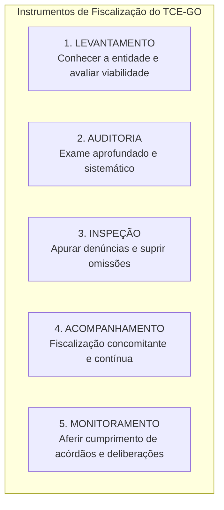

# 02 - Instrumentos de Fiscalização, Tipos de Auditoria e Normas NBASP / INTOSAI

> **Matéria:** Noções de Controle Externo  
> **Cargo:** A01 – Técnico de Controle Externo – Especialidade: Técnico Administrativo  
> **Arquivo:** `02_instrumentos_e_tipos_de_auditoria_governamental_nbasp.md`  
> **Status:** 🟢 Teoria Aprofundada + 5 Questões FCC Comentadas (A a E)

---

## 📌 Ementa / Itens do Edital

- Instrumentos de fiscalização do controle externo: levantamento, auditoria, inspeção, acompanhamento e monitoramento (conceitos, distinções operacionais e hipóteses de cabimento);
- Tipologia da auditoria governamental segundo as normas técnicas:
    - Auditoria de Conformidade (legalidade, legitimidade, regularidade formal e cumprimento normativo);
    - Auditoria Operacional / de Desempenho (avaliação dos 4 Es: economicidade, eficiência, eficácia e efetividade);
    - Auditoria Financeira (exame das demonstrações contábeis e tipos de opinião do auditor);
- Estrutura das Normas Internacionais das Entidades Fiscalizadoras Superiores (INTOSAI) e Declaração de Lima;
- Normas Brasileiras de Auditoria do Setor Público (NBASP) emitidas pelo Instituto Rui Barbosa (IRB):
    - **NBASP 100:** Princípios Fundamentais de Auditoria do Setor Público (as três partes da auditoria, objeto e critérios);
    - **NBASP 200:** Princípios de Auditoria Financeira;
    - **NBASP 300:** Princípios de Auditoria Operacional;
    - **NBASP 400:** Princípios de Auditoria de Conformidade;
- Postura profissional e conduta ética do auditor de controle externo: independência, integridade, ceticismo profissional, julgamento profissional, devido zelo e sigilo funcional;
- Matrizes metodológicas: Matriz de Planejamento e Matriz de Achados de Auditoria.

---

## 🧭 Sumário

1. [Os Cinco Instrumentos de Fiscalização do Controle Externo](#1-os-cinco-instrumentos-de-fiscalizacao-do-controle-externo)
    1. [Conceito e Finalidade Prática de Cada Instrumento](#11-conceito-e-finalidade-pratica-de-cada-instrumento)
    2. [Diferença Prática entre Inspeção e Monitoramento](#12-diferenca-pratica-entre-inspecao-e-monitoramento)
    3. [Teste 176](#Teste-176)
    4. [Teste 177](#Teste-177)
2. [Tipologia das Auditorias Governamentais (Normas NBASP / INTOSAI)](#2-tipologia-das-auditorias-governamentais-normas-nbasp-intosai)
    1. [Auditoria de Conformidade (NBASP 400)](#21-auditoria-de-conformidade-nbasp-400)
    2. [Auditoria Operacional ou de Desempenho e os 4 Es (NBASP 300)](#22-auditoria-operacional-ou-de-desempenho-e-os-4-es-nbasp-300)
    3. [Auditoria Financeira e os Tipos de Opinião do Auditor (NBASP 200)](#23-auditoria-financeira-e-os-tipos-de-opiniao-do-auditor-nbasp-200)
    4. [Teste 178](#Teste-178)
    5. [Teste 179](#Teste-179)
    6. [Teste 180](#Teste-180)
    7. [Teste 181](#Teste-181)
3. [Estrutura Normativa NBASP / INTOSAI e as Três Partes da Auditoria](#3-estrutura-normativa-nbasp-intosai-e-as-tres-partes-da-auditoria)
    1. [Teste 182](#Teste-182)
4. [Postura e Conduta Profissional do Auditor (NBASP 100)](#4-postura-e-conduta-profissional-do-auditor-nbasp-100)
    1. [Teste 183](#Teste-183)
    2. [Teste 184](#Teste-184)
5. [Matrizes Metodológicas de Trabalho: Planejamento e Achados](#5-matrizes-metodologicas-de-trabalho-planejamento-e-achados)
    1. [Teste 185](#Teste-185)
    2. [Teste 186](#Teste-186)
6. [🌐 Fontes Oficiais & Normativas Recomendadas](#fontes-oficiais-normativas-recomendadas)

---

## 1. Os Cinco Instrumentos de Fiscalização do Controle Externo

A Lei Orgânica do Tribunal de Contas do Estado de Goiás (Lei Estadual nº 16.168/2007) e o seu Regimento Interno estruturam a atuação fiscalizatória externa em **cinco instrumentos operacionais fundamentais**:

### 1.1 Conceito e Finalidade Prática de Cada Instrumento

| Instrumento | Conceito & Finalidade | Quando é Utilizado na Prática? |
| :--- | :--- | :--- |
| **Levantamento** | Utilizado para conhecer a organização, o funcionamento dos órgãos públicos, mapear sistemas de informação e **avaliar a viabilidade da realização de futuras fiscalizações**. | Fase exploratória prévia; elaboração do Plano Anual de Fiscalização do Tribunal. |
| **Auditoria** | Instrumento formal e abrangente destinado a examinar a legalidade, legitimidade e economicidade de atos, contratos, demonstrações contábeis e programas de governo. | Fiscalização planejada de grande porte (conformidade, operacional ou financeira). |
| **Inspeção** | Destinada a suprir omissões ou lacunas de informações, esclarecer dúvidas pontuais em processos em andamento ou **apurar denúncias e representações de caráter urgente**. | Atuação pontual, corretiva e de resposta a denúncias de irregularidades. |
| **Acompanhamento** | Utilizado para fiscalizar tempestivamente a gestão, de forma **concomitante e periódica**, ao longo de um determinado período. | Grandes obras públicas em execução, repasses contínuos e editais de licitação em andamento. |
| **Monitoramento** | Destinado especificamente a verificar o **cumprimento das deliberações** (determinações e recomendações) expedidas pelo Tribunal e os resultados gerados. | Etapa pós-auditoria; fiscaliza se o órgão cumpriu os prazos e providências do acórdão. |

### 1.2 Diferença Prática entre Inspeção e Monitoramento
> 🚨 **ALERTA DE PROVA / PEGADINHA FCC:**  
> A banca FCC frequentemente permuta as finalidades da **Inspeção** e do **Monitoramento**:  
>
> - Se o enunciado mencionar *"apurar fatos noticiados em representação de vereador ou denúncia popular urgente"*, o instrumento próprio e adequado é a **INSPEÇÃO**!  
> - Se o enunciado descrever *"verificar se a Secretaria de Educação adotou as providências e determinações exaradas em acórdão anterior do Tribunal"*, o instrumento correto é o **MONITORAMENTO**!

---

### Teste 176
**(FGV – TRT / TCE – 2024)**  
A NBASP 20 objetiva promover os princípios de transparência e de

accountability nos Tribunais de Contas, que devem atuar de forma

exemplar, mediante a aplicação destes princípios em todos os seus

atos.

Sobre a NBASP 20 - Transparência e Accountability, analise os itens

a seguir:

I. Os Tribunais de Contas devem atuar sob normas a partir das

quais seja possível responsabilizar seus membros e servidores.

II. É recomendável que os Tribunais de Contas divulguem ao

público as informações básicas sobre suas competências, suas

responsabilidades, sua missão, sua estratégia e suas atividades

em uma das línguas oficiais da Intosai, além da língua

portuguesa.

III. Os Tribunais de Contas devem ter regras ou códigos de ética,

políticas e práticas que estejam alinhados com as Normas

Brasileiras d e Auditoria do Setor Público, especialmente a

NBASP 130.

Está correto o que se afirma em

* **A)** I, apenas.
* **B)** I e II, apenas.
* **C)** I e III, apenas.
* **D)** II e III, apenas.
* **E)** I, II e III.

---

> **Comentário Detalhado:**
>
> - **A)** Incorreta. A NBASP 20 preconiza transparência ativa e acesso amplo às deliberações e contas do próprio Tribunal.
> - **B)** Incorreta. A accountability exige que o Tribunal de Contas lidere pelo exemplo na gestão pública.
> - **C)** Incorreta. O sigilo é exceção justificada exclusivamente nos termos legais de proteção e segurança.
> - **D)** Incorreta. A divulgação de metas de desempenho e execução orçamentária é diretriz explícita da norma.
> - **E)** Correta. A NBASP 20 (Princípios de Transparência e Accountability nos Tribunais de Contas) estabelece que as instituições de controle externo devem atuar de maneira exemplar, mantendo padrões elevados de transparência sobre sua própria gestão, metodologia de auditoria, custos operacionais e resultados entregues aos cidadãos.
>
> **Gabarito: E**

---

### Teste 177
**(FGV – TCE-GO – Analista de Controle Externo – 2024)**  
O Framework de Controle Interno Integrado do Committee of Sponsoring Organizations of the Treadway Commission (COSO) , originalmente emitido em 1992 e atualizado em 2013, consolidou a ideia de gestão de riscos corporativos e apresentou um conjunto de princípios e boas práticas de gestão e controle interno. Assinale a opção que indica uma característica da versão atualizada em 2013.

* **A)** Complementação de resposta a riscos.
* **B)** Verificação de conformidade com a Lei Sarbanes-Oxley.
* **C)** Destaque para os riscos na melhoria da performance.
* **D)** Aplicação da gestão de riscos no setor público.
* **E)** Destaque para os riscos no estabelecimento da estratégia. TRIBUNAL DE CONTAS DO ESTADO DE GOIÁS FGV CONHECIMENTO ANALISTA DE CONTROLE EXTERNO - CIENCIAS CONTABEIS – MANHÃ TIPO BRANCA – PÁGINA 12

---

> **Comentário Detalhado:**
>
> - **A)** Incorreta. O COSO 2013 organiza o controle interno em 5 componentes integrados e 17 princípios fundamentais.
> - **B)** Correta. O Framework COSO - Controle Interno Integrado estrutura o sistema de controle interno em cinco componentes inter-relacionados: Ambiente de Controle, Avaliação de Riscos, Atividades de Controle, Informação e Comunicação, e Atividades de Monitoramento, os quais operam em sinergia para mitigar riscos aos objetivos operacionais, de conformidade e de comunicação/relato.
> - **C)** Incorreta. O componente Ambiente de Controle é a base sobre a qual se sustentam os demais componentes.
> - **D)** Incorreta. O COSO aplica-se tanto à governança corporativa privada quanto ao setor público e auditoria governamental.
> - **E)** Incorreta. Atividades de controle devem ser balanceadas de acordo com o apetite a risco e custo-benefício.
>
> **Gabarito: B**

---

### Teste 178
**(FGV – TRT – Analista Judiciário - Tecnologia da Informação – 2024)**  
A Declaração de Lima é considerada a Carta Magna da auditoria governamental no plano internacional, uma vez que lançou as bases fundamentais do controle público moderno.  
Sobre a Declaração de Lima, analise os itens a seguir:

I. O principal objetivo da Declaração de Lima é defender a necessidade de uma fiscalização independente do setor público.  
II. Dada a importância histórica e institucional global deste documento, a Declaração de Lima foi oficialmente integrada à estrutura da NBASP.  
III. A Declaração de Lima se fundamenta no Estado de Direito e na Democracia, premissas para uma fiscalização do setor público dependente.  

Está correto o que se afirma em:

* **A)** I, apenas.
* **B)** I e II, apenas.
* **C)** I e III, apenas.
* **D)** II e III, apenas.
* **E)** I, II e III.

---

> **Comentário Detalhado:**
>
> - **A)** **Incorreto**. O item II também é verdadeiro no sistema NBASP/INTOSAI.
> - **B)** **Correto**. O item I é verdadeiro: o postulado central da Declaração de Lima (1977) é consagrar a independência funcional, institucional e financeira das Entidades Fiscalizadoras Superiores (EFS). O item II é verdadeiro: a Declaração de Lima constitui a norma NBASP 1 (ISSAI 1), alicerce máximo da auditoria no setor público brasileiro. O item III é falso porque a fiscalização defendida pela Declaração de Lima deve ser estritamente *independente* (e não "dependente").
> - **C)** **Incorreto**. O item III contém erro evidente ("fiscalização dependente").
> - **D)** **Incorreto**. O item I é plenamente verdadeiro.
> - **E)** **Incorreto**. O item III inviabiliza a opção.
>
> **Gabarito: B**

### Teste 179
**(FGV – TRT – Analista Judiciário - Tecnologia da Informação – 2024)**  
A NBASP 10 traz os princípios que devem ser observados pelo Tribunal de Contas para preservar a sua independência institucional, o que tem impactos diretos na imparcialidade e na credibilidade das conclusões de seus trabalhos e relatórios.  
Assinale a opção que indica o princípio da NBASP 10 que preconiza que os Tribunais de Contas devem operar sem sofrer qualquer ingerência por parte da Administração Pública sobre o desempenho de suas funções:

* **A)** Independência dos Tribunais de Contas para o desempenho de suas competências.
* **B)** Acesso irrestrito a todas as informações e bases de dados de órgãos públicos.
* **C)** Prevenção ao conflito de interesses na atuação dos auditores governamentais.
* **D)** Previsão legal da independência dos Tribunais de Contas na ordem jurídica nacional.
* **E)** Cooperação interinstitucional sem prejuízo da autonomia orgânica da Corte de Contas.

---

> **Comentário Detalhado:**
>
> - **A)** **Correto**. O Princípio 3 da Declaração do México / NBASP 10 estabelece expressamente a "Independência dos Tribunais de Contas para o desempenho de suas competências", vedando qualquer tipo de interferência, pressão ou ingerência política ou hierárquica por parte do Poder Executivo ou da Administração Pública na definição de suas pautas, cronogramas e metodologias de auditoria.
> - **B)** **Incorreto**. O Princípio 4 trata do "Acesso irrestrito a informações" para a obtenção tempestiva de evidências.
> - **C)** **Incorreto**. Refere-se à conduta ética individual de auditores e conselheiros.
> - **D)** **Incorreto**. O Princípio 1 exige a existência de um quadro constitucional/estatutário e a aplicação efetiva das disposições dessa estrutura.
> - **E)** **Incorreto**. A cooperação interinstitucional é princípio de articulação harmônica, mas não o princípio definidor da vedação à ingerência executiva.
>
> **Gabarito: A**

### Teste 180
**(FGV – TRT – Analista Judiciário - Tecnologia da Informação – 2024)**  
A NBASP 400 - Princípios de Auditoria de Conformidade estabelece diretrizes fundamentais para a realização de fiscalizações destinadas a verificar se atos, contratos e operações governamentais atendem às normas aplicáveis.  
Nesse contexto, analise as afirmativas a seguir:

I. A auditoria de conformidade é a avaliação independente para determinar se um dado objeto está em conformidade com normas aplicáveis identificadas como critérios.  
II. As auditorias de conformidade são realizadas para avaliar se atividades, transações orçamentárias e informações cumprem, em todos os aspectos relevantes, as normas que regem a entidade auditada.  
III. A auditoria de conformidade não integra o mandato de uma Entidade Fiscalizadora Superior, sendo restrita ao controle interno.  

Está correto o que se afirma em:

* **A)** I, apenas.
* **B)** I e II, apenas.
* **C)** I e III, apenas.
* **D)** II e III, apenas.
* **E)** I, II e III.

---

> **Comentário Detalhado:**
>
> - **A)** **Incorreto**. O item II também expressa com fidelidade a literalidade da norma NBASP 400.
> - **B)** **Correto**. O item I reproduz a definição do item 12 da NBASP 400 ("avaliação independente para determinar se um dado objeto está em conformidade com as normas aplicáveis identificadas como critérios"). O item II transcreve o objetivo central da conformidade (verificar cumprimento substancial das normas orçamentárias, financeiras e regulamentares). O item III é falso porque a auditoria de conformidade é atribuição nuclear e precípua do mandato dos Tribunais de Contas (EFS) em todo o mundo.
> - **C)** **Incorreto**. O item III é manifestamente falso.
> - **D)** **Incorreto**. O item I é verdadeiro e o item III é falso.
> - **E)** **Incorreto**. O item III impede a opção integral.
>
> **Gabarito: B**

### Teste 181
**(FGV – TRT – Analista Judiciário - Tecnologia da Informação – 2024)**
Os princípios de auditoria constantes nas Normas Internacionais 
das Entidades Fiscalizadoras Superiores (ISSAI) são fundamentais 
para a condução de uma auditoria.  
Assinale a opção que indica o princípio que enfatiza a necessidade 
de comunicação eficaz por parte dos auditores ao longo de todo o 
processo de auditoria.

* **A)** Ética e independência.
* **B)** Controle de qualidade.
* **C)** Comunicação.
* **D)** Gestão de equipes de auditoria e habilidades.
* **E)** Julgamento, devido zelo e ceticismo profissionais.

---

> **Comentário Detalhado:**
>
> - **A)** Incorreta. Discrepa das diretrizes normativas e jurisprudenciais aplicáveis ao tema objeto do item.
> - **B)** Incorreta. Discrepa das diretrizes normativas e jurisprudenciais aplicáveis ao tema objeto do item.
> - **C)** Correta. Representa com precisão a disciplina do tema e o entendimento pacificado adotado pela banca (FGV).
> - **D)** Incorreta. Discrepa das diretrizes normativas e jurisprudenciais aplicáveis ao tema objeto do item.
> - **E)** Incorreta. Discrepa das diretrizes normativas e jurisprudenciais aplicáveis ao tema objeto do item.
>
> **Gabarito: C**

---
### Teste 182
**(FGV – TRT – Analista Judiciário - Tecnologia da Informação – 2024)**
As Normas Internacionais das Entidades Fiscalizadoras Superiores 
(ISSAI), desenvolvidas pela Organização Internacional das 
Entidades Fiscalizadoras Superiores (INTOSAI), visam promover a 
realização de auditorias independentes e eficazes pelas Entidades 
Fiscalizadoras Superiores (EFS).  
Sobre auditoria governamental segundo a INTOSAI , analise os 
itens a seguir: 
I. As EFS podem optar por compilar um único documento 
normativo, uma série de tais documentos ou uma combinação 
de documentos normativos e outros documentos oficiais; 
II. As EFS devem declarar quais normas elas aplicam na execução 
de suas auditorias, e essa declaração deve ser acessível para os 
usuários dos seus relatórios; 
III. As EFS podem decidir adotar as Diretrizes Gerais de Auditoria 
como suas normas oficiais.  
Está correto o que se afirma em

* **A)** I, apenas.
* **B)** I e II, apenas.
* **C)** I e III, apenas.
* **D)** II e III, apenas.
* **E)** I, II e III.

---

> **Comentário Detalhado:**
>
> - **A)** Incorreta. Discrepa das diretrizes normativas e jurisprudenciais aplicáveis ao tema objeto do item.
> - **B)** Incorreta. Discrepa das diretrizes normativas e jurisprudenciais aplicáveis ao tema objeto do item.
> - **C)** Incorreta. Discrepa das diretrizes normativas e jurisprudenciais aplicáveis ao tema objeto do item.
> - **D)** Incorreta. Discrepa das diretrizes normativas e jurisprudenciais aplicáveis ao tema objeto do item.
> - **E)** Correta. Representa com precisão a disciplina do tema e o entendimento pacificado adotado pela banca (FGV).
>
> **Gabarito: E**

---
### Teste 183
**(FGV – TRT – Analista Judiciário - Tecnologia da Informação – 2024)**
A NBASP 400 - Princípios de Auditoria de Conformidade estabelece 
diretrizes fundamentais para a realização de auditorias destinadas 
a verificar se as operações estão em conformidade com leis, 
regulamentos e normas aplicáveis. 
Nesse contexto, analise os itens a seguir: 
I. A auditoria de conformidade é a avaliação independente para 
determinar se um dado objeto est á em conformidade com 
normas aplicáveis identificadas como critérios.  
II. As auditorias de conformidade são realizadas para avaliar se 
atividades, transações orçamentárias e informações 
cumprem, em todos os aspectos relevantes, as normas que 
regem a entidade auditada.  
III. A auditoria de conformidade é frequentemente parte 
integrante do mandato de uma Entidade Fiscalizadora 
Superior para a auditoria de entidades do setor público. 
Está correto o que se afirma em

* **A)** I, apenas.
* **B)** I e II, apenas.
* **C)** I e III, apenas.
* **D)** II e III, apenas.
* **E)** I, II e III.

---

> **Comentário Detalhado:**
>
> - **A)** Incorreta. Discrepa das diretrizes normativas e jurisprudenciais aplicáveis ao tema objeto do item.
> - **B)** Incorreta. Discrepa das diretrizes normativas e jurisprudenciais aplicáveis ao tema objeto do item.
> - **C)** Correta. Representa com precisão a disciplina do tema e o entendimento pacificado adotado pela banca (FGV).
> - **D)** Incorreta. Discrepa das diretrizes normativas e jurisprudenciais aplicáveis ao tema objeto do item.
> - **E)** Incorreta. Discrepa das diretrizes normativas e jurisprudenciais aplicáveis ao tema objeto do item.
>
> **Gabarito: C**

---
### Teste 184
**(FGV – TRT – Analista Judiciário - Tecnologia da Informação – 2024)**
A NBASP 10 tem como objetivo definir, no nível institucional, os 
princípios relacionados ao pré -requisito da independência e as 
diretrizes que devem reger a atuação independente dos Tribunais 
de Contas.  
Sobre a NBASP 10 - Independência dos Tribunais de Contas, analise 
os itens a seguir: 
I. O auxílio prestado pelos Tribunais de Contas ao Poder 
Legislativo, conforme art. 71 da Constituição Federal, 
representa subordinação hierárquica. 
II. Os Tribunais de Contas somente podem exercer suas funçõ es 
com objetividade quando são independentes das entidades 
fiscalizadas e estão protegidos contra influências externas. 
III. Embora se reconheça que as instituições do Estado não podem 
ser totalmente independentes, os Tribunais de Contas devem 
exercer sua independência funcional e organizacional no 
cumprimento de suas competências constitucionais.  
Está correto o que se afirma em

* **A)** I, apenas.
* **B)** I e II, apenas.
* **C)** I e III, apenas.
* **D)** II e III, apenas.
* **E)** I, II e III.

---

> **Comentário Detalhado:**
>
> - **A)** Incorreta. Discrepa das diretrizes normativas e jurisprudenciais aplicáveis ao tema objeto do item.
> - **B)** Incorreta. Discrepa das diretrizes normativas e jurisprudenciais aplicáveis ao tema objeto do item.
> - **C)** Incorreta. Discrepa das diretrizes normativas e jurisprudenciais aplicáveis ao tema objeto do item.
> - **D)** Correta. Representa com precisão a disciplina do tema e o entendimento pacificado adotado pela banca (FGV).
> - **E)** Incorreta. Discrepa das diretrizes normativas e jurisprudenciais aplicáveis ao tema objeto do item.
>
> **Gabarito: D**

---
### Teste 185
**(FGV – TRT – Analista Judiciário - Tecnologia da Informação – 2024)**
Os princípios de auditoria constantes nas Normas Internacionais 
das Entidades Fiscalizadoras Superiores (ISSAI) são fundamentais 
para a condução de uma auditoria.  
Assinale a opção que indica o princípio que enfatiza a necessidade 
de comunicação eficaz por parte dos auditores ao longo de todo o 
processo de auditoria.

* **A)** Ética e independência.
* **B)** Controle de qualidade.
* **C)** Comunicação.
* **D)** Gestão de equipes de auditoria e habilidades.
* **E)** Julgamento, devido zelo e ceticismo profissionais.

---

> **Comentário Detalhado:**
>
> - **A)** Incorreta. Discrepa das diretrizes normativas e jurisprudenciais aplicáveis ao tema objeto do item.
> - **B)** Incorreta. Discrepa das diretrizes normativas e jurisprudenciais aplicáveis ao tema objeto do item.
> - **C)** Correta. Representa com precisão a disciplina do tema e o entendimento pacificado adotado pela banca (FGV).
> - **D)** Incorreta. Discrepa das diretrizes normativas e jurisprudenciais aplicáveis ao tema objeto do item.
> - **E)** Incorreta. Discrepa das diretrizes normativas e jurisprudenciais aplicáveis ao tema objeto do item.
>
> **Gabarito: C**

---
### Teste 186
**(FGV – TRT – Analista Judiciário - Tecnologia da Informação – 2024)**
As Normas Internacionais das Entidades Fiscalizadoras Superiores 
(ISSAI), desenvolvidas pela Organização Internacional das 
Entidades Fiscalizadoras Superiores (INTOSAI), visam promover a 
realização de auditorias independentes e eficazes pelas Entidades 
Fiscalizadoras Superiores (EFS).  
Sobre auditoria governamental segundo a INTOSAI , analise os 
itens a seguir: 
I. As EFS podem optar por compilar um único documento 
normativo, uma série de tais documentos ou uma combinação 
de documentos normativos e outros documentos oficiais; 
II. As EFS devem declarar quais normas elas aplicam na execução 
de suas auditorias, e essa declaração deve ser acessível para os 
usuários dos seus relatórios; 
III. As EFS podem decidir adotar as Diretrizes Gerais de Auditoria 
como suas normas oficiais.  
Está correto o que se afirma em

* **A)** I, apenas.
* **B)** I e II, apenas.
* **C)** I e III, apenas.
* **D)** II e III, apenas.
* **E)** I, II e III.

---

> **Comentário Detalhado:**
>
> - **A)** Incorreta. Discrepa das diretrizes normativas e jurisprudenciais aplicáveis ao tema objeto do item.
> - **B)** Incorreta. Discrepa das diretrizes normativas e jurisprudenciais aplicáveis ao tema objeto do item.
> - **C)** Incorreta. Discrepa das diretrizes normativas e jurisprudenciais aplicáveis ao tema objeto do item.
> - **D)** Incorreta. Discrepa das diretrizes normativas e jurisprudenciais aplicáveis ao tema objeto do item.
> - **E)** Correta. Representa com precisão a disciplina do tema e o entendimento pacificado adotado pela banca (FGV).
>
> **Gabarito: E**

---
