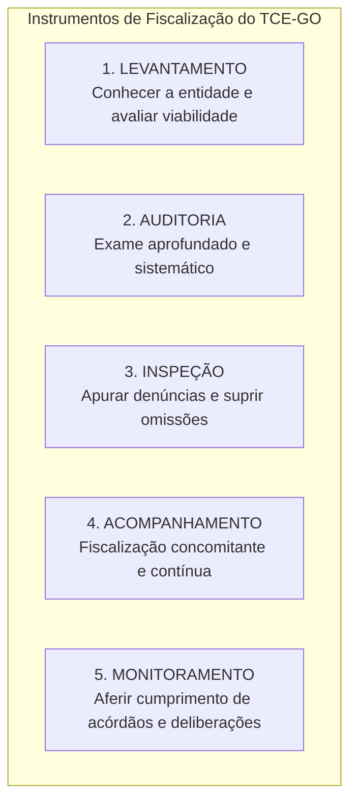

# 02 - Instrumentos de Fiscalização, Tipos de Auditoria e Normas NBASP / INTOSAI

> **Matéria:** Noções de Controle Externo  
> **Cargo:** A01 – Técnico de Controle Externo – Especialidade: Técnico Administrativo  
> **Arquivo:** `02_instrumentos_e_tipos_de_auditoria_governamental_nbasp.md`  
> **Status:** 🟢 Teoria Aprofundada + 5 Questões FCC Comentadas (A a E)

---

## 📌 Ementa / Itens do Edital

- Instrumentos de fiscalização do controle externo: levantamento, auditoria, inspeção, acompanhamento e monitoramento (conceitos, distinções operacionais e hipóteses de cabimento);
- Tipologia da auditoria governamental segundo as normas técnicas:
    - Auditoria de Conformidade (legalidade, legitimidade, regularidade formal e cumprimento normativo);
    - Auditoria Operacional / de Desempenho (avaliação dos 4 Es: economicidade, eficiência, eficácia e efetividade);
    - Auditoria Financeira (exame das demonstrações contábeis e tipos de opinião do auditor);
- Estrutura das Normas Internacionais das Entidades Fiscalizadoras Superiores (INTOSAI) e Declaração de Lima;
- Normas Brasileiras de Auditoria do Setor Público (NBASP) emitidas pelo Instituto Rui Barbosa (IRB):
    - **NBASP 100:** Princípios Fundamentais de Auditoria do Setor Público (as três partes da auditoria, objeto e critérios);
    - **NBASP 200:** Princípios de Auditoria Financeira;
    - **NBASP 300:** Princípios de Auditoria Operacional;
    - **NBASP 400:** Princípios de Auditoria de Conformidade;
- Postura profissional e conduta ética do auditor de controle externo: independência, integridade, ceticismo profissional, julgamento profissional, devido zelo e sigilo funcional;
- Matrizes metodológicas: Matriz de Planejamento e Matriz de Achados de Auditoria.

---

## 🧭 Sumário

1. [Os Cinco Instrumentos de Fiscalização do Controle Externo](#1-os-cinco-instrumentos-de-fiscalizacao-do-controle-externo)
    1. [Conceito e Finalidade Prática de Cada Instrumento](#11-conceito-e-finalidade-pratica-de-cada-instrumento)
    2. [Diferença Prática entre Inspeção e Monitoramento](#12-diferenca-pratica-entre-inspecao-e-monitoramento)
    3. [Teste 176](#Teste-176)
    4. [Teste 177](#Teste-177)
2. [Tipologia das Auditorias Governamentais (Normas NBASP / INTOSAI)](#2-tipologia-das-auditorias-governamentais-normas-nbasp-intosai)
    1. [Auditoria de Conformidade (NBASP 400)](#21-auditoria-de-conformidade-nbasp-400)
    2. [Auditoria Operacional ou de Desempenho e os 4 Es (NBASP 300)](#22-auditoria-operacional-ou-de-desempenho-e-os-4-es-nbasp-300)
    3. [Auditoria Financeira e os Tipos de Opinião do Auditor (NBASP 200)](#23-auditoria-financeira-e-os-tipos-de-opiniao-do-auditor-nbasp-200)
    4. [Teste 178](#Teste-178)
    5. [Teste 179](#Teste-179)
    6. [Teste 180](#Teste-180)
    7. [Teste 181](#Teste-181)
3. [Estrutura Normativa NBASP / INTOSAI e as Três Partes da Auditoria](#3-estrutura-normativa-nbasp-intosai-e-as-tres-partes-da-auditoria)
    1. [Teste 182](#Teste-182)
4. [Postura e Conduta Profissional do Auditor (NBASP 100)](#4-postura-e-conduta-profissional-do-auditor-nbasp-100)
    1. [Teste 183](#Teste-183)
    2. [Teste 184](#Teste-184)
5. [Matrizes Metodológicas de Trabalho: Planejamento e Achados](#5-matrizes-metodologicas-de-trabalho-planejamento-e-achados)
    1. [Teste 185](#Teste-185)
    2. [Teste 186](#Teste-186)
6. [🌐 Fontes Oficiais & Normativas Recomendadas](#fontes-oficiais-normativas-recomendadas)

---

## 1. Os Cinco Instrumentos de Fiscalização do Controle Externo

A Lei Orgânica do Tribunal de Contas do Estado de Goiás (Lei Estadual nº 16.168/2007) e o seu Regimento Interno estruturam a atuação fiscalizatória externa em **cinco instrumentos operacionais fundamentais**:

### 1.1 Conceito e Finalidade Prática de Cada Instrumento

| Instrumento | Conceito & Finalidade | Quando é Utilizado na Prática? |
| :--- | :--- | :--- |
| **Levantamento** | Utilizado para conhecer a organização, o funcionamento dos órgãos públicos, mapear sistemas de informação e **avaliar a viabilidade da realização de futuras fiscalizações**. | Fase exploratória prévia; elaboração do Plano Anual de Fiscalização do Tribunal. |
| **Auditoria** | Instrumento formal e abrangente destinado a examinar a legalidade, legitimidade e economicidade de atos, contratos, demonstrações contábeis e programas de governo. | Fiscalização planejada de grande porte (conformidade, operacional ou financeira). |
| **Inspeção** | Destinada a suprir omissões ou lacunas de informações, esclarecer dúvidas pontuais em processos em andamento ou **apurar denúncias e representações de caráter urgente**. | Atuação pontual, corretiva e de resposta a denúncias de irregularidades. |
| **Acompanhamento** | Utilizado para fiscalizar tempestivamente a gestão, de forma **concomitante e periódica**, ao longo de um determinado período. | Grandes obras públicas em execução, repasses contínuos e editais de licitação em andamento. |
| **Monitoramento** | Destinado especificamente a verificar o **cumprimento das deliberações** (determinações e recomendações) expedidas pelo Tribunal e os resultados gerados. | Etapa pós-auditoria; fiscaliza se o órgão cumpriu os prazos e providências do acórdão. |

### 1.2 Diferença Prática entre Inspeção e Monitoramento
> 🚨 **ALERTA DE PROVA / PEGADINHA FCC:**  
> A banca FCC frequentemente permuta as finalidades da **Inspeção** e do **Monitoramento**:  
>
> - Se o enunciado mencionar *"apurar fatos noticiados em representação de vereador ou denúncia popular urgente"*, o instrumento próprio e adequado é a **INSPEÇÃO**!  
> - Se o enunciado descrever *"verificar se a Secretaria de Educação adotou as providências e determinações exaradas em acórdão anterior do Tribunal"*, o instrumento correto é o **MONITORAMENTO**!

---

### Teste 176
**(Questão Inédita / Simulada Estilo FCC – Nível: Controle Externo / TI)**  
Os regimentos internos dos Tribunais de Contas e as normas de fiscalização governamental disciplinam os instrumentos de controle externo cabíveis para a atuação fiscalizatória das Cortes de Contas. A respeito do instrumento adequado para verificar o cumprimento de deliberações e os resultados dos acórdãos do Tribunal, é correto afirmar que se trata de:

* **A)** inspeção extraordinária de obras públicas estaduais.
* **B)** monitoramento processual de determinações e recomendações.
* **C)** levantamento preliminar da estrutura dos órgãos jurisdicionados.
* **D)** acompanhamento simultâneo da execução de despesas de custeio.
* **E)** auditoria operacional integrada de conformidade legal.

---

> **Comentário Detalhado:**
>
> - **A)** **Incorreto**. A inspeção é utilizada para suprir omissões, esclarecer dúvidas ou apurar denúncias e representações em situações pontuais urgentes.
> - **B)** **Correto**. O monitoramento é o instrumento específico e formal utilizado pelos Tribunais de Contas (conforme normas da INTOSAI, NBASP e regimentos dos TCs) para verificar o cumprimento de suas deliberações (determinações e recomendações) e avaliar os resultados e impactos práticos advindos de suas decisões.
> - **C)** **Incorreto**. O levantamento destina-se a conhecer a organização e funcionamento dos órgãos para subsidiar o planejamento futuro de auditorias.
> - **D)** **Incorreto**. O acompanhamento atua de forma concomitante ao longo de determinado período para avaliar a legalidade e legitimidade de atos de gestão contínuos.
> - **E)** **Incorreto**. A auditoria operacional examina a economicidade, eficiência, eficácia e efetividade de programas e órgãos.
>
> **Gabarito: B**

### Teste 177
**(FGV – TRT – Analista Judiciário - Tecnologia da Informação – 2024)**  
Os princípios de auditoria constantes nas Normas Internacionais das Entidades Fiscalizadoras Superiores (ISSAI / NBASP) são fundamentais para a condução de uma fiscalização técnica escorreita.  
Assinale a opção que indica o princípio de auditoria governamental que enfatiza a necessidade de comunicação eficaz e transparente por parte dos auditores ao longo de todo o processo fiscalizatório:

* **A)** Ética e independência profissional.
* **B)** Controle de qualidade do trabalho.
* **C)** Comunicação com a entidade auditada.
* **D)** Gestão de equipes e habilidades técnicas.
* **E)** Ceticismo e julgamento profissionais.

---

> **Comentário Detalhado:**
>
> - **A)** **Incorreto**. Refere-se à conduta moral, probidade, autonomia e neutralidade dos membros da equipe.
> - **B)** **Incorreto**. Abrange os procedimentos institucionais para assegurar que a auditoria atenda aos padrões técnicos de qualidade.
> - **C)** **Correto**. Conforme a NBASP 100 / ISSAI 100, o princípio da "Comunicação" estabelece que os auditores governamentais devem manter canais de comunicação claros e eficazes com a administração auditada e partes responsáveis ao longo de todas as etapas (planejamento, execução e relatório), promovendo a transparência e evitando surpresas nas conclusões.
> - **D)** **Incorreto**. Diz respeito à alocação de auditores com capacitação adequada ao objeto fiscalizado.
> - **E)** **Incorreto**. Refere-se à postura crítica e questionadora do auditor ao analisar as evidências colhidas.
>
> **Gabarito: C**

### Teste 178
**(FGV – TRT – Analista Judiciário - Tecnologia da Informação – 2024)**  
A Declaração de Lima é considerada a Carta Magna da auditoria governamental no plano internacional, uma vez que lançou as bases fundamentais do controle público moderno.  
Sobre a Declaração de Lima, analise os itens a seguir:

I. O principal objetivo da Declaração de Lima é defender a necessidade de uma fiscalização independente do setor público.  
II. Dada a importância histórica e institucional global deste documento, a Declaração de Lima foi oficialmente integrada à estrutura da NBASP.  
III. A Declaração de Lima se fundamenta no Estado de Direito e na Democracia, premissas para uma fiscalização do setor público dependente.  

Está correto o que se afirma em:

* **A)** I, apenas.
* **B)** I e II, apenas.
* **C)** I e III, apenas.
* **D)** II e III, apenas.
* **E)** I, II e III.

---

> **Comentário Detalhado:**
>
> - **A)** **Incorreto**. O item II também é verdadeiro no sistema NBASP/INTOSAI.
> - **B)** **Correto**. O item I é verdadeiro: o postulado central da Declaração de Lima (1977) é consagrar a independência funcional, institucional e financeira das Entidades Fiscalizadoras Superiores (EFS). O item II é verdadeiro: a Declaração de Lima constitui a norma NBASP 1 (ISSAI 1), alicerce máximo da auditoria no setor público brasileiro. O item III é falso porque a fiscalização defendida pela Declaração de Lima deve ser estritamente *independente* (e não "dependente").
> - **C)** **Incorreto**. O item III contém erro evidente ("fiscalização dependente").
> - **D)** **Incorreto**. O item I é plenamente verdadeiro.
> - **E)** **Incorreto**. O item III inviabiliza a opção.
>
> **Gabarito: B**

### Teste 179
**(FGV – TRT – Analista Judiciário - Tecnologia da Informação – 2024)**  
A NBASP 10 traz os princípios que devem ser observados pelo Tribunal de Contas para preservar a sua independência institucional, o que tem impactos diretos na imparcialidade e na credibilidade das conclusões de seus trabalhos e relatórios.  
Assinale a opção que indica o princípio da NBASP 10 que preconiza que os Tribunais de Contas devem operar sem sofrer qualquer ingerência por parte da Administração Pública sobre o desempenho de suas funções:

* **A)** Independência dos Tribunais de Contas para o desempenho de suas competências.
* **B)** Acesso irrestrito a todas as informações e bases de dados de órgãos públicos.
* **C)** Prevenção ao conflito de interesses na atuação dos auditores governamentais.
* **D)** Previsão legal da independência dos Tribunais de Contas na ordem jurídica nacional.
* **E)** Cooperação interinstitucional sem prejuízo da autonomia orgânica da Corte de Contas.

---

> **Comentário Detalhado:**
>
> - **A)** **Correto**. O Princípio 3 da Declaração do México / NBASP 10 estabelece expressamente a "Independência dos Tribunais de Contas para o desempenho de suas competências", vedando qualquer tipo de interferência, pressão ou ingerência política ou hierárquica por parte do Poder Executivo ou da Administração Pública na definição de suas pautas, cronogramas e metodologias de auditoria.
> - **B)** **Incorreto**. O Princípio 4 trata do "Acesso irrestrito a informações" para a obtenção tempestiva de evidências.
> - **C)** **Incorreto**. Refere-se à conduta ética individual de auditores e conselheiros.
> - **D)** **Incorreto**. O Princípio 1 exige a existência de um quadro constitucional/estatutário e a aplicação efetiva das disposições dessa estrutura.
> - **E)** **Incorreto**. A cooperação interinstitucional é princípio de articulação harmônica, mas não o princípio definidor da vedação à ingerência executiva.
>
> **Gabarito: A**

### Teste 180
**(FGV – TRT – Analista Judiciário - Tecnologia da Informação – 2024)**  
A NBASP 400 - Princípios de Auditoria de Conformidade estabelece diretrizes fundamentais para a realização de fiscalizações destinadas a verificar se atos, contratos e operações governamentais atendem às normas aplicáveis.  
Nesse contexto, analise as afirmativas a seguir:

I. A auditoria de conformidade é a avaliação independente para determinar se um dado objeto está em conformidade com normas aplicáveis identificadas como critérios.  
II. As auditorias de conformidade são realizadas para avaliar se atividades, transações orçamentárias e informações cumprem, em todos os aspectos relevantes, as normas que regem a entidade auditada.  
III. A auditoria de conformidade não integra o mandato de uma Entidade Fiscalizadora Superior, sendo restrita ao controle interno.  

Está correto o que se afirma em:

* **A)** I, apenas.
* **B)** I e II, apenas.
* **C)** I e III, apenas.
* **D)** II e III, apenas.
* **E)** I, II e III.

---

> **Comentário Detalhado:**
>
> - **A)** **Incorreto**. O item II também expressa com fidelidade a literalidade da norma NBASP 400.
> - **B)** **Correto**. O item I reproduz a definição do item 12 da NBASP 400 ("avaliação independente para determinar se um dado objeto está em conformidade com as normas aplicáveis identificadas como critérios"). O item II transcreve o objetivo central da conformidade (verificar cumprimento substancial das normas orçamentárias, financeiras e regulamentares). O item III é falso porque a auditoria de conformidade é atribuição nuclear e precípua do mandato dos Tribunais de Contas (EFS) em todo o mundo.
> - **C)** **Incorreto**. O item III é manifestamente falso.
> - **D)** **Incorreto**. O item I é verdadeiro e o item III é falso.
> - **E)** **Incorreto**. O item III impede a opção integral.
>
> **Gabarito: B**

### Teste 181
**(Questão Inédita / Simulada Estilo FCC – Nível: Controle Externo / TI)**  
De acordo com a estrutura normativa da NBASP 100 / INTOSAI, a auditoria no setor público compreende três tipos principais: financeira, de conformidade e operacional. A respeito do objeto e escopo específico da auditoria operacional, é correto afirmar:

* **A)** Tem por objetivo exclusivo atestar a fidedignidade formal das demonstrações contábeis e notas explicativas.
* **B)** Avalia o desempenho de órgãos e programas públicos segundo a economicidade, eficiência e eficácia.
* **C)** Foca prioritariamente na verificação da estrita legalidade de contratos administrativos e processos licitatórios.
* **D)** É vedada a análise de indicadores de efetividade social sob pena de violação do mérito administrativo do Executivo.
* **E)** Subordina suas conclusões à aprovação prévia e discricionária da Controladoria-Geral do respectivo Estado.

---

> **Comentário Detalhado:**
>
> - **A)** **Incorreto**. Atestar a fidedignidade das demonstrações contábeis (se estão livres de distorções relevantes) é o escopo da auditoria financeira (NBASP 200).
> - **B)** **Correto**. Conforme a NBASP 100 e a NBASP 300, a auditoria operacional foca em determinar se intervenções, programas e instituições estão operando em conformidade com os princípios da economicidade, eficiência, eficácia e efetividade (os "4Es"), visando identificar oportunidades de melhoria na gestão pública.
> - **C)** **Incorreto**. A verificação de conformidade a leis e regulamentos cabe à auditoria de conformidade (NBASP 400).
> - **D)** **Incorreto**. A efetividade social (impacto real da política pública na sociedade) é dimensão precípua do controle operacional moderno.
> - **E)** **Incorreto**. A auditoria pelo Tribunal de Contas é autônoma e independente de controladorias executivas.
>
> **Gabarito: B**

### Teste 182
**(Questão Inédita / Simulada Estilo FCC – Nível: Controle Externo / TI)**  
A NBASP 100 estabelece que os trabalhos de auditoria do setor público podem ser executados sob a forma de trabalhos de asseguração razoável ou limitada. A respeito da natureza da asseguração razoável, é correto afirmar que:

* **A)** consiste em uma garantia absoluta de que todas as fraudes ou erros cometidos na gestão foram detectados.
* **B)** expressa um nível alto, mas não absoluto, de certeza de que o objeto auditado está livre de distorções relevantes.
* **C)** dispensa a obtenção de evidências suficientes e apropriadas quando o controle interno for considerado robusto.
* **D)** conclui na forma negativa, declarando que nada chegou ao conhecimento do auditor que indicasse qualquer irregularidade.
* **E)** é aplicável apenas a inspeções extraordinárias instauradas com a finalidade de apurar denúncias anônimas.

---

> **Comentário Detalhado:**
>
> - **A)** **Incorreto**. A asseguração razoável nunca é absoluta devido às limitações inerentes à auditoria (uso de amostragem, limitações do controle interno e julgamento profissional).
> - **B)** **Correto**. Conforme a NBASP 100, a asseguração razoável é de nível alto, embora não absoluto. A conclusão do auditor é expressa de forma positiva, transmitindo aos usuários confiança de que as informações estão substancialmente corretas e livres de distorção relevante.
> - **C)** **Incorreto**. A obtenção de evidência suficiente e apropriada é indispensável em qualquer trabalho de asseguração razoável.
> - **D)** **Incorreto**. A forma negativa de conclusão ("nada chegou ao conhecimento que indicasse...") é a característica da asseguração limitada.
> - **E)** **Incorreto**. A asseguração razoável é o padrão típico das auditorias financeiras e de grande parte das auditorias de conformidade.
>
> **Gabarito: B**

### Teste 183
**(Questão Inédita / Simulada Estilo FCC – Nível: Controle Externo / TI)**  
De acordo com a NBASP 100, as auditorias do setor público envolvem três partes distintas (três sujeitos): o auditor, a parte responsável e os usuários previstos. A respeito da identificação dessas partes no controle externo, é correto afirmar:

* **A)** O Poder Executivo atua simultaneamente como auditor governamental e destinatário exclusivo dos relatórios de auditoria.
* **B)** A parte responsável é a entidade ou gestor encarregado da gestão dos recursos e do objeto sob exame.
* **C)** Os usuários previstos são exclusivamente os magistrados e promotores do Poder Judiciário e Ministério Público Estadual.
* **D)** O auditor é o agente submetido à fiscalização contábil obrigado a prestar contas anuais aos órgãos do Poder Legislativo.
* **E)** A sociedade civil e os cidadãos são expressamente excluídos da condição de usuários previstos nos trabalhos de controle.

---

> **Comentário Detalhado:**
>
> - **A)** **Incorreto**. No controle externo, o auditor é o Tribunal de Contas (EFS) e sua equipe de fiscalização.
> - **B)** **Correto**. Conforme o modelo da NBASP 100: a "parte responsável" é a autoridade ou entidade gestora encarregada da gestão da coisa pública ou da elaboração das informações auditadas; o "auditor" é o órgão de fiscalização independente; e os "usuários previstos" são o Poder Legislativo e a sociedade (cidadãos).
> - **C)** **Incorreto**. Os principais usuários previstos são os órgãos legislativos e a própria coletividade cidadã.
> - **D)** **Incorreto**. O responsável pelas contas é a parte responsável auditada, e não o auditor.
> - **E)** **Incorreto**. A sociedade é titular de interesse direto nos resultados das auditorias governamentais públicas.
>
> **Gabarito: B**

### Teste 184
**(Questão Inédita / Simulada Estilo FCC – Nível: Controle Externo / TI)**  
De acordo com os princípios da NBASP 30 (Código de Ética da INTOSAI) e os padrões profissionais da auditoria governamental, analise as condutas exigidas dos auditores no exercício do controle externo. É correto afirmar que:

* **A)** O auditor pode aceitar presentes ou favores pessoais da administração auditada se o valor for irrelevante perante o mercado.
* **B)** A integridade, a independência, o sigilo profissional e a competência técnica constituem valores éticos obrigatórios.
* **C)** O ceticismo profissional deve ser abandonado sempre que os gestores auditados comprovarem idoneidade moral pretérita.
* **D)** É dever do auditor emitir juízos de valor em redes sociais sobre processos de auditoria antes da deliberação do Plenário.
* **E)** O auditor está dispensado do dever de confidencialidade quando prestar consultoria particular remunerada a terceiros.

---

> **Comentário Detalhado:**
>
> - **A)** **Incorreto**. A NBASP 30 veda expressamente a aceitação de presentes, favores ou hospitalidades que possam comprometer, de fato ou na aparência, a independência e imparcialidade do auditor.
> - **B)** **Correto**. A NBASP 30 / ISSAI 130 estrutura o Código de Ética em cinco pilares axiológicos essenciais: integridade, independência e objetividade, competência técnica, comportamento profissional e sigilo/confidencialidade.
> - **C)** **Incorreto**. O ceticismo profissional é atitude permanente que mantém a mente aberta e questionadora ao avaliar criticamente a validade das evidências.
> - **D)** **Incorreto**. A divulgação prematura ou manifestação em redes sociais sobre processos não julgados afronta o dever de discrição e sigilo.
> - **E)** **Incorreto**. O dever de sigilo é indeclinável e a consultoria privada sobre áreas afins ao controle padece de vedação legal absoluta.
>
> **Gabarito: B**

### Teste 185
**(Questão Inédita / Simulada Estilo FCC – Nível: Controle Externo / TI)**  
Na auditoria financeira governamental regida pela NBASP 200, a responsabilidade do auditor ao emitir o seu relatório culmina na formulação de uma opinião técnica fundamentada sobre as demonstrações contábeis. A respeito dos tipos de opinião modificada, é correto afirmar que:

* **A)** A opinião sem ressalva é expressa quando o auditor identifica distorções relevantes e generalizadas nas contas públicas.
* **B)** A abstenção de opinião ocorre quando há falta de evidência apropriada com efeitos relevantes e generalizados.
* **C)** A opinião adversa é emitida quando a limitação de escopo impede a formação de qualquer conclusão técnica pelos auditores.
* **D)** A opinião com ressalva é vedada na administração pública estadual em razão do princípio da unidade de tesouraria do Estado.
* **E)** O relatório com opinião modificada é automaticamente descartado sem envio à Assembleia Legislativa estadual competente.

---

> **Comentário Detalhado:**
>
> - **A)** **Incorreto**. Diante de distorções relevantes e generalizadas, a opinião técnica é "adversa", e não sem ressalva.
> - **B)** **Correto**. Conforme a NBASP 200 / NBC TA 705: o auditor deve emitir uma "abstenção de opinião" (ou declinar de opinar) quando, devido a graves limitações de escopo impostas pela administração auditada, ele não consegue obter evidência de auditoria suficiente e apropriada para fundamentar sua opinião, e concluir que os possíveis efeitos de distorções não detectadas sobre as demonstrações contábeis podem ser tanto relevantes quanto generalizados.
> - **C)** **Incorreto**. A limitação de escopo com efeitos generalizados conduz à abstenção de opinião; a opinião adversa exige a certeza de que as distorções existem e são relevantes e generalizadas.
> - **D)** **Incorreto**. A opinião com ressalva é plenamente cabível quando há distorções relevantes, mas não generalizadas.
> - **E)** **Incorreto**. Os relatórios de auditoria com pareceres modificados são as principais peças técnicas apreciadas pelo Legislativo.
>
> **Gabarito: B**

### Teste 186
**(Questão Inédita / Simulada Estilo FCC – Nível: Controle Externo / TI)**  
A Declaração de Lima consagra preceitos vitais para assegurar a autonomia financeira das Entidades Fiscalizadoras Superiores (Seção 7). De acordo com esse tratado internacional e sua recepção na ordem jurídica brasileira, é correto afirmar:

* **A)** As Cortes de Contas devem ser dotadas de recursos financeiros próprios que lhes permitam cumprir integralmente suas tarefas.
* **B)** O Poder Executivo detém prerrogativa discricionária de contingenciar os repasses duodecimais do Tribunal de Contas a qualquer tempo.
* **C)** A dotação orçamentária do Tribunal de Contas deve ser aprovada diretamente em sessão plenária sem envio prévio ao Legislativo.
* **D)** A contratação de bens e serviços pelo Tribunal de Contas subordina-se à autorização prévia da Secretaria da Fazenda Estadual.
* **E)** As Cortes de Contas estão isentas de submeter suas despesas administrativas à prestação de contas perante o Poder Legislativo.

---

> **Comentário Detalhado:**
>
> - **A)** **Correto**. A Seção 7 da Declaração de Lima dispõe que as EFS devem dispor dos meios financeiros necessários ao cumprimento de suas funções constitucionais, devendo requerer os recursos diretamente ao órgão com competência orçamentária (o Poder Legislativo). Na ordem brasileira, o art. 168 da CF/88 consagra os duodécimos orçamentários obrigatórios repassados até o dia 20 de cada mês.
> - **B)** **Incorreto**. O art. 168 da CF/88 veda a retenção ou o contingenciamento arbitrário dos repasses orçamentários devidos aos Tribunais de Contas pelo Executivo.
> - **C)** **Incorreto**. O Tribunal propõe sua dotação na lei orçamentária, que é apreciada e votada pelo Poder Legislativo.
> - **D)** **Incorreto**. A contratação interna é autônoma, vedada a tutela hierárquica por secretarias de Fazenda.
> - **E)** **Incorreto**. As contas de gestão do Tribunal de Contas são fiscalizadas anualmente pela Assembleia Legislativa.
>
> **Gabarito: A**

