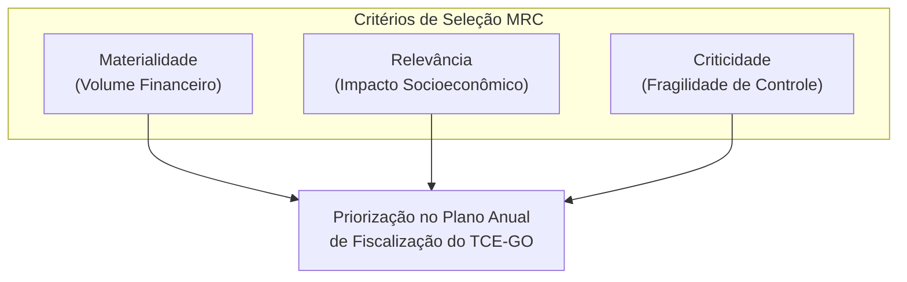
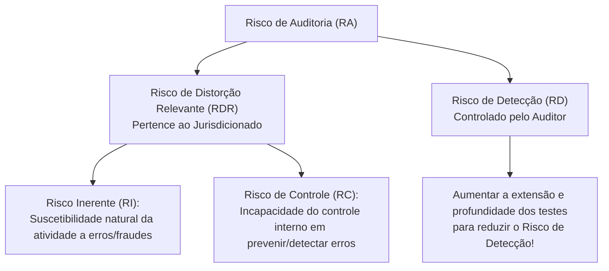
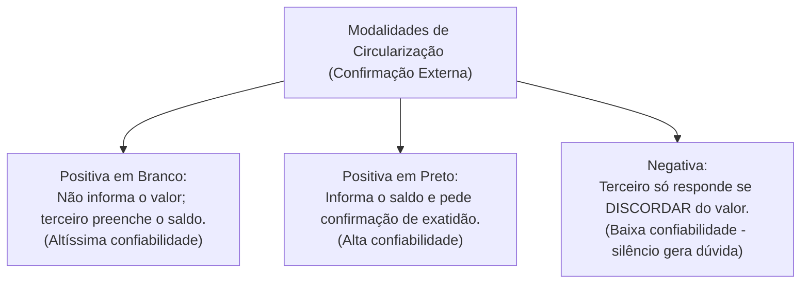

# 03 - Planejamento, Amostragem, Técnicas de Auditoria e Matriz de Achados

> **Matéria:** Noções de Controle Externo  
> **Cargo:** A01 – Técnico de Controle Externo – Especialidade: Técnico Administrativo  
> **Arquivo:** `03_planejamento_amostragem_procedimentos_e_achados.md`  
> **Status:** 🟢 Teoria Aprofundada + 5 Questões FCC Comentadas (A a E)

---

## 📌 Ementa / Itens do Edital

- Planejamento da auditoria de controle externo: delimitação do escopo, visão geral do objeto e questões de auditoria;
- Critérios de seleção e priorização da fiscalização: Materialidade, Relevância e Criticidade (Critérios MRC);
- Modelo de Avaliação de Risco de Auditoria e seus componentes: Risco Inerente, Risco de Controle e Risco de Detecção;
- Amostragem em auditoria governamental: amostragem probabilística (estatística) e não probabilística (por julgamento); métodos de amostragem e risco de amostragem (Risco Alfa e Risco Beta);
- Programas de auditoria e papéis de trabalho (documentação de auditoria): finalidades, requisitos de clareza e completude, confidencialidade, arquivos correntes e permanentes;
- Técnicas e procedimentos de auditoria governamental:
    - Exame documental, inspeção física, conferência de cálculos (recálculo), observação direta, entrevistas técnicas;
    - Circularização (confirmação externa: modalidades positiva em branco, positiva em preto e negativa);
    - Conciliação contábil e bancária;
    - Procedimentos analíticos / Revisão analítica (estudo de relações plausíveis, flutuações e índices);
- Evidências de auditoria: atributos essenciais de validade (suficiência, adequação/pertinência e confiabilidade);
- Estruturação anatômica dos achados de auditoria: Critério, Condição, Causa e Efeito;
- Matriz de Achados e Matriz de Responsabilização (conduta, nexo de causalidade e culpabilidade à luz do Art. 28 da LINDB).

---

## 🧭 Sumário
- [1. Planejamento da Fiscalização e Avaliação de Risco](#1-planejamento-da-fiscalizacao-e-avaliacao-de-risco)
    - [1.1 Critérios de Seleção de Objetos de Controle (Critérios MRC)](#11-criterios-de-selecao-de-objetos-de-controle-criterios-mrc)
    - [1.2 O Modelo do Risco de Auditoria (Auditoria Risk - AR)](#12-o-modelo-do-risco-de-auditoria-auditoria-risk-ar)
    - [1.3 Amostragem em Auditoria Governamental e Riscos Amostrais](#13-amostragem-em-auditoria-governamental-e-riscos-amostrais)
- [2. Programas de Auditoria e Documentação (Papéis de Trabalho)](#2-programas-de-auditoria-e-documentacao-papeis-de-trabalho)
- [3. Técnicas e Procedimentos de Auditoria Governamental](#3-tecnicas-e-procedimentos-de-auditoria-governamental)
    - [3.1 Quadro Geral dos Procedimentos de Obtenção de Evidências](#31-quadro-geral-dos-procedimentos-de-obtencao-de-evidencias)
    - [3.2 Modalidades de Circularização (Confirmação Externa)](#32-modalidades-de-circularizacao-confirmacao-externa)
- [4. Evidências de Auditoria: Os Três Pilares da Validade](#4-evidencias-de-auditoria-os-tres-pilares-da-validade)
- [5. A Estrutura Anatômica do Achado de Auditoria](#5-a-estrutura-anatomica-do-achado-de-auditoria)
    - [5.1 Os Quatro Elementos do Achado](#51-os-quatro-elementos-do-achado)
    - [5.2 Matriz de Responsabilização e a LINDB (Art. 28)](#52-matriz-de-responsabilizacao-e-a-lindb-art-28)
- [6. Fontes Oficiais & Manuais Técnicos Recomendados](#fontes-oficiais-manuais-tecnicos-recomendados)
- [7. Questões Comentadas no Padrão FCC (Justificadas de A a E)](#questoes-comentadas-no-padrao-fcc-justificadas-de-a-a-e)

---

## 📖 Conteúdo Teórico Aprofundado

### 1. Planejamento da Fiscalização e Avaliação de Risco

O Tribunal de Contas atua pautado pelo planejamento estratégico e pela alocação racional e eficiente de seus auditores e recursos técnicos.

#### 1.1 Critérios de Seleção de Objetos de Controle (Critérios MRC)
Os objetos de controle a serem incluídos no Plano Anual de Fiscalização são priorizados com base nos consagrados critérios **MRC**:

- **Materialidade:** Representatividade monetária dos recursos geridos pelo órgão (volume financeiro, orçamentário e patrimonial envolvido).
- **Relevância:** Importância socioeconômica, ambiental ou político-estratégica das ações governamentais auditadas para a sociedade.
- **Criticidade:** Nível de vulnerabilidade do ambiente institucional, complexidade técnica, histórico de fraudes e irregularidades, ou fragilidade evidente dos controles internos.



---

#### 1.2 O Modelo do Risco de Auditoria (Auditoria Risk - AR)
O **Risco de Auditoria (RA)** é o risco de o auditor expressar uma conclusão inadequada quando as informações objeto de fiscalização contiverem distorções relevantes.
O modelo decompõe-se na seguinte relação:

$$\text{Risco de Auditoria} = \text{Risco Inerente (RI)} \times \text{Risco de Controle (RC)} \times \text{Risco de Detecção (RD)}$$



> 🚨 **ALERTA DE PROVA / PEGADINHA FCC:**  
>
> - O auditor **NÃO altera nem controla o Risco Inerente (RI) nem o Risco de Controle (RC)**, pois estes pertencem exclusivamente à estrutura do órgão auditado e à eficiência de sua administração.  
> - O único risco que o auditor pode e deve controlar diretamente é o **Risco de Detecção (RD)**! Se o auditor identifica que o ambiente auditado tem alto risco inerente e péssimo controle interno (alto RDR), ele deve planejar testes mais rigorosos, com amostras maiores e procedimentos aprofundados, diminuindo o seu risco de detecção para manter o risco de auditoria global em nível aceitável.

---

#### 1.3 Amostragem em Auditoria Governamental e Riscos Amostrais
- **Amostragem Estatística (Probabilística):** Seleção aleatória de itens na qual cada item da população possui chance conhecida e diferente de zero de ser selecionado. Permite a avaliação quantitativa do risco de amostragem mediante intervalos de confiança matemáticos.
    - *Tipos:* Aleatória simples, sistemática (intervalo regular de seleção), estratificada (subdivisão da população em estratos homogêneos) e por unidade monetária (foco em valores financeiros mais expressivos).
- **Amostragem Não Estatística (Não Probabilística):** Seleção fundamentada exclusivamente no julgamento profissional, conhecimento prévio ou intuição do auditor.
- **Riscos de Amostragem na FCC:**
    - *Risco Alfa (Risco de Rejeição Incorreta):* Concluir que a amostra apresenta falhas graves quando a população total está em conformidade. Afeta a **eficiência** do trabalho (gera retrabalho e testes desnecessários).
    - *Risco Beta (Risco de Aceitação Incorreta):* Concluir que a amostra está adequada quando a população total contém erros relevantes graves. Afeta a **eficácia** da auditoria e é o mais perigoso, pois o auditor chancela contas viciadas.

---

### 2. Programas de Auditoria e Documentação (Papéis de Trabalho)

- **Programa de Auditoria:** Roteiro operacional e detalhado das etapas, procedimentos e testes substantivos e de conformidade que os membros da equipe devem executar no trabalho de campo.
- **Papéis de Trabalho (Documentação de Auditoria):**
    - *Finalidade:* Registrar as evidências colhidas, suportar técnica e juridicamente o relatório final e comprovar o cumprimento das normas profissionais da NBASP.
    - *Titularidade e Custódia:* São de **propriedade exclusiva do Tribunal de Contas**, sujeitos a sigilo legal durante a fase de instrução e arquivamento regulamentar.
    - *Classificação Arquivística:*
    - **Arquivo Corrente:** Guarda documentos e papéis específicos daquela auditoria em exercício financeiro determinado (ex.: notas fiscais, empenhos daquele mês e atas de medição);
    - **Arquivo Permanente:** Guarda documentos de uso contínuo por vários exercícios (ex.: lei de criação da entidade, organogramas, regimentos internos e manuais de rotina).

---

### 3. Técnicas e Procedimentos de Auditoria Governamental

#### 3.1 Quadro Geral dos Procedimentos de Obtenção de Evidências

| Procedimento / Técnica | Conceito Operacional | Exemplo Prático de Aplicação |
| :--- | :--- | :--- |
| **Exame Documental** | Análise minuciosa da validade, idoneidade e legalidade formal de documentos fiscais, administrativos e contratuais. | Exame de termos de referência, certidões de regularidade, notas de empenho e notas fiscais eletrônicas. |
| **Inspeção Física** | Constatação presencial e sensorial direta da existência física e qualidade de bens, estoques ou obras públicas. | Vistoria presencial em trecho de rodovia estadual para aferir espessura de asfalto e drenagem. |
| **Conferência de Cálculos (Recálculo)** | Reexecução aritmética independente de operações matemáticas realizadas pelo órgão auditado. | Recálculo de fórmulas de reajuste de tarifas de transporte ou índices de BDI em planilhas de obras. |
| **Observação Direta** | Acompanhamento ocular presencial de uma atividade operacional no momento exato em que é realizada. | Observação do procedimento de descarte de resíduos hospitalares pelo pessoal terceirizado. |
| **Circularização (Confirmação Externa)** | Obtenção de declaração direta por escrito de terceiros independentes alheios ao órgão fiscalizado. | Envio de ofício a banco conveniado solicitando confirmação do saldo e titularidade de conta de convênio. |
| **Procedimentos Analíticos (Revisão Analítica)** | Estudo e comparação de flutuações, índices e relações plausíveis entre dados operacionais e financeiros. | Confronto mensal entre o total de horas extras pagas e o volume de procedimentos médicos cirúrgicos realizados. |

#### 3.2 Modalidades de Circularização (Confirmação Externa)



---

### 4. Evidências de Auditoria: Os Três Pilares da Validade

As conclusões do relatório de auditoria dependem da colheita de evidências que satisfaçam cumulativamente:

1. **Suficiência (Aspecto Quantitativo):** Mede a quantidade de evidência colhida. Deve ser persuasiva o bastante para convencer uma pessoa sensata e prudente.
2. **Adequação / Relevância (Aspecto Qualitativo):** Pertinência da evidência em relação aos objetivos dos testes e às questões de auditoria formuladas.
3. **Confiabilidade:** Grau de autenticidade da evidência.
    - Evidências obtidas de **fontes externas independentes** são mais confiáveis do que as obtidas dentro da entidade auditada.
    - Evidências obtidas **diretamente pelo auditor** (ex.: inspeção física pessoal) são mais confiáveis do que as obtidas indiretamente.
    - Documentos **originais** são mais confiáveis do que fotocópias ou impressões digitalizadas.

---

### 5. A Estrutura Anatômica do Achado de Auditoria

#### 5.1 Os Quatro Elementos do Achado
O **Achado de Auditoria** é a discrepância relevante identificada entre a situação real constatada e o parâmetro ideal normativo:

```text
┌────────────────────────────────────────────────────────────────────────┐
│                        ANATOMIA DO ACHADO DE AUDITORIA                 │
├───────────────────┬────────────────────────────────────────────────────┤
│ 1. CRITÉRIO       │ O padrão normativo ideal ("O que deveria ser")     │
│                   │ Ex.: O art. 72 da Lei 14.133/21 exige prévio ETP.  │
├───────────────────┼────────────────────────────────────────────────────┤
│ 2. CONDIÇÃO       │ A realidade fática encontrada ("O que é")          │
│                   │ Ex.: Contratação de R$ 3 milhões executada sem ETP.│
├───────────────────┼────────────────────────────────────────────────────┤
│ 3. CAUSA          │ A razão explicativa do desvio ("Por que ocorreu")  │
│                   │ Ex.: Falha no controle interno e falta de servidores.│
├───────────────────┼────────────────────────────────────────────────────┤
│ 4. EFEITO         │ A consequência real ou potencial ("Qual o impacto")│
│                   │ Ex.: Superfaturamento e contratação superdimensionada.│
└───────────────────┴────────────────────────────────────────────────────┘
```

#### 5.2 Matriz de Responsabilização e a LINDB (Art. 28)
Ao propor imputação de débito ou cominação de multas sancionatórias a agentes públicos, a equipe de auditoria deve confeccionar obrigatoriamente a **Matriz de Responsabilização**, demonstrando:

- **Identificação Individual:** Nome, CPF e cargo do agente público ou privado;
- **Conduta:** Ação ou omissão específica imputada ao gestor;
- **Nexo de Causalidade:** Vínculo fático entre o ato praticado e o resultado lesivo gerado ao erário;
- **Culpabilidade:** Demonstração expressa de que o agente agiu com **dolo ou erro grosseiro** (culpa manifesta e inescusável), nos exatos termos do **Art. 28 da LINDB**.

---

## 🌐 Fontes Oficiais & Manuais Técnicos Recomendados

* [TCU - Boas Práticas e Padrões de Auditoria Governamental](https://portal.tcu.gov.br/governanca/governanca-no-tcu/) - Diretrizes institucionais de auditoria, matriz de planejamento, achados e matriz de responsabilização.
* [Lei Estadual nº 16.168/2007 - Do Planejamento das Fiscalizações](https://legisla.casacivil.go.gov.br/pesquisa_legislacao/86708/lei-16168) - Regras para inclusão de matérias no plano anual de fiscalização e dever de colaboração dos gestores.
* [TCE-GO - Plano Institucional de Fiscalização e Governança](https://portal.tce.go.gov.br/governanca-planejamento-e-gestao/planos-institucionais/plano-de-fiscalizacao) - Planejamento anual e plurianual das ações de fiscalização externa no Estado de Goiás.
* [TCE-GO - Competências e Jurisdição Institucional](https://portal.tce.go.gov.br/competencias) - Bases legais para requisição de documentos, fixação de prazos e fiscalização de convênios e contratos.
* [Constituição Federal de 1988 - Arts. 70 a 74 (Controle Interno e Externo)](https://www.planalto.gov.br/ccivil_03/constituicao/constituicao.htm#art70) - Apoio obrigatório do controle interno ao controle externo e dever de comunicação de irregularidades sob pena de responsabilidade solidária.
* CHAVES, Francisco Eduardo Carrilho. **Controle Externo da Gestão Pública**. 3. ed. Niterói: Impetus, 2016. (Cap. 5 - Fases da Auditoria: Planejamento, Execução e Achados).
* CASTRO, Domingos Poubel de. **Auditoria e Controle Interno na Administração Pública**. 3. ed. São Paulo: Atlas, 2019. (Cap. 6 - Procedimentos de Auditoria, Amostragem e Evidências).
* ZYMLER, Benjamin. **Direito Administrativo e Controle**. 3. ed. Belo Horizonte: Fórum, 2015. (Cap. 4 - O Achado de Auditoria e a Matriz de Responsabilização).


## 📝 Questões Comentadas no Padrão FCC (Justificadas de A a E)

### Questão 1 (FCC - Adaptada / TCE-RS - Auditor de Controle Externo)
No âmbito dos trabalhos de fiscalização governamental conduzidos por equipe de controle externo do Tribunal de Contas, os auditores compararam o volume mensal de combustível faturado por uma secretaria de estado com a quilometragem média rodada pelos veículos no mesmo período, constatando desvios e picos anômalos de consumo em determinados meses. A técnica de auditoria utilizada pela equipe denomina-se:

* **A)** Circularização ativa.
* **B)** Revisão analítica (ou procedimentos analíticos).
* **C)** Inspeção física.
* **D)** Conciliação contábil.
* **E)** Conferência de cálculos.

> **Comentário Detalhado:**
>
> - **A) Incorreta:** Circularização consiste em obter confirmação externa formal de terceiros alheios à entidade auditada.  
> - **B) CORRETA:** Os procedimentos analíticos (ou revisão analítica) compreendem a avaliação de informações financeiras e operacionais por meio de estudo e comparação das relações plausíveis entre dados financeiros e não financeiros, permitindo a detecção de flutuações, índices incoerentes ou variações atípicas que exijam investigação direcionada.  
> - **C) Incorreta:** Inspeção física exige o exame presencial e sensorial da existência palpável de bens, obras ou estoques.  
> - **D) Incorreta:** Conciliação contábil consiste em confrontar saldos contábeis internos com documentos de suporte (ex.: razão contábil e extrato bancário).  
> - **E) Incorreta:** Conferência de cálculos consiste na mera repetição aritmética de cálculos prévios efetuados pela administração pública.
> 
> **Gabarito: B**

---

### Questão 2 (FCC - Adaptada / TCE-AM - Auditor de Controle Externo)
Em relatório de fiscalização de obras rodoviárias, a equipe técnica do Tribunal de Contas registrou a ocorrência de fissuras e afundamentos prematuros no asfalto decorrentes da utilização de ligante betuminoso com espessura inferior à exigida nas especificações do projeto executivo aprovado pela Agência Goiana de Infraestrutura. De acordo com a metodologia de estruturação de achados de auditoria preconizada pelas normas de auditoria do setor público (NBASP), a especificação do projeto executivo e o asfalto com espessura inferior constituem, respectivamente:

* **A)** Condição e Critério.
* **B)** Causa e Efeito.
* **C)** Critério e Condição.
* **D)** Efeito e Causa.
* **E)** Matriz de Risco e Evidência.

> **Comentário Detalhado:**
>
> - **A) Incorreta:** A ordem está invertida.  
> - **B) Incorreta:** A causa foi a falha na dosagem ou fiscalização do executor; o efeito foram as fissuras e o prejuízo financeiro.  
> - **C) CORRETA:** Na metodologia do achado de auditoria:  
>     - **Critério:** É o padrão normativo, contratual ou técnico ideal ("o que deveria ser") – neste caso, as especificações técnicas obrigatórias do projeto executivo aprovado.  
>     - **Condição (ou Situação Encontrada):** É a realidade fática verificada pelo auditor *in loco* ("o que é") – neste caso, a aplicação de camada asfáltica com espessura inferior à contratada.  
> - **D) Incorreta:** As deformidades e fissuras representam o efeito/impacto danoso gerado na rodovia.  
> - **E) Incorreta:** Matriz de risco é ferramenta prévia de planejamento, e não elemento integrante da anatomia do achado.
> 
> **Gabarito: C**

---

### Questão 3 (FCC - Adaptada / Auditor Governamental)
Acerca do modelo de avaliação de risco de auditoria e dos fatores de risco considerados no planejamento das ações de controle externo, assinale a opção correta:

* **A)** O risco de detecção é o risco de que os controles internos da entidade auditada não consigam prevenir tempestivamente uma fraude contábil relevante.
* **B)** O risco inerente decorre exclusivamente de erros cometidos pela própria equipe de auditores durante a aplicação de seus testes substantivos.
* **C)** O risco de controle e o risco inerente são intrínsecos ao ambiente do órgão auditado, cabendo ao auditor gerenciar e reduzir o risco de detecção para manter o risco global de auditoria em patamar aceitável.
* **D)** Diante de controles internos eficientes e ausência de risco inerente, o auditor de controle externo pode dispensar a aplicação de quaisquer testes e aprovar as contas sumariamente.
* **E)** O risco de auditoria independe da extensão dos procedimentos aplicados pelo órgão de controle externo.

> **Comentário Detalhado:**
>
> - **A) Incorreta:** O risco de o controle interno falhar denomina-se **Risco de Controle (RC)**. Risco de detecção é a falha dos procedimentos do próprio auditor.  
> - **B) Incorreta:** O risco inerente refere-se à suscetibilidade da própria atividade auditada ao erro antes de qualquer controle.  
> - **C) CORRETA:** O auditor não pode alterar o risco inerente nem o risco de controle do jurisdicionado. Portanto, ao se deparar com um órgão de elevado risco (alto risco inerente e fragilidade de controles internos), o auditor deve **reduzir o risco de detecção (RD)** mediante a aplicação de testes mais profundos, com amostras maiores e maior ceticismo profissional.  
> - **D) Incorreta:** Testes substantivos nunca podem ser totalmente dispensados pelas normas de auditoria governamental.  
> - **E) Incorreta:** O risco global de auditoria varia em proporção inversa à extensão e qualidade dos procedimentos executados pela equipe.
> 
> **Gabarito: C**

---

### Questão 4 (FCC - Adaptada / Técnico de Controle Externo)
Em relação aos papéis de trabalho (documentação de auditoria) elaborados e custodiados no âmbito dos Tribunais de Contas, é correto afirmar:

* **A)** Pertencem pessoalmente ao auditor que os confeccionou, que detém o direito autoral de levá-los consigo ao se aposentar.
* **B)** O arquivo permanente é destinado à guarda de documentos específicos de uma única auditoria em exercício financeiro determinado, como notas fiscais daquele mês.
* **C)** Os papéis de trabalho pertencem ao Tribunal de Contas, destinando-se a fundamentar as conclusões do relatório técnico e a comprovar a observância das normas profissionais de auditoria.
* **D)** São de livre acesso público irrestrito e devem ser divulgados em tempo real na internet durante a realização dos testes de campo.
* **E)** Devem ser destruídos imediatamente após a publicação da deliberação plenária terminativa do processo de controle externo.

> **Comentário Detalhado:**
>
> - **A) Incorreta:** Os papéis de trabalho são patrimônio documental oficial e institucional exclusivo do Tribunal de Contas.  
> - **B) Incorreta:** O arquivo que guarda os dados de uma única auditoria anual é o **arquivo corrente**. O arquivo permanente abriga dados de uso continuado por anos (leis de criação do órgão, organogramas, estatutos).  
> - **C) CORRETA:** Conforme as normas técnicas da NBASP e Manuais de Auditoria, a documentação de auditoria pertence privativamente ao Tribunal e tem o objetivo primordial de registrar as evidências, fundamentar a opinião expressa e demonstrar a qualidade dos testes executados.  
> - **D) Incorreta:** Durante a fase de instrução e coleta, os papéis de trabalho mantêm-se sob sigilo e confidencialidade profissional para resguardar a integridade das apurações.  
> - **E) Incorreta:** Os papéis de trabalho devem ser mantidos sob guarda e custódia arquivística pelo prazo regulamentar para fins de segurança jurídica e eventual reexame.
> 
> **Gabarito: C**

---

### Questão 5 (FCC - Adaptada / Analista Jurídico de Controle)
Ao elaborar a Matriz de Responsabilização em processo de tomada de contas especial decorrente de auditoria, a unidade técnica do Tribunal de Contas imputou dever de ressarcir o erário a determinado Secretário de Estado em virtude de pagamento indevido de adicional de periculosidade a servidores administrativos.

Nos termos do artigo 28 da Lei de Introdução às Normas do Direito Brasileiro (LINDB), para que o agente público responda pessoalmente por suas decisões perante o Tribunal de Contas, é necessário demonstrar que ele agiu:

* **A)** Com qualquer modalidade de culpa leve, aplicando-se a teoria do risco integral administrativo.
* **B)** Com dolo ou erro grosseiro.
* **C)** Sem aprovação prévia da Procuradoria-Geral do Estado, independentemente de demonstração de culpabilidade.
* **D)** Exclusivamente com motivação político-partidária de oposição.
* **E)** Em contrariedade a parecer técnico não vinculante emitido por estagiário do órgão.

> **Comentário Detalhado:**
>
> - **A) Incorreta:** A responsabilidade pessoal sancionatória e ressarcitória do gestor perante o Tribunal de Contas não é objetiva (risco integral), exigindo elemento subjetivo qualificado. Culpa levíssima ou escusável não autoriza condenação pessoal.  
> - **B) CORRETA:** O art. 28 da LINDB (com redação dada pela Lei nº 13.655/2018) estabelece categoricamente: *"O agente público responderá pessoalmente por suas decisões ou opiniões técnicas em caso de **dolo ou erro grosseiro**."* O erro grosseiro é a culpa grave, inescusável, resultante de desatenção manifesta que o gestor médio não cometeria.  
> - **C) Incorreta:** A ausência de consulta jurídica isoladamente não presume a culpa grave do agente.  
> - **D) Incorreta:** O art. 28 exige dolo ou erro grosseiro no plano da conduta material, e não motivação partidária.  
> - **E) Incorreta:** Pareceres informais não vinculantes não constituem critério objetivo para definição da responsabilidade do gestor.
> 
> **Gabarito: B**
