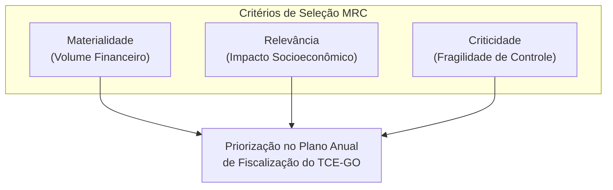
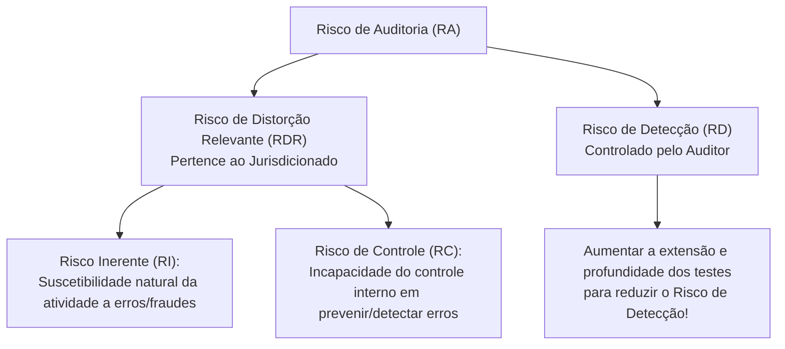

# 03 - Planejamento, Amostragem, Técnicas de Auditoria e Matriz de Achados

> **Matéria:** Noções de Controle Externo  
> **Cargo:** A01 – Técnico de Controle Externo – Especialidade: Técnico Administrativo  
> **Arquivo:** `03_planejamento_amostragem_procedimentos_e_achados.md`  
> **Status:** 🟢 Teoria Aprofundada + 5 Questões FCC Comentadas (A a E)

---

## 📌 Ementa / Itens do Edital

- Planejamento da auditoria de controle externo: delimitação do escopo, visão geral do objeto e questões de auditoria;
- Critérios de seleção e priorização da fiscalização: Materialidade, Relevância e Criticidade (Critérios MRC);
- Modelo de Avaliação de Risco de Auditoria e seus componentes: Risco Inerente, Risco de Controle e Risco de Detecção;
- Amostragem em auditoria governamental: amostragem probabilística (estatística) e não probabilística (por julgamento); métodos de amostragem e risco de amostragem (Risco Alfa e Risco Beta);
- Programas de auditoria e papéis de trabalho (documentação de auditoria): finalidades, requisitos de clareza e completude, confidencialidade, arquivos correntes e permanentes;
- Técnicas e procedimentos de auditoria governamental:
    - Exame documental, inspeção física, conferência de cálculos (recálculo), observação direta, entrevistas técnicas;
    - Circularização (confirmação externa: modalidades positiva em branco, positiva em preto e negativa);
    - Conciliação contábil e bancária;
    - Procedimentos analíticos / Revisão analítica (estudo de relações plausíveis, flutuações e índices);
- Evidências de auditoria: atributos essenciais de validade (suficiência, adequação/pertinência e confiabilidade);
- Estruturação anatômica dos achados de auditoria: Critério, Condição, Causa e Efeito;
- Matriz de Achados e Matriz de Responsabilização (conduta, nexo de causalidade e culpabilidade à luz do Art. 28 da LINDB).

---

## 🧭 Sumário

1. [Planejamento da Fiscalização e Avaliação de Risco](#1-planejamento-da-fiscalizacao-e-avaliacao-de-risco)
    1. [Critérios de Seleção de Objetos de Controle (Critérios MRC)](#11-criterios-de-selecao-de-objetos-de-controle-criterios-mrc)
    2. [O Modelo do Risco de Auditoria (Auditoria Risk - AR)](#12-o-modelo-do-risco-de-auditoria-auditoria-risk-ar)
    3. [Amostragem em Auditoria Governamental e Riscos Amostrais](#13-amostragem-em-auditoria-governamental-e-riscos-amostrais)
    4. [Teste 187](#Teste-187)
    5. [Teste 188](#Teste-188)
2. [Programas de Auditoria e Documentação (Papéis de Trabalho)](#2-programas-de-auditoria-e-documentacao-papeis-de-trabalho)
    1. [Teste 189](#Teste-189)
    2. [Teste 190](#Teste-190)
3. [Técnicas e Procedimentos de Auditoria Governamental](#3-tecnicas-e-procedimentos-de-auditoria-governamental)
    1. [Quadro Geral dos Procedimentos de Obtenção de Evidências](#31-quadro-geral-dos-procedimentos-de-obtencao-de-evidencias)
    2. [Modalidades de Circularização (Confirmação Externa)](#32-modalidades-de-circularizacao-confirmacao-externa)
    3. [Teste 191](#Teste-191)
    4. [Teste 192](#Teste-192)
    5. [Teste 193](#Teste-193)
4. [Evidências de Auditoria: Os Três Pilares da Validade](#4-evidencias-de-auditoria-os-tres-pilares-da-validade)
    1. [Teste 194](#Teste-194)
5. [A Estrutura Anatômica do Achado de Auditoria](#5-a-estrutura-anatomica-do-achado-de-auditoria)
    1. [Os Quatro Elementos do Achado](#51-os-quatro-elementos-do-achado)
    2. [Matriz de Responsabilização e a LINDB (Art. 28)](#52-matriz-de-responsabilizacao-e-a-lindb-art-28)
    3. [Teste 195](#Teste-195)
    4. [Teste 196](#Teste-196)
    5. [Teste 197](#Teste-197)
6. [🌐 Fontes Oficiais & Manuais Técnicos Recomendados](#fontes-oficiais-manuais-tecnicos-recomendados)

---

## 1. Planejamento da Fiscalização e Avaliação de Risco

O Tribunal de Contas atua pautado pelo planejamento estratégico e pela alocação racional e eficiente de seus auditores e recursos técnicos.

### 1.1 Critérios de Seleção de Objetos de Controle (Critérios MRC)
Os objetos de controle a serem incluídos no Plano Anual de Fiscalização são priorizados com base nos consagrados critérios **MRC**:

- **Materialidade:** Representatividade monetária dos recursos geridos pelo órgão (volume financeiro, orçamentário e patrimonial envolvido).
- **Relevância:** Importância socioeconômica, ambiental ou político-estratégica das ações governamentais auditadas para a sociedade.
- **Criticidade:** Nível de vulnerabilidade do ambiente institucional, complexidade técnica, histórico de fraudes e irregularidades, ou fragilidade evidente dos controles internos.

### 1.2 O Modelo do Risco de Auditoria (Auditoria Risk - AR)
O **Risco de Auditoria (RA)** é o risco de o auditor expressar uma conclusão inadequada quando as informações objeto de fiscalização contiverem distorções relevantes.
O modelo decompõe-se na seguinte relação:

$$\text{Risco de Auditoria} = \text{Risco Inerente (RI)} \times \text{Risco de Controle (RC)} \times \text{Risco de Detecção (RD)}$$

> 🚨 **ALERTA DE PROVA / PEGADINHA FCC:**  
>
> - O auditor **NÃO altera nem controla o Risco Inerente (RI) nem o Risco de Controle (RC)**, pois estes pertencem exclusivamente à estrutura do órgão auditado e à eficiência de sua administração.  
> - O único risco que o auditor pode e deve controlar diretamente é o **Risco de Detecção (RD)**! Se o auditor identifica que o ambiente auditado tem alto risco inerente e péssimo controle interno (alto RDR), ele deve planejar testes mais rigorosos, com amostras maiores e procedimentos aprofundados, diminuindo o seu risco de detecção para manter o risco de auditoria global em nível aceitável.

### 1.3 Amostragem em Auditoria Governamental e Riscos Amostrais
- **Amostragem Estatística (Probabilística):** Seleção aleatória de itens na qual cada item da população possui chance conhecida e diferente de zero de ser selecionado. Permite a avaliação quantitativa do risco de amostragem mediante intervalos de confiança matemáticos.
    - *Tipos:* Aleatória simples, sistemática (intervalo regular de seleção), estratificada (subdivisão da população em estratos homogêneos) e por unidade monetária (foco em valores financeiros mais expressivos).
- **Amostragem Não Estatística (Não Probabilística):** Seleção fundamentada exclusivamente no julgamento profissional, conhecimento prévio ou intuição do auditor.
- **Riscos de Amostragem na FCC:**
    - *Risco Alfa (Risco de Rejeição Incorreta):* Concluir que a amostra apresenta falhas graves quando a população total está em conformidade. Afeta a **eficiência** do trabalho (gera retrabalho e testes desnecessários).
    - *Risco Beta (Risco de Aceitação Incorreta):* Concluir que a amostra está adequada quando a população total contém erros relevantes graves. Afeta a **eficácia** da auditoria e é o mais perigoso, pois o auditor chancela contas viciadas.

---

### Teste 187
**(Questão Inédita / Simulada Estilo FCC – Nível: Controle Externo / TI)**  
No planejamento de uma auditoria governamental de acordo com as normas da NBASP / INTOSAI, a elaboração da Matriz de Planejamento é etapa essencial para estruturar os trabalhos de campo. A respeito dos elementos integrantes da Matriz de Planejamento, é correto afirmar:

* **A)** A delimitação do escopo dispensa a formulação prévia de questões de auditoria quando o órgão for submetido a inspeção ordinária pelo TC.
* **B)** As questões de auditoria orientam as informações requeridas, fontes de dados, procedimentos e possíveis achados.
* **C)** A equipe de fiscalização é impedida de alterar o cronograma ou os testes previstos na matriz durante a execução dos trabalhos.
* **D)** A definição de critérios é restrita aos preceitos legais e regulamentares formais, vedado o emprego de boas práticas gerenciais.
* **E)** As limitações metodológicas devem ser mantidas em segredo pelos auditores para resguardar a presunção de veracidade da Corte.

---

> **Comentário Detalhado:**
>
> - **A)** **Incorreto**. As questões de auditoria são o eixo central da Matriz de Planejamento, definindo exatamente o que se pretende responder.
> - **B)** **Correto**. Conforme os manuais de auditoria governamental (TCU/ATRICON/NBASP): a Matriz de Planejamento articula logicamente as questões de auditoria com os critérios, informações requeridas, fontes de informação, procedimentos de coleta e análise de dados, limitações e possíveis achados esperados.
> - **C)** **Incorreto**. A Matriz de Planejamento é um instrumento dinâmico e flexível que pode ser ajustado à medida que novos fatos surgem no campo.
> - **D)** **Incorreto**. Em auditoria operacional, os critérios podem abranger padrões de desempenho, boas práticas e referenciais técnicos aceitos.
> - **E)** **Incorreto**. As limitações metodológicas devem constar expressamente do relatório em obséquio à transparência profissional.
>
> **Gabarito: B**

### Teste 188
**(Questão Inédita / Simulada Estilo FCC – Nível: Controle Externo / TI)**  
Acerca do modelo conceitual de risco de auditoria ($Risco = RI \times RC \times RD$) e da avaliação dos controles internos preconizada pela NBASP 200 / NBASP 100, é correto afirmar:

* **A)** O risco de detecção é independente da atuação dos auditores, dependendo exclusivamente da estrutura do órgão auditado.
* **B)** A constatação de elevado risco de controle autoriza a equipe a reduzir o tamanho da amostra e os testes substantivos.
* **C)** O risco de detecção refere-se aos procedimentos executados pelo auditor para reduzir o risco a um nível aceitável.
* **D)** O risco de auditoria refere-se à possibilidade de a administração auditada não implementar as determinações do acórdão do Plenário.
* **E)** O risco inerente decorre da incapacidade dos controles internos da entidade de prevenir fraudes de forma tempestiva.

---

> **Comentário Detalhado:**
>
> - **A)** **Incorreto**. O risco de detecção é o único componente diretamente controlado pelo auditor, decorrendo da eficácia de seus procedimentos.
> - **B)** **Incorreto**. Se o risco de controle for elevado, o auditor deve aplicar testes substantivos mais extensos (amostras maiores) para compensar.
> - **C)** **Correto**. Conforme a NBASP 200 / NBC TA 200: Risco de Detecção (RD) é o risco de que os procedimentos executados pelo auditor para reduzir o risco de auditoria a um nível aceitavelmente baixo não detectem uma distorção que exista e que possa ser relevante, individualmente ou em conjunto com outras distorções.
> - **D)** **Incorreto**. Risco de auditoria é o risco de o auditor expressar uma opinião inadequada quando as informações contiverem distorção relevante.
> - **E)** **Incorreto**. A incapacidade do controle interno de prevenir/detectar erro é a definição exata de Risco de Controle (RC), não inerente.
>
> **Gabarito: C**

### Teste 189
**(Questão Inédita / Simulada Estilo FCC – Nível: Controle Externo / TI)**  
Em relação aos papéis de trabalho (documentação de auditoria) disciplinados nas normas de fiscalização dos Tribunais de Contas, analise as afirmativas:

* **A)** O descarte de papéis de trabalho pode ocorrer no encerramento da execução, dispensando-se arquivo permanente.
* **B)** A documentação de auditoria deve ser mantida em sigilo absoluto mesmo perante os membros julgadores do Tribunal.
* **C)** Os papéis de trabalho devem ser suficientes para permitir que auditor experiente compreenda a natureza e achados.
* **D)** É vedada a utilização de registros fotográficos e gravações digitais como suporte probatório de achados no campo.
* **E)** A guarda dos papéis de trabalho é facultativa para auditorias de conformidade com parecer prévio sem ressalvas.

---

> **Comentário Detalhado:**
>
> - **A)** **Incorreto**. Os papéis de trabalho devem ser arquivados em meio físico ou eletrônico e conservados pelo prazo legal (regra de 5 a 10 anos).
> - **B)** **Incorreto**. A documentação de auditoria serve de suporte probatório direto para o julgamento pelos Conselheiros e Ministros.
> - **C)** **Correto**. Conforme a NBASP 100 / NBASP 200: a documentação de auditoria deve ser preparada de modo tempestivo e ser suficientemente completa e detalhada para permitir que um auditor experiente, sem conexão prévia com o trabalho, compreenda a natureza, a época e a extensão dos procedimentos, os resultados obtidos e os fundamentos técnicos das conclusões.
> - **D)** **Incorreto**. Registros audiovisuais e digitais são papéis de trabalho amplamente aceitos e recomendados.
> - **E)** **Incorreto**. A guarda e custódia documental é obrigatória para todos os trabalhos fiscalizatórios.
>
> **Gabarito: C**

### Teste 190
**(Questão Inédita / Simulada Estilo FCC – Nível: Controle Externo / TI)**  
Os papéis de trabalho constituem a documentação indispensável do planejamento, da execução e dos resultados alcançados pelo controle externo. A respeito da finalidade e propriedade dos papéis de trabalho, é correto afirmar:

* **A)** Pertencem originariamente ao administrador do órgão fiscalizado, cabendo ao Tribunal de Contas apenas a consulta.
* **B)** Constituem propriedade privativa do Tribunal de Contas e fundamentam o relatório, as conclusões e a proposta de voto.
* **C)** Têm como única finalidade subsidiar a aplicação de sanções administrativas aos gestores públicos do Poder Executivo.
* **D)** Não podem ser examinados pelas equipes de controle de qualidade dos Tribunais de Contas por força de sigilo funcional.
* **E)** São dispensáveis nas fiscalizações concomitantes que adotam a metodologia de monitoramento contínuo informatizado.

---

> **Comentário Detalhado:**
>
> - **A)** **Incorreto**. Os papéis de trabalho são de propriedade exclusiva do Tribunal de Contas / entidade fiscalizadora que os produziu ou reuniu.
> - **B)** **Correto**. Os papéis de trabalho pertencem à Corte de Contas, servindo para evidenciar o cumprimento das normas de auditoria, apoiar a supervisão do trabalho e fundamentar com solidez documental o relatório, o parecer do Ministério Público de Contas e a decisão do colegiado.
> - **C)** **Incorreto**. Subsidiam também o planejamento futuro, o controle de qualidade e a emissão de determinações corretivas.
> - **D)** **Incorreto**. A revisão por pares e o controle de qualidade interno exigem o acesso irrestrito aos papéis de trabalho.
> - **E)** **Incorreto**. Toda e qualquer fiscalização exige registro e arquivo comprobatório de evidências.
>
> **Gabarito: B**

### Teste 191
**(Questão Inédita / Simulada Estilo FCC – Nível: Controle Externo / TI)**  
No planejamento e execução de auditorias do setor público, as equipes utilizam técnicas de amostragem para fundamentar suas conclusões sobre a população sob exame. A respeito da amostragem estatística e não estatística, é correto afirmar:

* **A)** A amostragem não estatística (por julgamento) permite mensurar objetivamente o risco de amostragem em percentual.
* **B)** A amostragem estatística exige seleção aleatória dos itens e aplicação da teoria das probabilidades aos dados.
* **C)** O erro tolerável é o montante máximo de distorção aceito pelo gestor do órgão auditado na prestação de contas.
* **D)** A estratificação populacional é vedada na auditoria financeira governamental por distorcer a média aritmética.
* **E)** O tamanho da amostra diminui linearmente quando o auditor reduz o nível de risco de amostragem aceitável no teste de controle.

---

> **Comentário Detalhado:**
>
> - **A)** **Incorreto**. A amostragem não estatística fundamenta-se exclusivamente no julgamento do auditor, não permitindo o cálculo matemático exato do risco de amostragem.
> - **B)** **Correto**. Conforme a NBASP 200 / NBC TA 530: a abordagem de amostragem que tem como características a seleção aleatória dos itens da amostra e o uso da teoria das probabilidades para avaliar os resultados (inclusive mensurar o risco de amostragem) é classificada tecnicamente como amostragem estatística.
> - **C)** **Incorreto**. O erro/distorção tolerável é fixado tecnicamente pelo auditor (nível de materialidade na amostragem), e não pelo gestor.
> - **D)** **Incorreto**. A estratificação (subdivisão da população em subpopulações homogêneas) é técnica altamente recomendada para aumentar a eficiência amostral.
> - **E)** **Incorreto**. Se o auditor deseja correr menos risco (risco aceitável menor), ele deve aumentar o tamanho da amostra.
>
> **Gabarito: B**

### Teste 192
**(Questão Inédita / Simulada Estilo FCC – Nível: Controle Externo / TI)**  
No âmbito dos trabalhos de fiscalização governamental conduzidos por Tribunal de Contas, a equipe de auditoria decide obter uma declaração escrita diretamente de uma instituição bancária sobre os saldos mantidos por determinado fundo previdenciário público. Esse procedimento técnico de auditoria é denominado:

* **A)** inspeção física direta de bens e ativos estatais.
* **B)** confirmação externa (circularização).
* **C)** recálculo aritmético de lançamentos.
* **D)** procedimento analítico comparativo.
* **E)** reexecução de rotinas operacionais.

---

> **Comentário Detalhado:**
>
> - **A)** **Incorreto**. Inspeção física consiste no exame físico de ativos ou bens tangíveis (ex.: conferir existência física de um veículo ou obra).
> - **B)** **Correto**. A confirmação externa (comumente denominada circularização) é o procedimento de auditoria pelo qual o auditor obtém evidência direta de uma terceira parte independente (fora da entidade auditada), em formato escrito, para corroborar saldos bancários, contas a pagar/receber ou litígios em curso (NBASP 200 / NBC TA 505).
> - **C)** **Incorreto**. Recálculo consiste na conferência da exatidão matemática de documentos ou registros.
> - **D)** **Incorreto**. Procedimento analítico avalia informações financeiras por meio de análise de relações plausíveis entre dados.
> - **E)** **Incorreto**. Reexecução envolve a realização independente pelo auditor de procedimentos ou controles já executados pela entidade.
>
> **Gabarito: B**

### Teste 193
**(Questão Inédita / Simulada Estilo FCC – Nível: Controle Externo / TI)**  
Durante auditoria de conformidade em contrato de fornecimento de merenda escolar, a equipe de controle externo constatou indícios de superfaturamento de quantitativos e entrega de gêneros alimentícios impróprios para consumo. Para constatar a real ocorrência dos fatos, os auditores compareceram aos depósitos escolares durante o recebimento dos alimentos e examinaram as notas fiscais e certificados fitossanitários. Os procedimentos aplicados correspondem, respectivamente, a:

* **A)** procedimento analítico e recálculo.
* **B)** observação direta e inspeção documental.
* **C)** confirmação externa e reexecução.
* **D)** circularização e entrevista estruturada.
* **E)** conciliação bancária e teste de aderência.

---

> **Comentário Detalhado:**
>
> - **A)** **Incorreto**. Procedimento analítico envolve índices financeiros e recálculo confere cálculos aritméticos.
> - **B)** **Correto**. Acompanhar in loco o recebimento físico dos alimentos configura o procedimento de "observação" (exame de um processo ou procedimento executado por terceiros). Por sua vez, o exame das notas fiscais e certificados fitossanitários constitui o procedimento de "inspeção" documental (exame de registros ou documentos, internos ou externos, em papel ou meio eletrônico - NBASP 100/200).
> - **C)** **Incorreto**. Confirmação externa exige comunicação com terceiro externo e reexecução é refazer controles.
> - **D)** **Incorreto**. Circularização é envio de cartas a terceiros.
> - **E)** **Incorreto**. Não se trata de reconciliação de contas contábeis.
>
> **Gabarito: B**

### Teste 194
**(Questão Inédita / Simulada Estilo FCC – Nível: Controle Externo / TI)**  
A validade e a força persuasiva de um relatório de fiscalização do Tribunal de Contas dependem da qualidade das evidências obtidas pelos auditores durante a instrução do processo. A respeito dos atributos da suficiência e da apropriação (relevância e confiabilidade) das evidências de auditoria, é correto afirmar:

* **A)** A suficiência é a medida da qualidade da evidência obtida pelos auditores no campo.
* **B)** A suficiência é a medida da quantidade da evidência, e a apropriação é a medida de sua qualidade.
* **C)** Evidências obtidas de fontes internas da entidade são mais confiáveis do que as de fontes externas.
* **D)** A obtenção de evidências orais colhidas em conversas informais dispensa a formalização por escrito.
* **E)** Documentos originais e cópias autenticadas possuem menor valor probatório do que impressões anônimas.

---

> **Comentário Detalhado:**
>
> - **A)** **Incorreto**. A qualidade é mensurada pela *apropriação* (relevância e confiabilidade); a suficiência afere a quantidade.
> - **B)** **Correto**. Conforme a NBASP 100 e a NBASP 200: a "suficiência" é a medida da quantidade de evidência de auditoria necessária para fundamentar as conclusões (influenciada pelo risco de auditoria e pela qualidade dessas evidências). A "apropriação" é a medida da qualidade da evidência de auditoria, ou seja, sua relevância e sua confiabilidade para fornecer suporte às conclusões do auditor.
> - **C)** **Incorreto**. A confiabilidade da evidência é maior quando obtida de fontes independentes externas à entidade auditada.
> - **D)** **Incorreto**. Evidências orais isoladas são de baixa confiabilidade e devem ser confirmadas por escrito ou complementadas por provas documentais.
> - **E)** **Incorreto**. Documentos originais possuem maior confiabilidade do que cópias ou documentos apócrifos.
>
> **Gabarito: B**

### Teste 195
**(Questão Inédita / Simulada Estilo FCC – Nível: Controle Externo / TI)**  
Em relatório de auditoria de obras rodoviárias, a equipe do Tribunal de Contas apontou que a camada asfáltica executada pela empreiteira apresentou espessura média de 3 cm (situação encontrada), enquanto as especificações do edital e o projeto executivo exigiam espessura de 5 cm (critério normativo), gerando degradação prematura do pavimento e risco de prejuízo financeiro ao Estado (efeito). No jargão da auditoria governamental, a integração harmônica desses elementos caracteriza um:

* **A)** escopo de amostragem estatística.
* **B)** plano preliminar de fiscalização.
* **C)** achado de auditoria governamental.
* **D)** mapa institucional de riscos operacionais.
* **E)** termo de ajustamento de conduta executivo.

---

> **Comentário Detalhado:**
>
> - **A)** **Incorreto**. Escopo define os limites e a amplitude dos exames.
> - **B)** **Incorreto**. Plano de fiscalização antecede a execução da auditoria.
> - **C)** **Correto**. Conforme o Manual de Auditoria do TCU, a NBASP 100 e a NBASP 300: o "Achado de Auditoria" é qualquer fato significativo, relevante e respaldado por evidências suficientes e apropriadas, composto classicamente por quatro elementos estruturantes: Condição (situação encontrada), Critério (o que deveria ser conforme a norma), Causa (a razão da desconformidade) e Efeito/Impacto (as consequências reais ou potenciais da distorção).
> - **D)** **Incorreto**. Mapa de riscos é ferramenta de governança da administração pública.
> - **E)** **Incorreto**. TAC é instrumento consensual de resolução de conflitos celebrado com o MP.
>
> **Gabarito: C**

### Teste 196
**(Questão Inédita / Simulada Estilo FCC – Nível: Controle Externo / TI)**  
Ao elaborar a Matriz de Responsabilização em processo de tomada de contas especial decorrente de achado de superfaturamento em compras públicas, a equipe de auditoria deve identificar com rigor técnico o nexo causal e o elemento subjetivo da conduta dos responsáveis. Para imputação de débito sancionatório com base no art. 28 da LINDB, é indispensável demonstrar que o agente público atuou com:

* **A)** culpa leve decorrente de erro procedimental escusável.
* **B)** dolo ou erro grosseiro na prática do ato administrativo.
* **C)** responsabilidade objetiva pura decorrente da titularidade do cargo público.
* **D)** boa-fé estrita respaldada em parecer técnico vinculante.
* **E)** omissão irrelevante desprovida de nexo com o dano apurado.

---

> **Comentário Detalhado:**
>
> - **A)** **Incorreto**. O art. 28 da LINDB afasta a responsabilização pessoal por mera culpa leve ou erro desprovido de gravidade excepcional.
> - **B)** **Correto**. Conforme o art. 28 da Lei de Introdução às Normas do Direito Brasileiro (LINDB - Decreto-Lei nº 4.657/1942, incluído pela Lei nº 13.655/2018): "O agente público responderá pessoalmente por suas decisões ou opiniões técnicas em caso de dolo ou erro grosseiro". A jurisprudência consolidada do STF e do TCU define o erro grosseiro como a culpa grave, caracterizada pela inobservância do dever geral de cuidado que uma pessoa com diligência média adotaria nas mesmas circunstâncias.
> - **C)** **Incorreto**. A responsabilidade do gestor perante os Tribunais de Contas é de natureza subjetiva, exigindo comprovação de conduta, dano, nexo causal e dolo ou culpa grave.
> - **D)** **Incorreto**. A boa-fé elide a sanção, e não a fundamenta.
> - **E)** **Incorreto**. Sem nexo de causalidade não há responsabilização civil ou sancionatória.
>
> **Gabarito: B**

### Teste 197
**(Questão Inédita / Simulada Estilo FCC – Nível: Controle Externo / TI)**  
Ao finalizar os trabalhos de execução no campo, antes da emissão definitiva do relatório de auditoria, a equipe técnica do Tribunal de Contas realiza reuniões com a administração auditada para apresentação preliminar dos achados e discussão das conclusões. A respeito da comunicação dos achados de auditoria e da solicitação de manifestação dos gestores antes do relatório final, é correto afirmar:

* **A)** É vedada aos auditores sob pena de violação do sigilo das apurações preliminares do Tribunal de Contas.
* **B)** É prática recomendada para assegurar clareza aos fatos e oportunidade de esclarecimento prévio.
* **C)** Transfere para a administração auditada a titularidade formal sobre a redação do relatório final de controle externo.
* **D)** Condiciona a validade do relatório à anuência e concordância expressa de todas as autoridades fiscalizadas.
* **E)** Impede a posterior aplicação de sanções administrativas caso os gestores reconheçam expressamente a falha.

---

> **Comentário Detalhado:**
>
> - **A)** **Incorreto**. As normas internacionais de auditoria e os regimentos dos TCs preconizam expressamente a comunicação e o diálogo prévio com a entidade auditada.
> - **B)** **Correto**. Conforme as diretrizes da NBASP 100, NBASP 300 e dos Manuais de Auditoria do TCU e dos Tribunais de Contas: a apresentação da versão preliminar dos achados (ou reunião de encerramento dos trabalhos de campo) oportuniza à entidade auditada manifestar-se sobre a fidedignidade dos fatos narrados, apontar eventuais equívocos fáticos ou apresentar documentos adicionais, agregando solidez e credibilidade às conclusões dos auditores.
> - **C)** **Incorreto**. O relatório permanece sob a inteira e exclusiva responsabilidade técnica e autoral da equipe de fiscalização.
> - **D)** **Incorreto**. A discordância da administração auditada não impede a manutenção do achado, cabendo apenas o registro de suas contra-argumentações.
> - **E)** **Incorreto**. O reconhecimento não anula a irregularidade nem elide a competência sancionatória do Tribunal.
>
> **Gabarito: B**

