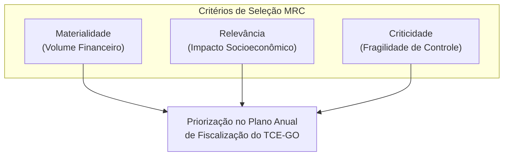
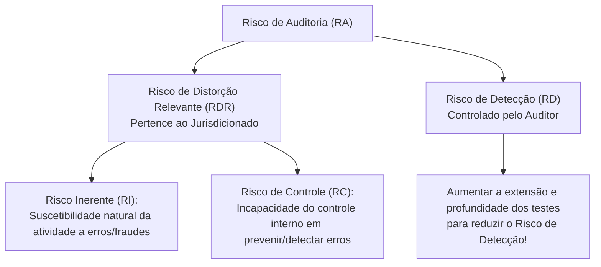

# 03 - Planejamento, Amostragem, Técnicas de Auditoria e Matriz de Achados

> **Matéria:** Noções de Controle Externo  
> **Cargo:** A01 – Técnico de Controle Externo – Especialidade: Técnico Administrativo  
> **Arquivo:** `03_planejamento_amostragem_procedimentos_e_achados.md`  
> **Status:** 🟢 Teoria Aprofundada + 5 Questões FCC Comentadas (A a E)

---

## 📌 Ementa / Itens do Edital

- Planejamento da auditoria de controle externo: delimitação do escopo, visão geral do objeto e questões de auditoria;
- Critérios de seleção e priorização da fiscalização: Materialidade, Relevância e Criticidade (Critérios MRC);
- Modelo de Avaliação de Risco de Auditoria e seus componentes: Risco Inerente, Risco de Controle e Risco de Detecção;
- Amostragem em auditoria governamental: amostragem probabilística (estatística) e não probabilística (por julgamento); métodos de amostragem e risco de amostragem (Risco Alfa e Risco Beta);
- Programas de auditoria e papéis de trabalho (documentação de auditoria): finalidades, requisitos de clareza e completude, confidencialidade, arquivos correntes e permanentes;
- Técnicas e procedimentos de auditoria governamental:
    - Exame documental, inspeção física, conferência de cálculos (recálculo), observação direta, entrevistas técnicas;
    - Circularização (confirmação externa: modalidades positiva em branco, positiva em preto e negativa);
    - Conciliação contábil e bancária;
    - Procedimentos analíticos / Revisão analítica (estudo de relações plausíveis, flutuações e índices);
- Evidências de auditoria: atributos essenciais de validade (suficiência, adequação/pertinência e confiabilidade);
- Estruturação anatômica dos achados de auditoria: Critério, Condição, Causa e Efeito;
- Matriz de Achados e Matriz de Responsabilização (conduta, nexo de causalidade e culpabilidade à luz do Art. 28 da LINDB).

---

## 🧭 Sumário

1. [Planejamento da Fiscalização e Avaliação de Risco](#1-planejamento-da-fiscalizacao-e-avaliacao-de-risco)
    1. [Critérios de Seleção de Objetos de Controle (Critérios MRC)](#11-criterios-de-selecao-de-objetos-de-controle-criterios-mrc)
    2. [O Modelo do Risco de Auditoria (Auditoria Risk - AR)](#12-o-modelo-do-risco-de-auditoria-auditoria-risk-ar)
    3. [Amostragem em Auditoria Governamental e Riscos Amostrais](#13-amostragem-em-auditoria-governamental-e-riscos-amostrais)
    4. [Teste 187](#Teste-187)
    5. [Teste 188](#Teste-188)
2. [Programas de Auditoria e Documentação (Papéis de Trabalho)](#2-programas-de-auditoria-e-documentacao-papeis-de-trabalho)
    1. [Teste 189](#Teste-189)
    2. [Teste 190](#Teste-190)
3. [Técnicas e Procedimentos de Auditoria Governamental](#3-tecnicas-e-procedimentos-de-auditoria-governamental)
    1. [Quadro Geral dos Procedimentos de Obtenção de Evidências](#31-quadro-geral-dos-procedimentos-de-obtencao-de-evidencias)
    2. [Modalidades de Circularização (Confirmação Externa)](#32-modalidades-de-circularizacao-confirmacao-externa)
    3. [Teste 191](#Teste-191)
    4. [Teste 192](#Teste-192)
    5. [Teste 193](#Teste-193)
4. [Evidências de Auditoria: Os Três Pilares da Validade](#4-evidencias-de-auditoria-os-tres-pilares-da-validade)
    1. [Teste 194](#Teste-194)
5. [A Estrutura Anatômica do Achado de Auditoria](#5-a-estrutura-anatomica-do-achado-de-auditoria)
    1. [Os Quatro Elementos do Achado](#51-os-quatro-elementos-do-achado)
    2. [Matriz de Responsabilização e a LINDB (Art. 28)](#52-matriz-de-responsabilizacao-e-a-lindb-art-28)
    3. [Teste 195](#Teste-195)
    4. [Teste 196](#Teste-196)
    5. [Teste 197](#Teste-197)
6. [🌐 Fontes Oficiais & Manuais Técnicos Recomendados](#fontes-oficiais-manuais-tecnicos-recomendados)

---

## 1. Planejamento da Fiscalização e Avaliação de Risco

O Tribunal de Contas atua pautado pelo planejamento estratégico e pela alocação racional e eficiente de seus auditores e recursos técnicos.

### 1.1 Critérios de Seleção de Objetos de Controle (Critérios MRC)
Os objetos de controle a serem incluídos no Plano Anual de Fiscalização são priorizados com base nos consagrados critérios **MRC**:

- **Materialidade:** Representatividade monetária dos recursos geridos pelo órgão (volume financeiro, orçamentário e patrimonial envolvido).
- **Relevância:** Importância socioeconômica, ambiental ou político-estratégica das ações governamentais auditadas para a sociedade.
- **Criticidade:** Nível de vulnerabilidade do ambiente institucional, complexidade técnica, histórico de fraudes e irregularidades, ou fragilidade evidente dos controles internos.

### 1.2 O Modelo do Risco de Auditoria (Auditoria Risk - AR)
O **Risco de Auditoria (RA)** é o risco de o auditor expressar uma conclusão inadequada quando as informações objeto de fiscalização contiverem distorções relevantes.
O modelo decompõe-se na seguinte relação:

$$\text{Risco de Auditoria} = \text{Risco Inerente (RI)} \times \text{Risco de Controle (RC)} \times \text{Risco de Detecção (RD)}$$

> 🚨 **ALERTA DE PROVA / PEGADINHA FCC:**  
>
> - O auditor **NÃO altera nem controla o Risco Inerente (RI) nem o Risco de Controle (RC)**, pois estes pertencem exclusivamente à estrutura do órgão auditado e à eficiência de sua administração.  
> - O único risco que o auditor pode e deve controlar diretamente é o **Risco de Detecção (RD)**! Se o auditor identifica que o ambiente auditado tem alto risco inerente e péssimo controle interno (alto RDR), ele deve planejar testes mais rigorosos, com amostras maiores e procedimentos aprofundados, diminuindo o seu risco de detecção para manter o risco de auditoria global em nível aceitável.

### 1.3 Amostragem em Auditoria Governamental e Riscos Amostrais
- **Amostragem Estatística (Probabilística):** Seleção aleatória de itens na qual cada item da população possui chance conhecida e diferente de zero de ser selecionado. Permite a avaliação quantitativa do risco de amostragem mediante intervalos de confiança matemáticos.
    - *Tipos:* Aleatória simples, sistemática (intervalo regular de seleção), estratificada (subdivisão da população em estratos homogêneos) e por unidade monetária (foco em valores financeiros mais expressivos).
- **Amostragem Não Estatística (Não Probabilística):** Seleção fundamentada exclusivamente no julgamento profissional, conhecimento prévio ou intuição do auditor.
- **Riscos de Amostragem na FCC:**
    - *Risco Alfa (Risco de Rejeição Incorreta):* Concluir que a amostra apresenta falhas graves quando a população total está em conformidade. Afeta a **eficiência** do trabalho (gera retrabalho e testes desnecessários).
    - *Risco Beta (Risco de Aceitação Incorreta):* Concluir que a amostra está adequada quando a população total contém erros relevantes graves. Afeta a **eficácia** da auditoria e é o mais perigoso, pois o auditor chancela contas viciadas.

---

### Teste 187
**(FGV – TRT – Analista Judiciário - Tecnologia da Informação – 2024)**
A NBASP 10 tem como objetivo definir, no nível institucional, os 
princípios relacionados ao pré -requisito da independência e as 
diretrizes que devem reger a atuação independente dos Tribunais 
de Contas.  
Sobre a NBASP 10 - Independência dos Tribunais de Contas, analise 
os itens a seguir: 
I. O auxílio prestado pelos Tribunais de Contas ao Poder 
Legislativo, conforme art. 71 da Constituição Federal, 
representa subordinação hierárquica. 
II. Os Tribunais de Contas somente podem exercer suas funções 
com objetividade quando são independentes das entidades 
fiscalizadas e estão protegidos contra influências externas. 
III. Embora se reconheça que as instituições do Estado não podem 
ser totalmente independentes, os Tribunais de Contas devem 
exercer sua indepen dência funcional e organizacional no 
cumprimento de suas competências constitucionais.  
Está correto o que se afirma em

* **A)** I, apenas.
* **B)** I e II, apenas.
* **C)** I e III, apenas.
* **D)** II e III, apenas.
* **E)** I, II e III.

---

> **Comentário Detalhado:**
>
> - **A)** Incorreta. Discrepa das diretrizes normativas e jurisprudenciais aplicáveis ao tema objeto do item.
> - **B)** Incorreta. Discrepa das diretrizes normativas e jurisprudenciais aplicáveis ao tema objeto do item.
> - **C)** Incorreta. Discrepa das diretrizes normativas e jurisprudenciais aplicáveis ao tema objeto do item.
> - **D)** Correta. Representa com precisão a disciplina do tema e o entendimento pacificado adotado pela banca (FGV).
> - **E)** Incorreta. Discrepa das diretrizes normativas e jurisprudenciais aplicáveis ao tema objeto do item.
>
> **Gabarito: D**

---
### Teste 188
**(FGV – TRT – Analista Judiciário - Tecnologia da Informação – 2024)**
A Lei nº 9.504/1997 atribui funções específicas aos Tribunais de 
Contas no contexto das eleições e da fiscalização dos gastos 
públicos relacionados a campanhas políticas. 
Assinale a opção que indica uma função dos Tribunais de Contas 
constante na Lei nº 9.504/1997.

* **A)** Promover eventos de capacitação para os servidores efetivos 
e empregados públicos designados para o desempenho das 
funções essenciais à execução desta Lei por meio de suas 
escolas de contas.
* **B)** Fiscalizar a execução do orçamento, inclusive a aplicação de 
recursos específicos, bem como sua compatibilização com o 
plano plurianual e com as diretrizes orçamentárias.
* **C)** Fornecer à Justiça Eleitoral relação dos que tiveram suas 
contas relativas ao exercício de cargos ou funções públicas 
rejeitadas por irregularidade insanável e por decisão 
irrecorrível, exceto em situações sob análise judicial ou com 
decisão favorável.
* **D)** Prestar as informações solicitadas pela Assembleia ou por 
qualquer de suas co missões, sobre a fiscalização contábil, 
financeira, orçamentária, operacional e patrimonial, e sobre 
resultados de auditorias e inspeções realizadas.
* **E)** Representar ao Poder competente sobre irregularidades ou 
abusos apurados, indicando o ato inquinado e definindo 
responsabilidades.

---

> **Comentário Detalhado:**
>
> - **A)** Incorreta. Discrepa das diretrizes normativas e jurisprudenciais aplicáveis ao tema objeto do item.
> - **B)** Incorreta. Discrepa das diretrizes normativas e jurisprudenciais aplicáveis ao tema objeto do item.
> - **C)** Correta. Representa com precisão a disciplina do tema e o entendimento pacificado adotado pela banca (FGV).
> - **D)** Incorreta. Discrepa das diretrizes normativas e jurisprudenciais aplicáveis ao tema objeto do item.
> - **E)** Incorreta. Discrepa das diretrizes normativas e jurisprudenciais aplicáveis ao tema objeto do item.
>
> **Gabarito: C**

---
### Teste 189
**(FGV – TRT – Analista Judiciário - Tecnologia da Informação – 2024)**
A Lei nº 9.504/1997 atribui funções específicas aos Tribunais de 
Contas no contexto das eleições e da fiscalização dos gastos 
públicos relacionados a campanhas políticas. 
Assinale a opção que indica uma função dos Tribunais de Contas 
constante na Lei nº 9.504/1997.

* **A)** promover eventos de capacitação para os servidores efetivos 
e empregados públicos designados para o desempenho das 
funções essenciais à execução desta Lei por meio de suas 
escolas de contas.
* **B)** fiscalizar a execução do orçamento, inclusive a aplicação de 
recursos específicos, bem como sua compatibilização com o 
plano plurianual e com as diretrizes orçamentárias.
* **C)** fornecer à Justiça Eleitoral relação dos que tiveram suas contas 
relativas ao exercício de cargos ou funções públicas rejeitadas 
por irregularidade insanável e por decisão irrecorrível, exceto 
em situações sob análise judicial ou com decisão favorável.
* **D)** prestar as informações solicitadas pela Assembleia ou por 
qualquer de suas co missões, sobre a fiscalização contábil, 
financeira, orçamentária, operacional e patrimonial, e sobre 
resultados de auditorias e inspeções realizadas.
* **E)** representar ao Poder competente sobre irregularidades ou 
abusos apurados, indicando o ato inquinado e definindo 
responsabilidades.

---

> **Comentário Detalhado:**
>
> - **A)** Incorreta. Discrepa das diretrizes normativas e jurisprudenciais aplicáveis ao tema objeto do item.
> - **B)** Incorreta. Discrepa das diretrizes normativas e jurisprudenciais aplicáveis ao tema objeto do item.
> - **C)** Correta. Representa com precisão a disciplina do tema e o entendimento pacificado adotado pela banca (FGV).
> - **D)** Incorreta. Discrepa das diretrizes normativas e jurisprudenciais aplicáveis ao tema objeto do item.
> - **E)** Incorreta. Discrepa das diretrizes normativas e jurisprudenciais aplicáveis ao tema objeto do item.
>
> **Gabarito: C**

---
### Teste 190
**(FGV – TRT-DA 24-REGIÃO – Analista Judiciário - Tecnologia da Informação – 2025)**
Para que a vigilância de áreas internas e externas seja efetiva, é 
necessário seguir o seguinte roteiro: identificação de riscos, 
mitigação de riscos e elaboração de plano de contingência. 
Assinale a opção que apresenta duas ações que contribuem com a 
identificação de riscos.

* **A)** Avaliação da edificação e vulnerabilidade do acervo.
* **B)** Guarda do acervo com critérios de seguranças e identificação 
de serviços de emergência.
* **C)** Vulnerabilidade do acervo e treinamento de equipes.
* **D)** Métodos de recuperação dos acervos e avaliação do sistema 
de combate a incêndio.
* **E)** Utilização de diário de ocorrências e manutenção da 
edificação.

---

> **Comentário Detalhado:**
>
> - **A)** Incorreta. Discrepa das diretrizes normativas e jurisprudenciais aplicáveis ao tema objeto do item.
> - **B)** Incorreta. Discrepa das diretrizes normativas e jurisprudenciais aplicáveis ao tema objeto do item.
> - **C)** Incorreta. Discrepa das diretrizes normativas e jurisprudenciais aplicáveis ao tema objeto do item.
> - **D)** Incorreta. Discrepa das diretrizes normativas e jurisprudenciais aplicáveis ao tema objeto do item.
> - **E)** Correta. Representa com precisão a disciplina do tema e o entendimento pacificado adotado pela banca (FGV).
>
> **Gabarito: E**

---
### Teste 191
**(FGV – TRT-DA 24-REGIÃO – Analista Judiciário - Tecnologia da Informação – 2025)**
Assinale a opção que indica o método mais adequado na avaliação 
e mitigação de riscos em sessões e audiências jurídicas.

* **A)** Qualitativo, somente.
* **B)** Quantitativo, somente.
* **C)** Semiquantitativo, somente.
* **D)** Qualitativo ou combinação qualitativo/semiquantitativo, 
somente.
* **E)** Quantitativo ou combinação quantitativo/qualitativo, 
somente.

---

> **Comentário Detalhado:**
>
> - **A)** Incorreta. Discrepa das diretrizes normativas e jurisprudenciais aplicáveis ao tema objeto do item.
> - **B)** Incorreta. Discrepa das diretrizes normativas e jurisprudenciais aplicáveis ao tema objeto do item.
> - **C)** Incorreta. Discrepa das diretrizes normativas e jurisprudenciais aplicáveis ao tema objeto do item.
> - **D)** Incorreta. Discrepa das diretrizes normativas e jurisprudenciais aplicáveis ao tema objeto do item.
> - **E)** Correta. Representa com precisão a disciplina do tema e o entendimento pacificado adotado pela banca (FGV).
>
> **Gabarito: E**

---
### Teste 192
**(FGV – TCE-PA – Auditor de Controle Externo – 2024)**
A Área de Proteção Ambiental (APA) Arquipélago do Marajó é 
considerada a maior Unidade de Conservação na costa norte do 
Brasil. 
A respeito da APA Marajó, é correto afirmar que

* **A)** protege a biodiversidade dos ecossistemas que compõem os 
biomas amazônico e o pantanal, marcado pelas savanas 
alagadas.
* **B)** apresenta uma paisagem alterada pelo período chuvoso, 
quando as várzeas e os campos baixos são inundados por 3 a 
4 meses.
* **C)** possui uma vegetação predominantemente composta por 
florestas decíduas temperadas, mais densas nas regiões 
aluvial e de terras baixas.
* **D)** contém uma área de formação pioneira, com vastas áreas de 
dunas, caatinga e de florestas tropical ainda intocada.
* **E)** abriga o povo marajoara, descendente de etnias indígenas 
pré-colombianas que se mantiveram isoladas do resto do 
continente. 

AUDITOR DE CONTROLE EXTERNO - FISCALIZAÇÃO - CONTABILIDADE  – MANHÃ  TIPO  BRANCA – PÁGINA 8

---

> **Comentário Detalhado:**
>
> - **A)** Incorreta. Discrepa das diretrizes normativas e jurisprudenciais aplicáveis ao tema objeto do item.
> - **B)** Correta. Representa com precisão a disciplina do tema e o entendimento pacificado adotado pela banca (FGV).
> - **C)** Incorreta. Discrepa das diretrizes normativas e jurisprudenciais aplicáveis ao tema objeto do item.
> - **D)** Incorreta. Discrepa das diretrizes normativas e jurisprudenciais aplicáveis ao tema objeto do item.
> - **E)** Incorreta. Discrepa das diretrizes normativas e jurisprudenciais aplicáveis ao tema objeto do item.
>
> **Gabarito: B**

---
### Teste 193
**(FGV – TCE-PA – Auditor de Controle Externo – 2024)**
A Área de Proteção Ambiental (APA) Arquipélago do Marajó é 
considerada a maior Unidade de Conservação na costa norte do 
Brasil. 
A respeito da APA Marajó, é correto afirmar que

* **A)** protege a biodiversidade dos ecossistemas que compõem os 
biomas amazônico e o pantanal, marcado pelas savanas 
alagadas.
* **B)** apresenta uma paisagem alterada pelo período chuvoso, 
quando as várzeas e os campos baixos são inundados por 3 a 
4 meses.
* **C)** possui uma vegetação predominantemente composta por 
florestas decíduas temperadas, mais densas nas regiões 
aluvial e de terras baixas.
* **D)** contém uma área de formação pioneira, com vastas áreas de 
dunas, caatinga e de florestas tropical ainda intocada.
* **E)** abriga o povo marajoara, descendente de etnias indígenas 
pré-colombianas que se mantiveram isoladas do resto do 
continente. 

AUDITOR DE CONTROLE EXTERNO - ADMINISTRATIVA - GESTÃO GOVERNAMENTAL – MANHÃ  TIPO  BRANCA – PÁGINA 8

---

> **Comentário Detalhado:**
>
> - **A)** Incorreta. Discrepa das diretrizes normativas e jurisprudenciais aplicáveis ao tema objeto do item.
> - **B)** Correta. Representa com precisão a disciplina do tema e o entendimento pacificado adotado pela banca (FGV).
> - **C)** Incorreta. Discrepa das diretrizes normativas e jurisprudenciais aplicáveis ao tema objeto do item.
> - **D)** Incorreta. Discrepa das diretrizes normativas e jurisprudenciais aplicáveis ao tema objeto do item.
> - **E)** Incorreta. Discrepa das diretrizes normativas e jurisprudenciais aplicáveis ao tema objeto do item.
>
> **Gabarito: B**

---
### Teste 194
**(FGV – TCE-PA – Auditor de Controle Externo – 2024)**
Uma das propriedades físicas de um solo é o grau de saturação. 
Em uma amostra, essa propriedade pode ser medida como a 
razão entre o volume ocupado pela água e

* **A)** a soma dos volumes de água e solo.
* **B)** a soma dos volumes de água e ar.
* **C)** o volume de solo.
* **D)** o volume de ar.
* **E)** o volume total. 

AUDITOR DE CONTROLE EXTERNO – ÁREA ADMINISTRATIVA - ENGENHARIA CIVIL – MANHÃ  TIPO  BRANCA – PÁGINA 23

---

> **Comentário Detalhado:**
>
> - **A)** Incorreta. Discrepa das diretrizes normativas e jurisprudenciais aplicáveis ao tema objeto do item.
> - **B)** Incorreta. Discrepa das diretrizes normativas e jurisprudenciais aplicáveis ao tema objeto do item.
> - **C)** Incorreta. Discrepa das diretrizes normativas e jurisprudenciais aplicáveis ao tema objeto do item.
> - **D)** Incorreta. Discrepa das diretrizes normativas e jurisprudenciais aplicáveis ao tema objeto do item.
> - **E)** Correta. Representa com precisão a disciplina do tema e o entendimento pacificado adotado pela banca (FGV).
>
> **Gabarito: E**

---
### Teste 195
**(FGV – TRT – Analista Judiciário - Tecnologia da Informação – 2024)**
O crescimento na quantidade e complexidade dos dados 
disponíveis para as empresas torna imprescindível que a 
Governança de Dados seja estruturada com documentos que 
circulem em vários níveis da empresa de acordo com as suas 
respectivas finalidades, contribuindo para colimar os esforços de 
todos os membros para obter os resultados esperados. 
Com relação aos documentos da Governança de Dados, avalie as 
afirmativas a seguir. 
I. As políticas de dados são regras pormenorizadas do que pode 
ser feito e o que não pode ser feito, devendo ser conhecidas 
por todos os profissionais da empresa. 
II. As normas são documentos que indicam as práticas 
recomendadas, mas não obrigatórias, que devem ser 
adotadas pelas pessoas que trabalham com os dados. 
III. Os procedimentos têm por finalidade orientar as pessoas na 
execução de tarefas específicas visando atingir determinado 
objetivo, ou seja, documentos que indicam o “como fazer” 
determinada tarefa.  
Está correto o que se afirma em

* **A)** I, apenas.
* **B)** II, apenas.
* **C)** III, apenas.
* **D)** I e III apenas.
* **E)** I, II e III.

---

> **Comentário Detalhado:**
>
> - **A)** Incorreta. Discrepa das diretrizes normativas e jurisprudenciais aplicáveis ao tema objeto do item.
> - **B)** Incorreta. Discrepa das diretrizes normativas e jurisprudenciais aplicáveis ao tema objeto do item.
> - **C)** Incorreta. Discrepa das diretrizes normativas e jurisprudenciais aplicáveis ao tema objeto do item.
> - **D)** Correta. Representa com precisão a disciplina do tema e o entendimento pacificado adotado pela banca (FGV).
> - **E)** Incorreta. Discrepa das diretrizes normativas e jurisprudenciais aplicáveis ao tema objeto do item.
>
> **Gabarito: D**

---
### Teste 196
**(FGV – TRT-DA 24-REGIÃO – Analista Judiciário - Tecnologia da Informação – 2025)**
Um problema importante em inferência estatística decorre da 
necessidade de se obter uma amostra de uma determinada 
população para se estudar determinado fenômeno. 
Nesse caso, um problema crucial é se obter uma mostra que seja, 
em algum sentido, representativa da população em estudo, o que 
nos leva a pensar em como nossa amostra pode ser obtida. 
Um método importante, nesse sentido, é a amostragem aleatória 
simples, na qual

* **A)** a população apresenta uma subdivisão em pequenos grupos, 
e é possível e conveniente sortear um número suficiente 
desses grupos, cujos elementos constituirão a amostra.
* **B)** a população se divide em subpopulações, de tal modo que 
podemos especificar quantos elementos da amostra serão 
retirados em cada subpopulação.
* **C)** todos os elementos da população têm igual probabilidade de 
pertencer à amostra, e todas as possíveis amostras têm 
também igual probabilidade de ocorrer.
* **D)** a população pode ser ordenada e cada elemento da amostra é 
obtido a partir de uma escolha sistemática e periódica.
* **E)** a amostra é retirada em diversas etapas sucessivas e, 
dependendo dos resultados obtidos, etapas suplementares 
são necessárias ou dispensadas.

---

> **Comentário Detalhado:**
>
> - **A)** Incorreta. Discrepa das diretrizes normativas e jurisprudenciais aplicáveis ao tema objeto do item.
> - **B)** Incorreta. Discrepa das diretrizes normativas e jurisprudenciais aplicáveis ao tema objeto do item.
> - **C)** Correta. Representa com precisão a disciplina do tema e o entendimento pacificado adotado pela banca (FGV).
> - **D)** Incorreta. Discrepa das diretrizes normativas e jurisprudenciais aplicáveis ao tema objeto do item.
> - **E)** Incorreta. Discrepa das diretrizes normativas e jurisprudenciais aplicáveis ao tema objeto do item.
>
> **Gabarito: C**

---
### Teste 197
**(FGV – TRT-DA 24-REGIÃO – Analista Judiciário - Tecnologia da Informação – 2025)**
Na fase de Planejamento de uma auditoria operacional, o auditor 
deve estabelecer critérios apropriados, que correspondam aos 
objetivos e questões de auditoria. 
Em relação a eles, analise o que se afirma a seguir. 
I. O critério representa a expectativa razoável e fundamentada 
do que “deveria ser”, as melhores práticas e benchmarks com 
os quais o desempenho pode ser comparado. 
II. Os critérios de auditoria precisam fornecer uma base 
apropriada e razoável para a avaliação dos objetivos da 
auditoria e devem ser relevantes, compreensíveis, completos, 
confiáveis e objetivos no contexto do objeto, dos objetivos 
e/ou das questões de auditoria. 
III. Os critérios de auditoria são estabelecidos pela equipe de 
auditoria e devem ser discutidos com a entidade auditada 
posteriormente, na fase de execução. 
Está correto o que se afirma em

* **A)** I, apenas.
* **B)** I e II, apenas.
* **C)** I e III, apenas.
* **D)** II e III, apenas.
* **E)** I, II e III. 

TRIBUNAL REGIONAL DO TRABALHO DA 24ª REGIÃO (TRT-24) – REAPLICAÇÃO FGV CONHECIMENTO

---

> **Comentário Detalhado:**
>
> - **A)** Correta. Representa com precisão a disciplina do tema e o entendimento pacificado adotado pela banca (FGV).
> - **B)** Incorreta. Discrepa das diretrizes normativas e jurisprudenciais aplicáveis ao tema objeto do item.
> - **C)** Incorreta. Discrepa das diretrizes normativas e jurisprudenciais aplicáveis ao tema objeto do item.
> - **D)** Incorreta. Discrepa das diretrizes normativas e jurisprudenciais aplicáveis ao tema objeto do item.
> - **E)** Incorreta. Discrepa das diretrizes normativas e jurisprudenciais aplicáveis ao tema objeto do item.
>
> **Gabarito: A**

---
