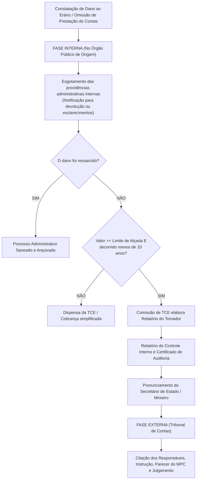
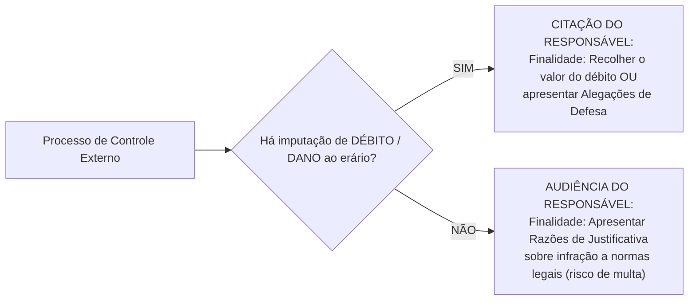
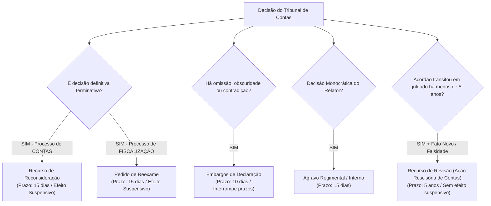

# 04 - Relatórios de Auditoria, Processo de Controle Externo, Tomada de Contas Especial e Sanções

> **Matéria:** Noções de Controle Externo  
> **Cargo:** A01 – Técnico de Controle Externo – Especialidade: Técnico Administrativo  
> **Arquivo:** `04_relatorios_processo_de_controle_externo_e_sancoes.md`  
> **Status:** 🟢 Teoria Aprofundada + 5 Questões FCC Comentadas (A a E)

---

## 📌 Ementa / Itens do Edital

- Comunicação dos resultados da auditoria: atributos, estrutura e padronização dos relatórios de controle externo (clareza, concisão, precisão, objetividade, completude e tempestividade);
- Deliberações do Tribunal de Contas: acórdãos colegiados, decisões monocráticas do Relator, determinações mandamentais e recomendações propositivas;
- Monitoramento das deliberações e Planos de Ação formulados pelo gestor público;
- Tomada de Contas Especial (TCE):
    - Conceito, natureza jurídica excepcional e finalidades institucionais;
    - Pressupostos cumulativos de instauração (ocorrência de dano ou omissão de contas, esgotamento das providências administrativas internas, valor superior ao limite de alçada e não transcurso de mais de 10 anos);
    - Fase interna no órgão de origem vs. Fase externa perante o Tribunal de Contas;
    - Hipóteses de dispensa, trancamento e arquivamento da TCE;
- O processo no Tribunal de Contas:
    - Comunicações processuais: Citação (para ressarcimento de débito) vs. Audiência (para justificativa de infração legal);
    - Fase recursal no processo de contas: Recurso de Reconsideração, Pedido de Reexame, Embargos de Declaração, Agravo e Recurso de Revisão;
- Julgamento técnico das contas dos administradores públicos:
    - Contas Regulares (quitação plena);
    - Contas Regulares com Ressalva (quitação com determinações corretivas para falhas formais);
    - Contas Irregulares (dano ao erário, desfalque, desvio, infração grave à norma ou reincidência de descumprimento);
    - Contas Iliquidáveis (caso fortuito ou força maior que inviabilize o exame de mérito);
- Regime sancionatório dos Tribunais de Contas:
    - Condenação em débito (natureza indenizatória reparatória);
    - Multas administrativas (proporcional ao débito e multa por grave infração à norma legal);
    - Inabilitação para o exercício de cargo em comissão ou função de confiança (até 5 anos);
    - Declaração de inidoneidade para participar de licitações e contratar com a Administração Pública (até 5 anos);
    - Reflexos eleitorais do julgamento de contas (inelegibilidade de 8 anos da Lei da Ficha Limpa - LC nº 64/90);
- Prescrição no âmbito do controle externo: prescrição quinquenal (5 anos) da pretensão punitiva e ressarcitória (Tema 899 do STF e Lei nº 9.873/1999) e prescrição intercorrente trienal (3 anos).

---

## 🧭 Sumário

1. [Conteúdo Teórico Aprofundado](#conteudo-teorico-aprofundado)
    1. [Comunicação dos Resultados e Deliberações do Tribunal](#1-comunicacao-dos-resultados-e-deliberacoes-do-tribunal)
    2. [Teste 198](#Teste-198)
    3. [Tomada de Contas Especial (TCE): Rito e Pressupostos](#2-tomada-de-contas-especial-tce-rito-e-pressupostos)
    4. [Teste 199](#Teste-199)
    5. [Teste 200](#Teste-200)
    6. [Comunicações Processuais: Citação versus Audiência](#3-comunicacoes-processuais-citacao-versus-audiencia)
    7. [Teste 201](#Teste-201)
    8. [Teste 202](#Teste-202)
    9. [Julgamento das Contas de Gestão dos Administradores Públicos](#4-julgamento-das-contas-de-gestao-dos-administradores-publicos)
    10. [Teste 203](#Teste-203)
    11. [Teste 204](#Teste-204)
    12. [Sistema Recursal no Processo de Controle Externo](#5-sistema-recursal-no-processo-de-controle-externo)
    13. [Teste 205](#Teste-205)
    14. [Teste 206](#Teste-206)
    15. [Regime Sancionatório e Reflexos Eleitorais (Lei da Ficha Limpa)](#6-regime-sancionatorio-e-reflexos-eleitorais-lei-da-ficha-limpa)
    16. [Teste 207](#Teste-207)
    17. [Prescrição nos Tribunais de Contas: O Marco do STF (Tema 899)](#7-prescricao-nos-tribunais-de-contas-o-marco-do-stf-tema-899)
    18. [Teste 208](#Teste-208)
2. [Fontes Oficiais & Jurisprudenciais Recomendadas](#fontes-oficiais-jurisprudenciais-recomendadas)

---

## 📖 Conteúdo Teórico Aprofundado

### 1. Comunicação dos Resultados e Deliberações do Tribunal

#### 1.1 Atributos do Relatório de Auditoria
A comunicação dos resultados dos trabalhos de auditoria e fiscalização deve atender aos seguintes atributos de qualidade estabelecidos na NBASP 100:

- **Clareza:** Linguagem acessível, técnica e compreensível para os leitores e cidadãos;
- **Concisão:** Foco direto no que é materialmente relevante, sem prolixidade inútil;
- **Precisão:** Informações exatas, lastreadas em evidências idôneas e documentação incontestável;
- **Objetividade:** Neutralidade, ausência de juízos emocionais e equilíbrio na ponderação dos argumentos do auditado;
- **Completude:** Inclusão de todos os dados necessários para o perfeito entendimento do fato e formulação do juízo de mérito;
- **Tempestividade:** Emissão do relatório no momento oportuno, em tempo hábil para evitar o perecimento do direito ou o agravamento do dano.

#### 1.2 Espécies de Deliberações: Determinações versus Recomendações
As deliberações do Tribunal de Contas proferidas no julgamento de relatórios de auditoria e processos de fiscalização dividem-se em duas categorias fundamentais:

- **Determinações:** Provimentos mandamentais vinculantes que impõem à autoridade administrativa a obrigação jurídica de fazer ou deixar de fazer algo para sanar ilegalidade, anular ato viciado ou adequar condutas ao ordenamento jurídico. O descumprimento injustificado de determinação enseja a aplicação de multa ao gestor reincidente e julgamento de contas irregulares.
- **Recomendações:** Provimentos pedagógicos e propositivos destinados a orientar o gestor sobre oportunidades de melhoria de desempenho, aprimoramento de rotinas gerenciais e governança pública, no campo da discricionariedade administrativa. Não possuem caráter sancionatório direto imediato.

---

### Teste 198
**(FCC - Analista de Controle Externo / TCE-GO)**
A respeito da comunicação dos resultados das fiscalizações e dos instrumentos deliberativos do Tribunal de Contas, assinale a afirmativa correta.

* **A)** O acórdão constitui deliberação monocrática tomada exclusivamente pelo Conselheiro-Presidente em matéria administrativa interna.
* **B)** O acórdão é a deliberação colegiada do Tribunal de Contas (tomada pelo Plenário ou pelas Câmaras), formalizada por escrito e publicada no Diário Oficial de Contas, que decide o mérito de processos submetidos a julgamento ou apreciação da Corte.
* **C)** As decisões monocráticas dos Conselheiros-Relatores são irrecorríveis e imunes a qualquer insurgência recursal pelo gestor público.
* **D)** O relatório de auditoria elaborado pela equipe técnica tem força executiva imediata de título extrajudicial antes de qualquer manifestação do colegiado do Tribunal.
* **E)** O Ministério Público de Contas tem a prerrogativa de emitir sentenças vinculantes que anulam os acórdãos do Pleno do Tribunal de Contas.

---

> **Comentário Detalhado:**
>
> - **A)** Incorreta. Acórdão é ato **colegiado**, resultante da deliberação de órgãos fracionários (Câmaras) ou do Plenário da Corte.
> - **B)** Correta. O **acórdão** consubstancia a deliberação colegiada formal do Tribunal de Contas (Pleno ou Câmaras), contendo relatório, fundamentação/voto do Relator e dispositivo decisório, com publicação oficial para produzir efeitos erga omnes ou inter partes.
> - **C)** Incorreta. As decisões monocráticas do Relator admitem recurso de **agravo** para o órgão colegiado respectivo no prazo regimental.
> - **D)** Incorreta. O relatório técnico é peça instrutória e opinativa; apenas a decisão final colegiada do Tribunal com imputação de débito ou multa tem eficácia de título executivo (art. 71, § 3º, CF).
> - **E)** Incorreta. O Ministério Público de Contas atua como fiscal da ordem jurídica (custos legis), emitindo pareceres, sem exercer função judicante do Plenário.
>
> **Gabarito: B**

---

### 2. Tomada de Contas Especial (TCE): Rito e Pressupostos

A **Tomada de Contas Especial (TCE)** é um processo administrativo de caráter **excepcional**, instaurado com rito próprio para apurar fatos lesivos, identificar responsáveis, quantificar o prejuízo e obter a recomposição do erário.

#### 2.1 Natureza Jurídica e Pressupostos de Instauração Obrigatória
Para a instauração e prosseguimento regular de uma TCE, exige-se o preenchimento cumulativo de quatro pressupostos:

1. **Ocorrência do Dano ou Omissão:** Caracterização de desfalque, desvio, ato de gestão ilegal/ilegítimo ou omissão no dever de prestar contas;
2. **Esgotamento das Vias Internas:** Demonstração de que a administração tentou obter o ressarcimento voluntário sem sucesso;
3. **Limite de Alçada:** O valor histórico atualizado do dano deve ser **igual ou superior ao limite mínimo de alçada** fixado anualmente pelo Tribunal de Contas (evita que o custo operacional do controle supere o montante a recuperar);
4. **Tempestividade (Regra dos 10 anos):** Não deve ter decorrido prazo superior a **dez (10) anos** entre a data originária do fato e a primeira notificação válida do responsável pela administração. Se decorridos mais de 10 anos sem notificação, a TCE é arquivada por comprometimento insanável da ampla defesa e do contraditório.

#### 2.2 Fase Interna versus Fase Externa da TCE
- **Fase Interna (no órgão público de origem):** Conduzida por comissão tomadora de contas no órgão lesado; localiza documentos, notifica o gestor para recolhimento amigável, elabora o Relatório do Tomador de Contas, recebe o Certificado de Auditoria do Controle Interno e o pronunciamento do Secretário de Estado supervisor da pasta.
- **Fase Externa (no Tribunal de Contas):** Tem início com o ingresso formal do processo no Tribunal de Contas; são autuados os autos, realizada a instrução pela unidade técnica de fiscalização, aberta a citação do responsável para recolher o valor ou contestar, emitido parecer conclusivo do Ministério Público de Contas e realizado o julgamento definitivo pelo Plenário ou Câmara.

---

### Teste 199
**(FGV - Auditor de Controle Externo / TCE-SC)**
A Tomada de Contas Especial (TCE) é um processo administrativo de controle de rito próprio instaurado para apurar responsabilidade por dano causado ao erário.

Sobre os pressupostos de instauração e o desenvolvimento da Tomada de Contas Especial, assinale a afirmativa correta.

* **A)** A Tomada de Contas Especial deve ser instaurada de forma compulsória e imediata pela autoridade administrativa competente diante da omissão no dever de prestar contas, de desfalque, desvio de bens ou de prática de qualquer ato ilegal, ilegítimo ou antieconômico de que resulte dano ao erário, após o esgotamento das medidas administrativas internas de cobrança.
* **B)** A TCE pode ser instaurada para apurar danos ao erário de valor insignificante, independentemente do custo de tramitação do processo de cobrança.
* **C)** A autoridade administrativa do órgão lesado fica dispensada de instaurar a TCE se o dano tiver sido praticado por servidor efetivo com mais de vinte anos de serviço.
* **D)** A instauração da Tomada de Contas Especial é prerrogativa exclusiva e originária do Poder Judiciário.
* **E)** A Tomada de Contas Especial não admite a condenação solidária de pessoas jurídicas de direito privado contratadas pelo órgão público.

---

> **Comentário Detalhado:**
>
> - **A)** Correta. O art. 71, II, da CF/88 c/c leis orgânicas dos Tribunais de Contas (art. 8º da Lei nº 8.443/1992 e LOTCE-GO) dispõe que, diante da omissão no dever de prestar contas, da não comprovação da aplicação dos recursos, de desfalque ou de qualquer ato ilegal de que resulte dano ao erário, a autoridade administrativa competente, **sob pena de responsabilidade solidária**, deverá adotar providências para a instauração da **Tomada de Contas Especial (TCE)** para apurar os fatos, identificar os responsáveis e quantificar o dano, após esgotadas as medidas internas.
> - **B)** Incorreta. Em homenagem ao princípio da economicidade processual, os Tribunais de Contas fixam valor de alçada (teto mínimo de dano); abaixo desse valor, adota-se cobrança administrativa sem deflagração de onerosa TCE.
> - **C)** Incorreta. O dever de prestar contas e apurar o dano atinge qualquer agente público, independentemente do tempo de carreira.
> - **D)** Incorreta. A TCE é processo administrativo instaurado pelo próprio órgão lesado (fase interna) e julgado pelo Tribunal de Contas (fase externa).
> - **E)** Incorreta. O particular e a pessoa jurídica privada que concorrerem para o dano respondem solidariamente com o agente público perante o TC (art. 71, II, CF).
>
> **Gabarito: A**

---

### Teste 200
**(FCC - Adaptada / TCE-PI - Auditor de Controle Externo)**
A respeito da Tomada de Contas Especial (TCE) perante o sistema constitucional e processual dos Tribunais de Contas, assinale a opção correta:

* **A)** A Tomada de Contas Especial constitui procedimento ordinário de fiscalização anual a que se submetem compulsoriamente todos os dirigentes de autarquias estaduais ao término de cada exercício financeiro.
* **B)** A autoridade administrativa competente deve instaurar de imediato a TCE tão logo verifique qualquer indício de dano, sendo-lhe expressamente vedada a adoção de medidas administrativas internas prévias para obtenção do ressarcimento amigável.
* **C)** A instauração da TCE é medida excepcional de apuração de responsabilidades, que pressupõe o esgotamento prévio das providências administrativas internas para recomposição do erário e a demonstração cabal da ocorrência de prejuízo de valor superior ao limite de alçada legalmente fixado.
* **D)** Caso o dano apurado decorra de desfalque praticado por particular sem vínculo estatutário com o poder público, o Tribunal de Contas não possui competência jurisdicional para julgar a respectiva TCE, devendo os autos ser remetidos com exclusividade à autoridade policial.
* **E)** A citação do responsável no bojo da Tomada de Contas Especial dispensa a individualização da conduta e a indicação do valor nominal do débito atribuído, bastando a descrição genérica do fato apurado pela comissão tomadora.

---

> **Comentário Detalhado:**
>
> - **A) Incorreta:** O procedimento ordinário anual é a Prestação/Tomada de Contas Ordinária. A TCE é processo administrativo de caráter extraordinário e excepcional vocacionado a apurar dano ao erário e buscar reparação patrimonial.  
> - **B) Incorreta:** A autoridade administrativa deve, primeiramente, esgotar todas as providências administrativas internas no âmbito do próprio órgão para tentar reaver os valores amigavelmente antes de instaurar a TCE.  
> - **C) CORRETA:** A TCE é instrumento de exceção. A sua regular deflagração exige simultaneamente: a) ocorrência de dano; b) esgotamento das vias administrativas prévias sem êxito; c) valor do dano superior ao limite de alçada normativo do Tribunal; e d) não transcurso de mais de dez anos entre o fato e a primeira notificação válida do agente.  
> - **D) Incorreta:** O art. 70, parágrafo único e o art. 71, II da CF/88 conferem competência ampla ao Tribunal de Contas para julgar particulares que derem causa a perda, extravio ou outra irregularidade de que resulte dano ao erário.  
> - **E) Incorreta:** Para resguardar a ampla defesa e o contraditório, o mandado de citação deve obrigatoriamente delimitar o valor atualizado do débito, o período dos fatos e a conduta individualizada atribuída ao responsável.
> 
> **Gabarito: C**

---

### 3. Comunicações Processuais: Citação versus Audiência

Nos processos em trâmite nos Tribunais de Contas, a intimação para defesa adota duas formas distintas conforme o conteúdo da imputação:

- **Citação:** Instrumento formal cabível quando há imputação de **débito patrimonial**. O responsável é intimado para recolher a importância devida acrescida de encargos ou apresentar **alegações de defesa**.
- **Audiência:** Instrumento formal cabível quando não há imputação de débito, mas sim **irregularidade ou infração grave a norma legal/regulamentar**, ou descumprimento de diligência. O responsável é intimado para apresentar **razões de justificativa**, sujeitando-se à aplicação de multa pecuniária.

---

### Teste 201
**(FCC - Adaptada / Analista de Controle Externo)**
Em processo de controle externo instaurado no Tribunal de Contas para apurar irregularidades em contrato administrativo estadual, a equipe técnica concluiu que determinada cláusula editalícia violou a Lei de Licitações, porém sem constatação de sobrepreço ou superfaturamento nos pagamentos realizados à empreiteira.

Para oportunizar a manifestação formal do gestor que subscreveu o edital impugnado, o ato de comunicação processual adequado a ser determinado pelo Relator é a:

* **A)** Citação, para recolhimento da multa fixada de plano em vinte dias.
* **B)** Audiência, para apresentação de razões de justificativa no prazo regimental.
* **C)** Interpelação judicial perante a Vara da Fazenda Pública.
* **D)** Notificação cartorária para confissão de dívida.
* **E)** Citação por edital com prazo de cinco dias sob pena de revelia e prisão civil.

---

> **Comentário Detalhado:**
>
> - **A) Incorreta:** A citação é reservada a processos em que há imputação de débito e pretensão de ressarcimento por dano ao erário.  
> - **B) CORRETA:** A **Audiência** é o instrumento processual próprio de chamamento aos autos utilizado pelo Tribunal de Contas quando se imputa ao responsável a prática de infração à norma legal ou regulamentar sem dano patrimonial apurado, conferindo-lhe prazo para apresentar **razões de justificativa** antes de eventual cominação de multa.  
> - **C) Incorreta:** Trata-se de procedimento administrativo de controle externo, prescindindo de interpelação perante o Poder Judiciário.  
> - **D) Incorreta:** Inaplicável aos processos de controle externo.  
> - **E) Incorreta:** Tribunais de Contas não decretam prisão civil e a citação é medida voltada para cobrança de dano.
> 
> **Gabarito: B**

---

### Teste 202
**(FCC - Procurador do Estado / Adaptada)**
Determinada autoridade administrativa, regularmente citada por edital em processo de tomada de contas especial perante o Tribunal de Contas em virtude de superfaturamento em pagamentos de obras, permaneceu inerte e não apresentou alegações de defesa nem recolheu o valor do débito no prazo fixado.

Diante do não comparecimento do responsável ao processo de controle externo, assinale a opção que expressa a consequência jurídica e a atuação correta do Tribunal de Contas.

* **A)** A revelia do responsável induz a presunção absoluta de veracidade de todas as imputações técnicas, ficando o Tribunal dispensado de examinar as provas materiais dos autos.
* **B)** O Tribunal de Contas deve declarar a revelia do responsável e dar prosseguimento ao processo, não operando a revelia a presunção automática de veracidade dos fatos, devendo a Corte de Contas pautar seu julgamento pelo princípio da verdade material com base nas provas efetivamente constantes nos autos.
* **C)** A decretação de revelia acarreta a prisão administrativa imediata do responsável pelo prazo de sessenta dias.
* **D)** O Tribunal deve extinguir o processo sem julgamento de mérito ante a ausência de manifestação voluntária da parte.
* **E)** A revelia impede que o responsável intervenha posteriormente nos autos ou constitua advogado antes do trânsito em julgado.

---

> **Comentário Detalhado:**
>
> - **A)** Incorreta. Ao contrário do processo civil comum onde a revelia pode gerar presunção relativa de veracidade fática dos fatos alegados pelo autor, no processo de controle externo vigora o postulado da **verdade material**: o Tribunal só condena se as provas documentais dos autos demonstrarem cabalmente o ilícito e o dano.
> - **B)** Correta. Regra processual pacífica nos Tribunais de Contas: o responsável que não atender à citação válida será considerado revel, dando-se prosseguimento ao feito. Todavia, a revelia não implica confissão ficta automática; a condenação exige lastro probatório fático idôneo apurado sob o princípio da **verdade material**. O responsável revel pode intervir no processo na fase em que ele se encontrar.
> - **C)** Incorreta. A prisão por dívida ou administrativa é vedada pela Constituição e pela Convenção Americana sobre Direitos Humanos (Súmula Vinculante 25/STF).
> - **D)** Incorreta. O processo prossegue à revelia até o julgamento de mérito com imputação de débito e multa.
> - **E)** Incorreta. O revel pode intervir em qualquer fase processual ulterior, recebendo o processo no estado em que se encontra.
>
> **Gabarito: B**

---

### 4. Julgamento das Contas de Gestão dos Administradores Públicos

O Tribunal de Contas, ao julgar em caráter definitivo as contas dos ordenadores de despesas e gestores públicos (Art. 71, II da CF/88), manifestará um dos quatro julgamentos:

| Julgamento de Mérito | Hipóteses Constitucionais e Legais | Desfecho / Efeitos Processuais |
| :--- | :--- | :--- |
| **Regulares** | Contas que expressam exatidão dos demonstrativos, legalidade, legitimidade e economicidade dos atos de gestão. | **Quitação plena** e irrestrita ao responsável. |
| **Regulares com Ressalva** | Constatação de falhas meramente formais ou de ordem técnica das quais **não resulte dano ao erário** nem grave infração à norma. | **Quitação** com expedição de determinações e recomendações para prevenir reincidência. |
| **Irregulares** | a) Omissão no dever de prestar contas; b) Gestão ilegal, ilegítima ou antieconômica; c) Grave infração a norma legal ou regulamentar; d) Desfalque, desvio de bens ou dano injustificado ao erário. | Condenação em **débito**, aplicação de **multa**, inabilitação temporária para cargos públicos e inclusão na lista da Justiça Eleitoral (**inelegibilidade por 8 anos** pela LC 64/90). |
| **Iliquidáveis** | Caso fortuito ou força maior comprovadamente alheio à vontade do gestor que impeça materialmente o julgamento de mérito (ex.: incêndio ou inundação que destrua acervo documental). | **Trancamento das contas** e arquivamento do processo. (Se surgirem novos elementos no prazo de 5 anos, o processo pode ser reaberto). |

> 🚨 **ALERTA DE PROVA / PEGADINHA FCC:**  
> A omissão no dever de prestar contas **NÃO torna as contas iliquidáveis**! Omissão no dever de prestar contas acarreta o julgamento de **contas IRREGULARES**, com presunção de débito e aplicação de multa ao gestor omisso. Contas iliquidáveis exigem comprovação de motivo de força maior absolutamente inimputável ao agente.

---

### Teste 203
**(FCC - Adaptada / TCE-AM - Auditor de Controle Externo)**
Um Tribunal de Contas estadual, ao analisar o processo de prestação de contas de determinado dirigente de fundação pública estadual, constatou a ocorrência de grave infração a normas orçamentárias e regulamentares da Lei nº 4.320/1964 e da Lei de Responsabilidade Fiscal, todavia sem comprovação de desfalque ou locupletamento ilícito com dano patrimonial aos cofres públicos.

Diante de tal quadro, à luz da legislação de regência e da jurisprudência consolidada, o Tribunal de Contas deverá:

* **A)** Considerar as contas iliquidáveis, determinando o trancamento do processo e seu arquivamento definitivo na Secretaria.
* **B)** Julgar as contas irregulares, sendo cabível a aplicação de penalidade de multa por grave infração à norma legal, ainda que não subsista débito patrimonial a ser imputado.
* **C)** Julgar as contas regulares com ressalva, haja vista que a ausência de prejuízo financeiro efetivo afasta a possibilidade de juízo terminativo de irregularidade.
* **D)** Declarar extinta a punibilidade, reconhecendo a imprescritibilidade privativa do processo administrativo de contas públicas.
* **E)** Deixar de julgar as contas e remeter os autos à Procuradoria-Geral do Estado para ajuizamento de ação de improbidade administrativa perante o Poder Judiciário.

---

> **Comentário Detalhado:**
>
> - **A) Incorreta:** Contas iliquidáveis decorrem de caso fortuito ou força maior comprovada (ex.: enchente destruindo arquivos) que impeça materialmente o julgamento.  
> - **B) CORRETA:** Conforme o art. 71, II e VIII da CF/88 e a Lei Orgânica do TCE-GO (art. 59, III), as contas de gestão serão julgadas **irregulares** quando comprovada a prática de grave infração a norma legal ou regulamentar de natureza contábil, financeira ou orçamentária, aplicando-se multa sancionatória ao gestor, mesmo na hipótese em que não tenha havido dano ao erário.  
> - **C) Incorreta:** Grave infração a norma legal impede o juízo de regularidade com ressalva, o qual se reserva estritamente a falhas formais de menor relevância que não comprometam a legitimidade da gestão.  
> - **D) Incorreta:** Pretensões punitivas do Tribunal de Contas prescrevem no prazo de cinco anos (Tema 899 do STF).  
> - **E) Incorreta:** O julgamento técnico das contas dos administradores de fundações públicas é competência constitucional privativa e irrenunciável do Tribunal de Contas (art. 71, II).
> 
> **Gabarito: B**

---

### Teste 204
**(FGV - Analista de Controle Externo / TCE-GO)**
No julgamento das contas dos administradores públicos realizado pelo Tribunal de Contas, as contas podem ser julgadas regulares, regulares com ressalva ou irregulares (art. 71, II, CF/88 c/c LOTCE).

A respeito das consequências jurídicas do julgamento das contas, assinale a afirmativa correta.

* **A)** Quando julgar as contas regulares, o Tribunal dará quitação plena ao responsável, extinguindo sua responsabilidade sobre os atos de gestão examinados.
* **B)** O julgamento pela regularidade com ressalva acarreta a inabilitação temporária do gestor para o exercício de cargos em comissão pelo prazo de oito anos.
* **C)** As contas serão julgadas regulares com ressalva quando for comprovado desfalque financeiro ou dano irremediável ao patrimônio público.
* **D)** As contas julgadas irregulares que não envolvam dano ao erário dispensam a aplicação de qualquer sanção pecuniária pelo Tribunal.
* **E)** O acórdão que julga as contas regulares pode ser revisto ex officio a qualquer tempo pelo Presidente do Tribunal sem prazo decadencial.

---

> **Comentário Detalhado:**
>
> - **A)** Correta. Conforme previsto expressamente na Lei Orgânica do Tribunal de Contas, quando as contas forem julgadas **regulares** (expressando de forma clara e exata a exatidão dos demonstrativos e a legalidade dos atos de gestão), o Tribunal dará **quitação plena** ao responsável.
> - **B)** Incorreta. A regularidade com ressalva ocorre diante de impropriedades de natureza formal ou falhas sanáveis que não resultem em dano ao erário; o Tribunal emite quitação ao responsável e expede recomendações ou determinações corretivas, sem inabilitação.
> - **C)** Incorreta. Desfalque e dano impõem obrigatoriamente o julgamento pela **irregularidade das contas**, com condenação em débito e multa.
> - **D)** Incorreta. O art. 71, VIII, autoriza a aplicação de multa ao gestor por ato praticado com grave infração à norma legal ou regulamentar, mesmo sem dano patrimonial ao erário.
> - **E)** Incorreta. A revisão de ofício submete-se ao contraditório, aos prazos regimentais e à segurança jurídica.
>
> **Gabarito: A**

---

### 5. Sistema Recursal no Processo de Controle Externo

A legislação orgânica dos Tribunais de Contas (Lei nº 16.168/2007 do TCE-GO e Lei 8.443/92) prevê os seguintes recursos:

- **Recurso de Reconsideração:** Cabível contra decisão definitiva proferida em **processo de contas** (Prestação ou Tomada de Contas). Possui efeito suspensivo.
- **Pedido de Reexame:** Cabível contra decisão de mérito em **processos de fiscalização** (auditoria, inspeção, acompanhamento e denúncias/representações). Possui efeito suspensivo.
- **Recurso de Revisão:** Assemelha-se a uma **ação rescisória**. Cabível uma única vez, no prazo decadencial de **cinco (5) anos** do trânsito em julgado, com base em erro de cálculo, falsidade documental comprovada ou superveniência de documentos novos com eficácia probatória. Não tem efeito suspensivo.

---

### Teste 205
**(FCC - Adaptada / Procuradoria Legislativa)**
Contra acórdão proferido pelo Plenário do Tribunal de Contas que julgou irregulares as contas de determinado administrador público e imputou-lhe débito em processo de Tomada de Contas Especial, o responsável inconformado poderá interpor, no prazo regulamentar de quinze dias e com efeito suspensivo:

* **A)** Recurso de Revisão.
* **B)** Pedido de Reexame.
* **C)** Recurso de Reconsideração.
* **D)** Apelação Cível Administrativa.
* **E)** Mandado de Segurança perante o Tribunal de Justiça.

---

> **Comentário Detalhado:**
>
> - **A) Incorreta:** O Recurso de Revisão tem natureza de ação rescisória, cabível no prazo decadencial de 5 anos do trânsito em julgado, sem efeito suspensivo.  
> - **B) Incorreta:** O Pedido de Reexame é o recurso cabível contra decisões de mérito em **processos de fiscalização** (auditorias, inspeções, acompanhamentos), e não em processos de contas.  
> - **C) CORRETA:** Nos termos da Lei Orgânica dos Tribunais de Contas (art. 76 da Lei nº 16.168/2007 do TCE-GO e art. 33 da Lei 8.443/92), o recurso cabível contra acórdão definitivo proferido em **processo de contas** (Prestação de Contas ou Tomada de Contas Especial) é o **Recurso de Reconsideração**, dotado de efeito suspensivo.  
> - **D) Incorreta:** Recurso inexistente no processo de controle externo.  
> - **E) Incorreta:** O MS é remédio jurisdicional, e não via recursal administrativa interna contra decisão definitiva de contas.
> 
> **Gabarito: C**

---

### Teste 206
**(FCC - Técnico de Controle Externo / TCE-GO)**
Sobre o sistema recursal no processo de controle externo perante o Tribunal de Contas, assinale a afirmativa correta.

* **A)** O recurso de revisão possui efeito suspensivo automático sobre a execução do acórdão condenatório de débito emitido pelo Tribunal.
* **B)** Das deliberações proferidas pelo Tribunal de Contas em processos de prestação ou tomada de contas cabem embargos de declaração (para sanar obscuridade, omissão ou contradição) e recurso de reconsideração (dotado de efeito suspensivo ordinário).
* **C)** Os embargos de declaração no processo do Tribunal de Contas têm prazo de quinze dias úteis para interposição.
* **D)** O recurso de revisão pode ser interposto a qualquer tempo, mesmo após vinte anos do trânsito em julgado administrativo, sem necessidade de documento novo.
* **E)** É proibida a interposição de recursos administrativos por terceiros juridicamente interessados que comprovem prejuízo direto decorrente da decisão da Corte.

---

> **Comentário Detalhado:**
>
> - **A)** Incorreta. O recurso de revisão (ação rescisória no âmbito das Cortes de Contas) tem efeito **meramente devolutivo**, não suspendendo a eficácia da decisão condenatória nem impedindo a execução fiscal da dívida.
> - **B)** Correta. Disciplina processual consolidada das Cortes de Contas (Lei nº 8.443/1992 e Regimento Interno do TCE-GO): contra decisão definitiva de mérito em tomada ou prestação de contas cabe o **Recurso de Reconsideração** no prazo de 15 dias, dotado de efeito suspensivo e devolutivo; e cabem **Embargos de Declaração** para corrigir obscuridade, omissão ou contradição na deliberação colegiada.
> - **C)** Incorreta. O prazo dos embargos de declaração é de **5 (cinco) dias**, e não quinze.
> - **D)** Incorreta. O recurso de revisão sujeita-se a prazo decadencial estrito (normalmente 5 anos) e exige erro de cálculo, falsidade documental comprovada ou documento novo com eficácia sobre a prova.
> - **E)** Incorreta. Terceiros interessados e o Ministério Público de Contas detêm plena legitimidade recursal.
>
> **Gabarito: B**

---

### 6. Regime Sancionatório e Reflexos Eleitorais (Lei da Ficha Limpa)

As sanções administrativas dos Tribunais de Contas incluem:

1. **Imputação de Débito:** Condenação à devolução integral do valor do dano ou desvio, acrescido de correção monetária e juros de mora (constitui título executivo extrajudicial - art. 71, § 3º da CF);
2. **Multa Proporcional ao Dano:** Aplicável nos casos de dano ao erário, no percentual de até 100% do valor atualizado do prejuízo;
3. **Multa por Infração à Norma Legal:** Penalidade cominada por grave infração a normas contábeis, financeiras, orçamentárias ou operacionais, independentemente da ocorrência de prejuízo monetário;
4. **Inabilitação para Exercício de Cargo em Comissão:** Penalidade de inabilitação temporária, por período de **até 5 anos**, para o exercício de cargo em comissão ou função de confiança na Administração Pública;
5. **Declaração de Inidoneidade para Licitar e Contratar:** Penalidade aplicada a licitantes e empresas que fraudarem licitações ou cometerem ilícitos graves, com eficácia de **até 5 anos**;
6. **Reflexos Eleitorais (Art. 1º, I, "g" da LC nº 64/90 - Lei da Ficha Limpa):** São inelegíveis para qualquer cargo político os que tiverem suas contas relativas ao exercício de cargos ou funções públicas rejeitadas por **irregularidade insanável que configure ato doloso de improbidade administrativa**, por decisão irrecorrível do órgão competente, para as eleições que se realizarem nos **oito (8) anos seguintes**, salvo se suspensa ou anulada pelo Poder Judiciário.

---

### Teste 207
**(FCC - Adaptada / Analista de Gestão Pública)**
Acerca dos reflexos eleitorais decorrentes das decisões terminativas proferidas pelos Tribunais de Contas, consoante o disposto na Lei Complementar nº 64/1990 (com as alterações da Lei da Ficha Limpa) e a jurisprudência sumulada do TSE:

* **A)** O julgamento que considera contas regulares com ressalva atrai automaticamente a inelegibilidade do gestor pelo prazo de quatro anos.
* **B)** São inelegíveis para qualquer cargo os que tiverem suas contas relativas ao exercício de cargos ou funções públicas rejeitadas por irregularidade insanável que configure ato doloso de improbidade administrativa, por decisão irrecorrível do órgão competente, salvo se suspensa pelo Poder Judiciário.
* **C)** Toda e qualquer reprovação de contas em Tribunal de Contas gera inelegibilidade irrecorrível, sendo vedada qualquer apreciação do processo pelo Poder Judiciário.
* **D)** As decisões dos Tribunais de Contas não produzem efeitos eleitorais, cabendo exclusivamente à Justiça Eleitoral apurar danos patrimoniais e desvios de conduta.
* **E)** A inelegibilidade decorrente da rejeição de contas perdura por até vinte anos contados da data da notificação inicial no Tribunal de Contas.

---

> **Comentário Detalhado:**
>
> - **A) Incorreta:** Regularidade com ressalva não gera inelegibilidade, pois representa quitação das contas com identificação de meras falhas formais.  
> - **B) CORRETA:** Reproduz a literalidade do art. 1º, inciso I, alínea "g" da Lei Complementar nº 64/1990: são inelegíveis *"os que tiverem suas contas relativas ao exercício de cargos ou funções públicas rejeitadas por irregularidade insanável que configure ato doloso de improbidade administrativa, e por decisão irrecorrível do órgão competente, salvo se esta houver sido suspensa ou anulada pelo Poder Judiciário, para as eleições que se realizarem nos 8 (oito) anos seguintes"*.  
> - **C) Incorreta:** Pelo princípio da inafastabilidade da jurisdição (art. 5º, XXXV da CF), o Poder Judiciário pode apreciar a legalidade formal e material dos julgamentos dos TCs.  
> - **D) Incorreta:** As decisões dos Tribunais de Contas constituem o fundamento primordial da cláusula de inelegibilidade do art. 1º, I, "g" da LC 64/90.  
> - **E) Incorreta:** O prazo legal de inelegibilidade é de **oito (8) anos** contados da data da decisão irrecorrível.
> 
> **Gabarito: B**

---

### 7. Prescrição nos Tribunais de Contas: O Marco do STF (Tema 899)

A disciplina da prescrição nas ações perante os Tribunais de Contas é orientada pelas seguintes diretrizes:

- **Tema 899 do STF (RE 636.886):** O Supremo Tribunal Federal pacificou que a pretensão de ressarcimento ao erário fundada em decisão de Tribunal de Contas é **prescritível**, aplicando-se o prazo **quinquenal (5 anos)** do Decreto nº 20.910/1932 e da Lei nº 9.873/1999.
- **Prescrição Principal:** Prescrevem em **5 (cinco) anos** a pretensão punitiva (aplicação de multas, inabilitação e inidoneidade) e a pretensão ressarcitória (imputação de débito) nos Tribunais de Contas.
- **Prescrição Intercorrente:** Opera-se a prescrição intercorrente no prazo de **3 (três) anos** caso o processo administrativo fique paralisado, pendente de despacho ou instrução processual injustificada.
- **Marcos Interruptivos da Prescrição:** Interrompem a contagem do prazo prescricional:
    - A notificação ou citação do responsável para apresentar defesa;
    - Qualquer ato inequívoco de apuração do fato praticado pela autoridade competente;
    - A decisão condenatória recorrível proferida pelo órgão colegiado.

---

### Teste 208
**(FGV - Auditor de Controle Externo / TCE-GO)**
A Lei Complementar nº 64/1990 (Lei das Inelegibilidades, com as alterações da Lei da Ficha Limpa - LC nº 135/2010) estabelece que são inelegíveis os que tiverem suas contas relativas ao exercício de cargos ou funções públicas rejeitadas por irregularidade insanável que configure ato doloso de improbidade administrativa.

Sobre a atuação do Tribunal de Contas na aplicação da Lei da Ficha Limpa e o envio de listagens à Justiça Eleitoral, assinale a afirmativa correta.

* **A)** O Tribunal de Contas declara diretamente e de forma privativa a inelegibilidade dos gestores punidos, cassando seus direitos políticos com efeitos imediatos.
* **B)** Compete ao Tribunal de Contas encaminhar à Justiça Eleitoral a relação dos responsáveis que tiveram suas contas rejeitadas por irregularidade insanável e por decisão irrecorrível do órgão competente, cabendo exclusivamente à Justiça Eleitoral declarar a inelegibilidade do candidato no processo de registro de candidatura.
* **C)** A inclusão do nome do gestor na lista do Tribunal de Contas enseja a cassação automática de seu diploma de eleito pela mesa da assembleia legislativa.
* **D)** Contas rejeitadas por mera culpa ou impropriedade formal leve atraem compulsoriamente a inelegibilidade decenal da Lei da Ficha Limpa.
* **E)** A obtenção de liminar judicial suspendendo os efeitos do acórdão do Tribunal de Contas é irrelevante para a Justiça Eleitoral, que deve manter o indeferimento da candidatura.

---

> **Comentário Detalhado:**
>
> - **A)** Incorreta. O Tribunal de Contas **não declara inelegibilidade nem cassa direitos políticos**; sua competência é administrativa e de julgamento técnico de contas.
> - **B)** Correta. O art. 11, § 5º, da Lei nº 9.504/1997 c/c art. 1º, I, 'g', da LC nº 64/1990 estatui categoricamente: até 15 de agosto do ano eleitoral, os Tribunais de Contas enviarão à Justiça Eleitoral a **relação dos agentes que tiveram suas contas rejeitadas** por irregularidade insanável e por decisão irrecorrível nos últimos 8 anos. A competência para julgar e declarar a **inelegibilidade** do cidadão é privativa da **Justiça Eleitoral** no momento da impugnação ao registro de candidatura.
> - **C)** Incorreta. O envio da lista subsidia o julgamento jurisdicional eleitoral, não gerando perda sumária de mandato prévio.
> - **D)** Incorreta. A inelegibilidade da alínea 'g' exige cumulativamente: irregularidade insanável + ato doloso de improbidade administrativa + decisão irrecorrível do órgão competente. Falhas formais ou culposas não geram inelegibilidade.
> - **E)** Incorreta. Se houver provimento judicial (tutela provisória ou anulatória) suspendendo o acórdão do TC, a inelegibilidade fica suspensa perante a Justiça Eleitoral (art. 1º, § 2º da LC 64/90).
>
> **Gabarito: B**

---

## 🌐 Fontes Oficiais & Jurisprudenciais Recomendadas

* [Lei Estadual nº 16.168/2007 - Processo de Controle Externo e Sanções](https://legisla.casacivil.go.gov.br/pesquisa_legislacao/86708/lei-16168) - Tipos de sanções aplicáveis pelo TCE-GO: multas, inabilitação para o exercício de cargo em comissão e ressarcimento ao erário.
* [TCE-GO - Resolução nº 22/2008 (Regimento Interno no GNOI)](https://gnoi.tce.go.gov.br/atoNormativo/Publicado?id=9544) - Rito processual, julgamento de contas regulares, regulares com ressalva e irregulares, prazos de defesa e recursos cabíveis.
* [TCE-GO - Prestação e Julgamento de Contas](https://portal.tce.go.gov.br/prestacao-de-contas) - Prazos e critérios de envio e instrução processual de contas de governo e de gestão no TCE-GO.
* [Constituição Federal de 1988 - Art. 71, § 3º (Eficácia de Título Executivo das Decisões do TC)](https://www.planalto.gov.br/ccivil_03/constituicao/constituicao.htm#art71) - As decisões do Tribunal de que resulte imputação de débito ou multa terão eficácia de título executivo extrajudicial.
* [STF Súmula Vinculante 3 (Contraditório Prévio)](https://portal.stf.jus.br/jurisprudencia/sumarios/sumulavinculante.asp?seq=3) - Garante a observância do contraditório e da ampla defesa antes da aplicação de sanções pelos Tribunais de Contas.
* CHAVES, Francisco Eduardo Carrilho. **Controle Externo da Gestão Pública**. 3. ed. Niterói: Impetus, 2016. (Cap. 6 - O Processo no Tribunal de Contas, Julgamento de Contas e Sanções).
* ZYMLER, Benjamin. **Direito Administrativo e Controle**. 3. ed. Belo Horizonte: Fórum, 2015. (Cap. 6 - As Decisões do Tribunal de Contas e sua Eficácia de Título Executivo).
* DI PIETRO, Maria Sylvia Zanella. **Direito Administrativo**. 37. ed. Rio de Janeiro: Forense, 2024. (Cap. 17 - Sanções no Controle Externo e Responsabilização).
