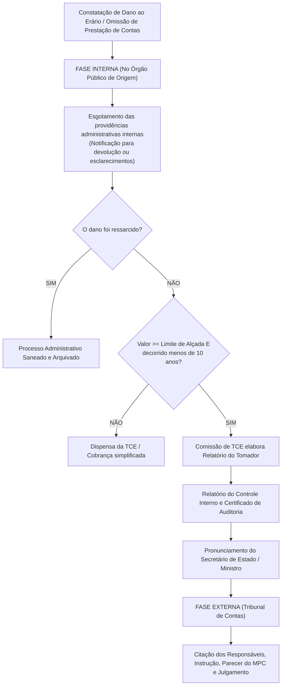
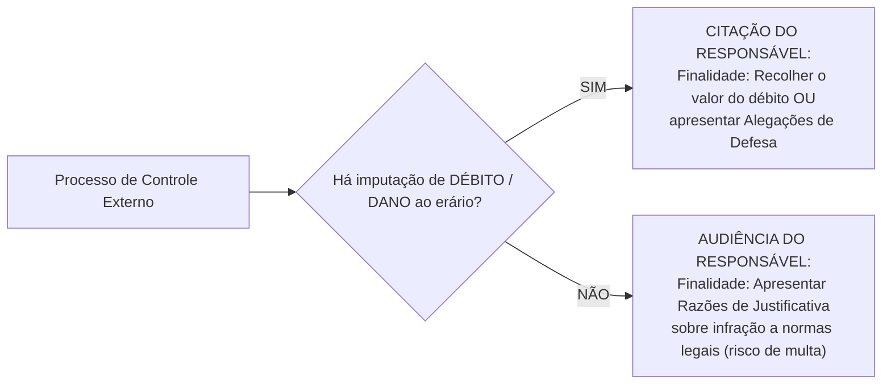
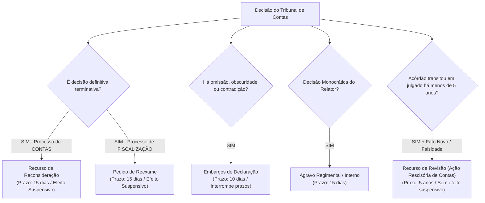

# 04 - Relatórios de Auditoria, Processo de Controle Externo, Tomada de Contas Especial e Sanções

> **Matéria:** Noções de Controle Externo  
> **Cargo:** A01 – Técnico de Controle Externo – Especialidade: Técnico Administrativo  
> **Arquivo:** `04_relatorios_processo_de_controle_externo_e_sancoes.md`  

---

## 📌 Ementa / Itens do Edital

- Comunicação dos resultados da auditoria: atributos, estrutura e padronização dos relatórios de controle externo (clareza, concisão, precisão, objetividade, completude e tempestividade);
- Deliberações do Tribunal de Contas: acórdãos colegiados, decisões monocráticas do Relator, determinações mandamentais e recomendações propositivas;
- Monitoramento das deliberações e Planos de Ação formulados pelo gestor público;
- Tomada de Contas Especial (TCE):
  - Conceito, natureza jurídica excepcional e finalidades institucionais;
  - Pressupostos cumulativos de instauração (ocorrência de dano ou omissão de contas, esgotamento das providências administrativas internas, valor superior ao limite de alçada e não transcurso de mais de 10 anos);
  - Fase interna no órgão de origem vs. Fase externa perante o Tribunal de Contas;
  - Hipóteses de dispensa, trancamento e arquivamento da TCE;
- O processo no Tribunal de Contas:
  - Comunicações processuais: Citação (para ressarcimento de débito) vs. Audiência (para justificativa de infração legal);
  - Fase recursal no processo de contas: Recurso de Reconsideração, Pedido de Reexame, Embargos de Declaração, Agravo e Recurso de Revisão;
- Julgamento técnico das contas dos administradores públicos:
  - Contas Regulares (quitação plena);
  - Contas Regulares com Ressalva (quitação com determinações corretivas para falhas formais);
  - Contas Irregulares (dano ao erário, desfalque, desvio, infração grave à norma ou reincidência de descumprimento);
  - Contas Iliquidáveis (caso fortuito ou força maior que inviabilize o exame de mérito);
- Regime sancionatório dos Tribunais de Contas:
  - Condenação em débito (natureza indenizatória reparatória);
  - Multas administrativas (proporcional ao débito e multa por grave infração à norma legal);
  - Inabilitação para o exercício de cargo em comissão ou função de confiança (até 5 anos);
  - Declaração de inidoneidade para participar de licitações e contratar com a Administração Pública (até 5 anos);
  - Reflexos eleitorais do julgamento de contas (inelegibilidade de 8 anos da Lei da Ficha Limpa - LC nº 64/90);
- Prescrição no âmbito do controle externo: prescrição quinquenal (5 anos) da pretensão punitiva e ressarcitória (Tema 899 do STF e Lei nº 9.873/1999) e prescrição intercorrente trienal (3 anos).

---

## 🌳 Classificação Hierárquica

```text
4. Relatórios, Processo de Controle Externo, Tomada de Contas Especial e Sanções
├── 4.1 Comunicação dos Resultados e Deliberações do Tribunal
│   ├── 4.1.1 Atributos Qualitativos do Relatório: Clareza, concisão, precisão, objetividade, completude e tempestividade
│   ├── 4.1.2 Espécies de Deliberações:
│   │   ├── Acórdão: Decisão colegiada proferida pelas Câmaras ou pelo Plenário
│   │   ├── Decisão Monocrática: Proferida singularmente pelo Conselheiro-Relator (ex.: concessão de cautelar)
│   │   ├── Determinações: Ordens mandamentais vinculantes para sanar ilegalidades (cumprimento obrigatório)
│   │   └── Recomendações: Orientações de caráter propositivo e pedagógico para aprimorar a gestão discricionária
│   └── 4.1.3 Monitoramento: Fiscalização do cumprimento das deliberações com exigência de Plano de Ação
├── 4.2 Tomada de Contas Especial (TCE)
│   ├── 4.2.1 Natureza: Processo administrativo excepcional de ressarcimento deflagrado após esgotadas as vias internas
│   ├── 4.2.2 Pressupostos de Instauração Obrigatória:
│   │   ├── 1. Omissão no dever de prestar contas ou ocorrência de desfalque, desvio ou dano ao erário
│   │   ├── 2. Esgotamento das providências administrativas internas no órgão onde o fato ocorreu
│   │   ├── 3. Prejuízo financeiro em valor superior ao limite de alçada normativo
│   │   └── 4. Não transcurso de mais de 10 anos entre a ocorrência do fato e a notificação válida do responsável
│   └── 4.2.3 As Duas Fases da TCE:
│       ├── Fase Interna: Conduzida no órgão de origem pela comissão tomadora, com relatório do controle interno e manifestação da autoridade máxima supervisora
│       └── Fase Externa: Autuada no Tribunal de Contas, com citação do responsável, parecer do Ministério Público de Contas e julgamento colegiado
├── 4.3 O Processo de Controle Externo e as Garantias Constitucionais
│   ├── 4.3.1 Espécies de Comunicação Processual:
│   │   ├── Citação: Comunicação para recolher débito apurado OU apresentar alegações de defesa (há imputação de dano)
│   │   └── Audiência: Chamamento para apresentar razões de justificativa (apuração de infração à norma, sem dano)
│   ├── 4.3.2 Sistema Recursal no Processo de Contas:
│   │   ├── Recurso de Reconsideração: Cabível contra decisão definitiva em processo de contas (efeito suspensivo)
│   │   ├── Pedido de Reexame: Cabível contra decisão de mérito em processos de fiscalização (auditorias, inspeções)
│   │   ├── Embargos de Declaração: Para sanar omissão, contradição ou obscuridade no julgado
│   │   ├── Agravo: Cabível contra decisões monocráticas interlocutórias do Relator
│   │   └── Recurso de Revisão: Ação rescisória de contas cabível no prazo de 5 anos fundada em fato ou documento novo
│   └── 4.3.3 Coisa Julgada Administrativa: Decisão torna-se definitiva na via administrativa, admitindo revisão judicial estrita da legalidade pelo Poder Judiciário (Art. 5º, XXXV da CF)
├── 4.4 Julgamento das Contas de Gestão (Art. 71, II da CF)
│   ├── 4.4.1 Contas Regulares: Demonstram exatidão e legalidade plena dos atos -> Quitação plena ao responsável
│   ├── 4.4.2 Contas Regulares com Ressalva: Falhas meramente formais que não causaram dano -> Quitação com determinações
│   ├── 4.4.3 Contas Irregulares: Dano ao erário, desfalque, desvio, gestão ilegítima ou grave infração legal -> Condenação em débito, multa, inabilitação e remessa ao MPE (inelegibilidade da Lei da Ficha Limpa)
│   └── 4.4.4 Contas Iliquidáveis: Caso fortuito ou força maior que impossibilite materialmente o julgamento -> Trancamento das contas e arquivamento (reabríveis dentro de 5 anos com novos fatos)
└── 4.5 Regime Sancionatório e Prescrição
    ├── 4.5.1 Sanções Aplicáveis pelos Tribunais de Contas:
    │   ├── Imputação de Débito: Ressarcimento integral do dano patrimonial (eficácia de título executivo extrajudicial)
    │   ├── Multa Proporcional ao Dano: De até 100% do valor do prejuízo apurado
    │   ├── Multa por Grave Infração à Norma Legal ou não atendimento de diligências
    │   ├── Inabilitação para o Exercício de Cargo em Comissão ou Função de Confiança: Por período de até 5 anos
    │   └── Declaração de Inidoneidade para Licitar e Contratar: Por período de até 5 anos
    └── 4.5.2 Prescrição nos Tribunais de Contas (Lei 9.873/1999 e STF Tema 899):
        ├── Prescrição Principal: Prazo de 5 (cinco) anos para o exercício das pretensões punitiva e de ressarcimento
        └── Prescrição Intercorrente: Prazo de 3 (três) anos se o processo ficar paralisado sem movimentação instrutória
```

---

## 📖 Conteúdo Teórico Aprofundado

### 1. Tomada de Contas Especial (TCE): Rito e Pressupostos

A **Tomada de Contas Especial (TCE)** é um processo administrativo de caráter **excepcional**, instaurado com rito próprio para apurar fatos lesivos, identificar responsáveis, quantificar o prejuízo e obter a recomposição do erário.



#### Pressupostos de Instauração e Hipóteses de Dispensa / Arquivamento
Para a instauração e prosseguimento regular de uma TCE, exige-se o preenchimento cumulativo de quatro pressupostos:
1. **Ocorrência do Dano ou Omissão:** Caracterização de desfalque, desvio, ato de gestão ilegal/ilegítimo ou omissão no dever de prestar contas;
2. **Esgotamento das Vias Internas:** Demonstração de que a administração tentou obter o ressarcimento voluntário sem sucesso;
3. **Limite de Alçada:** O valor histórico atualizado do dano deve ser **igual ou superior ao limite mínimo de alçada** fixado anualmente pelo Tribunal de Contas (evita que o custo operacional do controle supere o montante a recuperar);
4. **Tempestividade (Regra dos 10 anos):** Não deve ter decorrido prazo superior a **dez (10) anos** entre a data originária do fato e a primeira notificação válida do responsável pela administração. Se decorridos mais de 10 anos sem notificação, a TCE é arquivada por comprometimento insanável da ampla defesa e do contraditório.

---

### 2. Comunicações Processuais: Citação vs. Audiência

Nos processos em trâmite nos Tribunais de Contas, a intimação para defesa adota duas formas distintas conforme o conteúdo da imputação:



- **Citação:** Instrumento formal cabível quando há imputação de **débito patrimonial**. O responsável é intimado para recolher a importância devida acrescida de encargos ou apresentar **alegações de defesa**.
- **Audiência:** Instrumento formal cabível quando não há imputação de débito, mas sim **irregularidade ou infração grave a norma legal/regulamentar**, ou descumprimento de diligência. O responsável é intimado para apresentar **razões de justificativa**, sujeitando-se à aplicação de multa pecuniária.

---

### 3. Julgamento das Contas de Gestão dos Administradores Públicos

O Tribunal de Contas, ao julgar em caráter definitivo as contas dos ordenadores de despesas e gestores públicos (Art. 71, II da CF/88), manifestará um dos quatro julgamentos:

| Julgamento de Mérito | Hipóteses Constitucionais e Legais | Desfecho / Efeitos Processuais |
| :--- | :--- | :--- |
| **Regulares** | Contas que expressam exatidão dos demonstrativos, legalidade, legitimidade e economicidade dos atos de gestão. | **Quitação plena** e irrestrita ao responsável. |
| **Regulares com Ressalva** | Constatação de falhas meramente formais ou de ordem técnica das quais **não resulte dano ao erário** nem grave infração à norma. | **Quitação** com expedição de determinações e recomendações para prevenir reincidência. |
| **Irregulares** | a) Omissão no dever de prestar contas;<br>b) Gestão ilegal, ilegítima ou antieconômica;<br>c) Grave infração a norma legal ou regulamentar;<br>d) Desfalque, desvio de bens ou dano injustificado ao erário. | Condenação em **débito**, aplicação de **multa**, inabilitação temporária para cargos públicos e inclusão na lista da Justiça Eleitoral (**inelegibilidade por 8 anos** pela LC 64/90). |
| **Iliquidáveis** | Caso fortuito ou força maior comprovadamente alheio à vontade do gestor que impeça materialmente o julgamento de mérito (ex.: incêndio ou inundação que destrua acervo documental). | **Trancamento das contas** e arquivamento do processo. (Se surgirem novos elementos no prazo de 5 anos, o processo pode ser reaberto). |

> 🚨 **ALERTA DE PROVA / PEGADINHA FCC:**  
> A omissão no dever de prestar contas **NÃO torna as contas iliquidáveis**! Omissão no dever de prestar contas acarreta o julgamento de **contas IRREGULARES**, com presunção de débito e aplicação de multa ao gestor omisso. Contas iliquidáveis exigem comprovação de motivo de força maior absolutamente inimputável ao agente.

---

### 4. Sistema Recursal no Processo de Controle Externo

A legislação orgânica dos Tribunais de Contas (Lei nº 16.168/2007 do TCE-GO e Lei 8.443/92) prevê os seguintes recursos:



- **Recurso de Reconsideração:** Cabível contra decisão definitiva proferida em **processo de contas** (Prestação ou Tomada de Contas). Possui efeito suspensivo.
- **Pedido de Reexame:** Cabível contra decisão de mérito em **processos de fiscalização** (auditoria, inspeção, acompanhamento e denúncias/representações). Possui efeito suspensivo.
- **Recurso de Revisão:** Assemelha-se a uma **ação rescisória**. Cabível uma única vez, no prazo decadencial de **cinco (5) anos** do trânsito em julgado, com base em erro de cálculo, falsidade documental comprovada ou superveniência de documentos novos com eficácia probatória. Não tem efeito suspensivo.

---

### 5. Prescrição nos Tribunais de Contas: O Marco do STF (Tema 899)

A disciplina da prescrição nas ações perante os Tribunais de Contas é orientada pelas seguintes diretrizes:
- **Tema 899 do STF (RE 636.886):** O Supremo Tribunal Federal pacificou que a pretensão de ressarcimento ao erário fundada em decisão de Tribunal de Contas é **prescritível**, aplicando-se o prazo **quinquenal (5 anos)** do Decreto nº 20.910/1932 e da Lei nº 9.873/1999.
- **Prescrição Principal:** Prescrevem em **5 (cinco) anos** a pretensão punitiva (aplicação de multas, inabilitação e inidoneidade) e a pretensão ressarcitória (imputação de débito) nos Tribunais de Contas.
- **Prescrição Intercorrente:** Opera-se a prescrição intercorrente no prazo de **3 (três) anos** caso o processo administrativo fique paralisado, pendente de despacho ou instrução processual injustificada.
- **Marcos Interruptivos da Prescrição:** Interrompem a contagem do prazo prescricional:
  - A notificação ou citação do responsável para apresentar defesa;
  - Qualquer ato inequívoco de apuração do fato praticado pela autoridade competente;
  - A decisão condenatória recorrível proferida pelo órgão colegiado.

---

## 🌐 Fontes Oficiais & Jurisprudenciais Recomendadas

- [Lei Estadual nº 16.168/2007 (Lei Orgânica do TCE-GO)](https://legisla.casacivil.go.gov.br/)
  - Arts. 45 a 85 (Do processo de contas, recursos regimentais e regime de sanções).
- [Regimento Interno do TCE-GO (Resolução nº 22/2008)](https://portal.tce.go.gov.br/)
  - Tramitação processual, prazos recursais e procedimentos de Tomada de Contas Especial.
- [Instrução Normativa TCU nº 71/2012](https://portal.tcu.gov.br/)
  - Regulamenta a instauração e organização das Tomadas de Contas Especiais no setor público.
- [Supremo Tribunal Federal - Tema 899 de Repercussão Geral](https://portal.stf.jus.br/)
  - Tese vinculante sobre a prescritibilidade das ações de cobrança fundadas em títulos executivos dos TCs.
- [Lei Complementar Federal nº 64/1990 (Lei das Inelegibilidades / Lei da Ficha Limpa)](https://www.planalto.gov.br/ccivil_03/leis/lcp/lcp64.htm)
  - Art. 1º, inciso I, alínea "g" (inelegibilidade decorrente de rejeição de contas por irregularidade insanável).

---

## 📝 Questões Comentadas no Padrão FCC

### Questão 1 (FCC - Adaptada / TCE-PI - Auditor de Controle Externo)
A respeito da Tomada de Contas Especial (TCE) perante o sistema constitucional e processual dos Tribunais de Contas, assinale a opção correta:

A) A Tomada de Contas Especial constitui procedimento ordinário de fiscalização anual a que se submetem compulsoriamente todos os dirigentes de autarquias estaduais ao término de cada exercício financeiro.  
B) A autoridade administrativa competente deve instaurar de imediato a TCE tão logo verifique qualquer indício de dano, sendo-lhe expressamente vedada a adoção de medidas administrativas internas prévias para obtenção do ressarcimento amigável.  
C) A instauração da TCE é medida excepcional de apuração de responsabilidades, que pressupõe o esgotamento prévio das providências administrativas internas para recomposição do erário e a demonstração cabal da ocorrência de prejuízo de valor superior ao limite de alçada legalmente fixado.  
D) Caso o dano apurado decorra de desfalque praticado por particular sem vínculo estatutário com o poder público, o Tribunal de Contas não possui competência jurisdicional para julgar a respectiva TCE, devendo os autos ser remetidos com exclusividade à autoridade policial.  
E) A citação do responsável no bojo da Tomada de Contas Especial dispensa a individualização da conduta e a indicação do valor nominal do débito atribuído, bastando a descrição genérica do fato apurado pela comissão tomadora.  

> **Gabarito: C**  
>
> **Análise detalhada de cada alternativa:**  
> - **A) INCORRETA:** O procedimento ordinário anual é a Prestação/Tomada de Contas Ordinária. A TCE é processo administrativo de caráter extraordinário e excepcional vocacionado a apurar dano ao erário e buscar reparação patrimonial.  
> - **B) INCORRETA:** A autoridade administrativa deve, primeiramente, esgotar todas as providências administrativas internas no âmbito do próprio órgão para tentar reaver os valores amigavelmente antes de instaurar a TCE.  
> - **C) CORRETA:** A TCE é instrumento de exceção. A sua regular deflagração exige simultaneamente: a) ocorrência de dano; b) esgotamento das vias administrativas prévias sem êxito; c) valor do dano superior ao limite de alçada normativo do Tribunal; e d) não transcurso de mais de dez anos entre o fato e a primeira notificação válida do agente.  
> - **D) INCORRETA:** O art. 70, parágrafo único e o art. 71, II da CF/88 conferem competência ampla ao Tribunal de Contas para julgar particulares que derem causa a perda, extravio ou outra irregularidade de que resulte dano ao erário.  
> - **E) INCORRETA:** Para resguardar a ampla defesa e o contraditório, o mandado de citação deve obrigatoriamente delimitar o valor atualizado do débito, o período dos fatos e a conduta individualizada atribuída ao responsável.

---

### Questão 2 (FCC - Adaptada / TCE-AM - Auditor de Controle Externo)
Um Tribunal de Contas estadual, ao analisar o processo de prestação de contas de determinado dirigente de fundação pública estadual, constatou a ocorrência de grave infração a normas orçamentárias e regulamentares da Lei nº 4.320/1964 e da Lei de Responsabilidade Fiscal, todavia sem comprovação de desfalque ou locupletamento ilícito com dano patrimonial aos cofres públicos.

Diante de tal quadro, à luz da legislação de regência e da jurisprudência consolidada, o Tribunal de Contas deverá:

A) Considerar as contas iliquidáveis, determinando o trancamento do processo e seu arquivamento definitivo na Secretaria.  
B) Julgar as contas irregulares, sendo cabível a aplicação de penalidade de multa por grave infração à norma legal, ainda que não subsista débito patrimonial a ser imputado.  
C) Julgar as contas regulares com ressalva, haja vista que a ausência de prejuízo financeiro efetivo afasta a possibilidade de juízo terminativo de irregularidade.  
D) Declarar extinta a punibilidade, reconhecendo a imprescritibilidade privativa do processo administrativo de contas públicas.  
E) Deixar de julgar as contas e remeter os autos à Procuradoria-Geral do Estado para ajuizamento de ação de improbidade administrativa perante o Poder Judiciário.  

> **Gabarito: B**  
>
> **Análise detalhada de cada alternativa:**  
> - **A) INCORRETA:** Contas iliquidáveis decorrem de caso fortuito ou força maior comprovada (ex.: enchente destruindo arquivos) que impeça materialmente o julgamento.  
> - **B) CORRETA:** Conforme o art. 71, II e VIII da CF/88 e a Lei Orgânica do TCE-GO (art. 59, III), as contas de gestão serão julgadas **irregulares** quando comprovada a prática de grave infração a norma legal ou regulamentar de natureza contábil, financeira ou orçamentária, aplicando-se multa sancionatória ao gestor, mesmo na hipótese em que não tenha havido dano ao erário.  
> - **C) INCORRETA:** Grave infração a norma legal impede o juízo de regularidade com ressalva, o qual se reserva estritamente a falhas formais de menor relevância que não comprometam a legitimidade da gestão.  
> - **D) INCORRETA:** Pretensões punitivas do Tribunal de Contas prescrevem no prazo de cinco anos (Tema 899 do STF).  
> - **E) INCORRETA:** O julgamento técnico das contas dos administradores de fundações públicas é competência constitucional privativa e irrenunciável do Tribunal de Contas (art. 71, II).

---

### Questão 3 (FCC - Adaptada / Analista de Controle Externo)
Em processo de controle externo instaurado no Tribunal de Contas para apurar irregularidades em contrato administrativo estadual, a equipe técnica concluiu que determinada cláusula editalícia violou a Lei de Licitações, porém sem constatação de sobrepreço ou superfaturamento nos pagamentos realizados à empreiteira.

Para oportunizar a manifestação formal do gestor que subscreveu o edital impugnado, o ato de comunicação processual adequado a ser determinado pelo Relator é a:

A) Citação, para recolhimento da multa fixada de plano em vinte dias.  
B) Audiência, para apresentação de razões de justificativa no prazo regimental.  
C) Interpelação judicial perante a Vara da Fazenda Pública.  
D) Notificação cartorária para confissão de dívida.  
E) Citação por edital com prazo de cinco dias sob pena de revelia e prisão civil.  

> **Gabarito: B**  
>
> **Análise detalhada de cada alternativa:**  
> - **A) INCORRETA:** A citação é reservada a processos em que há imputação de débito e pretensão de ressarcimento por dano ao erário.  
> - **B) CORRETA:** A **Audiência** é o instrumento processual próprio de chamamento aos autos utilizado pelo Tribunal de Contas quando se imputa ao responsável a prática de infração à norma legal ou regulamentar sem dano patrimonial apurado, conferindo-lhe prazo para apresentar **razões de justificativa** antes de eventual cominação de multa.  
> - **C) INCORRETA:** Trata-se de procedimento administrativo de controle externo, prescindindo de interpelação perante o Poder Judiciário.  
> - **D) INCORRETA:** Inaplicável aos processos de controle externo.  
> - **E) INCORRETA:** Tribunais de Contas não decretam prisão civil e a citação é medida voltada para cobrança de dano.

---

### Questão 4 (FCC - Adaptada / Procuradoria Legislativa)
Contra acórdão proferido pelo Plenário do Tribunal de Contas que julgou irregulares as contas de determinado administrador público e imputou-lhe débito em processo de Tomada de Contas Especial, o responsável inconformado poderá interpor, no prazo regulamentar de quinze dias e com efeito suspensivo:

A) Recurso de Revisão.  
B) Pedido de Reexame.  
C) Recurso de Reconsideração.  
D) Apelação Cível Administrativa.  
E) Mandado de Segurança perante o Tribunal de Justiça.  

> **Gabarito: C**  
>
> **Análise detalhada de cada alternativa:**  
> - **A) INCORRETA:** O Recurso de Revisão tem natureza de ação rescisória, cabível no prazo decadencial de 5 anos do trânsito em julgado, sem efeito suspensivo.  
> - **B) INCORRETA:** O Pedido de Reexame é o recurso cabível contra decisões de mérito em **processos de fiscalização** (auditorias, inspeções, acompanhamentos), e não em processos de contas.  
> - **C) CORRETA:** Nos termos da Lei Orgânica dos Tribunais de Contas (art. 76 da Lei nº 16.168/2007 do TCE-GO e art. 33 da Lei 8.443/92), o recurso cabível contra acórdão definitivo proferido em **processo de contas** (Prestação de Contas ou Tomada de Contas Especial) é o **Recurso de Reconsideração**, dotado de efeito suspensivo.  
> - **D) INCORRETA:** Recurso inexistente no processo de controle externo.  
> - **E) INCORRETA:** O MS é remédio jurisdicional, e não via recursal administrativa interna contra decisão definitiva de contas.

---

### Questão 5 (FCC - Adaptada / Analista de Gestão Pública)
Acerca dos reflexos eleitorais decorrentes das decisões terminativas proferidas pelos Tribunais de Contas, consoante o disposto na Lei Complementar nº 64/1990 (com as alterações da Lei da Ficha Limpa) e a jurisprudência sumulada do TSE:

A) O julgamento que considera contas regulares com ressalva atrai automaticamente a inelegibilidade do gestor pelo prazo de quatro anos.  
B) São inelegíveis para qualquer cargo os que tiverem suas contas relativas ao exercício de cargos ou funções públicas rejeitadas por irregularidade insanável que configure ato doloso de improbidade administrativa, por decisão irrecorrível do órgão competente, salvo se suspensa pelo Poder Judiciário.  
C) Toda e qualquer reprovação de contas em Tribunal de Contas gera inelegibilidade irrecorrível, sendo vedada qualquer apreciação do processo pelo Poder Judiciário.  
D) As decisões dos Tribunais de Contas não produzem efeitos eleitorais, cabendo exclusivamente à Justiça Eleitoral apurar danos patrimoniais e desvios de conduta.  
E) A inelegibilidade decorrente da rejeição de contas perdura por até vinte anos contados da data da notificação inicial no Tribunal de Contas.  

> **Gabarito: B**  
>
> **Análise detalhada de cada alternativa:**  
> - **A) INCORRETA:** Regularidade com ressalva não gera inelegibilidade, pois representa quitação das contas com identificação de meras falhas formais.  
> - **B) CORRETA:** Reproduz a literalidade do art. 1º, inciso I, alínea "g" da Lei Complementar nº 64/1990: são inelegíveis *"os que tiverem suas contas relativas ao exercício de cargos ou funções públicas rejeitadas por irregularidade insanável que configure ato doloso de improbidade administrativa, e por decisão irrecorrível do órgão competente, salvo se esta houver sido suspensa ou anulada pelo Poder Judiciário, para as eleições que se realizarem nos 8 (oito) anos seguintes"*.  
> - **C) INCORRETA:** Pelo princípio da inafastabilidade da jurisdição (art. 5º, XXXV da CF), o Poder Judiciário pode apreciar a legalidade formal e material dos julgamentos dos TCs.  
> - **D) INCORRETA:** As decisões dos Tribunais de Contas constituem o fundamento primordial da cláusula de inelegibilidade do art. 1º, I, "g" da LC 64/90.  
> - **E) INCORRETA:** O prazo legal de inelegibilidade é de **oito (8) anos** contados da data da decisão irrecorrível.
