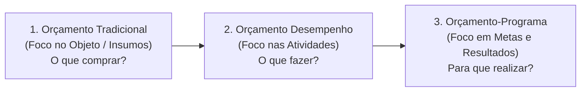
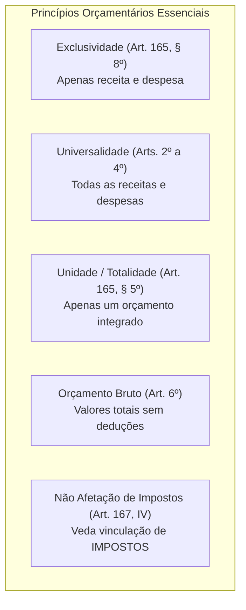
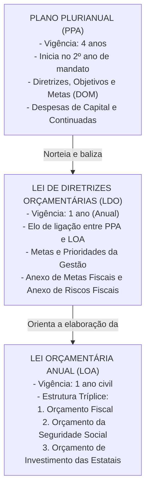
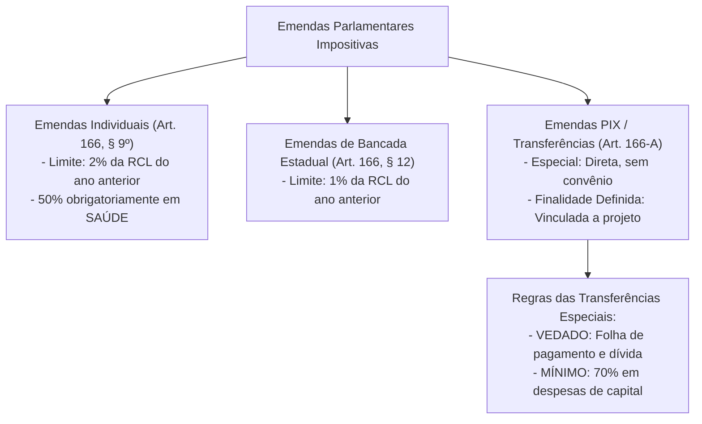

# 01 - Orçamento Público, Princípios, Ciclo Orçamentário, PPA, LDO, LOA e Orçamento Impositivo

> **Matéria:** Noções de Administração Financeira e Orçamentária (AFO)  
> **Cargo:** A01 – Técnico de Controle Externo – Especialidade: Técnico Administrativo  
> **Arquivo:** `01_orcamento_publico_principios_e_ciclo_ppa_ldo_loa.md`  

---

## 📌 Ementa / Itens do Edital

- Orçamento público: conceito, natureza jurídica e evolução histórica dos modelos (Orçamento Tradicional/Clássico, de Desempenho, Base-Zero e Orçamento-Programa);
- Princípios orçamentários fundamentais: unidade/totalidade, universalidade, anualidade/periodicidade, exclusividade, orçamento bruto, não afetação da receita de impostos, legalidade, clareza e equilíbrio;
- O sistema orçamentário na Constituição Federal de 1988 (Artigo 165):
  - Plano Plurianual (PPA): vigência quadrienal, diretrizes, objetivos e metas (DOM), despesas de capital e programas de duração continuada;
  - Lei de Diretrizes Orçamentárias (LDO): elo entre PPA e LOA, metas e prioridades, Anexo de Metas Fiscais (AMF) e Anexo de Riscos Fiscais (ARF) da LRF;
  - Lei Orçamentária Anual (LOA): estrutura tríplice integrada (Orçamento Fiscal, da Seguridade Social e de Investimento das Estatais);
- Ciclo orçamentário e processo legislativo: elaboração da proposta, apreciação na Comissão Mista, emendas parlamentares, votação, sanção/veto, execução e controle;
- Emendas parlamentares e o Orçamento Impositivo:
  - Emendas individuais (Art. 166, §§ 9º e 11 da CF/88): limite percentual de 2% da RCL e aplicação obrigatória de 50% em saúde;
  - Emendas de bancada estadual impositivas (Art. 166, §§ 12 e 13);
  - As modalidades do Artigo 166-A da CF/88: Transferências especiais ("emendas PIX") vs. transferências com finalidade definida;
  - Impedimentos de ordem técnica e contingenciamento proporcional na execução impositiva.

---

## 🌳 Classificação Hierárquica

```text
1. Teoria do Orçamento Público e Sistema Orçamentário da CF/88
├── 1.1 Conceito e Evolução dos Modelos Orçamentários
│   ├── 1.1.1 Orçamento Tradicional / Clássico: Mero controle financeiro, foco no objeto de gasto ("o que comprar"), sem plano
│   ├── 1.1.2 Orçamento de Desempenho / Funcional: Foco nas coisas que o governo faz, sem integração estratégica ao planejamento
│   ├── 1.1.3 Orçamento Base-Zero (OBZ - Peter Pyhrr): Reavaliação anual de todos os gastos a partir do marco zero (sem direito adquirido)
│   └── 1.1.4 Orçamento-Programa (Modelo da CF/88 e Lei 4.320/64): Instrumento de planejamento governamental ("para que gastar"), orientado por programas, metas e indicadores
├── 1.2 Princípios Orçamentários Constitucionais e Legais
│   ├── 1.2.1 Unidade / Totalidade: Cada ente federativo deve possuir apenas uma lei orçamentária anual consolidada
│   ├── 1.2.2 Universalidade: Todas as receitas e despesas de todos os poderes e fundos devem constar na LOA
│   ├── 1.2.3 Anualidade / Periodicidade: Coincide com o ano civil (1º de janeiro a 31 de dezembro)
│   │   └── Exceção: Reabertura de créditos especiais e extraordinários abertos nos últimos 4 meses do exercício
│   ├── 1.2.4 Exclusividade (Art. 165, § 8º da CF/88): A LOA conterá apenas previsão de receita e fixação de despesa (veda caudas orçamentárias)
│   │   └── Duas Exceções Expressas: Autorização para abertura de créditos suplementares e contratação de operações de crédito (inclusive por ARO)
│   ├── 1.2.5 Orçamento Bruto (Art. 6º da Lei 4.320/64): Receitas e despesas constarão pelo seu valor bruto total, sem deduções
│   ├── 1.2.6 Não Afetação da Receita de Impostos (Art. 167, IV): É vedada a vinculação da receita de IMPOSTOS a órgão, fundo ou despesa
│   │   └── Exceções Taxativas: Saúde (Art. 198), Educação (Art. 212), Fundos FPE/FPM, Garantia a operações de crédito e Administração Tributária
│   └── 1.2.7 Equilíbrio Orçamentário: Igualdade formal e material entre receitas estimadas e despesas fixadas
├── 1.3 O Tríptico Orçamentário Constitucional (Art. 165 da CF/88)
│   ├── 1.3.1 Plano Plurianual (PPA):
│   │   ├── Vigência Quadrienal: Inicia no 2º ano de mandato do governante e encerra no 1º ano do mandato subsequente
│   │   └── Conteúdo: Estabelece as Diretrizes, Objetivos e Metas (DOM) para despesas de capital e programas continuados
│   ├── 1.3.2 Lei de Diretrizes Orçamentárias (LDO):
│   │   ├── Vigência Anual: Elo de sintonia entre o plano estratégico (PPA) e a execução operacional (LOA)
│   │   ├── Conteúdo Constitucional: Metas e prioridades, orienta elaboração da LOA, dispõe sobre despesa com pessoal e tributos
│   │   └── Conteúdo LRF (Art. 4º): Anexo de Metas Fiscais (metas de resultado primário e nominal para 3 anos) e Anexo de Riscos Fiscais (passivos contingentes)
│   └── 1.3.3 Lei Orçamentária Anual (LOA - Estrutura Tríplice Integrada):
│       ├── Orçamento Fiscal: Poderes do ente, fundos, órgãos e entidades da administração direta e indireta
│       ├── Orçamento da Seguridade Social: Ações nas áreas de Saúde, Previdência Social e Assistência Social
│       └── Orçamento de Investimento das Estatais: Empresas em que o Estado detenha, direta ou indiretamente, a maioria do capital social com direito a voto
└── 1.4 Emendas Parlamentares e o Orçamento Impositivo (Arts. 166 e 166-A da CF/88)
    ├── 1.4.1 Emendas Individuais Impositivas:
    │   ├── Limite Global: 2% da Receita Corrente Líquida (RCL) do exercício anterior
    │   └── Destinação Vinculada Obrigatória: Exatamente 50% do montante deve ser aplicado em Ações e Serviços Públicos de Saúde (ASPS)
    ├── 1.4.2 Emendas de Bancada Estadual: Limite de 1% da RCL para execução obrigatória e institucional
    ├── 1.4.3 Modalidades do Art. 166-A (EC nº 105/2019):
    │   ├── Transferência Especial ("Emenda PIX"): Repasse financeiro direto ao ente federativo sem exigência de convênio; passa a pertencer ao ente recebedor; vedado uso para pessoal e serviço da dívida; mínimo de 70% em despesas de capital
    │   └── Transferência com Finalidade Definida: Vinculada à área de competência associada à emenda com instrumento congênere
    └── 1.4.4 Limitações da Execução Obrigatória: Contingenciamento proporcional em caso de frustração de receitas e impedimentos de ordem técnica
```

---

## 📖 Conteúdo Teórico Aprofundado

### 1. Evolução dos Modelos de Orçamento Público

O orçamento público passou por transformações históricas determinantes para a compreensão das finanças públicas:



| Modelo Orçamentário | Foco Central | Relação com o Planejamento | Principal Característica Cobrada pela FCC |
| :--- | :--- | :--- | :--- |
| **Tradicional / Clássico** | Objeto do gasto (materiais, salários, diárias). | Inexistente. | Instrumento de mero controle financeiro do Executivo pelo Legislativo. Não há preocupação com metas sociais. |
| **De Desempenho / Funcional** | Atividades e coisas que o governo realiza (*outputs*). | Desconectado do plano de longo prazo. | Preocupa-se com o trabalho realizado, mas sem vincular aos programas estruturados de desenvolvimento. |
| **Base-Zero (OBZ)** | Justificativa individual de cada item a partir do zero. | Curto/Médio prazo. | Idealizado por Peter Pyhrr; rompe com o incrementalismo orçamentário. Nenhum gasto tem direito adquirido. |
| **Orçamento-Programa** | Objetivos, programas, metas e impacto social. | **Total e indissociável** (PPA + LDO + LOA). | **Adotado no Brasil**. Aloca recursos segundo programas governamentais mensurados por indicadores objetivos de resultado. |

---

### 2. Princípios Orçamentários: O Núcleo Duro da FCC

Para garantir higidez, transparência e controle legislativo, a Constituição Federal de 1988 e a Lei nº 4.320/1964 consagram os seguintes princípios orçamentários:



#### 2.1 Princípio da Exclusividade (Art. 165, § 8º da CF/88)
A Lei Orçamentária Anual não conterá dispositivo estranho à previsão da receita e à fixação da despesa (proibição de *caudas orçamentárias* ou *rabilongos*).
- **As Duas Únicas Exceções Constitucionais Permitidas na LOA:**
  1. Autorização para **abertura de créditos suplementares**;
  2. Autorização para a **contratação de operações de crédito**, ainda que por antecipação de receita orçamentária (ARO), nos termos da lei.

> 🚨 **ALERTA DE PROVA / PEGADINHA FCC:**  
> A LOA pode autorizar a abertura de créditos **suplementares**, mas **JAMAIS pode autorizar a abertura de créditos especiais ou extraordinários**! Créditos especiais dependem de lei específica posterior, e extraordinários de Medida Provisória ou Decreto Executivo.

---

#### 2.2 Princípio da Não Afetação (Não Vinculação) da Receita de Impostos (Art. 167, IV)
É terminantemente vedada a vinculação da receita de **impostos** a órgão, fundo ou despesa.
- **Alcance Restrito:** A vedação atinge **exclusivamente os impostos**! As taxas, contribuições de melhoria e contribuições especiais (como a contribuição previdenciária e a COSIP) possuem receitas constitucionalmente vinculadas a seus objetivos específicos.
- **As Cinco Exceções Constitucionais Expressas (Art. 167, IV):**
  1. Ações e serviços públicos de **saúde** (Art. 198, § 2º);
  2. Manutenção e desenvolvimento do **ensino** (Art. 212);
  3. Realização de atividades da **administração tributária** (Art. 37, XXII);
  4. Repartição constitucional de receitas tributárias (Fundos de Participação dos Estados - FPE e Municípios - FPM);
  5. Prestação de garantias às operações de crédito por antecipação de receita e garantias prestadas à União.

---

### 3. O Tríptico Orçamentário na CF/88: PPA, LDO e LOA

A gestão das finanças públicas no Brasil é estruturada em três leis orçamentárias harmônicas de iniciativa privativa do Chefe do Poder Executivo:



#### 3.1 Detalhamento das Três Leis Orçamentárias
1. **Plano Plurianual - PPA (Art. 165, § 1º):**  
   - Estabelece, de forma regionalizada, as **Diretrizes, Objetivos e Metas (DOM)** da administração pública para as **despesas de capital** (obras, instalações e equipamentos) e outras delas decorrentes, e para os **programas de duração continuada**.  
   - Vigência de **quatro anos**, não coincidente com o mandato do Chefe do Executivo: tem início no segundo ano de mandato do governante e vigora até o final do primeiro ano do mandato subsequente, preservando a continuidade das políticas de Estado.
2. **Lei de Diretrizes Orçamentárias - LDO (Art. 165, § 2º c/c Art. 4º da LRF):**  
   - Compreende as **metas e prioridades** da administração pública federal ou estadual;  
   - Orienta a elaboração da Lei Orçamentária Anual e dispõe sobre as alterações na legislação tributária;  
   - Regula a concessão de vantagens ou aumento de remuneração de servidores;  
   - **Inovações da LRF (Art. 4º):** A LDO contém obrigatoriamente:  
     - *Anexo de Metas Fiscais (AMF):* Fixa metas anuais para receitas, despesas, montante da dívida pública e resultados nominal e primário para o exercício de referência e os dois seguintes;  
     - *Anexo de Riscos Fiscais (ARF):* Avalia passivos contingentes (ações judiciais em curso, avais e garantias concedidas) e outros riscos capazes de afetar as contas públicas.
3. **Lei Orçamentária Anual - LOA (Art. 165, § 5º):**  
   Compreende três orçamentos integrados em peça única:  
   - *Orçamento Fiscal:* Abrange todos os Poderes do ente, seus fundos, órgãos e entidades da administração direta e indireta (inclusive autarquias e fundações);  
   - *Orçamento da Seguridade Social:* Abrange todas as entidades e órgãos vinculados à Saúde, Previdência e Assistência Social;  
   - *Orçamento de Investimento das Estatais:* Abrange as empresas públicas e sociedades de economia mista em que o ente detenha a maioria do capital social com direito a voto.

---

### 4. Orçamento Impositivo e Emendas Parlamentares (Arts. 166 e 166-A)

O ordenamento constitucional brasileiro consolidou o regime do **Orçamento Impositivo**, transformando a execução de certas emendas parlamentares em obrigação orçamentária e financeira cogente:



#### 4.1 Principais Regras do Orçamento Impositivo
- **Emendas Individuais (Art. 166, §§ 9º e 11):** Limite de **2% da Receita Corrente Líquida (RCL)** do exercício anterior, com aplicação obrigatória de **50% do total em ações e serviços públicos de saúde (ASPS)**. Não podem ser computadas para cumprir o limite constitucional mínimo que o Executivo é obrigado a aplicar em saúde.
- **Transferências Especiais ("Emendas PIX" - Art. 166-A):**
  - O recurso é transferido diretamente ao Estado, DF ou Município sem a necessidade de celebração de convênio ou contrato de repasse prévio;
  - O valor repassado passa a pertencer ao ente federado recebedor no ato da efetivação da transferência financeira;
  - **Vedações Absolutas:** Não podem ser utilizados para custear despesas com pessoal e encargos sociais, nem para o serviço da dívida pública consolidada;
  - **Percentual de Investimento:** Pelo menos **70% (setenta por cento)** dos recursos transferidos especialmente devem ser aplicados em **despesas de capital** (obras, reformas e equipamentos), sendo permitida a aplicação de até 30% em despesas correntes de custeio (exceto pessoal).

---

## 🌐 Fontes Oficiais & Normativas Recomendadas

- [Constituição Federal de 1988 - Artigos 165 a 169 (Dos Orçamentos)](https://www.planalto.gov.br/ccivil_03/constituicao/constituicao.htm#art165)
  - Estatuto constitucional básico de PPA, LDO, LOA e do orçamento impositivo.
- [Lei Federal nº 4.320/1964 (Normas Gerais de Direito Financeiro)](https://www.planalto.gov.br/ccivil_03/leis/l4320.htm)
  - Princípios orçamentários, elaboração e controle da Lei de Orçamento.
- [Lei Complementar Federal nº 101/2000 (Lei de Responsabilidade Fiscal)](https://www.planalto.gov.br/ccivil_03/leis/lcp/lcp101.htm)
  - Arts. 4º a 10 (Normas orçamentárias, Anexo de Metas Fiscais e Anexo de Riscos Fiscais).
- [Manual de Contabilidade Aplicada ao Setor Público (MCASP) - STN](https://www.gov.br/tesouronacional/pt-br)
  - Parte I: Procedimentos Contábeis Orçamentários.

---

## 📝 Questões Comentadas no Padrão FCC

### Questão 1 (FCC - Adaptada / TCE-PI - Auditor de Controle Externo)
A respeito dos princípios orçamentários consagrados na legislação brasileira e no texto da Constituição Federal de 1988, considere as seguintes assertivas:

I. O princípio da exclusividade impede que a Lei Orçamentária Anual disponha sobre autorização para a contratação de operações de crédito, ainda que por antecipação de receita orçamentária.  
II. O princípio da não afetação veda genericamente a vinculação de qualquer espécie tributária a órgão, fundo ou despesa pública.  
III. O princípio do orçamento bruto estabelece que todas as receitas e despesas constarão da lei de orçamento pelos seus totais, vedadas quaisquer deduções pecuniárias prévias.  

Está correto o que se afirma APENAS em:

A) I.  
B) II.  
C) III.  
D) I e II.  
E) I e III.  

> **Gabarito: C**  
>
> **Análise detalhada de cada alternativa:**  
> - **Item I - FALSO:** O art. 165, § 8º da CF/88 consagra duas ressalvas expressas ao princípio da exclusividade: autorização para abertura de créditos suplementares e para a contratação de operações de crédito, ainda que por antecipação de receita orçamentária (ARO).  
> - **Item II - FALSO:** O princípio da não afetação (art. 167, IV da CF/88) alcança estritamente os **impostos**, não se aplicando às taxas, contribuições de melhoria e contribuições especiais.  
> - **Item III - VERDADEIRO:** O art. 6º da Lei nº 4.320/1964 consagra solenemente o princípio do orçamento bruto: *"Todas as receitas e despesas constarão da Lei de Orçamento pelos seus totais, vedadas quaisquer deduções."*  
> - Portanto, está correto apenas o item III (Gabarito C).

---

### Questão 2 (FCC - Adaptada / TCE-AP - Técnico de Controle Externo)
Em relação às normas constitucionais vigentes relativas às emendas parlamentares individuais de execução orçamentária e financeira obrigatória (orçamento impositivo), é correto afirmar que:

A) Os recursos transferidos por meio de transferência especial ("emendas PIX") aos Estados e Municípios podem ser utilizados livremente para pagamento de folha de salários de servidores e serviço da dívida pública.  
B) É obrigatória a destinação de, pelo menos, metade (50%) do valor total das emendas parlamentares individuais para ações e serviços públicos de saúde.  
C) A execução das emendas individuais independe da observância de metas fiscais ou da constatação de impedimentos de ordem técnica devidamente justificados pelo Executivo.  
D) O limite global de aprovação das emendas parlamentares individuais ao projeto de lei orçamentária é fixado em 10% da receita tributária líquida da União.  
E) A execução orçamentária das emendas individuais de bancada estadual possui natureza facultativa e estritamente discricionária do Poder Executivo em qualquer hipótese.  

> **Gabarito: B**  
>
> **Análise detalhada de cada alternativa:**  
> - **A) INCORRETA:** O art. 166-A, § 1º da CF/88 veda expressamente o uso de recursos de transferência especial para despesas com pessoal e encargos sociais, bem como para o pagamento do serviço da dívida.  
> - **B) CORRETA:** Conforme o art. 166, § 9º da CF/88: *"As emendas individuais ao projeto de lei orçamentária serão aprovadas no limite de 2% da receita corrente líquida do exercício anterior (...), sendo que a metade desse percentual será destinada a ações e serviços públicos de saúde."*  
> - **C) INCORRETA:** A execução das emendas impositivas submete-se a contingenciamento proporcional em caso de frustração de receitas e pode ser suspensa na hipótese de impedimentos de ordem técnica fundamentados (art. 166, §§ 13 e 14).  
> - **D) INCORRETA:** O limite constitucional é de 2% da Receita Corrente Líquida (RCL), e não 10% da receita tributária.  
> - **E) INCORRETA:** As emendas de bancada estadual também adquiriram caráter vinculante e obrigatório (§§ 12 e 13 do art. 166).

---

### Questão 3 (FCC - Adaptada / Analista de Planejamento e Orçamento)
Acerca da vigência e da dinâmica estrutural do Plano Plurianual (PPA) no modelo orçamentário instituído pela Constituição Federal de 1988, é correto afirmar:

A) O PPA possui vigência de quatro anos, iniciando-se no primeiro ano do mandato do Chefe do Executivo e encerrando-se no término do quarto ano do mesmo mandato.  
B) O PPA possui vigência de quatro anos, tendo início no segundo ano de mandato do governante eleito e término no encerramento do primeiro ano do mandato subsequente.  
C) As diretrizes orçamentárias e metas do PPA vinculam a União e os Estados, mas dispensam adoção obrigatória no âmbito dos Municípios com menos de cinquenta mil habitantes.  
D) O PPA destina-se unicamente a fixar a estimativa de arrecadação tributária anual e a tabela salarial dos servidores públicos da administração direta.  
E) Os projetos de lei de PPA são de iniciativa concorrente entre o Presidente da República e os Presidentes da Câmara dos Deputados e do Senado Federal.  

> **Gabarito: B**  
>
> **Análise detalhada de cada alternativa:**  
> - **A) INCORRETA:** O PPA não coincide com os quatro anos exatos do mandato presidencial para evitar solução de continuidade administrativa na transição de governo.  
> - **B) CORRETA:** O PPA vigora por quatro anos: tem início no dia 1º de janeiro do segundo ano do mandato do Chefe do Poder Executivo e vigora até o dia 31 de dezembro do primeiro ano do mandato do governante subsequente (Art. 35, § 2º, I do ADCT).  
> - **C) INCORRETA:** O modelo orçamentário tripartite (PPA, LDO, LOA) é de reprodução obrigatória por todos os entes federados, inclusive por todos os Municípios brasileiros.  
> - **D) INCORRETA:** O PPA estabelece as Diretrizes, Objetivos e Metas para despesas de capital e programas continuados, e não tabelas salariais ou previsão anual de receitas (matérias da LOA e de leis específicas).  
> - **E) INCORRETA:** A iniciativa das leis orçamentárias é competência privativa do Chefe do Poder Executivo (Art. 165, *caput*).

---

### Questão 4 (FCC - Adaptada / Analista de Gestão Pública)
A Lei de Responsabilidade Fiscal (Lei Complementar nº 101/2000) introduziu instrumentos fundamentais para garantir a solvência e a transparência fiscal dos entes públicos. Dentre esses instrumentos, o documento integrante do projeto de Lei de Diretrizes Orçamentárias (LDO) que estabelece as metas anuais de receitas e despesas, o montante da dívida pública e os resultados primário e nominal para o exercício a que se refere e para os dois seguintes denomina-se:

A) Relatório de Gestão Fiscal (RGF).  
B) Anexo de Riscos Fiscais (ARF).  
C) Anexo de Metas Fiscais (AMF).  
D) Balanço Orçamentário Simplificado.  
E) Demonstrativo de Restos a Pagar.  

> **Gabarito: C**  
>
> **Análise detalhada de cada alternativa:**  
> - **A) INCORRETA:** O RGF é relatório de controle publicado ao final de cada quadrimestre pelos Poderes e órgãos autônomos (Arts. 54 e 55 da LRF).  
> - **B) INCORRETA:** O Anexo de Riscos Fiscais (ARF) avalia os passivos contingentes e outros riscos capazes de afetar as contas públicas (Art. 4º, § 3º da LRF).  
> - **C) CORRETA:** Conforme o art. 4º, § 1º da LRF, o **Anexo de Metas Fiscais (AMF)** integrará o projeto de LDO e estabelecerá metas anuais, em valores correntes e constantes, relativas a receitas, despesas, resultado nominal e primário e montante da dívida pública, para o exercício a que se referir e para os dois seguintes (triênio fiscal).  
> - **D) INCORRETA:** O Balanço Orçamentário integra a prestação anual de contas da Lei 4.320/64.  
> - **E) INCORRETA:** Demonstrativo operacional da execução da despesa.

---

### Questão 5 (FCC - Adaptada / Auditor de Controle Externo)
Na elaboração do projeto de Lei Orçamentária Anual (LOA) de determinado Estado, o Poder Executivo incluiu um artigo concedendo autorização legislativa para a alteração das alíquotas do Imposto sobre Circulação de Mercadorias e Serviços (ICMS), bem como autorização para a abertura de créditos orçamentários suplementares até o limite de 20% da despesa fixada.

Diante do princípio orçamentário da exclusividade (art. 165, § 8º da CF/88):

A) Ambas as autorizações constantes do projeto são constitucionais, pois a LOA pode veicular quaisquer normas com reflexo financeiro.  
B) Ambas as autorizações são flagrantemente inconstitucionais, haja vista que a LOA não admite qualquer tipo de exceção temática.  
C) A autorização para abertura de créditos suplementares é constitucional por consistir em ressalva expressa ao princípio da exclusividade; todavia, a cláusula alterando alíquotas de ICMS padece de inconstitucionalidade material por se tratar de matéria estranha à LOA.  
D) A autorização para alterar ICMS é válida, mas a previsão de créditos suplementares é proibida pelo texto constitucional.  
E) O projeto é nulo e deve ser arquivado imediatamente sem deliberação pelo plenário da Assembleia Legislativa.  

> **Gabarito: C**  
>
> **Análise detalhada de cada alternativa:**  
> - **A) INCORRETA:** A LOA não pode veicular normas de direito tributário em geral; isso configuraria contrabando legislativo ("cauda orçamentária").  
> - **B) INCORRETA:** A CF/88 prevê expressamente duas exceções ao princípio da exclusividade.  
> - **C) CORRETA:** O art. 165, § 8º da CF/88 prescreve: *"A lei orçamentária anual não conterá dispositivo estranho à previsão da receita e à fixação da despesa, não se incluindo na proibição a autorização para abertura de créditos suplementares e contratação de operações de crédito, ainda que por antecipação de receita, nos termos da lei."* Portanto, a autorização para créditos suplementares é válida, enquanto a norma que altera alíquotas de tributo (ICMS) é inconstitucional por violar a exclusividade orçamentária.  
> - **D) INCORRETA:** Inverteu as regras: tributo é matéria estranha e créditos suplementares são expressamente permitidos.  
> - **E) INCORRETA:** A existência de artigo inconstitucional no projeto não anula o processo legislativo da lei orçamentária; enseja apenas a supressão do dispositivo inconstitucional por emenda ou veto.
