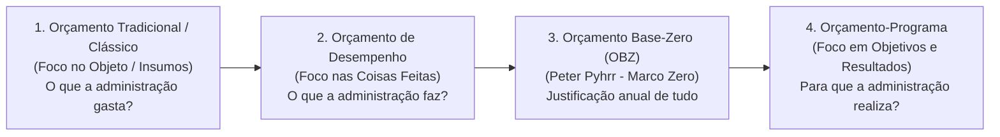
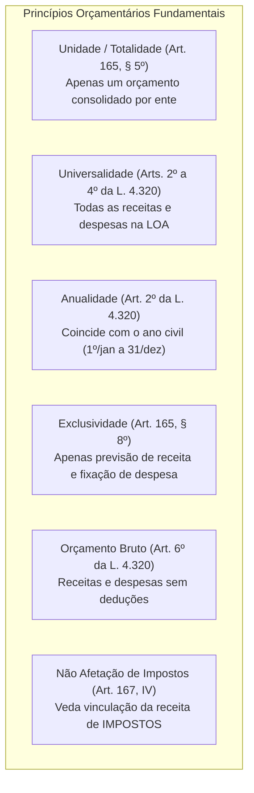
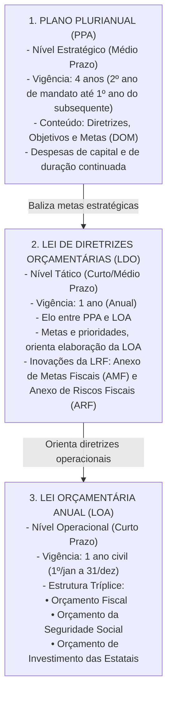
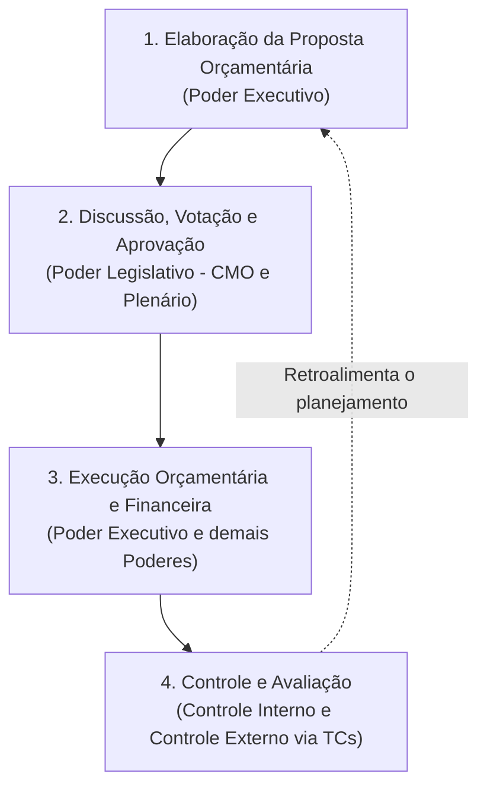
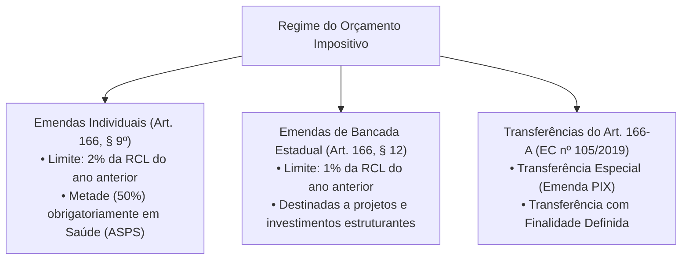

# 01 - Orçamento Público, Princípios, Ciclo Orçamentário, PPA, LDO, LOA e Orçamento Impositivo

> **Matéria:** Noções de Administração Financeira e Orçamentária (AFO)  
> **Cargo:** A01 – Técnico de Controle Externo – Especialidade: Técnico Administrativo  
> **Arquivo:** `01_orcamento_publico_principios_e_ciclo_ppa_ldo_loa.md`  

---

## 📌 Ementa / Itens do Edital

- Orçamento público: conceito, natureza jurídica e evolução histórica dos modelos (Orçamento Tradicional/Clássico, de Desempenho, Base-Zero e Orçamento-Programa);
- Princípios orçamentários fundamentais: unidade/totalidade, universalidade, anualidade/periodicidade, exclusividade, orçamento bruto, não afetação da receita de impostos, legalidade, clareza e equilíbrio;
- O sistema orçamentário na Constituição Federal de 1988 (Artigo 165):
    - Plano Plurianual (PPA): vigência quadrienal, diretrizes, objetivos e metas (DOM), despesas de capital e programas de duração continuada;
    - Lei de Diretrizes Orçamentárias (LDO): elo entre PPA e LOA, metas e prioridades, Anexo de Metas Fiscais (AMF) e Anexo de Riscos Fiscais (ARF) da LRF;
    - Lei Orçamentária Anual (LOA): estrutura tríplice integrada (Orçamento Fiscal, da Seguridade Social e de Investimento das Estatais);
- Ciclo orçamentário e processo legislativo: elaboração da proposta, apreciação na Comissão Mista, emendas parlamentares, votação, sanção/veto, execução e controle;
- Emendas parlamentares e o Orçamento Impositivo:
    - Emendas individuais (Art. 166, §§ 9º e 11 da CF/88): limite percentual de 2% da RCL e aplicação obrigatória de 50% em saúde;
    - Emendas de bancada estadual impositivas (Art. 166, §§ 12 e 13);
    - As modalidades do Artigo 166-A da CF/88: Transferências especiais ("emendas PIX") vs. transferências com finalidade definida;
    - Impedimentos de ordem técnica e contingenciamento proporcional na execução impositiva.

---

## 🧭 Sumário Interativo

- [1. Conceito, Natureza Jurídica e Evolução dos Modelos Orçamentários](#1-conceito-natureza-jurídica-e-evolução-dos-modelos-orçamentários)
    - [1.1 Conceito e Natureza Jurídica do Orçamento Público](#11-conceito-e-natureza-jurídica-do-orçamento-público)
    - [1.2 Modelos Orçamentários e Comparativo Evolutivo](#12-modelos-orçamentários-e-comparativo-evolutivo)
- [2. Princípios Orçamentários: O Núcleo Normativo e Doutrinário](#2-princípios-orçamentários-o-núcleo-normativo-e-doutrinário)
    - [2.1 Princípio da Unidade ou Totalidade](#21-princípio-da-unidade-ou-totalidade)
    - [2.2 Princípio da Universalidade](#22-princípio-da-universalidade)
    - [2.3 Princípio da Anualidade ou Periodicidade](#23-princípio-da-anualidade-ou-periodicidade)
    - [2.4 Princípio da Exclusividade Orçamentária](#24-princípio-da-exclusividade-orçamentária)
    - [2.5 Princípio do Orçamento Bruto](#25-princípio-do-orçamento-bruto)
    - [2.6 Princípio da Não Afetação (Não Vinculação) da Receita de Impostos](#26-princípio-da-não-afetação-não-vinculação-da-receita-de-impostos)
    - [2.7 Princípios do Equilíbrio, Legalidade, Clareza e Publicidade](#27-princípios-do-equilíbrio-legalidade-clareza-e-publicidade)
- [3. O Sistema Orçamentário Constitucional: PPA, LDO e LOA](#3-o-sistema-orçamentário-constitucional-ppa-ldo-e-loa)
    - [3.1 Plano Plurianual (PPA): Planejamento Estratégico de Médio Prazo](#31-plano-plurianual-ppa-planejamento-estratégico-de-médio-prazo)
    - [3.2 Lei de Diretrizes Orçamentárias (LDO): O Elo Tático e as Exigências da LRF](#32-lei-de-diretrizes-orçamentárias-ldo-o-elo-tático-e-as-exigências-da-lrf)
    - [3.3 Lei Orçamentária Anual (LOA): A Estrutura Tríplice Integrada](#33-lei-orçamentária-anual-loa-a-estrutura-tríplice-integrada)
- [4. Ciclo Orçamentário e Processo Legislativo Orçamentário](#4-ciclo-orçamentário-e-processo-legislativo-orçamentário)
    - [4.1 As Quatro Etapas do Ciclo Orçamentário](#41-as-quatro-etapas-do-ciclo-orçamentário)
    - [4.2 Processo Legislativo e a Tramitação na CMO](#42-processo-legislativo-e-a-tramitação-na-cmo)
    - [4.3 Prazos Constitucionais de Envio e Devolução (ADCT)](#43-prazos-constitucionais-de-envio-e-devolução-adct)
- [5. Emendas Parlamentares e o Regime do Orçamento Impositivo](#5-emendas-parlamentares-e-o-regime-do-orçamento-impositivo)
    - [5.1 Emendas Individuais Impositivas](#51-emendas-individuais-impositivas)
    - [5.2 Emendas de Bancada Estadual Impositivas](#52-emendas-de-bancada-estadual-impositivas)
    - [5.3 Transferências Especiais ("Emendas PIX") e com Finalidade Definida (Art. 166-A)](#53-transferências-especiais-emendas-pix-e-com-finalidade-definida-art-166-a)
    - [5.4 Limitações e Impedimentos Técnicos na Execução Obrigatória](#54-limitações-e-impedimentos-técnicos-na-execução-obrigatória)
- [6. Fontes Oficiais & Normativas Recomendadas](#6-fontes-oficiais--normativas-recomendadas)
- [7. Questões Comentadas no Padrão FCC](#7-questões-comentadas-no-padrão-fcc)

---

## 📖 Conteúdo Teórico Aprofundado

### 1. Conceito, Natureza Jurídica e Evolução dos Modelos Orçamentários

#### 1.1 Conceito e Natureza Jurídica do Orçamento Público
O **orçamento público** é o ato formal pelo qual o Poder Executivo estima as receitas e fixa e autoriza as despesas governamentais para um período determinado (geralmente coincidente com o ano civil), consubstanciando o plano financeiro de ação do Estado.

Quanto à sua **natureza jurídica**, vigora no Supremo Tribunal Federal (STF) a compreensão de que as leis orçamentárias (PPA, LDO e LOA) possuem natureza de **lei em sentido formal** (ou formal-material especial):

- Veiculam autorização legal para a prática de despesas e previsão de receitas;
- Não criam, em regra, direitos subjetivos imediatos aos cidadãos (com exceção das regras cogentes de execução orçamentária impositiva criadas pelas Emendas Constitucionais nº 86/2015, 100/2019, 105/2019 e 126/2022);
- O STF admite o controle concentrado de constitucionalidade (ADI) contra dispositivos de leis orçamentárias quando apresentarem efeitos concretos e lesividade direta a preceitos constitucionais fundamentais.

#### 1.2 Modelos Orçamentários e Comparativo Evolutivo
A evolução histórica do orçamento público evidencia a transição de um mero instrumento contábil-financeiro de contenção do gasto para um instrumento tático e estratégico de desenvolvimento econômico-social:

1. **Orçamento Tradicional ou Clássico:**
    - Preponderou no Estado Liberal (séculos XIX e início do XX);
    - Instrumento de controle de legalidade política e financeira do Poder Legislativo sobre o Poder Executivo;
    - Foco exclusivo no **objeto do gasto** (insumos: salários, móveis, material de expediente) — *"o que a administração compra"*;
    - Completa dissociação entre o orçamento e qualquer planejamento de longo prazo; não há mensuração de benefícios sociais ou metas de desempenho.
2. **Orçamento de Desempenho (Funcional):**
    - Surge no período pós-Segunda Guerra Mundial (relatórios da Comissão Hoover nos EUA);
    - Foco nas **coisas que o governo faz** (serviços e produtos) em vez de apenas no que compra — *"o que a administração faz"*;
    - Embora introduza a ideia de desempenho e atividade operacional, continuava desvinculado de um planejamento governamental estratégico de longo prazo.
3. **Orçamento Base-Zero (OBZ) ou Estratégico:**
    - Criado por Peter Pyhrr e disseminado na década de 1970;
    - Caracteriza-se pela **inexistência de direito adquirido à manutenção de despesas** do exercício anterior (rompimento com a abordagem incrementalista);
    - A cada novo ciclo orçamentário, todas as atividades e programas devem ser justificados desde a sua base ("marco zero"), competindo entre si em pacotes de decisão hierarquizados por custo-benefício.
4. **Orçamento-Programa:**
    - **Modelo adotado no ordenamento brasileiro** desde o Decreto-Lei nº 200/1967 e consolidado na CF/88 e pela Portaria MOG nº 42/1999;
    - É a expressão financeira de programas de trabalho do governo voltados para objetivos e metas claros;
    - Foco nos **resultados sociais e de impacto** — *"para que a administração gasta"*;
    - Integração indissociável entre planejamento, programação e orçamentação (concretizada no tríptico PPA, LDO e LOA);
    - Utilização de indicadores físicos, metas quantitativas e avaliação contínua de eficácia, eficiência e efetividade.

| Critério de Comparação | Orçamento Tradicional / Clássico | Orçamento-Programa (Modelo CF/88) |
| :--- | :--- | :--- |
| **Principal Objetivo** | Controle legal e contábil do gasto público. | Concretização de políticas públicas e resultados sociais. |
| **Foco Central** | O que o governo compra (insumos/objetos). | Para que o governo gasta (objetivos e programas). |
| **Planejamento** | Inexistente / Desconectado. | Indissociável e estruturante (PPA, LDO e LOA). |
| **Estrutura dos Gastos** | Elementos de despesa e órgãos executores. | Programas, ações, projetos, atividades e operações especiais. |
| **Métrica de Avaliação** | Cumprimento da dotação orçamentária estrita. | Indicadores de eficácia, eficiência e impacto social. |

> 🚨 **ALERTA DE PROVA / PEGADINHA FCC:**  
> A banca FCC costuma afirmar que o Orçamento de Desempenho e o Orçamento-Programa são expressões sinônimas. Cuidado! O Orçamento de Desempenho deu o primeiro passo ao focar nas atividades/ações, mas pecou por não possuir conexão com o planejamento global integrado. Somente o Orçamento-Programa consolida a tríade *planejamento-programação-orçamento*.

---

### 2. Princípios Orçamentários: O Núcleo Normativo e Doutrinário

Os princípios orçamentários constituem diretrizes materiais e processuais que asseguram a higidez, a transparência, a consistência e o controle fiscal da lei orçamentária.

#### 2.1 Princípio da Unidade ou Totalidade
- Cada ente da Federação (União, cada Estado, DF e cada Município) deve possuir **uma única lei orçamentária anual** para cada exercício financeiro.
- A doutrina moderna (e a banca FCC) distingue a *Unidade clássica* (que defendia a existência física de um só documento) da *Totalidade orçamentária* (prevista no art. 165, § 5º da CF/88): embora a LOA congregue três esferas distintas (Orçamento Fiscal, da Seguridade Social e de Investimento das Estatais), todas integram formal e organicamente uma **única e consolidada peça legislativa**.

#### 2.2 Princípio da Universalidade
- A Lei Orçamentária Anual deve conter **todas as receitas e todas as despesas** de todos os Poderes, órgãos, fundos e entidades da administração direta e indireta (arts. 2º, 3º e 4º da Lei nº 4.320/1964 e art. 165, § 5º da CF/88).
- Nenhuma despesa ou receita pública pode ser omitida do orçamento nem tratada "extracontabilmente".
- *Ressalva importante:* As entradas compensatórias puramente financeiras (ingressos extraorçamentários, como fianças, cauções, depósitos judiciais e restos a pagar processados) não se sujeitam à autorização orçamentária prévia, pois não representam receita orçamentária pertencente em definitivo ao patrimônio estatal.

#### 2.3 Princípio da Anualidade ou Periodicidade
- As estimativas de receita e as fixações de despesa devem corresponder a um período determinado de tempo. No Brasil, o exercício financeiro **coincide rigorosamente com o ano civil**: tem início em 1º de janeiro e encerra-se em 31 de dezembro (art. 34 da Lei nº 4.320/1964).
- **Exceção Constitucional à Anualidade:** A reabertura dos saldos de **créditos adicionais especiais e extraordinários** promulgados nos últimos quatro meses do exercício financeiro (de 1º de setembro a 31 de dezembro). Nesses casos, os saldos não executados podem ser reabertos nos limites dos seus saldos no exercício financeiro seguinte, com vigência estendida até o fim deste (art. 167, § 2º da CF/88).
- *Atenção:* Créditos suplementares **nunca** podem ser reabertos no exercício seguinte; extinguem-se impreterivelmente em 31 de dezembro.

#### 2.4 Princípio da Exclusividade Orçamentária
- Previsto expressamente no art. 165, § 8º da CF/88: a LOA não conterá dispositivo estranho à previsão da receita e à fixação da despesa.
- Destina-se a impedir os chamados "rabilongos" ou "caudas orçamentárias" (disposições casuísticas de direito material, administrativo ou penal enxertadas na lei de orçamento).
- **As Duas Únicas Exceções Constitucionais Permitidas na Própria LOA:**
    1. Autorização para a **abertura de créditos suplementares**;
    2. Autorização para a **contratação de operações de crédito**, ainda que por antecipação de receita orçamentária (ARO), nos termos da lei.

> 🚨 **ALERTA DE PROVA / PEGADINHA FCC:**  
> A LOA pode autorizar a abertura de créditos **suplementares**, mas **JAMAIS pode autorizar a abertura de créditos especiais ou extraordinários**! Créditos especiais dependem de projeto de lei específico subsequente, e créditos extraordinários decorrem de ato executivo de urgência (Medida Provisória na União ou Decreto nos entes sem MP).

#### 2.5 Princípio do Orçamento Bruto
- Estatuído no art. 6º da Lei nº 4.320/1964: todas as receitas e despesas constarão da lei de orçamento pelos seus **valores brutos totais**, vedada qualquer dedução pecuniária preliminar.
- Não é admitido compensar a receita com as despesas cobradas para sua arrecadação (ex.: registrar no orçamento apenas o valor líquido arrecadado de um imposto após descontar as taxas bancárias de cobrança).

#### 2.6 Princípio da Não Afetação (Não Vinculação) da Receita de Impostos
- Previsto no art. 167, IV da CF/88: é vedada a vinculação de receita de **impostos** a órgão, fundo ou despesa.
- **Alcance Restrito aos Impostos:** A vedação atinge **exclusivamente os impostos**! As taxas, contribuições de melhoria e contribuições especiais (como contribuições previdenciárias e COSIP) podem ser e frequentemente são constitucionalmente vinculadas a seus fins específicos.
- **Exceções Constitucionais Expressas (Art. 167, IV):**
    1. Destinação a ações e serviços públicos de **saúde** (art. 198, § 2º);
    2. Manutenção e desenvolvimento do **ensino** (art. 212);
    3. Realização de atividades da **administração tributária** (art. 37, XXII);
    4. Repartição constitucional de receitas tributárias (FPE, FPM, repartição de ICMS e IPVA);
    5. Prestação de garantias às operações de crédito por antecipação de receita e garantias prestadas à União.

#### 2.7 Princípios do Equilíbrio, Legalidade, Clareza e Publicidade
- **Equilíbrio Orçamentário:** Igualdade formal entre receitas estimadas e despesas fixadas na lei orçamentária. No aspecto material moderno, exige gestão fiscal prudente para geração de superávits primários e controle da dívida consolidada líquida (LRF).
- **Legalidade Orçamentária:** A aprovação do orçamento, de seus créditos adicionais e do plano plurianual depende obrigatoriamente de lei formal de iniciativa privativa do Executivo (art. 165 da CF/88).
- **Clareza e Transparência:** O orçamento deve ser apresentado em linguagem compreensível para permitir a fiscalização pela sociedade e pelos órgãos de controle externo (art. 48 da LRF).

---

### 3. O Sistema Orçamentário Constitucional: PPA, LDO e LOA

A Constituição Federal de 1988 estabeleceu um modelo tripartite harmônico de planejamento e finanças públicas estruturado no artigo 165:

#### 3.1 Plano Plurianual (PPA): Planejamento Estratégico de Médio Prazo
- **Matriz Constitucional (Art. 165, § 1º):** Estabelece, de forma regionalizada, as **Diretrizes, Objetivos e Metas (DOM)** da administração pública federal, estadual ou municipal para as **despesas de capital** e outras delas decorrentes e para as relativas aos **programas de duração continuada**.
- **Regra de Bloqueio Orçamentário (Art. 167, § 1º da CF/88):** Nenhum investimento cuja execução ultrapasse um exercício financeiro poderá ser iniciado sem prévia inclusão no PPA, ou sem lei que autorize a inclusão, sob pena de crime de responsabilidade.
- **Vigência Quadrienal Descasada do Mandato:**  
  O PPA vigora por 4 anos: inicia-se no segundo ano do mandato do governante eleito e encerra-se no final do primeiro ano do mandato do sucessor (art. 35, § 2º, I do ADCT). Essa regra assegura a transição republicana e impede descontinuidade administrativa de projetos estratégicos.

#### 3.2 Lei de Diretrizes Orçamentárias (LDO): O Elo Tático e as Exigências da LRF
- **Matriz Constitucional (Art. 165, § 2º):**
    - Compreende as **metas e prioridades** da administração pública;
    - Estabelece as diretrizes de política fiscal e suas metas, em consonância com a trajetória sustentável da dívida pública;
    - Orienta a elaboração da LOA;
    - Dispõe sobre as alterações na legislação tributária;
    - Regula a concessão de quaisquer vantagens ou aumentos de remuneração a servidores.
- **Conteúdo Obrigatório pela LRF (Art. 4º):**
    - **Anexo de Metas Fiscais (AMF):** Estabelece metas anuais, em valores correntes e constantes, relativas a receitas, despesas, resultado nominal e primário e montante da dívida pública, para o **exercício a que se referir e para os dois seguintes (triênio fiscal)**.
    - **Anexo de Riscos Fiscais (ARF):** Avalia os passivos contingentes e outros riscos capazes de afetar as contas públicas (ex.: demandas judiciais de grande repercussão, avais concedidos), informando as providências a serem tomadas caso se concretizem.
    - Critérios e formas de limitação de empenho e movimentação financeira (contingenciamento de gastos).

#### 3.3 Lei Orçamentária Anual (LOA): A Estrutura Tríplice Integrada
A LOA (art. 165, § 5º da CF/88) materializa o plano anual de receitas e despesas mediante três esferas integradas:

1. **Orçamento Fiscal:** Abrange os Poderes do ente federativo, seus fundos, órgãos e entidades da administração direta e indireta, inclusive fundações instituídas e mantidas pelo poder público.
2. **Orçamento da Seguridade Social:** Abrange todas as entidades e órgãos a ela vinculados, da administração direta ou indireta, bem como os fundos e fundações instituídos e mantidos pelo poder público, contemplando as áreas de **Saúde, Previdência Social e Assistência Social** (Art. 195 da CF/88).
3. **Orçamento de Investimento das Estatais:** Abrange as empresas em que o Estado, direta ou indiretamente, detenha a **maioria do capital social com direito a voto**.

---

### 4. Ciclo Orçamentário e Processo Legislativo Orçamentário

#### 4.1 As Quatro Etapas do Ciclo Orçamentário
O ciclo orçamentário é um processo contínuo e dinâmico desdobrado em quatro fases sequenciais:

1. **Elaboração da Proposta:** Competência privativa do Chefe do Poder Executivo, que consolida suas propostas e as demandas orçamentárias dos demais Poderes e órgãos autônomos (Legislativo, Judiciário, Ministério Público e Defensoria Pública), nos limites estipulados pela LDO.
2. **Discussão, Votação e Aprovação:** Conduzida no âmbito do Poder Legislativo, iniciando-se por comissão mista e culminando com votação em plenário e envio para sanção ou veto.
3. **Execução Orçamentária e Financeira:** Arrecadação de receitas, emissão de empenhos, liquidação e pagamento das despesas públicas.
4. **Controle e Avaliação:** Fiscalização contábil, financeira, orçamentária, operacional e patrimonial exercida pelos sistemas de controle interno e pelo controle externo (Poder Legislativo auxiliado pelo Tribunal de Contas).

#### 4.2 Processo Legislativo e a Tramitação na CMO
- No âmbito federal, os projetos de lei do PPA, LDO, LOA e de créditos adicionais são examinados e relatados pela **Comissão Mista Permanente de Deputados e Senadores (Comissão Mista de Planos, Orçamentos Públicos e Fiscalização - CMO)** (art. 166, § 1º da CF/88).
- **Regras para Apresentação de Emendas à LOA (Art. 166, § 3º):**  
  As emendas parlamentares ao projeto de LOA só podem ser aprovadas caso:

    - Sejam compatíveis com o PPA e com a LDO; e
    - Indiquem os recursos necessários, admitidos apenas os provenientes de anulação de despesa, **excluídas as relativas a:**
    - Dotações para pessoal e seus encargos;
    - Serviço da dívida;
    - Transferências tributárias constitucionais para Estados e Municípios; OU
    - Sejam relacionadas com a correção de erros ou omissões, ou com os dispositivos do texto do projeto de lei.

#### 4.3 Prazos Constitucionais de Envio e Devolução (ADCT)
Enquanto não editada a Lei Complementar prevista no art. 165, § 9º da CF/88, vigoram na esfera federal os prazos do art. 35, § 2º do ADCT:

| Instrumento | Prazo Limite de Envio pelo Executivo | Prazo Limite de Devolução pelo Legislativo |
| :--- | :--- | :--- |
| **PPA** | Até 4 meses antes do encerramento do exercício financeiro (**31 de agosto**) do primeiro ano de mandato. | Até o encerramento da sessão legislativa (**22 de dezembro**). |
| **LDO** | Até 8 meses e meio antes do encerramento do exercício financeiro (**15 de abril**). | Até o encerramento do primeiro período da sessão legislativa (**17 de julho** - a sessão não pode ser interrompida sem sua aprovação). |
| **LOA** | Até 4 meses antes do encerramento do exercício financeiro (**31 de agosto**). | Até o encerramento da sessão legislativa (**22 de dezembro**). |

---

### 5. Emendas Parlamentares e o Regime do Orçamento Impositivo

Historicamente meramente autorizativo, o orçamento brasileiro adquiriu feição **parcialmente impositiva** por meio de reformas constitucionais sucessivas:

#### 5.1 Emendas Individuais Impositivas
- **Percentual Vinculante (Art. 166, § 9º):** As emendas individuais ao projeto de LOA serão aprovadas no limite de **2% da Receita Corrente Líquida (RCL)** do exercício anterior.
- **Vinculação à Saúde:** A **metade (50%)** desse percentual deve ser destinada obrigatoriamente a **ações e serviços públicos de saúde (ASPS)**.
- **Vedação de Compensação:** Os recursos de emendas individuais não podem ser utilizados pelo Poder Executivo para abater ou integralizar o piso constitucional mínimo obrigatório que o ente deve aplicar em saúde (art. 166, § 10).

#### 5.2 Emendas de Bancada Estadual Impositivas
- **Percentual Vinculante (Art. 166, § 12):** A aprovação e execução orçamentária e financeira das emendas de bancada de parlamentares de Estado ou do DF são obrigatórias até o limite de **1% da Receita Corrente Líquida** do exercício anterior.
- Destinam-se precipuamente a investimentos estruturantes e despesas de capital de interesse regional.

#### 5.3 Transferências Especiais ("Emendas PIX") e com Finalidade Definida (Art. 166-A)
A Emenda Constitucional nº 105/2019 introduziu o art. 166-A na Carta Magna, disciplinando duas modalidades para repasse direto de recursos federais de emendas individuais a Estados, DF e Municípios:

1. **Transferência Especial ("Emenda PIX"):**
    - O recurso financeiro é repassado **diretamente ao ente federado recebedor, sem a necessidade de celebração de convênio**, contrato de repasse ou instrumento congênere;
    - Os recursos passam a pertencer ao ente federado no ato da efetivação da transferência financeira;
    - **Vedações Constitucionais Absolutas:** Não podem ser aplicados em:
    - Despesas com pessoal e encargos sociais;
    - Pagamento de encargos do serviço da dívida pública consolidada.
    - **Mínimo de 70% em Capital:** Pelo menos **70% (setenta por cento)** das transferências especiais devem ser aplicadas em **despesas de capital** (investimentos, obras, aquisição de equipamentos), sendo permitido o máximo de 30% em despesas correntes de custeio operacional.
2. **Transferência com Finalidade Definida:**
    - Os recursos são expressamente vinculados à programação e ao objeto estabelecido na emenda parlamentar;
    - Devem ser aplicados nas áreas de competência constitucional associadas ao objeto, sujeitando-se à prestação de contas vinculada e acompanhamento pelo Tribunal de Contas da União (TCU).

#### 5.4 Limitações e Impedimentos Técnicos na Execução Obrigatória
A execução obrigatória do orçamento impositivo não é irrestrita:

- **Contingenciamento Proporcional:** Se a estimativa de receita e da despesa demonstrar que o cumprimento das metas de resultado primário ou nominal pode ser comprometido, o montante das emendas impositivas poderá ser reduzido **na mesma proporção da limitação de empenho aplicada às demais despesas discricionárias** (art. 166, § 18 da CF/88);
- **Impedimentos de Ordem Técnica:** Justificativas formais do Poder Executivo (ex.: ausência de projeto de engenharia, desapropriação pendente, irregularidade cadastral insuperável) suspendem a obrigatoriedade da execução, cabendo ao parlamento indicar remanejamento em prazos legais fixados.

---

## 🌐 Fontes Oficiais & Normativas Recomendadas

- [Constituição Federal de 1988 - Artigos 165 a 169 (Dos Orçamentos)](https://www.planalto.gov.br/ccivil_03/constituicao/constituicao.htm#art165)
    - Estatuto constitucional de PPA, LDO, LOA, emendas parlamentares e orçamento impositivo.
- [Lei Federal nº 4.320/1964 (Normas Gerais de Direito Financeiro)](https://www.planalto.gov.br/ccivil_03/leis/l4320.htm)
    - Princípios orçamentários, estrutura legal do orçamento e créditos adicionais.
- [Lei Complementar Federal nº 101/2000 (Lei de Responsabilidade Fiscal)](https://www.planalto.gov.br/ccivil_03/leis/lcp/lcp101.htm)
    - Normas orçamentárias de responsabilidade, Anexo de Metas Fiscais (AMF) e Anexo de Riscos Fiscais (ARF).
- [Manual de Contabilidade Aplicada ao Setor Público (MCASP) - STN](https://www.gov.br/tesouronacional/pt-br)
    - Parte I: Procedimentos Contábeis Orçamentários.

---

## 📝 Questões Comentadas no Padrão FCC

### Questão 1 (FCC - Adaptada / TCE-PI - Auditor de Controle Externo)
A respeito dos princípios orçamentários consagrados na legislação brasileira e no texto da Constituição Federal de 1988, considere as seguintes assertivas:

I. O princípio da exclusividade impede que a Lei Orçamentária Anual disponha sobre autorização para a contratação de operações de crédito, ainda que por antecipação de receita orçamentária.  
II. O princípio da não afetação veda genericamente a vinculação de qualquer espécie tributária a órgão, fundo ou despesa pública.  
III. O princípio do orçamento bruto estabelece que todas as receitas e despesas constarão da lei de orçamento pelos seus totais, vedadas quaisquer deduções pecuniárias prévias.  

Está correto o que se afirma APENAS em:

* **A)** I.
* **B)** II.
* **C)** III.
* **D)** I e II.
* **E)** I e III.

> **Comentário Detalhado:**
> - **A)** Incorreta. O item I é falso, pois a contratação de operações de crédito (inclusive por ARO) é ressalva expressa ao princípio da exclusividade.
> - **B)** Incorreta. O item II é falso, pois a vedação de afetação alcança restritivamente os impostos, não abrangendo taxas ou contribuições.
> - **C)** Correta. Apenas a assertiva III é verdadeira. O art. 6º da Lei nº 4.320/1964 dispõe taxativamente que todas as receitas e despesas constarão da Lei de Orçamento pelos seus totais, vedadas quaisquer deduções pecuniárias.
> - **D)** Incorreta. Ambos os itens I e II contêm erros jurídicos flagrantes.
> - **E)** Incorreta. O item I é manifestamente contrário ao texto do art. 165, § 8º da CF/88.
> 
> **Gabarito: C**

---

### Questão 2 (FCC - Adaptada / TCE-AP - Técnico de Controle Externo)
Em relação às normas constitucionais vigentes relativas às emendas parlamentares individuais de execução orçamentária e financeira obrigatória (orçamento impositivo), é correto afirmar que:

* **A)** Os recursos transferidos por meio de transferência especial ("emendas PIX") aos Estados e Municípios podem ser utilizados livremente para pagamento de folha de salários de servidores e serviço da dívida pública.
* **B)** É obrigatória a destinação de, pelo menos, metade (50%) do valor total das emendas parlamentares individuais para ações e serviços públicos de saúde.
* **C)** A execução das emendas individuais independe da observância de metas fiscais ou da constatação de impedimentos de ordem técnica devidamente justificados pelo Executivo.
* **D)** O limite global de aprovação das emendas parlamentares individuais ao projeto de lei orçamentária é fixado em 10% da receita tributária líquida da União.
* **E)** A execução orçamentária das emendas individuais de bancada estadual possui natureza facultativa e estritamente discricionária do Poder Executivo em qualquer hipótese.

> **Comentário Detalhado:**
> - **A)** Incorreta. O art. 166-A, § 1º da CF/88 proíbe terminantemente a utilização de transferências especiais para custear despesas com pessoal/encargos e para pagamento do serviço da dívida consolidada.
> - **B)** Correta. Nos exatos termos do art. 166, § 9º da CF/88, as emendas individuais são aprovadas no limite de 2% da receita corrente líquida do exercício anterior, sendo que metade (50%) desse percentual é compulsoriamente destinada a ações e serviços públicos de saúde (ASPS).
> - **C)** Incorreta. As emendas impositivas subordinam-se a contingenciamento proporcional na hipótese de frustração de receitas fiscais e podem ter execução sobrestada por impedimentos de ordem técnica fundamentados.
> - **D)** Incorreta. O parâmetro constitucional é de 2% da Receita Corrente Líquida (RCL) do ano anterior, e não 10% da receita tributária.
> - **E)** Incorreta. As emendas de bancada estadual também foram contempladas com regime impositivo de execução vinculante (art. 166, §§ 12 e 13 da CF/88).
> 
> **Gabarito: B**

---

### Questão 3 (FCC - Adaptada / Analista de Planejamento e Orçamento)
Acerca da vigência e da dinâmica estrutural do Plano Plurianual (PPA) no modelo orçamentário instituído pela Constituição Federal de 1988, é correto afirmar:

* **A)** O PPA possui vigência de quatro anos, iniciando-se no primeiro ano do mandato do Chefe do Executivo e encerrando-se no término do quarto ano do mesmo mandato.
* **B)** O PPA possui vigência de quatro anos, tendo início no segundo ano de mandato do governante eleito e término no encerramento do primeiro ano do mandato subsequente.
* **C)** As diretrizes orçamentárias e metas do PPA vinculam a União e os Estados, mas dispensam adoção obrigatória no âmbito dos Municípios com menos de cinquenta mil habitantes.
* **D)** O PPA destina-se unicamente a fixar a estimativa de arrecadação tributária anual e a tabela salarial dos servidores públicos da administração direta.
* **E)** Os projetos de lei de PPA são de iniciativa concorrente entre o Presidente da República e os Presidentes da Câmara dos Deputados e do Senado Federal.

> **Comentário Detalhado:**
> - **A)** Incorreta. O PPA não coincide com os quatro anos exatos do mandato do chefe eleito, justamente para permitir continuidade gerencial e planejamento de médio prazo.
> - **B)** Correta. Nos termos do art. 35, § 2º, I do ADCT da CF/88, o PPA vigora por quatro anos, iniciando seus efeitos em 1º de janeiro do segundo ano de mandato do Chefe do Executivo e perdurando até 31 de dezembro do primeiro ano do mandato governamental seguinte.
> - **C)** Incorreta. O modelo orçamentário tripartite é obrigatório e vinculante para todas as esferas federativas, independentemente do porte populacional do Município.
> - **D)** Incorreta. A estimativa tributária anual é matéria típica da LOA e as tabelas remuneratórias constam em leis ordinárias específicas; o PPA trata de diretrizes, objetivos e metas para despesas de capital e continuadas.
> - **E)** Incorreta. A iniciativa legislativa das leis orçamentárias (PPA, LDO e LOA) é de competência privativa do Chefe do Poder Executivo (art. 165, *caput* da CF/88).
> 
> **Gabarito: B**

---

### Questão 4 (FCC - Adaptada / Analista de Gestão Pública)
A Lei de Responsabilidade Fiscal (Lei Complementar nº 101/2000) introduziu instrumentos fundamentais para garantir a solvência e a transparência fiscal dos entes públicos. Dentre esses instrumentos, o documento integrante do projeto de Lei de Diretrizes Orçamentárias (LDO) que estabelece as metas anuais de receitas e despesas, o montante da dívida pública e os resultados primário e nominal para o exercício a que se refere e para os dois seguintes denomina-se:

* **A)** Relatório de Gestão Fiscal (RGF).
* **B)** Anexo de Riscos Fiscais (ARF).
* **C)** Anexo de Metas Fiscais (AMF).
* **D)** Balanço Orçamentário Simplificado.
* **E)** Demonstrativo de Restos a Pagar.

> **Comentário Detalhado:**
> - **A)** Incorreta. O Relatório de Gestão Fiscal (RGF) é documento de controle emitido quadrimestralmente por cada Poder e órgão (arts. 54 e 55 da LRF).
> - **B)** Incorreta. O Anexo de Riscos Fiscais (ARF) avalia os passivos contingentes e outros riscos capazes de comprometer as finanças públicas (art. 4º, § 3º da LRF).
> - **C)** Correta. De acordo com o art. 4º, § 1º da LRF, integrará o projeto de LDO o Anexo de Metas Fiscais (AMF), em que serão estabelecidas metas anuais para receitas, despesas, montante da dívida pública e resultados nominal e primário, para o exercício a que se referir e para os dois seguintes.
> - **D)** Incorreta. Trata-se de demonstrativo contábil integrante da prestação de contas governamentais da Lei nº 4.320/1964.
> - **E)** Incorreta. Trata-se de demonstrativo contábil de controle operacional da execução da despesa.
> 
> **Gabarito: C**

---

### Questão 5 (FCC - Adaptada / Auditor de Controle Externo)
Na elaboração do projeto de Lei Orçamentária Anual (LOA) de determinado Estado, o Poder Executivo incluiu um artigo concedendo autorização legislativa para a alteração das alíquotas do Imposto sobre Circulação de Mercadorias e Serviços (ICMS), bem como autorização para a abertura de créditos orçamentários suplementares até o limite de 20% da despesa fixada.

Diante do princípio orçamentário da exclusividade (art. 165, § 8º da CF/88):

* **A)** Ambas as autorizações constantes do projeto são constitucionais, pois a LOA pode veicular quaisquer normas com reflexo financeiro.
* **B)** Ambas as autorizações são flagrantemente inconstitucionais, haja vista que a LOA não admite qualquer tipo de exceção temática.
* **C)** A autorização para abertura de créditos suplementares é constitucional por consistir em ressalva expressa ao princípio da exclusividade; todavia, a cláusula alterando alíquotas de ICMS padece de inconstitucionalidade material por se tratar de matéria estranha à LOA.
* **D)** A autorização para alterar ICMS é válida, mas a previsão de créditos suplementares é proibida pelo texto constitucional.
* **E)** O projeto é nulo e deve ser arquivado imediatamente sem deliberação pelo plenário da Assembleia Legislativa.

> **Comentário Detalhado:**
> - **A)** Incorreta. A LOA não pode veicular alterações de alíquotas tributárias de direito substantivo; isso configura típica violação ao princípio da exclusividade ("cauda orçamentária").
> - **B)** Incorreta. A CF/88 estabelece duas exceções taxativas ao princípio da exclusividade (créditos suplementares e operações de crédito).
> - **C)** Correta. Conforme o art. 165, § 8º da CF/88, a LOA não conterá matéria estranha à previsão da receita e à fixação da despesa, excetuando-se a autorização para abertura de créditos suplementares e contratação de operações de crédito. Logo, a autorização de créditos suplementares é constitucional, e a norma alteradora de alíquota do ICMS é inconstitucional por constituir matéria estranha à lei de meios orçamentária.
> - **D)** Incorreta. Inverteu o tratamento constitucional dado aos institutos.
> - **E)** Incorreta. O vício pontual de inconstitucionalidade em dispositivo do projeto não invalida todo o processo orçamentário, ensejando emenda saneadora ou veto governamental.
> 
> **Gabarito: C**
