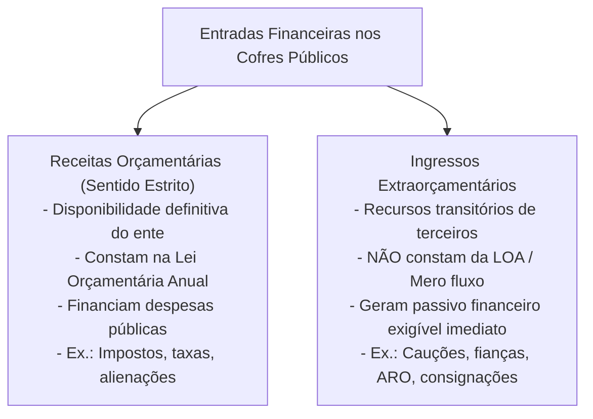
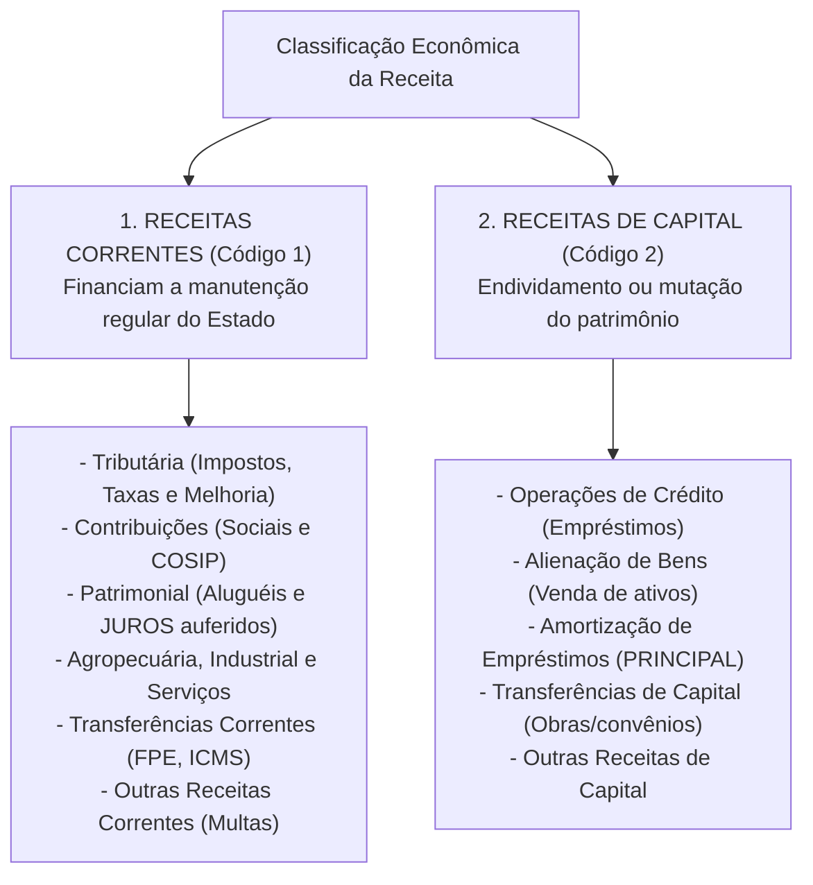

# 02 - Receita Orçamentária, Ingressos Extraorçamentários, Estágios e Classificações

> **Matéria:** Noções de Administração Financeira e Orçamentária (AFO)  
> **Cargo:** A01 – Técnico de Controle Externo – Especialidade: Técnico Administrativo  
> **Arquivo:** `02_receita_publica_estagios_fontes_e_classificacoes.md`  

---

## 📌 Ementa / Itens do Edital

- Receita pública: conceito amplo (entradas e influxos de caixa) e conceito estrito (receita orçamentária efetiva e por mutação);
- Receita Orçamentária vs. Ingressos Extraorçamentários (entradas compensatórias, cauções, fianças, depósitos judiciais, consignações em folha de pagamento e ARO);
- Etapas e estágios da receita orçamentária:
  - Etapa do Planejamento: Previsão da receita (estimativa orçamentária segundo a LRF);
  - Etapa da Execução: Lançamento (Art. 53 da Lei 4.320/64 e Art. 142 do CTN), Arrecadação (entrega de valores à rede bancária conveniada) e Recolhimento (transferência dos recursos para a Conta Única do Tesouro - Princípio da Unidade de Caixa);
- Classificações orçamentárias da receita (Lei Federal nº 4.320/1964 e MCASP 11ª Edição):
  - Classificação por Categoria Econômica: Receitas Correntes e Receitas de Capital;
  - Origens das Receitas Correntes (Tributária, de Contribuições, Patrimonial, Agropecuária, Industrial, de Serviços, Transferências Correntes e Outras);
  - Origens das Receitas de Capital (Operações de Crédito, Alienação de Bens, Amortização de Empréstimos, Transferências de Capital e Outras);
  - Distinção crítica entre Amortização de Empréstimos (capital) e Juros Recebidos (corrente/patrimonial);
  - Classificação por Esfera Orçamentária (Fiscal, Seguridade Social e Investimento);
  - Classificação por Fonte/Destinação de Recursos (fontes vinculadas vs. recursos ordinários livres);
  - Classificação por Natureza da Receita (estrutura codificada de 8 dígitos do MCASP);
- Regras fiscais restritivas da receita: vedação de aplicação de receitas de alienação de bens em despesas correntes (Art. 44 da LRF);
- Renúncia de Receitas e exigências da Lei de Responsabilidade Fiscal (Art. 14 da LRF: estimativa trienal de impacto orçamentário-financeiro e medidas de compensação).

---

## 🌳 Classificação Hierárquica

```text
2. Regime Jurídico e Estrutura da Receita Pública
├── 2.1 Ingressos Públicos: Conceituação e Distinções
│   ├── 2.1.1 Receita Orçamentária (Sentido Estrito):
│   │   ├── Recursos que ingressam em caráter definitivo no patrimônio público (aumentam PL ou geram mutação ativa)
│   │   └── Integram a Lei Orçamentária Anual para financiar a realização de despesas públicas
│   └── 2.1.2 Ingressos Extraorçamentários (Meros Ingressos Financeiros de Caixa):
│       ├── Recursos de caráter temporário ou fiduciário, em que o Estado atua como mero depositário
│       ├── Não pertencem ao Estado e geram passivo exigível financeiro concomitante (não alteram PL)
│       └── Exemplos FCC: Cauções licitatórias em dinheiro, fianças, depósitos judiciais, consignações da folha e ARO
├── 2.2 Etapas e Estágios da Receita Orçamentária
│   ├── 2.2.1 Etapa de Planejamento:
│   │   └── Previsão: Estimativa de arrecadação na LOA baseada em séries históricas, PIB e inflação (Art. 12 da LRF)
│   └── 2.2.2 Etapa de Execução:
│       ├── Lançamento: Ato privativo de verificação da ocorrência do fato gerador, identificação do devedor e cálculo do montante
│       │   └── 🚨 Pegadinha: Nem toda receita passa pelo lançamento (doações, serviços e rendimentos independem de lançamento)
│       ├── Arrecadação: Pagamento efetuado pelo contribuinte junto aos agentes bancários arrecadadores autorizados
│       └── Recolhimento: Transferência dos valores da rede bancária para a Conta Única do Tesouro (Princípio da Unidade de Caixa - Art. 56)
├── 2.3 Classificações da Receita Orçamentária
│   ├── 2.3.1 Por Categoria Econômica (Lei 4.320/64 e MCASP):
│   │   ├── Código 1 - Receitas Correntes:
│   │   │   ├── Tributária (Impostos, Taxas e Contribuições de Melhoria)
│   │   │   ├── Contribuições (Sociais, Econômicas e Iluminação Pública - COSIP)
│   │   │   ├── Patrimonial (Aluguéis, concessões, foros e JUROS de empréstimos concedidos)
│   │   │   ├── Agropecuária, Industrial e de Serviços
│   │   │   ├── Transferências Correntes (FPE, FPM, cota do ICMS, repasses do SUS)
│   │   │   └── Outras Receitas Correntes (Multas, juros moratórios, indenizações e restituições)
│   │   └── Código 2 - Receitas de Capital:
│   │       ├── Operações de Crédito (Empréstimos, financiamentos e títulos da dívida)
│   │       ├── Alienação de Bens (Venda de imóveis e veículos - Vedado uso em despesa corrente pelo Art. 44 da LRF)
│   │       ├── Amortização de Empréstimos (Recebimento do PRINCIPAL de empréstimos outrora concedidos)
│   │       ├── Transferências de Capital (Recursos de terceiros destinados a investimentos e obras)
│   │       └── Outras Receitas de Capital (Superávit do Bacen, integralização de capital de estatais)
│   ├── 2.3.2 Por Fonte / Destinação de Recursos:
│   │   ├── Recursos Ordinários (Livres para programação em qualquer despesa discricionária)
│   │   └── Recursos Vinculados (Carimbados por lei ou CF para finalidade específica: Fundeb, Saúde, Emendas)
│   └── 2.3.3 Por Natureza da Receita (Estrutura de 8 Dígitos do MCASP):
│       └── Categoria Econômica (1º) -> Origem (2º) -> Espécie (3º) -> Desdobramentos (4º a 7º) -> Tipo (8º: Principal, Multas/Juros, Dívida Ativa)
└── 2.4 Renúncia de Receitas e a Lei de Responsabilidade Fiscal (Art. 14 da LRF)
    ├── 2.4.1 Modalidades de Renúncia: Anistia, remissão, subsídio, crédito presumido, isenção individual e redução de alíquota
    └── 2.4.2 Requisitos Cumulativos:
        ├── Estimativa do impacto financeiro no exercício em vigor e nos dois exercícios seguintes (triênio fiscal)
        ├── Demonstração de compatibilidade com a Lei de Diretrizes Orçamentárias (LDO)
        └── Atendimento a uma das duas condições alternativas:
            ├── Condição A: Demonstração de que a renúncia foi considerada na estimativa da LOA e não afeta metas
            └── Condição B: Adoção concomitante de medidas de compensação (aumento de outros tributos)
```

---

## 📖 Conteúdo Teórico Aprofundado

### 1. Ingressos Orçamentários vs. Ingressos Extraorçamentários

Para fins de Direito Financeiro e Contabilidade Pública, as entradas financeiras nos cofres estatais classificam-se em duas categorias mutuamente excludentes:



#### Peculiaridades dos Ingressos Extraorçamentários na FCC:
- **Cauções e Fianças em Dinheiro:** Prestadas por licitantes e contratados como garantia de execução de contratos administrativos. O Estado é mero custodiante da quantia, devendo devolvê-la após o adimplemento contratual.
- **Depósitos Judiciais e Recursais:** Recursos vinculados a processos judiciais guardados em conta judicial sob guarda transitória.
- **Consignações em Folha de Pagamento:** Valores retidos dos vencimentos dos servidores (ex.: empréstimos bancários consignados, plano de saúde, pensão alimentícia judicial) para posterior repasse às instituições credoras.
- **Operações de Crédito por Antecipação de Receita Orçamentária (ARO):** Previstas no art. 165, § 8º da CF e art. 38 da LRF, destinam-se unicamente a cobrir déficits momentâneos de caixa ao longo do ano fiscal. **Não constituem receita orçamentária**, devendo ser integralmente quitadas até o final do exercício orçamentário.

---

### 2. Estágios da Receita Orçamentária (Lei 4.320/64 e MCASP)

A arrecadação dos recursos públicos cumpre quatro estágios ordenados distribuídos entre o planejamento e a execução:


| Estágio da Receita | Fase de Atuação | Descrição Legal & Doutrinária | Peculiaridade Cobrada pela FCC |
| :--- | :--- | :--- | :--- |
| **1. Previsão** | Planejamento | Estimativa técnica da arrecadação calculada pelo Poder Executivo e fixada na LOA (Art. 12 da LRF). | Baseia-se na evolução da arrecadação nos três anos anteriores e no cenário macroeconômico. |
| **2. Lançamento** | Execução | Ato administrativo privativo da autoridade tributária que verifica o fato gerador, identifica o devedor e calcula o valor devido (Art. 53 da Lei 4.320/64 e Art. 142 do CTN). | **Nem toda receita passa por lançamento!** Tarifas, doações, serviços e rendimentos entram sem lançamento prévio. |
| **3. Arrecadação** | Execução | Momento em que os contribuintes comparecem à rede bancária arrecadadora autorizada e quitam a guia de recolhimento. | Os recursos entram na esfera dos agentes arrecadadores credenciados. |
| **4. Recolhimento** | Execução | Transferência dos recursos arrecadados pelos bancos para a **Conta Única do Tesouro** do Estado de Goiás. | Concretiza o **Princípio da Unidade de Caixa** (Art. 56 da Lei 4.320/64). |

---

### 3. Classificação Econômica da Receita Orçamentária

Conforme o art. 9º da Lei nº 4.320/1964 e a estrutura padronizada da Secretaria do Tesouro Nacional (STN), as receitas orçamentárias dividem-se em:



#### A Grande Distinção FCC: Amortização vs. Juros Recebidos
Quando o Estado concede um empréstimo ou financiamento a um Município e depois recebe as parcelas mensais de pagamento:
- A parcela referente ao **PRINCIPAL da dívida** devolvido ao Estado é classificada como **Receita de Capital (Amortização de Empréstimos)**.
- A parcela referente aos **JUROS e encargos moratórios** recebidos é classificada como **Receita Corrente (Receita Patrimonial)**!

#### Restrição Legal à Alienação de Bens (Art. 44 da LRF)
> *"É vedada a aplicação da receita de capital derivada da alienação de bens e direitos que integrem o patrimônio público para o financiamento de despesa corrente, salvo se destinada por lei aos regimes de previdência social, geral e próprio dos servidores públicos."*  
> O objetivo do legislador fiscal foi evitar que o governante "venda o patrimônio público para pagar a folha de salários do funcionalismo".

---

### 4. Renúncia de Receitas e as Regras do Art. 14 da LRF

A Lei de Responsabilidade Fiscal impõe rigoroso controle sobre qualquer concessão ou ampliação de incentivo ou benefício de natureza tributária que resulte em renúncia de receita:
- **Modalidades Alcançadas:** Anistia, remissão, subsídio, crédito presumido, isenção em caráter não geral, alteração de alíquota ou modificação de base de cálculo que implique redução discriminada de tributos.
- **Requisitos de Validade Fiscal (Cumulativos):**
  1. Elaboração de **estimativa do impacto orçamentário-financeiro** no exercício em que deva iniciar sua vigência e nos dois seguintes (triênio fiscal);
  2. Comprovação de atendimento ao disposto na Lei de Diretrizes Orçamentárias (LDO); e
  3. Cumprimento de **ao menos uma das seguintes condições alternativas**:
     - **Alternativa 1:** Demonstração de que a renúncia foi formalmente considerada na estimativa de receita da LOA e que não afetará as metas de resultados fiscais do Anexo de Metas Fiscais; **OU**
     - **Alternativa 2:** Estar acompanhada de **medidas de compensação** concomitantes no período, por meio do aumento de receitas decorrente da elevação de alíquotas, ampliação da base de cálculo, ou criação/majoração de outro tributo.

---

## 🌐 Fontes Oficiais & Manuais Técnicos Recomendados

- [Lei Federal nº 4.320/1964](https://www.planalto.gov.br/ccivil_03/leis/l4320.htm)
  - Arts. 9º a 11 (Classificação Econômica da Receita) e Arts. 51 a 57 (Estágios e Arrecadação).
- [Lei Complementar Federal nº 101/2000 (Lei de Responsabilidade Fiscal)](https://www.planalto.gov.br/ccivil_03/leis/lcp/lcp101.htm)
  - Arts. 11 a 14 (Previsão de Receitas e Renúncia Fiscal) e Art. 44 (Alienação de Ativos).
- [Manual de Contabilidade Aplicada ao Setor Público (MCASP) - 11ª Edição (STN)](https://www.gov.br/tesouronacional/pt-br)
  - Parte I: Procedimentos Contábeis Orçamentários - Classificações da Receita.
- [Código Tributário Nacional - Lei Federal nº 5.172/1966](https://www.planalto.gov.br/ccivil_03/leis/l5172compilado.htm)
  - Art. 142 (Do Lançamento Tributário).

---

## 📝 Questões Comentadas no Padrão FCC

### Questão 1 (FCC - Adaptada / TCE-RS - Auditor de Controle Externo)
Determinado Estado da Federação recebeu as seguintes quantias financeiras em sua conta única do Tesouro ao longo do mês:

I. R$ 500.000,00 referentes à venda em leilão público de veículos automotores inservíveis de sua frota administrativa.  
II. R$ 200.000,00 a título de juros moratórios incidentes sobre créditos tributários de ICMS pagos em atraso por contribuintes.  
III. R$ 300.000,00 decorrentes da devolução parcelada do principal de financiamento outrora concedido pelo Estado a determinado município goiano para fomento agropecuário.  

Nos termos da Lei Federal nº 4.320/1964 e das normas do MCASP, os itens I, II e III classificam-se, respectivamente, como:

A) Receita Corrente; Receita Corrente; Receita de Capital.  
B) Receita de Capital; Receita Corrente; Receita de Capital.  
C) Receita de Capital; Receita de Capital; Receita Corrente.  
D) Receita Corrente; Receita de Capital; Receita de Capital.  
E) Receita de Capital; Receita Corrente; Receita Corrente.  

> **Gabarito: B**  
>
> **Análise detalhada de cada alternativa:**  
> - **Item I:** A venda de veículos configura **Alienação de Bens Móveis**, que é espécie típica de **Receita de Capital** (Art. 11, § 2º da Lei 4.320/64).  
> - **Item II:** Juros de mora de tributos constituem acréscimos moratórios classificados como **Receita Corrente** (tipo de receita decorrente da receita tributária originária ou outras receitas correntes).  
> - **Item III:** O recebimento da parcela correspondente ao principal do empréstimo outrora concedido pelo Estado configura **Amortização de Empréstimos**, que integra as **Receitas de Capital**.  
> - Logo, a sequência correta é: Receita de Capital, Receita Corrente e Receita de Capital (Alternativa B).

---

### Questão 2 (FCC - Adaptada / TCE-PI - Auditor de Controle Externo)
A respeito das etapas e estágios da receita orçamentária e dos ingressos nos cofres estaduais, assinale a assertiva correta:

A) As garantias contratuais depositadas em dinheiro por licitantes vencedores configuram receita orçamentária corrente, devendo constar previamente estimadas na Lei Orçamentária Anual.  
B) O estágio do recolhimento ocorre no momento exato em que o contribuinte efetua o pagamento do documento de arrecadação no caixa da instituição financeira credenciada.  
C) As operações de crédito por antecipação de receita orçamentária (ARO) constituem receitas de capital de execução orçamentária obrigatória no primeiro semestre do exercício financeiro.  
D) A transferência dos recursos arrecadados pelos agentes bancários para a Conta Única do Tesouro consubstancia o estágio do recolhimento, em obediência ao princípio da unidade de caixa.  
E) O lançamento é estágio obrigatório prévio e indispensável para a arrecadação de toda e qualquer receita orçamentária no âmbito da administração pública.  

> **Gabarito: D**  
>
> **Análise detalhada de cada alternativa:**  
> - **A) INCORRETA:** Depósitos em garantia (cauções) são ingressos **extraorçamentários**, pois representam mera custódia de recursos restituíveis a terceiros.  
> - **B) INCORRETA:** O pagamento pelo contribuinte na rede bancária é o estágio da **arrecadação**; o recolhimento é a transferência posterior do banco para a Conta Única do Tesouro.  
> - **C) INCORRETA:** As AROs são ingressos **extraorçamentários** (mero adiantamento temporário de fluxo de caixa a ser devolvido até o fim do exercício), não sendo receitas de capital nem integrando a LOA.  
> - **D) CORRETA:** O estágio do recolhimento é exatamente o ato pelo qual os agentes arrecadadores transferem os recursos arrecadados para a Conta Única do Tesouro, concretizando o princípio da unidade de caixa (Art. 56 da Lei nº 4.320/64).  
> - **E) INCORRETA:** Nem todas as receitas passam pelo lançamento; receitas como tarifas, doações e rendimentos patrimoniais são arrecadadas diretamente sem formalização de lançamento prévio.

---

### Questão 3 (FCC - Adaptada / Analista de Planejamento e Orçamento)
Determinado Secretário de Estado da Fazenda propôs projeto de lei concedendo isenção temporária de IPVA para proprietários de veículos elétricos e híbridos matriculados no Estado. O projeto de lei foi aprovado pela Assembleia Legislativa sem a apresentação de estimativa de impacto orçamentário-financeiro e desacompanhado de medidas de compensação fiscal.

À luz do artigo 14 da Lei de Responsabilidade Fiscal (LC nº 101/2000):

A) A concessão do benefício é válida de pleno direito, visto que o Estado detém soberania para instituir e conceder isenções de seus tributos privativos.  
B) A proposição viola a Lei de Responsabilidade Fiscal, pois a concessão de benefício tributário da qual decorra renúncia de receita exige estimativa de impacto no exercício e nos dois seguintes, além de comprovação de que não afetará as metas fiscais ou de adoção de medidas compensatórias de arrecadação.  
C) A renúncia de receitas somente atinge isenções concedidas a pessoas jurídicas de direito privado, sendo dispensada qualquer formalidade para pessoas físicas adquirentes de veículos.  
D) As medidas compensatórias exigidas pela LRF aplicam-se com exclusividade a impostos federais compartilhados, dispensando-se do IPVA estadual.  
E) A exigência de estimativa trienal restringe-se aos dois últimos anos de mandato do Chefe do Poder Executivo.  

> **Gabarito: B**  
>
> **Análise detalhada de cada alternativa:**  
> - **A) INCORRETA:** A autonomia tributária dos entes submete-se compulsoriamente às regras nacionais de finanças públicas veiculadas pela LRF.  
> - **B) CORRETA:** O art. 14 da LRF impõe que a concessão ou ampliação de incentivo tributário do qual resulte renúncia fiscal exige estimativa trienal do impacto orçamentário-financeiro e comprovação de atendimento à LDO, acompanhada da demonstração de que foi prevista na LOA sem afetar metas ou de medidas de compensação por meio do aumento de outras receitas tributárias.  
> - **C) INCORRETA:** A norma alcança todas as isenções tributárias discriminadas concedidas pelo ente, sem distinção subjetiva entre pessoas físicas e jurídicas.  
> - **D) INCORRETA:** A regra do art. 14 é de observância obrigatória para todos os entes da Federação (União, Estados, DF e Municípios) em relação a todos os seus tributos.  
> - **E) INCORRETA:** A exigência de estimativa do impacto para o exercício e os dois seguintes vigora permanentemente ao longo de todos os anos da legislatura.

---

### Questão 4 (FCC - Adaptada / Técnico de Controle Externo)
O Governo do Estado de Goiás promoveu a alienação, mediante concorrência pública, de um edifício comercial de sua propriedade que estava desocupado, arrecadando R$ 10.000.000,00. O Governador pretende aplicar integralmente essa receita para pagar o reajuste salarial concedido aos servidores públicos da Secretaria da Saúde.

De acordo com o artigo 44 da Lei Complementar nº 101/2000 (Lei de Responsabilidade Fiscal):

A) A pretensão governamental é lícita, pois a saúde pública constitui prioridade orçamentária imune a restrições fiscais.  
B) A aplicação é vedada, pois a receita de capital derivada da alienação de bens públicos não pode ser aplicada no financiamento de despesas correntes, salvo se destinada por lei aos regimes de previdência social.  
C) A receita de alienação de bens pode ser destinada a qualquer tipo de despesa pública, desde que autorizada por decreto executivo simples.  
D) O valor arrecadado deve ser compulsoriamente recolhido ao Tesouro Nacional para amortização de títulos federais.  
E) A alienação de imóveis públicos converte-se automaticamente em receita corrente tributária após o depósito bancário.  

> **Gabarito: B**  
>
> **Análise detalhada de cada alternativa:**  
> - **A) INCORRETA:** Mesmo para a saúde, despesas correntes de pessoal não podem ser custeadas com receita de alienação de ativos.  
> - **B) CORRETA:** O art. 44 da LRF é categórico: *"É vedada a aplicação da receita de capital derivada da alienação de bens e direitos que integrem o patrimônio público para o financiamento de despesa corrente, salvo se destinada por lei aos regimes de previdência social, geral e próprio dos servidores públicos."* Salários de servidores constituem despesa corrente de pessoal, sendo vedada sua cobertura com venda de patrimônio.  
> - **C) INCORRETA:** Trata-se de expressa proibição legal de ordem pública.  
> - **D) INCORRETA:** O recurso pertence ao Estado de Goiás, mas deve ser alocado em investimentos ou despesas de capital.  
> - **E) INCORRETA:** Alienação de bens é e permanece como Receita de Capital.

---

### Questão 5 (FCC - Adaptada / Analista de Gestão Pública)
Na execução orçamentária de determinada entidade autárquica estadual, os valores descontados mensalmente na folha de pagamentos dos seus servidores a título de contribuição previdenciária própria e de pensão alimentícia judicial fixada por sentença constituem:

A) Receitas Correntes Patrimoniais da própria autarquia.  
B) Ingressos Extraorçamentários, haja vista que a entidade é mera depositária temporária dos valores que serão repassados aos seus legítimos destinatários.  
C) Receitas de Capital decorrentes de amortização forçada de encargos de pessoal.  
D) Receitas Tributárias originárias de competência privativa do Poder Executivo.  
E) Recursos vinculados de transferências voluntárias intergovernamentais.  

> **Gabarito: B**  
>
> **Análise detalhada de cada alternativa:**  
> - **A) INCORRETA:** Retenções de terceiros não integram a receita própria da autarquia nem remuneram patrimônio estatal.  
> - **B) CORRETA:** Valores retidos e consignados em folha (como pensão alimentícia e empréstimos) representam **ingressos extraorçamentários**: ingressam transitoriamente nos cofres para imediata entrega aos beneficiários, gerando concomitante passivo financeiro exigível de repasse.  
> - **C) INCORRETA:** Não há amortização de capital nem concessão prévia de empréstimo pela entidade.  
> - **D) INCORRETA:** Pensão alimentícia é relação de direito civil de família e retenções não configuram tributo da autarquia.  
> - **E) INCORRETA:** Não se trata de transferências voluntárias entre entes federados (como convênios).
