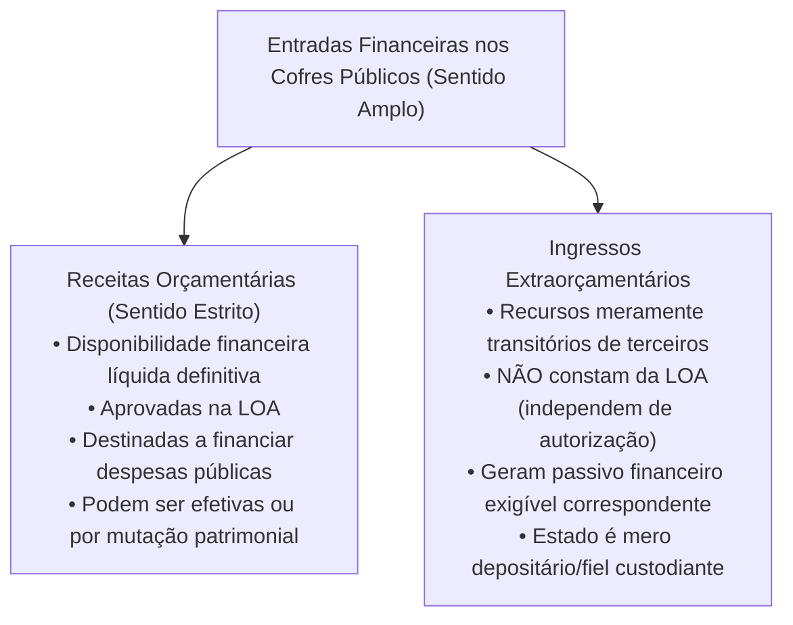
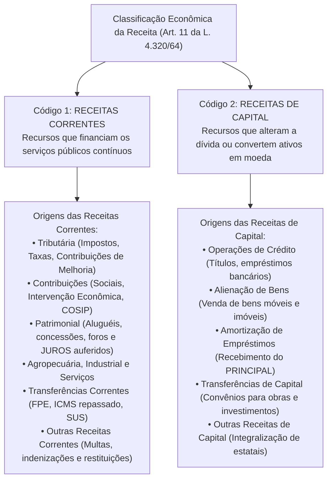
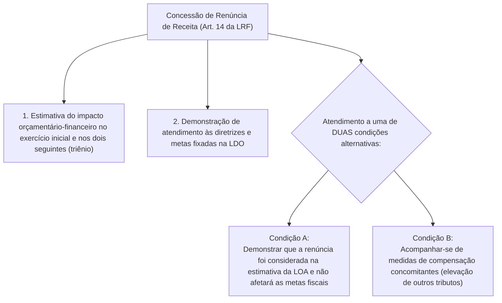

# 02 - Receita Orçamentária, Ingressos Extraorçamentários, Estágios e Classificações

> **Matéria:** Noções de Administração Financeira e Orçamentária (AFO)  
> **Cargo:** A01 – Técnico de Controle Externo – Especialidade: Técnico Administrativo  
> **Arquivo:** `02_receita_publica_estagios_fontes_e_classificacoes.md`  

---

## 📌 Ementa / Itens do Edital

- Receita pública: conceito amplo (entradas e influxos de caixa) e conceito estrito (receita orçamentária efetiva e por mutação);
- Receita Orçamentária vs. Ingressos Extraorçamentários (entradas compensatórias, cauções, fianças, depósitos judiciais, consignações em folha de pagamento e ARO);
- Etapas e estágios da receita orçamentária:
    - Etapa do Planejamento: Previsão da receita (estimativa orçamentária segundo a LRF);
    - Etapa da Execução: Lançamento (Art. 53 da Lei 4.320/64 e Art. 142 do CTN), Arrecadação (entrega de valores à rede bancária conveniada) e Recolhimento (transferência dos recursos para a Conta Única do Tesouro - Princípio da Unidade de Caixa);
- Classificações orçamentárias da receita (Lei Federal nº 4.320/1964 e MCASP 11ª Edição):
    - Classificação por Categoria Econômica: Receitas Correntes e Receitas de Capital;
    - Origens das Receitas Correntes (Tributária, de Contribuições, Patrimonial, Agropecuária, Industrial, de Serviços, Transferências Correntes e Outras);
    - Origens das Receitas de Capital (Operações de Crédito, Alienação de Bens, Amortização de Empréstimos, Transferências de Capital e Outras);
    - Distinção crítica entre Amortização de Empréstimos (capital) e Juros Recebidos (corrente/patrimonial);
    - Classificação por Esfera Orçamentária (Fiscal, Seguridade Social e Investimento);
    - Classificação por Fonte/Destinação de Recursos (fontes vinculadas vs. recursos ordinários livres);
    - Classificação por Natureza da Receita (estrutura codificada de 8 dígitos do MCASP);
- Regras fiscais restritivas da receita: vedação de aplicação de receitas de alienação de bens em despesas correntes (Art. 44 da LRF);
- Renúncia de Receitas e exigências da Lei de Responsabilidade Fiscal (Art. 14 da LRF: estimativa trienal de impacto orçamentário-financeiro e medidas de compensação).

---

## 🧭 Sumário Interativo

- [1. Conceito e Distinção: Receita Orçamentária vs. Ingressos Extraorçamentários](#1-conceito-e-distinção-receita-orçamentária-vs-ingressos-extraorçamentários)
    - [1.1 Sentido Amplo e Sentido Estrito de Receita Pública](#11-sentido-amplo-e-sentido-estrito-de-receita-pública)
    - [1.2 Regime dos Ingressos Extraorçamentários e Peculiaridades FCC](#12-regime-dos-ingressos-extraorçamentários-e-peculiaridades-fcc)
- [2. Etapas e Estágios da Receita Orçamentária](#2-etapas-e-estágios-da-receita-orçamentária)
    - [2.1 Etapa de Planejamento: Previsão da Receita (Art. 12 da LRF)](#21-etapa-de-planejamento-previsão-da-receita-art-12-da-lrf)
    - [2.2 Etapa de Execução: Lançamento, Arrecadação e Recolhimento](#22-etapa-de-execução-lançamento-arrecadação-e-recolhimento)
    - [2.3 O Princípio da Unidade de Caixa (Art. 56 da Lei nº 4.320/1964)](#23-o-princípio-da-unidade-de-caixa-art-56-da-lei-nº-43201964)
- [3. Classificações da Receita Orçamentária (Lei nº 4.320/1964 e MCASP)](#3-classificações-da-receita-orçamentária-lei-nº-43201964-e-mcasp)
    - [3.1 Classificação por Categoria Econômica: Receitas Correntes e de Capital](#31-classificação-por-categoria-econômica-receitas-correntes-e-de-capital)
    - [3.2 Distinção Crítica: Amortização de Empréstimos vs. Juros Recebidos](#32-distinção-crítica-amortização-de-empréstimos-vs-juros-recebidos)
    - [3.3 Classificação por Esfera Orçamentária e por Fonte/Destinação de Recursos](#33-classificação-por-esfera-orçamentária-e-por-fontedestinação-de-recursos)
    - [3.4 Classificação por Natureza da Receita (Estrutura Codificada de 8 Dígitos)](#34-classificação-por-natureza-da-receita-estrutura-codificada-de-8-dígitos)
- [4. Regras Fiscais Restritivas da Receita e a LRF](#4-regras-fiscais-restritivas-da-receita-e-a-lrf)
    - [4.1 Vedação de Aplicação de Receita de Alienação de Bens em Despesa Corrente (Art. 44)](#41-vedação-de-aplicação-de-receita-de-alienação-de-bens-em-despesa-corrente-art-44)
    - [4.2 Disciplina Fiscal da Renúncia de Receitas (Art. 14 da LRF)](#42-disciplina-fiscal-da-renúncia-de-receitas-art-14-da-lrf)
- [5. Fontes Oficiais & Manuais Técnicos Recomendados](#5-fontes-oficiais--manuais-técnicos-recomendados)
- [6. Questões Comentadas no Padrão FCC](#6-questões-comentadas-no-padrão-fcc)

---

## 📖 Conteúdo Teórico Aprofundado

### 1. Conceito e Distinção: Receita Orçamentária vs. Ingressos Extraorçamentários

#### 1.1 Sentido Amplo e Sentido Estrito de Receita Pública
No estudo das finanças públicas, a expressão **receita pública** admite duas acepções fundamentais:

- **Sentido Amplo (Ingressos Públicos em Geral):** Compreende todo e qualquer influxo de recursos financeiros que entra nos cofres públicos, seja ele definitivo ou transitório, seja destinado à execução orçamentária ou a mera custódia fiduciária.
- **Sentido Estrito (Receita Orçamentária):** Compreende as entradas financeiras que ingressam com caráter de definitividade no patrimônio público estatal, integrando a Lei Orçamentária Anual (LOA) como fonte de custeio para as despesas e programas governamentais.

#### 1.2 Regime dos Ingressos Extraorçamentários e Peculiaridades FCC
Os **ingressos extraorçamentários** não configuram receita orçamentária, não aumentam o patrimônio líquido do Estado e não podem ser utilizados discricionariamente pelo gestor público para realizar despesas orçamentárias. Caracterizam-se por gerarem, no exato instante de sua entrada de caixa, um passivo exigível (obrigação de devolução ou repasse):

- **Cauções e Fianças em Dinheiro:** Depositadas por licitantes e contratados como garantia de execução de contratos administrativos ou participação em certames licitatórios. Findo o contrato ou o processo, a quantia deve ser restituída;
- **Depósitos Judiciais e Recursais:** Recursos vinculados a litígios judiciais recolhidos em contas especiais sob administração temporária do Poder Judiciário;
- **Consignações em Folha de Pagamento:** Valores retidos compulsoriamente ou por autorização do servidor na folha de pagamentos (ex.: retenções de pensão alimentícia judicial, plano de saúde, empréstimos bancários consignados) destinados a imediato repasse a terceiros (credores ou beneficiários);
- **Operações de Crédito por Antecipação de Receita Orçamentária (ARO):** Previstas no art. 165, § 8º da CF/88 e art. 38 da LRF, destinam-se exclusivamente a cobrir descompassos temporários de caixa ao longo do ano civil. **Não constituem receita orçamentária**, geram dívida flutuante e devem ser integralmente liquidadas com juros e encargos até o encerramento do exercício financeiro.

---

### 2. Etapas e Estágios da Receita Orçamentária

A Lei Federal nº 4.320/1964 e o Manual de Contabilidade Aplicada ao Setor Público (MCASP) dividem a trajetória da receita pública em duas grandes etapas: a etapa do planejamento e a etapa da execução.

#### 2.1 Etapa de Planejamento: Previsão da Receita (Art. 12 da LRF)
- A **previsão** é o estágio inicial no qual o Poder Executivo estima, por meio de modelos estatísticos e econométricos, o volume de recursos a ser arrecadado no exercício financeiro seguinte para fixação na LOA.
- A Lei de Responsabilidade Fiscal (art. 12 da LRF) determina que as previsões de receita observarão as normas técnicas e legais, considerarão os efeitos das alterações na legislação, da variação do índice de preços (inflação), do crescimento econômico (PIB) e da evolução da receita nos últimos três exercícios.

#### 2.2 Etapa de Execução: Lançamento, Arrecadação e Recolhimento
1. **Lançamento (Art. 53 da Lei nº 4.320/1964 e Art. 142 do CTN):**
    - Ato privativo da autoridade administrativa que verifica a ocorrência do fato gerador da obrigação correspondente, determina a matéria tributável, calcula o montante do tributo devido, identifica o sujeito passivo e, sendo o caso, propõe a aplicação da penalidade cabível.
    - Aplica-se típica e primordialmente às receitas tributárias diretas (ex.: IPTU, IPVA, taxas de fiscalização) e às rendas com vencimento predeterminado.
2. **Arrecadação:**
    - Momento em que o sujeito passivo (contribuinte ou devedor) comparece perante os agentes arrecadadores legalmente autorizados (bancos credenciados, casas lotéricas, aplicativos bancários conveniados) e quita a guia de recolhimento oficial (DARE, DAM, GRU).
    - Nesse estágio, os recursos saem da esfera de posse do contribuinte e ingressam sob custódia dos intermediários financeiros conveniados com a administração pública.
3. **Recolhimento:**
    - Ato pelo qual as instituições financeiras arrecadadoras transferem os recursos financeiros arrecadados para a **Conta Única do Tesouro Estadual ou Municipal**.
    - É o momento em que a disponibilidade de caixa passa a pertencer faticamente ao erário público para livre destinação orçamentária.

> 🚨 **ALERTA DE PROVA / PEGADINHA FCC:**  
> A banca FCC testa com grande frequência se **todas** as receitas orçamentárias cumprem os quatro estágios. **ATENÇÃO:** Nem toda receita orçamentária passa pelo estágio do lançamento! Receitas de serviços, tarifas, doações, transferências correntes e receitas patrimoniais (como aluguéis) são arrecadadas diretamente sem a necessidade do ato formal de lançamento fiscal. Contudo, **todas** as receitas cumprem impreterivelmente os estágios da previsão, da arrecadação e do recolhimento.

#### 2.3 O Princípio da Unidade de Caixa (Art. 56 da Lei nº 4.320/1964)
- O art. 56 da Lei nº 4.320/1964 consagra solenemente o **Princípio da Unidade de Caixa** (ou Princípio da Conta Única): *"O recolhimento de todas as receitas far-se-á em estrita observância ao princípio de unidade de tesouraria, vedada qualquer fragmentação de caixas."*
- Todos os recursos auferidos pelo Estado de Goiás devem ser centralizados na Conta Única do Tesouro Estadual mantida em instituição financeira oficial, assegurando transparência, controle centralizado do fluxo financeiro e otimização da gestão de liquidez.

---

### 3. Classificações da Receita Orçamentária (Lei nº 4.320/1964 e MCASP)

A receita orçamentária é classificada segundo múltiplos critérios para fins de planejamento, controle contábil e divulgação de estatísticas fiscais.

#### 3.1 Classificação por Categoria Econômica: Receitas Correntes e de Capital
1. **Receitas Correntes (Código 1):**  
   Recursos financeiros que ingressam regularmente no erário e destinam-se ao custeio da máquina pública e à manutenção dos serviços públicos regulares prestados à sociedade. Em sua grande maioria, são **receitas efetivas** (aumentam a situação líquida patrimonial do Estado por constituírem variações patrimoniais aumentativas - VPA).
2. **Receitas de Capital (Código 2):**  
   Recursos financeiros provenientes da constituição de dívidas (operações de crédito), da conversão em moeda de bens e direitos (alienação de bens e amortização de empréstimos) ou de transferências de terceiros vinculadas à realização de investimentos. Em sua maioria, são **receitas não efetivas** (ou por mutação patrimonial), pois representam meras trocas compensatórias de elementos patrimoniais (ex.: entra dinheiro em caixa e diminui o valor de um imóvel na alienação, ou entra dinheiro e surge um passivo financeiro na operação de crédito) sem alteração imediata do patrimônio líquido.

#### 3.2 Distinção Crítica: Amortização de Empréstimos vs. Juros Recebidos
Um dos temas mais recorrentes em provas da FCC é o tratamento contábil dos financiamentos concedidos pelo Estado a outros entes ou agentes econômicos:

- **Recebimento do Principal (Devolução do Capital Emprestado):**  
  Classifica-se como **Receita de Capital**, sob a origem **Amortização de Empréstimos**. O Estado detinha um direito a receber no Ativo Não Circulante que se converte em dinheiro de caixa (mutação ativa compensatória).
- **Recebimento dos Juros e Encargos da Dívida:**  
  Classifica-se como **Receita Corrente**, sob a origem **Receita Patrimonial**. Remunera o capital emprestado e constitui ganho patrimonial efetivo (VPA).

#### 3.3 Classificação por Esfera Orçamentária e por Fonte/Destinação de Recursos
- **Por Esfera Orçamentária:** Identifica a qual dos três orçamentos integrados da LOA a receita pertence:
    - Orçamento Fiscal (F);
    - Orçamento da Seguridade Social (S);
    - Orçamento de Investimento das Estatais (I).
- **Por Fonte / Destinação de Recursos:** Mecanismo pelo qual se estabelece a vinculação entre a origem do ingresso e a sua aplicação final:
    - **Recursos Ordinários (Livres):** Podem ser programados pelo Executivo para qualquer despesa discricionária regular;
    - **Recursos Vinculados (Carimbados):** Possuem destinação legal ou constitucional obrigatória (ex.: Fundeb, percentuais mínimos de saúde e educação, convênios com repasses federais e emendas parlamentares impositivas). Conforme o art. 8º, parágrafo único da LRF, as disponibilidades de caixa dessas fontes mantêm sua vinculação ao longo dos exercícios, até a efetivação do seu objeto.

#### 3.4 Classificação por Natureza da Receita (Estrutura Codificada de 8 Dígitos)
O MCASP (STN) padronizou a codificação da natureza da receita em nível nacional através de 8 dígitos alfanuméricos:

$$\text{C . O . E . D1 . D2 . D3 . D4 . T}$$

1. **1º dígito - Categoria Econômica:** (1 = Receita Corrente; 2 = Receita de Capital);
2. **2º dígito - Origem:** Subdivisão das categorias econômicas (ex.: Tributária, Patrimonial, Alienação de Bens, etc.);
3. **3º dígito - Espécie:** Nível que individualiza a receita (ex.: Impostos, Taxas, Amortizações);
4. **4º ao 7º dígitos - Desdobramentos para Identificação de Peculiaridades e Alíquotas:** Detalham o fato gerador específico (ex.: ICMS, IPVA, Alienação de Imóveis);
5. **8º dígito - Tipo da Receita:** Identifica se o valor arrecadado é o Principal (Tipo 1), Multas e Juros de Mora (Tipo 2), Dívida Ativa (Tipo 3), ou Multas e Juros da Dívida Ativa (Tipo 4).

---

### 4. Regras Fiscais Restritivas da Receita e a LRF

#### 4.1 Vedação de Aplicação de Receita de Alienação de Bens em Despesa Corrente (Art. 44)
A Lei de Responsabilidade Fiscal impõe uma barreira intransponível à dilapidação do patrimônio público para custeio operacional:
> *"É vedada a aplicação da receita de capital derivada da alienação de bens e direitos que integrem o patrimônio público para o financiamento de despesa corrente, salvo se destinada por lei aos regimes de previdência social, geral e próprio dos servidores públicos."* (Art. 44 da LRF)

- **Fundamento Fiscal:** Evitar que governantes vendam imóveis, empresas estatais ou frotas públicas para pagar despesas ordinárias do dia a dia (folha salarial, água, luz e telefone), o que geraria rápida ruína fiscal do Estado.
- **Única Exceção Legal:** Destinação autorizada por lei para capitalizar os **regimes de previdência social (RPPS ou RGPS)**, viabilizando o equilíbrio atuarial dos fundos de aposentadoria pública.

#### 4.2 Disciplina Fiscal da Renúncia de Receitas (Art. 14 da LRF)
Qualquer ato normativo que conceda ou amplie benefício fiscal que resulte em **renúncia de receita** (anistia, remissão, subsídio, crédito presumido, isenção em caráter não geral ou redução de alíquotas) deve obedecer aos rigorosos requisitos do art. 14 da LRF:

> 🚨 **ALERTA DE PROVA / PEGADINHA FCC:**  
> A banca frequentemente afirma que a renúncia de receitas exige sempre, obrigatoriamente e cumulativamente, aumento de tributos compensatórios. **ERRADO!** O aumento compensatório (Condição B) só é exigido caso a renúncia NÃO tenha sido expressamente prevista na estimativa de receita da Lei Orçamentária Anual. Se já foi contemplada e absorvida na LOA sem risco para as metas fiscais do AMF, a criação/aumento de outros tributos é dispensada.

---

## 🌐 Fontes Oficiais & Manuais Técnicos Recomendados

- [Lei Federal nº 4.320/1964](https://www.planalto.gov.br/ccivil_03/leis/l4320.htm)
    - Arts. 9º a 11 (Classificação Econômica da Receita) e Arts. 51 a 57 (Estágios da Receita e Unidade de Caixa).
- [Lei Complementar Federal nº 101/2000 (Lei de Responsabilidade Fiscal)](https://www.planalto.gov.br/ccivil_03/leis/lcp/lcp101.htm)
    - Arts. 11 a 14 (Previsão de Receitas e Renúncia Fiscal) e Art. 44 (Alienação de Ativos).
- [Manual de Contabilidade Aplicada ao Setor Público (MCASP) - 11ª Edição (STN)](https://www.gov.br/tesouronacional/pt-br)
    - Parte I: Procedimentos Contábeis Orçamentários - Classificações e Natureza da Receita.
- [Código Tributário Nacional - Lei Federal nº 5.172/1966](https://www.planalto.gov.br/ccivil_03/leis/l5172compilado.htm)
    - Art. 142 (Do Lançamento Tributário).

---

## 📝 Questões Comentadas no Padrão FCC

### Questão 1 (FCC - Adaptada / TCE-RS - Auditor de Controle Externo)
Determinado Estado da Federação recebeu as seguintes quantias financeiras em sua conta única do Tesouro ao longo do mês:

I. R$ 500.000,00 referentes à venda em leilão público de veículos automotores inservíveis de sua frota administrativa.  
II. R$ 200.000,00 a título de juros moratórios incidentes sobre créditos tributários de ICMS pagos em atraso por contribuintes.  
III. R$ 300.000,00 decorrentes da devolução parcelada do principal de financiamento outrora concedido pelo Estado a determinado município goiano para fomento agropecuário.  

Nos termos da Lei Federal nº 4.320/1964 e das normas do MCASP, os itens I, II e III classificam-se, respectivamente, como:

* **A)** Receita Corrente; Receita Corrente; Receita de Capital.
* **B)** Receita de Capital; Receita Corrente; Receita de Capital.
* **C)** Receita de Capital; Receita de Capital; Receita Corrente.
* **D)** Receita Corrente; Receita de Capital; Receita de Capital.
* **E)** Receita de Capital; Receita Corrente; Receita Corrente.

> **Comentário Detalhado:**
> - **A)** Incorreta. O item I trata de alienação de ativos públicos, classificado legalmente como Receita de Capital.
> - **B)** Correta. O item I (venda de veículos da frota) configura Alienação de Bens Móveis, integrando as Receitas de Capital; o item II (juros de mora sobre créditos tributários) integra as Receitas Correntes (receitas de juros/outras receitas correntes); e o item III (devolução do principal de empréstimo concedido) classifica-se como Amortização de Empréstimos, enquadrado como Receita de Capital. Portanto, a ordem correta é Capital, Corrente e Capital.
> - **C)** Incorreta. O item II (juros moratórios) é receita corrente, e o item III (amortização do principal) é receita de capital.
> - **D)** Incorreta. O leilão de veículos inservíveis é receita de capital e não corrente.
> - **E)** Incorreta. A devolução do principal do empréstimo outrora cedido (item III) não é receita corrente, e sim de capital.
> 
> **Gabarito: B**

---

### Questão 2 (FCC - Adaptada / TCE-PI - Auditor de Controle Externo)
A respeito das etapas e estágios da receita orçamentária e dos ingressos nos cofres estaduais, assinale a assertiva correta:

* **A)** As garantias contratuais depositadas em dinheiro por licitantes vencedores configuram receita orçamentária corrente, devendo constar previamente estimadas na Lei Orçamentária Anual.
* **B)** O estágio do recolhimento ocorre no momento exato em que o contribuinte efetua o pagamento do documento de arrecadação no caixa da instituição financeira credenciada.
* **C)** As operações de crédito por antecipação de receita orçamentária (ARO) constituem receitas de capital de execução orçamentária obrigatória no primeiro semestre do exercício financeiro.
* **D)** A transferência dos recursos arrecadados pelos agentes bancários para a Conta Única do Tesouro consubstancia o estágio do recolhimento, em obediência ao princípio da unidade de caixa.
* **E)** O lançamento é estágio obrigatório prévio e indispensável para a arrecadação de toda e qualquer receita orçamentária no âmbito da administração pública.

> **Comentário Detalhado:**
> - **A)** Incorreta. Garantias e cauções contratuais são ingressos extraorçamentários (recursos transitórios de terceiros com obrigação de devolução posterior), não constando da LOA.
> - **B)** Incorreta. O pagamento realizado pelo contribuinte perante o caixa bancário consubstancia o estágio da arrecadação, e não do recolhimento.
> - **C)** Incorreta. ARO não é receita orçamentária de capital; é mero ingresso extraorçamentário de caixa para cobrir déficits transitórios de tesouraria.
> - **D)** Correta. Conforme o art. 56 da Lei nº 4.320/1964, o recolhimento é a entrega ou transferência dos recursos da rede bancária arrecadadora para a Conta Única do Tesouro Estadual, operacionalizando o princípio da unidade de caixa.
> - **E)** Incorreta. Nem toda receita orçamentária cumpre o estágio do lançamento (tarifas, serviços, doações e receitas financeiras são arrecadadas diretamente sem lançamento fiscal prévio).
> 
> **Gabarito: D**

---

### Questão 3 (FCC - Adaptada / Analista de Planejamento e Orçamento)
Determinado Secretário de Estado da Fazenda propôs projeto de lei concedendo isenção temporária de IPVA para proprietários de veículos elétricos e híbridos matriculados no Estado. O projeto de lei foi aprovado pela Assembleia Legislativa sem a apresentação de estimativa de impacto orçamentário-financeiro e desacompanhado de medidas de compensação fiscal.

À luz do artigo 14 da Lei de Responsabilidade Fiscal (LC nº 101/2000):

* **A)** A concessão do benefício é válida de pleno direito, visto que o Estado detém soberania para instituir e conceder isenções de seus tributos privativos.
* **B)** A proposição viola a Lei de Responsabilidade Fiscal, pois a concessão de benefício tributário da qual decorra renúncia de receita exige estimativa de impacto no exercício e nos dois seguintes, além de comprovação de que não afetará as metas fiscais ou de adoção de medidas compensatórias de arrecadação.
* **C)** A renúncia de receitas somente atinge isenções concedidas a pessoas jurídicas de direito privado, sendo dispensada qualquer formalidade para pessoas físicas adquirentes de veículos.
* **D)** As medidas compensatórias exigidas pela LRF aplicam-se com exclusividade a impostos federais compartilhados, dispensando-se do IPVA estadual.
* **E)** A exigência de estimativa trienal restringe-se aos dois últimos anos de mandato do Chefe do Poder Executivo.

> **Comentário Detalhado:**
> - **A)** Incorreta. A autonomia federativa dos entes para legislar sobre seus tributos submete-se expressamente às normas gerais de finanças públicas veiculadas pela LRF.
> - **B)** Correta. O art. 14 da LRF prescreve que qualquer benefício ou incentivo que importe em renúncia de receita deve ser acompanhado de estimativa trienal do impacto orçamentário-financeiro e atender à LDO, mediante demonstração de que foi prevista na LOA sem afetar metas ou acompanhada de medidas de compensação fiscal efetivas.
> - **C)** Incorreta. A disciplina da LRF alcança a concessão de incentivos fiscais indistintamente, quer os beneficiários sejam pessoas físicas ou pessoas jurídicas.
> - **D)** Incorreta. A Lei de Responsabilidade Fiscal incide com eficácia nacional e obriga União, Estados, Distrito Federal e Municípios em relação a todos os seus tributos.
> - **E)** Incorreta. A exigência do art. 14 da LRF é permanente e aplica-se durante todo e qualquer período do exercício orçamentário e mandato.
> 
> **Gabarito: B**

---

### Questão 4 (FCC - Adaptada / Técnico de Controle Externo)
O Governo do Estado de Goiás promoveu a alienação, mediante concorrência pública, de um edifício comercial de sua propriedade que estava desocupado, arrecadando R$ 10.000.000,00. O Governador pretende aplicar integralmente essa receita para pagar o reajuste salarial concedido aos servidores públicos da Secretaria da Saúde.

De acordo com o artigo 44 da Lei Complementar nº 101/2000 (Lei de Responsabilidade Fiscal):

* **A)** A pretensão governamental é lícita, pois a saúde pública constitui prioridade orçamentária imune a restrições fiscais.
* **B)** A aplicação é vedada, pois a receita de capital derivada da alienação de bens públicos não pode ser aplicada no financiamento de despesas correntes, salvo se destinada por lei aos regimes de previdência social.
* **C)** A receita de alienação de bens pode ser destinada a qualquer tipo de despesa pública, desde que autorizada por decreto executivo simples.
* **D)** O valor arrecadado deve ser compulsoriamente recolhido ao Tesouro Nacional para amortização de títulos federais.
* **E)** A alienação de imóveis públicos converte-se automaticamente em receita corrente tributária após o depósito bancário.

> **Comentário Detalhado:**
> - **A)** Incorreta. As restrições do art. 44 da LRF são cogentes e insuperáveis, não comportando exceção para a folha de pessoal da saúde.
> - **B)** Correta. O art. 44 da LRF proíbe expressamente a aplicação de receitas de capital oriundas da alienação de bens e direitos para o financiamento de despesas correntes (como salários de servidores), admitindo única exceção legal para capitalização de regimes de previdência social (RPPS/RGPS).
> - **C)** Incorreta. O gestor não possui discricionariedade para desrespeitar vedação legal expressa da lei de finanças públicas.
> - **D)** Incorreta. Os recursos da venda pertencem ao erário estadual de Goiás e podem financiar outras despesas de capital (investimentos).
> - **E)** Incorreta. A alienação de ativos conserva perenemente sua natureza de Receita de Capital.
> 
> **Gabarito: B**

---

### Questão 5 (FCC - Adaptada / Analista de Gestão Pública)
Na execução orçamentária de determinada entidade autárquica estadual, os valores descontados mensalmente na folha de pagamentos dos seus servidores a título de contribuição previdenciária própria e de pensão alimentícia judicial fixada por sentença constituem:

* **A)** Receitas Correntes Patrimoniais da própria autarquia.
* **B)** Ingressos Extraorçamentários, haja vista que a entidade é mera depositária temporária dos valores que serão repassados aos seus legítimos destinatários.
* **C)** Receitas de Capital decorrentes de amortização forçada de encargos de pessoal.
* **D)** Receitas Tributárias originárias de competência privativa do Poder Executivo.
* **E)** Recursos vinculados de transferências voluntárias intergovernamentais.

> **Comentário Detalhado:**
> - **A)** Incorreta. Retenções de vencimentos para entrega a terceiros não geram acréscimo patrimonial nem remuneram bens da autarquia.
> - **B)** Correta. As consignações em folha de pagamento (pensão alimentícia, retenções judiciais e empréstimos consignados) consubstanciam ingressos extraorçamentários. O poder público atua como mero depositário transitório desses valores, surgindo no mesmo instante a obrigação financeira exigível de repasse aos credores legítimos.
> - **C)** Incorreta. Não existe mutação de ativo permanente nem amortização de empréstimos concedidos pelo Estado.
> - **D)** Incorreta. As retenções de pensão alimentícia advêm de relações cíveis de família e não possuem natureza tributária.
> - **E)** Incorreta. Não se tratam de convênios ou acordos federativos voluntários.
> 
> **Gabarito: B**
