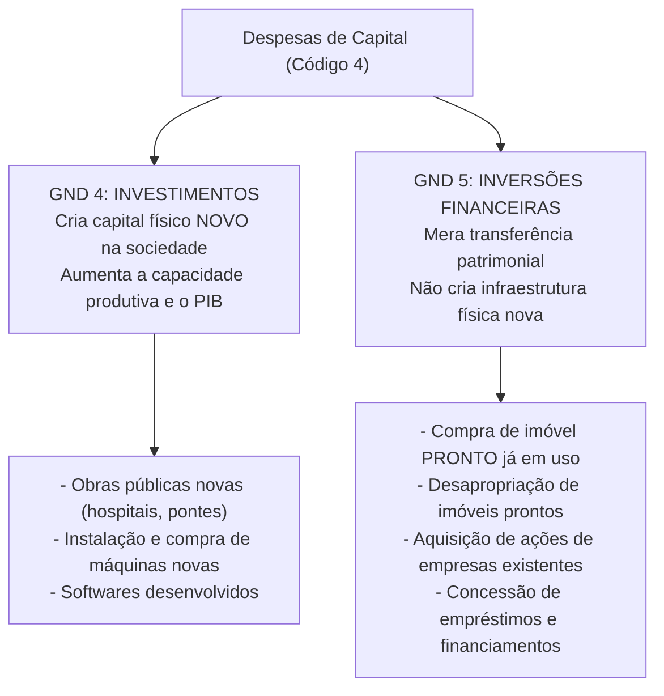
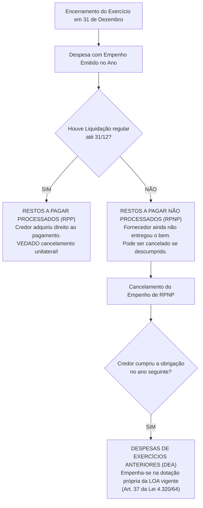

# 03 - Despesa Pública, Estágios, Classificações, Restos a Pagar, DEA e Suprimento de Fundos

> **Matéria:** Noções de Administração Financeira e Orçamentária (AFO)  
> **Cargo:** A01 – Técnico de Controle Externo – Especialidade: Técnico Administrativo  
> **Arquivo:** `03_despesa_publica_estagios_restos_a_pagar_e_suprimento.md`  

---

## 📌 Ementa / Itens do Edital

- Despesa pública: conceito amplo e estrito, despesas orçamentárias vs. dispêndios extraorçamentários;
- Estágios da despesa orçamentária (Lei Federal nº 4.320/1964):
  - Fixação (aprovação da dotação na LOA);
  - Empenho (Art. 58 da Lei 4.320/64): conceito, modalidades (ordinário, estimativo e global) e a Nota de Empenho;
  - Liquidação (Art. 63 da Lei 4.320/64): verificação objetiva do direito adquirido pelo credor e atesto de conformidade;
  - Pagamento (Art. 64 da Lei 4.320/64): ordem bancária emitida contra a Conta Única do Tesouro;
- Classificações da Despesa Orçamentária (Portaria Interministerial STN/SOF nº 163/2001 e MCASP):
  - Classificação Institucional (Órgão e Unidade Orçamentária executora);
  - Classificação Funcional-Programática (Função, Subfunção, Programa, Ações: Projetos, Atividades e Operações Especiais; princípio da matricialidade funcional);
  - Classificação por Natureza da Despesa (estrutura codificada: Categoria Econômica, Grupo de Natureza da Despesa - GND, Modalidade de Aplicação e Elemento de Despesa);
  - Distinção essencial: Investimentos (GND 4) vs. Inversões Financeiras (GND 5);
- Restos a Pagar (RAP - Artigo 36 da Lei nº 4.320/1964):
  - Restos a Pagar Processados (RPP) vs. Restos a Pagar Não Processados (RPNP);
  - Regras de vigência, liquidação, cancelamento e prescrição quinquenal;
- Despesas de Exercícios Anteriores (DEA): as três hipóteses legais taxativas do Artigo 37 da Lei nº 4.320/1964;
- Suprimento de Fundos (Regime de Adiantamento): conceito, hipóteses restritas de concessão (pequeno vulto, urgência, viagens e despesas sigilosas), proibições absolutas de concessão e prestação de contas.

---

## 🌳 Classificação Hierárquica

```text
3. Regime da Despesa Pública e Mecanismos Excepcionais de Execução
├── 3.1 Estágios da Despesa Orçamentária (Lei nº 4.320/1964)
│   ├── 3.1.1 Fixação: Dotação orçamentária autorizada pelo Poder Legislativo na Lei Orçamentária Anual
│   ├── 3.1.2 Empenho (Art. 58): Ato de autoridade que cria obrigação de pagamento pendente ou não de condição
│   │   ├── Empenho Ordinário: Despesa com valor exato conhecido e pagamento em parcela única (ex.: compra de computadores)
│   │   ├── Empenho Estimativo: Despesa de montante previamente inexato (ex.: contas de água, energia, telefone, combustível)
│   │   └── Empenho Global: Despesa contratual de valor determinado com execução/pagamento parcelado (ex.: locações e obras)
│   ├── 3.1.3 Liquidação (Art. 63): Verificação do direito adquirido pelo credor mediante conferência documental e atesto físico
│   └── 3.1.4 Pagamento (Art. 64): Despacho determinando a quitação da obrigação mediante Ordem Bancária na Conta Única
├── 3.2 Estrutura e Classificações Orçamentárias da Despesa
│   ├── 3.2.1 Classificação Institucional: "Quem gasta?" (Órgão Orçamentário e Unidade Orçamentária - UO)
│   ├── 3.2.2 Classificação Funcional: "Em que área de governo?"
│   │   ├── Função: Maior nível de agregação das áreas de atuação pública (Saúde, Educação, Segurança, Controle Externo)
│   │   └── Subfunção: Ramo específico da função; Princípio da Matricialidade (qualquer subfunção combina com qualquer função)
│   ├── 3.2.3 Classificação Programática: "Para que gastar?" (Programa -> Ações Orçamentárias):
│   │   ├── Projetos: Instrumentos temporários de expansão que criam produto novo ou ampliam capacidade física (novo hospital)
│   │   ├── Atividades: Ações contínuas e permanentes destinadas à manutenção dos serviços públicos (manutenção do hospital)
│   │   └── Operações Especiais: Despesas financeiras que não geram contraprestação física ou serviços (pagamento da dívida)
│   └── 3.2.4 Classificação por Natureza da Despesa (Estrutura de 6 dígitos: c.g.mm.ee):
│       ├── Categoria Econômica: 3 - Despesas Correntes / 4 - Despesas de Capital
│       ├── Grupos de Natureza da Despesa (GND):
│       │   ├── GND 1: Pessoal e Encargos Sociais
│       │   ├── GND 2: Juros e Encargos da Dívida
│       │   ├── GND 3: Outras Despesas Correntes (ODC - material de consumo, diárias, serviços terceirizados)
│       │   ├── GND 4: Investimentos (obras públicas novas, ampliações e aquisição de equipamentos permanentes)
│       │   ├── GND 5: Inversões Financeiras (aquisição de imóveis PRONTOS em uso, desapropriações e compra de ações)
│       │   └── GND 6: Amortização da Dívida (pagamento do principal da dívida pública fundada)
│       ├── Modalidade de Aplicação: Eliminação da dupla contagem de recursos repassados
│       └── Elemento de Despesa: Objeto específico do gasto (material de consumo, serviços de TI, vencimentos)
├── 3.3 Restos a Pagar (RAP) e Despesas de Exercícios Anteriores (DEA)
│   ├── 3.3.1 Restos a Pagar (Art. 36 da Lei 4.320/64): Despesas empenhadas e não pagas até 31 de dezembro:
│   │   ├── Restos a Pagar Processados (RPP): Despesa empenhada E liquidada (direito adquirido do credor; vedado cancelamento unilateral)
│   │   └── Restos a Pagar Não Processados (RPNP): Despesa empenhada e NÃO liquidada (bem ou serviço pendente de entrega)
│   └── 3.3.2 Despesas de Exercícios Anteriores (DEA - Art. 37): Pagas à conta do orçamento vigente nas hipóteses:
│       ├── 1. Despesas para as quais o orçamento anterior consignava crédito próprio e saldo suficiente, mas não empenhadas na época
│       ├── 2. Restos a pagar cancelados, desde que o direito do credor subsista e a prescrição quinquenal esteja interrompida
│       └── 3. Compromissos decorrentes de obrigações legais ou contratuais reconhecidos pela autoridade após o fim do ano
└── 3.4 Regime de Suprimento de Fundos (Adiantamento)
    ├── 3.4.1 Hipóteses Restritas: Despesas de pequeno vulto (pronto pagamento), viagens/urgências e despesas sigilosas
    ├── 3.4.2 Vedações Categóricas: A servidor em alcance (com prestação de contas pendente/atrasada) ou responsável por almoxarifado
    └── 3.4.3 Regra de Ouro: Exige empenho prévio em nome do servidor suprido (não dispensa a licitação material)
```

---

## 📖 Conteúdo Teórico Aprofundado

### 1. Estágios da Despesa Orçamentária (Lei nº 4.320/1964)

A realização da despesa pública cumpre uma rígida ordem cronológica legal e contábil:


#### 1.1 O Empenho (Arts. 58 a 61 da Lei nº 4.320/1964)
- **Conceito:** Ato emanado de autoridade competente que cria para o Estado a obrigação de pagamento pendente ou não de implemento de condição. Tem a função contábil de reservar previamente a dotação orçamentária, garantindo recursos ao fornecedor.
- **Princípio da Prévia Dotação:** É terminantemente vedada a realização de despesa sem prévio empenho (Art. 60).
- **As Três Modalidades de Empenho:**

| Modalidade de Empenho | Montante da Despesa | Forma de Pagamento | Exemplo Prático de Aplicação |
| :--- | :--- | :--- | :--- |
| **Ordinário (Comum)** | Exato e previamente determinado. | **Parcela única** (de uma só vez). | Compra de lote de 10 impressoras entregues e faturadas em fatura única. |
| **Estimativo** | **Inexato / Impossível** de fixar previamente. | Parcelado ao longo do período. | Contas mensais de energia elétrica, fornecimento de água potável e consumo de combustível da frota. |
| **Global** | Exato e previamente determinado. | **Parcelado / Sucessivo**. | Contratos de locação de imóvel com aluguéis mensais, contratos de vigilância continuada e medições de obras. |

---

#### 1.2 A Liquidação (Art. 63 da Lei nº 4.320/1964)
- **Conceito:** Verificação do **direito adquirido pelo credor**, tendo por base os títulos e documentos comprobatórios do crédito.
- **Elementos de Aferição Obrigatória:**
  1. A origem e o objeto do que se deve pagar;
  2. A importância exata a pagar;
  3. A quem se deve pagar para extinguir a obrigação.
- **Procedimento:** Exige a comprovação documental e o **atesto formal** por comissão fiscalizatória ou servidor credenciado de que os bens foram entregues ou de que os serviços foram integralmente executados de acordo com as especificações do contrato e da nota de empenho.

#### 1.3 O Pagamento (Arts. 64 e 65 da Lei nº 4.320/1964)
- **Conceito:** O despacho exarado pela autoridade competente ordenando que a despesa liquidada seja paga.
- **Processamento:** Dá-se mediante emissão de **Ordem Bancária (OB)** transferindo o valor diretamente da Conta Única do Tesouro para a conta bancária do credor. Nenhum pagamento pode ser realizado sem a prévia e regular liquidação da despesa (Art. 62).

---

### 2. Despesas de Capital: Investimentos vs. Inversões Financeiras

A distinção entre o Grupo de Natureza da Despesa 4 (Investimentos) e o Grupo 5 (Inversões Financeiras) é uma das temáticas mais exploradas em concursos da FCC:



> 🚨 **ALERTA DE PROVA / PEGADINHA FCC:**  
> - **Construir um prédio novo** ou adquirir um imóvel recém-construído diretamente para primeira utilização do Poder Público classifica-se como **INVESTIMENTO (GND 4)**!  
> - **Comprar um prédio comercial que já estava alugado ou funcionando** no mercado privado, ou desapropriar um terreno/imóvel pronto classifica-se como **INVERSÃO FINANCEIRA (GND 5)**! Isso ocorre porque a operação não gerou formação bruta de capital novo no país; representou apenas a mudança de titularidade de um patrimônio preexistente.

---

### 3. Restos a Pagar (RAP) vs. Despesas de Exercícios Anteriores (DEA)



#### 3.1 Restos a Pagar Processados (RPP) vs. Não Processados (RPNP)
- **Restos a Pagar Processados (RPP):** Despesas empenhadas e **liquidadas** dentro do exercício, pendentes apenas do pagamento financeiro. A Administração Pública não pode cancelar o empenho arbitrariamente sem quitar a dívida, pois o credor já cumpriu sua prestação e o direito adquirido está aperfeiçoado.
- **Restos a Pagar Não Processados (RPNP):** Despesas empenhadas, mas **não liquidadas** até 31 de dezembro (a entrega do bem ou serviço ainda não ocorreu). Podem ser canceladas pela administração caso o prazo contratual expire ou haja desistência justificada.

#### 3.2 Despesas de Exercícios Anteriores (DEA - Art. 37 da Lei nº 4.320/1964)
As dívidas passadas de exercícios já encerrados serão empenhadas e pagas à conta de dotação orçamentária constante na **Lei Orçamentária Anual do exercício em curso**, exclusivamente nas seguintes hipóteses:
1. Despesas para as quais o orçamento respectivo consignava **crédito próprio, com saldo suficiente**, mas que não tenham sido empenhadas na época própria;
2. Restos a pagar com **prescrição interrompida** ou cancelados indevidamente, desde que o direito do credor subsista;
3. Compromissos decorrentes de obrigações contratuais ou legais cujo reconhecimento da dívida tenha sido formalizado pela autoridade competente após o encerramento do exercício.

---

### 4. Regime de Suprimento de Fundos (Adiantamento)

Consiste na entrega de numerário a um servidor público para realização de despesas que não possam subordinar-se ao processo normal de aplicação (empenho -> liquidação -> pagamento).
- **O empenho prévio continua obrigatório**, sendo emitido previamente no nome do servidor suprido.
- **Hipóteses Autorizadas em Regulamento:**
  1. Despesas miúdas de pequeno vulto (pronto pagamento em dinheiro ou cartão corporativo);
  2. Despesas extraordinárias e urgentes que possam comprometer o serviço público;
  3. Despesas com viagens e representações institucionais de servidores;
  4. Despesas de caráter reservado ou sigiloso (segurança pública e inteligência policial).
- **Vedações Categóricas de Concessão de Suprimento de Fundos:**
  - A servidor **em alcance** (que esteja em atraso na prestação de contas de adiantamento anterior ou que teve contas impugnadas);
  - A servidor responsável pela guarda ou utilização do material a adquirir (ex.: chefe ou funcionário de almoxarifado);
  - Fracionamento indevido de despesas para burlar o dever de licitar da Lei nº 14.133/2021.

---

## 🌐 Fontes Oficiais & Manuais Técnicos Recomendados

- [Lei Federal nº 4.320/1964](https://www.planalto.gov.br/ccivil_03/leis/l4320.htm)
  - Arts. 58 a 65 (Dos Estágios da Despesa), Art. 36 (Restos a Pagar) e Art. 37 (DEA).
- [Manual de Contabilidade Aplicada ao Setor Público (MCASP) - 11ª Edição (STN)](https://www.gov.br/tesouronacional/pt-br)
  - Parte I: Procedimentos Contábeis Orçamentários - Despesa Pública e GNDs.
- [Decreto Federal nº 93.872/1986](https://www.planalto.gov.br/ccivil_03/decreto/d93872.htm)
  - Disciplina a unificação dos recursos de caixa e as regras de Suprimento de Fundos.
- [Decreto Estadual de Goiás nº 9.697/2020](https://legisla.casacivil.go.gov.br)
  - Regulamento da execução financeira e prestação de contas de suprimento de fundos em Goiás.

---

## 📝 Questões Comentadas no Padrão FCC

### Questão 1 (FCC - Adaptada / TCE-RS - Auditor de Controle Externo)
A respeito da classificação e dos estágios da despesa pública orçamentária, assinale a opção correta:

A) A emissão de nota de empenho ordinário é admitida para despesas contratuais de prestação contínua de serviços cujo valor total deva ser desembolsado em parcelas mensais ao longo do ano.  
B) A aquisição de imóvel residencial já edificado e em utilização para instalação de repartição pública estadual constitui típica despesa de Investimento (GND 4).  
C) A liquidação da despesa tem por objetivo comprovar o implemento de condição e o direito adquirido pelo credor, mediante verificação documental de que o serviço foi efetivamente prestado ou os bens foram entregues.  
D) O pagamento da despesa pública pode anteceder a liquidação nas hipóteses de aquisição de bens duráveis com cláusula de entrega futura.  
E) As despesas empenhadas e não pagas até o encerramento do exercício financeiro em 31 de dezembro serão obrigatoriamente anuladas pelo controle interno.  

> **Gabarito: C**  
>
> **Análise detalhada de cada alternativa:**  
> - **A) INCORRETA:** Para despesas contratuais com pagamentos parcelados mensais, a modalidade de empenho exigida é o **empenho global** (art. 60, § 3º da Lei 4.320/64).  
> - **B) INCORRETA:** A compra de imóvel já construído e em utilização configura **Inversão Financeira (GND 5)**, pois não gera formação bruta de capital fixo novo na economia.  
> - **C) CORRETA:** Nos termos do art. 63 da Lei nº 4.320/1964, a liquidação consiste na verificação objetiva do direito adquirido pelo credor, mediante verificação da documentação e atesto físico de que o serviço foi concluído ou os bens entregues.  
> - **D) INCORRETA:** A ordem legal é rígida: fixação -> empenho -> liquidação -> pagamento. O pagamento antes da liquidação é terminantemente vedado (art. 62).  
> - **E) INCORRETA:** Despesas empenhadas e não pagas até 31 de dezembro são inscritas em **Restos a Pagar** (art. 36), não sendo sumariamente canceladas.

---

### Questão 2 (FCC - Adaptada / TCE-PI - Auditor de Controle Externo)
Em relação ao regime de suprimento de fundos (adiantamento) e às Despesas de Exercícios Anteriores (DEA), é correto afirmar que:

A) O suprimento de fundos pode ser concedido livremente a qualquer servidor público, inclusive àquele que esteja omisso no dever de prestar contas de adiantamento concedido anteriormente.  
B) As Despesas de Exercícios Anteriores (DEA) correspondem exclusivamente a despesas que foram liquidadas e pagas no exercício anterior sem prévio empenho orçamentário.  
C) O suprimento de fundos dispensa a realização de empenho orçamentário prévio em nome do servidor responsável pelo adiantamento.  
D) As despesas de exercícios encerrados para as quais o orçamento respectivo consignava crédito próprio e com saldo suficiente, mas que não tenham sido empenhadas na época própria, poderão ser pagas à conta de dotação para despesas de exercícios anteriores (DEA).  
E) O cancelamento de Restos a Pagar Processados enseja a imediata extinção irrecorrível do direito creditório do fornecedor perante a Fazenda Pública.  

> **Gabarito: D**  
>
> **Análise detalhada de cada alternativa:**  
> - **A) INCORRETA:** É expressamente vedada a concessão de suprimento de fundos a servidor em alcance (com prestação de contas pendente de homologação ou em atraso).  
> - **B) INCORRETA:** As DEA referem-se a compromissos pretéritos que não foram quitados no exercício de competência e serão custeados à conta da dotação da LOA em vigor (art. 37 da Lei 4.320/64).  
> - **C) INCORRETA:** O empenho prévio em nome do agente recebedor (suprido) é condição indeclinável antes da liberação do numerário.  
> - **D) CORRETA:** O art. 37 da Lei nº 4.320/1964 prevê que as despesas de exercícios encerrados para as quais o orçamento respectivo consignava crédito próprio com saldo suficiente, mas que não se empenharam na época própria, poderão ser empenhadas e pagas à conta de dotação de DEA na LOA vigente.  
> - **E) INCORRETA:** Se a despesa foi liquidada, o direito do fornecedor subsiste; eventual cancelamento indevido enseja reconhecimento do débito como DEA dentro do prazo prescricional quinquenal.

---

### Questão 3 (FCC - Adaptada / Analista de Planejamento e Orçamento)
Para a realização de despesas rotineiras de manutenção das instalações de uma secretaria de estado, o gestor público determinou a emissão de nota de empenho no início do mês de janeiro para cobrir os gastos com fornecimento contínuo de energia elétrica e abastecimento de água ao longo de todo o ano, sem que seja possível conhecer previamente o consumo exato a cada mês.

A modalidade de empenho adequada e legalmente exigida para essa situação é o empenho:

A) Ordinário.  
B) Global.  
C) Estimativo.  
D) Extraorçamentário.  
E) Suplementar por Decreto.  

> **Gabarito: C**  
>
> **Análise detalhada de cada alternativa:**  
> - **A) INCORRETA:** O empenho ordinário aplica-se a despesas de valor exato conhecido e pagamento em parcela única.  
> - **B) INCORRETA:** O empenho global exige que o valor total da obrigação contratual seja previamente conhecido com exatidão (ex.: aluguel fixado em R$ 5.000/mês).  
> - **C) CORRETA:** De acordo com o art. 60, § 2º da Lei nº 4.320/1964, aplica-se o **empenho estimativo** para as despesas cujo montante exato não se possa previamente determinar no momento da emissão, como as contas de água, energia, telefone e combustíveis.  
> - **D) INCORRETA:** Despesas com serviços essenciais de manutenção são despesas orçamentárias correntes.  
> - **E) INCORRETA:** Crédito suplementar é instrumento de alteração orçamentária, não modalidade de empenho.

---

### Questão 4 (FCC - Adaptada / Técnico de Controle Externo)
Determinada empresa pública estadual adquiriu, mediante procedimento licitatório de compra direta, um terreno urbano desocupado para futura expansão de seu almoxarifado no valor de R$ 2.000.000,00, bem como contratou uma empreiteira para a construção de um novo edifício administrativo no mesmo local pelo montante de R$ 5.000.000,00.

Segundo a estrutura da despesa pública por sua natureza (Portaria Interministerial STN/SOF nº 163/2001 e MCASP), essas despesas classificam-se, respectivamente, nos seguintes Grupos de Natureza da Despesa (GND):

A) Inversões Financeiras (GND 5) e Investimentos (GND 4).  
B) Investimentos (GND 4) e Investimentos (GND 4).  
C) Outras Despesas Correntes (GND 3) e Investimentos (GND 4).  
D) Inversões Financeiras (GND 5) e Inversões Financeiras (GND 5).  
E) Amortização da Dívida (GND 6) e Outras Despesas Correntes (GND 3).  

> **Gabarito: A**  
>
> **Análise detalhada de cada alternativa:**  
> - **A) CORRETA:**  
>   - A aquisição de terrenos ou imóveis prontos existentes no mercado configura **Inversão Financeira (GND 5)**, pois não gera formação bruta de capital físico novo.  
>   - A execução de obras públicas de construção civil nova de um prédio administrativo gera infraestrutura nova para a sociedade, classificando-se como **Investimento (GND 4)**.  
> - **B) INCORRETA:** Terrenos prontos são classificados no GND 5.  
> - **C) INCORRETA:** Nenhuma das duas operações constitui despesa corrente de consumo (GND 3).  
> - **D) INCORRETA:** Construção de obra nova é investimento (GND 4).  
> - **E) INCORRETA:** Não se trata de amortização de dívida pública fundada (GND 6).

---

### Questão 5 (FCC - Adaptada / Analista Jurídico de Controle)
Ao final do exercício financeiro em 31 de dezembro, a Secretaria de Infraestrutura do Estado possuía dois contratos em execução:
I. Contrato de pavimentação asfáltica, cuja medição final foi regularmente atestada pela fiscalização no dia 20 de dezembro e a nota fiscal devidamente liquidada, mas a ordem bancária de pagamento de R$ 800.000,00 não foi emitida até o encerramento do expediente bancário do ano.  
II. Contrato de fornecimento de tubos de concreto, empenhado em novembro pelo valor de R$ 300.000,00, cujos materiais tinham prazo de entrega previsto em contrato para 15 de janeiro do exercício subsequente.

Em 31 de dezembro, essas duas despesas foram inscritas, respectivamente, como:

A) Restos a Pagar Processados e Restos a Pagar Processados.  
B) Restos a Pagar Não Processados e Restos a Pagar Não Processados.  
C) Restos a Pagar Processados e Restos a Pagar Não Processados.  
D) Despesas de Exercícios Anteriores e Restos a Pagar Processados.  
E) Ingressos Extraorçamentários e Restos a Pagar Não Processados.  

> **Gabarito: C**  
>
> **Análise detalhada de cada alternativa:**  
> - **A) INCORRETA:** O contrato II não foi liquidado, não podendo ser processado.  
> - **B) INCORRETA:** O contrato I foi regularmente liquidado antes de 31 de dezembro, qualificando-se como processado.  
> - **C) CORRETA:**  
>   - Despesas empenhadas e **liquidadas** (serviço atestado) e não pagas em 31/12 são inscritas como **Restos a Pagar Processados (RPP)** (Contrato I).  
>   - Despesas empenhadas e **não liquidadas** (bens a serem entregues no exercício seguinte) são inscritas como **Restos a Pagar Não Processados (RPNP)** (Contrato II).  
> - **D) INCORRETA:** DEA refere-se a despesas de anos pretéritos que serão pagas no orçamento corrente sem restos a pagar válidos.  
> - **E) INCORRETA:** São despesas orçamentárias de capital/corrente, não ingressos.
