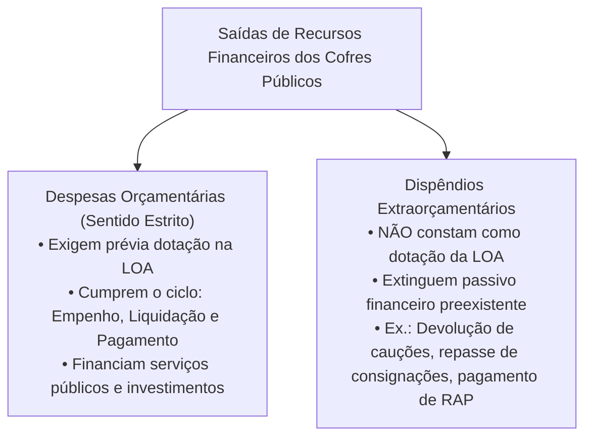
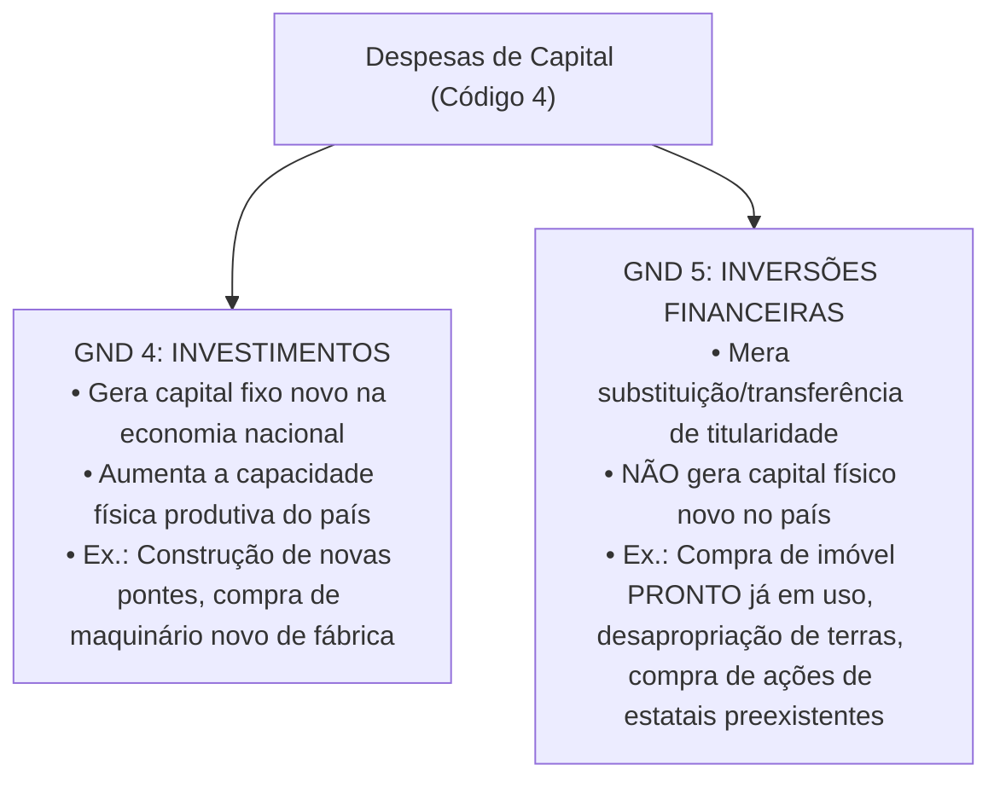
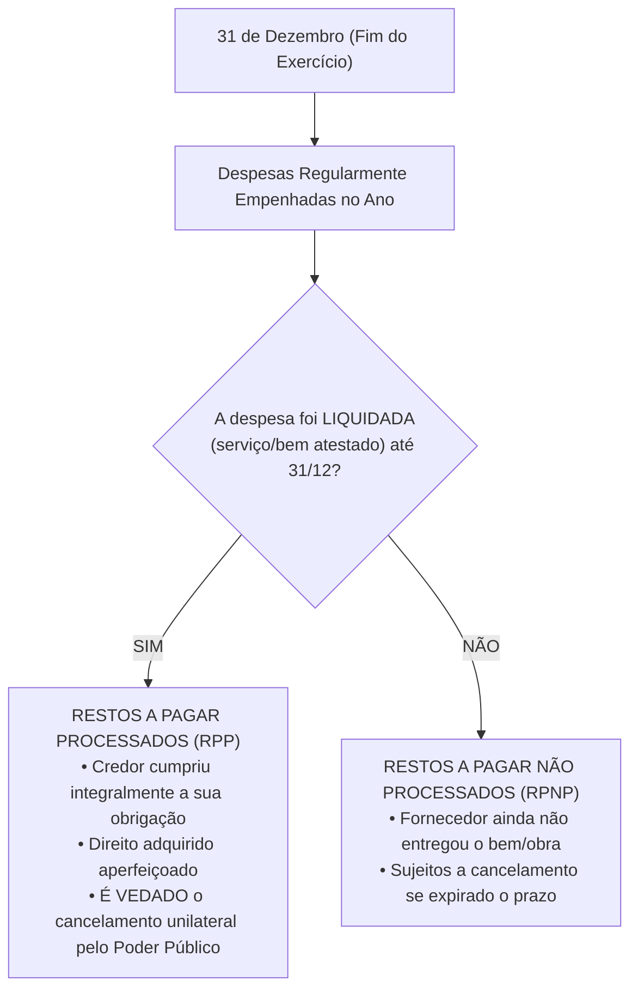
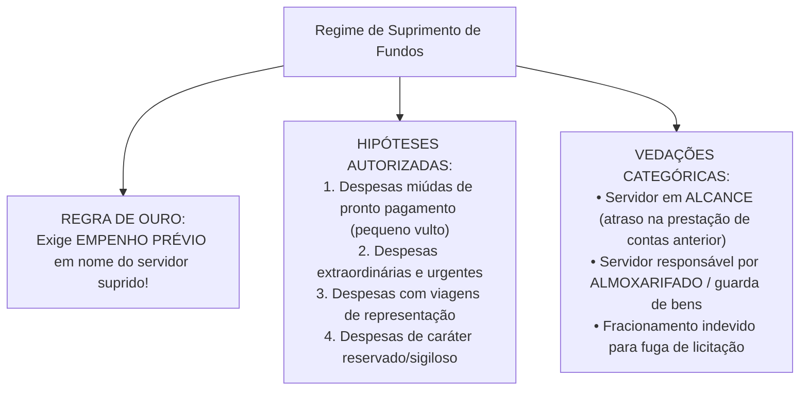

# 03 - Despesa Pública, Estágios, Classificações, Restos a Pagar, DEA e Suprimento de Fundos

> **Matéria:** Noções de Administração Financeira e Orçamentária (AFO)  
> **Cargo:** A01 – Técnico de Controle Externo – Especialidade: Técnico Administrativo  
> **Arquivo:** `03_despesa_publica_estagios_restos_a_pagar_e_suprimento.md`  

---

## 📌 Ementa / Itens do Edital

- Despesa pública: conceito amplo e estrito, despesas orçamentárias vs. dispêndios extraorçamentários;
- Estágios da despesa orçamentária (Lei Federal nº 4.320/1964):
    - Fixação (aprovação da dotação na LOA);
    - Empenho (Art. 58 da Lei 4.320/64): conceito, modalidades (ordinário, estimativo e global) e a Nota de Empenho;
    - Liquidação (Art. 63 da Lei 4.320/64): verificação objetiva do direito adquirido pelo credor e atesto de conformidade;
    - Pagamento (Art. 64 da Lei 4.320/64): ordem bancária emitida contra a Conta Única do Tesouro;
- Classificações da Despesa Orçamentária (Portaria Interministerial STN/SOF nº 163/2001 e MCASP):
    - Classificação Institucional (Órgão e Unidade Orçamentária executora);
    - Classificação Funcional-Programática (Função, Subfunção, Programa, Ações: Projetos, Atividades e Operações Especiais; princípio da matricialidade funcional);
    - Classificação por Natureza da Despesa (estrutura codificada: Categoria Econômica, Grupo de Natureza da Despesa - GND, Modalidade de Aplicação e Elemento de Despesa);
    - Distinção essencial: Investimentos (GND 4) vs. Inversões Financeiras (GND 5);
- Restos a Pagar (RAP - Artigo 36 da Lei nº 4.320/1964):
    - Restos a Pagar Processados (RPP) vs. Restos a Pagar Não Processados (RPNP);
    - Regras de vigência, liquidação, cancelamento e prescrição quinquenal;
- Despesas de Exercícios Anteriores (DEA): as três hipóteses legais taxativas do Artigo 37 da Lei nº 4.320/1964;
- Suprimento de Fundos (Regime de Adiantamento): conceito, hipóteses restritas de concessão (pequeno vulto, urgência, viagens e despesas sigilosas), proibições absolutas de concessão e prestação de contas.

---

## 🧭 Sumário Interativo
- [1. Despesa Pública: Conceito e Estágios Legais](#1-despesa-publica-conceito-e-estagios-legais)
    - [1.1 Despesa Orçamentária vs. Dispêndios Extraorçamentários](#11-despesa-orcamentaria-vs-dispendios-extraorcamentarios)
    - [1.2 Os Quatro Estágios da Despesa Pública (Fixação, Empenho, Liquidação e Pagamento)](#12-os-quatro-estagios-da-despesa-publica-fixacao-empenho-liquidacao-e-pagamento)
    - [1.3 Modalidades de Empenho: Ordinário, Estimativo e Global](#13-modalidades-de-empenho-ordinario-estimativo-e-global)
- [2. Estrutura e Classificações da Despesa Orçamentária](#2-estrutura-e-classificacoes-da-despesa-orcamentaria)
    - [2.1 Classificação Institucional e Funcional (Matricialidade)](#21-classificacao-institucional-e-funcional-matricialidade)
    - [2.2 Classificação Programática: Projetos, Atividades e Operações Especiais](#22-classificacao-programatica-projetos-atividades-e-operacoes-especiais)
    - [2.3 Classificação por Natureza da Despesa e GNDs](#23-classificacao-por-natureza-da-despesa-e-gnds)
    - [2.4 A Distinção Crítica FCC: Investimentos (GND 4) vs. Inversões Financeiras (GND 5)](#24-a-distincao-critica-fcc-investimentos-gnd-4-vs-inversoes-financeiras-gnd-5)
- [3. Restos a Pagar (RAP) e Despesas de Exercícios Anteriores (DEA)](#3-restos-a-pagar-rap-e-despesas-de-exercicios-anteriores-dea)
    - [3.1 Restos a Pagar Processados (RPP) vs. Restos a Pagar Não Processados (RPNP)](#31-restos-a-pagar-processados-rpp-vs-restos-a-pagar-nao-processados-rpnp)
    - [3.2 Cancelamento de RAP e a Prescrição Quinquenal](#32-cancelamento-de-rap-e-a-prescricao-quinquenal)
    - [3.3 As Três Hipóteses Legais de DEA (Art. 37 da Lei nº 4.320/1964)](#33-as-tres-hipoteses-legais-de-dea-art-37-da-lei-no-43201964)
- [4. Regime Excepcional de Suprimento de Fundos (Adiantamento)](#4-regime-excepcional-de-suprimento-de-fundos-adiantamento)
    - [4.1 Hipóteses Restritas e Regra do Empenho Prévio](#41-hipoteses-restritas-e-regra-do-empenho-previo)
    - [4.2 Vedações Categóricas e Prestação de Contas](#42-vedacoes-categoricas-e-prestacao-de-contas)
- [5. Fontes Oficiais & Manuais Técnicos Recomendados](#fontes-oficiais-manuais-tecnicos-recomendados)
- [6. Questões Comentadas no Padrão FCC](#questoes-comentadas-no-padrao-fcc)

---

## 📖 Conteúdo Teórico Aprofundado

### 1. Despesa Pública: Conceito e Estágios Legais

#### 1.1 Despesa Orçamentária vs. Dispêndios Extraorçamentários
No direito financeiro e na contabilidade pública, a realização de saídas financeiras dos cofres estatais divide-se em:

- **Despesas Orçamentárias (Sentido Estrito):** São aquelas que necessitam de prévia autorização legislativa fixada na Lei Orçamentária Anual (ou em créditos adicionais) para serem executadas, destinando-se a financiar os serviços públicos, investimentos e transferências governamentais.
- **Dispêndios Extraorçamentários (Saídas de Caixa):** Não representam despesa orçamentária nem reduzem o patrimônio líquido estatal. Correspondem a saídas puramente financeiras que extinguem passivos exigíveis anteriormente constituídos (ex.: devolução de cauções ou fianças licitatórias depositadas em dinheiro, resgate de depósitos judiciais, repasse aos bancos de empréstimos consignados retidos em folha e pagamento de Restos a Pagar).

#### 1.2 Os Quatro Estágios da Despesa Pública (Fixação, Empenho, Liquidação e Pagamento)
A execução formal da despesa pública submete-se a quatro estágios sucessivos e interdependentes (arts. 58 a 65 da Lei Federal nº 4.320/1964):

1. **Fixação (Etapa de Planejamento):** É a autorização legislativa conferida ao Poder Executivo e demais órgãos independentes, por meio da LOA, estabelecendo o limite máximo de recursos destinados a cada programa e ação de governo.
2. **Empenho (Art. 58 da Lei nº 4.320/1964):**  
    - *"O empenho de despesa é o ato emanado de autoridade competente que cria para o Estado obrigação de pagamento pendente ou não de implemento de condição."*
    - Possui função jurídica (criação da obrigação) e contábil (reserva prévia da dotação orçamentária, impedindo que o mesmo recurso seja utilizado para outra finalidade).
    - **Regra de Ouro (Art. 60):** É **vedada a realização de despesa sem prévio empenho**!
    - Formaliza-se pelo documento oficial denominado **Nota de Empenho (NE)**, que deve indicar o nome do credor, a especificação do bem ou serviço e a importância exata da despesa.

3. **Liquidação (Art. 63 da Lei nº 4.320/1964):**  
    - Consiste na **verificação objetiva do direito adquirido pelo credor** tendo por base os títulos e documentos comprobatórios do respectivo crédito.
    - Tem por objetivo apurar:
        1. A origem e o objeto do que se deve pagar;
        2. A importância exata a pagar;
        3. A quem se deve pagar para extinguir a obrigação.

    - Requer a realização de **atesto formal** na nota fiscal por servidor competente ou comissão fiscalizadora, certificando que as obras, os serviços ou os materiais foram recebidos em perfeita conformidade com as especificações contratadas.

4. **Pagamento (Arts. 64 e 65 da Lei nº 4.320/1964):**  
    - É o despacho exarado pelo ordenador de despesas determinando a efetiva quitação da obrigação liquidada.
    - Processa-se mediante **Ordem Bancária (OB)** emitida contra a Conta Única do Tesouro Estadual diretamente em favor do credor.
    - **Regra de Interdependência (Art. 62):** A ordem de pagamento só pode ser expedida após a regular liquidação da despesa!

#### 1.3 Modalidades de Empenho: Ordinário, Estimativo e Global
A legislação orçamentária prevê três modalidades formais de empenho, a serem adotadas conforme a natureza da obrigação contratual:

| Modalidade de Empenho | Montante da Despesa | Forma de Desembolso / Pagamento | Casos Práticos de Aplicação (Padrão FCC) |
| :--- | :--- | :--- | :--- |
| **Ordinário (Comum)** | Exato e previamente conhecido. | **Parcela única** (desembolso de uma só vez). | Aquisição de lote de veículos ou computadores faturados e entregues de uma só vez. |
| **Estimativo** | **Inexato / Impossível** de fixar previamente. | Desembolsos parcelados ou periódicos. | Contas de consumo mensal: energia elétrica, água, telefonia, diárias e combustíveis da frota. |
| **Global** | Exato e previamente conhecido em contrato. | **Parcelado / Sucessivo** ao longo do exercício. | Contratos de locação de imóveis (aluguel mensal fixo), contratos continuados de vigilância e medições de obras. |

---

### 2. Estrutura e Classificações da Despesa Orçamentária

#### 2.1 Classificação Institucional e Funcional (Matricialidade)
- **Classificação Institucional:** Responde à indagação: *"Quem gasta o recurso público?"*. Estrutura-se em dois níveis fundamentais:
    - **Órgão Orçamentário:** Maior nível institucional (ex.: Tribunal de Contas do Estado, Secretaria de Estado da Fazenda, Tribunal de Justiça);
    - **Unidade Orçamentária (UO):** Subunidade executora detentora direta de dotação orçamentária (ex.: Fundo de Modernização do TCE-GO, Diretoria-Geral da Polícia Civil).
- **Classificação Funcional:** Responde à pergunta: *"Em qual área de atuação governamental a despesa será realizada?"*. Composta por:
    - **Função:** O maior nível de agregação das competências estatais (ex.: 01 - Legislativa, 04 - Administração, 10 - Saúde, 12 - Educação);
    - **Subfunção:** Ramo específico e detalhado de uma função (ex.: 122 - Administração Geral, 301 - Atenção Básica, 361 - Ensino Fundamental);
    - **Princípio da Matricialidade Funcional:** Qualquer subfunção pode ser combinada com qualquer função orçamentária, independentemente da vinculação institucional tradicional (ex.: uma escola administrada pelo TCE-GO para capacitação de servidores pode ser classificada na Função 01 - Legislativa e Subfunção 128 - Formação de Recursos Humanos).

#### 2.2 Classificação Programática: Projetos, Atividades e Operações Especiais
A estrutura programática organiza as ações governamentais orientadas a metas em três tipos:

1. **Projeto:** Instrumento de programação temporário destinado a expandir a infraestrutura pública ou criar novo bem/serviço, resultando em formação bruta de capital (ex.: construção de novo edifício-sede de fórum judicial ou implantação de rodovia);
2. **Atividade:** Instrumento contínuo e permanente destinado à manutenção e funcionamento regular das ações governamentais preexistentes (ex.: manutenção da frota, pagamento de pessoal, fornecimento de merenda escolar);
3. **Operação Especial:** Despesas que não resultam na produção de um bem nem na prestação direta de serviços, destinadas a obrigações financeiras do Estado (ex.: pagamento do serviço da dívida pública, sentenças judiciais/precatórios, amortizações financeiras).

#### 2.3 Classificação por Natureza da Despesa e GNDs
A Portaria Interministerial STN/SOF nº 163/2001 padronizou a codificação da despesa na seguinte estrutura:

$$\text{C . G . MM . EE}$$

- **1º dígito - Categoria Econômica:**
    - `3` - Despesas Correntes;
    - `4` - Despesas de Capital.
- **2º dígito - Grupo de Natureza da Despesa (GND):**
    - **GND 1:** Pessoal e Encargos Sociais (vencimentos, subsídios, previdência patronal);
    - **GND 2:** Juros e Encargos da Dívida (remuneração financeira do endividamento público);
    - **GND 3:** Outras Despesas Correntes - ODC (materiais de consumo, serviços de terceiros, passagens, diárias);
    - **GND 4:** Investimentos (obras novas, aquisições de equipamentos permanentes e instalações);
    - **GND 5:** Inversões Financeiras (aquisição de imóveis em uso, compra de títulos de empresas já constituídas e empréstimos concedidos);
    - **GND 6:** Amortização da Dívida (pagamento do principal da dívida pública fundada).
- **3º e 4º dígitos - Modalidade de Aplicação:** Elimina a dupla contagem nas transferências intergovernamentais e entre órgãos;
- **5º e 6º dígitos - Elemento de Despesa:** Identifica os objetos pontuais de gasto (ex.: 14 - Diárias, 30 - Material de Consumo, 52 - Equipamentos e Material Permanente).

#### 2.4 A Distinção Crítica FCC: Investimentos (GND 4) vs. Inversões Financeiras (GND 5)
A jurisprudência da banca FCC cobra com rigor a distinção entre os gastos de capital que aumentam a capacidade produtiva da sociedade e os que consistem em meras transferências patrimoniais:

---

### 3. Restos a Pagar (RAP) e Despesas de Exercícios Anteriores (DEA)

#### 3.1 Restos a Pagar Processados (RPP) vs. Restos a Pagar Não Processados (RPNP)
O art. 36 da Lei Federal nº 4.320/1964 prescreve que se consideram **Restos a Pagar** as despesas empenhadas, mas não pagas até o dia 31 de dezembro, distinguindo-se em:

1. **Restos a Pagar Processados (RPP):** A despesa percorreu os estágios do empenho e da **liquidação** dentro do exercício financeiro. O credor tem direito subjetivo líquido e certo ao pagamento; a administração pública **não pode cancelar** o respectivo empenho de forma unilateral, sob pena de enriquecimento sem causa do Estado.
2. **Restos a Pagar Não Processados (RPNP):** Despesas empenhadas cuja **liquidação não ocorreu** até 31 de dezembro (a contraprestação contratual ainda está pendente). Podem ser canceladas administrativamente caso o credor descumpra o cronograma de entrega ou o interesse público deixe de existir.

#### 3.2 Cancelamento de RAP e a Prescrição Quinquenal
- Conforme o Decreto Federal nº 93.872/1986, os Restos a Pagar Não Processados perdem a validade e devem ser cancelados ao final do exercício subsequente caso a liquidação não tenha sido iniciada.
- O cancelamento contábil de um empenho de RAP **não extingue o direito do credor**, desde que a prestação do serviço seja comprovada e não tenha decorrido a **prescrição quinquenal de 5 anos** (Decreto nº 20.910/1932). Nesses casos, o credor fará jus ao recebimento mediante reconhecimento de dívida por **Despesas de Exercícios Anteriores (DEA)**.

#### 3.3 As Três Hipóteses Legais de DEA (Art. 37 da Lei nº 4.320/1964)
As dívidas passadas de exercícios orçamentários já encerrados serão empenhadas e pagas à conta das dotações constantes na **LOA do exercício corrente**, exclusivamente quando enquadradas nas seguintes hipóteses taxativas:

1. **Despesas sem empenho na época própria:** Despesas para as quais o orçamento do exercício pretérito consignava crédito orçamentário próprio com **saldo suficiente**, mas que, por erro ou omissão administrativa, não foram empenhadas na época oportuna;
2. **Restos a Pagar cancelados:** Restos a pagar com **prescrição interrompida** ou cancelados indevidamente, desde que o direito creditório do fornecedor subsista;
3. **Compromissos reconhecidos a posteriori:** Despesas contratuais ou legais cujo reconhecimento formal da obrigação pela autoridade competente tenha ocorrido **após o encerramento do exercício financeiro**.

---

### 4. Regime Excepcional de Suprimento de Fundos (Adiantamento)

O **Suprimento de Fundos** (regime de adiantamento financeiro previsto no art. 68 da Lei nº 4.320/1964 e no Decreto Federal nº 93.872/1986) consiste na entrega direta de numerário a um servidor público para execução de gastos que não possam subordinar-se ao rito ordinário de empenho -> liquidação -> pagamento:

#### 4.1 Hipóteses Restritas e Regra do Empenho Prévio
- **O empenho prévio é obrigatório:** Embora subverta a ordem cronológica usual do pagamento (o dinheiro vai para o servidor antes da compra), o recurso **deve ser formalmente empenhado** à conta da dotação orçamentária própria em nome do servidor designado (o suprido).
- **Hipóteses Restritas:**
    1. Despesas de pequeno vulto (despesas miúdas de consumo imediato);
    2. Despesas urgentes e imprevistas que possam paralisar o serviço público;
    3. Despesas de viagens e estadias fora da sede de trabalho;
    4. Despesas sigilosas de segurança e investigação policial.

#### 4.2 Vedações Categóricas e Prestação de Contas
É terminantemente proibido conceder adiantamento a:

- Servidor **em alcance** (que esteja em atraso no dever de prestar contas de adiantamento anterior ou que tenha tido contas rejeitadas);
- Servidor que seja responsável pela **guarda e custódia do material** a ser adquirido (ex.: chefes e operadores de almoxarifados ou patrimônio);
- Servidor que não esteja em efetivo exercício no órgão concedente.
- A prestação de contas é obrigatória e deve ser apresentada pelo suprido no prazo estipulado pelo regulamento, sob pena de instauração imediata de Tomada de Contas Especial (TCE).

---

## 🌐 Fontes Oficiais & Manuais Técnicos Recomendados

- [Lei Federal nº 4.320/1964](https://www.planalto.gov.br/ccivil_03/leis/l4320.htm)
    - Arts. 58 a 65 (Estágios da Despesa), Art. 36 (Restos a Pagar), Art. 37 (DEA) e Art. 68 (Suprimento de Fundos).
- [Manual de Contabilidade Aplicada ao Setor Público (MCASP) - 11ª Edição (STN)](https://www.gov.br/tesouronacional/pt-br)
    - Parte I: Procedimentos Contábeis Orçamentários - Despesa e Grupos de Natureza.
- [Decreto Federal nº 93.872/1986](https://www.planalto.gov.br/ccivil_03/decreto/d93872.htm)
    - Arts. 45 a 47 (Regime de Suprimento de Fundos) e Arts. 67 a 71 (Restos a Pagar).
- [Decreto Estadual de Goiás nº 9.697/2020](https://legisla.casacivil.go.gov.br)
    - Regulamentação da execução orçamentária e suprimento de fundos no Estado de Goiás.

---

## 📝 Questões Comentadas no Padrão FCC

### Questão 1 (FCC - Adaptada / TCE-RS - Auditor de Controle Externo)
A respeito da classificação e dos estágios da despesa pública orçamentária, assinale a opção correta:

* **A)** A emissão de nota de empenho ordinário é admitida para despesas contratuais de prestação contínua de serviços cujo valor total deva ser desembolsado em parcelas mensais ao longo do ano.
* **B)** A aquisição de imóvel residencial já edificado e em utilização para instalação de repartição pública estadual constitui típica despesa de Investimento (GND 4).
* **C)** A liquidação da despesa tem por objetivo comprovar o implemento de condição e o direito adquirido pelo credor, mediante verificação documental de que o serviço foi efetivamente prestado ou os bens foram entregues.
* **D)** O pagamento da despesa pública pode anteceder a liquidação nas hipóteses de aquisição de bens duráveis com cláusula de entrega futura.
* **E)** As despesas empenhadas e não pagas até o encerramento do exercício financeiro em 31 de dezembro serão obrigatoriamente anuladas pelo controle interno.

> **Comentário Detalhado:**
>
> - **A)** Incorreta. Despesas contratuais com pagamentos parcelados mensais de valor determinado exigem a modalidade de empenho global (art. 60, § 3º da Lei nº 4.320/1964).
> - **B)** Incorreta. A aquisição de imóveis prontos já edificados e em uso no mercado constitui Inversão Financeira (GND 5), pois não gera formação bruta de capital físico novo.
> - **C)** Correta. De acordo com o art. 63 da Lei nº 4.320/1964, a liquidação consiste na verificação objetiva do direito adquirido pelo credor, mediante a conferência de títulos, documentos e atesto físico de entrega dos bens ou conclusão dos serviços prestados.
> - **D)** Incorreta. O art. 62 da Lei nº 4.320/1964 prescreve que o pagamento da despesa só pode ser efetuado após a regular liquidação.
> - **E)** Incorreta. As despesas empenhadas e não pagas até 31 de dezembro são inscritas em Restos a Pagar (art. 36), não sendo automaticamente canceladas.
> 
> **Gabarito: C**

---

### Questão 2 (FCC - Adaptada / TCE-PI - Auditor de Controle Externo)
Em relação ao regime de suprimento de fundos (adiantamento) e às Despesas de Exercícios Anteriores (DEA), é correto afirmar que:

* **A)** O suprimento de fundos pode ser concedido livremente a qualquer servidor público, inclusive àquele que esteja omisso no dever de prestar contas de adiantamento concedido anteriormente.
* **B)** As Despesas de Exercícios Anteriores (DEA) correspondem exclusivamente a despesas que foram liquidadas e pagas no exercício anterior sem prévio empenho orçamentário.
* **C)** O suprimento de fundos dispensa a realização de empenho orçamentário prévio em nome do servidor responsável pelo adiantamento.
* **D)** As despesas de exercícios encerrados para as quais o orçamento respectivo consignava crédito próprio e com saldo suficiente, mas que não tenham sido empenhadas na época própria, poderão ser pagas à conta de dotação para despesas de exercícios anteriores (DEA).
* **E)** O cancelamento de Restos a Pagar Processados enseja a imediata extinção irrecorrível do direito creditório do fornecedor perante a Fazenda Pública.

> **Comentário Detalhado:**
>
> - **A)** Incorreta. É categoricamente proibido conceder suprimento de fundos a servidor em alcance (que esteja em mora na prestação de contas de suprimento anterior).
> - **B)** Incorreta. As DEA referem-se a compromissos pendentes que serão empenhados e quitados na LOA do exercício em curso, nas hipóteses do art. 37 da Lei nº 4.320/1964.
> - **C)** Incorreta. O adiantamento exige prévio empenho emitido formalmente em nome do servidor suprido.
> - **D)** Correta. Conforme o art. 37 da Lei nº 4.320/1964, despesas de exercícios findos que contavam com crédito orçamentário com saldo suficiente, mas que não foram empenhadas na época própria por erro ou omissão da administração, são empenhadas e pagas à conta de DEA.
> - **E)** Incorreta. O direito creditório do fornecedor subsiste e respeita o prazo prescricional quinquenal de 5 anos; se o RPP foi cancelado indevidamente, o débito deve ser reaberto como DEA.
> 
> **Gabarito: D**

---

### Questão 3 (FCC - Adaptada / Analista de Planejamento e Orçamento)
Para a realização de despesas rotineiras de manutenção das instalações de uma secretaria de estado, o gestor público determinou a emissão de nota de empenho no início do mês de janeiro para cobrir os gastos com fornecimento contínuo de energia elétrica e abastecimento de água ao longo de todo o ano, sem que seja possível conhecer previamente o consumo exato a cada mês.

A modalidade de empenho adequada e legalmente exigida para essa situação é o empenho:

* **A)** Ordinário.
* **B)** Global.
* **C)** Estimativo.
* **D)** Extraorçamentário.
* **E)** Suplementar por Decreto.

> **Comentário Detalhado:**
>
> - **A)** Incorreta. O empenho ordinário é utilizado exclusivamente para despesas de valor exato prefixado e pagamento único.
> - **B)** Incorreta. O empenho global destina-se a despesas contratuais cujo valor total exato é previamente conhecido, sendo desembolsado em parcelas.
> - **C)** Correta. Nos termos do art. 60, § 2º da Lei nº 4.320/1964, utiliza-se a modalidade de empenho estimativo para as despesas cujo montante exato não se possa fixar previamente, como é o caso das contas de utilidade pública (energia elétrica, água, telefonia e combustíveis).
> - **D)** Incorreta. Serviços essenciais de manutenção contínua são despesas orçamentárias correntes obrigatórias.
> - **E)** Incorreta. Crédito suplementar é espécie de crédito adicional para reforço de dotação, não modalidade de nota de empenho.
> 
> **Gabarito: C**

---

### Questão 4 (FCC - Adaptada / Técnico de Controle Externo)
Determinada empresa pública estadual adquiriu, mediante procedimento licitatório de compra direta, um terreno urbano desocupado para futura expansão de seu almoxarifado no valor de R$ 2.000.000,00, bem como contratou uma empreiteira para a construção de um novo edifício administrativo no mesmo local pelo montante de R$ 5.000.000,00.

Segundo a estrutura da despesa pública por sua natureza (Portaria Interministerial STN/SOF nº 163/2001 e MCASP), essas despesas classificam-se, respectivamente, nos seguintes Grupos de Natureza da Despesa (GND):

* **A)** Inversões Financeiras (GND 5) e Investimentos (GND 4).
* **B)** Investimentos (GND 4) e Investimentos (GND 4).
* **C)** Outras Despesas Correntes (GND 3) e Investimentos (GND 4).
* **D)** Inversões Financeiras (GND 5) e Inversões Financeiras (GND 5).
* **E)** Amortização da Dívida (GND 6) e Outras Despesas Correntes (GND 3).

> **Comentário Detalhado:**
>
> - **A)** Correta. A compra de terrenos ou imóveis prontos preexistentes no mercado configura Inversão Financeira (GND 5), pois transfere a posse sem gerar formação bruta de capital físico novo no país. Em contrapartida, a contratação de obras de construção civil para erguer um novo prédio público gera infraestrutura nova, qualificando-se como Investimento (GND 4).
> - **B)** Incorreta. Terrenos e imóveis prontos não integram o GND 4.
> - **C)** Incorreta. Ambas são despesas de capital (código 4) e não de consumo/custeio corrente (GND 3).
> - **D)** Incorreta. Obra de construção nova de prédio público é investimento.
> - **E)** Incorreta. Não se referem a amortização do principal da dívida pública fundada.
> 
> **Gabarito: A**

---

### Questão 5 (FCC - Adaptada / Analista Jurídico de Controle)
Ao final do exercício financeiro em 31 de dezembro, a Secretaria de Infraestrutura do Estado possuía dois contratos em execução:

I. Contrato de pavimentação asfáltica, cuja medição final foi regularmente atestada pela fiscalização no dia 20 de dezembro e a nota fiscal devidamente liquidada, mas a ordem bancária de pagamento de R$ 800.000,00 não foi emitida até o encerramento do expediente bancário do ano.  

II. Contrato de fornecimento de tubos de concreto, empenhado em novembro pelo valor de R$ 300.000,00, cujos materiais tinham prazo de entrega previsto em contrato para 15 de janeiro do exercício subsequente.  

Em 31 de dezembro, essas duas despesas foram inscritas, respectivamente, como:

* **A)** Restos a Pagar Processados e Restos a Pagar Processados.
* **B)** Restos a Pagar Não Processados e Restos a Pagar Não Processados.
* **C)** Restos a Pagar Processados e Restos a Pagar Não Processados.
* **D)** Despesas de Exercícios Anteriores e Restos a Pagar Processados.
* **E)** Ingressos Extraorçamentários e Restos a Pagar Não Processados.

> **Comentário Detalhado:**
>
> - **A)** Incorreta. O Contrato II não foi liquidado até 31 de dezembro, logo não pode constituir restos a pagar processados.
> - **B)** Incorreta. O Contrato I foi regularmente liquidado antes do encerramento do exercício, qualificando-se compulsoriamente como processado.
> - **C)** Correta. Conforme o art. 36 da Lei nº 4.320/1964, despesas empenhadas e liquidadas que não foram pagas até 31 de dezembro são inscritas em Restos a Pagar Processados (RPP - Contrato I); enquanto despesas empenhadas e não liquidadas até essa data são inscritas como Restos a Pagar Não Processados (RPNP - Contrato II).
> - **D)** Incorreta. DEA aplica-se a exercícios anteriores para os quais não há inscrição válida em restos a pagar.
> - **E)** Incorreta. São despesas orçamentárias de capital e correntes, e não ingressos financeiros.
> 
> **Gabarito: C**
