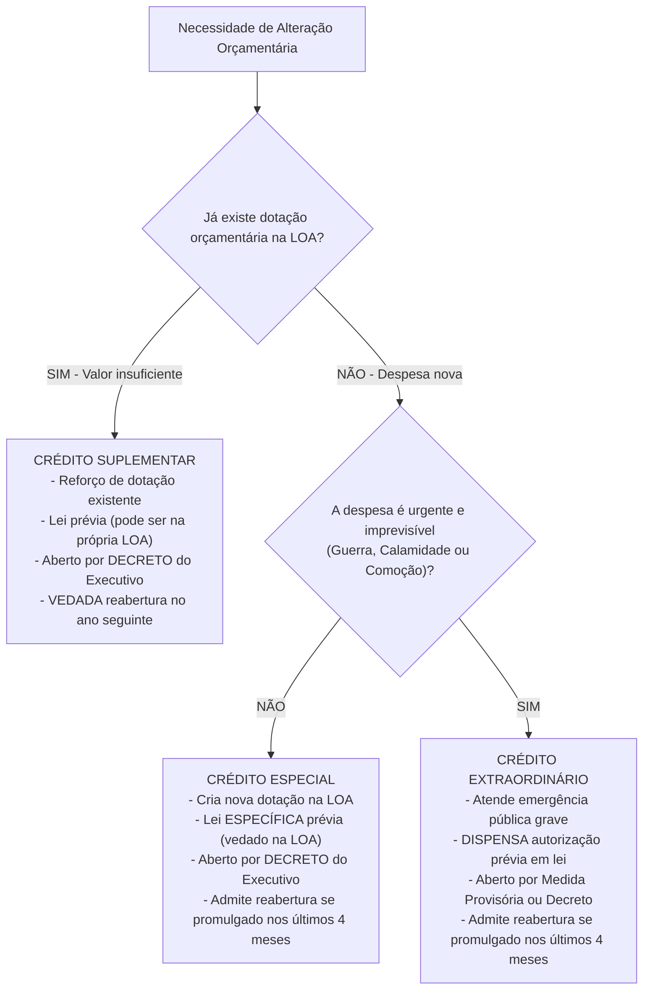
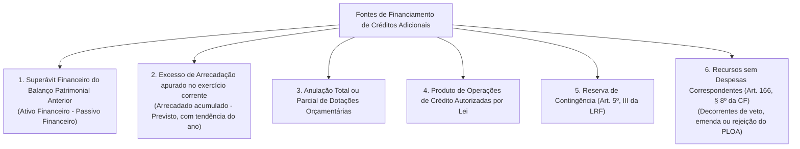

# 04 - Créditos Adicionais, Fontes de Financiamento e Dívida Pública

> **Matéria:** Noções de Administração Financeira e Orçamentária (AFO)  
> **Cargo:** A01 – Técnico de Controle Externo – Especialidade: Técnico Administrativo  
> **Arquivo:** `04_creditos_adicionais_e_divida_publica.md`  

---

## 📌 Ementa / Itens do Edital

- Créditos orçamentários iniciais (dotações fixadas na LOA) vs. Créditos Adicionais (mecanismos de retificação orçamentária);
- Espécies de Créditos Adicionais (Artigos 40 a 46 da Lei Federal nº 4.320/1964 e Artigo 167 da CF/88):
  - Créditos Suplementares: reforço de dotação orçamentária pré-existente insuficiente;
  - Créditos Especiais: criação de nova rubrica para despesas públicas não previstas na LOA;
  - Créditos Extraordinários: atendimento a despesas imprevisíveis e urgentes (guerra, comoção interna e calamidade pública - Art. 167, § 3º da CF/88);
- Ritos de autorização, instrumentos formais de abertura e vigência dos créditos adicionais;
- A regra de reabertura de saldos de créditos especiais e extraordinários promulgados nos últimos quatro meses do exercício financeiro (Artigo 167, § 2º da CF/88);
- As fontes legais de recursos para abertura de créditos adicionais (Artigo 43 da Lei nº 4.320/1964 e Artigo 166, § 8º da CF/88):
  - Superávit Financeiro apurado em Balanço Patrimonial do exercício anterior;
  - Excesso de Arrecadação apurado no exercício corrente;
  - Anulação total ou parcial de dotações orçamentárias;
  - Produto de Operações de Crédito autorizadas por lei;
  - Reserva de Contingência (LRF, Art. 5º, III);
  - Recursos sem despesas correspondentes decorrentes de veto, emenda ou rejeição do projeto de LOA;
- Dívida Pública no Direito Financeiro:
  - Dívida Flutuante (Artigo 92 da Lei nº 4.320/1964): restos a pagar, serviços da dívida a pagar, depósitos/cauções e débitos de tesouraria por ARO;
  - Dívida Fundada ou Consolidada (Artigo 98 da Lei nº 4.320/1964 e Artigo 29 da LRF): obrigações financeiras de longo prazo (superiores a 12 meses) decorrentes de contratos, emissão de títulos públicos e precatórios.

---

## 🌳 Classificação Hierárquica

```text
4. Créditos Adicionais e Regime da Dívida Pública
├── 4.1 Mecanismos de Retificação do Orçamento: Créditos Adicionais
│   ├── 4.1.1 Créditos Suplementares (Art. 41, I):
│   │   ├── Finalidade: Reforço de dotação orçamentária já existente que se mostrou insuficiente
│   │   ├── Autorização Legislativa: Prévia em lei (pode constar autorizada no próprio texto da LOA como exceção à exclusividade)
│   │   ├── Instrumento de Abertura: Decreto do Poder Executivo
│   │   └── Vigência: Adstrita ao exercício financeiro de abertura (NUNCA admite reabertura!)
│   ├── 4.1.2 Créditos Especiais (Art. 41, II):
│   │   ├── Finalidade: Criar nova rubrica orçamentária para despesa que não possui dotação específica na LOA
│   │   ├── Autorização Legislativa: Prévia em lei especial (vedada inclusão no texto da LOA)
│   │   ├── Instrumento de Abertura: Decreto do Poder Executivo
│   │   └── Vigência: Exercício financeiro, admitida reabertura se promulgado nos últimos 4 meses
│   └── 4.1.3 Créditos Extraordinários (Art. 41, III e Art. 167, § 3º da CF):
│       ├── Finalidade: Atender a despesas imprevisíveis e urgentes (comoção interna, calamidade pública ou guerra)
│       ├── Autorização e Abertura: Medida Provisória (na União/Estados que a prevejam) ou Decreto do Executivo
│       ├── Peculiaridade: Dispensa autorização prévia em lei; comunicação imediata ao Poder Legislativo
│       └── Vigência: Exercício financeiro, admitida reabertura se promulgado nos últimos 4 meses
├── 4.2 A Regra Constitucional de Reabertura de Saldos (Art. 167, § 2º da CF/88)
│   ├── 4.2.1 Regra Geral da Anualidade: Créditos orçamentários vigem até 31 de dezembro
│   └── 4.2.2 Exceção de Reabertura (Requisitos Cumulativos):
│       ├── Espécies Admitidas: Exclusivamente Créditos ESPECIAIS e EXTRAORDINÁRIOS
│       ├── Marco Temporal: Promulgados nos últimos 4 meses do exercício (setembro, outubro, novembro ou dezembro)
│       └── Limite: Reabertura estrita no limite de seus saldos não executados, vigorando até o fim do exercício seguinte
├── 4.3 As Fontes Legais de Cobertura Financeira (Art. 43 da Lei nº 4.320/1964)
│   ├── 4.3.1 Superávit Financeiro do Balanço Patrimonial do Exercício Anterior:
│   │   └── Fórmula: Ativo Financeiro (AF) - Passivo Financeiro (PF) (-) Saldos de créditos reabertos (-) Vinculações legais
│   ├── 4.3.2 Excesso de Arrecadação:
│   │   └── Saldo positivo apurado mês a mês entre arrecadação realizada e prevista, considerada a tendência do ano (-) créditos já abertos
│   ├── 4.3.3 Anulação Total ou Parcial de Dotações Orçamentárias
│   ├── 4.3.4 Produto de Operações de Crédito Autorizadas por Lei
│   ├── 4.3.5 Reserva de Contingência (Art. 5º, III da LRF)
│   └── 4.3.6 Recursos sem Despesas Correspondentes decorrentes de Veto, Emenda ou Rejeição do PLOA (Art. 166, § 8º da CF)
└── 4.4 O Regime da Dívida Pública: Flutuante vs. Fundada
    ├── 4.4.1 Dívida Flutuante (Curto Prazo - Art. 92 da Lei nº 4.320/1964):
    │   ├── Restos a Pagar (processados e não processados)
    │   ├── Serviços da dívida a pagar (juros e amortizações vencidos)
    │   ├── Depósitos, cauções e consignações de terceiros exigíveis
    │   └── Débitos de tesouraria decorrentes de Operações de Crédito por ARO
    └── 4.4.2 Dívida Fundada / Consolidada (Longo Prazo - Art. 29 da LRF e Art. 98 da Lei 4.320/64):
        ├── Obrigações financeiras assumidas pelo ente para amortização em prazo superior a 12 meses
        ├── Emissão de títulos da dívida pública e contratos de empréstimos internos e externos
        └── Operações de crédito de prazo inferior a 12 meses que constem como receita da LOA (LRF)
```

---

## 📖 Conteúdo Teórico Aprofundado

### 1. Espécies de Créditos Adicionais e Ritos de Abertura

Os **Créditos Adicionais** são as autorizações de despesa não computadas ou insuficientemente dotadas na Lei de Orçamento (Art. 40 da Lei nº 4.320/1964).



| Espécie de Crédito | Finalidade precípua | Autorização Legislativa | Instrumento de Abertura | Possibilidade de Reabertura no Ano Seguinte |
| :--- | :--- | :--- | :--- | :--- |
| **Suplementar** | Reforçar dotação orçamentária pré-existente insuficiente. | Prévia em lei (**pode constar no corpo da LOA**). | **Decreto** do Chefe do Executivo. | **JAMAIS ADMITE REABERTURA**. Caduca impreterivelmente em 31/12. |
| **Especial** | Criar dotação orçamentária nova para programa não previsto. | Prévia em **lei especial** (proibida inclusão no corpo da LOA). | **Decreto** do Chefe do Executivo. | **Admite reabertura** se promulgado entre 1º de setembro e 31 de dezembro. |
| **Extraordinário** | Custear despesas imprevisíveis e urgentes (guerra, comoção, calamidade). | **Dispensa prévia lei.** Comunicação imediata ao parlamento. | **Medida Provisória** ou **Decreto**. | **Admite reabertura** se promulgado entre 1º de setembro e 31 de dezembro. |

---

### 2. A Regra Constitucional de Reabertura de Saldos (Art. 167, § 2º da CF/88)

A Constituição da República de 1988 consagrou o princípio da anualidade orçamentária, admitindo uma única exceção para a vigência plurianual de dotações orçamentárias:

$$\text{Data de Abertura} \in [\text{1º de setembro a 31 de dezembro}] \implies \text{Admite Reabertura no Exercício Seguinte}$$

- **Requisitos Cumulativos para a Reabertura:**
  1. O crédito adicional deve ser **Especial** ou **Extraordinário** (créditos suplementares nunca admitem reabertura);
  2. O ato de abertura deve ter sido formalizado e publicado nos **últimos quatro meses do exercício financeiro** (de 1º de setembro a 31 de dezembro);
  3. A reabertura se opera **estritamente no limite dos seus saldos não utilizados**;
  4. O saldo reaberto vigora até o término do exercício financeiro subsequente (31 de dezembro do ano seguinte).

---

### 3. As Seis Fontes de Recursos para Abertura de Créditos Adicionais

A abertura de créditos suplementares e especiais depende da existência de recursos disponíveis e será precedida de exposição justificativa (Art. 43 da Lei nº 4.320/1964). Consideram-se recursos disponíveis para o fim deste artigo:



> 🚨 **ALERTA DE PROVA / PEGADINHA FCC:**  
> - **Superávit Financeiro vs. Superávit Orçamentário:**  
>   - O **Superávit Financeiro** é apurado no **Balanço Patrimonial** do ano anterior e constitui fonte legal para créditos adicionais!  
>   - O **Superávit Orçamentário** (receita arrecadada maior que a despesa executada na LOA) é apurado no Balanço Orçamentário e **NÃO CONSTITUI FONTE** de créditos adicionais!  
> - **Indicação Prévia de Recursos no Crédito Extraordinário:** Em situações de extrema gravidade e urgência (guerra ou calamidade), o crédito extraordinário pode ser aberto de imediato, dispensando a indicação prévia formal de fonte compensatória no ato de abertura (STF - ADI 4.048).

---

### 4. Dívida Pública: Dívida Flutuante vs. Dívida Fundada (Consolidada)

| Critério de Comparação | Dívida Flutuante (Curto Prazo - Art. 92 da Lei 4.320/64) | Dívida Fundada / Consolidada (Longo Prazo - Art. 29 da LRF e Art. 98 da Lei 4.320/64) |
| :--- | :--- | :--- |
| **Prazo de Resgate** | Curto prazo (até 12 meses); quitação dentro do exercício financeiro. | Longo prazo (resgate em prazo **superior a 12 meses**). |
| **Composição Legal** | - Restos a Pagar processados e não processados;<br>- Serviços da dívida a pagar (juros e amortizações vencidos);<br>- Depósitos, fianças e cauções de terceiros;<br>- Débitos de tesouraria decorrentes de **ARO**. | - Emissão de títulos da dívida pública (títulos soberanos/estaduais);<br>- Contratos de empréstimo e financiamento interno e externo (BIRD, BID);<br>- Precatórios judiciais emitidos após 1º de julho e não pagos durante o exercício orçamentário. |
| **Autorização Orçamentária** | Dispensa consignação orçamentária para pagamento (dispêndio extraorçamentário). | Depende de fixação orçamentária na LOA de dotação para amortização do principal (GND 6) e juros (GND 2). |

---

## 🌐 Fontes Oficiais & Manuais Técnicos Recomendados

- [Lei Federal nº 4.320/1964](https://www.planalto.gov.br/ccivil_03/leis/l4320.htm)
  - Arts. 40 a 46 (Créditos Adicionais e Fontes de Recursos) e Arts. 92 a 100 (Dívida Pública).
- [Constituição Federal de 1988](https://www.planalto.gov.br/ccivil_03/constituicao/constituicao.htm)
  - Art. 167, incisos II, V e §§ 2º e 3º (Vedações Orçamentárias, Reabertura e Créditos Extraordinários).
- [Lei Complementar Federal nº 101/2000 (Lei de Responsabilidade Fiscal)](https://www.planalto.gov.br/ccivil_03/leis/lcp/lcp101.htm)
  - Arts. 29 a 38 (Da Dívida Pública, Limites e Operações de Crédito).
- [Manual de Contabilidade Aplicada ao Setor Público (MCASP) - 11ª Edição](https://www.gov.br/tesouronacional/pt-br)
  - Procedimentos Contábeis Orçamentários e Cálculo do Superávit Financeiro.

---

## 📝 Questões Comentadas no Padrão FCC

### Questão 1 (FCC - Adaptada / TCE-RS - Auditor de Controle Externo)
Em decorrência de fortes chuvas torrenciais que assolaram municípios goianos, o Governador do Estado decretou formalmente estado de calamidade pública. Diante da necessidade imediata de socorro financeiro e humanitário às populações desabrigadas, o Poder Executivo necessita executar despesas emergenciais para as quais não há dotação orçamentária na Lei Orçamentária Anual em vigor.

Nessa situação fática, em conformidade com as normas constitucionais e financeiras vigentes:

A) O Chefe do Executivo deverá encaminhar previamente projeto de lei à Assembleia Legislativa propondo a abertura de crédito suplementar compensado por anulação de dotações.  
B) Poderá ser aberto crédito extraordinário por ato próprio do Poder Executivo, independentemente de prévia autorização legislativa formal, com comunicação imediata ao Poder Legislativo.  
C) É obrigatória a aprovação de Emenda à Lei Orçamentária Anual por quórum qualificado de dois terços dos membros da Assembleia Legislativa.  
D) O crédito adicional especial deverá ser aberto por decreto, desde que haja prévia autorização expressa na Lei de Diretrizes Orçamentárias.  
E) É vedada a realização de qualquer dispêndio em razão da ausência originária de dotação na LOA, devendo o Poder Executivo aguardar a tramitação do orçamento do ano seguinte.  

> **Gabarito: B**  
>
> **Análise detalhada de cada alternativa:**  
> - **A) INCORRETA:** O crédito suplementar destina-se a reforçar dotação existente e depende de lei prévia, o que inviabilizaria o socorro emergencial.  
> - **B) CORRETA:** O art. 167, § 3º da CF/88 e o art. 41, III c/c art. 44 da Lei nº 4.320/64 estabelecem que a abertura de **créditos extraordinários** é privativa para despesas imprevisíveis e urgentes decorrentes de comoção interna, calamidade pública ou guerra, sendo abertos por ato do Chefe do Executivo (Medida Provisória ou Decreto) sem necessidade de autorização prévia por lei, dando-se ciência imediata ao parlamento.  
> - **C) INCORRETA:** Não há exigência de emenda à LOA por 2/3 para ações de emergência.  
> - **D) INCORRETA:** O crédito especial exige autorização legislativa prévia em lei específica, o que retardaria o atendimento à calamidade.  
> - **E) INCORRETA:** O instituto do crédito extraordinário existe na ordem jurídica exatamente para conferir flexibilidade e resposta imediata do Estado diante de catástrofes.

---

### Questão 2 (FCC - Adaptada / TCE-PI - Auditor de Controle Externo)
A respeito das fontes de recursos para a abertura de créditos adicionais previstas no artigo 43 da Lei nº 4.320/1964 e das normas da Constituição Federal de 1988, considere as seguintes afirmativas:

I. O superávit financeiro utilizado para abertura de créditos adicionais corresponde à diferença positiva entre o ativo financeiro e o passivo financeiro apurados no Balanço Patrimonial do exercício anterior, conjugando-se com os saldos dos créditos adicionais transferidos e as operações de crédito a eles vinculadas.  
II. O excesso de arrecadação representa o saldo positivo das diferenças acumuladas mês a mês entre a arrecadação prevista e a efetivamente realizada, considerando-se a tendência do exercício e deduzidos os créditos suplementares e especiais já abertos no ano.  
III. Os créditos adicionais especiais abertos no mês de outubro do respectivo exercício financeiro poderão ter seus saldos reabertos no exercício subsequente, caso em que vigorarão até o encerramento deste.  

Está correto o que se afirma em:

A) I, apenas.  
B) I e II, apenas.  
C) II e III, apenas.  
D) I e III, apenas.  
E) I, II e III.  

> **Gabarito: E**  
>
> **Análise detalhada de cada alternativa:**  
> - **Item I - VERDADEIRO:** Reproduz o teor do art. 43, § 2º da Lei nº 4.320/1964: *"Entende-se por superávit financeiro a diferença positiva entre o ativo financeiro e o passivo financeiro, conjugando-se, ainda, os saldos dos créditos adicionais transferidos e as operações de crédito a eles vinculadas."*  
> - **Item II - VERDADEIRO:** Nos termos do art. 43, § 3º da Lei nº 4.320/1964, o excesso de arrecadação é o saldo positivo acumulado entre o realizado e o previsto, considerada a tendência do exercício e deduzidos os créditos já abertos.  
> - **Item III - VERDADEIRO:** Conforme o art. 167, § 2º da CF/88, os créditos especiais e extraordinários promulgados nos últimos quatro meses do exercício (setembro a dezembro) podem ser reabertos nos limites dos seus saldos no exercício financeiro seguinte.  
> - Portanto, estão plenamente corretos todos os três itens (Gabarito E).

---

### Questão 3 (FCC - Adaptada / Analista de Planejamento e Orçamento)
No encerramento do exercício financeiro de 2025, determinado órgão público estadual possuía os seguintes saldos de créditos adicionais que não foram totalmente utilizados nem pagos:
I. Saldo não utilizado de R$ 400.000,00 referente a um Crédito Suplementar aberto regularmente por decreto executivo em novembro de 2025.  
II. Saldo não utilizado de R$ 600.000,00 referente a um Crédito Especial autorizado por lei específica e aberto por decreto em outubro de 2025.

Considerando o princípio da anualidade orçamentária e a disciplina do artigo 167, § 2º da Constituição Federal de 1988, no exercício de 2026:

A) Ambos os saldos de créditos adicionais poderão ser reabertos, visto que foram abertos no último bimestre do ano.  
B) Nenhum dos saldos poderá ser reaberto, tendo em vista a caducidade absoluta de todas as dotações orçamentárias em 31 de dezembro.  
C) Apenas o saldo do Crédito Especial poderá ser reaberto no limite de R$ 600.000,00, vigorando até o término do exercício de 2026; o saldo do Crédito Suplementar será compulsoriamente extinto.  
D) Apenas o saldo do Crédito Suplementar poderá ser reaberto, desde que incorporado ao orçamento das estatais.  
E) Os saldos são convertidos automaticamente em Restos a Pagar Não Processados sem necessidade de ato de reabertura.  

> **Gabarito: C**  
>
> **Análise detalhada de cada alternativa:**  
> - **A) INCORRETA:** Créditos suplementares **jamais** admitem reabertura em nenhuma hipótese temporal.  
> - **B) INCORRETA:** O texto constitucional excepciona expressamente a anualidade para créditos especiais e extraordinários abertos nos últimos quatro meses do ano.  
> - **C) CORRETA:** Conforme o art. 167, § 2º da CF/88, somente os créditos especiais e extraordinários abertos nos últimos quatro meses do exercício (setembro a dezembro) possuem a faculdade de reabertura no ano seguinte no limite de seus saldos. O crédito suplementar não goza dessa prerrogativa e seu saldo caduca em 31 de dezembro.  
> - **D) INCORRETA:** Crédito suplementar não pode ser reaberto.  
> - **E) INCORRETA:** A inscrição em Restos a Pagar exige despesa previamente empenhada; o saldo de crédito orçamentário não empenhado depende de decreto de reabertura formal.

---

### Questão 4 (FCC - Adaptada / Técnico de Controle Externo)
Na contabilidade pública e no direito financeiro, as dívidas contraídas pelo Estado classificam-se em dívida flutuante e dívida fundada (consolidada). Assinale a opção que apresenta um componente típico da **dívida flutuante**:

A) Títulos públicos da dívida mobiliária estadual com vencimento para cinco anos.  
B) Contrato de financiamento firmado com o Banco Interamericano de Desenvolvimento (BID) para amortização em dez anos.  
C) Restos a Pagar processados e não processados inscritos ao término do exercício financeiro.  
D) Precatórios judiciais incluídos na proposta orçamentária para quitação ao longo de três exercícios sucessivos.  
E) Debêntures emitidas por sociedade de economia mista não dependente com garantia real imobiliária.  

> **Gabarito: C**  
>
> **Análise detalhada de cada alternativa:**  
> - **A) INCORRETA:** Títulos públicos com resgate em prazo superior a 12 meses integram a dívida fundada (consolidada).  
> - **B) INCORRETA:** Empréstimos contratuais de longo prazo com bancos internacionais integram a dívida consolidada.  
> - **C) CORRETA:** Conforme o art. 92 da Lei nº 4.320/1964, a **Dívida Flutuante** compreende os compromissos de curto prazo assumidos sem necessidade de autorização orçamentária contínua, abrangendo expressamente os **Restos a Pagar**, os serviços da dívida a pagar, os depósitos exigíveis e os débitos de tesouraria decorrentes de ARO.  
> - **D) INCORRETA:** Precatórios com parcelamento superior a 12 meses integram a dívida consolidada (Art. 30, § 7º da LRF).  
> - **E) INCORRETA:** Títulos privados de estatais não dependentes não compõem a dívida direta da Fazenda Pública.

---

### Questão 5 (FCC - Adaptada / Analista Jurídico de Controle)
Ao elaborar o projeto de Lei Orçamentária Anual (LOA), a Secretaria de Economia do Estado de Goiás estimou uma reserva global sem destinação específica a órgão ou programa determinado, vinculada unicamente à cobertura de passivos contingentes e outros riscos fiscais imprevistos.

Nos termos do artigo 5º, inciso III da Lei de Responsabilidade Fiscal (LC nº 101/2000) e da legislação financeira, essa dotação denomina-se:

A) Crédito Adicional Extraordinário Vinculado.  
B) Reserva de Contingência, cuja dotação pode servir como fonte de recursos para abertura de créditos adicionais.  
C) Provisão Judicial para Perdas Trabalhistas.  
D) Fundo de Estabilização Fiscal de Repartição Obrigatória.  
E) Superávit de Liquidez de Tesouraria.  

> **Gabarito: B**  
>
> **Análise detalhada de cada alternativa:**  
> - **A) INCORRETA:** Crédito extraordinário é instrumento de alteração orçamentária em caso de calamidade, e não dotação preventiva da LOA.  
> - **B) CORRETA:** Conforme o art. 5º, III da LRF e o art. 8º da Portaria Interministerial STN/SOF nº 163/2001, a **Reserva de Contingência** é dotação global prevista na LOA com base na LDO, destinada ao atendimento de passivos contingentes e outros riscos e eventos fiscais imprevistos, servindo legitimamente como fonte de cobertura para abertura de créditos adicionais suplementares e especiais.  
> - **C) INCORRETA:** Provisão contábil do balanço patrimonial, não dotação orçamentária da LOA.  
> - **D) INCORRETA:** Termo inexistente na sistemática orçamentária padrão.  
> - **E) INCORRETA:** Conceito estritamente financeiro de tesouraria.
