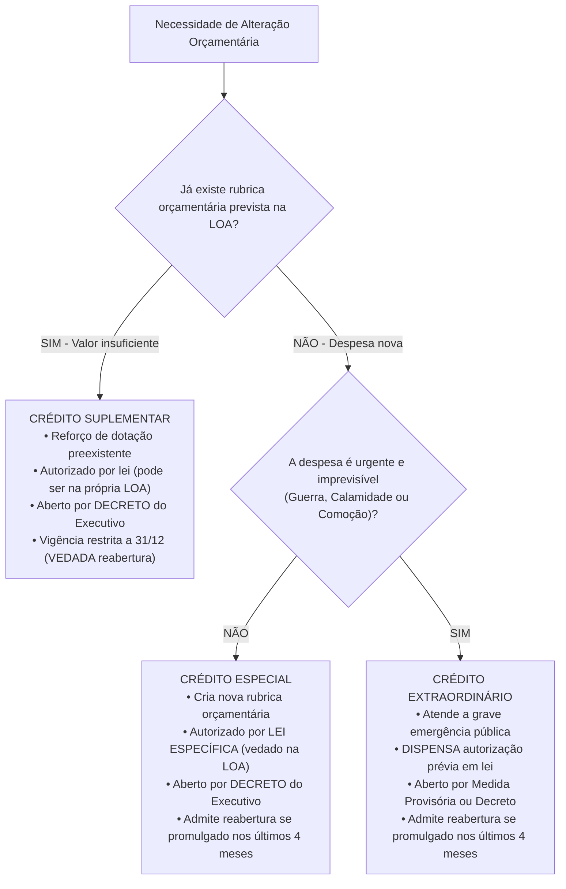
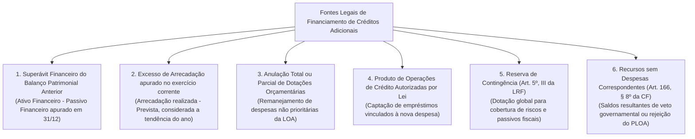
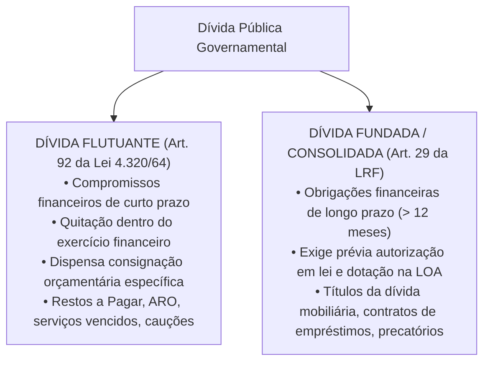

# 04 - Créditos Adicionais, Fontes de Financiamento e Dívida Pública

> **Matéria:** Noções de Administração Financeira e Orçamentária (AFO)  
> **Cargo:** A01 – Técnico de Controle Externo – Especialidade: Técnico Administrativo  
> **Arquivo:** `04_creditos_adicionais_e_divida_publica.md`  

---

## 📌 Ementa / Itens do Edital

- Créditos orçamentários iniciais (dotações fixadas na LOA) vs. Créditos Adicionais (mecanismos de retificação orçamentária);
- Espécies de Créditos Adicionais (Artigos 40 a 46 da Lei Federal nº 4.320/1964 e Artigo 167 da CF/88):
    - Créditos Suplementares: reforço de dotação orçamentária pré-existente insuficiente;
    - Créditos Especiais: criação de nova rubrica para despesas públicas não previstas na LOA;
    - Créditos Extraordinários: atendimento a despesas imprevisíveis e urgentes (guerra, comoção interna e calamidade pública - Art. 167, § 3º da CF/88);
- Ritos de autorização, instrumentos formais de abertura e vigência dos créditos adicionais;
- A regra de reabertura de saldos de créditos especiais e extraordinários promulgados nos últimos quatro meses do exercício financeiro (Artigo 167, § 2º da CF/88);
- As fontes legais de recursos para abertura de créditos adicionais (Artigo 43 da Lei nº 4.320/1964 e Artigo 166, § 8º da CF/88):
    - Superávit Financeiro apurado em Balanço Patrimonial do exercício anterior;
    - Excesso de Arrecadação apurado no exercício corrente;
    - Anulação total ou parcial de dotações orçamentárias;
    - Produto de Operações de Crédito autorizadas por lei;
    - Reserva de Contingência (LRF, Art. 5º, III);
    - Recursos sem despesas correspondentes decorrentes de veto, emenda ou rejeição do projeto de LOA;
- Dívida Pública no Direito Financeiro:
    - Dívida Flutuante (Artigo 92 da Lei nº 4.320/1964): restos a pagar, serviços da dívida a pagar, depósitos/cauções e débitos de tesouraria por ARO;
    - Dívida Fundada ou Consolidada (Artigo 98 da Lei nº 4.320/1964 e Artigo 29 da LRF): obrigações financeiras de longo prazo (superiores a 12 meses) decorrentes de contratos, emissão de títulos públicos e precatórios.

---

## 🧭 Sumário

1. [Mecanismos de Retificação do Orçamento: Os Créditos Adicionais](#1-mecanismos-de-retificacao-do-orcamento-os-creditos-adicionais)
    1. [Conceito e Função no Sistema Orçamentário](#11-conceito-e-funcao-no-sistema-orcamentario)
    2. [As Três Espécies: Suplementares, Especiais e Extraordinários](#12-as-tres-especies-suplementares-especiais-e-extraordinarios)
    3. [Quadro Comparativo dos Ritos e Vigência](#13-quadro-comparativo-dos-ritos-e-vigencia)
    4. [Teste 240](#Teste-240)
    5. [Teste 241](#Teste-241)
    6. [Teste 242](#Teste-242)
    7. [Teste 243](#Teste-243)
2. [A Regra Constitucional de Reabertura de Saldos (Art. 167, § 2º da CF/88)](#2-a-regra-constitucional-de-reabertura-de-saldos-art-167-2o-da-cf88)
    1. [Princípio da Anualidade e a Reabertura Quadrimestral](#21-principio-da-anualidade-e-a-reabertura-quadrimestral)
    2. [Requisitos Cumulativos para a Reabertura](#22-requisitos-cumulativos-para-a-reabertura)
    3. [Teste 244](#Teste-244)
    4. [Teste 245](#Teste-245)
3. [As Fontes Legais de Cobertura para Abertura de Créditos](#3-as-fontes-legais-de-cobertura-para-abertura-de-creditos)
    1. [Superávit Financeiro do Balanço Patrimonial Anterior (Art. 43, § 2º)](#31-superavit-financeiro-do-balanco-patrimonial-anterior-art-43-2o)
    2. [Excesso de Arrecadação (Art. 43, § 3º)](#32-excesso-de-arrecadacao-art-43-3o)
    3. [Anulação de Dotações e Operações de Crédito](#33-anulacao-de-dotacoes-e-operacoes-de-credito)
    4. [Reserva de Contingência e Recursos Decorrentes de Veto/Rejeição](#34-reserva-de-contingencia-e-recursos-decorrentes-de-vetorejeicao)
    5. [Teste 246](#Teste-246)
    6. [Teste 247](#Teste-247)
4. [Regime Jurídico da Dívida Pública: Flutuante vs. Fundada (Consolidada)](#4-regime-juridico-da-divida-publica-flutuante-vs-fundada-consolidada)
    1. [Dívida Flutuante (Curto Prazo - Art. 92 da Lei nº 4.320/1964)](#41-divida-flutuante-curto-prazo-art-92-da-lei-no-43201964)
    2. [Dívida Fundada ou Consolidada (Longo Prazo - Art. 29 da LRF)](#42-divida-fundada-ou-consolidada-longo-prazo-art-29-da-lrf)
    3. [Teste 248](#Teste-248)
    4. [Teste 249](#Teste-249)
5. [🌐 Fontes Oficiais & Manuais Técnicos Recomendados](#fontes-oficiais-manuais-tecnicos-recomendados)

---

## 1. Mecanismos de Retificação do Orçamento: Os Créditos Adicionais

### 1.1 Conceito e Função no Sistema Orçamentário
Conforme o art. 40 da Lei Federal nº 4.320/1964, os **créditos adicionais** são as autorizações de despesa não computadas ou insuficientemente dotadas na Lei de Orçamento. Atuam como válvulas de flexibilidade indispensáveis para corrigir imperfeições ou desvios na previsão orçamentária original provocados pela dinâmica econômica e social ao longo do exercício financeiro.

### 1.2 As Três Espécies: Suplementares, Especiais e Extraordinários
A legislação financeira reparte os créditos adicionais em três espécies bem delineadas:

1. **Créditos Suplementares (Art. 41, I da Lei nº 4.320/1964):**
    - Destinam-se exclusivamente ao **reforço de dotação orçamentária pré-existente** que se mostrou insuficiente durante a execução do exercício;
    - Dependem de prévia autorização em lei, que pode ser concedida tanto em **lei especial autônoma quanto no próprio corpo da Lei Orçamentária Anual**, constituindo expressa exceção ao princípio da exclusividade (art. 165, § 8º da CF/88);
    - São formalmente abertos por **decreto** do Poder Executivo.

2. **Créditos Especiais (Art. 41, II da Lei nº 4.320/1964):**
    - Destinam-se a despesas públicas para as quais **não haja dotação orçamentária específica na LOA** (criação de um programa de trabalho, projeto ou ação inteiramente novo);
    - Dependem obrigatoriamente de prévia autorização legislativa veiculada em **lei específica** (não podem ser autorizados no texto da LOA originária);
    - São abertos por **decreto** do Chefe do Poder Executivo.

3. **Créditos Extraordinários (Art. 41, III da Lei nº 4.320/1964 e Art. 167, § 3º da CF/88):**
    - Destinam-se ao atendimento de **despesas imprevisíveis e urgentes**, decorrentes exclusivamente de **guerra externa, comoção interna ou calamidade pública** (rol taxativo constitucional);
    - **Dispensam autorização prévia por lei:** São abertos no âmbito federal por **Medida Provisória** e, nos entes estaduais e municipais cujas Constituições ou Leis Orgânicas não contemplem MP, por **Decreto do Chefe do Executivo**, com ciência e submissão imediata ao Poder Legislativo;
    - Em caso de extrema emergência, a jurisprudência constitucional (STF - ADI 4.048) reconhece que a indicação formal prévia da fonte compensatória de recursos pode ser postergada.

### 1.3 Quadro Comparativo dos Ritos e Vigência

| Espécie de Crédito | Finalidade precípua | Autorização Legislativa | Instrumento Formal de Abertura | Possibilidade de Reabertura no Exercício Subsequente |
| :--- | :--- | :--- | :--- | :--- |
| **Suplementar** | Reforço de dotação orçamentária existente insuficiente. | Prévia em lei (**pode constar no texto da LOA**). | **Decreto** do Chefe do Executivo. | **NUNCA ADMITE REABERTURA**. Caduca impreterivelmente em 31 de dezembro. |
| **Especial** | Criação de nova dotação para despesas sem rubrica na LOA. | Prévia em **lei específica** (proibida autorização no corpo da LOA). | **Decreto** do Chefe do Executivo. | **Admite reabertura** se o ato for promulgado nos últimos 4 meses do ano. |
| **Extraordinário** | Custeio de emergências imprevisíveis (guerra, comoção, calamidade). | **Dispensa prévia lei.** Submissão e comunicação imediata ao Legislativo. | **Medida Provisória** ou **Decreto**. | **Admite reabertura** se o ato for promulgado nos últimos 4 meses do ano. |

---

### Teste 240
**(FGV – TRT – Analista Judiciário - Tecnologia da Informação – 2024)**
Segundo a Portaria MTP nº 1.467/2022, as contribuições normais 
e as suplementares e aportes destinados ao equacionamento do 
déficit atuarial, legalmente instituídos, inclusive seus encargos 
legais, devidos pelo ente federativo e não repassadas à unidade 
gestora do Regime Próprio até o seu vencimento, depois de 
apurados e confessados, pode ser objeto de Termo de Acordo de 
parcelamento para pagamento em moeda corrente, assegurado o 
equilíbrio financeiro e atuarial do regime e observados, no 
mínimo, o seguinte critério:

* **A)** admite-se o reparcelamento de débitos, parcelados 
anteriormente, mediante autorização em lei específica, 
observados ainda parâmetros adicionais.
* **B)** aplicação de correção equivalente ao índice oficial de 
atualização acrescido da meta atuarial utilizada na avaliação 
atuarial do Regime Próprio quando da celebração do Termo.
* **C)** autorização em lei específica do ente federativo.
* **D)** previsão, em cada Termo de Acordo, do número máximo de 
180 (cento e oitenta) prestações mensais, iguais e sucessivas.
* **E)** vedação de inclusão de débitos não decorrentes de 
contribuições previdenciárias.

---

> **Comentário Detalhado:**
>
> - **A)** Incorreta. Discrepa das diretrizes normativas e jurisprudenciais aplicáveis ao tema objeto do item.
> - **B)** Incorreta. Discrepa das diretrizes normativas e jurisprudenciais aplicáveis ao tema objeto do item.
> - **C)** Incorreta. Discrepa das diretrizes normativas e jurisprudenciais aplicáveis ao tema objeto do item.
> - **D)** Incorreta. Discrepa das diretrizes normativas e jurisprudenciais aplicáveis ao tema objeto do item.
> - **E)** Correta. Representa com precisão a disciplina do tema e o entendimento pacificado adotado pela banca (FGV).
>
> **Gabarito: E**

---
### Teste 241
**(FGV – TRT – Analista Judiciário - Tecnologia da Informação – 2024)**
Sobre os regimes financeiros e os métodos de financiamento, é 
correto afirmar que

* **A)** em um regime financeiro de capitalização, os recursos 
necessários para pagar os benefícios são acumulados ao 
longo do tempo, com base em contribuições regulares dos 
participantes e empregadores, e investidos para gerar 
retornos que ajudarão a cobrir as obrigações futuras, 
assegurando a solvência dos planos de previdência e 
mitigando os riscos de déficit.
* **B)** o método de capitalização coletiva garante que cada 
participante receba benefícios proporcionais às suas 
contribuições, independentemente das contribuições de 
outros participantes ou do número de beneficiários do 
sistema.
* **C)** o regime financeiro de repartição de capitais de cobertura é 
caracterizado por utilizar as contribuições atuais dos ativos 
para pagar os benefícios correntes dos aposentados, sem 
acumular reservas, o que pode levar a desafios de 
sustentabilidade a longo prazo.
* **D)** o regime financeiro de repartição simples pressupõe a receita 
de juros a partir do investimento das contribuições no 
mercado financeiro.
* **E)** o regime orçamentário acumula contribuições ao longo do 
tempo para formar um fundo que pagará os benefícios 
futuros, a fim de não depender de recursos adicionais para a 
cobertura de déficits, garantindo a solvência do sistema.

---

> **Comentário Detalhado:**
>
> - **A)** Incorreta. Discrepa das diretrizes normativas e jurisprudenciais aplicáveis ao tema objeto do item.
> - **B)** Incorreta. Discrepa das diretrizes normativas e jurisprudenciais aplicáveis ao tema objeto do item.
> - **C)** Incorreta. Discrepa das diretrizes normativas e jurisprudenciais aplicáveis ao tema objeto do item.
> - **D)** Incorreta. Discrepa das diretrizes normativas e jurisprudenciais aplicáveis ao tema objeto do item.
> - **E)** Correta. Representa com precisão a disciplina do tema e o entendimento pacificado adotado pela banca (FGV).
>
> **Gabarito: E**

---
### Teste 242
**(FGV – TRT – Analista Judiciário - Tecnologia da Informação – 2025)**
Em relação ao orçamento final, considere as informações a 
seguir. 
I. Reservas e transferências. 
II. Alocações e créditos adicionais. 
III. Estimativas e projeções divulgadas para os perí odos 
seguintes. 
De acordo com a NBC TSP 13 – Apresentação de Informação 
Orçamentária nas Demonstrações Contábeis, o orçamento final é 
o orçamento original ajustado pelo que se apresenta em

* **A)** I, apenas.
* **B)** I e II, apenas.
* **C)** I e III, apenas.
* **D)** II e III, apenas.
* **E)** I, II e III.

---

> **Comentário Detalhado:**
>
> - **A)** Incorreta. Discrepa das diretrizes normativas e jurisprudenciais aplicáveis ao tema objeto do item.
> - **B)** Incorreta. Discrepa das diretrizes normativas e jurisprudenciais aplicáveis ao tema objeto do item.
> - **C)** Correta. Representa com precisão a disciplina do tema e o entendimento pacificado adotado pela banca (FGV).
> - **D)** Incorreta. Discrepa das diretrizes normativas e jurisprudenciais aplicáveis ao tema objeto do item.
> - **E)** Incorreta. Discrepa das diretrizes normativas e jurisprudenciais aplicáveis ao tema objeto do item.
>
> **Gabarito: C**

---
### Teste 243
**(FGV – TRT – Analista Judiciário - Tecnologia da Informação – 2024)**
São consideradas “créditos adicionais” as autorizações de 
despesas não computadas ou insuficientemente dotadas na  
Lei de Orçamento. 
De acordo com a Lei nº 4.320/64, os créditos adicionais são 
classificados como

* **A)** Especiais e de Custeio.
* **B)** Correntes e de Custeio.
* **C)** de Capital, Patrimonial e de Empréstimos.
* **D)** Suplementares, Especiais e Extraordinários.
* **E)** de Custeio e de Capital.

---

> **Comentário Detalhado:**
>
> - **A)** Incorreta. Discrepa das diretrizes normativas e jurisprudenciais aplicáveis ao tema objeto do item.
> - **B)** Correta. Representa com precisão a disciplina do tema e o entendimento pacificado adotado pela banca (FGV).
> - **C)** Incorreta. Discrepa das diretrizes normativas e jurisprudenciais aplicáveis ao tema objeto do item.
> - **D)** Incorreta. Discrepa das diretrizes normativas e jurisprudenciais aplicáveis ao tema objeto do item.
> - **E)** Incorreta. Discrepa das diretrizes normativas e jurisprudenciais aplicáveis ao tema objeto do item.
>
> **Gabarito: B**

---
## 2. A Regra Constitucional de Reabertura de Saldos (Art. 167, § 2º da CF/88)

### 2.1 Princípio da Anualidade e a Reabertura Quadrimestral
O princípio orçamentário da anualidade determina que os créditos orçamentários têm vigência restrita ao exercício financeiro respectivo, extinguindo-se em 31 de dezembro. Todavia, o legislador constituinte originário inseriu no art. 167, § 2º da Carta Magna uma única ressalva temporal:

$$\text{Ato de Abertura} \in [1º \text{ de setembro a } 31 \text{ de dezembro}] \implies \text{Admissível Reabertura no Ano Seguinte}$$

### 2.2 Requisitos Cumulativos para a Reabertura
Para que o saldo de um crédito orçamentário possa ser regularmente reaberto no exercício subsequente, faz-se mister o atendimento rigoroso e simultâneo dos seguintes requisitos:

1. **Espécies Permitidas:** O crédito deve ser exclusivamente **Especial** ou **Extraordinário** (créditos suplementares jamais podem ser reabertos em hipótese alguma);
2. **Marco Temporal Limítrofe:** O ato de autorização e abertura deve ter sido promulgado e publicado nos **últimos quatro meses do exercício financeiro** (entre 1º de setembro e 31 de dezembro);
3. **Limite do Saldo Remanescente:** A reabertura se processa estritamente no **limite dos saldos não empenhados/não utilizados**;
4. **Vigência Final:** O saldo reaberto incorpora-se ao orçamento do ano subsequente, vigorando impreterivelmente até o dia 31 de dezembro do exercício seguinte.

---

### Teste 244
**(FGV – TCE-PA – Auditor de Controle Externo – 2024)**
De acordo com a Constituição Federal de 1988 (CRFB/88), 
pertencem aos Municípios

* **A)** cinquenta por cento do produto da arrecadação do imposto 
da União sobre renda e proventos de qualquer natureza, 
incidente na fonte sobre rendimentos pagos, a qualquer 
título, por eles, suas autarquias e pelas fundações que 
instituírem e mantiverem.
* **B)** cinquenta por cento do produto da arrecadação do imposto 
do Estado sobre a propriedade de veículos automotores 
licenciados em seus territórios.
* **C)** cem por cento do produto da arrecadação do imposto da 
União sobre a propriedade territorial rural, relativamente aos 
imóveis neles situados.
* **D)** vinte por cento do produto da arrecadação do imposto que a 
União instituir no exercício da competência que lhe é 
atribuída pelo Art. 154, I, CRFB/88 (impostos não -cumulativos 
e que não tenham fato gerador ou base de cálculo próprios 
dos discriminados na Constituição).
* **E)** cem por cento do produto da arrecadação de empréstimos 
compulsórios instituídos para atender despesas 
extraordinárias, decorrentes de calamidade pública ocorridas 
em seus territórios. 

AUDITOR DE CONTROLE EXTERNO - ADMINISTRATIVA - GESTÃO GOVERNAMENTAL – MANHÃ  TIPO  BRANCA – PÁGINA 21

---

> **Comentário Detalhado:**
>
> - **A)** Incorreta. Discrepa das diretrizes normativas e jurisprudenciais aplicáveis ao tema objeto do item.
> - **B)** Incorreta. Discrepa das diretrizes normativas e jurisprudenciais aplicáveis ao tema objeto do item.
> - **C)** Incorreta. Discrepa das diretrizes normativas e jurisprudenciais aplicáveis ao tema objeto do item.
> - **D)** Incorreta. Discrepa das diretrizes normativas e jurisprudenciais aplicáveis ao tema objeto do item.
> - **E)** Correta. Representa com precisão a disciplina do tema e o entendimento pacificado adotado pela banca (FGV).
>
> **Gabarito: E**

---
### Teste 245
**(FGV – TRT – Analista Judiciário - Tecnologia da Informação – 2024)**
A lei orçamentária anual - LOA é tida como um instrumento de 
planejamento projetado no exercício anterior para que se 
execute no exercício seguinte. No entanto, durante a fase de 
execução orçamentária, podem ocorrer situações que não foram 
previstas na fase do planejamento. 
Nesses casos, um mecanismo retificador do orçamento

* **A)** é a reserva de contingência.
* **B)** são as emendas do relator.
* **C)** é a abertura de créditos adicionais.
* **D)** é a proposta orçamentária qualitativa.
* **E)** é a emenda constitucional.

---

> **Comentário Detalhado:**
>
> - **A)** Incorreta. Discrepa das diretrizes normativas e jurisprudenciais aplicáveis ao tema objeto do item.
> - **B)** Incorreta. Discrepa das diretrizes normativas e jurisprudenciais aplicáveis ao tema objeto do item.
> - **C)** Incorreta. Discrepa das diretrizes normativas e jurisprudenciais aplicáveis ao tema objeto do item.
> - **D)** Correta. Representa com precisão a disciplina do tema e o entendimento pacificado adotado pela banca (FGV).
> - **E)** Incorreta. Discrepa das diretrizes normativas e jurisprudenciais aplicáveis ao tema objeto do item.
>
> **Gabarito: D**

---
## 3. As Fontes Legais de Cobertura para Abertura de Créditos

Conforme determina o art. 43 da Lei Federal nº 4.320/1964, a abertura de créditos suplementares e especiais é nula de pleno direito caso não seja precedida de exposição justificativa que comprove a existência de recursos disponíveis para o seu financiamento. O ordenamento jurídico reconhece seis fontes formais:

### 3.1 Superávit Financeiro do Balanço Patrimonial Anterior (Art. 43, § 2º)
- É a diferença positiva apurada no **Balanço Patrimonial** do exercício imediatamente anterior entre o Ativo Financeiro ($AF$) e o Passivo Financeiro ($PF$):

$$\text{Superávit Financeiro} = AF - PF - \text{Saldos de Créditos Reabertos} - \text{Vinculações Legais}$$

- O cálculo deve deduzir obrigatoriamente os saldos dos créditos adicionais transferidos/reabertos que ainda demandem cobertura, bem como as disponibilidades financeiras atreladas a receitas legalmente vinculadas (ex.: quotas do Fundeb).

### 3.2 Excesso de Arrecadação (Art. 43, § 3º)
- É o saldo positivo das diferenças acumuladas mês a mês entre a arrecadação realizada e a prevista na LOA, considerada a **tendência do exercício**.
- Do montante apurado de excesso de arrecadação devem ser deduzidas as importâncias dos créditos adicionais suplementares e especiais já abertos com base nessa mesma fonte ao longo do ano corrente.

### 3.3 Anulação de Dotações e Operações de Crédito
- **Anulação Total ou Parcial de Dotações:** Consiste na redução do valor fixado para determinada despesa orçamentária da LOA que deixou de ser prioritária para viabilizar o reforço ou criação de outra dotação pública de maior relevância.
- **Operações de Crédito:** Ingressos de recursos derivados da contratação de empréstimos, financiamentos ou emissão de títulos públicos da dívida fundada devidamente autorizados pelo Poder Legislativo em lei e vinculados ao crédito aberto.

### 3.4 Reserva de Contingência e Recursos Decorrentes de Veto/Rejeição
- **Reserva de Contingência (Art. 5º, III da LRF):** Dotação orçamentária global sem destinação específica a órgão ou programa, fixada na LOA com base na LDO, destinada a cobrir passivos contingentes e outros riscos fiscais imprevistos. Serve legitimamente como fonte de anulação para abertura de créditos suplementares e especiais.
- **Recursos Decorrentes de Veto ou Rejeição (Art. 166, § 8º da CF/88):** Recursos que ficaram sem despesas correspondentes em razão de veto parcial do Chefe do Executivo ao projeto de LOA, ou resultantes de emendas e rejeição de dispositivos no parlamento.

> 🚨 **ALERTA DE PROVA / PEGADINHA FCC:**  
> A banca frequentemente tenta confundir o candidato trocando **Superávit Financeiro** por **Superávit Orçamentário**:  
>
> - **Superávit Financeiro:** Apurado no **Balanço Patrimonial** ao término do ano anterior. **É FONTE LEGAL** para abertura de créditos adicionais!  
> - **Superávit Orçamentário:** Apurado no **Balanço Orçamentário** quando a receita arrecadada for maior que a despesa empenhada. **NÃO É FONTE** para abertura de créditos adicionais!

---

### Teste 246
**(FGV – TRT-DA 13-REGIÃO – Analista Judiciário - Tecnologia da Informação – 2022)**
Conceito, surgido a partir do Protocolo de Kyoto em 1997, que 
visa à diminuição dos gases de efeito estufa, que provocam 
diversos problemas ambientais associados às mudanças 
climáticas. Eles fazem parte de um mecanismo de flexibilização 
que auxilia os país es que possuem metas de redução da emissão 
de gases poluentes a alcançá-las.  
A cada tonelada não emitida, gera -se um crédito. Assim, quando 
um país consegue reduzir a emissão dessa tonelada, ele recebe 
uma certificação emitida pelo Mecanismo de Desenvolvimento 
Limpo (MDL), ou seja, recebe os créditos que estarão disponíveis 
para serem comercializados com os países que não alcançaram 
suas metas. 
A geração do crédito é realizada à medida que os países 
esforçam-se em projetos e ações que visam ao de senvolvimento 
sustentável, evitando, assim, o aumento do efeito estufa. 
Exemplos desses projetos são o empenho em reduzir os níveis de 
desmatamento, as campanhas para o consumo consciente, o uso 
de fontes de energia alternativas, entre outros. 
(mundoeducacao.uol.com.br. Adaptado) 
O texto refere-se aos créditos de

* **A)** Hidrogênio.
* **B)** Oxigênio.
* **C)** Carbono.
* **D)** Enxofre.
* **E)** Silício.  
TRIBUNAL REGIONAL DO TRABALHO 13ª REGIÃO (PARAÍBA) FGV

---

> **Comentário Detalhado:**
>
> - **A)** Correta. Representa com precisão a disciplina do tema e o entendimento pacificado adotado pela banca (FGV).
> - **B)** Incorreta. Discrepa das diretrizes normativas e jurisprudenciais aplicáveis ao tema objeto do item.
> - **C)** Incorreta. Discrepa das diretrizes normativas e jurisprudenciais aplicáveis ao tema objeto do item.
> - **D)** Incorreta. Discrepa das diretrizes normativas e jurisprudenciais aplicáveis ao tema objeto do item.
> - **E)** Incorreta. Discrepa das diretrizes normativas e jurisprudenciais aplicáveis ao tema objeto do item.
>
> **Gabarito: A**

---
### Teste 247
**(FGV – TRT-13 – Analista Judiciário - Tecnologia da Informação – 2022)**
Conceito, surgido a partir do Protocolo de Kyoto em 1997, que 
visa à diminuição dos gases de efeito estufa, que provocam 
diversos problemas ambientais associados às mudanças 
climáticas. Eles fazem parte de um mecanismo de flexibilização 
que auxilia os país es que possuem metas de redução da emissão 
de gases poluentes a alcançá-las.  
A cada tonelada não emitida, gera -se um crédito. Assim, quando 
um país consegue reduzir a emissão dessa tonelada, ele recebe 
uma certificação emitida pelo Mecanismo de Desenvolvimento 
Limpo (MDL), ou seja, recebe os créditos que estarão disponíveis 
para serem comercializados com os países que não alcançaram 
suas metas. 
A geração do crédito é realizada à medida que os países 
esforçam-se em projetos e ações que visam ao de senvolvimento 
sustentável, evitando, assim, o aumento do efeito estufa. 
Exemplos desses projetos são o empenho em reduzir os níveis de 
desmatamento, as campanhas para o consumo consciente, o uso 
de fontes de energia alternativas, entre outros. 
(mundoeducacao.uol.com.br. Adaptado) 
O texto refere-se aos créditos de

* **A)** Hidrogênio.
* **B)** Oxigênio.
* **C)** Carbono.
* **D)** Enxofre.
* **E)** Silício.  
TRIBUNAL REGIONAL DO TRABALHO 13ª REGIÃO (PARAÍBA) FGV

---

> **Comentário Detalhado:**
>
> - **A)** Incorreta. Discrepa das diretrizes normativas e jurisprudenciais aplicáveis ao tema objeto do item.
> - **B)** Incorreta. Discrepa das diretrizes normativas e jurisprudenciais aplicáveis ao tema objeto do item.
> - **C)** Correta. Representa com precisão a disciplina do tema e o entendimento pacificado adotado pela banca (FGV).
> - **D)** Incorreta. Discrepa das diretrizes normativas e jurisprudenciais aplicáveis ao tema objeto do item.
> - **E)** Incorreta. Discrepa das diretrizes normativas e jurisprudenciais aplicáveis ao tema objeto do item.
>
> **Gabarito: C**

---
## 4. Regime Jurídico da Dívida Pública: Flutuante vs. Fundada (Consolidada)

A disciplina jurídica da dívida pública no Brasil encontra-se fundamentada na Lei Federal nº 4.320/1964 e na Lei de Responsabilidade Fiscal (LC nº 101/2000):

### 4.1 Dívida Flutuante (Curto Prazo - Art. 92 da Lei nº 4.320/1964)
A dívida flutuante compreende os compromissos exigíveis assumidos pela administração pública para liquidação imediata ou a curto prazo, sem necessidade de autorização orçamentária contínua para sua amortização (opera-se como dispêndio extraorçamentário). Integra-se taxativamente por:

1. **Restos a Pagar:** Despesas empenhadas e não pagas até 31 de dezembro, processadas e não processadas;
2. **Serviços da dívida a pagar:** Parcelas de amortização e encargos de juros de empréstimos consolidados vencidos e pendentes de desembolso;
3. **Depósitos, fianças e cauções:** Recursos financeiros de terceiros sob custódia temporária da Fazenda Pública restituíveis a curto prazo;
4. **Débitos de tesouraria decorrentes de ARO:** Saldos pendentes de Operações de Crédito por Antecipação de Receita Orçamentária contraídos para suprir descompassos transitórios de caixa.

### 4.2 Dívida Fundada ou Consolidada (Longo Prazo - Art. 29 da LRF)
Conforme o art. 29 da LRF e o art. 98 da Lei nº 4.320/1964, a dívida fundada ou consolidada consiste no montante total das obrigações financeiras assumidas pelo ente federado para **amortização em prazo superior a 12 (doze) meses**:

- Decorre de emissão de títulos públicos mobiliários, contratos formais de empréstimo e financiamento internos e externos (junto a bancos como BNDES, Caixa, BIRD e BID);
- Inclui precatórios judiciais emitidos após 1º de julho e não pagos durante o exercício de inclusão orçamentária (art. 30, § 7º da LRF);
- *Exceção importante da LRF:* As operações de crédito de prazo inferior a 12 meses **também integrarão a dívida consolidada** caso suas receitas tenham sido expressamente incluídas e computadas como receita orçamentária na Lei Orçamentária Anual.

---

### Teste 248
**(FGV – TRT-1 – Analista Judiciário - Tecnologia da Informação – 2024)**
No primeiro semestre de um exercício financeiro, um estado da 
Federação enfrentou um severo período de inundações que 
afetou diversos dos seus municípios, incluindo a capital, com 
impactos relevantes na economia regional e, por  consequência, 
nas finanças públicas. Com isso, o estado pode ter que limitar 
programações de caráter obrigatório decorrentes de emendas 
parlamentares ao orçamento. 
Nesses casos, os procedimentos devem ser tratados:

* **A)** em instrumento específico de programação financeira;
* **B)** em lei complementar prevista no texto constitucional;
* **C)** na lei de diretrizes orçamentárias do respectivo exercício;
* **D)** nas disposições transitórias da lei orçamentária anual;
* **E)** no instrumento relativo ao decreto de calamidade pública.

---

> **Comentário Detalhado:**
>
> - **A)** Incorreta. Discrepa das diretrizes normativas e jurisprudenciais aplicáveis ao tema objeto do item.
> - **B)** Incorreta. Discrepa das diretrizes normativas e jurisprudenciais aplicáveis ao tema objeto do item.
> - **C)** Incorreta. Discrepa das diretrizes normativas e jurisprudenciais aplicáveis ao tema objeto do item.
> - **D)** Incorreta. Discrepa das diretrizes normativas e jurisprudenciais aplicáveis ao tema objeto do item.
> - **E)** Correta. Representa com precisão a disciplina do tema e o entendimento pacificado adotado pela banca (FGV).
>
> **Gabarito: E**

---
### Teste 249
**(FGV – TRT – Analista Judiciário - Tecnologia da Informação – 2024)**
Num processo de estimação pontual de um parâmetro  por um 
estimador T, avalie se as seguintes propriedades de T são 
desejáveis: 
I. T deve ser tendencioso para  
II. T deve ter variância pequena.  
III. T deve ter o maior erro quadrático médio possível. 
Está correto apenas o que se afirma em

* **A)** I.
* **B)** II.
* **C)** III.
* **D)** I e III.
* **E)** II e III.

---

> **Comentário Detalhado:**
>
> - **A)** Incorreta. Discrepa das diretrizes normativas e jurisprudenciais aplicáveis ao tema objeto do item.
> - **B)** Correta. Representa com precisão a disciplina do tema e o entendimento pacificado adotado pela banca (FGV).
> - **C)** Incorreta. Discrepa das diretrizes normativas e jurisprudenciais aplicáveis ao tema objeto do item.
> - **D)** Incorreta. Discrepa das diretrizes normativas e jurisprudenciais aplicáveis ao tema objeto do item.
> - **E)** Incorreta. Discrepa das diretrizes normativas e jurisprudenciais aplicáveis ao tema objeto do item.
>
> **Gabarito: B**

---
## 🌐 Fontes Oficiais & Manuais Técnicos Recomendados

* [Lei Federal nº 4.320/1964 - Arts. 40 a 46 (Créditos Adicionais)](https://www.planalto.gov.br/ccivil_03/leis/l4320.htm) - Definição, tipos (suplementares, especiais e extraordinários) e fontes de recursos para abertura de créditos adicionais.
* [Constituição Federal de 1988 - Arts. 166 e 167 (Abertura de Créditos Extraordinários)](https://www.planalto.gov.br/ccivil_03/constituicao/constituicao.htm#art165) - Requisitos de imprevisibilidade e urgência (guerra, comoção interna ou calamidade pública) e autorizações orçamentárias.
* [Lei Complementar nº 101/2000 - Arts. 29 a 40 (Dívida e Endividamento Público)](https://www.planalto.gov.br/ccivil_03/leis/lcp/lcp101.htm) - Conceitos de dívida pública consolidada, fundada, flutuante, operações de crédito e ARO (Antecipação de Receita Orçamentária).
* [Tesouro Transparente - MCASP 11ª Edição (Operações de Crédito e Dívida)](https://www.tesourotransparente.gov.br/publicacoes/manual-de-contabilidade-aplicada-ao-setor-publico-mcasp/2024/26) - Procedimentos contábeis e orçamentários do serviço da dívida pública.
* [Constituição do Estado de Goiás - Limites da Dívida e Autorizações](https://legisla.casacivil.go.gov.br/constituicao-estadual) - Competências da Assembleia Legislativa de Goiás na fixação de limites e autorização de empréstimos do Estado.
* GIACOMONI, James. **Orçamento Público**. 18. ed. São Paulo: Atlas, 2021. (Cap. 10 - Modificações Orçamentárias: Os Créditos Adicionais).
* PALUDO, Augustinho. **Orçamento Público, AFO e LRF**. 11. ed. Salvador: JusPodivm, 2022. (Cap. 7 - Créditos Adicionais; Cap. 12 - Dívida Pública e Operações de Crédito).
* PISCITELLI, Roberto Bocaccio; TIMÓTEO, Alfredo. **Contabilidade Pública: Uma Abordagem da Administração Financeira Pública**. 14. ed. São Paulo: Atlas, 2019. (Cap. 5 - Créditos Adicionais e Fontes de Financiamento).
