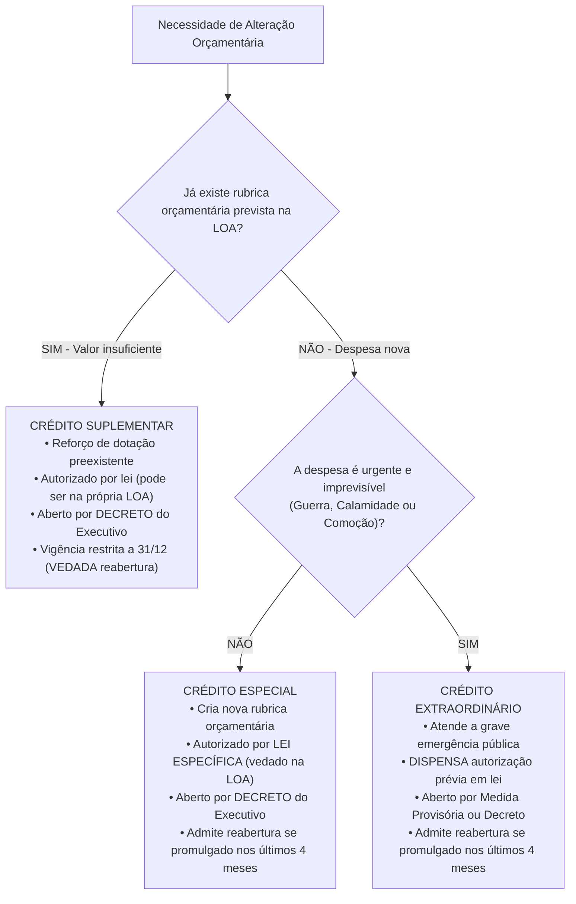
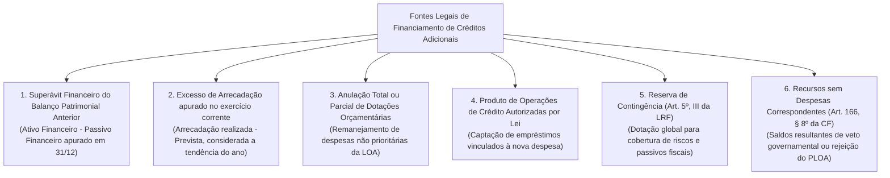
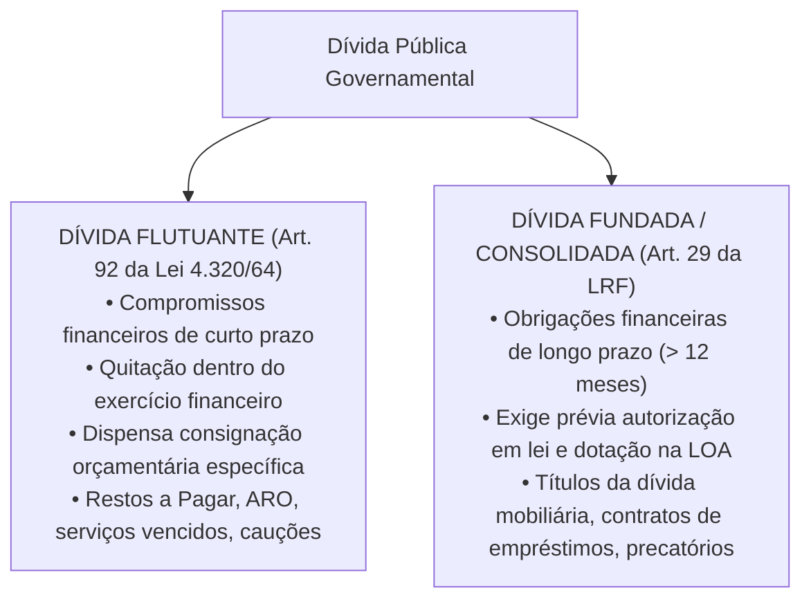

# 04 - Créditos Adicionais, Fontes de Financiamento e Dívida Pública

> **Matéria:** Noções de Administração Financeira e Orçamentária (AFO)  
> **Cargo:** A01 – Técnico de Controle Externo – Especialidade: Técnico Administrativo  
> **Arquivo:** `04_creditos_adicionais_e_divida_publica.md`  

---

## 📌 Ementa / Itens do Edital

- Créditos orçamentários iniciais (dotações fixadas na LOA) vs. Créditos Adicionais (mecanismos de retificação orçamentária);
- Espécies de Créditos Adicionais (Artigos 40 a 46 da Lei Federal nº 4.320/1964 e Artigo 167 da CF/88):
    - Créditos Suplementares: reforço de dotação orçamentária pré-existente insuficiente;
    - Créditos Especiais: criação de nova rubrica para despesas públicas não previstas na LOA;
    - Créditos Extraordinários: atendimento a despesas imprevisíveis e urgentes (guerra, comoção interna e calamidade pública - Art. 167, § 3º da CF/88);
- Ritos de autorização, instrumentos formais de abertura e vigência dos créditos adicionais;
- A regra de reabertura de saldos de créditos especiais e extraordinários promulgados nos últimos quatro meses do exercício financeiro (Artigo 167, § 2º da CF/88);
- As fontes legais de recursos para abertura de créditos adicionais (Artigo 43 da Lei nº 4.320/1964 e Artigo 166, § 8º da CF/88):
    - Superávit Financeiro apurado em Balanço Patrimonial do exercício anterior;
    - Excesso de Arrecadação apurado no exercício corrente;
    - Anulação total ou parcial de dotações orçamentárias;
    - Produto de Operações de Crédito autorizadas por lei;
    - Reserva de Contingência (LRF, Art. 5º, III);
    - Recursos sem despesas correspondentes decorrentes de veto, emenda ou rejeição do projeto de LOA;
- Dívida Pública no Direito Financeiro:
    - Dívida Flutuante (Artigo 92 da Lei nº 4.320/1964): restos a pagar, serviços da dívida a pagar, depósitos/cauções e débitos de tesouraria por ARO;
    - Dívida Fundada ou Consolidada (Artigo 98 da Lei nº 4.320/1964 e Artigo 29 da LRF): obrigações financeiras de longo prazo (superiores a 12 meses) decorrentes de contratos, emissão de títulos públicos e precatórios.

---

## 🧭 Sumário

1. [Mecanismos de Retificação do Orçamento: Os Créditos Adicionais](#1-mecanismos-de-retificacao-do-orcamento-os-creditos-adicionais)
    1. [Conceito e Função no Sistema Orçamentário](#11-conceito-e-funcao-no-sistema-orcamentario)
    2. [As Três Espécies: Suplementares, Especiais e Extraordinários](#12-as-tres-especies-suplementares-especiais-e-extraordinarios)
    3. [Quadro Comparativo dos Ritos e Vigência](#13-quadro-comparativo-dos-ritos-e-vigencia)
    4. [Teste 240](#Teste-240)
    5. [Teste 241](#Teste-241)
    6. [Teste 242](#Teste-242)
    7. [Teste 243](#Teste-243)
2. [A Regra Constitucional de Reabertura de Saldos (Art. 167, § 2º da CF/88)](#2-a-regra-constitucional-de-reabertura-de-saldos-art-167-2o-da-cf88)
    1. [Princípio da Anualidade e a Reabertura Quadrimestral](#21-principio-da-anualidade-e-a-reabertura-quadrimestral)
    2. [Requisitos Cumulativos para a Reabertura](#22-requisitos-cumulativos-para-a-reabertura)
    3. [Teste 244](#Teste-244)
    4. [Teste 245](#Teste-245)
3. [As Fontes Legais de Cobertura para Abertura de Créditos](#3-as-fontes-legais-de-cobertura-para-abertura-de-creditos)
    1. [Superávit Financeiro do Balanço Patrimonial Anterior (Art. 43, § 2º)](#31-superavit-financeiro-do-balanco-patrimonial-anterior-art-43-2o)
    2. [Excesso de Arrecadação (Art. 43, § 3º)](#32-excesso-de-arrecadacao-art-43-3o)
    3. [Anulação de Dotações e Operações de Crédito](#33-anulacao-de-dotacoes-e-operacoes-de-credito)
    4. [Reserva de Contingência e Recursos Decorrentes de Veto/Rejeição](#34-reserva-de-contingencia-e-recursos-decorrentes-de-vetorejeicao)
    5. [Teste 246](#Teste-246)
    6. [Teste 247](#Teste-247)
4. [Regime Jurídico da Dívida Pública: Flutuante vs. Fundada (Consolidada)](#4-regime-juridico-da-divida-publica-flutuante-vs-fundada-consolidada)
    1. [Dívida Flutuante (Curto Prazo - Art. 92 da Lei nº 4.320/1964)](#41-divida-flutuante-curto-prazo-art-92-da-lei-no-43201964)
    2. [Dívida Fundada ou Consolidada (Longo Prazo - Art. 29 da LRF)](#42-divida-fundada-ou-consolidada-longo-prazo-art-29-da-lrf)
    3. [Teste 248](#Teste-248)
    4. [Teste 249](#Teste-249)
5. [🌐 Fontes Oficiais & Manuais Técnicos Recomendados](#fontes-oficiais-manuais-tecnicos-recomendados)

---

## 1. Mecanismos de Retificação do Orçamento: Os Créditos Adicionais

### 1.1 Conceito e Função no Sistema Orçamentário
Conforme o art. 40 da Lei Federal nº 4.320/1964, os **créditos adicionais** são as autorizações de despesa não computadas ou insuficientemente dotadas na Lei de Orçamento. Atuam como válvulas de flexibilidade indispensáveis para corrigir imperfeições ou desvios na previsão orçamentária original provocados pela dinâmica econômica e social ao longo do exercício financeiro.

### 1.2 As Três Espécies: Suplementares, Especiais e Extraordinários
A legislação financeira reparte os créditos adicionais em três espécies bem delineadas:

1. **Créditos Suplementares (Art. 41, I da Lei nº 4.320/1964):**
    - Destinam-se exclusivamente ao **reforço de dotação orçamentária pré-existente** que se mostrou insuficiente durante a execução do exercício;
    - Dependem de prévia autorização em lei, que pode ser concedida tanto em **lei especial autônoma quanto no próprio corpo da Lei Orçamentária Anual**, constituindo expressa exceção ao princípio da exclusividade (art. 165, § 8º da CF/88);
    - São formalmente abertos por **decreto** do Poder Executivo.

2. **Créditos Especiais (Art. 41, II da Lei nº 4.320/1964):**
    - Destinam-se a despesas públicas para as quais **não haja dotação orçamentária específica na LOA** (criação de um programa de trabalho, projeto ou ação inteiramente novo);
    - Dependem obrigatoriamente de prévia autorização legislativa veiculada em **lei específica** (não podem ser autorizados no texto da LOA originária);
    - São abertos por **decreto** do Chefe do Poder Executivo.

3. **Créditos Extraordinários (Art. 41, III da Lei nº 4.320/1964 e Art. 167, § 3º da CF/88):**
    - Destinam-se ao atendimento de **despesas imprevisíveis e urgentes**, decorrentes exclusivamente de **guerra externa, comoção interna ou calamidade pública** (rol taxativo constitucional);
    - **Dispensam autorização prévia por lei:** São abertos no âmbito federal por **Medida Provisória** e, nos entes estaduais e municipais cujas Constituições ou Leis Orgânicas não contemplem MP, por **Decreto do Chefe do Executivo**, com ciência e submissão imediata ao Poder Legislativo;
    - Em caso de extrema emergência, a jurisprudência constitucional (STF - ADI 4.048) reconhece que a indicação formal prévia da fonte compensatória de recursos pode ser postergada.

### 1.3 Quadro Comparativo dos Ritos e Vigência

| Espécie de Crédito | Finalidade precípua | Autorização Legislativa | Instrumento Formal de Abertura | Possibilidade de Reabertura no Exercício Subsequente |
| :--- | :--- | :--- | :--- | :--- |
| **Suplementar** | Reforço de dotação orçamentária existente insuficiente. | Prévia em lei (**pode constar no texto da LOA**). | **Decreto** do Chefe do Executivo. | **NUNCA ADMITE REABERTURA**. Caduca impreterivelmente em 31 de dezembro. |
| **Especial** | Criação de nova dotação para despesas sem rubrica na LOA. | Prévia em **lei específica** (proibida autorização no corpo da LOA). | **Decreto** do Chefe do Executivo. | **Admite reabertura** se o ato for promulgado nos últimos 4 meses do ano. |
| **Extraordinário** | Custeio de emergências imprevisíveis (guerra, comoção, calamidade). | **Dispensa prévia lei.** Submissão e comunicação imediata ao Legislativo. | **Medida Provisória** ou **Decreto**. | **Admite reabertura** se o ato for promulgado nos últimos 4 meses do ano. |

---

### Teste 240
**(FCC - Adaptada / Técnico de Controle Externo)**
Na contabilidade pública e no direito financeiro, as dívidas contraídas pelo Estado classificam-se em dívida flutuante e dívida fundada (consolidada). Assinale a opção que apresenta um componente típico da **dívida flutuante**:

* **A)** Títulos públicos da dívida mobiliária estadual com vencimento para cinco anos.
* **B)** Contrato de financiamento firmado com o Banco Interamericano de Desenvolvimento (BID) para amortização em dez anos.
* **C)** Restos a Pagar processados e não processados inscritos ao término do exercício financeiro.
* **D)** Precatórios judiciais incluídos na proposta orçamentária para quitação ao longo de três exercícios sucessivos.
* **E)** Debêntures emitidas por sociedade de economia mista não dependente com garantia real imobiliária.

---

> **Comentário Detalhado:**
>
> - **A)** Incorreta. Títulos públicos da dívida mobiliária com prazo superior a 12 meses integram a dívida consolidada (fundada).
> - **B)** Incorreta. Contratos de empréstimos com organismos internacionais amortizáveis a longo prazo compõem a dívida fundada contratual.
> - **C)** Correta. Nos termos do art. 92 da Lei Federal nº 4.320/1964, a dívida flutuante compreende os compromissos exigíveis a curto prazo cuja liquidação independe de dotação orçamentária continuada, abrangendo expressamente os Restos a Pagar (processados e não processados), os serviços da dívida a pagar, os depósitos/cauções e os débitos de tesouraria decorrentes de ARO.
> - **D)** Incorreta. Precatórios com parcelamento em prazo superior a 12 meses são computados na dívida consolidada (art. 30, § 7º da LRF).
> - **E)** Incorreta. Debêntures privadas emitidas por estatais não dependentes não constituem obrigação direta da Fazenda Pública Estadual.
> 
> **Gabarito: C**

---

### Teste 241
**(FCC - Adaptada / Analista Jurídico de Controle)**
Ao elaborar o projeto de Lei Orçamentária Anual (LOA), a Secretaria de Economia do Estado de Goiás estimou uma reserva global sem destinação específica a órgão ou programa determinado, vinculada unicamente à cobertura de passivos contingentes e outros riscos fiscais imprevistos.

Nos termos do artigo 5º, inciso III da Lei de Responsabilidade Fiscal (LC nº 101/2000) e da legislação financeira, essa dotação denomina-se:

* **A)** Crédito Adicional Extraordinário Vinculado.
* **B)** Reserva de Contingência, cuja dotação pode servir como fonte de recursos para abertura de créditos adicionais.
* **C)** Provisão Judicial para Perdas Trabalhistas.
* **D)** Fundo de Estabilização Fiscal de Repartição Obrigatória.
* **E)** Superávit de Liquidez de Tesouraria.

---

> **Comentário Detalhado:**
>
> - **A)** Incorreta. Crédito extraordinário é instrumento de alteração orçamentária para emergências e calamidades, não dotação preventiva originária da LOA.
> - **B)** Correta. O art. 5º, inciso III da Lei de Responsabilidade Fiscal prescreve que o projeto de LOA conterá reserva de contingência, cuja forma de utilização e montante são definidos na LDO, destinada ao atendimento de passivos contingentes e outros riscos e eventos fiscais imprevistos, servindo perfeitamente como fonte de recursos para anulação e abertura de créditos suplementares e especiais.
> - **C)** Incorreta. Provisão contábil é instituto de mensuração patrimonial e não rubrica orçamentária da LOA.
> - **D)** Incorreta. Expressão desconexa do regramento de dotações orçamentárias gerais.
> - **E)** Incorreta. Refere-se a saldo de caixa de tesouraria, não a dotação autorizativa de despesa pública.
> 
> **Gabarito: B**

---

### Teste 242
**(FCC - Adaptada / TCE-RS - Auditor de Controle Externo)**
Em decorrência de fortes chuvas torrenciais que assolaram municípios goianos, o Governador do Estado decretou formalmente estado de calamidade pública. Diante da necessidade imediata de socorro financeiro e humanitário às populações desabrigadas, o Poder Executivo necessita executar despesas emergenciais para as quais não há dotação orçamentária na Lei Orçamentária Anual em vigor.

Nessa situação fática, em conformidade com as normas constitucionais e financeiras vigentes:

* **A)** O Chefe do Executivo deverá encaminhar previamente projeto de lei à Assembleia Legislativa propondo a abertura de crédito suplementar compensado por anulação de dotações.
* **B)** Poderá ser aberto crédito extraordinário por ato próprio do Poder Executivo, independentemente de prévia autorização legislativa formal, com comunicação imediata ao Poder Legislativo.
* **C)** É obrigatória a aprovação de Emenda à Lei Orçamentária Anual por quórum qualificado de dois terços dos membros da Assembleia Legislativa.
* **D)** O crédito adicional especial deverá ser aberto por decreto, desde que haja prévia autorização expressa na Lei de Diretrizes Orçamentárias.
* **E)** É vedada a realização de qualquer dispêndio em razão da ausência originária de dotação na LOA, devendo o Poder Executivo aguardar a tramitação do orçamento do ano seguinte.

---

> **Comentário Detalhado:**
>
> - **A)** Incorreta. Crédito suplementar serve apenas para reforçar dotação orçamentária preexistente e depende de autorização em lei prévia, o que impediria a resposta rápida à catástrofe humanitária.
> - **B)** Correta. De acordo com o art. 167, § 3º da CF/88 e o art. 41, III c/c art. 44 da Lei nº 4.320/1964, a abertura de crédito extraordinário destina-se expressamente ao custeio de despesas imprevisíveis e urgentes provocadas por guerra, comoção interna ou calamidade pública. O crédito é aberto por ato privativo do Poder Executivo (Medida Provisória ou Decreto), dispensando prévia autorização legislativa e dando-se ciência imediata ao parlamento.
> - **C)** Incorreta. Não existe previsão constitucional de emenda à LOA por quórum de dois terços para gestão de calamidade pública.
> - **D)** Incorreta. O crédito especial exige prévia autorização em lei específica, sendo inviável para resposta emergencial imediata.
> - **E)** Incorreta. O ordenamento jurídico confere ao Executivo o instrumento ágil do crédito extraordinário exatamente para evitar a paralisação do Estado em situações extremas.
> 
> **Gabarito: B**

---

### Teste 243
**(FCC - Adaptada / Analista de Planejamento e Orçamento)**
No tocante às três modalidades de créditos adicionais previstas no art. 41 da Lei Federal nº 4.320/1964, considere as seguintes assertivas:

I. Os créditos suplementares destinam-se a reforço de dotação orçamentária já existente na Lei Orçamentária Anual.  
II. Os créditos especiais destinam-se a despesas para as quais não haja dotação orçamentária específica na LOA, criando nova programação de trabalho.  
III. Os créditos extraordinários destinam-se a despesas imprevisíveis e urgentes, em caso de guerra, comoção intestina ou calamidade pública, abertos por medida provisória na União ou decreto do Executivo onde não houver previsão de MP.

Está correto o que se afirma em:

* **A)** I, apenas.
* **B)** I e II, apenas.
* **C)** II e III, apenas.
* **D)** I e III, apenas.
* **E)** I, II e III.

---

> **Comentário Detalhado:**
>
> - **I. Correto.** Art. 41, I da Lei nº 4.320/1964: suplementares são os destinados a reforço de dotação orçamentária existente.
> - **II. Correto.** Art. 41, II da Lei nº 4.320/1964: especiais são os destinados a despesas para as quais não haja dotação orçamentária específica.
> - **III. Correto.** Art. 41, III da Lei nº 4.320/1964 e art. 167, § 3º da CF/88: extraordinários destinam-se a despesas urgentes e imprevisíveis (guerra, comoção interna ou calamidade pública).
> 
> **Gabarito: E**

---

## 2. A Regra Constitucional de Reabertura de Saldos (Art. 167, § 2º da CF/88)

### 2.1 Princípio da Anualidade e a Reabertura Quadrimestral
O princípio orçamentário da anualidade determina que os créditos orçamentários têm vigência restrita ao exercício financeiro respectivo, extinguindo-se em 31 de dezembro. Todavia, o legislador constituinte originário inseriu no art. 167, § 2º da Carta Magna uma única ressalva temporal:

$$\text{Ato de Abertura} \in [1º \text{ de setembro a } 31 \text{ de dezembro}] \implies \text{Admissível Reabertura no Ano Seguinte}$$

### 2.2 Requisitos Cumulativos para a Reabertura
Para que o saldo de um crédito orçamentário possa ser regularmente reaberto no exercício subsequente, faz-se mister o atendimento rigoroso e simultâneo dos seguintes requisitos:

1. **Espécies Permitidas:** O crédito deve ser exclusivamente **Especial** ou **Extraordinário** (créditos suplementares jamais podem ser reabertos em hipótese alguma);
2. **Marco Temporal Limítrofe:** O ato de autorização e abertura deve ter sido promulgado e publicado nos **últimos quatro meses do exercício financeiro** (entre 1º de setembro e 31 de dezembro);
3. **Limite do Saldo Remanescente:** A reabertura se processa estritamente no **limite dos saldos não empenhados/não utilizados**;
4. **Vigência Final:** O saldo reaberto incorpora-se ao orçamento do ano subsequente, vigorando impreterivelmente até o dia 31 de dezembro do exercício seguinte.

---

### Teste 244
**(FCC - Adaptada / TCE-PI - Auditor de Controle Externo)**
A respeito das fontes de recursos para a abertura de créditos adicionais previstas no artigo 43 da Lei nº 4.320/1964 e das normas da Constituição Federal de 1988, considere as seguintes afirmativas:

I. O superávit financeiro utilizado para abertura de créditos adicionais corresponde à diferença positiva entre o ativo financeiro e o passivo financeiro apurados no Balanço Patrimonial do exercício anterior, conjugando-se com os saldos dos créditos adicionais transferidos e as operações de crédito a eles vinculadas.  

II. O excesso de arrecadação representa o saldo positivo das diferenças acumuladas mês a mês entre a arrecadação prevista e a efetivamente realizada, considerando-se a tendência do exercício e deduzidos os créditos suplementares e especiais já abertos no ano.  

III. Os créditos adicionais especiais abertos no mês de outubro do respectivo exercício financeiro poderão ter seus saldos reabertos no exercício subsequente, caso em que vigorarão até o encerramento deste.  

Está correto o que se afirma em:

* **A)** I, apenas.
* **B)** I e II, apenas.
* **C)** II e III, apenas.
* **D)** I e III, apenas.
* **E)** I, II e III.

---

> **Comentário Detalhado:**
>
> - **A)** Incorreta. Todos os três itens constantes do enunciado são rigorosamente verdadeiros.
> - **B)** Incorreta. O item III também está correto, tornando a alternativa incompleta.
> - **C)** Incorreta. O item I é conceitualmente perfeito e representa a literalidade da Lei nº 4.320/1964.
> - **D)** Incorreta. O item II é verdadeiro ao expressar a regra de cálculo do excesso de arrecadação.
> - **E)** Correta. Todas as assertivas são verdadeiras: o item I reproduz o art. 43, § 2º da Lei nº 4.320/1964 (superávit financeiro apurado no Balanço Patrimonial); o item II reflete o art. 43, § 3º da mesma lei (excesso de arrecadação apurado no ano corrente com base na tendência e deduzindo-se créditos abertos); e o item III aplica perfeitamente o art. 167, § 2º da CF/88 (créditos especiais e extraordinários abertos nos últimos quatro meses admitem reabertura no ano seguinte no limite de seus saldos).
> 
> **Gabarito: E**

---

### Teste 245
**(FCC - Adaptada / Analista de Planejamento e Orçamento)**
No encerramento do exercício financeiro de 2025, determinado órgão público estadual possuía os seguintes saldos de créditos adicionais que não foram totalmente utilizados nem pagos:

I. Saldo não utilizado de R$ 400.000,00 referente a um Crédito Suplementar aberto regularmente por decreto executivo em novembro de 2025.  

II. Saldo não utilizado de R$ 600.000,00 referente a um Crédito Especial autorizado por lei específica e aberto por decreto em outubro de 2025.  

Considerando o princípio da anualidade orçamentária e a disciplina do artigo 167, § 2º da Constituição Federal de 1988, no exercício de 2026:

* **A)** Ambos os saldos de créditos adicionais poderão ser reabertos, visto que foram abertos no último bimestre do ano.
* **B)** Nenhum dos saldos poderá ser reaberto, tendo em vista a caducidade absoluta de todas as dotações orçamentárias em 31 de dezembro.
* **C)** Apenas o saldo do Crédito Especial poderá ser reaberto no limite de R$ 600.000,00, vigorando até o término do exercício de 2026; o saldo do Crédito Suplementar será compulsoriamente extinto.
* **D)** Apenas o saldo do Crédito Suplementar poderá ser reaberto, desde que incorporado ao orçamento das estatais.
* **E)** Os saldos são convertidos automaticamente em Restos a Pagar Não Processados sem necessidade de ato de reabertura.

---

> **Comentário Detalhado:**
>
> - **A)** Incorreta. Créditos suplementares nunca admitem reabertura no ano seguinte, independentemente do mês em que foram abertos.
> - **B)** Incorreta. O art. 167, § 2º da CF/88 excepciona a anualidade orçamentária para os créditos especiais e extraordinários abertos no último quadrimestre.
> - **C)** Correta. De acordo com o art. 167, § 2º da CF/88, apenas os créditos especiais e extraordinários abertos nos últimos quatro meses do exercício financeiro (de 1º de setembro a 31 de dezembro) podem ter seus saldos reabertos no exercício seguinte, vigorando até 31 de dezembro deste. O crédito suplementar extingue-se impreterivelmente ao final do exercício de 2025.
> - **D)** Incorreta. Inverte as regras de reabertura constitucional e mistura conceitos de orçamento estatal.
> - **E)** Incorreta. Saldo de dotação orçamentária não empenhada não se converte em restos a pagar; Restos a Pagar exigem que a despesa tenha sido previamente empenhada no exercício.
> 
> **Gabarito: C**

---

## 3. As Fontes Legais de Cobertura para Abertura de Créditos

Conforme determina o art. 43 da Lei Federal nº 4.320/1964, a abertura de créditos suplementares e especiais é nula de pleno direito caso não seja precedida de exposição justificativa que comprove a existência de recursos disponíveis para o seu financiamento. O ordenamento jurídico reconhece seis fontes formais:

### 3.1 Superávit Financeiro do Balanço Patrimonial Anterior (Art. 43, § 2º)
- É a diferença positiva apurada no **Balanço Patrimonial** do exercício imediatamente anterior entre o Ativo Financeiro ($AF$) e o Passivo Financeiro ($PF$):

$$\text{Superávit Financeiro} = AF - PF - \text{Saldos de Créditos Reabertos} - \text{Vinculações Legais}$$

- O cálculo deve deduzir obrigatoriamente os saldos dos créditos adicionais transferidos/reabertos que ainda demandem cobertura, bem como as disponibilidades financeiras atreladas a receitas legalmente vinculadas (ex.: quotas do Fundeb).

### 3.2 Excesso de Arrecadação (Art. 43, § 3º)
- É o saldo positivo das diferenças acumuladas mês a mês entre a arrecadação realizada e a prevista na LOA, considerada a **tendência do exercício**.
- Do montante apurado de excesso de arrecadação devem ser deduzidas as importâncias dos créditos adicionais suplementares e especiais já abertos com base nessa mesma fonte ao longo do ano corrente.

### 3.3 Anulação de Dotações e Operações de Crédito
- **Anulação Total ou Parcial de Dotações:** Consiste na redução do valor fixado para determinada despesa orçamentária da LOA que deixou de ser prioritária para viabilizar o reforço ou criação de outra dotação pública de maior relevância.
- **Operações de Crédito:** Ingressos de recursos derivados da contratação de empréstimos, financiamentos ou emissão de títulos públicos da dívida fundada devidamente autorizados pelo Poder Legislativo em lei e vinculados ao crédito aberto.

### 3.4 Reserva de Contingência e Recursos Decorrentes de Veto/Rejeição
- **Reserva de Contingência (Art. 5º, III da LRF):** Dotação orçamentária global sem destinação específica a órgão ou programa, fixada na LOA com base na LDO, destinada a cobrir passivos contingentes e outros riscos fiscais imprevistos. Serve legitimamente como fonte de anulação para abertura de créditos suplementares e especiais.
- **Recursos Decorrentes de Veto ou Rejeição (Art. 166, § 8º da CF/88):** Recursos que ficaram sem despesas correspondentes em razão de veto parcial do Chefe do Executivo ao projeto de LOA, ou resultantes de emendas e rejeição de dispositivos no parlamento.

> 🚨 **ALERTA DE PROVA / PEGADINHA FCC:**  
> A banca frequentemente tenta confundir o candidato trocando **Superávit Financeiro** por **Superávit Orçamentário**:  
>
> - **Superávit Financeiro:** Apurado no **Balanço Patrimonial** ao término do ano anterior. **É FONTE LEGAL** para abertura de créditos adicionais!  
> - **Superávit Orçamentário:** Apurado no **Balanço Orçamentário** quando a receita arrecadada for maior que a despesa empenhada. **NÃO É FONTE** para abertura de créditos adicionais!

---

### Teste 246
**(FCC - Adaptada / TCE-RS - Auditor de Controle Externo)**
O art. 43 da Lei Federal nº 4.320/1964 disciplina as fontes de recursos disponíveis que podem ser utilizadas pelo Poder Público para a abertura de créditos suplementares e especiais.

Considera-se **superávit financeiro**, para fins de abertura de créditos adicionais:

* **A)** A diferença positiva entre o ativo financeiro e o passivo financeiro, conjugando-se, ainda, os saldos dos créditos adicionais transferidos e as operações de crédito a eles vinculadas, apurados no Balanço Patrimonial do exercício anterior.
* **B)** O excesso de arrecadação acumulado mês a mês no exercício financeiro corrente, sem dedução das parcelas já comprometidas com créditos suplementares.
* **C)** A economia de despesa decorrente de compras públicas adjudicadas por valores inferiores ao preço de referência do edital licitatório.
* **D)** O saldo positivo apurado na Demonstração das Variações Patrimoniais (DVP) decorrente de doações de bens imóveis recebidos pelo Estado.
* **E)** O total das disponibilidades de caixa existentes na Conta Única do Tesouro no último dia útil de cada quadrimestre fiscal.

---

> **Comentário Detalhado:**
>
> - **A)** Correta. Nos precisos termos do art. 43, § 2º da Lei nº 4.320/1964: "Entende-se por superávit financeiro a diferença positiva entre o ativo financeiro e o passivo financeiro, conjugando-se, ainda, os saldos dos créditos adicionais transferidos e as operações de crédito a eles vinculadas". É apurado no Balanço Patrimonial do exercício encerrado.
> - **B)** Incorreta. Conceito referente a excesso de arrecadação (art. 43, § 3º), e não superávit financeiro.
> - **C)** Incorreta. Economia de despesa em compras não constitui fonte de créditos adicionais na Lei nº 4.320/1964.
> - **D)** Incorreta. Variação patrimonial aumentativa em bens imóveis afeta o patrimônio permanente, não gerando liquidez financeira no ativo financeiro.
> - **E)** Incorreta. O superávit financeiro é uma grandeza de balanço patrimonial anual, deduzindo passivos financeiros e saldos de créditos reabertos.
> 
> **Gabarito: A**

---

### Teste 247
**(FCC - Adaptada / TCE-PI - Auditor de Controle Externo)**
Na apuração da fonte **excesso de arrecadação** para a abertura de créditos suplementares e especiais (art. 43, § 3º da Lei Federal nº 4.320/1964), a Administração Pública deve obrigatoriamente:

* **A)** Computar a diferença positiva entre a receita arrecadada e a estimada na LOA, considerando a tendência do exercício, deduzindo-se a importância dos créditos extraordinários já abertos no exercício.
* **B)** Desconsiderar qualquer tendência estatística dos meses vincendos e utilizar apenas a arrecadação histórica do exercício financeiro anterior.
* **C)** Deduzir do excesso apurado o valor das dotações orçamentárias anuladas na LOA durante a tramitação parlamentar.
* **D)** Utilizar os recursos exclusivamente se houver prévia autorização judicial proferida em ação direta de inconstitucionalidade.
* **E)** Reabrir compulsoriamente os saldos de créditos suplementares não utilizados no ano anterior antes de apurar novo excesso.

---

> **Comentário Detalhado:**
>
> - **A)** Correta. Conforme o art. 43, § 3º da Lei nº 4.320/1964: "Entende-se por excesso de arrecadação, para os fins deste artigo, o saldo positivo das diferenças acumuladas mês a mês entre a arrecadação prevista e a realizada, considerando-se, ainda, a tendência do exercício". E o § 4º complementa que do montante devem ser deduzidas as importâncias dos créditos extraordinários abertos no exercício.
> - **B)** Incorreta. A lei exige expressamente considerar a tendência do exercício.
> - **C)** Incorreta. Anulação de dotação é outra fonte autônoma (art. 43, § 1º, III).
> - **D)** Incorreta. Trata-se de procedimento estritamente administrativo-orçamentário.
> - **E)** Incorreta. Créditos suplementares não são passíveis de reabertura no exercício seguinte (apenas especiais e extraordinários com ato nos últimos 4 meses).
> 
> **Gabarito: A**

---

## 4. Regime Jurídico da Dívida Pública: Flutuante vs. Fundada (Consolidada)

A disciplina jurídica da dívida pública no Brasil encontra-se fundamentada na Lei Federal nº 4.320/1964 e na Lei de Responsabilidade Fiscal (LC nº 101/2000):

### 4.1 Dívida Flutuante (Curto Prazo - Art. 92 da Lei nº 4.320/1964)
A dívida flutuante compreende os compromissos exigíveis assumidos pela administração pública para liquidação imediata ou a curto prazo, sem necessidade de autorização orçamentária contínua para sua amortização (opera-se como dispêndio extraorçamentário). Integra-se taxativamente por:

1. **Restos a Pagar:** Despesas empenhadas e não pagas até 31 de dezembro, processadas e não processadas;
2. **Serviços da dívida a pagar:** Parcelas de amortização e encargos de juros de empréstimos consolidados vencidos e pendentes de desembolso;
3. **Depósitos, fianças e cauções:** Recursos financeiros de terceiros sob custódia temporária da Fazenda Pública restituíveis a curto prazo;
4. **Débitos de tesouraria decorrentes de ARO:** Saldos pendentes de Operações de Crédito por Antecipação de Receita Orçamentária contraídos para suprir descompassos transitórios de caixa.

### 4.2 Dívida Fundada ou Consolidada (Longo Prazo - Art. 29 da LRF)
Conforme o art. 29 da LRF e o art. 98 da Lei nº 4.320/1964, a dívida fundada ou consolidada consiste no montante total das obrigações financeiras assumidas pelo ente federado para **amortização em prazo superior a 12 (doze) meses**:

- Decorre de emissão de títulos públicos mobiliários, contratos formais de empréstimo e financiamento internos e externos (junto a bancos como BNDES, Caixa, BIRD e BID);
- Inclui precatórios judiciais emitidos após 1º de julho e não pagos durante o exercício de inclusão orçamentária (art. 30, § 7º da LRF);
- *Exceção importante da LRF:* As operações de crédito de prazo inferior a 12 meses **também integrarão a dívida consolidada** caso suas receitas tenham sido expressamente incluídas e computadas como receita orçamentária na Lei Orçamentária Anual.

---

### Teste 248
**(FCC - Adaptada / Analista Jurídico de Controle)**
No que tange à disciplina jurídica da Dívida Pública e à distinção entre Dívida Flutuante e Dívida Fundada (Consolidada), assinale a opção correta:

* **A)** A dívida fundada compreende os compromissos de exigibilidade a longo prazo, cujo prazo de amortização seja superior a doze meses, contraídos mediante emissão de títulos ou contratos de mútuo.
* **B)** A dívida flutuante é constituída pelas operações de crédito autorizadas na LOA para financiamento de grandes obras de infraestrutura com amortização em dez anos.
* **C)** Os Restos a Pagar processados e não processados integram a dívida consolidada de longo prazo do ente governamental.
* **D)** As operações de crédito por antecipação de receita orçamentária (ARO) compõem a dívida fundada e podem ser quitadas em até quatro anos.
* **E)** Os depósitos judiciais e cauções sob custódia temporária do Estado são classificados como patrimônio líquido governamental, e não como dívida flutuante.

---

> **Comentário Detalhado:**
>
> - **A)** Correta. A dívida fundada ou consolidada (art. 29 da LRF e art. 98 da Lei nº 4.320/1964) consiste nas obrigações financeiras assumidas para amortização em prazo superior a 12 meses.
> - **B)** Incorreta. Empréstimos para obras de longo prazo integram a dívida fundada (consolidada), não a flutuante.
> - **C)** Incorreta. Os Restos a Pagar integram formalmente a **Dívida Flutuante** (curto prazo - art. 92 da Lei nº 4.320/1964).
> - **D)** Incorreta. ARO é débito de tesouraria de curto prazo integrante da dívida flutuante, devendo ser liquidada até 10 de dezembro do mesmo exercício.
> - **E)** Incorreta. Depósitos de terceiros e cauções constituem passivos exigíveis de curto prazo e integram a dívida flutuante.
> 
> **Gabarito: A**

---

### Teste 249
**(FCC - Adaptada / TCE-GO - Auditor de Controle Externo)**
A respeito da vigência e da reabertura de créditos adicionais, a Constituição Federal de 1988 estabelece regra excepcional ao princípio da anualidade orçamentária (art. 167, § 2º).

Considere que, em 20 de outubro de determinado exercício financeiro, o Governador do Estado Alfa abriu um crédito extraordinário por ato próprio, no valor de R$ 50.000.000,00, para atendimento a vítimas de grave calamidade pública. Em 31 de dezembro, verificou-se que apenas R$ 35.000.000,00 haviam sido liquidados e pagos, remanescendo saldo orçamentário não utilizado de R$ 15.000.000,00.

À luz da Carta Magna, no exercício financeiro imediatamente subsequente, o saldo remanescente de R$ 15.000.000,00:

* **A)** Não poderá ser aproveitado sob nenhuma hipótese, extinguindo-se definitivamente com o término do ano civil em estrita observância à anualidade.
* **B)** Poderá ser reaberto, até o limite de seu saldo, mediante decreto do Poder Executivo, sendo incorporado ao orçamento do exercício subsequente e vigendo até o término deste novo exercício.
* **C)** Será convertido automaticamente em Restos a Pagar Processados, independentemente de ter havido empenho ou liquidação.
* **D)** Poderá ser reaberto exclusivamente se a Assembleia Legislativa aprovar novo projeto de PPA que contemple a mesma obra de socorro.
* **E)** Exigirá que o ente estatal contraia operação de crédito por ARO para financiar o montante residual reaberto.

---

> **Comentário Detalhado:**
>
> - **A)** Incorreta. O art. 167, § 2º da CF/88 prevê exceção expressa para créditos especiais e extraordinários abertos nos últimos quatro meses do exercício.
> - **B)** Correta. Conforme o art. 167, § 2º da CF/88, os créditos especiais e extraordinários terão vigência no exercício financeiro em que forem autorizados, salvo se o ato de autorização for promulgado nos **últimos quatro meses do exercício** (setembro a dezembro), caso em que, reabertos nos limites dos seus saldos, serão incorporados ao orçamento do exercício financeiro subsequente.
> - **C)** Incorreta. Restos a Pagar pressupõem empenho prévio da despesa. O saldo não utilizado da dotação orçamentária é reaberto como crédito orçamentário vigente no novo ano.
> - **D)** Incorreta. A reabertura decorre de ato do Poder Executivo, respeitado o saldo remanescente, sem necessidade de novo PPA.
> - **E)** Incorreta. O recurso de cobertura do saldo reaberto decorre do próprio superávit financeiro/disponibilidade do crédito extraordinário de origem.
> 
> **Gabarito: B**

---

## 🌐 Fontes Oficiais & Manuais Técnicos Recomendados

* [Lei Federal nº 4.320/1964 - Arts. 40 a 46 (Créditos Adicionais)](https://www.planalto.gov.br/ccivil_03/leis/l4320.htm) - Definição, tipos (suplementares, especiais e extraordinários) e fontes de recursos para abertura de créditos adicionais.
* [Constituição Federal de 1988 - Arts. 166 e 167 (Abertura de Créditos Extraordinários)](https://www.planalto.gov.br/ccivil_03/constituicao/constituicao.htm#art165) - Requisitos de imprevisibilidade e urgência (guerra, comoção interna ou calamidade pública) e autorizações orçamentárias.
* [Lei Complementar nº 101/2000 - Arts. 29 a 40 (Dívida e Endividamento Público)](https://www.planalto.gov.br/ccivil_03/leis/lcp/lcp101.htm) - Conceitos de dívida pública consolidada, fundada, flutuante, operações de crédito e ARO (Antecipação de Receita Orçamentária).
* [Tesouro Transparente - MCASP 11ª Edição (Operações de Crédito e Dívida)](https://www.tesourotransparente.gov.br/publicacoes/manual-de-contabilidade-aplicada-ao-setor-publico-mcasp/2024/26) - Procedimentos contábeis e orçamentários do serviço da dívida pública.
* [Constituição do Estado de Goiás - Limites da Dívida e Autorizações](https://legisla.casacivil.go.gov.br/constituicao-estadual) - Competências da Assembleia Legislativa de Goiás na fixação de limites e autorização de empréstimos do Estado.
* GIACOMONI, James. **Orçamento Público**. 18. ed. São Paulo: Atlas, 2021. (Cap. 10 - Modificações Orçamentárias: Os Créditos Adicionais).
* PALUDO, Augustinho. **Orçamento Público, AFO e LRF**. 11. ed. Salvador: JusPodivm, 2022. (Cap. 7 - Créditos Adicionais; Cap. 12 - Dívida Pública e Operações de Crédito).
* PISCITELLI, Roberto Bocaccio; TIMÓTEO, Alfredo. **Contabilidade Pública: Uma Abordagem da Administração Financeira Pública**. 14. ed. São Paulo: Atlas, 2019. (Cap. 5 - Créditos Adicionais e Fontes de Financiamento).
