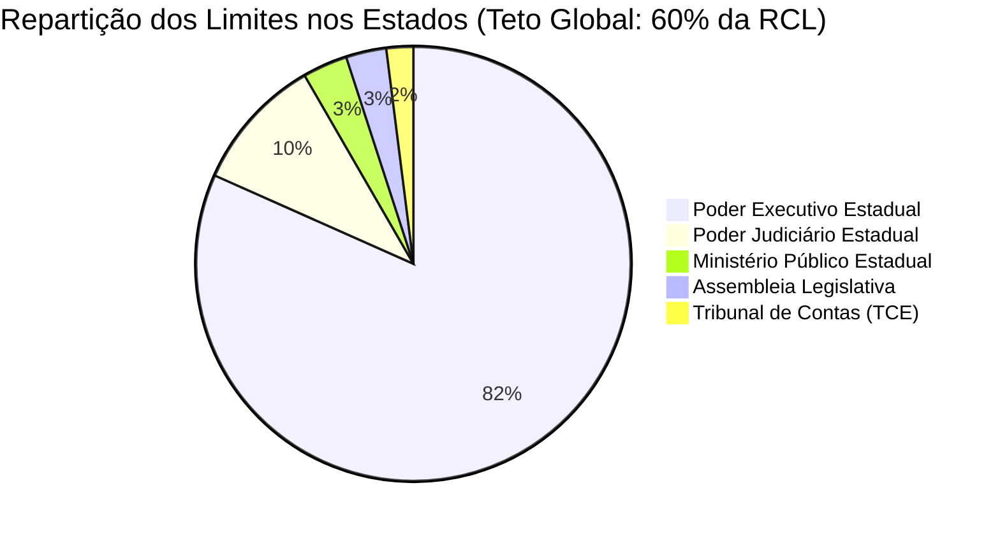
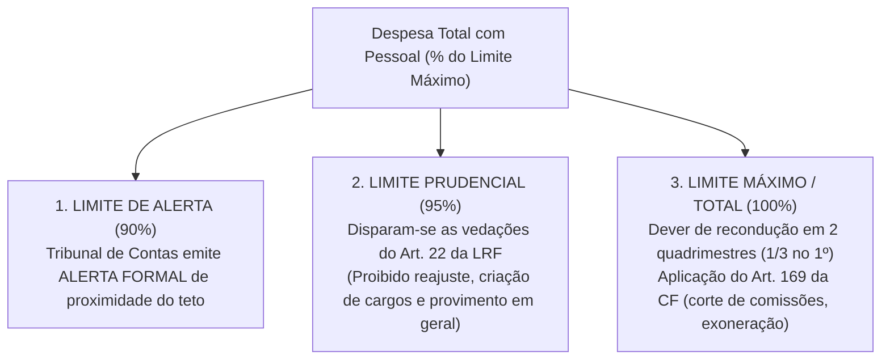

# 05 - Lei de Responsabilidade Fiscal (LRF), Despesa com Pessoal e Limites de Endividamento

> **Matéria:** Noções de Administração Financeira e Orçamentária (AFO)  
> **Cargo:** A01 – Técnico de Controle Externo – Especialidade: Técnico Administrativo  
> **Arquivo:** `05_lei_de_responsabilidade_fiscal_lrf_e_despesa_com_pessoal.md`  

---

## 📌 Ementa / Itens do Edital

- Lei de Responsabilidade Fiscal (Lei Complementar nº 101/2000): princípios fundamentais, planejamento, transparência, controle e responsabilidade na gestão fiscal;
- Despesa Obrigatória de Caráter Continuado (DOCC - Artigo 17 da LRF): conceito, requisitos para criação/aumento e medidas permanentes de compensação;
- Despesa Total com Pessoal (DTP - Artigos 18 a 23 da LRF):
  - Definição ampla de despesa com pessoal, parcelas computáveis e parcelas expressamente excluídas;
  - Base de cálculo: Receita Corrente Líquida (RCL) nos últimos doze meses (mês de referência + 11 anteriores);
  - Limites globais: União (50%), Estados (60%) e Municípios (60%);
  - Repartição dos limites nos Estados (60%): Poder Executivo (49%), Poder Judiciário (6%), Ministério Público (2%) e Poder Legislativo/TC (3%, sendo 1,8% Assembleia Legislativa e 1,2% TCE);
  - Limites operacionais: Limite de Alerta (90%), Limite Prudencial (95%) e Limite Total/Máximo (100%);
  - Vedações decorrentes do atingimento do limite prudencial (Artigo 22, parágrafo único);
  - Prazos e regras de recondução do excesso (Artigo 23 da LRF) e medidas constitucionais drásticas de corte (Artigo 169 da CF/88);
- Operações de crédito e endividamento público:
  - Conceito de operação de crédito e competência do Senado Federal para fixação de limites globais;
  - A "Regra de Ouro" orçamentária (Artigo 167, III da CF/88);
  - Operações de Crédito por Antecipação de Receita Orçamentária (ARO - Artigo 38 da LRF): requisitos estritos e proibições;
- Regras de gestão fiscal em final de mandato:
  - Vedação do Artigo 42 da LRF (assunção de obrigação financeira nos últimos dois quadrimestres sem disponibilidade de caixa);
  - Nulidade de atos que aumentem despesa com pessoal nos últimos 180 dias de mandato (Artigo 21, parágrafo único da LRF).

---

## 🌳 Classificação Hierárquica

```text
5. Lei de Responsabilidade Fiscal (LC 101/2000) e Limites Fiscais
├── 5.1 Princípios e Premissas da Gestão Fiscal Responsável
│   ├── 5.1.1 Ação planejada e transparente, prevenção de riscos e correção de desvios (Art. 1º, § 1º)
│   ├── 5.1.2 Garantia do equilíbrio fiscal e cumprimento de metas de resultado primário e nominal
│   └── 5.1.3 Instrumentos de Transparência Fiscal:
│       ├── Relatório Resumido da Execução Orçamentária - RREO: Bimestral (Art. 52)
│       └── Relatório de Gestão Fiscal - RGF: Quadrimestral (Art. 54)
├── 5.2 Despesa Obrigatória de Caráter Continuado (DOCC - Art. 17)
│   ├── 5.2.1 Conceito: Despesa corrente derivada de lei, MP ou ato que fixe obrigação legal por período superior a 2 anos
│   └── 5.2.2 Condições Cumulativas de Validade:
│       ├── Estimativa do impacto orçamentário-financeiro no exercício de início e nos dois seguintes (triênio)
│       ├── Declaração de compatibilidade com o PPA, LDO e LOA pelo ordenador
│       └── Medida de compensação financeira permanente (aumento permanente de receita ou redução permanente de despesa)
├── 5.3 Despesa Total com Pessoal (DTP - Arts. 18 a 23 da LRF)
│   ├── 5.3.1 Apuração: Período móvel de 12 meses (mês de apuração + 11 meses anteriores)
│   ├── 5.3.2 Base de Cálculo: Receita Corrente Líquida (RCL) do mesmo período
│   ├── 5.3.3 Limite Global nos Estados e DF: 60% da RCL
│   │   ├── Poder Executivo Estadual: 49,0%
│   │   ├── Poder Judiciário Estadual: 6,0%
│   │   ├── Ministério Público Estadual: 2,0%
│   │   └── Poder Legislativo Estadual: 3,0% (repartido em 1,8% ALEGO e 1,2% TCE-GO)
│   ├── 5.3.4 Limites de Controle e Gatilhos da LRF:
│   │   ├── Limite de Alerta (90% do teto): Notificação formal pelo Tribunal de Contas competente
│   │   ├── Limite Prudencial (95% do teto): Gatilhos imediatos do Art. 22, parágrafo único:
│   │   │   ├── Vedado conceder reajuste salarial, aumentos ou vantagens (salvo revisão geral anual)
│   │   │   ├── Vedada criação de cargos, empregos ou funções
│   │   │   ├── Vedada alteração de estrutura de carreira que aumente despesa
│   │   │   ├── Vedado provimento de cargos (salvo vacância em saúde, educação e segurança decorrente de morte/aposentadoria)
│   │   │   └── Vedada contratação de horas extras (salvo calamidade pública)
│   │   └── Limite Máximo / Total (100% do teto): Obrigatoriedade de eliminação do excedente nos 2 quadrimestres seguintes (1/3 no 1º)
│   └── 5.3.5 Medidas Constitucionais Sucessivas de Redução (Art. 169 da CF/88):
│       ├── 1º: Redução de pelo menos 20% das despesas com cargos em comissão e funções de confiança
│       ├── 2º: Exoneração dos servidores públicos não estáveis
│       └── 3º: Demissão de servidores públicos estáveis (com indenização prévia de 1 mês de remuneração por ano de serviço)
└── 5.4 Endividamento, Operações de Crédito e Fim de Mandato
    ├── 5.4.1 Regra de Ouro (CF/88, Art. 167, III): O montante das operações de crédito não pode exceder as despesas de capital
    ├── 5.4.2 Antecipação de Receita Orçamentária (ARO - Art. 38):
    │   ├── Finalidade exclusiva: Atender a insuficiências de caixa durante o ano
    │   ├── Prazo fatal de quitação: Até o dia 10 de dezembro do mesmo exercício
    │   └── Vedações absolutas: Enquanto houver ARO pendente e no último ano de mandato
    ├── 5.4.3 Regra do Fim de Mandato (Art. 42 da LRF):
    │   └── É vedado contrair obrigação de despesa nos últimos dois quadrimestres (8 meses) sem suficiente disponibilidade de caixa
    └── 5.4.4 Nulidade de Atos nos Últimos 180 Dias (Art. 21, parágrafo único): É nulo de pleno direito ato que aumente despesa de pessoal nos 180 dias anteriores ao fim do mandato
```

---

## 📖 Conteúdo Teórico Aprofundado

### 1. Repartição dos Limites de Despesa com Pessoal (Arts. 19 e 20 da LRF)

A Despesa Total com Pessoal (DTP) de cada ente federado não poderá ultrapassar, ao final de cada quadrimestre, os limites percentuais incidentes sobre a **Receita Corrente Líquida (RCL)**:



| Ente Federado | Limite Global Máximo | Poder Executivo | Poder Judiciário | Ministério Público | Poder Legislativo e Tribunais de Contas |
| :--- | :---: | :---: | :---: | :---: | :---: |
| **União** | **50%** | 40,9% | 6,0% | 0,6% | 2,5% (Câmara 1,4%, Senado 0,9%, TCU 0,2%) |
| **Estados e DF** | **60%** | **49,0%** | **6,0%** | **2,0%** | **3,0%** (Assembleia 1,8% e TCE 1,2%) |
| **Municípios** | **60%** | **54,0%** | *(Não há)* | *(Não há)* | **6,0%** (Câmara Municipal de Vereadores) |

> 🚨 **ALERTA DE PROVA / PEGADINHA FCC:**  
> A fatia destinada ao Poder Legislativo Estadual é de **3,0% da RCL**, mas ela abrange obrigatoriamente o Tribunal de Contas!  
> A repartição interna prevista no art. 20, II, "a" da LRF é:  
> - **Assembleia Legislativa:** **1,8%** da RCL;  
> - **Tribunal de Contas do Estado (TCE-GO):** **1,2%** da RCL.  
> A FCC adora inverter esses percentuais ou afirmar que o Tribunal de Contas integra a cota do Poder Judiciário. O TCE integra a cota do Poder Legislativo!

---

### 2. Os Três Limites de Controle e os Gatilhos Automáticos da LRF

A Lei de Responsabilidade Fiscal institui três patamares escalonados de monitoramento para a despesa de pessoal:



#### Vedações Imediatas do Limite Prudencial (Art. 22, Parágrafo Único da LRF)
Ao atingir 95% do limite máximo, o Poder ou órgão fica expressamente impedido de:
1. Conceder vantagem, aumento, reajuste ou adequação de remuneração a qualquer título (ressalvada a revisão geral anual do art. 37, X da CF);
2. Criar cargos, empregos ou funções;
3. Alterar estrutura de carreira que implique aumento de despesa;
4. Prover cargo público, admissão ou contratação de pessoal a qualquer título;
   > ⭐ **EXCEÇÃO CRÍTICA FCC:** É permitida a reposição decorrente de **aposentadoria ou falecimento de servidores das áreas de educação, saúde e segurança pública**!
5. Contratar hora extraordinária (salvo calamidade pública ou situações emergenciais expressamente justificadas).

#### Prazos de Recondução e Sanções Institucionais (Art. 23 da LRF)
- Se o Poder ou órgão ultrapassar 100% do limite máximo, deverá eliminar o excedente nos **dois quadrimestres seguintes**, sendo pelo menos **um terço (1/3) no primeiro quadrimestre**.
- Enquanto perdurar o excesso, o ente federativo submete-se às seguintes sanções fiscais:
  - Não pode receber **transferências voluntárias** de recursos;
  - Não pode obter garantia de outro ente federado;
  - Não pode contratar novas operações de crédito (salvo para refinanciar dívida mobiliária).

---

### 3. A Antecipação de Receita Orçamentária (ARO - Art. 38 da LRF)

A ARO é um contrato de crédito de curto prazo celebrado com instituições financeiras sujeito a restrições estritas:
- **Finalidade Única:** Atender exclusivamente a **insuficiência momentânea de caixa** durante o exercício financeiro;
- **Data-Limite de Quitação:** Deve ser liquidada integralmente, com juros e encargos, **até o dia 10 de dezembro de cada ano**;
- **Proibições Categóricas:**
  - Não pode ser realizada enquanto existir outra operação da mesma natureza pendente de liquidação;
  - Não pode ser contratada no **último ano de mandato** do Chefe do Poder Executivo.

---

### 4. Regras de Final de Mandato (Arts. 21 e 42 da LRF)

1. **A Regra do Artigo 42 da LRF (Últimos Dois Quadrimestres - 8 Meses):**
   > *"É vedado ao titular de Poder ou órgão referido no art. 20, nos últimos dois quadrimestres do seu mandato, contrair obrigação de despesa que não possa ser cumprida integralmente dentro dele, ou que tenha parcelas a serem pagas no exercício seguinte sem que haja suficiente disponibilidade de caixa para este efeito."*  
   - O descumprimento do Art. 42 constitui crime contra as finanças públicas punível com reclusão de 1 a 4 anos (**Artigo 359-C do Código Penal**).
2. **Nulidade de Atos nos Últimos 180 Dias (Artigo 21, Parágrafo Único):**  
   - É **nulo de pleno direito** qualquer ato que resulte em aumento da despesa com pessoal editado nos **cento e oitenta (180) dias anteriores ao final do mandato** do governante (Artigo 359-G do Código Penal).

---

## 🌐 Fontes Oficiais & Normativas Recomendadas

- [Lei Complementar Federal nº 101/2000 (Lei de Responsabilidade Fiscal)](https://www.planalto.gov.br/ccivil_03/leis/lcp/lcp101.htm)
  - Arts. 15 a 24 (Despesa Pública e Pessoal) e Arts. 29 a 42 (Endividamento e Final de Mandato).
- [Constituição da República Federativa do Brasil de 1988](https://www.planalto.gov.br/ccivil_03/constituicao/constituicao.htm)
  - Arts. 167 e 169 (Limites Constitucionais e Medidas de Saneamento da Folha de Pessoal).
- [Manual de Demonstrativos Fiscais (MDF) - 14ª Edição (STN)](https://www.tesourotransparente.gov.br)
  - Metodologia de cálculo da Receita Corrente Líquida e preenchimento do RGF.
- [Código Penal Brasileiro - Dos Crimes Contra as Finanças Públicas](https://www.planalto.gov.br/ccivil_03/decreto-lei/del2848compilado.htm)
  - Arts. 359-A a 359-H (Lei Federal nº 10.028/2000).

---

## 📝 Questões Comentadas no Padrão FCC

### Questão 1 (FCC - Adaptada / TCE-PI - Auditor de Controle Externo)
Determinado Estado da Federação, ao apurar o Relatório de Gestão Fiscal (RGF) ao término do segundo quadrimestre, verificou que as despesas com pessoal do Poder Executivo atingiram 96% do limite máximo legalmente fixado pela Lei de Responsabilidade Fiscal.

Diante da constatação da superação do limite prudencial, o Governador do Estado:

A) Deverá ser sumariamente afastado do cargo pelo Tribunal de Contas por crime de responsabilidade contra as finanças públicas.  
B) Poderá nomear novos servidores aprovados em concurso público para cargos administrativos recém-criados, desde que não haja impacto financeiro no exercício.  
C) Ficará impedido de conceder vantagem, aumento, reajuste ou adequação de remuneração a qualquer título aos servidores públicos, ressalvada a revisão geral anual.  
D) Terá o prazo de quatro quadrimestres para reconduzir a despesa ao limite prudencial, devendo demitir compulsoriamente os servidores estáveis no primeiro mês.  
E) Ficará automaticamente autorizado a contrair operações de crédito por antecipação de receita orçamentária para saldar a folha de pagamento.  

> **Gabarito: C**  
>
> **Análise detalhada de cada alternativa:**  
> - **A) INCORRETA:** O afastamento do governante não é ato sumário nem determinado monocraticamente pelo TC em virtude do mero alcance do limite prudencial.  
> - **B) INCORRETA:** O art. 22, parágrafo único, IV da LRF veda expressamente o provimento de cargos públicos e a admissão de novos servidores, admitindo apenas a reposição em saúde, educação e segurança decorrente de aposentadoria ou falecimento.  
> - **C) CORRETA:** Ao ultrapassar 95% do limite máximo (limite prudencial), entram em vigor imediato as vedações do art. 22, parágrafo único, I da LRF, sendo vedada a concessão de vantagem, aumento ou reajuste salarial, ressalvada unicamente a revisão geral anual (Art. 37, X da CF).  
> - **D) INCORRETA:** O prazo de recondução de dois quadrimestres aplica-se após a violação do limite máximo (100%), e a demissão de estáveis é a última das medidas constitucionais de saneamento.  
> - **E) INCORRETA:** É proibida a contratação de ARO para pagamento continuado de despesas correntes de pessoal.

---

### Questão 2 (FCC - Adaptada / TCE-RS - Auditor de Controle Externo)
A respeito das regras atinentes às Operações de Crédito por Antecipação de Receita Orçamentária (ARO) e às vedações do final de mandato disciplinadas na Lei Complementar nº 101/2000 (LRF), assinale a opção correta:

A) A ARO pode ser contratada a qualquer momento do último ano de mandato do governante, desde que aprovada por dois terços dos membros do Poder Legislativo.  
B) A operação de crédito por ARO destina-se a financiar despesas de capital de longo prazo, devendo ser amortizada no prazo de trinta e seis meses.  
C) É vedado ao titular de Poder contrair obrigação de despesa nos últimos dois quadrimestres do seu mandato sem que haja suficiente disponibilidade de caixa para o seu pagamento.  
D) A liquidação da ARO poderá ser postergada para o exercício seguinte caso a arrecadação tributária no mês de dezembro fique abaixo da média anual.  
E) A realização de ARO dispensa a cobrança de juros bancários por se tratar de operação de curto prazo de assistência mútua federativa.  

> **Gabarito: C**  
>
> **Análise detalhada de cada alternativa:**  
> - **A) INCORRETA:** O art. 38, IV, "b" da LRF proíbe terminantemente a realização de ARO no último ano de mandato do Chefe do Executivo.  
> - **B) INCORRETA:** A ARO tem por finalidade exclusiva cobrir insuficiência passageira de caixa no curso do exercício corrente (dívida flutuante de curto prazo).  
> - **C) CORRETA:** Reproduz fielmente a regra consagrada no art. 42 da LRF: é vedado contrair despesa nos últimos dois quadrimestres do mandato que não possa ser paga dentro dele ou que deixe parcelas sem suficiente disponibilidade financeira em caixa.  
> - **D) INCORRETA:** A ARO deve ser liquidada impreterivelmente até o dia **10 de dezembro** do mesmo exercício (art. 38, II).  
> - **E) INCORRETA:** A ARO é operação de crédito com remuneração financeira e encargos bancários normais.

---

### Questão 3 (FCC - Adaptada / Analista de Controle Externo - TCE-GO)
Consoante as normas da Lei de Responsabilidade Fiscal (LC nº 101/2000), a despesa total com pessoal do Poder Legislativo do Estado de Goiás, incluído o Tribunal de Contas do Estado, não poderá exceder determinado percentual da Receita Corrente Líquida (RCL).

A fatia global reservada pela LRF e sua respectiva repartição entre os órgãos do Legislativo goiano é de:

A) 6,0% da RCL, sendo 3,0% para a Assembleia Legislativa e 3,0% para o Tribunal de Contas.  
B) 3,0% da RCL, sendo 1,8% para a Assembleia Legislativa e 1,2% para o Tribunal de Contas do Estado (TCE-GO).  
C) 2,0% da RCL, sendo 1,0% para a Assembleia Legislativa e 1,0% para o Tribunal de Contas do Estado.  
D) 3,0% da RCL, cabendo 2,0% à Assembleia Legislativa e 1,0% ao Tribunal de Contas do Estado.  
E) 4,0% da RCL, com repartição disciplinada discricionariamente por ato conjunto dos Presidentes dos órgãos.  

> **Gabarito: B**  
>
> **Análise detalhada de cada alternativa:**  
> - **A) INCORRETA:** O limite global do Legislativo estadual é de 3% da RCL (6% é o limite do Legislativo municipal).  
> - **B) CORRETA:** Nos termos do art. 20, II, "a" da LRF, o limite de 3% da RCL atribuído ao Poder Legislativo estadual reparte-se da seguinte forma: **1,8% para a Assembleia Legislativa** e **1,2% para o Tribunal de Contas do Estado**.  
> - **C) INCORRETA:** 2,0% é o limite privativo do Ministério Público Estadual.  
> - **D) INCORRETA:** Erra a proporção interna fixada em lei (é 1,8% e 1,2%).  
> - **E) INCORRETA:** A partilha é de definição legal rígida fixada pela lei complementar federal.

---

### Questão 4 (FCC - Adaptada / Técnico de Controle Externo)
Ao término do primeiro quadrimestre do exercício, a unidade técnica do Tribunal de Contas apurou que as despesas com pessoal da Assembleia Legislativa atingiram 92% do seu limite máximo legal.

Nos termos do artigo 59, § 1º, inciso II da Lei Complementar nº 101/2000, diante dessa situação fática, compete ao Tribunal de Contas:

A) Determinar a imediata demissão de servidores comissionados para recomposição das metas fiscais.  
B) Emitir alerta formal ao Poder Legislativo informando que o montante da despesa com pessoal ultrapassou 90% do limite máximo legal.  
C) Declarar a indisponibilidade dos bens do Presidente da Mesa Diretora da Casa Legislativa.  
D) Proibir o Poder Executivo de realizar o repasse do duodécimo orçamentário constitucional.  
E) Decretar intervenção fiscal no parlamento com nomeação de interventor econômico.  

> **Gabarito: B**  
>
> **Análise detalhada de cada alternativa:**  
> - **A) INCORRETA:** Medidas drásticas de exoneração aplicam-se apenas após extrapolação do limite total (100%).  
> - **B) CORRETA:** Conforme o art. 59, § 1º, II da LRF, o Tribunal de Contas alertará o Poder ou órgão quando constatar que o montante da despesa total com pessoal ultrapassou **90% do limite máximo** (Limite de Alerta). Como o órgão atingiu 92%, cabe a expedição do **Alerta formal**.  
> - **C) INCORRETA:** Medida cautelar patrimonial desproporcional e sem respaldo legal para a hipótese de mero alerta.  
> - **D) INCORRETA:** O repasse dos duodécimos orçamentários até o dia 20 de cada mês é imposição constitucional cogente (Art. 168 da CF/88).  
> - **E) INCORRETA:** Inexiste previsão de intervenção fiscal no parlamento pelo Tribunal de Contas.

---

### Questão 5 (FCC - Adaptada / Analista de Planejamento e Orçamento)
Determinado Secretário de Estado pretende criar um novo programa social continuado de concessão de bolsas financeiras mensais a estudantes do ensino médio da rede pública estadual, com vigência estimada por tempo indeterminado.

Nos termos do artigo 17 da Lei de Responsabilidade Fiscal, por se tratar de Despesa Obrigatória de Caráter Continuado (DOCC), a criação desse programa exige:

A) Mera autorização na Lei Orçamentária Anual vigente, dispensando qualquer compensação financeira.  
B) Estimativa do impacto orçamentário-financeiro no exercício em que deva entrar em vigor e nos dois subsequentes, comprovação de que a despesa não afetará as metas de resultados fiscais e compensação permanente pelo aumento de receita ou redução permanente de despesa.  
C) Aprovação prévia unânime do Tribunal de Contas do Estado em sessão plenária extraordinária.  
D) Demonstração de superávit orçamentário no balanço geral da União dos últimos cinco exercícios.  
E) Declaração de nulidade de todos os contratos temporários em vigor na Secretaria de Educação.  

> **Gabarito: B**  
>
> **Análise detalhada de cada alternativa:**  
> - **A) INCORRETA:** A DOCC exige compensação permanente rigorosa, não bastando dotação simples na LOA.  
> - **B) CORRETA:** Conforme o art. 17, §§ 1º e 2º da LRF, os atos que criarem ou aumentarem Despesa Obrigatória de Caráter Continuado deverão ser instruídos com a estimativa do impacto orçamentário-financeiro no exercício de vigência e nos dois seguintes, declaração de compatibilidade com PPA/LDO/LOA e compensação permanente por meio de aumento contínuo de receita (elevação de tributos) ou redução permanente de outras despesas.  
> - **C) INCORRETA:** Tribunais de Contas exercem controle *a posteriori* e fiscalização concomitante, não emitindo autorização prévia unânime para criação de leis de políticas públicas.  
> - **D) INCORRETA:** A despesa é do Estado e depende de compensação no âmbito de suas próprias finanças.  
> - **E) INCORRETA:** Inexiste exigência de rescisão de contratos temporários para a criação da DOCC.
