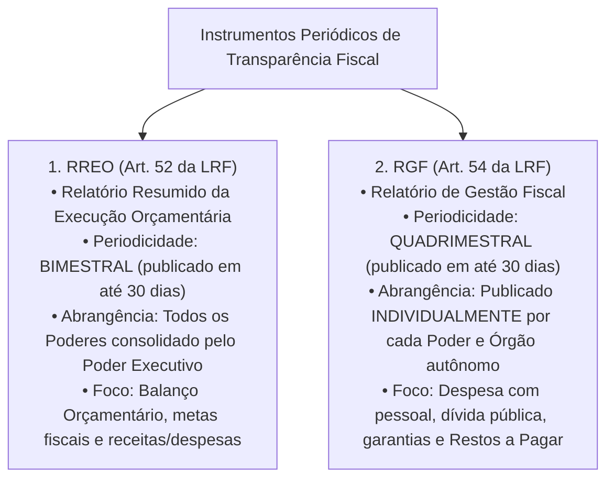
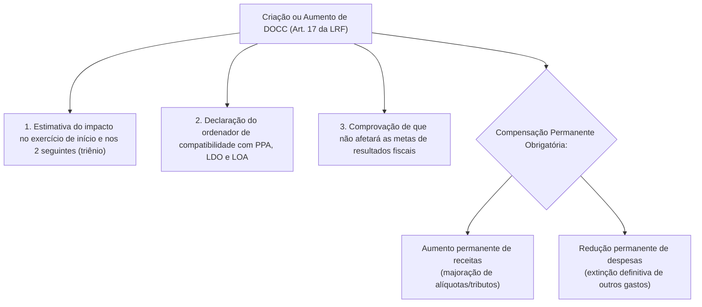
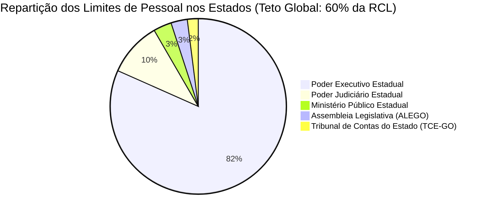
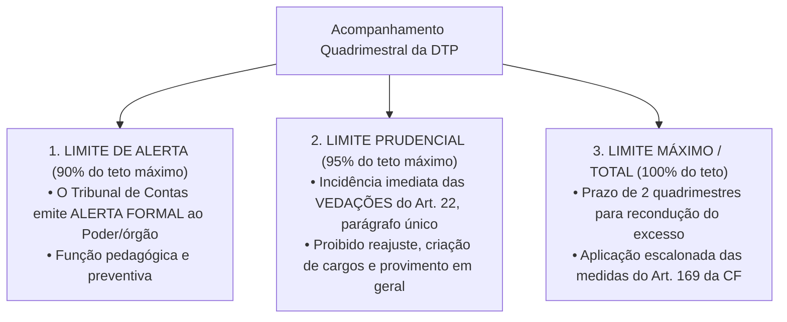
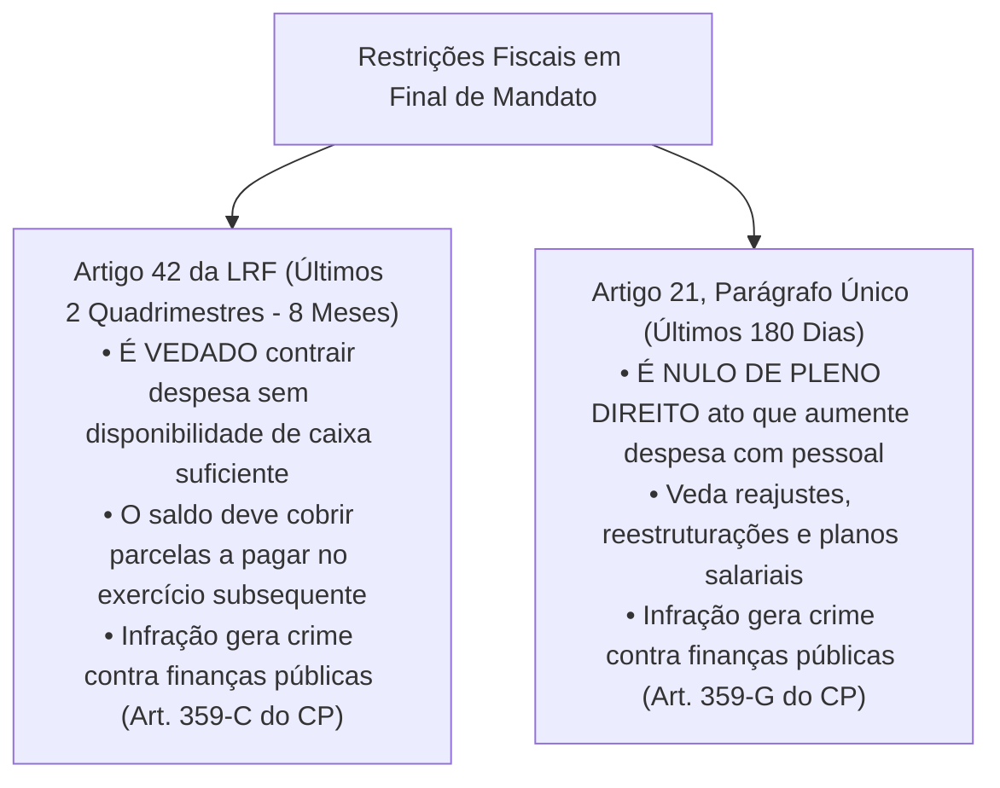

# 05 - Lei de Responsabilidade Fiscal (LRF), Despesa com Pessoal e Limites de Endividamento

> **Matéria:** Noções de Administração Financeira e Orçamentária (AFO)  
> **Cargo:** A01 – Técnico de Controle Externo – Especialidade: Técnico Administrativo  
> **Arquivo:** `05_lei_de_responsabilidade_fiscal_lrf_e_despesa_com_pessoal.md`  

---

## 📌 Ementa / Itens do Edital

- Lei de Responsabilidade Fiscal (Lei Complementar nº 101/2000): princípios fundamentais, planejamento, transparência, controle e responsabilidade na gestão fiscal;
- Despesa Obrigatória de Caráter Continuado (DOCC - Artigo 17 da LRF): conceito, requisitos para criação/aumento e medidas permanentes de compensação;
- Despesa Total com Pessoal (DTP - Artigos 18 a 23 da LRF):
    - Definição ampla de despesa com pessoal, parcelas computáveis e parcelas expressamente excluídas;
    - Base de cálculo: Receita Corrente Líquida (RCL) nos últimos doze meses (mês de referência + 11 anteriores);
    - Limites globais: União (50%), Estados (60%) e Municípios (60%);
    - Repartição dos limites nos Estados (60%): Poder Executivo (49%), Poder Judiciário (6%), Ministério Público (2%) e Poder Legislativo/TC (3%, sendo 1,8% Assembleia Legislativa e 1,2% TCE);
    - Limites operacionais: Limite de Alerta (90%), Limite Prudencial (95%) e Limite Total/Máximo (100%);
    - Vedações decorrentes do atingimento do limite prudencial (Artigo 22, parágrafo único);
    - Prazos e regras de recondução do excesso (Artigo 23 da LRF) e medidas constitucionais drásticas de corte (Artigo 169 da CF/88);
- Operações de crédito e endividamento público:
    - Conceito de operação de crédito e competência do Senado Federal para fixação de limites globais;
    - A "Regra de Ouro" orçamentária (Artigo 167, III da CF/88);
    - Operações de Crédito por Antecipação de Receita Orçamentária (ARO - Artigo 38 da LRF): requisitos estritos e proibições;
- Regras de gestão fiscal em final de mandato:
    - Vedação do Artigo 42 da LRF (assunção de obrigação financeira nos últimos dois quadrimestres sem disponibilidade de caixa);
    - Nulidade de atos que aumentem despesa com pessoal nos últimos 180 dias de mandato (Artigo 21, parágrafo único da LRF).

---

## 🧭 Sumário

1. [Fundamentos e Instrumentos de Transparência da LRF](#1-fundamentos-e-instrumentos-de-transparencia-da-lrf)
    1. [Premissas da Gestão Fiscal Responsável (Art. 1º, § 1º)](#11-premissas-da-gestao-fiscal-responsavel-art-1o-1o)
    2. [Os Relatórios Fiscais Obrigatórios: RREO e RGF](#12-os-relatorios-fiscais-obrigatorios-rreo-e-rgf)
    3. [Teste 250](#Teste-250)
2. [Despesa Obrigatória de Caráter Continuado (DOCC - Art. 17)](#2-despesa-obrigatoria-de-carater-continuado-docc-art-17)
    1. [Conceito Legal e Requisitos Formais](#21-conceito-legal-e-requisitos-formais)
    2. [Mecanismos Permanentes de Compensação Fiscal](#22-mecanismos-permanentes-de-compensacao-fiscal)
    3. [Teste 251](#Teste-251)
3. [Despesa Total com Pessoal (DTP) e Gatilhos de Controle](#3-despesa-total-com-pessoal-dtp-e-gatilhos-de-controle)
    1. [Conceito, Apuração Quadrimestral e Base da RCL](#31-conceito-apuracao-quadrimestral-e-base-da-rcl)
    2. [Repartição dos Limites Globais e a Cota do TCE-GO](#32-reparticao-dos-limites-globais-e-a-cota-do-tce-go)
    3. [Limite de Alerta, Prudencial e Máximo: Gatilhos e Vedações](#33-limite-de-alerta-prudencial-e-maximo-gatilhos-e-vedacoes)
    4. [Regras de Recondução e Medidas Constitucionais Sucessivas de Corte (Art. 169)](#34-regras-de-reconducao-e-medidas-constitucionais-sucessivas-de-corte-art-169)
    5. [Teste 252](#Teste-252)
    6. [Teste 253](#Teste-253)
    7. [Teste 254](#Teste-254)
    8. [Teste 255](#Teste-255)
    9. [Teste 256](#Teste-256)
4. [Endividamento, Regra de Ouro, ARO e Vedações de Fim de Mandato](#4-endividamento-regra-de-ouro-aro-e-vedacoes-de-fim-de-mandato)
    1. [A Regra de Ouro Orçamentária (Art. 167, III da CF/88)](#41-a-regra-de-ouro-orcamentaria-art-167-iii-da-cf88)
    2. [Regime das Operações de Crédito por ARO (Art. 38)](#42-regime-das-operacoes-de-credito-por-aro-art-38)
    3. [As Restrições Severas de Final de Mandato (Arts. 21 e 42 da LRF)](#43-as-restricoes-severas-de-final-de-mandato-arts-21-e-42-da-lrf)
    4. [Teste 257](#Teste-257)
    5. [Teste 258](#Teste-258)
    6. [Teste 259](#Teste-259)
5. [🌐 Fontes Oficiais & Normativas Recomendadas](#fontes-oficiais-normativas-recomendadas)

---

## 1. Fundamentos e Instrumentos de Transparência da LRF

### 1.1 Premissas da Gestão Fiscal Responsável (Art. 1º, § 1º)
A Lei Complementar Federal nº 101/2000 (Lei de Responsabilidade Fiscal - LRF) estabelece normas de finanças públicas voltadas para a responsabilidade na gestão fiscal, que pressupõe a **ação planejada e transparente**, em que se previnem riscos e corrigem desvios capazes de afetar o equilíbrio das contas públicas, mediante o cumprimento de metas de resultados entre receitas e despesas e a obediência a limites e condições no que tange a renúncia de receita, geração de despesas com pessoal, da seguridade social e outras, dívidas consolidada e mobiliária, operações de crédito, inclusive por antecipação de receita, concessão de garantia e inscrição em Restos a Pagar.

### 1.2 Os Relatórios Fiscais Obrigatórios: RREO e RGF
Para viabilizar a ampla fiscalização pela sociedade e pelos órgãos de controle externo (TCEs e Ministério Público de Contas), a LRF institui dois relatórios periódicos estruturantes:

---

### Teste 250
**(FCC - Adaptada / Analista de Planejamento e Orçamento)**
A Lei Complementar nº 101/2000 (LRF) estabelece dois instrumentos essenciais de transparência da gestão fiscal: o Relatório Resumido da Execução Orçamentária (RREO) e o Relatório de Gestão Fiscal (RGF).

Sobre a periodicidade de publicação e o alcance desses relatórios, assinale a afirmativa correta:

* **A)** O RREO é publicado bimestralmente pelo Poder Executivo (abrangendo todos os Poderes), enquanto o RGF é emitido quadrimestralmente por cada um dos Poderes e órgãos autônomos (Executivo, Legislativo, Judiciário e Ministério Público).
* **B)** O RGF é divulgado mensalmente apenas pela União, sendo os Estados e Municípios dispensados de sua elaboração quando tiverem população inferior a 500 mil habitantes em estrita conformidade com as normas legais e regulamentares aplicáveis.
* **C)** O RREO e o RGF são publicados anualmente em conjunto, exclusivamente como anexo integrante da prestação de contas do Governador ao Tribunal de Contas.
* **D)** O RGF abrange unicamente o demonstrativo das despesas com propaganda institucional e diárias de viagem no âmbito da administração pública direta e indireta.
* **E)** O descumprimento dos prazos de publicação do RREO não gera qualquer sanção institucional ao ente federado, possuindo natureza meramente orientativa.

---

> **Comentário Detalhado:**
>
> - **A)** Correta. O art. 52 da LRF determina a publicação do RREO até 30 dias após o encerramento de cada **bimestre** pelo Executivo (englobando todos os Poderes). O RGF (arts. 54 e 55 da LRF) é emitido ao final de cada **quadrimestre** por cada titular de Poder e órgão autônomo (com faculdade semestral para municípios com menos de 50 mil habitantes).
> - **B)** Incorreta. O RGF é obrigatório para todos os entes federados (União, Estados, DF e Municípios).
> - **C)** Incorreta. Os relatórios possuem periodicidades próprias infra-anuais (bimestral para RREO e quadrimestral para RGF).
> - **D)** Incorreta. O RGF demonstra despesa com pessoal, dívida consolidada, concessão de garantias, operações de crédito e restos a pagar.
> - **E)** Incorreta. O atraso na publicação do RREO e do RGF sujeita o ente ao impedimento de receber transferências voluntárias e contratar operações de crédito (art. 51, § 2º da LRF).
> 
> **Gabarito: A**

---

## 2. Despesa Obrigatória de Caráter Continuado (DOCC - Art. 17)

### 2.1 Conceito Legal e Requisitos Formais
A **Despesa Obrigatória de Caráter Continuado (DOCC)** é a despesa corrente derivada de lei, medida provisória ou ato administrativo normativo que fixe para o ente público a obrigação legal de sua execução por um **período superior a dois (2) anos** (art. 17, *caput* da LRF).

### 2.2 Mecanismos Permanentes de Compensação Fiscal
A criação ou aumento de DOCC submete-se a rígidas condições cumulativas de higidez fiscal, sob pena de nulidade absoluta do ato e caracterização de crime fiscal:

1. **Estimativa Trienal do Impacto Orçamentário-Financeiro:** Aferição do impacto financeiro no exercício em que deva entrar em vigor e nos dois subsequentes;
2. **Declaração do Ordenador de Despesas:** Demonstração expressa de que o aumento tem adequação orçamentária e financeira com a LOA e compatibilidade com o PPA e a LDO;
3. **Compensação Financeira Permanente:** O ato deve ser acompanhado de **medida de compensação financeira contínua**, efetivada por meio do:
    - Aumento permanente de receitas (elevação de alíquotas ou criação de novos tributos); OU
    - Redução permanente de despesas públicas preexistentes.

> 🚨 **ALERTA DE PROVA / PEGADINHA FCC:**  
> A banca frequentemente tenta igualar a compensação da DOCC com a da renúncia de receita. Na DOCC, **a compensação deve ser estritamente PERMANENTE**! Não basta indicar que há superávit temporário no ano corrente; o governante tem que aumentar receitas contínuas ou cortar outras despesas em caráter definitivo.

---

### Teste 251
**(FCC - Adaptada / Analista de Planejamento e Orçamento)**
Determinado Secretário de Estado pretende criar um novo programa social continuado de concessão de bolsas financeiras mensais a estudantes do ensino médio da rede pública estadual, com vigência estimada por tempo indeterminado.

Nos termos do artigo 17 da Lei de Responsabilidade Fiscal, por se tratar de Despesa Obrigatória de Caráter Continuado (DOCC), a criação desse programa exige:

* **A)** Mera autorização na Lei Orçamentária Anual vigente, dispensando qualquer compensação financeira.
* **B)** Estimativa do impacto orçamentário-financeiro no exercício em que deva entrar em vigor e nos dois subsequentes, comprovação de que a despesa não afetará as metas de resultados fiscais e compensação permanente pelo aumento de receita ou redução permanente de despesa.
* **C)** Aprovação prévia unânime do Tribunal de Contas do Estado em sessão plenária extraordinária no âmbito da administração pública direta e indireta no âmbito da administração pública direta e indireta.
* **D)** Demonstração de superávit orçamentário no balanço geral da União dos últimos cinco exercícios.
* **E)** Declaração de nulidade de todos os contratos temporários em vigor na Secretaria de Educação.

---

> **Comentário Detalhado:**
>
> - **A)** Incorreta. A DOCC impõe condicionantes rigorosas de validade que vão muito além da simples inclusão na LOA.
> - **B)** Correta. O art. 17 da LRF define que os atos que criarem ou aumentarem Despesa Obrigatória de Caráter Continuado (vigência superior a 2 anos) devem ser instruídos com estimativa de impacto orçamentário-financeiro no exercício de vigência e nos dois seguintes (triênio fiscal), declaração de compatibilidade com PPA/LDO/LOA, demonstração de não afetação de metas e compensação contínua permanente por aumento permanente de receitas ou redução permanente de outras despesas.
> - **C)** Incorreta. A atuação dos Tribunais de Contas é de controle externo concomitante e a posteriori, não cabendo aprovação unânime prévia de projetos de governo.
> - **D)** Incorreta. O programa é estadual e sua compensação opera-se dentro das finanças do próprio Estado de Goiás.
> - **E)** Incorreta. Inexiste qualquer exigência de rescisão arbitrária de contratos temporários regulares.
> 
> **Gabarito: B**

---

## 3. Despesa Total com Pessoal (DTP) e Gatilhos de Controle

### 3.1 Conceito, Apuração Quadrimestral e Base da RCL
- **Definição Ampla (Art. 18):** Entende-se por despesa total com pessoal o somatório dos gastos do ente com os ativos, inativos e pensionistas, relativos a mandatos eletivos, cargos, funções ou empregos, subsídios e vencimentos, vantagens fixas e variáveis, proventos de aposentadoria e pensões, adicionais, gratificações, horas extras, bem como encargos sociais e contribuições recolhidas pelo ente às entidades de previdência, além dos valores decorrentes de contratos de terceirização de mão de obra que substituam servidores de cargos vagos (art. 18, § 1º).
- **Base de Cálculo:** O somatório da **Receita Corrente Líquida (RCL)** do ente apurada no mês de referência e nos onze meses imediatamente anteriores (período móvel de 12 meses).

### 3.2 Repartição dos Limites Globais e a Cota do TCE-GO
A DTP de cada ente da Federação não poderá exceder os seguintes percentuais máximos da Receita Corrente Líquida:

- **União:** 50% da RCL;
- **Estados e Distrito Federal:** 60% da RCL;
- **Municípios:** 60% da RCL.

| Ente Federado | Limite Global Máximo | Poder Executivo | Poder Judiciário | Ministério Público | Poder Legislativo e Tribunais de Contas |
| :--- | :---: | :---: | :---: | :---: | :---: |
| **União** | **50%** | 40,9% | 6,0% | 0,6% | 2,5% (Câmara 1,4%, Senado 0,9%, TCU 0,2%) |
| **Estados e DF** | **60%** | **49,0%** | **6,0%** | **2,0%** | **3,0%** (Assembleia 1,8% e TCE 1,2%) |
| **Municípios** | **60%** | **54,0%** | *(Não há)* | *(Não há)* | **6,0%** (Câmara Municipal de Vereadores) |

> 🚨 **ALERTA DE PROVA / PEGADINHA FCC:**  
> A cota de **3,0% da RCL** reservada ao Poder Legislativo Estadual é dividida por lei de forma taxativa:  
>
> - **1,8%** para a Assembleia Legislativa;  
> - **1,2%** para o Tribunal de Contas do Estado (TCE-GO).  
> A banca frequentemente afirma que o Tribunal de Contas integra a cota do Judiciário (falso!) ou altera os percentuais para 1,5% e 1,5% (falso!).

### 3.3 Limite de Alerta, Prudencial e Máximo: Gatilhos e Vedações
A fiscalização do cumprimento dos limites de pessoal processa-se através de três patamares escalonados:

##### Vedações Expressas do Limite Prudencial (Art. 22, Parágrafo Único da LRF)
Ao atingir 95% do limite legal máximo, aplicam-se imediatamente ao Poder ou órgão as seguintes proibições:

1. Concessão de vantagem, aumento, reajuste ou adequação de remuneração a qualquer título (salvo revisão geral anual do art. 37, X da CF);
2. Criação de cargos, empregos ou funções públicas;
3. Alteração de estrutura de carreira que implique aumento de despesa;
4. Provimento de cargo público, admissão ou contratação de pessoal a qualquer título;
    - **Exceção Constitucional e Legal:** Permite-se a reposição decorrente de **aposentadoria ou falecimento de servidores das áreas de educação, saúde e segurança pública**!

5. Contratação de serviço extraordinário (horas extras), ressalvada situação de emergência e calamidade pública justificada.

### 3.4 Regras de Recondução e Medidas Constitucionais Sucessivas de Corte (Art. 169)
- Se a DTP ultrapassar o **Limite Máximo (100%)**, o excedente deverá ser integralmente eliminado nos **dois quadrimestres imediatamente seguintes**, devendo ser eliminado **pelo menos um terço (1/3) no primeiro quadrimestre** (art. 23 da LRF).
- **Medidas Sucessivas Obrigatórias do Art. 169, §§ 3º e 4º da CF/88:**
    1. **1º Passo:** Redução de pelo menos **20% (vinte por cento)** das despesas com cargos em comissão e funções de confiança;
    2. **2º Passo:** Exoneração dos servidores públicos **não estáveis** (admitidos sem concurso antes da CF/88 ou em estágio probatório);
    3. **3º Passo:** Se as duas medidas anteriores forem insuficientes, poderá haver a **demissão de servidores públicos estáveis**, mediante processo administrativo individual fundamentado, cabendo ao servidor indenização pecuniária correspondente a 1 (um) mês de remuneração por ano de serviço prestado.

---

### Teste 252
**(FCC - Adaptada / Analista de Controle Externo - TCE-GO)**
Consoante as normas da Lei de Responsabilidade Fiscal (LC nº 101/2000), a despesa total com pessoal do Poder Legislativo do Estado de Goiás, incluído o Tribunal de Contas do Estado, não poderá exceder determinado percentual da Receita Corrente Líquida (RCL).

A fatia global reservada pela LRF e sua respectiva repartição entre os órgãos do Legislativo goiano é de:

* **A)** 6,0% da RCL, sendo 3,0% para a Assembleia Legislativa e 3,0% para o Tribunal de Contas no âmbito da administração pública direta e indireta.
* **B)** 3,0% da RCL, sendo 1,8% para a Assembleia Legislativa e 1,2% para o Tribunal de Contas do Estado (TCE-GO).
* **C)** 2,0% da RCL, sendo 1,0% para a Assembleia Legislativa e 1,0% para o Tribunal de Contas do Estado.
* **D)** 3,0% da RCL, cabendo 2,0% à Assembleia Legislativa e 1,0% ao Tribunal de Contas do Estado.
* **E)** 4,0% da RCL, com repartição disciplinada discricionariamente por ato conjunto dos Presidentes dos órgãos.

---

> **Comentário Detalhado:**
>
> - **A)** Incorreta. O limite global estadual do Legislativo é de 3% (o limite de 6% é aplicável às Câmaras Municipais).
> - **B)** Correta. De acordo com o art. 20, inciso II, alínea "a" da Lei de Responsabilidade Fiscal, a cota de 3,0% da Receita Corrente Líquida destinada ao Poder Legislativo Estadual é repartida em 1,8% para a Assembleia Legislativa e 1,2% para o Tribunal de Contas do Estado (TCE-GO).
> - **C)** Incorreta. O limite de 2,0% pertence ao Ministério Público Estadual.
> - **D)** Incorreta. A repartição legal correta é exatamente 1,8% para a ALEGO e 1,2% para o TCE-GO.
> - **E)** Incorreta. A repartição decorre de norma expressa da lei complementar nacional, não de ato discricionário interno.
> 
> **Gabarito: B**

---

### Teste 253
**(FCC - Adaptada / TCE-PI - Auditor de Controle Externo)**
Determinado Estado da Federação, ao apurar o Relatório de Gestão Fiscal (RGF) ao término do segundo quadrimestre, verificou que as despesas com pessoal do Poder Executivo atingiram 96% do limite máximo legalmente fixado pela Lei de Responsabilidade Fiscal.

Diante da constatação da superação do limite prudencial, o Governador do Estado:

* **A)** Deverá ser sumariamente afastado do cargo pelo Tribunal de Contas por crime de responsabilidade contra as finanças públicas no âmbito da administração pública direta e indireta.
* **B)** Poderá nomear novos servidores aprovados em concurso público para cargos administrativos recém-criados, desde que não haja impacto financeiro no exercício.
* **C)** Ficará impedido de conceder vantagem, aumento, reajuste ou adequação de remuneração a qualquer título aos servidores públicos, ressalvada a revisão geral anual.
* **D)** Terá o prazo de quatro quadrimestres para reconduzir a despesa ao limite prudencial, devendo demitir compulsoriamente os servidores estáveis no primeiro mês.
* **E)** Ficará automaticamente autorizado a contrair operações de crédito por antecipação de receita orçamentária para saldar a folha de pagamento.

---

> **Comentário Detalhado:**
>
> - **A)** Incorreta. O Tribunal de Contas não tem competência para decretar monocraticamente o afastamento sumário de governadores em virtude do atingimento do limite prudencial.
> - **B)** Incorreta. O art. 22, parágrafo único, IV da LRF proíbe expressamente o provimento de cargos públicos e contratação de pessoal quando atingido o limite prudencial, abrindo exceção apenas para reposição em saúde, educação e segurança por morte ou aposentadoria.
> - **C)** Correta. Ao ultrapassar o limite prudencial de 95% do teto máximo de pessoal, disparam-se automaticamente as vedações do art. 22, parágrafo único da LRF, dentre as quais a vedação categórica de concessão de vantagens, aumentos ou reajustes de remuneração, ressalvada tão somente a revisão geral anual do art. 37, X da CF/88.
> - **D)** Incorreta. O prazo de recondução de dois quadrimestres aplica-se à superação do limite total (100%), e a demissão de estáveis é a última das medidas extremas do art. 169 da CF.
> - **E)** Incorreta. É vedada a contratação de ARO para financiar despesas de pessoal.
> 
> **Gabarito: C**

---

### Teste 254
**(FCC - Adaptada / Técnico de Controle Externo)**
Ao término do primeiro quadrimestre do exercício, a unidade técnica do Tribunal de Contas apurou que as despesas com pessoal da Assembleia Legislativa atingiram 92% do seu limite máximo legal.

Nos termos do artigo 59, § 1º, inciso II da Lei Complementar nº 101/2000, diante dessa situação fática, compete ao Tribunal de Contas:

* **A)** Determinar a imediata demissão de servidores comissionados para recomposição das metas fiscais.
* **B)** Emitir alerta formal ao Poder Legislativo informando que o montante da despesa com pessoal ultrapassou 90% do limite máximo legal.
* **C)** Declarar a indisponibilidade dos bens do Presidente da Mesa Diretora da Casa Legislativa.
* **D)** Proibir o Poder Executivo de realizar o repasse do duodécimo orçamentário constitucional.
* **E)** Decretar intervenção fiscal no parlamento com nomeação de interventor econômico em conformidade com as normas legais e regulamentares aplicáveis.

---

> **Comentário Detalhado:**
>
> - **A)** Incorreta. A redução de 20% das comissões só é exigível após o transcurso do prazo de descumprimento do limite total (100%).
> - **B)** Correta. Conforme o art. 59, § 1º, II da LRF, o Tribunal de Contas alertará formalmente o respectivo Poder ou órgão sempre que constatar que o montante da despesa total com pessoal ultrapassou 90% do limite máximo (Limite de Alerta). Tendo atingido 92%, a medida técnica imediata é a expedição de Alerta.
> - **C)** Incorreta. Medida cautelar patrimonial desproporcional e inexistente para mera situação de alerta.
> - **D)** Incorreta. O repasse dos duodécimos constitucionais até o dia 20 de cada mês (art. 168 da CF) é imperativo e insuscetível de retenção unilateral.
> - **E)** Incorreta. Inexiste figura de intervenção fiscal no parlamento pelo órgão de contas.
> 
> **Gabarito: B**

---

### Teste 255
**(FCC - Adaptada / TCE-PI - Auditor de Controle Externo)**
Na hipótese de a Despesa Total com Pessoal (DTP) de determinado Poder ou órgão autônomo estadual ultrapassar o limite máximo fixado na LRF, a Constituição Federal de 1988 (art. 169, §§ 3º e 4º) e a própria LRF impõem medidas sucessivas e escalonadas para o retorno aos limites.

A ordem constitucional obrigatória das medidas de corte é:

* **A)** 1º - Redução de pelo menos 20% das despesas com cargos em comissão e funções de confiança; 2º - Exoneração de servidores não estáveis; 3º - Se as medidas anteriores não forem suficientes, perda do cargo pelo servidor público estável.
* **B)** 1º - Demissão sumária de servidores públicos estáveis; 2º - Redução proporcional de salários dos magistrados; 3º - Extinção de fundos constitucionais.
* **C)** 1º - Suspensão do pagamento de proventos a aposentados; 2º - Extinção de órgãos públicos; 3º - Corte de despesas de capital em saúde e educação no âmbito da administração pública direta e indireta no âmbito da administração pública direta e indireta.
* **D)** 1º - Exoneração imediata de servidores aprovados em concurso recente; 2º - Demissão de ocupantes de cargos comissionados; 3º - Aumento compulsório da alíquota do ICMS.
* **E)** 1º - Devolução voluntária de subsídios pelos Chefes de Poder; 2º - Congelamento da inflação; 3º - Limitação exclusiva das despesas de investimento.

---

> **Comentário Detalhado:**
>
> - **A)** Correta. O art. 169, §§ 3º e 4º da CF/88 estabelece a ordem cronológica estrita de providências: 1) redução em pelo menos 20% das despesas com comissionados e funções de confiança; 2) se não bastar, exoneração dos servidores não estáveis; 3) se ainda assim não alcançar o equilíbrio, o servidor estável poderá perder o cargo mediante processo administrativo em que lhe seja assegurada ampla defesa, fazendo jus a indenização de 1 mês por ano de serviço.
> - **B)** Incorreta. Atingir servidor estável é medida extrema e residual (última etapa), jamais primeira.
> - **C)** Incorreta. Proventos de aposentadoria gozam de garantia constitucional irredutível.
> - **D)** Incorreta. A primeira etapa atinge cargos em comissão e funções de confiança, não servidores concursados.
> - **E)** Incorreta. Não existe previsão constitucional de tais medidas nessa ordem.
> 
> **Gabarito: A**

---

### Teste 256
**(FCC - Adaptada / TCE-SC - Auditor de Controle Externo)**
Em determinado Estado da Federação, apurou-se que a Despesa Total com Pessoal do Poder Executivo atingiu 96% do limite máximo legalmente admitido pela Lei de Responsabilidade Fiscal (limite prudencial ultrapassado).

Diante dessa situação fática, o Poder Executivo estadual está expressamente VEDADO de:

* **A)** Conceder vantagem, aumento, reajuste ou adequação de remuneração a qualquer título, salvo os derivados de sentença judicial ou de determinação legal ou contratual anterior, bem como criar cargo, emprego ou função.
* **B)** Pagar a folha normal de salários e os proventos regulares de aposentadoria e pensão dos servidores já existentes.
* **C)** Efetuar qualquer tipo de empenho orçamentário destinado à manutenção de escolas e hospitais estaduais.
* **D)** Arrecadar tributos estaduais inscritos em dívida ativa e ajuizar execuções fiscais no âmbito da administração pública direta e indireta no âmbito da administração pública direta e indireta.
* **E)** Publicar o Relatório Resumido da Execução Orçamentária e as prestações de contas constitucionais.

---

> **Comentário Detalhado:**
>
> - **A)** Correta. O art. 22, parágrafo único da LRF estabelece que, ao ultrapassar o limite prudencial (95% do limite máximo), aplicam-se proibições imediatas ao órgão: vedada concessão de vantagens/aumentos/reajustes (salvo decisão judicial ou lei anterior), criação de cargos, alteração de estruturas de carreira que impliquem aumento de despesa, provimento de cargo público (ressalvada reposição em saúde, educação e segurança por aposentadoria/falecimento) e contratação de hora extra.
> - **B)** Incorreta. O pagamento da folha regular existente permanece obrigatório.
> - **C)** Incorreta. As despesas de custeio e funcionamento de serviços essenciais continuam normais.
> - **D)** Incorreta. A atividade arrecadatória é dever funcional vinculado do Estado.
> - **E)** Incorreta. A transparência fiscal é mantida e reforçada nesse cenário.
> 
> **Gabarito: A**

---

## 4. Endividamento, Regra de Ouro, ARO e Vedações de Fim de Mandato

### 4.1 A Regra de Ouro Orçamentária (Art. 167, III da CF/88)
A Constituição Federal consagra a célebre "Regra de Ouro" das finanças públicas:
$$\text{Operações de Crédito Realizadas no Exercício} \le \text{Despesas de Capital Fixadas na LOA}$$

- **Objetivo Econômico:** Impedir que o governante contraia empréstimos públicos ou emita títulos soberanos para pagar despesas correntes de manutenção (salários e diárias), endividando as gerações futuras sem criar capital ou infraestrutura física durável.
- **Ressalva Constitucional:** É admitida a realização de operações de crédito em montante superior às despesas de capital caso seja autorizada pelo Poder Legislativo mediante **créditos adicionais suplementares ou especiais com finalidade precisa**, aprovados por **maioria absoluta** dos votos dos membros do parlamento.

### 4.2 Regime das Operações de Crédito por ARO (Art. 38)
A Antecipação de Receita Orçamentária (ARO) é uma operação de crédito de curto prazo autorizada pelo art. 165, § 8º da CF/88 e regulada estritamente pelo art. 38 da LRF:

- **Finalidade Exclusiva:** Suprir insuficiência passageira de caixa ao longo do exercício orçamentário;
- **Prazo Fatal de Resgate:** Deve ser integralmente liquidada, com juros e encargos contratuais, **até o dia 10 de dezembro de cada ano**;
- **Proibições Insuperáveis:**
    - É proibida nova ARO enquanto existir outra da mesma natureza pendente de liquidação integral;
    - É **terminantemente proibida no último ano de mandato** do governante.

### 4.3 As Restrições Severas de Final de Mandato (Arts. 21 e 42 da LRF)

1. **Artigo 42 da LRF (Últimos 8 Meses do Mandato):** É vedado ao titular de Poder ou órgão, nos últimos dois quadrimestres do seu mandato, contrair obrigação de despesa que não possa ser cumprida integralmente dentro dele, ou que tenha parcelas a serem pagas no exercício seguinte sem que haja suficiente disponibilidade de caixa para este efeito. O descumprimento sujeita o governante ao crime do art. 359-C do Código Penal (pena de reclusão de 1 a 4 anos).
2. **Artigo 21, Parágrafo Único da LRF (Últimos 180 Dias):** É nulo de pleno direito o ato que resulte em aumento da despesa com pessoal editado nos cento e oitenta dias anteriores ao final do mandato do titular do respectivo Poder ou órgão. O descumprimento configura o crime do art. 359-G do Código Penal.

---

### Teste 257
**(FCC - Adaptada / TCE-RS - Auditor de Controle Externo)**
A respeito das regras atinentes às Operações de Crédito por Antecipação de Receita Orçamentária (ARO) e às vedações do final de mandato disciplinadas na Lei Complementar nº 101/2000 (LRF), assinale a opção correta:

* **A)** A ARO pode ser contratada a qualquer momento do último ano de mandato do governante, desde que aprovada por dois terços dos membros do Poder Legislativo.
* **B)** A operação de crédito por ARO destina-se a financiar despesas de capital de longo prazo, devendo ser amortizada no prazo de trinta e seis meses.
* **C)** É vedado ao titular de Poder contrair obrigação de despesa nos últimos dois quadrimestres do seu mandato sem que haja suficiente disponibilidade de caixa para o seu pagamento.
* **D)** A liquidação da ARO poderá ser postergada para o exercício seguinte caso a arrecadação tributária no mês de dezembro fique abaixo da média anual.
* **E)** A realização de ARO dispensa a cobrança de juros bancários por se tratar de operação de curto prazo de assistência mútua federativa no âmbito da administração pública direta e indireta.

---

> **Comentário Detalhado:**
>
> - **A)** Incorreta. O art. 38, IV, "b" da LRF proíbe terminantemente a contratação de operações por ARO no último ano de mandato do governante.
> - **B)** Incorreta. ARO é mecanismo de curto prazo para cobrir insuficiência momentânea de fluxo de caixa, e não para financiar despesas de capital de longo prazo.
> - **C)** Correta. Trata-se da regra expressa do art. 42 da LRF: é vedado ao governante, nos últimos dois quadrimestres do mandato (últimos 8 meses), assumir obrigação financeira que não possa ser paga dentro dele ou que deixe parcelas para o ano seguinte sem suficiente saldo de caixa disponível.
> - **D)** Incorreta. A data de resgate final da ARO é improrrogável: deve ser liquidada até o dia 10 de dezembro do mesmo exercício financeiro.
> - **E)** Incorreta. Operações de crédito bancário de ARO sujeitam-se às taxas de juros contratuais de mercado.
> 
> **Gabarito: C**

---

### Teste 258
**(FCC - Adaptada / Analista Jurídico de Controle)**
O art. 167, inciso III da Constituição Federal de 1988 estabelece o princípio conhecido pela doutrina e jurisprudência como a **"Regra de Ouro"** das finanças públicas brasileiras.

Segundo a Regra de Ouro constitucional:

* **A)** É vedada a realização de operações de créditos que excedam o montante das despesas de capital, ressalvadas as autorizadas mediante créditos suplementares ou especiais com finalidade precisa, aprovados pelo Poder Legislativo por maioria absoluta.
* **B)** As receitas tributárias correntes devem superar em pelo menos 50% todas as despesas com juros e encargos da dívida pública consolidada.
* **C)** É obrigatória a destinação de 10% da receita de impostos para a constituição de reserva monetária em ouro no Banco Central do Brasil.
* **D)** Nenhuma dívida pública fundada poderá ultrapassar o prazo de amortização de dez anos sem autorização unânime do Senado Federal.
* **E)** Os precatórios judiciais alimentares gozam de preferência absoluta de saque em relação a qualquer outro dispêndio estatal no âmbito da administração pública direta e indireta em estrita conformidade com as normas legais e regulamentares aplicáveis.

---

> **Comentário Detalhado:**
>
> - **A)** Correta. É o teor literal do art. 167, III da CF/88. A finalidade da Regra de Ouro é impedir que o Estado financie despesas correntes de custeio diário com endividamento público (empréstimos), exigindo que o crédito obtido financie despesas de capital (investimentos), ressalvada autorização legislativa especial por maioria absoluta.
> - **B)** Incorreta. Trata-se de formulação sem respaldo constitucional.
> - **C)** Incorreta. Não existe exigência de lastro em metal ouro na gestão orçamentária hodierna.
> - **D)** Incorreta. Os limites da dívida consolidada são fixados por resolução do Senado Federal com base no art. 52 da CF/88.
> - **E)** Incorreta. Embora precatórios tenham preferência no art. 100 da CF/88, não é essa a definição da Regra de Ouro.
> 
> **Gabarito: A**

---

### Teste 259
**(FCC - Adaptada / TCE-GO - Analista de Controle Externo)**
Nos termos do art. 42 da Lei de Responsabilidade Fiscal (LC nº 101/2000), aplicável aos governantes dos Poderes Executivo, Legislativo e Judiciário em fim de mandato:

* **A)** É vedado ao titular de Poder ou órgão contrair obrigação de despesa que não possa ser cumprida integralmente dentro dos últimos dois quadrimestres do seu mandato, ou que tenha parcelas a serem pagas no exercício seguinte sem que haja suficiente disponibilidade de caixa para este efeito.
* **B)** É permitida a contratação de quaisquer despesas continuadas, desde que os empenhos sejam cancelados no primeiro dia útil do mandato do sucessor.
* **C)** Os contratos administrativos firmados nos últimos oito meses do mandato ficam automaticamente rescindidos sem direito a indenização no âmbito da administração pública direta e indireta no âmbito da administração pública direta e indireta.
* **D)** As restrições de final de mandato atingem exclusivamente o Presidente da República e os Governadores de Estado, não se aplicando aos Prefeitos Municipais.
* **E)** O descumprimento do art. 42 da LRF constitui mera irregularidade formal de gestão, sem repercussão na esfera penal do ordenador de despesas.

---

> **Comentário Detalhado:**
>
> - **A)** Correta. É a redação expressa do art. 42 da LRF: veda contrair despesa nos últimos dois quadrimestres (8 meses) do mandato sem suficiente disponibilidade de caixa para saldá-la ou cobrir parcelas no exercício subsequente.
> - **B)** Incorreta. A vedação visa justamente evitar o cancelamento abusivo de restos a pagar e a transmissão de déficits ao sucessor.
> - **C)** Incorreta. Contratos regulares não são rescindidos automaticamente; o que se proíbe é contrair obrigações sem lastro de caixa.
> - **D)** Incorreta. Aplica-se a todos os titulares de Poder e órgão de todas as esferas federativas.
> - **E)** Incorreta. O descumprimento do art. 42 da LRF configura o crime tipificado no art. 359-C do Código Penal (pena de reclusão de 1 a 4 anos).
> 
> **Gabarito: A**

---

## 🌐 Fontes Oficiais & Normativas Recomendadas

* [Lei Complementar nº 101/2000 (Lei de Responsabilidade Fiscal)](https://www.planalto.gov.br/ccivil_03/leis/lcp/lcp101.htm) - Texto integral da LRF detalhando limites globais e setoriais com despesa total com pessoal (DTP), limites prudenciais e de alerta.
* [Constituição Federal de 1988 - Art. 169 (Limites de Despesa de Pessoal)](https://www.planalto.gov.br/ccivil_03/constituicao/constituicao.htm#art165) - Medidas constitucionais para redução de despesas com cargos em comissão e servidores estáveis em caso de extrapolação de limites.
* [Tesouro Transparente - Relatórios de Gestão Fiscal (RGF e RREO)](https://www.tesourotransparente.gov.br/publicacoes/manual-de-contabilidade-aplicada-ao-setor-publico-mcasp/2024/26) - Manuais e demonstrativos fiscais obrigatórios previstos na LRF.
* [Lei Estadual nº 16.168/2007 (Fiscalização da LRF pelo TCE-GO)](https://legisla.casacivil.go.gov.br/pesquisa_legislacao/86708/lei-16168) - Competência do Tribunal de Contas para fiscalizar o cumprimento das metas fiscais e limites de gastos de pessoal nos órgãos estaduais.
* [TCE-GO - Resultados e Pareceres de Contas de Governo](https://portal.tce.go.gov.br/prestacao-de-contas) - Acompanhamento dos demonstrativos da Lei de Responsabilidade Fiscal pelo TCE-GO.
* PALUDO, Augustinho. **Orçamento Público, AFO e LRF**. 11. ed. Salvador: JusPodivm, 2022. (Cap. 10 - Despesas com Pessoal na LRF; Cap. 14 - Relatórios da LRF: RREO e RGF).
* MOTA, Francisco Glauber Lima. **Contabilidade Aplicada ao Setor Público**. 2. ed. Brasília: Gestão Pública, 2018. (Cap. 8 - A Lei de Responsabilidade Fiscal e o Equilíbrio Orçamentário).
* GIACOMONI, James. **Orçamento Público**. 18. ed. São Paulo: Atlas, 2021. (Cap. 11 - A Lei de Responsabilidade Fiscal).
