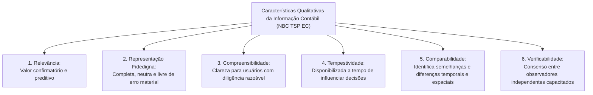
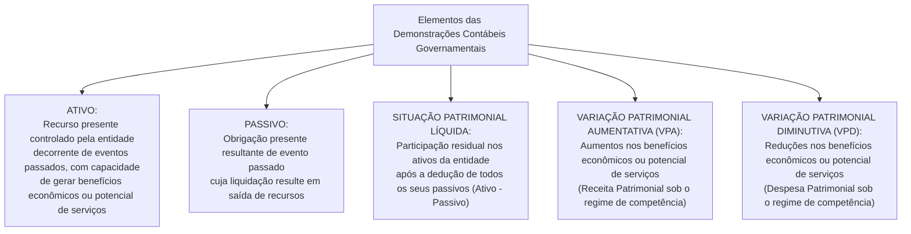

# 01 - NBC TSP Estrutura Conceitual e Normas Gerais no Setor Público

> **Matéria:** Contabilidade Aplicada ao Setor Público (CASP)  
> **Cargo:** A01 – Técnico de Controle Externo – Especialidade: Técnico Administrativo  
> **Arquivo:** `01_nbc_tsp_estrutura_conceitual_e_normas_gerais.md`  


---


## 📌 Ementa / Itens do Edital

- Normas Brasileiras de Contabilidade Aplicadas ao Setor Público (NBC TSP): processo de convergência às normas internacionais IPSAS (*International Public Sector Accounting Standards*);
- NBC TSP Estrutura Conceitual:
    - Usuários primários da informação contábil governamental: cidadãos, seus representantes políticos (parlamentares e Tribunais de Contas) e provedores de recursos;
    - Objetivos dos Relatórios Contábeis de Propósito Geral das Entidades do Setor Público (RCPGs): prestação de contas (*accountability*) e tomada de decisão;
    - Características qualitativas da informação contábil: relevância, representação fidedigna, compreensibilidade, tempestividade, comparabilidade e verificabilidade;
    - Restrições inerentes à informação: materialidade, custo-benefício e alcance do equilíbrio entre características;
- Elementos das demonstrações contábeis patrimoniais:
    - Ativo sob o enfoque patrimonial e o conceito distintivo de **potencial de serviços**;
    - Passivo, Situação Patrimonial Líquida, Receita (Variação Patrimonial Aumentativa - VPA) e Despesa (Variação Patrimonial Diminutiva - VPD) sob a ótica da competência pura;
- Critérios e bases de mensuração de ativos e passivos:
    - Bases para Ativos: custo histórico, valor de mercado, custo de reposição ou substituição, preço líquido de venda e valor em uso;
    - Bases para Passivos: custo histórico, custo de cumprimento da obrigação, valor de mercado, custo de liberação e preço de assunção;
- Visão geral das normas específicas fundamentais:
    - NBC TSP 03: Provisões, Passivos Contingentes e Ativos Contingentes (matriz de probabilidade de desembolso);
    - NBC TSP 04: Estoques e mensuração de itens mantidos para distribuição gratuita na rede pública;
    - NBC TSP 07: Ativo Imobilizado, mensuração e depreciação periódica;
    - NBC TSP 34: Sistema de Informação de Custos no Setor Público.

---

## 🧭 Sumário

1. [O Enfoque Patrimonial da Contabilidade Pública e a Convergência IPSAS](#1-o-enfoque-patrimonial-da-contabilidade-publica-e-a-convergencia-ipsas)
    1. [Evolução: Do Enfoque Orçamentário ao Patrimonial Integrado](#11-evolucao-do-enfoque-orcamentario-ao-patrimonial-integrado)
    2. [O Conceito Crítico de "Potencial de Serviços"](#12-o-conceito-critico-de-potencial-de-servicos)
    3. [Usuários Primários e Objetivos Centrais dos RCPGs](#13-usuarios-primarios-e-objetivos-centrais-dos-rcpgs)
    4. [Teste 260](#Teste-260)
    5. [Teste 261](#Teste-261)
2. [Características Qualitativas da Informação Contábil Útil (NBC TSP EC)](#2-caracteristicas-qualitativas-da-informacao-contabil-util-nbc-tsp-ec)
    1. [As Seis Características Qualitativas](#21-as-seis-caracteristicas-qualitativas)
    2. [Restrições Inerentes: Custo-Benefício e Materialidade](#22-restricoes-inerentes-custo-beneficio-e-materialidade)
    3. [Teste 262](#Teste-262)
    4. [Teste 263](#Teste-263)
3. [Elementos das Demonstrações Contábeis e Bases de Mensuração](#3-elementos-das-demonstracoes-contabeis-e-bases-de-mensuracao)
    1. [Elementos Patrimoniais: Ativo, Passivo, SPL, VPA e VPD](#31-elementos-patrimoniais-ativo-passivo-spl-vpa-e-vpd)
    2. [Bases de Mensuração para Ativos e Passivos](#32-bases-de-mensuracao-para-ativos-e-passivos)
    3. [Teste 264](#Teste-264)
4. [Normas Específicas Fundamentais no Padrão FCC](#4-normas-especificas-fundamentais-no-padrao-fcc)
    1. [Matriz de Provisões e Passivos Contingentes (NBC TSP 03)](#41-matriz-de-provisoes-e-passivos-contingentes-nbc-tsp-03)
    2. [Mensuração de Estoques Públicos para Distribuição Gratuita (NBC TSP 04)](#42-mensuracao-de-estoques-publicos-para-distribuicao-gratuita-nbc-tsp-04)
    3. [Ativo Imobilizado e Depreciação Sistemática (NBC TSP 07)](#43-ativo-imobilizado-e-depreciacao-sistematica-nbc-tsp-07)
    4. [Teste 265](#Teste-265)
    5. [Teste 266](#Teste-266)
    6. [Teste 267](#Teste-267)
    7. [Teste 268](#Teste-268)
    8. [Teste 269](#Teste-269)
5. [🌐 Fontes Oficiais & Normativas Recomendadas](#fontes-oficiais-normativas-recomendadas)

---

## 1. O Enfoque Patrimonial da Contabilidade Pública e a Convergência IPSAS

### 1.1 Evolução: Do Enfoque Orçamentário ao Patrimonial Integrado
Historicamente, a contabilidade governamental brasileira sob a égide da Lei Federal nº 4.320/1964 priorizou o **enfoque orçamentário** (controle de legalidade de créditos, empenhos e arrecadação de tributos), adotando um regime misto: caixa para as receitas e competência para as despesas (art. 35 da Lei nº 4.320/1964).

Com o processo de convergência às normas internacionais do setor público (**IPSAS** - *International Public Sector Accounting Standards*), emitidas pelo *International Public Sector Accounting Standards Board* (IPSASB) e traduzidas no Brasil pelo Conselho Federal de Contabilidade (CFC) como **NBC TSP** em articulação com a Secretaria do Tesouro Nacional (STN), consolidou-se o **enfoque patrimonial pleno**:


- O registro contábil patrimonial independe da execução orçamentária: o reconhecimento de bens, direitos e obrigações ocorre no momento do **fato gerador** (regime de competência), gerando Variações Patrimoniais Aumentativas (VPA) e Variações Patrimoniais Diminutivas (VPD);
- A dimensão orçamentária e a patrimonial coexistem de forma harmônica e integrada por meio do Plano de Contas Aplicado ao Setor Público (PCASP).

### 1.2 O Conceito Crítico de "Potencial de Serviços"
No setor empresarial privado, um item é classificado como ativo porque tem o potencial de gerar lucros e fluxos futuros de caixa positivos para os acionistas.

No setor público, a grande maioria dos ativos controlados pelo Estado (escolas públicas, postos de saúde, pontes, praças, viaturas policiais e sistemas de esgoto) não se destina a gerar lucro financeiro, mas sim a **atender necessidades coletivas e prestar serviços públicos gratuitos ou subsidiados à sociedade**.  
Por essa razão, a Estrutura Conceitual da NBC TSP introduziu o conceito de **potencial de serviços**:
> *"Potencial de serviços é a capacidade de gerar serviços que contribuam para alcançar os objetivos da entidade pública, sem necessariamente gerar fluxos de caixa líquidos positivos."*

### 1.3 Usuários Primários e Objetivos Centrais dos RCPGs
Conforme a NBC TSP Estrutura Conceitual, os Relatórios Contábeis de Propósito Geral das Entidades do Setor Público (RCPGs) destinam-se a atender às necessidades comuns dos seguintes **usuários primários**:

1. **Cidadãos e usuários de serviços públicos:** Avaliam a gestão dos recursos públicos, a sustentabilidade intergeracional e a qualidade dos serviços ofertados (controle social);
2. **Representantes políticos:** Parlamentares da Assembleia Legislativa, vereadores e os órgãos de controle externo (**Tribunais de Contas**), que necessitam de informações fidedignas para o julgamento das contas e a fiscalização orçamentária e financeira;
3. **Provedores de recursos:** Contribuintes tributários, credores, investidores e organismos multilaterais de crédito (BID, BIRD) que financiam o Estado.

- **Os Dois Objetivos Centrais dos RCPGs:**
    - Fornecer informações úteis para a **prestação de contas e responsabilização (*accountability*)**;
    - Fornecer subsídios técnicos indispensáveis para a **tomada de decisão** sobre a alocação de recursos públicos.

---

### Teste 260
**(FCC - Adaptada / Analista Contábil)**
A respeito do conceito de Ativo no setor público preconizado na NBC TSP Estrutura Conceitual, assinale a opção correta:

* **A)** A capacidade de um bem público gerar fluxos futuros de caixa positivos é requisito indispensável para sua classificação como ativo governamental.
* **B)** Um recurso pode ser reconhecido como ativo no setor público quando a entidade possui o controle do recurso, decorrente de evento passado, e do qual se espera a geração de benefícios econômicos ou potencial de serviços.
* **C)** Bens de uso comum do povo, como rodovias e praças públicas, não podem ser classificados como ativos patrimoniais em virtude de sua inalienabilidade civil.
* **D)** A titularidade da propriedade jurídica formal é elemento obrigatório e insubstituível para o reconhecimento de qualquer ativo no setor público.
* **E)** Os ativos intangíveis desenvolvidos pelo ente público são vedados na contabilidade governamental por ausência de valor físico tangível.


---

> **Comentário Detalhado:**
>
> - **A)** Incorreta. No setor público, a esmagadora maioria dos bens não gera fluxos de caixa positivos, mas gera potencial de serviços essenciais à coletividade.
> - **B)** Correta. Reproduz a definição clássica da NBC TSP EC: ativo é um recurso controlado no presente pela entidade em decorrência de eventos passados, do qual se espera a geração de benefícios econômicos futuros ou potencial de serviços.
> - **C)** Incorreta. Bens de uso comum do povo integram o patrimônio público e compõem o Ativo Não Circulante (Imobilizado de infraestrutura) quando controlados pelo ente.
> - **D)** Incorreta. O elemento central para o reconhecimento é o controle econômico e não a propriedade jurídica formal, prevalecendo a primazia da essência econômica sobre a forma jurídica (ex.: arrendamento mercantil financeiro).
> - **E)** Incorreta. Ativos intangíveis (sistemas de TI, softwares, licenças) são plenamente reconhecidos no Ativo Não Circulante (Intangível) conforme a NBC TSP 08.
> 
> **Gabarito: B**

---

### Teste 261
**(FCC - Adaptada / Analista Contábil)**
De acordo com a NBC TSP Estrutura Conceitual, a informação contábil no setor público destina-se primordialmente a suprir as necessidades de informação dos usuários primários dos Relatórios Contábeis de Propósito Geral das Entidades do Setor Público (RCPGs).

São considerados usuários primários dos RCPGs:

* **A)** Os usuários dos serviços públicos e seus representantes (cidadãos, membros do Poder Legislativo) e os provedores de recursos (contribuintes, doadores, credores por empréstimos).
* **B)** Exclusivamente os auditores de controle externo dos Tribunais de Contas e os contadores públicos responsáveis pelo fechamento do balanço.
* **C)** Unicamente as agências internacionais de classificação de risco de crédito soberano (ratings).
* **D)** Apenas os secretários de fazenda e os dirigentes máximos das entidades do Poder Executivo.
* **E)** As sociedades empresárias privadas concorrentes que participam de processos licitatórios governamentais.


---

> **Comentário Detalhado:**
>
> - **A)** Correta. A NBC TSP Estrutura Conceitual define expressamente como **usuários primários dos RCPGs**: (1) os usuários de serviços e seus representantes (cidadãos e parlamentares); e (2) os provedores de recursos e seus representantes (contribuintes, doadores, financiadores e credores).
> - **B)** Incorreta. Auditores e contadores são usuários institucionais e reguladores, mas os usuários primários são os cidadãos e provedores de recursos para fins de prestação de contas (*accountability*) e tomada de decisão.
> - **C)** Incorreta. Agências de rating são usuários secundários ou específicos.
> - **D)** Incorreta. Gestores públicos utilizam relatórios de gestão gerencial interna; os RCPGs destinam-se a usuários externos que não têm poder para exigir relatórios customizados.
> - **E)** Incorreta. Licitantes não figuram no rol dos usuários primários conceituais dos RCPGs.
> 
> **Gabarito: A**

---

## 2. Características Qualitativas da Informação Contábil Útil (NBC TSP EC)

As características qualitativas são atributos indispensáveis que tornam as informações contidas nos RCPGs úteis para os usuários na tomada de decisão e na prestação de contas:



### 2.1 As Seis Características Qualitativas
1. **Relevância:** A informação é relevante se for capaz de influenciar as decisões dos usuários, auxiliando-os a avaliar eventos passados, presentes ou futuros (valor preditivo) ou confirmando/alterando avaliações prévias (valor confirmatório).
2. **Representação Fidedigna:** A informação deve retratar com fidelidade a substância econômica das transações. Para ser fidedigna, a representação deve ser **completa, neutra e livre de erro material** (a neutralidade implica a ausência de viés na seleção ou apresentação dos dados).
3. **Compreensibilidade:** Qualidade que permite aos usuários com conhecimento razoável do setor público e disposição para estudar as demonstrações compreender prontamente o significado das informações contábeis.  
   > 🚨 **Atenção:** Informações complexas e essenciais à governança jamais devem ser omitidas sob o pretexto de tornar o relatório "simples" ou acessível!
4. **Tempestividade:** Significa disponibilizar a informação aos tomadores de decisão antes que ela perca sua capacidade de influenciar decisões. Uma informação contábil perfeita, mas disponibilizada com anos de atraso, perde sua utilidade gerencial.
5. **Comparabilidade:** Permite aos usuários identificar semelhanças e diferenças entre diferentes entidades governamentais no mesmo período (comparabilidade espacial) ou em relação à mesma entidade ao longo de exercícios sucessivos (comparabilidade temporal). Requer consistência na aplicação de políticas e planos de contas.
6. **Verificabilidade:** Qualidade que assegura aos usuários que a informação representa fidedignamente o que se propõe a representar, possibilitando que diferentes auditores e observadores independentes e capacitados cheguem a um consenso razoável sobre a exatidão das conclusões.

### 2.2 Restrições Inerentes: Custo-Benefício e Materialidade
- **Custo-Benefício:** Os benefícios derivados da informação devem exceder os custos decorrentes de sua coleta, processamento e divulgação.
- **Materialidade:** A informação é material se a sua omissão ou distorção puder influenciar o julgamento ou as decisões dos usuários dos RCPGs. A materialidade depende da natureza ou da magnitude do item no contexto orçamentário e patrimonial específico.

---

### Teste 262
**(FCC - Adaptada / TCE-RS - Auditor de Controle Externo)**
A Estrutura Conceitual das Normas Brasileiras de Contabilidade Aplicadas ao Setor Público (NBC TSP EC) estabelece as características qualitativas da informação contábil incluída nos Relatórios Contábeis de Propósito Geral das Entidades do Setor Público (RCPGs).

A característica qualitativa que permite aos usuários identificar semelhanças e diferenças entre itens e fenômenos econômicos, seja entre diferentes entidades do setor público, seja em relação à mesma entidade ao longo de períodos contábeis consecutivos, denomina-se:

* **A)** Compreensibilidade.
* **B)** Comparabilidade.
* **C)** Tempestividade.
* **D)** Representação fidedigna.
* **E)** Verificabilidade.


---

> **Comentário Detalhado:**
>
> - **A)** Incorreta. Compreensibilidade é a qualidade que possibilita a rápida compreensão do significado da informação contábil por usuários com conhecimento razoável.
> - **B)** Correta. A Comparabilidade é definida textualmente na NBC TSP EC como a característica qualitativa que permite aos usuários identificar semelhanças e diferenças entre itens, cobrindo tanto a comparação temporal (mesma entidade ao longo de exercícios sucessivos) quanto a comparação espacial (entre diferentes órgãos e entidades públicas).
> - **C)** Incorreta. Tempestividade refere-se à disponibilização da informação em tempo oportuno para influenciar julgamentos e decisões.
> - **D)** Incorreta. Representação fidedigna significa retratar com completude, neutralidade e ausência de erro material a substância dos eventos econômicos.
> - **E)** Incorreta. Verificabilidade é a qualidade que assegura que diferentes observadores independentes e capacitados cheguem a um consenso razoável sobre a informação apresentada.
> 
> **Gabarito: B**

---

### Teste 263
**(FCC - Adaptada / TCE-SC - Auditor de Controle Externo)**
Na NBC TSP Estrutura Conceitual, as características qualitativas são atributos que tornam a informação contida nos RCPGs útil para os usuários. Considere as seguintes características:

I. **Relevância:** A informação é relevante se for capaz de influenciar as decisões dos usuários, tendo valor confirmatório, preditivo ou ambos.  
II. **Representação Fidedigna:** Para ser fidedigna, a informação deve ser completa, neutra e livre de erro material, retratando fielmente a substância econômica da transação e não apenas sua forma jurídica.  
III. **Compreensibilidade:** Pressupõe que os relatórios contábeis públicos sejam simplificados a ponto de dispensar qualquer conhecimento prévio dos usuários sobre economia e finanças governamentais.

Está correto o que se afirma em:

* **A)** I, apenas.
* **B)** I e II, apenas.
* **C)** II e III, apenas.
* **D)** I e III, apenas.
* **E)** I, II e III.


---

> **Comentário Detalhado:**
>
> - **I. Correto.** A relevância é característica qualitativa fundamental caracterizada pelo valor confirmatório e/ou preditivo.
> - **II. Correto.** A representação fidedigna exige que a informação seja completa, neutra e isenta de erro material, com primazia da substância sobre a forma.
> - **III. Incorreto.** A compreensibilidade permite que a informação seja facilmente compreendida por usuários que tenham conhecimento razoável das atividades do setor público e do ambiente econômico, e que se disponham a estudar a informação com razoável diligência. Não se eliminam informações complexas e relevantes apenas sob o argumento de que seriam difíceis de compreender por leigos absolutos.
> 
> **Gabarito: B**

---

## 3. Elementos das Demonstrações Contábeis e Bases de Mensuração

### 3.1 Elementos Patrimoniais: Ativo, Passivo, SPL, VPA e VPD
A Estrutura Conceitual define os seguintes elementos constitutivos dos relatórios patrimoniais:



### 3.2 Bases de Mensuração para Ativos e Passivos
A mensuração consiste no processo de determinar os valores monetários pelos quais os elementos serão reconhecidos nas demonstrações contábeis.

| Base de Mensuração | Aplicação a Ativos | Aplicação a Passivos |
| :--- | :--- | :--- |
| **Custo Histórico** | Montante de caixa fornecido para adquirir ou construir o ativo. | Montante de recursos recebidos para assumir a obrigação no passado. |
| **Valor de Mercado** | Montante pelo qual um ativo pode ser trocado entre partes conhecedoras, dispostas e em condições normais de mercado. | Montante pelo qual o passivo poderia ser liquidado entre partes independentes. |
| **Custo de Reposição / Substituição** | Custo mais econômico exigido para a entidade substituir o **potencial de serviços** do ativo na data de mensuração. | *(Não aplicável nesta forma conceitual)* |
| **Valor em Uso** | Valor presente do potencial de serviços remanescente do ativo ao longo de sua vida útil remanescente. | *(Não aplicável)* |
| **Custo de Cumprimento** | *(Não aplicável)* | Custos que a entidade pública incorrerá para satisfazer as obrigações assumidas com terceiros. |
| **Preço de Assunção** | *(Não aplicável)* | Valor monetário que um terceiro independente exigiria para assumir formalmente a obrigação da entidade. |

---

### Teste 264
**(FCC - Adaptada / Analista de Planejamento e Orçamento)**
No que concerne às bases de mensuração para ativos e passivos segundo a NBC TSP Estrutura Conceitual, assinale a opção correta:

* **A)** O custo histórico é uma base de mensuração a valor de saída que reflete o preço que seria recebido pela venda de um ativo no mercado aberto.
* **B)** O custo de reposição ou substituição é uma base de mensuração a valor de entrada que reflete o custo mais econômico exigido para a entidade substituir o potencial de serviços de um ativo na data das demonstrações contábeis.
* **C)** O valor justo é uma medida específica da entidade que independe das condições de transação entre participantes do mercado.
* **D)** O valor em uso de um ativo reflete o valor presente dos fluxos de caixa futuros descontados, aplicável exclusivamente a ativos geradores de caixa do setor público.
* **E)** Todos os passivos públicos devem ser obrigatoriamente mensurados pelo custo histórico original, sendo vedada qualquer avaliação pelo preço de liquidação.


---

> **Comentário Detalhado:**
>
> - **A)** Incorreta. O custo histórico é uma base de mensuração a valor de **entrada** (reflete a transação original passada).
> - **B)** Correta. O **custo de reposição/substituição** (*depreciated replacement cost*) é uma base de mensuração a valor de entrada amplamente utilizada no setor público para ativos não geradores de caixa, correspondendo ao custo mais econômico para substituir o potencial de serviços do ativo.
> - **C)** Incorreta. O valor justo é mensuração baseada no mercado (preço de saída), e não medida específica da entidade.
> - **D)** Incorreta. No setor público, o valor em uso também se aplica a ativos não geradores de caixa através da mensuração do valor presente do potencial de serviços remanescente do ativo.
> - **E)** Incorreta. Passivos podem ser mensurados pelo custo histórico, custo de cumprimento da obrigação (*fulfillment cost*) ou valor de mercado/liquidação.
> 
> **Gabarito: B**

---

## 4. Normas Específicas Fundamentais no Padrão FCC

### 4.1 Matriz de Provisões e Passivos Contingentes (NBC TSP 03)
A aplicação contábil de ações judiciais e litígios contra o Poder Público submete-se à matriz de probabilidade estipulada na NBC TSP 03:

```mermaid
flowchart TD
    Litigio["Litígio / Obrigação Presente Incerta contra o Estado"] --> Avaliacao{"Qual o grau de probabilidade de desembolso futuro?"}
    
    Avaliacao -->|PROVÁVEL (> 50%)| Prov["RECONHECE PROVISÃO NO PASSIVO<br/>Lançamento contábil imediato no Balanço:<br/>D: Variação Patrimonial Diminutiva (VPD)<br/>C: Provisão (Passivo Circulante ou Não Circulante)<br/>+ Divulgação completa em Notas Explicativas"]
    
    Avaliacao -->|POSSÍVEL (Incerta)| Conting["PASSIVO CONTINGENTE<br/>• NÃO faz lançamento contábil no Balanço Patrimonial!<br/>• OBRIGATÓRIA DIVULGAÇÃO em Notas Explicativas!"]
    
    Avaliacao -->|REMOTA (< 5%)| Remota["PROBABILIDADE REMOTA<br/>• NÃO reconhece no Balanço Patrimonial!<br/>• NÃO divulga em Notas Explicativas! (Inação contábil)"]
```

> 🚨 **ALERTA DE PROVA / PEGADINHA FCC:**  
> A banca frequentemente tenta confundir o candidato afirmando que um risco **possível** deve ser registrado no Balanço Patrimonial. **FALSO!**  
>
> - Apenas o evento **provável** com valor estimável com segurança gera lançamento contábil no Balanço (Provisão);  
> - O risco **possível** é apenas divulgado em Notas Explicativas (**Passivo Contingente**);  
> - O risco **remoto** é sumariamente ignorado (sem registro e sem nota explicativa).

### 4.2 Mensuração de Estoques Públicos para Distribuição Gratuita (NBC TSP 04)
- **Regra Mercantil Comum:** Estoques são avaliados pelo menor valor entre o custo histórico e o valor realizável líquido (preço estimado de venda menos despesas de concretização).
- **Regra Específica do Setor Público (Distribuição Gratuita):**  
  Quando os estoques forem mantidos para **distribuição gratuita ou por valor simbólico** (ex.: medicamentos e vacinas do SUS, kits de merenda escolar, livros didáticos), eles devem ser mensurados pelo **menor valor entre o custo histórico de aquisição e o CUSTO CORRENTE DE REPOSIÇÃO**!  
  *(Fundamento: como esses bens públicos não se destinam à venda comercial, o conceito de "preço de venda/valor realizável líquido" é economicamente inaplicável).*

### 4.3 Ativo Imobilizado e Depreciação Sistemática (NBC TSP 07)
- **Mensuração Inicial:** O ativo imobilizado é reconhecido inicialmente pelo seu custo histórico (preço de aquisição somado a todas as despesas diretamente atribuíveis para colocar o bem em condições operacionais de uso).
- **Depreciação Periódica:** Consiste na alocação sistemática do valor depreciável de um bem ativo ao longo de sua vida útil estimada. Reconhece-se a perda de potencial de serviços por uso, desgaste natural ou obsolescência tecnológica:
    - **Lançamento Contábil:**
    - `D` - Variação Patrimonial Diminutiva (VPD - Depreciação);
    - `C` - Depreciação Acumulada (Conta retificadora do Ativo Imobilizado).

---

### Teste 265
**(FCC - Adaptada / TCE-PI - Auditor de Controle Externo)**
A Procuradoria-Geral de determinado Estado foi intimada de ação judicial de grande repercussão econômica proposta por consórcio de empreiteiras cobrando reequilíbrio econômico-financeiro de contrato de obras. O departamento jurídico do Estado avaliou o risco de perda da ação judicial como **provável** e mensurou com segurança razoável o valor do desembolso futuro estimado em R$ 15.000.000,00.

Consoante as disposições da NBC TSP 03 e do Manual de Contabilidade Aplicada ao Setor Público (MCASP):

* **A)** O Estado não deve efetuar nenhum registro contábil nem em notas explicativas até o trânsito em julgado irrecorrível da decisão judicial condenatória.
* **B)** A entidade deve divulgar a informação exclusivamente em notas explicativas, sem efetuar quaisquer lançamentos contábeis no Balanço Patrimonial.
* **C)** A entidade pública deve reconhecer uma provisão no Passivo, em contrapartida a uma Variação Patrimonial Diminutiva (VPD) no resultado do exercício.
* **D)** A perda potencial deve ser reconhecida como despesa orçamentária imediatamente no estágio da fixação da Lei Orçamentária Anual.
* **E)** Trata-se de um ativo contingente cujo ingresso de recursos deve ser registrado preventivamente no subsistema orçamentário.


---

> **Comentário Detalhado:**
>
> - **A)** Incorreta. O regime de competência contábil exige o registro tempestivo da obrigação presente assim que o fato gerador e os critérios de probabilidade se consolidem, não aguardando o trânsito em julgado formal.
> - **B)** Incorreta. A divulgação exclusiva em notas explicativas aplica-se aos passivos contingentes com risco de perda possível, e não provável.
> - **C)** Correta. De acordo com a NBC TSP 03 e o MCASP, existindo uma obrigação presente resultante de evento passado cuja liquidação implique saída de recursos classificada como provável e o valor possa ser estimado com confiabilidade técnica, a entidade pública deve reconhecer formalmente uma Provisão no Passivo, lançando a débito uma Variação Patrimonial Diminutiva (VPD) no resultado do exercício patrimonial.
> - **D)** Incorreta. A provisão é ato estritamente patrimonial, não transitando pela fixação de créditos orçamentários da LOA nem exigindo nota de empenho imediata.
> - **E)** Incorreta. Litígio judicial que exige desembolso de recursos configura potencial passivo e não ativo contingente.
> 
> **Gabarito: C**

---

### Teste 266
**(FCC - Adaptada / Auditor de Controle Externo)**
Em determinado processo judicial em trâmite na Justiça do Trabalho contra uma autarquia estadual, a assessoria jurídica emitiu parecer formal classificando o risco de condenação e perda patrimonial da entidade como **possível**, sem possibilidade de definição precisa de valores no momento.

Em observância à NBC TSP 03 e ao MCASP, a conduta contábil adequada a ser adotada pela autarquia é:

* **A)** Reconhecer imediatamente uma provisão no Passivo Não Circulante pelo valor estimado pelo autor da ação.
* **B)** Não efetuar lançamento contábil de provisão no Balanço Patrimonial, divulgando as informações relevantes sobre o passivo contingente em Notas Explicativas.
* **C)** Deixar de efetuar qualquer lançamento contábil e dispensar a divulgação em notas explicativas em virtude do princípio do sigilo processual.
* **D)** Registrar uma Variação Patrimonial Aumentativa para neutralizar o impacto financeiro futuro.
* **E)** Solicitar abertura imediata de crédito adicional extraordinário para cobertura judicial.


---

> **Comentário Detalhado:**
>
> - **A)** Incorreta. O reconhecimento de provisão no Balanço Patrimonial é cabível apenas e tão somente quando o risco de saída de recursos for classificado como provável.
> - **B)** Correta. De acordo com a NBC TSP 03, quando a probabilidade de desembolso futuro for classificada como possível, a obrigação consubstancia um Passivo Contingente: não deve ser reconhecida no Balanço Patrimonial, mas deve ser compulsoriamente divulgada em Notas Explicativas, especificando a natureza da ação e as incertezas existentes.
> - **C)** Incorreta. A dispensa de notas explicativas ocorre unicamente quando a probabilidade de perda for remota.
> - **D)** Incorreta. Ação indenizatória contra a entidade jamais configurará VPA (ganho patrimonial).
> - **E)** Incorreta. Crédito extraordinário destina-se exclusivamente a calamidades, guerra e comoção interna.
> 
> **Gabarito: B**

---

### Teste 267
**(FCC - Adaptada / Analista de Gestão Pública - Contabilidade)**
No âmbito do setor público, a Secretaria de Estado da Saúde de Goiás mantém em seus depósitos centrais vultosos estoques de vacinas e medicamentos essenciais destinados exclusivamente à distribuição gratuita à população nos postos de saúde da rede pública.

De acordo com as regras de mensuração de estoques contidas na NBC TSP 04:

* **A)** Os estoques devem ser mensurados pelo menor valor entre o custo histórico de aquisição e o valor justo de mercado para revenda.
* **B)** Os estoques mantidos para distribuição gratuita devem ser mensurados pelo menor valor entre o custo e o custo corrente de reposição.
* **C)** A Secretaria de Saúde deve mensurar seus estoques obrigatoriamente a valor presente descontado pela taxa básica de juros (Selic).
* **D)** Medicamentos para distribuição gratuita não configuram ativo, devendo ser lançados como despesa de consumo no ato do recebimento da nota fiscal.
* **E)** Os estoques devem ser mantidos sem qualquer registro patrimonial até o momento da efetiva aplicação nos pacientes.


---

> **Comentário Detalhado:**
>
> - **A)** Incorreta. Bens destinados à distribuição gratuita à sociedade não têm como objetivo a comercialização, inexistindo valor justo ou valor realizável de venda no mercado.
> - **B)** Correta. Conforme a regra expressa da NBC TSP 04 (Estoques), os bens mantidos pela administração pública para distribuição gratuita ou para consumo na prestação de serviços sem contraprestação financeira devem ser mensurados pelo menor valor entre o custo histórico de aquisição e o custo corrente de reposição.
> - **C)** Incorreta. Não se aplica metodologia de desconto a valor presente por taxa Selic para estoques de suprimentos médicos.
> - **D)** Incorreta. Medicamentos estocados representam recursos controlados com potencial de serviços, configurando ativo circulante de estoques até a entrega final ao usuário do SUS.
> - **E)** Incorreta. O controle de almoxarifado exige controle patrimonial contínuo pelo princípio da competência.
> 
> **Gabarito: B**

---

### Teste 268
**(FCC - Adaptada / TCE-PI - Auditor de Controle Externo)**
A respeito da NBC TSP 07 (Ativo Imobilizado) e do reconhecimento contábil dos elementos patrimoniais, analise a seguinte hipótese:

Determinado Tribunal de Contas realizou despesas no valor de R$ 300.000,00 com obras de reforma e adaptação predial em seu auditório principal. A reforma resultou no aumento comprovado da vida útil do imóvel em 10 anos e na ampliação da capacidade de recepção de público, com instalação de novos sistemas centrais de ar-condicionado.

À luz da NBC TSP 07 e das normas contábeis aplicadas ao setor público, o dispêndio realizado:

* **A)** Deve ser capitalizado ao valor contábil do ativo imobilizado (incorporado ao custo do edifício), pois aumentou a vida útil e o potencial de serviços do bem público.
* **B)** Deve ser reconhecido integralmente como Variação Patrimonial Diminutiva (VPD) no resultado do exercício, por se tratar de despesa de manutenção rotineira.
* **C)** Não pode ser registrado no subsistema patrimonial, limitando-se ao subsistema de compensação de atos potenciais.
* **D)** Deve ser registrado como ativo intangível pelo período em que perdurarem as garantias da construtora.
* **E)** Constitui inversão financeira na classificação por natureza da despesa, devendo ser baixado imediatamente do patrimônio líquido.


---

> **Comentário Detalhado:**
>
> - **A)** Correta. A NBC TSP 07 e o MCASP determinam que os gastos posteriores com ativos imobilizados que aumentem a vida útil econômica, melhorem o potencial de serviços ou ampliem a capacidade produtiva do bem devem ser **capitalizados** (incorporados ao valor contábil do ativo).
> - **B)** Incorreta. Apenas reparos de conservação e manutenção periódica que visem manter o bem em operação normal sem ampliação de vida útil são reconhecidos diretamente como VPD (despesa de manutenção).
> - **C)** Incorreta. O fato afeta o patrimônio permanente e é registrado no subsistema patrimonial.
> - **D)** Incorreta. Auditórios e instalações físicas são ativos tangíveis (imobilizado), não intangíveis.
> - **E)** Incorreta. Obras de ampliação física constituem investimentos (GND 4) e aumentam o ativo não circulante.
> 
> **Gabarito: A**

---

### Teste 269
**(FCC - Adaptada / TCE-GO - Analista de Controle Externo)**
Segundo a NBC TSP 03 (Provisões, Passivos Contingentes e Ativos Contingentes), assinale a opção que apresenta o correto tratamento contábil para uma ação judicial movida contra um Estado da Federação cuja perda seja avaliada pela Procuradoria-Geral do Estado como **provável** e cujo valor possa ser estimado com confiabilidade:

* **A)** Deve ser reconhecida uma provisão no passivo exigível, com contrapartida em Variação Patrimonial Diminutiva (VPD) no resultado do exercício.
* **B)** Não deve ser efetuado nenhum registro no passivo, bastando a divulgação em nota explicativa como passivo contingente.
* **C)** Deve ser registrada apenas no subsistema de controle (atos potenciais passivos), sendo vedado o lançamento contábil no passivo patrimonial.
* **D)** O registro contábil fica condicionado ao trânsito em julgado da decisão judicial irrecorrível perante os Tribunais Superiores.
* **E)** Deve ser contabilizado um ativo contingente garantidor em contrapartida ao patrimônio líquido.


---

> **Comentário Detalhado:**
>
> - **A)** Correta. Conforme a NBC TSP 03: quando uma obrigação presente resultante de evento passado tiver saída de recursos avaliada como **provável** e puder ser mensurada com confiabilidade, **deve ser reconhecida uma provisão no passivo**, afetando o resultado (VPD).
> - **B)** Incorreta. Essa conduta aplica-se a passivos contingentes com probabilidade de perda apenas **possível**.
> - **C)** Incorreta. O fato de ser provável e mensurável exige contabilização patrimonial efetiva no Passivo Circulante ou Não Circulante.
> - **D)** Incorreta. A provisão existe exatamente para antecipar obrigações prováveis antes da liquidação jurídica definitiva (trânsito em julgado).
> - **E)** Incorreta. Ativos contingentes não são reconhecidos no balanço patrimonial.
> 
> **Gabarito: A**

---

## 🌐 Fontes Oficiais & Normativas Recomendadas

* [CFC - NBC TSP Estrutura Conceitual](https://www1.cfc.org.br/sisweb/sre/detalhes_sre.aspx?Codigo=2016/NBCTSPEC) - Norma brasileira do Conselho Federal de Contabilidade alinhada aos padrões internacionais do IPSASB para o setor público.
* [Tesouro Transparente - MCASP 11ª Edição (Visão Geral e Estrutura Conceitual)](https://www.tesourotransparente.gov.br/publicacoes/manual-de-contabilidade-aplicada-ao-setor-publico-mcasp/2024/26) - Manual oficial da STN sobre princípios contábeis fundamentais e convergência às normas internacionais.
* [Lei Federal nº 4.320/1964 - Título IX (Da Contabilidade)](https://www.planalto.gov.br/ccivil_03/leis/l4320.htm) - Disposições gerais sobre a contabilidade orçamentária, patrimonial e financeira.
* [Decreto nº 10.540/2020 (Padrão Mínimo do SIAFIC)](https://www.planalto.gov.br/ccivil_03/_ato2019-2022/2020/decreto/d10540.htm) - Define o padrão mínimo de qualidade do Sistema Único e Integrado de Execução Orçamentária, Administração Financeira e Controle.
* [TCE-GO - Competências Institucionais e Fiscalização Contábil](https://portal.tce.go.gov.br/competencias) - Atuação fiscalizatória da conformidade dos registros contábeis no âmbito do Estado de Goiás.
* CONSELHO FEDERAL DE CONTABILIDADE. **Normas Brasileiras de Contabilidade: NBC TSP — Estrutura Conceitual para Elaboração e Divulgação de Informação Contábil de Propósito Geral pelas Entidades do Setor Público**. Brasília: CFC, 2016.
* BEZERRA FILHO, João Eudes. **Contabilidade Aplicada ao Setor Público: Teoria e Exercícios**. 3. ed. São Paulo: Atlas, 2021. (Cap. 1 - Origens e Evolução da Contabilidade Pública; Cap. 2 - A Estrutura Conceitual da NBC TSP).
* KOHAMA, Heilio. **Contabilidade Pública: Teoria e Prática**. 15. ed. São Paulo: Atlas, 2016. (Cap. 1 e 2 - Fundamentos da CASP).
