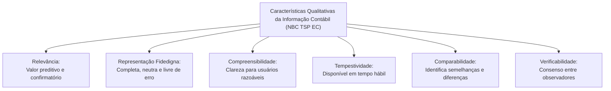

# 01 - NBC TSP Estrutura Conceitual e Normas Gerais no Setor Público

> **Matéria:** Contabilidade Aplicada ao Setor Público (CASP)  
> **Cargo:** A01 – Técnico de Controle Externo – Especialidade: Técnico Administrativo  
> **Arquivo:** `01_nbc_tsp_estrutura_conceitual_e_normas_gerais.md`  

---

## 📌 Ementa / Itens do Edital

- Normas Brasileiras de Contabilidade Aplicadas ao Setor Público (NBC TSP): processo de convergência às normas internacionais IPSAS (*International Public Sector Accounting Standards*);
- NBC TSP Estrutura Conceitual:
  - Usuários primários da informação contábil governamental: cidadãos, seus representantes políticos (parlamentares e Tribunais de Contas) e provedores de recursos;
  - Objetivos dos Relatórios Contábeis de Propósito Geral das Entidades do Setor Público (RCPGs): prestação de contas (*accountability*) e tomada de decisão;
  - Características qualitativas da informação contábil: relevância, representação fidedigna, compreensibilidade, tempestividade, comparabilidade e verificabilidade;
  - Restrições inerentes à informação: materialidade, custo-benefício e alcance do equilíbrio entre características;
- Elementos das demonstrações contábeis patrimoniais:
  - Ativo sob o enfoque patrimonial e o conceito distintivo de **potencial de serviços**;
  - Passivo, Situação Patrimonial Líquida, Receita (Variação Patrimonial Aumentativa - VPA) e Despesa (Variação Patrimonial Diminutiva - VPD) sob a ótica da competência pura;
- Critérios e bases de mensuração de ativos e passivos:
  - Bases para Ativos: custo histórico, valor de mercado, custo de reposição ou substituição, preço líquido de venda e valor em uso;
  - Bases para Passivos: custo histórico, custo de cumprimento da obrigação, valor de mercado, custo de liberação e preço de assunção;
- Visão geral das normas específicas fundamentais:
  - NBC TSP 03: Provisões, Passivos Contingentes e Ativos Contingentes (matriz de probabilidade de desembolso);
  - NBC TSP 04: Estoques e mensuração de itens mantidos para distribuição gratuita na rede pública;
  - NBC TSP 07: Ativo Imobilizado, mensuração e depreciação periódica;
  - NBC TSP 34: Sistema de Informação de Custos no Setor Público.

---

## 🌳 Classificação Hierárquica

```text
1. Estrutura Conceitual e Normas NBC TSP Aplicadas ao Setor Público
├── 1.1 NBC TSP Estrutura Conceitual: Fundamentos e Objetivos
│   ├── 1.1.1 Processo de Convergência às Normas Internacionais (IPSAS / CFC / STN)
│   ├── 1.1.2 Usuários Primários dos RCPGs:
│   │   ├── Cidadãos e Usuários de Serviços Públicos (controle social e acompanhamento das entregas)
│   │   ├── Representantes Políticos (Poder Legislativo e Tribunais de Contas no controle externo)
│   │   └── Provedores de Recursos (contribuintes, financiadores e credores públicos)
│   └── 1.1.3 Objetivos Centrais dos RCPGs:
│       ├── Prestação de Contas e Responsabilização (*Accountability*)
│       └── Fornecimento de Subsídios Técnicos para a Tomada de Decisão
├── 1.2 Características Qualitativas da Informação Contábil Útil
│   ├── 1.2.1 Relevância: Capacidade de fazer a diferença nas decisões (valor preditivo e valor confirmatório)
│   ├── 1.2.2 Representação Fidedigna: Retrata a substância econômica (completa, neutra e livre de erro material)
│   ├── 1.2.3 Compreensibilidade: Clareza e concisão que viabilizam o entendimento por usuários com conhecimento razoável
│   ├── 1.2.4 Tempestividade: Disponibilidade da informação em tempo hábil para influenciar decisões
│   ├── 1.2.5 Comparabilidade: Permite identificar semelhanças e diferenças entre entidades ou períodos temporais
│   ├── 1.2.6 Verificabilidade: Permite que observadores independentes e capacitados cheguem a um consenso razoável
│   └── 1.2.7 Restrições à Informação: Custo-benefício da geração do dado e Materialidade
├── 1.3 Elementos das Demonstrações Contábeis Governamentais
│   ├── 1.3.1 Ativo:
│   │   ├── Recurso controlado pela entidade em decorrência de eventos passados
│   │   └── Capaz de gerar benefícios econômicos futuros OU POTENCIAL DE SERVIÇOS à sociedade
│   ├── 1.3.2 Passivo: Obrigação presente derivada de eventos passados cuja liquidação exige saída de recursos
│   ├── 1.3.3 Situação Patrimonial Líquida: Participação residual nos ativos da entidade após dedução de todos os passivos
│   ├── 1.3.4 Variação Patrimonial Aumentativa (VPA): Aumentos nos benefícios econômicos ou potencial de serviços (Receita Patrimonial)
│   └── 1.3.5 Variação Patrimonial Diminutiva (VPD): Reduções nos benefícios econômicos ou potencial de serviços (Despesa Patrimonial)
├── 1.4 Critérios e Bases de Mensuração
│   ├── 1.4.1 Bases de Mensuração para Ativos:
│   │   ├── Custo Histórico: Valor dos recursos fornecidos para adquirir ou desenvolver o ativo
│   │   ├── Valor de Mercado: Preço de transação entre partes conhecedoras, dispostas e independentes
│   │   ├── Custo de Reposição / Substituição: Custo mais recente para substituir o potencial de serviços do ativo
│   │   └── Valor em Uso: Valor presente do potencial de serviços remanescente do ativo
│   └── 1.4.2 Bases de Mensuração para Passivos:
│       ├── Custo de Cumprimento da Obrigação: Custos que a entidade incorrerá para satisfazer os compromissos
│       └── Preço de Assunção: Valor monetário que um terceiro exigiria para assumir formalmente a obrigação
└── 1.5 Normas Específicas Relevantes em Provas da FCC
    ├── 1.5.1 NBC TSP 03 (Provisões e Contingências):
    │   ├── Provável (> 50% de chance) + Mensurável: RECONHECE PROVISÃO no Passivo (D: VPD / C: Provisão)
    │   ├── Possível (Incerta): NÃO reconhece no Passivo; DIVULGA em Notas Explicativas
    │   └── Remota: NADA FAZ (nem reconhece em balanço, nem divulga em notas explicativas)
    ├── 1.5.2 NBC TSP 04 (Estoques Públicos):
    │   └── Itens para distribuição gratuita (medicamentos): Mensurados pelo menor valor entre o custo e o CUSTO CORRENTE DE REPOSIÇÃO
    └── 1.5.3 NBC TSP 07 (Ativo Imobilizado): Mensuração inicial pelo custo, depreciação sistemática e valor residual
```

---

## 📖 Conteúdo Teórico Aprofundado

### 1. O Enfoque Patrimonial da Contabilidade Pública

A Contabilidade Aplicada ao Setor Público (CASP) passou por uma revolução paradigmática com a convergência às normas internacionais **IPSAS** (*International Public Sector Accounting Standards*), normatizadas no Brasil pelas **NBC TSP** do Conselho Federal de Contabilidade (CFC) e pelo Manual de Contabilidade Aplicada ao Setor Público (**MCASP**).


#### O Conceito Crítico de "Potencial de Serviços"
No setor privado mercantil, um bem é considerado ativo primordialmente porque gera fluxos de caixa futuros (*lucro*).  
No setor público, a esmagadora maioria dos bens estatais não tem a finalidade de produzir lucro financeiro, mas sim de prestar serviços públicos essenciais e gratuitos à sociedade (escolas, hospitais, praças públicas, viaturas da polícia militar, redes de drenagem urbana).  
Por essa razão, a Estrutura Conceitual da NBC TSP consagrou o conceito de **potencial de serviços**:
> *"Potencial de serviços é a capacidade de gerar serviços que contribuam para alcançar os objetivos da entidade, sem necessariamente gerar fluxos de caixa líquidos positivos."*

---

### 2. Características Qualitativas dos RCPGs (NBC TSP EC)

Para serem úteis na prestação de contas (*accountability*) e na tomada de decisões governamentais, os relatórios contábeis de propósito geral devem apresentar as seguintes características qualitativas:



| Característica Qualitativa | Definição Normativa | Aplicação Prática / FCC |
| :--- | :--- | :--- |
| **Relevância** | Informações capazes de fazer a diferença nas decisões dos usuários, tendo valor confirmatório, preditivo ou ambos. | Permite avaliar se a arrecadação futura sustentará os programas continuados. |
| **Representação Fidedigna** | A informação retrata com fidelidade a substância econômica das transações. Para ser fidedigna, deve ser **completa, neutra e livre de erro material**. | Não exige exatidão matemática infalível em estimativas (admite margens estatísticas razoáveis). |
| **Compreensibilidade** | Qualidade da informação que possibilita que os usuários compreendam prontamente seu significado. | **Atenção:** Informações financeiras complexas essenciais não podem ser excluídas a pretexto de torná-las "fáceis"! |
| **Tempestividade** | Disponibilização da informação contábil aos tomadores de decisão antes que ela perca sua capacidade de influenciar julgamentos. | Relatórios atrasados em anos perdem seu valor decisório, ainda que impecáveis. |
| **Comparabilidade** | Permite aos usuários identificar e compreender semelhanças e diferenças entre entidades ou períodos contábeis sucessivos. | Exige consistência e uniformidade na aplicação das políticas contábeis ao longo do tempo. |
| **Verificabilidade** | Assegura aos usuários que a informação representa fidedignamente o fenômeno que se propõe representar, permitindo consenso. | Diferentes auditores independentes chegam aos mesmos resultados ao examinar os dados. |

---

### 3. Matriz de Provisões e Passivos Contingentes (NBC TSP 03)

O tratamento contábil aplicável a demandas judiciais e obrigações incertas é um dos temas mais recorrentes nas provas da Fundação Carlos Chagas:

```mermaid
flowchart TD
    Demanda["Ação Judicial / Obrigação Presente Incerta"] --> Prob{"Qual a probabilidade de desembolso futuro?"}
    
    Prob -->|PROVÁVEL (> 50%)| Prov["RECONHECE PROVISÃO NO PASSIVO<br/>Lançamento contábil:<br/>D: Variação Patrimonial Diminutiva (VPD)<br/>C: Provisão (Passivo Circulante ou Não Circulante)<br/>+ Divulga em Notas Explicativas"]
    
    Prob -->|POSSÍVEL (Incerta)| Conting["PASSIVO CONTINGENTE<br/>NÃO efetua lançamento contábil no Balanço!<br/>DIVULGA OBRIGATORIAMENTE em Notas Explicativas"]
    
    Prob -->|REMOTA (< 5%)| Remota["PROBABILIDADE REMOTA<br/>NÃO efetua lançamento no Balanço!<br/>NÃO divulga em Notas Explicativas!"]
```

> 🚨 **ALERTA DE PROVA / PEGADINHA FCC:**  
> A FCC adora afirmar que um passivo contingente com probabilidade **possível** deve ser registrado no Passivo Não Circulante do Balanço Patrimonial. **Falso!**  
> - Apenas a **PROVISÃO** (probabilidade provável com valor estimável) transita pelo Balanço Patrimonial.  
> - O **PASSIVO CONTINGENTE** é apenas divulgado em **Notas Explicativas**, sem qualquer lançamento que afete o balanço ou o patrimônio líquido!  
> - Se o risco for **REMOTO**, a entidade não faz absolutamente nada (nem registra, nem divulga em notas).

---

### 4. Avaliação de Estoques Públicos (NBC TSP 04)

- **Regra Geral:** Os estoques do setor público são mensurados pelo menor valor entre o **custo histórico** e o **valor realizável líquido**.
- **Exceção Fundamental do Setor Público (Distribuição Gratuita):**  
  Quando os estoques são mantidos para **distribuição gratuita ou por valor simbólico** (ex.: vacinas e medicamentos fornecidos pelo SUS, livros didáticos distribuídos a alunos de escolas públicas), eles devem ser mensurados pelo menor valor entre o **custo de aquisição** e o **custo corrente de reposição**!  
  *(Motivo: como esses bens não serão vendidos no mercado privado, não existe a figura do valor realizável líquido).*

---

## 🌐 Fontes Oficiais & Normativas Recomendadas

- [Conselho Federal de Contabilidade (CFC) - NBC TSP Estrutura Conceitual](https://cfc.org.br/)
  - Norma que define os postulados, características qualitativas e elementos contábeis.
- [NBC TSP 03 - Provisões, Passivos Contingentes e Ativos Contingentes](https://cfc.org.br/)
  - Disciplina o reconhecimento e divulgação de riscos judiciais no setor público.
- [NBC TSP 04 - Estoques](https://cfc.org.br/)
  - Regras de mensuração e custo corrente de reposição para bens de consumo e distribuição.
- [Manual de Contabilidade Aplicada ao Setor Público (MCASP) - 11ª Edição](https://www.gov.br/tesouronacional/pt-br)
  - Visão Geral do Enfoque Patrimonial e Procedimentos Contábeis Patrimoniais.

---

## 📝 Questões Comentadas no Padrão FCC

### Questão 1 (FCC - Adaptada / TCE-RS - Auditor de Controle Externo)
A Estrutura Conceitual das Normas Brasileiras de Contabilidade Aplicadas ao Setor Público (NBC TSP EC) estabelece as características qualitativas da informação contábil incluída nos Relatórios Contábeis de Propósito Geral das Entidades do Setor Público (RCPGs).

A característica qualitativa que permite aos usuários identificar semelhanças e diferenças entre itens e fenômenos econômicos, seja entre diferentes entidades do setor público, seja em relação à mesma entidade ao longo de períodos contábeis consecutivos, denomina-se:

A) Compreensibilidade.  
B) Comparabilidade.  
C) Tempestividade.  
D) Representação fidedigna.  
E) Verificabilidade.  

> **Gabarito: B**  
>
> **Análise detalhada de cada alternativa:**  
> - **A) INCORRETA:** Compreensibilidade é a qualidade da informação que possibilita que os usuários compreendam prontamente seu significado.  
> - **B) CORRETA:** A **Comparabilidade** é expressamente definida pela NBC TSP EC como a característica qualitativa que permite aos usuários identificar e entender semelhanças e diferenças entre itens, cobrindo tanto a comparação temporal (mesma entidade ao longo dos anos) quanto a espacial (entre diferentes órgãos públicos).  
> - **C) INCORRETA:** Tempestividade refere-se à disponibilização da informação a tempo de influenciar o processo de tomada de decisão.  
> - **D) INCORRETA:** Representação fidedigna significa retratar com neutralidade, completude e ausência de erro material a substância dos fenômenos econômicos.  
> - **E) INCORRETA:** Verificabilidade é a qualidade que assegura que diferentes observadores independentes e capacitados cheguem a um consenso razoável.

---

### Questão 2 (FCC - Adaptada / TCE-PI - Auditor de Controle Externo)
A Procuradoria-Geral de determinado Estado foi intimada de ação judicial de grande repercussão econômica proposta por consórcio de empreiteiras cobrando reequilíbrio econômico-financeiro de contrato de obras. O departamento jurídico do Estado avaliou o risco de perda da ação judicial como **provável** e mensurou com segurança razoável o valor do desembolso futuro estimado em R$ 15.000.000,00.

Consoante as disposições da NBC TSP 03 e do Manual de Contabilidade Aplicada ao Setor Público (MCASP):

A) O Estado não deve efetuar nenhum registro contábil nem em notas explicativas até o trânsito em julgado irrecorrível da decisão judicial condenatória.  
B) A entidade deve divulgar a informação exclusivamente em notas explicativas, sem efetuar quaisquer lançamentos contábeis no Balanço Patrimonial.  
C) A entidade pública deve reconhecer uma provisão no Passivo, em contrapartida a uma Variação Patrimonial Diminutiva (VPD) no resultado do exercício.  
D) A perda potencial deve ser reconhecida como despesa orçamentária imediatamente no estágio da fixação da Lei Orçamentária Anual.  
E) Trata-se de um ativo contingente cujo ingresso de recursos deve ser registrado preventivamente no subsistema orçamentário.  

> **Gabarito: C**  
>
> **Análise detalhada de cada alternativa:**  
> - **A) INCORRETA:** O regime de competência contábil exige o reconhecimento tempestivo da obrigação presente assim que o fato gerador e os critérios de probabilidade se consolidem.  
> - **B) INCORRETA:** Quando a probabilidade de desembolso futuro é classificada como **provável** e o valor é mensurável com confiabilidade, o reconhecimento no balanço é obrigatório (e não mera divulgação em notas).  
> - **C) CORRETA:** Nos termos da NBC TSP 03 e do MCASP, existindo obrigação presente resultante de evento passado cuja liquidação implique saída de recursos **provável** e o valor possa ser estimado com confiabilidade, a entidade pública **deve reconhecer uma provisão no Passivo**, debitando uma **Variação Patrimonial Diminutiva (VPD)** no resultado patrimonial.  
> - **D) INCORRETA:** A provisão é evento contábil patrimonial puro, não transitando pelo estágio da fixação orçamentária nem exigindo empenho imediato da despesa orçamentária.  
> - **E) INCORRETA:** Trata-se de potencial passivo (saída de recursos), e não de ativo.

---

### Questão 3 (FCC - Adaptada / Analista de Gestão Pública - Contabilidade)
No âmbito do setor público, a Secretaria de Estado da Saúde de Goiás mantém em seus depósitos centrais vultosos estoques de vacinas e medicamentos essenciais destinados exclusivamente à distribuição gratuita à população nos postos de saúde da rede pública.

De acordo com as regras de mensuração de estoques contidas na NBC TSP 04:

A) Os estoques devem ser mensurados pelo menor valor entre o custo histórico de aquisição e o valor justo de mercado para revenda.  
B) Os estoques mantidos para distribuição gratuita devem ser mensurados pelo menor valor entre o custo e o custo corrente de reposição.  
C) A Secretaria de Saúde deve mensurar seus estoques obrigatoriamente a valor presente descontado pela taxa básica de juros (Selic).  
D) Medicamentos para distribuição gratuita não configuram ativo, devendo ser lançados como despesa de consumo no ato do recebimento da nota fiscal.  
E) Os estoques devem ser mantidos sem qualquer registro patrimonial até o momento da efetiva aplicação nos pacientes.  

> **Gabarito: B**  
>
> **Análise detalhada de cada alternativa:**  
> - **A) INCORRETA:** Os medicamentos não se destinam à revenda mercantil, inexistindo preço de venda realizável líquido no mercado privado.  
> - **B) CORRETA:** Conforme a NBC TSP 04 (Estoques), os bens mantidos para distribuição gratuita ou consumo na prestação de serviços sem fins lucrativos devem ser mensurados pelo menor valor entre o **custo histórico** e o **custo corrente de reposição**.  
> - **C) INCORRETA:** Não se aplica ajuste a valor presente pela Selic para avaliação física de estoques de saúde pública.  
> - **D) INCORRETA:** Medicamentos em depósito constituem ativos da entidade e devem figurar no Ativo Circulante (Estoques) até o efetivo consumo.  
> - **E) INCORRETA:** O registro patrimonial do almoxarifado é obrigatório pelo regime de competência.

---

### Questão 4 (FCC - Adaptada / Analista Contábil)
A respeito do conceito de Ativo no setor público preconizado na NBC TSP Estrutura Conceitual, assinale a opção correta:

A) A capacidade de um bem público gerar fluxos futuros de caixa positivos é requisito indispensável para sua classificação como ativo governamental.  
B) Um recurso pode ser reconhecido como ativo no setor público quando a entidade possui o controle do recurso, decorrente de evento passado, e do qual se espera a geração de benefícios econômicos ou potencial de serviços.  
C) Bens de uso comum do povo, como rodovias e praças públicas, não podem ser classificados como ativos patrimoniais em virtude de sua inalienabilidade civil.  
D) A titularidade da propriedade jurídica formal é elemento obrigatório e insubstituível para o reconhecimento de qualquer ativo no setor público.  
E) Os ativos intangíveis desenvolvidos pelo ente público são vedados na contabilidade governamental por ausência de valor físico tangível.  

> **Gabarito: B**  
>
> **Análise detalhada de cada alternativa:**  
> - **A) INCORRETA:** No setor público, a grande maioria dos bens não gera fluxos de caixa, mas gera **potencial de serviços**.  
> - **B) CORRETA:** Reproduz fielmente a definição da NBC TSP EC: *"Ativo é um recurso controlado no presente pela entidade como resultado de um evento passado (...), do qual se espera a geração de benefícios econômicos ou potencial de serviços."*  
> - **C) INCORRETA:** Bens de uso comum do povo integram o ativo imobilizado do ente público quando preenchem os requisitos de controle e potencial de serviços.  
> - **D) INCORRETA:** O elemento definidor é o **controle econômico** do recurso (capacidade de direcionar seu uso e usufruir de seus serviços), prevalecendo a substância sobre a forma jurídica (ex.: arrendamento mercantil financeiro).  
> - **E) INCORRETA:** Ativos intangíveis (softwares, licenças) são plenamente admitidos e regulamentados pela NBC TSP 08.

---

### Questão 5 (FCC - Adaptada / Auditor de Controle Externo)
Em determinado processo judicial em trâmite na Justiça do Trabalho contra uma autarquia estadual, a assessoria jurídica emitiu parecer formal classificando o risco de condenação e perda patrimonial da entidade como **possível**, sem possibilidade de definição precisa de valores no momento.

Em observância à NBC TSP 03 e ao MCASP, a conduta contábil adequada a ser adotada pela autarquia é:

A) Reconhecer imediatamente uma provisão no Passivo Não Circulante pelo valor estimado pelo autor da ação.  
B) Não efetuar lançamento contábil de provisão no Balanço Patrimonial, divulgando as informações relevantes sobre o passivo contingente em Notas Explicativas.  
C) Deixar de efetuar qualquer lançamento contábil e dispensar a divulgação em notas explicativas em virtude do princípio do sigilo processual.  
D) Registrar uma Variação Patrimonial Aumentativa para neutralizar o impacto financeiro futuro.  
E) Solicitar abertura imediata de crédito adicional extraordinário para cobertura judicial.  

> **Gabarito: B**  
>
> **Análise detalhada de cada alternativa:**  
> - **A) INCORRETA:** O reconhecimento no Balanço Patrimonial (provisão) só é cabível quando o risco for **provável**. Risco possível não transita pelo balanço.  
> - **B) CORRETA:** Quando a probabilidade de desembolso futuro for classificada como **possível**, a obrigação configura **Passivo Contingente**: não é reconhecida no Balanço Patrimonial, mas deve ser **obrigatoriamente divulgada em Notas Explicativas**, detalhando a natureza do litígio e a incerteza do valor.  
> - **C) INCORRETA:** A divulgação em notas explicativas é mandatória para riscos possíveis. A dispensa de notas ocorre apenas quando o risco é **remoto**.  
> - **D) INCORRETA:** Ação judicial contra a entidade representa passivo ou perda potencial, jamais gerando VPA (receita).  
> - **E) INCORRETA:** Crédito extraordinário é restrito a guerra, comoção ou calamidade pública.
