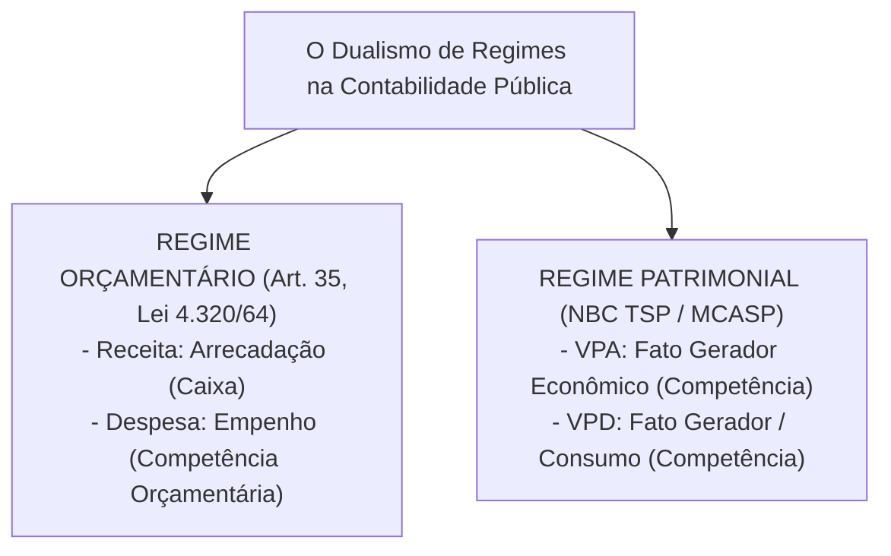
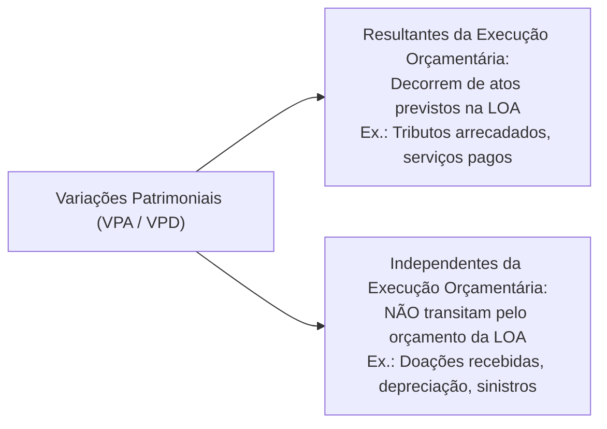
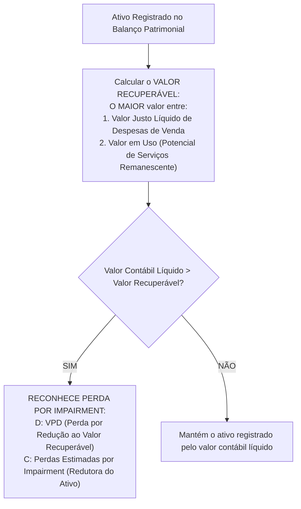

# 02 - Procedimentos Contábeis Orçamentários (PCO) e Patrimoniais (PCP) - MCASP 11ª Edição

> **Matéria:** Contabilidade Aplicada ao Setor Público (CASP)  
> **Cargo:** A01 – Técnico de Controle Externo – Especialidade: Técnico Administrativo  
> **Arquivo:** `02_mcasp_procedimentos_orcamentarios_e_patrimoniais.md`  

---

## 📌 Ementa / Itens do Edital

- Manual de Contabilidade Aplicada ao Setor Público (MCASP, 11ª edição):
  - **Parte I – Procedimentos Contábeis Orçamentários (PCO):**
    - Regime Contábil Orçamentário (Artigo 35 da Lei nº 4.320/1964: Caixa para Receitas e Competência para Despesas);
    - Confronto analítico entre a execução orçamentária e as variações patrimoniais;
    - Variações Patrimoniais Quantitativas (Aumentativas e Diminutivas) e Qualitativas (Fatos Permutativos);
    - Variações Resultantes da Execução Orçamentária vs. Variações Independentes da Execução Orçamentária;
  - **Parte II – Procedimentos Contábeis Patrimoniais (PCP):**
    - Princípio da Competência aplicado aos fatos patrimoniais (reconhecimento de VPA e VPD pelo fato gerador econômico);
    - Ativo Imobilizado: reconhecimento, mensuração inicial ao custo e mensuração subsequente;
    - Bens de Uso Comum do Povo e Bens de Infraestrutura: critérios de reconhecimento no Balanço Patrimonial;
    - Depreciação, Amortização e Exaustão no setor público: valor depreciável, valor residual, vida útil econômica e ativos não depreciáveis;
    - Teste de Redução ao Valor Recuperável de Ativos (*Impairment Test*): conceitos e aplicação a ativos geradores e não geradores de caixa;
    - Provisões e desreconhecimento de ativos.

---

## 🌳 Classificação Hierárquica

```text
2. Procedimentos Contábeis Orçamentários (PCO) e Patrimoniais (PCP)
├── 2.1 Procedimentos Contábeis Orçamentários (MCASP Parte I)
│   ├── 2.1.1 O Regime Orçamentário Legal (Art. 35 da Lei nº 4.320/1964):
│   │   ├── Receita Orçamentária: Pertence ao exercício em que for ARRECADADA (Regime de Caixa)
│   │   └── Despesa Orçamentária: Pertence ao exercício em que for EMPENHADA (Regime de Competência Orçamentária)
│   ├── 2.1.2 Fatos Contábeis e sua Repercussão no Patrimônio Líquido:
│   │   ├── Fatos Permutativos (Qualitativos): Alteram apenas a composição do ativo/passivo sem modificar o PL (compra à vista de veículo)
│   │   └── Fatos Modificativos (Quantitativos): Alteram o valor do Patrimônio Líquido (geram VPA ou VPD)
│   └── 2.1.3 Origem das Variações Patrimoniais:
│       ├── Variações Resultantes da Execução Orçamentária: Decorrem da realização de receitas/despesas constantes da LOA
│       └── Variações Independentes da Execução Orçamentária: Ocorrem no patrimônio sem trânsito pela LOA (ex.: doação recebida, depreciação periódica)
├── 2.2 Procedimentos Contábeis Patrimoniais (MCASP Parte II)
│   ├── 2.2.1 Regime Patrimonial: Regime de Competência Integral para todos os atos e fatos modificativos
│   │   ├── Variação Patrimonial Aumentativa (VPA): Fato gerador do direito econômico (lançamento de tributos)
│   │   └── Variação Patrimonial Diminutiva (VPD): Fato gerador do dever ou consumo econômico (liquidação da despesa/consumo)
│   ├── 2.2.2 Ativo Imobilizado e Bens de Infraestrutura:
│   │   ├── Bens Móveis e Imóveis de uso especial e dominicais
│   │   └── Bens de Uso Comum do Povo (rodovias, praças): Devem ser reconhecidos no Ativo quando mensuráveis e controlados
│   ├── 2.2.3 Depreciação, Amortização e Exaustão:
│   │   ├── Depreciação: Alocação sistemática do valor depreciável de bem tangível ao longo de sua vida útil econômica
│   │   │   └── Fórmula Linear: (Custo de Aquisição - Valor Residual) / Vida Útil
│   │   ├── Amortização: Alocação periódica de ativos intangíveis com vida útil definida (softwares e licenças)
│   │   ├── Exaustão: Esgotamento gradual de recursos minerais e florestais explorados pela administração
│   │   └── Bens NÃO sujeitos a depreciação: Terrenos, obras de arte e monumentos de valor histórico inestimável
│   └── 2.2.4 Teste de Recuperabilidade (*Impairment*):
│       ├── Aplicação: Assegurar que nenhum ativo esteja registrado por valor superior ao seu Valor Recuperável
│       ├── Valor Recuperável: O MAIOR entre o Valor Justo Líquido de Despesas de Venda e o Valor em Uso
│       └── Reconhecimento da Perda: Se Valor Contábil Líquido > Valor Recuperável -> D: VPD / C: Perdas Estimadas por Impairment
└── 2.3 Desreconhecimento e Baixas de Ativos (Alienação, sinistro, doação concedida e sucateamento)
```

---

## 📖 Conteúdo Teórico Aprofundado

### 1. O Dualismo de Regimes na Contabilidade Pública

A Contabilidade Aplicada ao Setor Público opera sob dois enfoques distintos que convivem de forma harmônica e integrada:



| Transação Prática | Enfoque Orçamentário (Lei nº 4.320/1964) | Enfoque Patrimonial (MCASP / NBC TSP) |
| :--- | :--- | :--- |
| **Lançamento do IPTU/IPVA pelo Fisco** | Não há receita orçamentária (receita orçamentária só nasce na arrecadação). | **Ocorre VPA** (a entidade pública adquiriu o direito ao crédito pelo fato gerador). |
| **Pagamento do tributo pelo contribuinte no banco** | **Receita Orçamentária Realizada** (estágio da arrecadação/recolhimento). | **Fato Permutativo** (D: Caixa / C: Tributos a Receber - não altera o PL!). |
| **Emissão da Nota de Empenho de material** | **Despesa Orçamentária Executada** (reserva da dotação na LOA). | **Não há fato patrimonial** (o patrimônio da entidade não foi alterado). |
| **Liquidação / Entrega do serviço contratado** | Despesa orçamentária liquidada (reconhece passivo orçamentário). | **Ocorre VPD** (fato gerador econômico do consumo que diminui o patrimônio líquido). |

---

### 2. Variações Patrimoniais: Classificação e Origem

As alterações no patrimônio público dividem-se em:
1. **Qualitativas (Fatos Permutativos):** Alteram apenas a composição dos elementos patrimoniais sem impactar o montante do Patrimônio Líquido (ex.: compra de ambulância à vista em dinheiro: diminui Caixa e aumenta Ativo Imobilizado pelo mesmo valor).
2. **Quantitativas (Fatos Modificativos):** Alteram o montante do Patrimônio Líquido:
   - *Variação Patrimonial Aumentativa (VPA):* Transações que aumentam o PL (receitas patrimoniais);
   - *Variação Patrimonial Diminutiva (VPD):* Transações que reduzem o PL (despesas patrimoniais).



> 🚨 **ALERTA DE PROVA / PEGADINHA FCC:**  
> - **Depreciação é despesa orçamentária? NÃO!** A depreciação é uma **Variação Patrimonial Diminutiva (VPD) Independente da Execução Orçamentária**. Ela não depende de empenho, liquidação ou dotação na LOA!  
> - **Doação de imóvel recebida de particular é receita orçamentária? NÃO!** Não transita pela LOA nem gera receita de capital orçamentária. É uma **VPA Independente da Execução Orçamentária** que eleva diretamente o Ativo Imobilizado e o Patrimônio Líquido.

---

### 3. Depreciação, Amortização e Exaustão no Setor Público

Conforme a **NBC TSP 07** e o **MCASP**, o registro contábil sistemático do desgaste dos bens públicos é mandatório:
- **Depreciação:** Alocação sistemática do valor depreciável de um **ativo tangível (corpóreo)** ao longo da sua vida útil econômica estimada.
- **Amortização:** Alocação sistemática da perda de valor de **ativos intangíveis (incorpóreos)** com vida útil definida (ex.: licenças e softwares).
- **Exaustão:** Esgotamento gradual dos recursos minerais, hídricos ou florestais explorados pelo poder público.

```text
┌────────────────────────────────────────────────────────────────────────┐
│               CONCEITOS E FÓRMULAS DE DEPRECIAÇÃO (MCASP)              │
├───────────────────────┬────────────────────────────────────────────────┤
│ VALOR DEPRECIÁVEL     │ Custo de Aquisição (-) Valor Residual          │
├───────────────────────┼────────────────────────────────────────────────┤
│ VALOR RESIDUAL        │ Valor líquido estimado que a entidade espera   │
│                       │ obter pelo ativo no fim de sua vida útil.      │
├───────────────────────┼────────────────────────────────────────────────┤
│ VIDA ÚTIL ECONÔMICA   │ Período estimado de utilização produtiva.      │
├───────────────────────┼────────────────────────────────────────────────┤
│ LANÇAMENTO CONTÁBIL   │ D - Variação Patrimonial Diminutiva (VPD)       │
│                       │ C - Depreciação Acumulada (Retificadora Ativo) │
└───────────────────────┴────────────────────────────────────────────────┘
```

#### Ativos Públicos que NÃO sofrem Depreciação:
1. **Terrenos** (salvo pedreiras ou aterros sanitários cuja capacidade de descarte se esgota);
2. **Obras de arte, relíquias e antiguidades** cujo valor histórico/artístico seja inestimável e permanente;
3. Bens de valor cultural com vida útil econômica indefinida.

---

### 4. Teste de Redução ao Valor Recuperável (*Impairment*)

O teste de recuperabilidade assegura que nenhum ativo esteja registrado no Balanço Patrimonial por valor superior àquele que o Estado é capaz de recuperar pelo uso ou venda do bem.



---

## 🌐 Fontes Oficiais & Manuais Técnicos Recomendados

- [Manual de Contabilidade Aplicada ao Setor Público (MCASP) - 11ª Edição](https://www.gov.br/tesouronacional/pt-br)
  - Parte I: Procedimentos Contábeis Orçamentários (PCO).
  - Parte II: Procedimentos Contábeis Patrimoniais (PCP).
- [Conselho Federal de Contabilidade - NBC TSP 07 (Ativo Imobilizado)](https://cfc.org.br/)
  - Critérios de reconhecimento, mensuração, vida útil e depreciação.
- [Conselho Federal de Contabilidade - NBC TSP 09 e 10 (Redução ao Valor Recuperável)](https://cfc.org.br/)
  - Regras para teste de impairment em ativos geradores e não geradores de caixa.
- [Lei Federal nº 4.320/1964](https://www.planalto.gov.br/ccivil_03/leis/l4320.htm)
  - Art. 35 (Regime orçamentário legal).

---

## 📝 Questões Comentadas no Padrão FCC

### Questão 1 (FCC - Adaptada / TCE-PI - Auditor de Controle Externo)
Determinado órgão público estadual recebeu, em doação incondicional de particular, um terreno avaliado a valor justo de mercado em R$ 800.000,00 para futura construção de um posto fiscal de fronteira.

Sob a ótica do Manual de Contabilidade Aplicada ao Setor Público (MCASP 11ª edição):

A) O recebimento do imóvel deve ser contabilizado como receita orçamentária de capital no estágio do recolhimento bancário.  
B) A transação representa uma Variação Patrimonial Aumentativa (VPA) independente da execução orçamentária, elevando o Patrimônio Líquido da entidade.  
C) O bem não pode ser registrado no ativo imobilizado até que a obra do posto fiscal seja integralmente concluída e aceita pela fiscalização.  
D) A operação constitui um fato meramente qualitativo (permutativo), uma vez que não envolveu fluxo financeiro em moeda corrente.  
E) O terreno recebido deverá sofrer depreciação periódica anual linear à alíquota contábil de 4% ao ano.  

> **Gabarito: B**  
>
> **Análise detalhada de cada alternativa:**  
> - **A) INCORRETA:** Doações de bens físicos não envolvem fluxo financeiro e não transitam pela Lei Orçamentária Anual; não constituem receita orçamentária.  
> - **B) CORRETA:** A doação de ativo recebida aumenta o patrimônio da entidade pública sem exigir dotação na LOA ou arrecadação, constituindo típica **Variação Patrimonial Aumentativa (VPA) Independente da Execução Orçamentária**, lançada a débito no Ativo Imobilizado (Terrenos) e a crédito de VPA no Resultado, aumentando o Patrimônio Líquido.  
> - **C) INCORRETA:** O ativo é reconhecido no momento em que a entidade obtém o controle do bem (posse e escritura), e não quando da construção da edificação.  
> - **D) INCORRETA:** É um fato quantitativo aumentativo, pois ampliou o patrimônio líquido da entidade em R$ 800.000,00.  
> - **E) INCORRETA:** Terrenos possuem vida útil econômica indefinida e, por regra contábil geral, **não são depreciados**.

---

### Questão 2 (FCC - Adaptada / TCE-RS - Auditor de Controle Externo)
Em relação aos conceitos de depreciação, amortização e teste de recuperabilidade (*impairment*) aplicados aos ativos do setor público, assinale a opção correta:

A) O valor depreciável de um bem corresponde ao seu custo histórico de aquisição somado ao valor residual estimado ao término de sua vida útil.  
B) As quotas de depreciação mensal apuradas para a frota de ambulâncias públicas exigem a prévia emissão de nota de empenho ordinário no orçamento da Secretaria de Saúde.  
C) O teste de recuperabilidade é dispensável no setor público quando o ativo imobilizado não for utilizado diretamente na geração de receitas comerciais ou de lucro.  
D) A redução ao valor recuperável ocorre quando o valor contábil líquido de um ativo for superior ao seu valor recuperável, devendo a perda ser reconhecida no resultado patrimonial como variação patrimonial diminutiva (VPD).  
E) A amortização aplica-se aos bens corpóreos que sofrem desgaste físico ou perecimento gradual ao longo do tempo.  

> **Gabarito: D**  
>
> **Análise detalhada de cada alternativa:**  
> - **A) INCORRETA:** O valor depreciável é o custo histórico **subtraído** do valor residual ($Valor\ Depreciável = Custo - Valor\ Residual$).  
> - **B) INCORRETA:** A depreciação é evento estritamente patrimonial (VPD independente da execução orçamentária), não exigindo prévio empenho nem execução na LOA.  
> - **C) INCORRETA:** O teste de recuperabilidade é obrigatório no setor público inclusive para **ativos não geradores de caixa**, avaliando-se o seu potencial de serviços (NBC TSP 09).  
> - **D) CORRETA:** Quando o valor contábil líquido supera o valor recuperável, o ativo está sobreavaliado; a norma exige o reconhecimento imediato da perda por desvalorização (*impairment*) como VPD no resultado patrimonial.  
> - **E) INCORRETA:** A amortização aplica-se a ativos **intangíveis** (incorpóreos) de vida útil definida; o desgaste de bens corpóreos é objeto de **depreciação**.

---

### Questão 3 (FCC - Adaptada / Analista Contábil de Controle)
Determinada entidade governamental adquiriu, mediante regular processo licitatório, um lote de microcomputadores para suas secretarias no valor total de R$ 100.000,00. A despesa foi devidamente empenhada, liquidada com o recebimento das máquinas e integralmente paga em dinheiro à empresa fornecedora.

Sob a ótica patrimonial e orçamentária, essa transação completa caracteriza-se como:

A) Fato modificativo aumentativo que gera Variação Patrimonial Aumentativa.  
B) Fato contábil qualitativo (permutativo), que não altera o valor do Patrimônio Líquido da entidade.  
C) Fato modificativo diminutivo que reduz o Patrimônio Líquido em R$ 100.000,00 no ato da compra.  
D) Variação patrimonial independente da execução orçamentária.  
E) Transação extraorçamentária que dispensa registro no subsistema patrimonial.  

> **Gabarito: B**  
>
> **Análise detalhada de cada alternativa:**  
> - **A) INCORRETA:** A compra de computadores com saída de caixa não gerou receita patrimonial (VPA).  
> - **B) CORRETA:** Trata-se de um **fato permutativo entre elementos patrimoniais ativos**: houve a saída de R$ 100.000,00 da conta Caixa/Bancos (Ativo Circulante) e a entrada simultânea de R$ 100.000,00 em Bens Móveis (Ativo Não Circulante - Imobilizado). O valor total do Ativo e do Patrimônio Líquido permaneceu inalterado (houve apenas mutação qualitativa).  
> - **C) INCORRETA:** A aquisição de computadores não diminui o PL (a redução do PL ocorrerá posteriormente e de forma gradual via depreciação mensal).  
> - **D) INCORRETA:** A despesa decorreu diretamente da execução do orçamento (despesa de capital na LOA).  
> - **E) INCORRETA:** Trata-se de despesa orçamentária de capital com pleno registro patrimonial no PCASP.

---

### Questão 4 (FCC - Adaptada / Técnico de Controle Externo)
Uma viatura policial foi adquirida pelo Estado de Goiás por R$ 120.000,00. A vida útil estimada do veículo é de 5 anos (60 meses) e a comissão de avaliação patrimonial fixou um valor residual de R$ 20.000,00 para o final do período.

Utilizando o método das quotas constantes (linear) preconizado pelo MCASP, o valor depreciável do bem e o valor da quota mensal de depreciação a ser lançada como VPD são, respectivamente:

A) R$ 120.000,00 e R$ 2.000,00.  
B) R$ 100.000,00 e R$ 1.666,67.  
C) R$ 100.000,00 e R$ 2.000,00.  
D) R$ 120.000,00 e R$ 1.666,67.  
E) R$ 140.000,00 e R$ 2.333,33.  

> **Gabarito: B**  
>
> **Análise detalhada de cada alternativa:**  
> - **Cálculo do Valor Depreciável:**  
>   $\text{Valor Depreciável} = \text{Custo de Aquisição} - \text{Valor Residual}$  
>   $\text{Valor Depreciável} = 120.000,00 - 20.000,00 =$ **R$ 100.000,00**  
> - **Cálculo da Quota Mensal de Depreciação:**  
>   $\text{Quota Mensal} = \frac{\text{Valor Depreciável}}{\text{Vida Útil em Meses}} = \frac{100.000,00}{60} \approx$ **R$ 1.666,67**  
> - Portanto, o valor depreciável é R$ 100.000,00 e a quota mensal é R$ 1.666,67 (Gabarito B).

---

### Questão 5 (FCC - Adaptada / Analista de Planejamento e Orçamento)
No tocante ao regime contábil aplicado no setor público, analise as afirmativas a seguir:

I. De acordo com a Lei nº 4.320/1964 (Art. 35), o regime orçamentário é misto, pertencendo ao exercício as receitas nele arrecadadas e as despesas nele legalmente empenhadas.  
II. Segundo as normas NBC TSP e o MCASP, o regime contábil patrimonial é o de competência, exigindo o reconhecimento de receitas e despesas patrimoniais no momento da ocorrência de seus respectivos fatos geradores.  
III. A arrecadação de tributos em dinheiro gera concomitantemente uma receita orçamentária realizada e um fato permutativo no patrimônio líquido da entidade caso o crédito tributário já tenha sido lançado previamente.  

Está correto o que se afirma em:

A) I, apenas.  
B) I e II, apenas.  
C) II e III, apenas.  
D) I e III, apenas.  
E) I, II e III.  

> **Gabarito: E**  
>
> **Análise detalhada de cada alternativa:**  
> - **Item I - VERDADEIRO:** O art. 35 da Lei nº 4.320/1964 fixa: *"Pertencem ao exercício financeiro: I - as receitas nele arrecadadas; II - as despesas nele legalmente empenhadas"* (regime misto de caixa para receitas e competência para despesas).  
> - **Item II - VERDADEIRO:** As normas NBC TSP e o MCASP consagram o regime de competência puro para o patrimônio governamental, registrando VPAs e VPDs pelo fato gerador.  
> - **Item III - VERDADEIRO:** Quando o crédito tributário já foi objeto de lançamento anterior (já houve VPA), o pagamento no banco representa arrecadação na esfera orçamentária e simples permutação patrimonial entre Disponibilidades e Créditos Tributários a Receber (não gera nova VPA).  
> - Estão corretos todos os três itens (Gabarito E).
