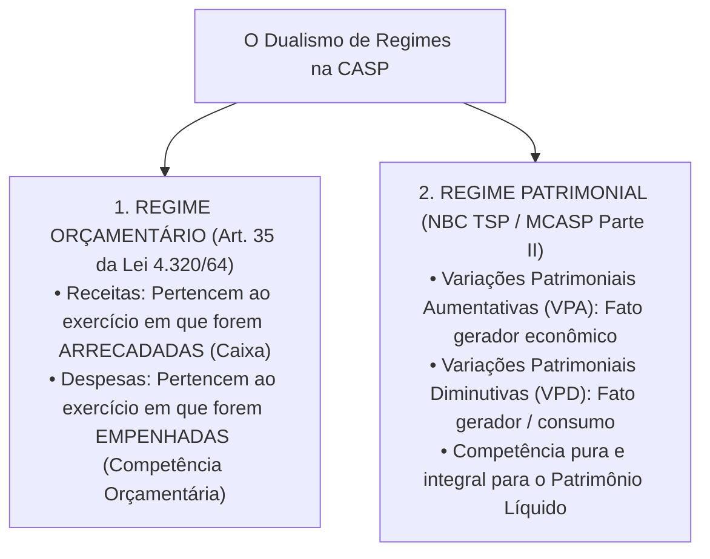
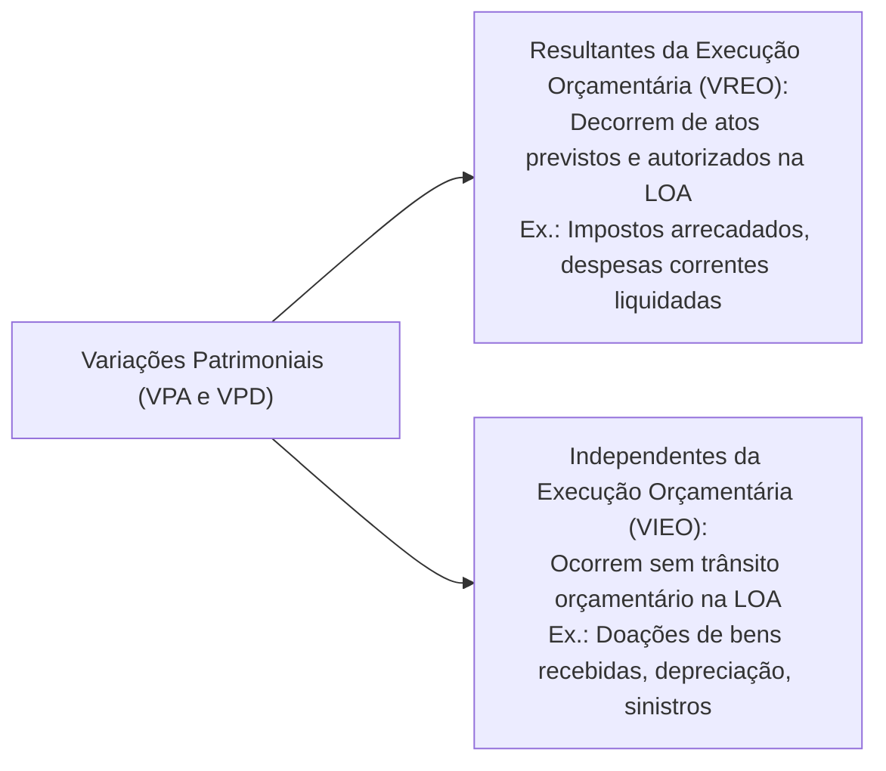
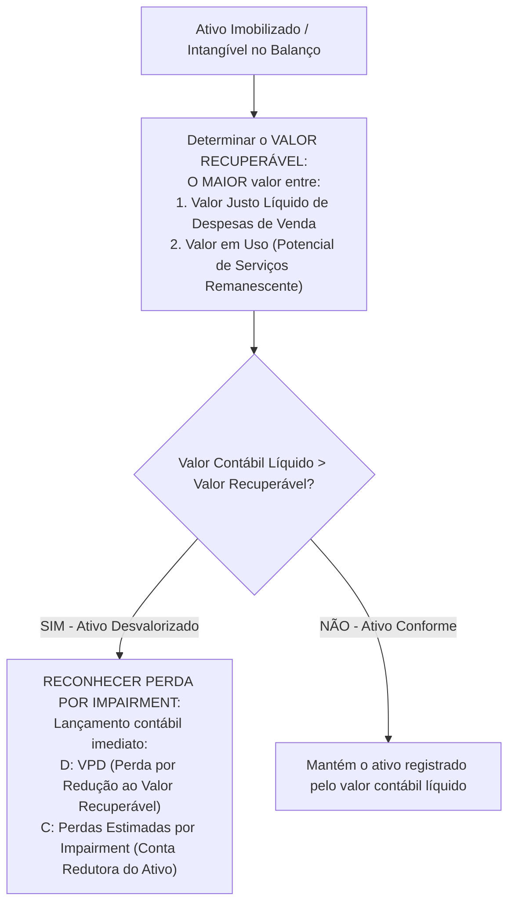

# 02 - Procedimentos Contábeis Orçamentários (PCO) e Patrimoniais (PCP) - MCASP 11ª Edição

> **Matéria:** Contabilidade Aplicada ao Setor Público (CASP)  
> **Cargo:** A01 – Técnico de Controle Externo – Especialidade: Técnico Administrativo  
> **Arquivo:** `02_mcasp_procedimentos_orcamentarios_e_patrimoniais.md`  

---

## 📌 Ementa / Itens do Edital

- Manual de Contabilidade Aplicada ao Setor Público (MCASP, 11ª edição):
    - **Parte I – Procedimentos Contábeis Orçamentários (PCO):**
    - Regime Contábil Orçamentário (Artigo 35 da Lei nº 4.320/1964: Caixa para Receitas e Competência para Despesas);
    - Confronto analítico entre a execução orçamentária e as variações patrimoniais;
    - Variações Patrimoniais Quantitativas (Aumentativas e Diminutivas) e Qualitativas (Fatos Permutativos);
    - Variações Resultantes da Execução Orçamentária vs. Variações Independentes da Execução Orçamentária;
    - **Parte II – Procedimentos Contábeis Patrimoniais (PCP):**
    - Princípio da Competência aplicado aos fatos patrimoniais (reconhecimento de VPA e VPD pelo fato gerador econômico);
    - Ativo Imobilizado: reconhecimento, mensuração inicial ao custo e mensuração subsequente;
    - Bens de Uso Comum do Povo e Bens de Infraestrutura: critérios de reconhecimento no Balanço Patrimonial;
    - Depreciação, Amortização e Exaustão no setor público: valor depreciável, valor residual, vida útil econômica e ativos não depreciáveis;
    - Teste de Redução ao Valor Recuperável de Ativos (*Impairment Test*): conceitos e aplicação a ativos geradores e não geradores de caixa;
    - Provisões e desreconhecimento de ativos.

---

## 🧭 Sumário

1. [O Dualismo de Regimes na Contabilidade Pública (Orçamentário vs. Patrimonial)](#1-o-dualismo-de-regimes-na-contabilidade-publica-orcamentario-vs-patrimonial)
    1. [O Regime Orçamentário da Lei nº 4.320/1964 (Art. 35)](#11-o-regime-orcamentario-da-lei-no-43201964-art-35)
    2. [O Regime Patrimonial da Competência Integral (MCASP e NBC TSP)](#12-o-regime-patrimonial-da-competencia-integral-mcasp-e-nbc-tsp)
    3. [Quadro Sinótico de Confronto e Fatos Contábeis](#13-quadro-sinotico-de-confronto-e-fatos-contabeis)
    4. [Teste 270](#Teste-270)
    5. [Teste 271](#Teste-271)
    6. [Teste 272](#Teste-272)
2. [Variações Patrimoniais: Classificações e Origens](#2-variacoes-patrimoniais-classificacoes-e-origens)
    1. [Variações Qualitativas (Permutativas) vs. Quantitativas (Modificativas)](#21-variacoes-qualitativas-permutativas-vs-quantitativas-modificativas)
    2. [Variações Resultantes vs. Independentes da Execução Orçamentária](#22-variacoes-resultantes-vs-independentes-da-execucao-orcamentaria)
    3. [Teste 273](#Teste-273)
    4. [Teste 274](#Teste-274)
3. [Procedimentos Patrimoniais Aplicados ao Ativo Imobilizado](#3-procedimentos-patrimoniais-aplicados-ao-ativo-imobilizado)
    1. [Mensuração Inicial, Custos Atribuíveis e Bens de Infraestrutura](#31-mensuracao-inicial-custos-atribuiveis-e-bens-de-infraestrutura)
    2. [Depreciação, Amortização e Exaustão: Conceitos e Fórmulas](#32-depreciacao-amortizacao-e-exaustao-conceitos-e-formulas)
    3. [Ativos que NÃO Sofrem Depreciação Periódica](#33-ativos-que-nao-sofrem-depreciacao-periodica)
    4. [Teste 275](#Teste-275)
    5. [Teste 276](#Teste-276)
    6. [Teste 277](#Teste-277)
4. [Teste de Redução ao Valor Recuperável de Ativos (*Impairment Test*)](#4-teste-de-reducao-ao-valor-recuperavel-de-ativos-impairment-test)
    1. [Mecanismo de Aferição do Valor Recuperável](#41-mecanismo-de-afericao-do-valor-recuperavel)
    2. [Reconhecimento Contábil da Perda e Reversões](#42-reconhecimento-contabil-da-perda-e-reversoes)
    3. [Teste 278](#Teste-278)
    4. [Teste 279](#Teste-279)
5. [🌐 Fontes Oficiais & Manuais Técnicos Recomendados](#fontes-oficiais-manuais-tecnicos-recomendados)

---

## 1. O Dualismo de Regimes na Contabilidade Pública (Orçamentário vs. Patrimonial)

A Contabilidade Aplicada ao Setor Público (CASP) no Brasil opera com a convivência harmônica e integrada de dois regimes contábeis fundamentais:

### 1.1 O Regime Orçamentário da Lei nº 4.320/1964 (Art. 35)
O art. 35 da Lei Federal nº 4.320/1964 disciplina a apropriação dos créditos orçamentários sob um regime misto:

- **Receita Orçamentária:** Pertence ao exercício financeiro em que for efetivamente **arrecadada** pelos agentes bancários credenciados (regime de caixa puro na dimensão orçamentária);
- **Despesa Orçamentária:** Pertence ao exercício financeiro em que for legalmente **empenhada** pela autoridade ordenadora (regime de competência orçamentária, assegurando a reserva do crédito antes da contratação).

### 1.2 O Regime Patrimonial da Competência Integral (MCASP e NBC TSP)
No âmbito patrimonial (MCASP e NBC TSP Estrutura Conceitual), vigora o **regime de competência puro e irrestrito**:

- Os efeitos das transações e demais eventos contábeis são reconhecidos quando ocorrem os seus respectivos fatos geradores econômicos, independentemente do recebimento ou pagamento em dinheiro de caixa;
- As receitas patrimoniais denominam-se **Variações Patrimoniais Aumentativas (VPA)** e as despesas patrimoniais denominam-se **Variações Patrimoniais Diminutivas (VPD)**.

### 1.3 Quadro Sinótico de Confronto e Fatos Contábeis

| Evento Prático Governamental | Enfoque Orçamentário (Lei nº 4.320/1964) | Enfoque Patrimonial (MCASP / NBC TSP) | Natureza do Fato Contábil |
| :--- | :--- | :--- | :--- |
| **Lançamento do IPTU ou IPVA pelo Fisco** | Não há receita orçamentária realizada (aguarda arrecadação). | **Ocorre VPA** (direito líquido e certo gerado pelo fato gerador tributário). | **Fato Modificativo Aumentativo** (aumenta o PL da entidade). |
| **Contribuinte paga o tributo no caixa bancário** | **Receita Orçamentária Realizada** (estágio da arrecadação/recolhimento). | Nenhum impacto no resultado patrimonial! (D: Caixa / C: Tributos a Receber). | **Fato Permutativo / Qualitativo** (o PL não é alterado). |
| **Emissão de Nota de Empenho de material** | **Despesa Orçamentária Executada** (reserva de crédito na LOA). | Não há fato patrimonial (nenhum bem ou serviço ingressou no patrimônio). | **Ato Potencial** (registro puramente orçamentário e de controle). |
| **Recebimento e Atesto do material (Liquidação)** | Despesa orçamentária liquidada (passivo orçamentário a pagar). | **Ocorre VPD ou Ativo** (se for material de consumo imediato gera VPD; se for estoque/imobilizado gera ativo). | **Fato Modificativo Diminutivo** (se consumo) ou **Permutativo** (se estocagem). |
| **Ordem Bancária de Pagamento emitida** | Despesa orçamentária paga (extingue dotação e passivo). | Extingue o passivo financeiro com saída de disponibilidades (D: Fornecedores / C: Caixa). | **Fato Permutativo** (não afeta o PL). |

---

### Teste 270
**(FGV – TRT – Analista Judiciário - Tecnologia da Informação – 2024)**
Avalie, de acordo com a jurisp rudência, se a análise da vedação 
ao confisco deve apurar se o aumento de carga tributária:  
I. é necessário para fazer frente ao custeio das despesas do 
respectivo regime; 
II. importou em comprometimento do patrimônio e renda do 
contribuinte, incompatível  com o atendimento das 
necessidades primordiais a uma vida com dignidade; 
III. precede de estudo atuarial específico à edição de lei que 
aumente o tributo. 
Está correto o que se afirma em

* **A)** II, apenas.
* **B)** I e II, apenas.
* **C)** II e III, apenas.
* **D)** I e III, apenas.
* **E)** I, II e III.

---

> **Comentário Detalhado:**
>
> - **A)** Incorreta. Discrepa das diretrizes normativas e jurisprudenciais aplicáveis ao tema objeto do item.
> - **B)** Incorreta. Discrepa das diretrizes normativas e jurisprudenciais aplicáveis ao tema objeto do item.
> - **C)** Correta. Representa com precisão a disciplina do tema e o entendimento pacificado adotado pela banca (FGV).
> - **D)** Incorreta. Discrepa das diretrizes normativas e jurisprudenciais aplicáveis ao tema objeto do item.
> - **E)** Incorreta. Discrepa das diretrizes normativas e jurisprudenciais aplicáveis ao tema objeto do item.
>
> **Gabarito: C**

---
### Teste 271
**(FGV – TRT – Analista Judiciário - Tecnologia da Informação – 2024)**
Em 01/07/2023, uma universidade do setor público adquiriu 
projetores para as salas de aula. 
Em 31/12/2023, a universidade verificou que os projetores eram 
pouco utilizados e que outras unive rsidades estavam usando 
equipamentos novos e diferentes, devido ao avanço da 
tecnologia, que permitiu a produção de alternativas que 
proporcionavam aulas com melhor qualidade e didática. 
A constatação representa

* **A)** uma fonte externa de informação que pode  identificar perda 
ao valor recuperável do ativo.
* **B)** uma fonte interna de informação que pode identificar perda 
ao valor recuperável do ativo.
* **C)** uma fonte externa de informação que pode identificar 
reversão da perda por redução ao valor recuperável
* **D)** uma fonte interna de informação que pode identificar 
reversão da perda por redução ao valor recuperável
* **E)** uma fonte interna de informação que pode comprometer a 
continuidade dos serviços.

---

> **Comentário Detalhado:**
>
> - **A)** Incorreta. Discrepa das diretrizes normativas e jurisprudenciais aplicáveis ao tema objeto do item.
> - **B)** Correta. Representa com precisão a disciplina do tema e o entendimento pacificado adotado pela banca (FGV).
> - **C)** Incorreta. Discrepa das diretrizes normativas e jurisprudenciais aplicáveis ao tema objeto do item.
> - **D)** Incorreta. Discrepa das diretrizes normativas e jurisprudenciais aplicáveis ao tema objeto do item.
> - **E)** Incorreta. Discrepa das diretrizes normativas e jurisprudenciais aplicáveis ao tema objeto do item.
>
> **Gabarito: B**

---
### Teste 272
**(FGV – TCE-PA – Auditor de Controle Externo – 2024)**
Um museu do setor público possui gravações de eventos 
históricos significativos. Essas são classificadas em seu balanço 
patrimonial como patrimônio cultural intangível. 
Algumas características apresentadas por esses bens estão 
listadas a seguir, à exceção de uma. Assinale-a.

* **A)** Pode ser difícil estimar a sua vida útil.
* **B)** Seu valor pode aumentar ao longo do tempo.
* **C)** Não existe mercado interessado em sua compra.
* **D)** Obrigações legais ou estatutárias podem impor proibições ou 
severas restrições à sua alienação por venda.
* **E)** Seu valor histórico é improvável de ser totalmente refletido 
em valor financeiro baseado a preços de mercado. 

AUDITOR DE CONTROLE EXTERNO – ÁREA ADMINISTRATIVA - CONTABILIDADE  – MANHÃ  TIPO  BRANCA – PÁGINA 19

---

> **Comentário Detalhado:**
>
> - **A)** Incorreta. Discrepa das diretrizes normativas e jurisprudenciais aplicáveis ao tema objeto do item.
> - **B)** Incorreta. Discrepa das diretrizes normativas e jurisprudenciais aplicáveis ao tema objeto do item.
> - **C)** Incorreta. Discrepa das diretrizes normativas e jurisprudenciais aplicáveis ao tema objeto do item.
> - **D)** Correta. Representa com precisão a disciplina do tema e o entendimento pacificado adotado pela banca (FGV).
> - **E)** Incorreta. Discrepa das diretrizes normativas e jurisprudenciais aplicáveis ao tema objeto do item.
>
> **Gabarito: D**

---
## 2. Variações Patrimoniais: Classificações e Origens

### 2.1 Variações Qualitativas (Permutativas) vs. Quantitativas (Modificativas)
- **Variações Qualitativas (Fatos Permutativos):** São transações que alteram a composição dos elementos patrimoniais (Ativos e Passivos) sem provocar qualquer variação no montante líquido do Patrimônio Líquido (ex.: compra à vista de equipamentos, recebimento de créditos tributários lançados anteriormente, pagamento de fornecedores);
- **Variações Quantitativas (Fatos Modificativos):** Transações que impactam diretamente e alteram o valor total do Patrimônio Líquido da entidade pública:
    - *Variação Patrimonial Aumentativa (VPA):* Transação que eleva o PL (ex.: arrecadação de tributos não lançados, doações de bens recebidas de terceiros, juros ativos ganhos em aplicações);
    - *Variação Patrimonial Diminutiva (VPD):* Transação que reduz o PL (ex.: consumo de material de expediente, folha de salários do funcionalismo, quotas de depreciação mensal).

### 2.2 Variações Resultantes vs. Independentes da Execução Orçamentária

> 🚨 **ALERTA DE PROVA / PEGADINHA FCC:**  
>
> - **A Depreciação é despesa orçamentária? NÃO!** A depreciação é uma **Variação Patrimonial Diminutiva Independente da Execução Orçamentária (VIEO)**. Não exige empenho, dotação orçamentária na LOA nem liquidação; opera-se exclusivamente no subsistema patrimonial!  
> - **A Doação de imóvel recebida é receita orçamentária de capital? NÃO!** Não transita pela LOA nem envolve disponibilidade financeira em moeda. Trata-se de uma **VPA Independente da Execução Orçamentária (VIEO)** que eleva diretamente o Ativo Imobilizado e o Patrimônio Líquido do ente federativo.

---

### Teste 273
**(FGV – TCE-PA – Auditor de Controle Externo – 2024)**
A depreciação de um ativo é a diminuição do seu valor ao longo 
do tempo devido ao uso, desgaste ou avanço da tecnologia. Com 
base no método de depreciação linear, considere que um novo 
equipamento da empresa XYZ foi avaliado em R$1.900.000,00, 
com uma vida útil prevista de 7 anos e um valor residual de 
R$150.000,00, sem levar em conta os efe itos da correção 
monetária devido à inflação. 
Assinale a opção que apresenta o valor contábil do equipamento 
ao final do quarto ano de uso.

* **A)** R$1.650.000,00
* **B)** R$1.400.000,00
* **C)** R$1.150.000,00
* **D)** R$900.000,00
* **E)** R$650.000,00 

AUDITOR DE CONTROLE EXTERNO – ÁREA ADMINISTRATIVA - ADMINISTRAÇÃO – MANHÃ  TIPO  BRANCA – PÁGINA 22

---

> **Comentário Detalhado:**
>
> - **A)** Incorreta. Discrepa das diretrizes normativas e jurisprudenciais aplicáveis ao tema objeto do item.
> - **B)** Incorreta. Discrepa das diretrizes normativas e jurisprudenciais aplicáveis ao tema objeto do item.
> - **C)** Incorreta. Discrepa das diretrizes normativas e jurisprudenciais aplicáveis ao tema objeto do item.
> - **D)** Incorreta. Discrepa das diretrizes normativas e jurisprudenciais aplicáveis ao tema objeto do item.
> - **E)** Correta. Representa com precisão a disciplina do tema e o entendimento pacificado adotado pela banca (FGV).
>
> **Gabarito: E**

---
### Teste 274
**(FGV – TRT – Analista Judiciário - Tecnologia da Informação – 2024)**
A Administração patrimonial e de instalações é essencial na 
gestão organizacional, focando na otimização e manutenção dos 
ativos físicos, como imóveis, equipamentos e infraestrutura.  
Assinale a opção que indica a forma d e solicitação de compras 
iniciada em função de uma necessidade de produção.

* **A)** Reposição contínua.
* **B)** Caixeiro-viajante.
* **C)** Lote padrão.
* **D)** Contrato de fornecimento.
* **E)** Reposição periódica.

---

> **Comentário Detalhado:**
>
> - **A)** Incorreta. Discrepa das diretrizes normativas e jurisprudenciais aplicáveis ao tema objeto do item.
> - **B)** Correta. Representa com precisão a disciplina do tema e o entendimento pacificado adotado pela banca (FGV).
> - **C)** Incorreta. Discrepa das diretrizes normativas e jurisprudenciais aplicáveis ao tema objeto do item.
> - **D)** Incorreta. Discrepa das diretrizes normativas e jurisprudenciais aplicáveis ao tema objeto do item.
> - **E)** Incorreta. Discrepa das diretrizes normativas e jurisprudenciais aplicáveis ao tema objeto do item.
>
> **Gabarito: B**

---
## 3. Procedimentos Patrimoniais Aplicados ao Ativo Imobilizado

### 3.1 Mensuração Inicial, Custos Atribuíveis e Bens de Infraestrutura
- **Mensuração Inicial:** O ativo imobilizado deve ser mensurado inicialmente pelo seu **custo de aquisição ou construção**, o qual engloba o preço de compra (deduzidos descontos comerciais e abatimentos), tributos não recuperáveis e todos os custos diretamente atribuíveis necessários para colocar o bem em local e condições operacionais de funcionamento pretendidos pela administração pública.
- **Bens de Infraestrutura e Bens de Uso Comum do Povo:** Rodovias, pontes, praças públicas, redes de esgoto e iluminação pública que estejam sob o controle da entidade governamental e possuam potencial de serviços mensurável com confiabilidade **devem ser formalmente reconhecidos no Ativo Não Circulante (Imobilizado)** do Balanço Patrimonial, contrariando a prática histórica de lançar tais obras como mera despesa orçamentária extinta.

### 3.2 Depreciação, Amortização e Exaustão: Conceitos e Fórmulas
Conforme a NBC TSP 07 e o MCASP:

- **Depreciação:** Alocação sistemática do valor depreciável de um **ativo tangível (corpóreo)** ao longo de sua vida útil econômica estimada;
- **Amortização:** Alocação sistemática do valor amortizável de um **ativo intangível (incorpóreo)** com vida útil definida (ex.: softwares, licenças governamentais adquiridas);
- **Exaustão:** Redução do valor de recursos minerais, hídricos ou florestais decorrente de sua exploração produtiva contínua pelo Estado.

$$\text{Valor Depreciável} = \text{Custo Histórico de Aquisição} - \text{Valor Residual Estimado}$$

$$\text{Quota Periódica de Depreciação (Método Linear)} = \frac{\text{Valor Depreciável}}{\text{Vida Útil Econômica}}$$

- **Lançamento Contábil da Depreciação Periódica:**
    - `D` - Variação Patrimonial Diminutiva (VPD - Depreciação de Bens Móveis/Imóveis);
    - `C` - Depreciação Acumulada (Conta retificadora redutora do Ativo Imobilizado).

### 3.3 Ativos que NÃO Sofrem Depreciação Periódica
O MCASP elenca expressamente os ativos públicos que não estão sujeitos à depreciação:

1. **Terrenos:** Possuem vida útil econômica indefinida (ressalvadas áreas destinadas a aterros sanitários ou pedreiras cuja capacidade física se esgota);
2. **Obras de arte, relíquias e antiguidades:** Cujo valor cultural, artístico ou histórico seja inestimável e não sofra perda sistemática de potencial de serviços ao longo do tempo;
3. Bens de valor histórico com vida útil indeterminada mantidos em museus e acervos cívicos.

---

### Teste 275
**(FGV – TRT-DA 24-REGIÃO – Analista Judiciário - Tecnologia da Informação – 2025)**
A Secretaria de Habitação do estado Beta apresenta, em seu 
balanço patrimonial, habitações que são utilizadas para fornecer 
moradia para famílias de baixa renda por aluguéis com preço 
abaixo do mercado. 
O valor contábil destas habitações é de R$ 600.000,00. A entidade 
possui, também, um imóvel, cujo valor contábil é de 
R$ 100.000,00,  que é alugado a seus empregados, que trabalham 
no local, por um valor de aluguel semelhante ao de mercado. 
Assinale a opção que indica a classificação dos ativos no balanço 
patrimonial da Secretaria de Habitação.

* **A)** Imobilizado: R$ 700.000,00.
* **B)** Propriedade para Investimento: R$ 700.000,00.
* **C)** Propriedade para Investimento: R$ 100.000,00 e Imobilizado: 
R$ 600.000,00.
* **D)** Propriedade para Investimento: R$ 600.000,00 e Imobilizado: 
R$ 100.000,00.
* **E)** Realizável a Longo Prazo: R$ 600.000,00 e Imobilizado: 
R$ 100.000,00.

---

> **Comentário Detalhado:**
>
> - **A)** Incorreta. Discrepa das diretrizes normativas e jurisprudenciais aplicáveis ao tema objeto do item.
> - **B)** Incorreta. Discrepa das diretrizes normativas e jurisprudenciais aplicáveis ao tema objeto do item.
> - **C)** Incorreta. Discrepa das diretrizes normativas e jurisprudenciais aplicáveis ao tema objeto do item.
> - **D)** Correta. Representa com precisão a disciplina do tema e o entendimento pacificado adotado pela banca (FGV).
> - **E)** Incorreta. Discrepa das diretrizes normativas e jurisprudenciais aplicáveis ao tema objeto do item.
>
> **Gabarito: D**

---
### Teste 276
**(FGV – TRT-DA 24-REGIÃO – Analista Judiciário - Tecnologia da Informação – 2025)**
O governo de um ente da Federação recebeu a transferência de 
um edifício de escritórios do governo federal, localizado em 
Brasília, e passou a alugá-lo a terceiros, a preços de mercado. 
Em relação a esse edifício, assinale a afirmativa correta.

* **A)** É classificado como ativo imobilizado.
* **B)** Deve ser depreciado mensalmente, de modo linear.
* **C)** Representa uma aquisição por meio de transação com 
contraprestação.
* **D)** O valor justo na data da aquisição é considerado como custo 
do ativo.
* **E)** Após o reconhecimento inicial, deve-se adotar o modelo do 
custo para mensuração.

---

> **Comentário Detalhado:**
>
> - **A)** Incorreta. Discrepa das diretrizes normativas e jurisprudenciais aplicáveis ao tema objeto do item.
> - **B)** Incorreta. Discrepa das diretrizes normativas e jurisprudenciais aplicáveis ao tema objeto do item.
> - **C)** Correta. Representa com precisão a disciplina do tema e o entendimento pacificado adotado pela banca (FGV).
> - **D)** Incorreta. Discrepa das diretrizes normativas e jurisprudenciais aplicáveis ao tema objeto do item.
> - **E)** Incorreta. Discrepa das diretrizes normativas e jurisprudenciais aplicáveis ao tema objeto do item.
>
> **Gabarito: C**

---
### Teste 277
**(FGV – TRT-DA 24-REGIÃO – Analista Judiciário - Tecnologia da Informação – 2025)**
Em dezembro de 2024, uma sociedade empresária recomprou 
suas próprias ações, que estavam com terceiros, para mantê-las 
em tesouraria. 
A contrapartida da diminuição em Disponibilidades é reconhecida 
como um(a)

* **A)** aumento no patrimônio líquido.
* **B)** aumento em investimentos.
* **C)** diminuição no patrimônio líquido.
* **D)** diminuição em investimentos.
* **E)** diminuição em financiamentos.

---

> **Comentário Detalhado:**
>
> - **A)** Correta. Representa com precisão a disciplina do tema e o entendimento pacificado adotado pela banca (FGV).
> - **B)** Incorreta. Discrepa das diretrizes normativas e jurisprudenciais aplicáveis ao tema objeto do item.
> - **C)** Incorreta. Discrepa das diretrizes normativas e jurisprudenciais aplicáveis ao tema objeto do item.
> - **D)** Incorreta. Discrepa das diretrizes normativas e jurisprudenciais aplicáveis ao tema objeto do item.
> - **E)** Incorreta. Discrepa das diretrizes normativas e jurisprudenciais aplicáveis ao tema objeto do item.
>
> **Gabarito: A**

---
## 4. Teste de Redução ao Valor Recuperável de Ativos (*Impairment Test*)

### 4.1 Mecanismo de Aferição do Valor Recuperável
O objetivo do teste de recuperabilidade (NBC TSP 09 e 10 c/c MCASP) é garantir que nenhum ativo figure no Balanço Patrimonial por valor superior ao seu **Valor Recuperável**:

### 4.2 Reconhecimento Contábil da Perda e Reversões
- Se o **Valor Contábil Líquido** (custo de aquisição menos depreciação acumulada) for superior ao **Valor Recuperável**, o valor do ativo deve ser reduzido ao valor recuperável;
- Essa redução é contabilizada como **perda por impairment** através de uma conta redutora do ativo imobilizado, tendo como contrapartida uma **Variação Patrimonial Diminutiva (VPD)** no resultado do exercício;
- Caso cessem as razões econômicas que motivaram a perda em exercícios futuros, a norma permite a reversão da perda até o limite do saldo que o ativo teria se nenhuma perda tivesse sido outrora reconhecida.

---

### Teste 278
**(FGV – TCE-GO – Analista de Controle Externo - Ciências Contábeis – 2024)**
Um analista deseja calcular o indicador de imobilização do 
patrimônio líquido de uma empresa em 31/12/2023. 
O analista recebeu as demonstrações contábeis completas de 
31/12/2022 e apenas as notas explicativas de 2023. 
Dentre as informações divulgadas pela empresa em 2023, para 
tentar se aproximar dos valores utilizados para obtenção do 
indicador, será útil

* **A)** a origem dos ativos imobilizados adquiridos.
* **B)** o modo de pagamento das aquisições do ativo imobilizado.
* **C)** o valor contábil bruto do ativo imobilizado e a depreciação 
acumulada no início e no final do período.
* **D)** o valor dos compromissos contratuais advindos da aquisição 
de ativos imobilizados.
* **E)** o valor das indenizações de terceiros por itens do ativo 
imobilizado que tenham sido desvalorizados, perdidos ou 
abandonados, incluído no resultado. 

Realização 
DE GOIÁS 
CONCURSO PÚBLICO – EDITAL 01/2024  

TARDE 
CIENCIAS CONTABEIS 

 NÍVEL SUPERIOR TIPO 1 – BRANCA  

• Além deste caderno contendo 2 (duas) 
discursivas você receberá do fiscal de sala a folha 
de texto definitivo; 
• As questões discursivas deverão ser redigidas em 
até 20 (vinte) linhas.   

•  

• Verifique se seu caderno de questões está completo, 
sem repetição de questões ou falhas. Caso contrário, 
notifique imediatamente o fiscal da sala, para que 
sejam tomadas as devidas providências; 
• Confira seus dados pessoais, especialmente nome, 
número de inscrição e documento de identidade e leia 
atentamente as instruções para preencher a folha de 
texto definitivo; 
• Para o preenchimento das folhas de textos definitivos, 
use somente caneta esferográf ica, fabricada em 
material transparente, com tinta preta ou azul; 
• Assine seu nome apenas nos espaços reservados nas 
folhas de textos definitivos; 
• Confira seu cargo, cor e tipo do caderno de questões. 
Caso tenha recebido caderno de cargo ou cor ou tipo 
diferente do impresso em sua s folhas de texto s 
definitivos, o fiscal de sala deve ser obrigatoriamente 
informado para o devido registro na ata da sala; 
• Reserve tempo suficiente para o preenchimento das 
suas folhas de textos definitivos. O preenchimento é de 
sua responsabilidade e não será permitida a troca 
das folhas de textos definitivos em caso de erro 
cometido pelo candidato; 
• Para fins de avaliação, serão levadas em consideração 
apenas as marcações realizadas nas folhas de textos 
definitivos; 
• A FGV coletará as impressões digitais dos candidatos 
na lista de presença; 
• Os candidatos serão submetidos ao sistema de 
detecção de metais quando do ingresso e da saída de 
sanitários durante a realização das provas. 
• Boa prova! 

• Você dispõe de 2 (duas) horas para a realização 
da prova, já incluído o tempo para o preenchimento 
das folhas de textos definitivos; 
• 1 (uma) hora após o início da prova, é possível 
retirar-se da sala, sem levar o caderno de questões; 
• A partir dos 30 (trinta) minutos anteriores ao 
término da prova é possível retirar -se da sala  
levando o caderno de questões. 

• Qualquer tipo de comunicação entre os candidatos 
durante a aplicação da prova; 
• Anotar informações relativas às respostas em 
qualquer outro meio que não seja o caderno de 
questões; 
• Levantar da cadeira sem autorização do fiscal de 
sala; 
• Usar o sanitário ao término da prova, após deixar 
a sala. 
SUA PROVA 
TEMPO 
NÃO SERÁ PERMITIDO 
INFORMAÇÕES GERAIS 

Ciências Contábeis - Discursiva

---

> **Comentário Detalhado:**
>
> - **A)** Incorreta. Discrepa das diretrizes normativas e jurisprudenciais aplicáveis ao tema objeto do item.
> - **B)** Incorreta. Discrepa das diretrizes normativas e jurisprudenciais aplicáveis ao tema objeto do item.
> - **C)** Incorreta. Discrepa das diretrizes normativas e jurisprudenciais aplicáveis ao tema objeto do item.
> - **D)** Correta. Representa com precisão a disciplina do tema e o entendimento pacificado adotado pela banca (FGV).
> - **E)** Incorreta. Discrepa das diretrizes normativas e jurisprudenciais aplicáveis ao tema objeto do item.
>
> **Gabarito: D**

---
### Teste 279
**(FGV – TCE-GO – Analista de Controle Externo - Ciências Contábeis – 2024)**
De acordo com a Lei Complementar 101/200, além de obedecer às 
demais normas de contabilidade pública, a escrituração das contas 
públicas observará

* **A)** as receitas e despesas previdenciárias serão apresentadas na 
demonstração das variações patrimoniais elaborada.
* **B)** a despesa e a assunção de compromisso serão registradas 
segundo o regime de caixa, não sendo utilizado o regime de 
competência.
* **C)** a demonstração das variações patrimoniais dará destaque à 
origem e ao destino dos recursos provenientes de 
financiamentos de terceiros.
* **D)** a disponibilidade de caixa constará de registro próprio, de 
modo que os recursos vinculados a órgão, fundo ou despesa 
obrigatória fiquem identificados e escriturados de forma 
individualizada.
* **E)** as operações de crédito e as inscrições em Restos a Pagar 
serão escrituradas de modo a evidenciar o montante e a 
variação da dívida pública no período ant erior, detalhando, 
pelo menos, a data e o montante específico.

---

> **Comentário Detalhado:**
>
> - **A)** Incorreta. Discrepa das diretrizes normativas e jurisprudenciais aplicáveis ao tema objeto do item.
> - **B)** Incorreta. Discrepa das diretrizes normativas e jurisprudenciais aplicáveis ao tema objeto do item.
> - **C)** Correta. Representa com precisão a disciplina do tema e o entendimento pacificado adotado pela banca (FGV).
> - **D)** Incorreta. Discrepa das diretrizes normativas e jurisprudenciais aplicáveis ao tema objeto do item.
> - **E)** Incorreta. Discrepa das diretrizes normativas e jurisprudenciais aplicáveis ao tema objeto do item.
>
> **Gabarito: C**

---
## 🌐 Fontes Oficiais & Manuais Técnicos Recomendados

* [Tesouro Transparente - MCASP 11ª Edição (Parte II - Procedimentos Patrimoniais - PCP)](https://www.tesourotransparente.gov.br/publicacoes/manual-de-contabilidade-aplicada-ao-setor-publico-mcasp/2024/26) - Variações Patrimoniais Aumentativas (VPA), Diminutivas (VPD), mensuração de ativos, reavaliação, depreciação e provisões.
* [Tesouro Transparente - MCASP 11ª Edição (Parte I - Procedimentos Orçamentários - PCO)](https://www.tesourotransparente.gov.br/publicacoes/manual-de-contabilidade-aplicada-ao-setor-publico-mcasp/2024/26) - Regime orçamentário (caixa para receitas e competência para despesas) vs. Regime patrimonial (competência plena).
* [Lei Federal nº 4.320/1964 - Do Patrimônio Público (Arts. 94 a 100)](https://www.planalto.gov.br/ccivil_03/leis/l4320.htm) - Inventário, avaliação de bens móveis e imóveis, créditos e valores públicos.
* [Decreto nº 10.540/2020 (SIAFIC e Contabilidade Patrimonial)](https://www.planalto.gov.br/ccivil_03/_ato2019-2022/2020/decreto/d10540.htm) - Requisitos tecnológicos e operacionais para registro de estoques, imobilizado e intangíveis.
* [TCE-GO - Prestação de Contas e Análise Patrimonial](https://portal.tce.go.gov.br/prestacao-de-contas) - Normas do Tribunal de Contas para prestação de contas com evidenciação patrimonial e depreciação acumulada.
* BEZERRA FILHO, João Eudes. **Contabilidade Aplicada ao Setor Público: Teoria e Exercícios**. 3. ed. São Paulo: Atlas, 2021. (Cap. 3 - Procedimentos Contábeis Orçamentários; Cap. 4 - Procedimentos Contábeis Patrimoniais: VPA, VPD e Depreciação).
* FEIJÓ, Paulo Henrique et al. **Curso de Contabilidade Aplicada ao Setor Público**. 8. ed. Brasília: Gestão Pública, 2022. (Cap. 5 - Variações Patrimoniais e Mensuração de Ativos).
* PISCITELLI, Roberto Bocaccio; TIMÓTEO, Alfredo. **Contabilidade Pública: Uma Abordagem da Administração Financeira Pública**. 14. ed. São Paulo: Atlas, 2019. (Cap. 6 - Procedimentos Patrimoniais).
