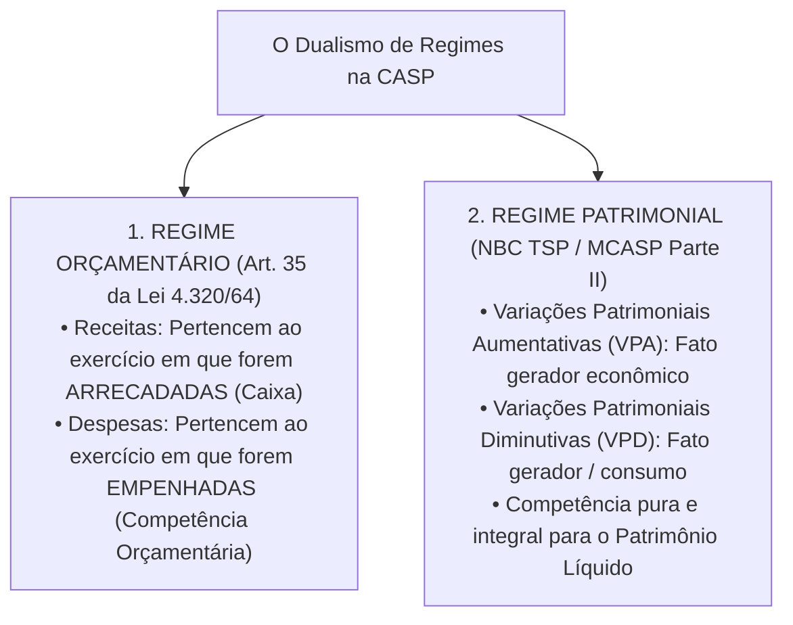
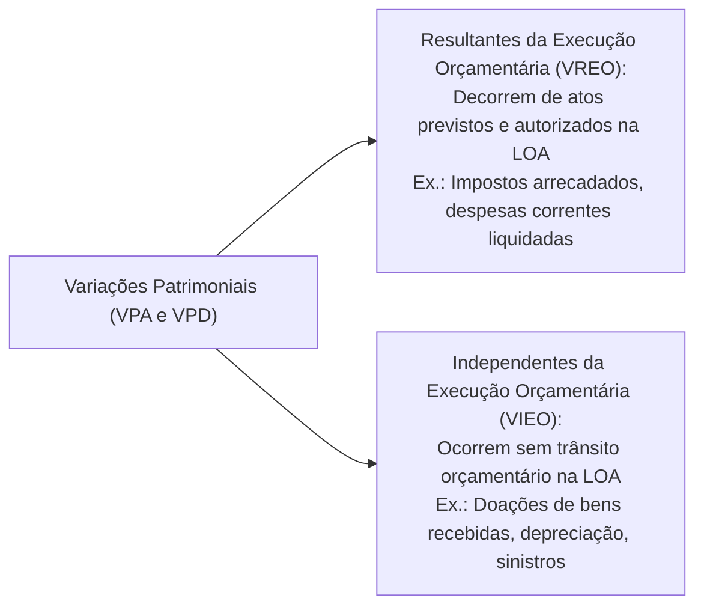
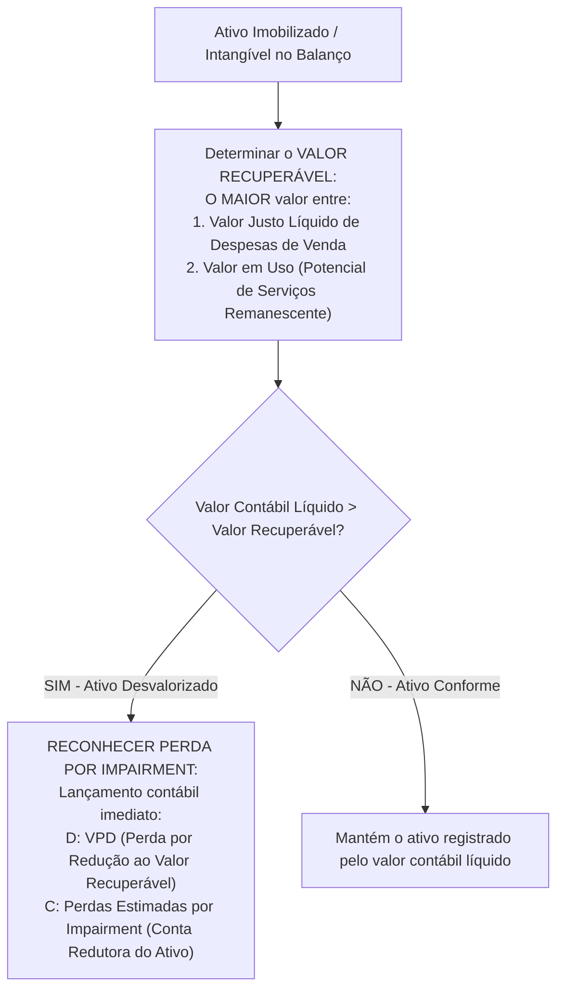

# 02 - Procedimentos Contábeis Orçamentários (PCO) e Patrimoniais (PCP) - MCASP 11ª Edição

> **Matéria:** Contabilidade Aplicada ao Setor Público (CASP)  
> **Cargo:** A01 – Técnico de Controle Externo – Especialidade: Técnico Administrativo  
> **Arquivo:** `02_mcasp_procedimentos_orcamentarios_e_patrimoniais.md`  

---

## 📌 Ementa / Itens do Edital

- Manual de Contabilidade Aplicada ao Setor Público (MCASP, 11ª edição):
    - **Parte I – Procedimentos Contábeis Orçamentários (PCO):**
    - Regime Contábil Orçamentário (Artigo 35 da Lei nº 4.320/1964: Caixa para Receitas e Competência para Despesas);
    - Confronto analítico entre a execução orçamentária e as variações patrimoniais;
    - Variações Patrimoniais Quantitativas (Aumentativas e Diminutivas) e Qualitativas (Fatos Permutativos);
    - Variações Resultantes da Execução Orçamentária vs. Variações Independentes da Execução Orçamentária;
    - **Parte II – Procedimentos Contábeis Patrimoniais (PCP):**
    - Princípio da Competência aplicado aos fatos patrimoniais (reconhecimento de VPA e VPD pelo fato gerador econômico);
    - Ativo Imobilizado: reconhecimento, mensuração inicial ao custo e mensuração subsequente;
    - Bens de Uso Comum do Povo e Bens de Infraestrutura: critérios de reconhecimento no Balanço Patrimonial;
    - Depreciação, Amortização e Exaustão no setor público: valor depreciável, valor residual, vida útil econômica e ativos não depreciáveis;
    - Teste de Redução ao Valor Recuperável de Ativos (*Impairment Test*): conceitos e aplicação a ativos geradores e não geradores de caixa;
    - Provisões e desreconhecimento de ativos.

---

## 🧭 Sumário

1. [O Dualismo de Regimes na Contabilidade Pública (Orçamentário vs. Patrimonial)](#1-o-dualismo-de-regimes-na-contabilidade-publica-orcamentario-vs-patrimonial)
    1. [O Regime Orçamentário da Lei nº 4.320/1964 (Art. 35)](#11-o-regime-orcamentario-da-lei-no-43201964-art-35)
    2. [O Regime Patrimonial da Competência Integral (MCASP e NBC TSP)](#12-o-regime-patrimonial-da-competencia-integral-mcasp-e-nbc-tsp)
    3. [Quadro Sinótico de Confronto e Fatos Contábeis](#13-quadro-sinotico-de-confronto-e-fatos-contabeis)
    4. [Teste 270](#Teste-270)
    5. [Teste 271](#Teste-271)
    6. [Teste 272](#Teste-272)
2. [Variações Patrimoniais: Classificações e Origens](#2-variacoes-patrimoniais-classificacoes-e-origens)
    1. [Variações Qualitativas (Permutativas) vs. Quantitativas (Modificativas)](#21-variacoes-qualitativas-permutativas-vs-quantitativas-modificativas)
    2. [Variações Resultantes vs. Independentes da Execução Orçamentária](#22-variacoes-resultantes-vs-independentes-da-execucao-orcamentaria)
    3. [Teste 273](#Teste-273)
    4. [Teste 274](#Teste-274)
3. [Procedimentos Patrimoniais Aplicados ao Ativo Imobilizado](#3-procedimentos-patrimoniais-aplicados-ao-ativo-imobilizado)
    1. [Mensuração Inicial, Custos Atribuíveis e Bens de Infraestrutura](#31-mensuracao-inicial-custos-atribuiveis-e-bens-de-infraestrutura)
    2. [Depreciação, Amortização e Exaustão: Conceitos e Fórmulas](#32-depreciacao-amortizacao-e-exaustao-conceitos-e-formulas)
    3. [Ativos que NÃO Sofrem Depreciação Periódica](#33-ativos-que-nao-sofrem-depreciacao-periodica)
    4. [Teste 275](#Teste-275)
    5. [Teste 276](#Teste-276)
    6. [Teste 277](#Teste-277)
4. [Teste de Redução ao Valor Recuperável de Ativos (*Impairment Test*)](#4-teste-de-reducao-ao-valor-recuperavel-de-ativos-impairment-test)
    1. [Mecanismo de Aferição do Valor Recuperável](#41-mecanismo-de-afericao-do-valor-recuperavel)
    2. [Reconhecimento Contábil da Perda e Reversões](#42-reconhecimento-contabil-da-perda-e-reversoes)
    3. [Teste 278](#Teste-278)
    4. [Teste 279](#Teste-279)
5. [🌐 Fontes Oficiais & Manuais Técnicos Recomendados](#fontes-oficiais-manuais-tecnicos-recomendados)

---

## 1. O Dualismo de Regimes na Contabilidade Pública (Orçamentário vs. Patrimonial)

A Contabilidade Aplicada ao Setor Público (CASP) no Brasil opera com a convivência harmônica e integrada de dois regimes contábeis fundamentais:

### 1.1 O Regime Orçamentário da Lei nº 4.320/1964 (Art. 35)
O art. 35 da Lei Federal nº 4.320/1964 disciplina a apropriação dos créditos orçamentários sob um regime misto:

- **Receita Orçamentária:** Pertence ao exercício financeiro em que for efetivamente **arrecadada** pelos agentes bancários credenciados (regime de caixa puro na dimensão orçamentária);
- **Despesa Orçamentária:** Pertence ao exercício financeiro em que for legalmente **empenhada** pela autoridade ordenadora (regime de competência orçamentária, assegurando a reserva do crédito antes da contratação).

### 1.2 O Regime Patrimonial da Competência Integral (MCASP e NBC TSP)
No âmbito patrimonial (MCASP e NBC TSP Estrutura Conceitual), vigora o **regime de competência puro e irrestrito**:

- Os efeitos das transações e demais eventos contábeis são reconhecidos quando ocorrem os seus respectivos fatos geradores econômicos, independentemente do recebimento ou pagamento em dinheiro de caixa;
- As receitas patrimoniais denominam-se **Variações Patrimoniais Aumentativas (VPA)** e as despesas patrimoniais denominam-se **Variações Patrimoniais Diminutivas (VPD)**.

### 1.3 Quadro Sinótico de Confronto e Fatos Contábeis

| Evento Prático Governamental | Enfoque Orçamentário (Lei nº 4.320/1964) | Enfoque Patrimonial (MCASP / NBC TSP) | Natureza do Fato Contábil |
| :--- | :--- | :--- | :--- |
| **Lançamento do IPTU ou IPVA pelo Fisco** | Não há receita orçamentária realizada (aguarda arrecadação). | **Ocorre VPA** (direito líquido e certo gerado pelo fato gerador tributário). | **Fato Modificativo Aumentativo** (aumenta o PL da entidade). |
| **Contribuinte paga o tributo no caixa bancário** | **Receita Orçamentária Realizada** (estágio da arrecadação/recolhimento). | Nenhum impacto no resultado patrimonial! (D: Caixa / C: Tributos a Receber). | **Fato Permutativo / Qualitativo** (o PL não é alterado). |
| **Emissão de Nota de Empenho de material** | **Despesa Orçamentária Executada** (reserva de crédito na LOA). | Não há fato patrimonial (nenhum bem ou serviço ingressou no patrimônio). | **Ato Potencial** (registro puramente orçamentário e de controle). |
| **Recebimento e Atesto do material (Liquidação)** | Despesa orçamentária liquidada (passivo orçamentário a pagar). | **Ocorre VPD ou Ativo** (se for material de consumo imediato gera VPD; se for estoque/imobilizado gera ativo). | **Fato Modificativo Diminutivo** (se consumo) ou **Permutativo** (se estocagem). |
| **Ordem Bancária de Pagamento emitida** | Despesa orçamentária paga (extingue dotação e passivo). | Extingue o passivo financeiro com saída de disponibilidades (D: Fornecedores / C: Caixa). | **Fato Permutativo** (não afeta o PL). |

---

### Teste 270
**(FCC - Adaptada / Analista de Planejamento e Orçamento)**
No tocante ao regime contábil aplicado no setor público, analise as afirmativas a seguir:

I. De acordo com a Lei nº 4.320/1964 (Art. 35), o regime orçamentário é misto, pertencendo ao exercício as receitas nele arrecadadas e as despesas nele legalmente empenhadas.  

II. Segundo as normas NBC TSP e o MCASP, o regime contábil patrimonial é o de competência, exigindo o reconhecimento de receitas e despesas patrimoniais no momento da ocorrência de seus respectivos fatos geradores.  

III. A arrecadação de tributos em dinheiro gera concomitantemente uma receita orçamentária realizada e um fato permutativo no patrimônio líquido da entidade caso o crédito tributário já tenha sido lançado previamente.  

Está correto o que se afirma em:

* **A)** I, apenas.
* **B)** I e II, apenas.
* **C)** II e III, apenas.
* **D)** I e III, apenas.
* **E)** I, II e III.

---

> **Comentário Detalhado:**
>
> - **A)** Incorreta. Os itens II e III também são verdadeiros, tornando a alternativa incompleta.
> - **B)** Incorreta. Deixa de incluir o item III, que expressa corretamente a dinâmica da CASP.
> - **C)** Incorreta. O item I é a previsão literal do art. 35 da Lei nº 4.320/1964.
> - **D)** Incorreta. O item II reflete o preceito central do MCASP moderno (regime de competência patrimonial).
> - **E)** Correta. Todas as três assertivas são verdadeiras: o item I reproduz o art. 35 da Lei Federal nº 4.320/1964 (regime orçamentário misto); o item II reflete a consolidação da competência pura para o patrimônio pelas NBC TSP e MCASP; e o item III descreve com rigor a transação de arrecadação de tributos cujo lançamento ocorreu em momento anterior (no lançamento houve VPA; na arrecadação há receita orçamentária realizada e simples permutação patrimonial entre Disponibilidades e Créditos a Receber).
> 
> **Gabarito: E**

---

### Teste 271
**(FCC - Adaptada / Analista Contábil de Controle)**
Determinada entidade governamental adquiriu, mediante regular processo licitatório, um lote de microcomputadores para suas secretarias no valor total de R$ 100.000,00. A despesa foi devidamente empenhada, liquidada com o recebimento das máquinas e integralmente paga em dinheiro à empresa fornecedora.

Sob a ótica patrimonial e orçamentária, essa transação completa caracteriza-se como:

* **A)** Fato modificativo aumentativo que gera Variação Patrimonial Aumentativa.
* **B)** Fato contábil qualitativo (permutativo), que não altera o valor do Patrimônio Líquido da entidade.
* **C)** Fato modificativo diminutivo que reduz o Patrimônio Líquido em R$ 100.000,00 no ato da compra no âmbito da administração pública direta e indireta.
* **D)** Variação patrimonial independente da execução orçamentária.
* **E)** Transação extraorçamentária que dispensa registro no subsistema patrimonial.

---

> **Comentário Detalhado:**
>
> - **A)** Incorreta. A compra de bens com desembolso financeiro de caixa não gera VPA (receita patrimonial).
> - **B)** Correta. Trata-se de um típico fato permutativo (qualitativo) entre contas do Ativo: ocorreu a diminuição de R$ 100.000,00 na conta Caixa/Bancos (Ativo Circulante) e o aumento simultâneo de R$ 100.000,00 na conta de Equipamentos e Material Permanente (Ativo Não Circulante - Imobilizado). O total do Ativo e a Situação Patrimonial Líquida permaneceram rigorosamente inalterados.
> - **C)** Incorreta. A redução do patrimônio líquido ocorrerá de forma paulatina e distribuída nos exercícios seguintes por meio do registro da depreciação mensal.
> - **D)** Incorreta. A transação resultou diretamente da execução de dotação de capital fixada na LOA (variação resultante da execução orçamentária).
> - **E)** Incorreta. É despesa orçamentária própria de capital, plenamente escriturada nos subsistemas orçamentário e patrimonial do PCASP.
> 
> **Gabarito: B**

---

### Teste 272
**(FCC - Adaptada / Analista Contábil)**
No âmbito da Contabilidade Aplicada ao Setor Público (CASP), a coexistência dos regimes orçamentário e patrimonial decorre da aplicação simultânea da Lei Federal nº 4.320/1964 e das normas internacionais de contabilidade (NBC TSP / MCASP).

A respeito da aplicação dos regimes contábeis, assinale a afirmativa correta:

* **A)** A despesa pública sob o enfoque patrimonial é reconhecida segundo o princípio da competência (pela ocorrência do fato gerador), independentemente do estágio da execução orçamentária (empenho ou liquidação).
* **B)** A receita orçamentária é reconhecida pelo regime de competência no momento do lançamento tributário da dívida ativa.
* **C)** O regime orçamentário adota a competência integral para as receitas públicas e a caixa estrita para as despesas públicas.
* **D)** O reconhecimento patrimonial de uma obrigação pública subordina-se à emissão prévia de autorização de saque pelo Tesouro Estadual no âmbito da administração pública direta e indireta.
* **E)** O fato gerador da despesa coincide obrigatoriamente com o ato administrativo da fixação orçamentária anual constante da LOA.

---

> **Comentário Detalhado:**
>
> - **A)** Correta. Sob o enfoque **patrimonial**, aplica-se o regime de competência tanto para receitas (VPA) quanto para despesas (VPD): a VPD deve ser reconhecida no momento em que ocorre o fato gerador (ex.: consumo de material, prestação do serviço ou fruição do trabalho), independentemente do estágio orçamentário.
> - **B)** Incorreta. Sob o enfoque orçamentário (art. 35, I da Lei nº 4.320/1964), a receita orçamentária é reconhecida no momento da arrecadação (regime de caixa orçamentário).
> - **C)** Incorreta. O art. 35 da Lei nº 4.320/1964 prevê regime de caixa para as receitas e competência para as despesas no orçamento (regime misto orçamentário).
> - **D)** Incorreta. As obrigações patrimoniais surgem com o fato gerador, independentemente de saques financeiros.
> - **E)** Incorreta. A fixação apenas autoriza o limite de gasto; não gera fato patrimonial.
> 
> **Gabarito: A**

---

## 2. Variações Patrimoniais: Classificações e Origens

### 2.1 Variações Qualitativas (Permutativas) vs. Quantitativas (Modificativas)
- **Variações Qualitativas (Fatos Permutativos):** São transações que alteram a composição dos elementos patrimoniais (Ativos e Passivos) sem provocar qualquer variação no montante líquido do Patrimônio Líquido (ex.: compra à vista de equipamentos, recebimento de créditos tributários lançados anteriormente, pagamento de fornecedores);
- **Variações Quantitativas (Fatos Modificativos):** Transações que impactam diretamente e alteram o valor total do Patrimônio Líquido da entidade pública:
    - *Variação Patrimonial Aumentativa (VPA):* Transação que eleva o PL (ex.: arrecadação de tributos não lançados, doações de bens recebidas de terceiros, juros ativos ganhos em aplicações);
    - *Variação Patrimonial Diminutiva (VPD):* Transação que reduz o PL (ex.: consumo de material de expediente, folha de salários do funcionalismo, quotas de depreciação mensal).

### 2.2 Variações Resultantes vs. Independentes da Execução Orçamentária

> 🚨 **ALERTA DE PROVA / PEGADINHA FCC:**  
>
> - **A Depreciação é despesa orçamentária? NÃO!** A depreciação é uma **Variação Patrimonial Diminutiva Independente da Execução Orçamentária (VIEO)**. Não exige empenho, dotação orçamentária na LOA nem liquidação; opera-se exclusivamente no subsistema patrimonial!  
> - **A Doação de imóvel recebida é receita orçamentária de capital? NÃO!** Não transita pela LOA nem envolve disponibilidade financeira em moeda. Trata-se de uma **VPA Independente da Execução Orçamentária (VIEO)** que eleva diretamente o Ativo Imobilizado e o Patrimônio Líquido do ente federativo.

---

### Teste 273
**(FCC - Adaptada / TCE-PI - Auditor de Controle Externo)**
Determinado órgão público estadual recebeu, em doação incondicional de particular, um terreno avaliado a valor justo de mercado em R$ 800.000,00 para futura construção de um posto fiscal de fronteira.

Sob a ótica do Manual de Contabilidade Aplicada ao Setor Público (MCASP 11ª edição):

* **A)** O recebimento do imóvel deve ser contabilizado como receita orçamentária de capital no estágio do recolhimento bancário.
* **B)** A transação representa uma Variação Patrimonial Aumentativa (VPA) independente da execução orçamentária, elevando o Patrimônio Líquido da entidade.
* **C)** O bem não pode ser registrado no ativo imobilizado até que a obra do posto fiscal seja integralmente concluída e aceita pela fiscalização no âmbito da administração pública direta e indireta.
* **D)** A operação constitui um fato meramente qualitativo (permutativo), uma vez que não envolveu fluxo financeiro em moeda corrente.
* **E)** O terreno recebido deverá sofrer depreciação periódica anual linear à alíquota contábil de 4% ao ano.

---

> **Comentário Detalhado:**
>
> - **A)** Incorreta. Doações de bens materiais não geram influxo de caixa financeiro nem constam na LOA, não constituindo receita orçamentária.
> - **B)** Correta. A doação de bens recebida amplia o ativo e o patrimônio líquido da entidade sem passar pelos estágios do orçamento (LOA), qualificando-se exatamente como uma Variação Patrimonial Aumentativa (VPA) Independente da Execução Orçamentária. O lançamento debita o Ativo Não Circulante (Imobilizado - Terrenos) e credita VPA no resultado.
> - **C)** Incorreta. O reconhecimento contábil do terreno ocorre no momento da obtenção de seu controle formal (escritura e posse), e não na futura edificação da obra.
> - **D)** Incorreta. Trata-se de fato quantitativo modificativo aumentativo, pois houve acréscimo de R$ 800.000,00 na Situação Patrimonial Líquida do ente.
> - **E)** Incorreta. Terrenos possuem vida útil econômica indefinida e, por expressa determinação contábil, não sofrem depreciação periódica.
> 
> **Gabarito: B**

---

### Teste 274
**(FCC - Adaptada / TCE-PI - Auditor de Controle Externo)**
Na Contabilidade Pública, as Variações Patrimoniais classificam-se quanto ao impacto sobre a situação líquida (qualitativas vs. quantitativas) e quanto à vinculação ao orçamento (resultantes vs. independentes da execução orçamentária).

Constitui uma Variação Patrimonial Diminutiva (VPD) **independente da execução orçamentária**:

* **A)** O reconhecimento mensal do encargo de depreciação do ativo imobilizado e a baixa de bens públicos em razão de sinistro/inutilização.
* **B)** O pagamento de salários e vencimentos aos servidores públicos estaduais mediante empenho ordinário no âmbito da administração pública direta e indireta.
* **C)** A aquisição de veículos novos mediante licitação e pagamento com recursos correntes.
* **D)** A contratação de serviços de consultoria técnica especializada com nota de empenho global.
* **E)** A amortização do principal da dívida pública contratual de longo prazo.

---

> **Comentário Detalhado:**
>
> - **A)** Correta. A depreciação, amortização, exaustão, perecimento de bens, sinistros e perdas por redução ao valor recuperável (*impairment*) constituem VPDs que afetam negativamente a situação patrimonial líquida **sem envolver execução de dotação orçamentária**, sendo, portanto, VPDs independentes da execução orçamentária.
> - **B)** Incorreta. Despesa com pessoal afeta o patrimônio, mas é resultante da execução orçamentária.
> - **C)** Incorreta. Aquisição de veículos é variação qualitativa (troca de caixa por imobilizado).
> - **D)** Incorreta. Serviços prestados são VPDs resultantes da execução do orçamento.
> - **E)** Incorreta. Amortização é fato permutativo (baixa de passivo com baixa de caixa).
> 
> **Gabarito: A**

---

## 3. Procedimentos Patrimoniais Aplicados ao Ativo Imobilizado

### 3.1 Mensuração Inicial, Custos Atribuíveis e Bens de Infraestrutura
- **Mensuração Inicial:** O ativo imobilizado deve ser mensurado inicialmente pelo seu **custo de aquisição ou construção**, o qual engloba o preço de compra (deduzidos descontos comerciais e abatimentos), tributos não recuperáveis e todos os custos diretamente atribuíveis necessários para colocar o bem em local e condições operacionais de funcionamento pretendidos pela administração pública.
- **Bens de Infraestrutura e Bens de Uso Comum do Povo:** Rodovias, pontes, praças públicas, redes de esgoto e iluminação pública que estejam sob o controle da entidade governamental e possuam potencial de serviços mensurável com confiabilidade **devem ser formalmente reconhecidos no Ativo Não Circulante (Imobilizado)** do Balanço Patrimonial, contrariando a prática histórica de lançar tais obras como mera despesa orçamentária extinta.

### 3.2 Depreciação, Amortização e Exaustão: Conceitos e Fórmulas
Conforme a NBC TSP 07 e o MCASP:

- **Depreciação:** Alocação sistemática do valor depreciável de um **ativo tangível (corpóreo)** ao longo de sua vida útil econômica estimada;
- **Amortização:** Alocação sistemática do valor amortizável de um **ativo intangível (incorpóreo)** com vida útil definida (ex.: softwares, licenças governamentais adquiridas);
- **Exaustão:** Redução do valor de recursos minerais, hídricos ou florestais decorrente de sua exploração produtiva contínua pelo Estado.

$$\text{Valor Depreciável} = \text{Custo Histórico de Aquisição} - \text{Valor Residual Estimado}$$

$$\text{Quota Periódica de Depreciação (Método Linear)} = \frac{\text{Valor Depreciável}}{\text{Vida Útil Econômica}}$$

- **Lançamento Contábil da Depreciação Periódica:**
    - `D` - Variação Patrimonial Diminutiva (VPD - Depreciação de Bens Móveis/Imóveis);
    - `C` - Depreciação Acumulada (Conta retificadora redutora do Ativo Imobilizado).

### 3.3 Ativos que NÃO Sofrem Depreciação Periódica
O MCASP elenca expressamente os ativos públicos que não estão sujeitos à depreciação:

1. **Terrenos:** Possuem vida útil econômica indefinida (ressalvadas áreas destinadas a aterros sanitários ou pedreiras cuja capacidade física se esgota);
2. **Obras de arte, relíquias e antiguidades:** Cujo valor cultural, artístico ou histórico seja inestimável e não sofra perda sistemática de potencial de serviços ao longo do tempo;
3. Bens de valor histórico com vida útil indeterminada mantidos em museus e acervos cívicos.

---

### Teste 275
**(FCC - Adaptada / TCE-RS - Auditor de Controle Externo)**
Em relação aos conceitos de depreciação, amortização e teste de recuperabilidade (*impairment*) aplicados aos ativos do setor público, assinale a opção correta:

* **A)** O valor depreciável de um bem corresponde ao seu custo histórico de aquisição somado ao valor residual estimado ao término de sua vida útil.
* **B)** As quotas de depreciação mensal apuradas para a frota de ambulâncias públicas exigem a prévia emissão de nota de empenho ordinário no orçamento da Secretaria de Saúde em estrita conformidade com as normas legais e regulamentares aplicáveis.
* **C)** O teste de recuperabilidade é dispensável no setor público quando o ativo imobilizado não for utilizado diretamente na geração de receitas comerciais ou de lucro.
* **D)** A redução ao valor recuperável ocorre quando o valor contábil líquido de um ativo for superior ao seu valor recuperável, devendo a perda ser reconhecida no resultado patrimonial como variação patrimonial diminutiva (VPD).
* **E)** A amortização aplica-se aos bens corpóreos que sofrem desgaste físico ou perecimento gradual ao longo do tempo.

---

> **Comentário Detalhado:**
>
> - **A)** Incorreta. O valor depreciável é calculado subtraindo-se o valor residual do custo histórico de aquisição ($Custo - Valor\ Residual$).
> - **B)** Incorreta. A depreciação é um procedimento estritamente patrimonial (VPD independente da execução orçamentária), não dependendo de dotação na LOA nem de emissão de nota de empenho.
> - **C)** Incorreta. O teste de recuperabilidade aplica-se obrigatoriamente inclusive aos ativos não geradores de caixa, avaliando-se a perda de seu potencial de serviços à sociedade.
> - **D)** Correta. De acordo com a NBC TSP 09/10 e o MCASP, se o valor contábil líquido de um ativo for maior que o seu valor recuperável, a entidade pública deve reconhecer imediatamente a perda por desvalorização (*impairment*), lançando uma VPD no resultado em contrapartida a uma conta redutora do ativo imobilizado.
> - **E)** Incorreta. A amortização destina-se a ativos incorpóreos/intangíveis com vida útil definida; o desgaste sistemático de bens corpóreos tangíveis é objeto de depreciação.
> 
> **Gabarito: D**

---

### Teste 276
**(FCC - Adaptada / Técnico de Controle Externo)**
Uma viatura policial foi adquirida pelo Estado de Goiás por R$ 120.000,00. A vida útil estimada do veículo é de 5 anos (60 meses) e a comissão de avaliação patrimonial fixou um valor residual de R$ 20.000,00 para o final do período.

Utilizando o método das quotas constantes (linear) preconizado pelo MCASP, o valor depreciável do bem e o valor da quota mensal de depreciação a ser lançada como VPD são, respectivamente:

* **A)** R$ 120.000,00 e R$ 2.000,00.
* **B)** R$ 100.000,00 e R$ 1.666,67.
* **C)** R$ 100.000,00 e R$ 2.000,00.
* **D)** R$ 120.000,00 e R$ 1.666,67.
* **E)** R$ 140.000,00 e R$ 2.333,33.

---

> **Comentário Detalhado:**
>
> - **A)** Incorreta. Erra ao desconsiderar a dedução do valor residual no cálculo do valor depreciável.
> - **B)** Correta. O cálculo contábil é exato:  
>     1. **Valor Depreciável:** Custo de Aquisição (R$ 120.000,00) menos Valor Residual (R$ 20.000,00) = **R$ 100.000,00**.  
>     2. **Quota Mensal de Depreciação:** Valor Depreciável (R$ 100.000,00) dividido por 60 meses de vida útil = **R$ 1.666,67** por mês, lançada como VPD.
>
> - **C)** Incorreta. R$ 2.000,00 por mês seria a quota caso o valor residual fosse zero (120.000 / 60).
> - **D)** Incorreta. O valor depreciável não é o custo bruto (120.000,00), pois há valor residual a ser deduzido.
> - **E)** Incorreta. Erra ao somar o valor residual ao custo em vez de subtrair.
> 
> **Gabarito: B**

---

### Teste 277
**(FCC - Adaptada / TCE-SC - Auditor de Controle Externo)**
Segundo as disposições do MCASP e da NBC TSP 07 (Ativo Imobilizado), a depreciação de um bem público:

* **A)** Deve iniciar-se no momento em que o ativo estiver disponível para uso, no local e nas condições necessárias para operar da forma pretendida pela administração, e não cessa quando o ativo se torna ocioso.
* **B)** Inicia-se unicamente após a quitação total da última fatura emitida pelo fornecedor da obra ou equipamento.
* **C)** É calculada sobre o valor original total do bem, sendo expressamente proibida a dedução de qualquer valor residual na fórmula de cálculo em estrita conformidade com as normas legais e regulamentares aplicáveis.
* **D)** Aplica-se compulsoriamente a todos os terrenos e obras de arte de acervos públicos históricos.
* **E)** Interrompe-se temporariamente sempre que o órgão público entrar em recesso administrativo parlamentar ou judiciário.

---

> **Comentário Detalhado:**
>
> - **A)** Correta. A depreciação de um ativo inicia-se quando ele está disponível para uso (instalado e pronto para operar). A depreciação não cessa quando o ativo se torna ocioso ou é retirado temporariamente de uso, a menos que o ativo esteja totalmente depreciado.
> - **B)** Incorreta. A depreciação vincula-se à disponibilidade operacional do ativo, e não a liquidações financeiras.
> - **C)** Incorreta. A base depreciável é exatamente o valor contábil deduzido do **valor residual** estimado.
> - **D)** Incorreta. Terrenos têm vida útil indefinida e obras de arte/acervos históricos raramente depreciam, estando dispensados de depreciação.
> - **E)** Incorreta. Recessos administrativos não paralisam a perda temporal de valor do ativo.
> 
> **Gabarito: A**

---

## 4. Teste de Redução ao Valor Recuperável de Ativos (*Impairment Test*)

### 4.1 Mecanismo de Aferição do Valor Recuperável
O objetivo do teste de recuperabilidade (NBC TSP 09 e 10 c/c MCASP) é garantir que nenhum ativo figure no Balanço Patrimonial por valor superior ao seu **Valor Recuperável**:

### 4.2 Reconhecimento Contábil da Perda e Reversões
- Se o **Valor Contábil Líquido** (custo de aquisição menos depreciação acumulada) for superior ao **Valor Recuperável**, o valor do ativo deve ser reduzido ao valor recuperável;
- Essa redução é contabilizada como **perda por impairment** através de uma conta redutora do ativo imobilizado, tendo como contrapartida uma **Variação Patrimonial Diminutiva (VPD)** no resultado do exercício;
- Caso cessem as razões econômicas que motivaram a perda em exercícios futuros, a norma permite a reversão da perda até o limite do saldo que o ativo teria se nenhuma perda tivesse sido outrora reconhecida.

---

### Teste 278
**(FCC - Adaptada / SEFAZ-PE - Auditor Fiscal do Tesouro Estadual)**
Em relação ao Teste de Redução ao Valor Recuperável (*Impairment Test*), disciplinado pela NBC TSP 09 (Ativos Não Geradores de Caixa) e NBC TSP 10 (Ativos Geradores de Caixa), é correto afirmar:

* **A)** Se o valor recuperável de um ativo for inferior ao seu valor contábil líquido, o valor contábil do ativo deve ser reduzido ao seu valor recuperável, reconhecendo-se essa redução imediatamente como Variação Patrimonial Diminutiva (VPD).
* **B)** O teste de recuperabilidade é aplicável exclusivamente a empresas estatais dependentes, sendo os órgãos da Administração Direta dispensados de aferir perdas patrimoniais em estrita conformidade com as normas legais e regulamentares aplicáveis.
* **C)** Uma perda por redução ao valor recuperável reconhecida em períodos anteriores para um ativo jamais poderá ser revertida em exercícios futuros.
* **D)** O valor recuperável de um ativo não gerador de caixa corresponde unicamente ao valor líquido de venda no mercado de leilões públicos.
* **E)** A constatação de obsolescência tecnológica relevante de um equipamento de TI não constitui indício para realização do teste de redução ao valor recuperável.

---

> **Comentário Detalhado:**
>
> - **A)** Correta. A regra matriz do *impairment* estabelece: constatado que o valor recuperável (maior entre valor justo líquido de despesas de venda e valor em uso) é inferior ao valor contábil líquido, a entidade deve reconhecer perda por desvalorização (VPD) e conta retificadora do ativo.
> - **B)** Incorreta. Aplica-se a todas as entidades do setor público abrangidas pelas NBC TSP.
> - **C)** Incorreta. As normas preveem a reversão de perdas por *impairment* caso as estimativas que fundamentaram a redução tenham se alterado favoravelmente em períodos posteriores.
> - **D)** Incorreta. O valor recuperável é o maior entre o valor justo menos custos de venda e o valor em uso (potencial de serviços remanescente).
> - **E)** Incorreta. A obsolescência tecnológica ou física é indício explícito para a aplicação obrigatória do teste.
> 
> **Gabarito: A**

---

### Teste 279
**(FCC - Adaptada / TCE-GO - Analista de Controle Externo)**
Determinado órgão público estadual efetuou a aquisição de um imóvel no valor de R$ 5.000.000,00 mediante regular processo licitatório, efetuando o pagamento à vista através de ordem bancária vinculada a dotação de despesa de capital (GND 4 - Investimentos).

Sob o enfoque estritamente patrimonial da Contabilidade Pública, essa transação corresponde a:

* **A)** Uma variação patrimonial qualitativa (ou permutativa), que não acarreta alteração no montante do patrimônio líquido do órgão, ocorrendo apenas permuta entre elementos do ativo (redução de caixa e aumento do ativo imobilizado).
* **B)** Uma variação patrimonial diminutiva quantitativa, reduzindo imediatamente o patrimônio líquido da entidade em R$ 5.000.000,00 no âmbito da administração pública direta e indireta.
* **C)** Uma variação patrimonial aumentativa orçamentária pura, que eleva o superávit financeiro do exercício.
* **D)** Um fato contábil misto aumentativo, pois os imóveis públicos não se desvalorizam economicamente.
* **E)** Um ato potencial ativo a ser escriturado apenas nas classes 7 e 8 do PCASP.

---

> **Comentário Detalhado:**
>
> - **A)** Correta. A aquisição de bens do ativo imobilizado (bens de capital) com recursos do ativo circulante (disponibilidades) constitui **fato contábil permutativo (variação qualitativa)**: altera a composição qualitativa do patrimônio (sai dinheiro do banco e entra imóvel no imobilizado), mantendo inalterado o valor do Patrimônio Líquido.
> - **B)** Incorreta. Não há redução do Patrimônio Líquido, pois o Estado recebeu um ativo de valor equivalente.
> - **C)** Incorreta. Não gerou aumento de PL nem receita patrimonial.
> - **D)** Incorreta. Não se trata de fato misto, mas permutativo puro no momento da aquisição.
> - **E)** Incorreta. É fato contábil patrimonial efetivo, registrado nas classes 1 (Ativo).
> 
> **Gabarito: A**

---

## 🌐 Fontes Oficiais & Manuais Técnicos Recomendados

* [Tesouro Transparente - MCASP 11ª Edição (Parte II - Procedimentos Patrimoniais - PCP)](https://www.tesourotransparente.gov.br/publicacoes/manual-de-contabilidade-aplicada-ao-setor-publico-mcasp/2024/26) - Variações Patrimoniais Aumentativas (VPA), Diminutivas (VPD), mensuração de ativos, reavaliação, depreciação e provisões.
* [Tesouro Transparente - MCASP 11ª Edição (Parte I - Procedimentos Orçamentários - PCO)](https://www.tesourotransparente.gov.br/publicacoes/manual-de-contabilidade-aplicada-ao-setor-publico-mcasp/2024/26) - Regime orçamentário (caixa para receitas e competência para despesas) vs. Regime patrimonial (competência plena).
* [Lei Federal nº 4.320/1964 - Do Patrimônio Público (Arts. 94 a 100)](https://www.planalto.gov.br/ccivil_03/leis/l4320.htm) - Inventário, avaliação de bens móveis e imóveis, créditos e valores públicos.
* [Decreto nº 10.540/2020 (SIAFIC e Contabilidade Patrimonial)](https://www.planalto.gov.br/ccivil_03/_ato2019-2022/2020/decreto/d10540.htm) - Requisitos tecnológicos e operacionais para registro de estoques, imobilizado e intangíveis.
* [TCE-GO - Prestação de Contas e Análise Patrimonial](https://portal.tce.go.gov.br/prestacao-de-contas) - Normas do Tribunal de Contas para prestação de contas com evidenciação patrimonial e depreciação acumulada.
* BEZERRA FILHO, João Eudes. **Contabilidade Aplicada ao Setor Público: Teoria e Exercícios**. 3. ed. São Paulo: Atlas, 2021. (Cap. 3 - Procedimentos Contábeis Orçamentários; Cap. 4 - Procedimentos Contábeis Patrimoniais: VPA, VPD e Depreciação).
* FEIJÓ, Paulo Henrique et al. **Curso de Contabilidade Aplicada ao Setor Público**. 8. ed. Brasília: Gestão Pública, 2022. (Cap. 5 - Variações Patrimoniais e Mensuração de Ativos).
* PISCITELLI, Roberto Bocaccio; TIMÓTEO, Alfredo. **Contabilidade Pública: Uma Abordagem da Administração Financeira Pública**. 14. ed. São Paulo: Atlas, 2019. (Cap. 6 - Procedimentos Patrimoniais).
