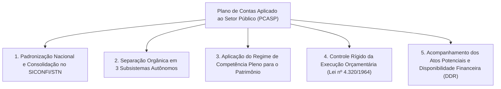
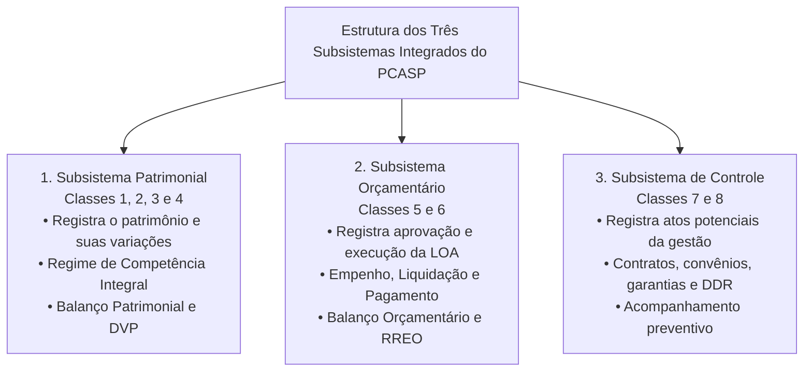
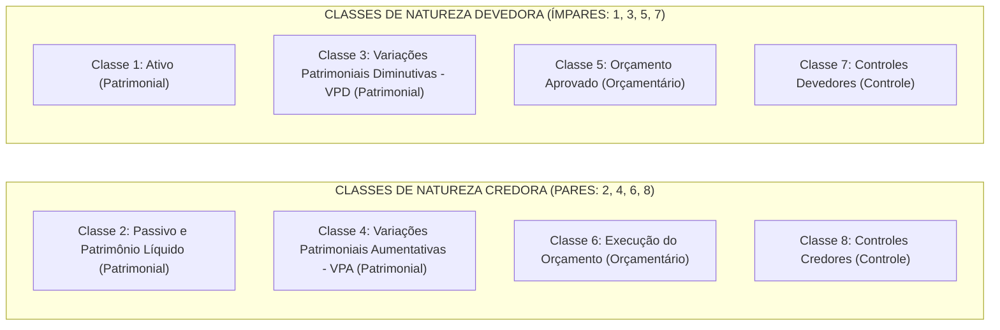
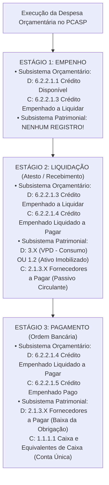

# 03 - Plano de Contas Aplicado ao Setor Público (PCASP) e Lançamentos Contábeis

> **Matéria:** Contabilidade Aplicada ao Setor Público (CASP)  
> **Cargo:** A01 – Técnico de Controle Externo – Especialidade: Técnico Administrativo  
> **Arquivo:** `03_pcasp_estrutura_e_lancamentos_contabeis.md`  

---

## 📌 Ementa / Itens do Edital

- Plano de Contas Aplicado ao Setor Público (PCASP - MCASP Parte IV):
    - Conceito, objetivos e diretrizes da padronização contábil nacional (SICONFI / Secretaria do Tesouro Nacional);
    - Estrutura codificada do plano de contas: 7 níveis de detalhamento (Classe, Grupo, Subgrupo, Título, Subtítulo, Item e Subitem);
    - Os três subsistemas contábeis integrados: Patrimonial, Orçamentário e de Controle;
    - As oito classes de contas do PCASP e sua natureza de saldo (Devedora ou Credora):
    - **Classe 1:** Ativo (Natureza Devedora);
    - **Classe 2:** Passivo e Patrimônio Líquido (Natureza Credora);
    - **Classe 3:** Variações Patrimoniais Diminutivas - VPD (Natureza Devedora);
    - **Classe 4:** Variações Patrimoniais Aumentativas - VPA (Natureza Credora);
    - **Classe 5:** Orçamento Aprovado (Natureza Devedora);
    - **Classe 6:** Execução do Orçamento (Natureza Credora);
    - **Classe 7:** Controles Devedores (Natureza Devedora);
    - **Classe 8:** Controles Credores (Natureza Credora);
- Regras de escrituração e mecânica das partidas dobradas:
    - Autonomia dos subsistemas e fechamento das partidas dobradas dentro de cada subsistema;
    - Lançamento de aprovação da Lei Orçamentária Anual (previsão da receita e fixação da despesa);
    - Lançamentos da execução da despesa orçamentária: empenho, liquidação e pagamento;
    - Lançamentos da execução da receita orçamentária: previsão, lançamento, arrecadação e recolhimento;
    - Contabilização dos atos potenciais (contratos administrativos celebrados, convênios, fianças e garantias);
    - Controle da Disponibilidade por Destinação de Recursos (DDR) e atributos das contas contábeis (P/F).

---

## 🧭 Sumário

1. [Fundamentos e Padronização Federativa do PCASP](#1-fundamentos-e-padronizacao-federativa-do-pcasp)
    1. [Objetivos Centrais e Abrangência Federativa Obrigatória](#11-objetivos-centrais-e-abrangencia-federativa-obrigatoria)
    2. [Os Atributos P/F das Contas Contábeis (Financeiro e Permanente)](#12-os-atributos-pf-das-contas-contabeis-financeiro-e-permanente)
    3. [Teste 280](#Teste-280)
2. [Estrutura Codificada do PCASP (Sete Níveis de Detalhamento)](#2-estrutura-codificada-do-pcasp-sete-niveis-de-detalhamento)
    1. [Estrutura Numérica Decimal (X.X.X.X.X.XX.XX)](#21-estrutura-numerica-decimal-xxxxxxxxx)
    2. [Detalhamento Federativo vs. Especificidades do Ente](#22-detalhamento-federativo-vs-especificidades-do-ente)
    3. [Teste 281](#Teste-281)
3. [Os Três Subsistemas de Informação Contábil e Regra da Autonomia](#3-os-tres-subsistemas-de-informacao-contabil-e-regra-da-autonomia)
    1. [Subsistema Patrimonial (Classes 1, 2, 3 e 4)](#31-subsistema-patrimonial-classes-1-2-3-e-4)
    2. [Subsistema Orçamentário (Classes 5 e 6)](#32-subsistema-orcamentario-classes-5-e-6)
    3. [Subsistema de Controle (Classes 7 e 8) e Atos Potenciais](#33-subsistema-de-controle-classes-7-e-8-e-atos-potenciais)
    4. [Regra da Autonomia e Fechamento das Partidas Dobradas](#34-regra-da-autonomia-e-fechamento-das-partidas-dobradas)
    5. [Teste 282](#Teste-282)
4. [As Oito Classes de Contas e a Natureza dos Saldos](#4-as-oito-classes-de-contas-e-a-natureza-dos-saldos)
    1. [A Regra de Ouro: Classes Ímpares (Devedoras) vs. Pares (Credoras)](#41-a-regra-de-ouro-classes-impares-devedoras-vs-pares-credoras)
    2. [Quadro Sinótico Consolidado das Classes](#42-quadro-sinotico-consolidado-das-classes)
    3. [Teste 283](#Teste-283)
    4. [Teste 284](#Teste-284)
5. [Mecânica dos Lançamentos Contábeis Típicos](#5-mecanica-dos-lancamentos-contabeis-tipicos)
    1. [Aprovação da Lei Orçamentária Anual (Previsão da Receita e Fixação da Despesa)](#51-aprovacao-da-lei-orcamentaria-anual-previsao-da-receita-e-fixacao-da-despesa)
    2. [Execução da Despesa Orçamentária Passo a Passo (Empenho, Liquidação e Pagamento)](#52-execucao-da-despesa-orcamentaria-passo-a-passo-empenho-liquidacao-e-pagamento)
    3. [Execução da Receita Orçamentária (Lançamento e Arrecadação/Recolhimento)](#53-execucao-da-receita-orcamentaria-lancamento-e-arrecadacaorecolhimento)
    4. [Escrituração dos Atos Potenciais e Controle de Contratos Administrativos](#54-escrituracao-dos-atos-potenciais-e-controle-de-contratos-administrativos)
    5. [Teste 285](#Teste-285)
    6. [Teste 286](#Teste-286)
    7. [Teste 287](#Teste-287)
    8. [Teste 288](#Teste-288)
    9. [Teste 289](#Teste-289)
6. [🌐 Fontes Oficiais & Manuais Técnicos Recomendados](#fontes-oficiais-manuais-tecnicos-recomendados)

---

## 1. Fundamentos e Padronização Federativa do PCASP

### 1.1 Objetivos Centrais e Abrangência Federativa Obrigatória
O **Plano de Contas Aplicado ao Setor Público (PCASP)** é a espinha dorsal da escrituração contábil e orçamentária governamental no Brasil. Instituído pela Secretaria do Tesouro Nacional (STN) e pelo Conselho Federal de Contabilidade (CFC), tem aplicação **obrigatória em todos os entes da Federação** (União, Estados, Distrito Federal e Municípios) e abrange todos os Poderes (Executivo, Legislativo e Judiciário), além do Ministério Público e dos Tribunais de Contas.

### 1.2 Os Atributos P/F das Contas Contábeis (Financeiro e Permanente)
Para conciliar o modelo contábil patrimonial moderno com as exigências legais da Lei Federal nº 4.320/1964, cada conta contábil das classes de Ativo (Classe 1) e Passivo (Classe 2) possui um atributo conceitual indicador de sua natureza financeira ou permanente:

- **Atributo `F` (Financeiro):** Identifica os bens, direitos e obrigações cuja realização ou liquidação independe de autorização orçamentária subsequente (ex.: Caixa, Bancos Conta Movimento, Restos a Pagar, depósitos de terceiros e retenções). Essas contas compõem o **Balanço Financeiro** e servem de base para o cálculo do **Superávit Financeiro** do art. 43, § 2º da Lei nº 4.320/1964;
- **Atributo `P` (Permanente):** Identifica os bens e obrigações cuja movimentação depende de autorização orçamentária prévia ou que decorrem de mutações patrimoniais duradouras (ex.: Edifícios, Veículos, Dívida Fundada Consolidada e Provisões Judiciais). Compõem o Balanço Patrimonial e não afetam diretamente o superávit financeiro de curto prazo.

---

### Teste 280
**(FCC - Adaptada / Analista Contábil)**
No Plano de Contas Aplicado ao Setor Público (PCASP), as contas contábeis do ativo e do passivo recebem atributos que identificam sua natureza e vinculação orçamentária e financeira, destacando-se o atributo **F/P** (Financeiro / Permanente).

A esse respeito, é correto afirmar:

* **A)** O atributo Financeiro (F) indica que a conta compreende créditos e obrigações cuja arrecadação ou pagamento independe de autorização orçamentária, servindo de base para a apuração do superávit financeiro da Lei nº 4.320/1964.
* **B)** O atributo Permanente (P) é atribuído exclusivamente às contas bancárias que integram a Conta Única do Tesouro Nacional.
* **C)** Todas as contas do patrimônio líquido recebem o atributo financeiro para possibilitar a imediata liquidação de passivos contingentes.
* **D)** O atributo financeiro e permanente foi totalmente extinto pelas normas internacionais de contabilidade (IPSAS), sendo vedada sua utilização pelo PCASP.
* **E)** As disponibilidades de caixa possuem atributo permanente por estarem vinculadas às leis orçamentárias futuras.

---

> **Comentário Detalhado:**
>
> - **A)** Correta. O art. 105 da Lei nº 4.320/1964 e o PCASP definem: o **Atributo Financeiro (F)** identifica as contas do Ativo e Passivo Financeiro cujas entradas ou saídas financeiras independem de autorização orçamentária ou decorrem de saldos orçamentários já autorizados (ex.: caixa, bancos, restos a pagar, depósitos de terceiros). Essas contas alimentam a apuração do superávit financeiro do art. 43, § 2º. O **Atributo Permanente (P)** identifica bens, créditos e obrigações que dependem de autorização orçamentária para alienação ou quitação de longo prazo.
> - **B)** Incorreta. Contas bancárias e disponibilidades recebem atributo Financeiro (F).
> - **C)** Incorreta. O atributo F/P aplica-se ao Ativo (Classe 1) e Passivo (Classe 2), não ao Patrimônio Líquido.
> - **D)** Incorreta. O PCASP manteve obrigatoriamente os atributos F/P para compatibilizar o balanço patrimonial com a Lei nº 4.320/1964.
> - **E)** Incorreta. Caixa e bancos são a expressão máxima do atributo financeiro.
> 
> **Gabarito: A**

---

## 2. Estrutura Codificada do PCASP (Sete Níveis de Detalhamento)

### 2.1 Estrutura Numérica Decimal (X.X.X.X.X.XX.XX)
A codificação contábil das contas no PCASP é organizada em **7 níveis hierárquicos de detalhamento**, totalizando **9 dígitos numéricos**:

$$\text{C . G . SG . T . ST . II . SS}$$

| Nível Hierárquico | Denominação | Dígitos | Exemplo Real no PCASP | Significado Prático |
| :---: | :--- | :---: | :--- | :--- |
| **1º** | **Classe** | 1 | `1` | Ativo |
| **2º** | **Grupo** | 1 | `1.1` | Ativo Circulante |
| **3º** | **Subgrupo** | 1 | `1.1.1` | Caixa e Equivalentes de Caixa |
| **4º** | **Título** | 1 | `1.1.1.1` | Caixa e Equivalentes de Caixa em Moeda Nacional |
| **5º** | **Subtítulo** | 1 | `1.1.1.1.1` | Caixa e Equivalentes em Moeda Nacional - Consolidação |
| **6º** | **Item** | 2 | `1.1.1.1.1.01` | Caixa Geral |
| **7º** | **Subitem** | 2 | `1.1.1.1.1.01.01` | Caixa do Tesouro Estadual de Goiás |

### 2.2 Detalhamento Federativo vs. Especificidades do Ente
- **Níveis 1 a 5 (PCASP Federativo):** A Secretaria do Tesouro Nacional padroniza de forma cogente e uniforme os níveis de 1 a 5 para toda a República Federativa do Brasil, sendo vedado aos Estados e Municípios criar ou alterar nomenclaturas nesses níveis.
- **Níveis 6 e 7 (Item e Subitem):** Podem ser abertos, detalhados e personalizados por cada ente federado (como o Estado de Goiás e o TCE-GO) para atender às suas particularidades operacionais e gerenciais de controle interno.

---

### Teste 281
**(FCC - Adaptada / TCE-PI - Auditor de Controle Externo)**
A estrutura codificada das contas contábeis no PCASP é padronizada nacionalmente pela Secretaria do Tesouro Nacional (STN) em níveis de desdobramento.

Sobre a estrutura padronizada das contas no PCASP, assinale a opção correta:

* **A)** Os primeiros níveis da codificação (Classe, Grupo, Subgrupo e Título) são de padronização nacional e de adoção obrigatória por todos os entes da Federação (União, Estados, DF e Municípios).
* **B)** Cada Estado e Município é livre para alterar a numeração das Classes de contas, podendo designar a Classe 1 para Despesas e a Classe 2 para Receitas.
* **C)** O PCASP é facultativo para os Tribunais de Contas e órgãos do Poder Judiciário, que podem utilizar planos de contas próprios do direito privado.
* **D)** O código da conta no PCASP possui 3 dígitos decimais no padrão internacional das normas IFRS.
* **E)** Os níveis de Subtítulo e Item de detalhamento não admitem nenhuma adaptação ou criação de contas pelas entidades federadas.

---

> **Comentário Detalhado:**
>
> - **A)** Correta. A estrutura federativa do PCASP padroniza obrigatoriamente os níveis superiores (Classe, Grupo, Subgrupo, Título e Subtítulo) para assegurar a comparabilidade nacional e a consolidação das contas públicas (BSN e SICONFI).
> - **B)** Incorreta. As Classes 1 a 8 são rígidas e imutáveis em todo o território nacional.
> - **C)** Incorreta. O PCASP é de adoção compulsória por todos os Poderes e órgãos de todas as esferas federativas.
> - **D)** Incorreta. O código estruturado do PCASP é composto por 7 níveis padronizados (`X.X.X.X.X.XX.XX`).
> - **E)** Incorreta. Os níveis inferiores mais analíticos podem ser detalhados pelos entes conforme suas peculiaridades de controle.
> 
> **Gabarito: A**

---

## 3. Os Três Subsistemas de Informação Contábil e Regra da Autonomia

O PCASP estrutura a contabilidade em três subsistemas autônomos e integrados:

### 3.1 Subsistema Patrimonial (Classes 1, 2, 3 e 4)
Registra, processa e evidencia os atos e fatos modificativos e permutativos que afetam a situação patrimonial do ente. Opera sob a ótica da **competência pura**, reconhecendo variações patrimoniais aumentativas (VPA) e diminutivas (VPD) no instante de ocorrência do fato gerador econômico.

### 3.2 Subsistema Orçamentário (Classes 5 e 6)
Registra a aprovação da proposta orçamentária (créditos iniciais e adicionais na LOA) e o ciclo de execução da receita e da despesa segundo as regras da Lei nº 4.320/1964.

### 3.3 Subsistema de Controle (Classes 7 e 8) e Atos Potenciais
Destina-se ao registro e monitoramento dos **atos potenciais** praticados pela administração pública. São eventos que não afetam de imediato o patrimônio líquido da entidade, mas que criam direitos ou obrigações futuras que poderão vir a modificá-lo (ex.: celebração de contratos administrativos de prestação de serviços continuados, convênios de repasse, concessão de avais e fianças a outros entes). Controla também a Disponibilidade por Destinação de Recursos (DDR).

### 3.4 Regra da Autonomia e Fechamento das Partidas Dobradas
> 🚨 **ALERTA DE PROVA / PEGADINHA FCC:**  
> No modelo do PCASP, vigora o **princípio da autonomia dos subsistemas contábeis**. O fechamento do método das partidas dobradas (Débito = Crédito) dá-se **estritamente dentro de cada subsistema**:  
>
> - Uma conta do Subsistema Patrimonial (Classes 1, 2, 3 e 4) **SEMPRE fecha com outra conta do Subsistema Patrimonial**;  
> - Uma conta do Subsistema Orçamentário (Classes 5 e 6) **SEMPRE fecha com outra conta do Subsistema Orçamentário**;  
> - Uma conta do Subsistema de Controle (Classes 7 e 8) **SEMPRE fecha com outra conta do Subsistema de Controle**!  
> **JAMAIS** ocorrerá lançamento contábil direto debitando uma conta orçamentária (ex.: Classe 6) e creditando uma conta patrimonial (ex.: Classe 1). Lançamentos cruzados entre subsistemas são terminantemente vedados pelo MCASP!

---

### Teste 282
**(FCC - Adaptada / TCE-RS - Auditor de Controle Externo)**
O PCASP estrutura as contas em três grandes subsistemas contábeis autônomos de informação: **Patrimonial**, **Orçamentário** e **de Controle**.

A respeito do princípio da autonomia dos subsistemas no PCASP, é correto afirmar:

* **A)** O método das partidas dobradas deve ser respeitado internamente em cada um dos subsistemas contábeis, de tal forma que um lançamento a débito em conta de subsistema orçamentário deve ter sua contrapartida a crédito em outra conta do mesmo subsistema orçamentário.
* **B)** É lícito efetuar um débito no subsistema orçamentário (Classe 6) tendo como contrapartida direta um crédito no subsistema patrimonial (Classe 1).
* **C)** O subsistema de controle destina-se unicamente ao registro dos saldos bancários e do ativo disponível.
* **D)** O subsistema patrimonial engloba as Classes 5 e 6 do PCASP para registrar a previsão da receita e fixação da despesa.
* **E)** As contas de compensação do subsistema de controle foram abolidas e substituídas pelo balanço financeiro.

---

> **Comentário Detalhado:**
>
> - **A)** Correta. A **Regra da Autonomia dos Subsistemas** estabelece que o fechamento das partidas dobradas ocorre dentro de cada subsistema: débitos no subsistema patrimonial fecham com créditos no subsistema patrimonial; débitos no orçamentário fecham com créditos no orçamentário; e débitos no controle fecham com créditos no controle. Jamais se cruza débito de uma classe orçamentária com crédito de classe patrimonial.
> - **B)** Incorreta. Viola frontalmente a regra de autonomia e isolamento dos subsistemas no PCASP.
> - **C)** Incorreta. O subsistema de controle (classes 7 e 8) registra atos potenciais (contratos, garantias, convênios) e controles específicos.
> - **D)** Incorreta. O subsistema patrimonial engloba as Classes 1, 2, 3 e 4. Classes 5 e 6 pertencem ao subsistema orçamentário.
> - **E)** Incorreta. O subsistema de controle (Classes 7 e 8) é amplamente ativo e estruturante no PCASP.
> 
> **Gabarito: A**

---

## 4. As Oito Classes de Contas e a Natureza dos Saldos

### 4.1 A Regra de Ouro: Classes Ímpares (Devedoras) vs. Pares (Credoras)
A arquitetura do PCASP foi concebida sob uma regra matemática de elegância e simplicidade que facilita a resolução de dezenas de questões da banca FCC:

$$\text{Classe Ímpar } (1, 3, 5, 7) \implies \text{Natureza Saldo DEVEDOR}$$

$$\text{Classe Par } (2, 4, 6, 8) \implies \text{Natureza Saldo CREDOR}$$

### 4.2 Quadro Sinótico Consolidado das Classes

| Classe | Nome da Classe | Subsistema | Natureza Típica | Função Primária de Registro |
| :---: | :--- | :---: | :---: | :--- |
| **1** | **Ativo** | Patrimonial | **Devedora** | Bens e direitos controlados pelo ente público. |
| **2** | **Passivo e Patrimônio Líquido** | Patrimonial | **Credora** | Obrigações exigíveis e situação líquida residual. |
| **3** | **VPD (Variação Patrimonial Diminutiva)** | Patrimonial | **Devedora** | Transações que diminuem o patrimônio líquido (despesas). |
| **4** | **VPA (Variação Patrimonial Aumentativa)** | Patrimonial | **Credora** | Transações que aumentam o patrimônio líquido (receitas). |
| **5** | **Orçamento Aprovado** | Orçamentário | **Devedora** | Registro da previsão da receita e fixação da despesa na LOA. |
| **6** | **Execução do Orçamento** | Orçamentário | **Credora** | Acompanhamento da receita arrecadada e despesa executada. |
| **7** | **Controles Devedores** | Controle | **Devedora** | Registro de atos potenciais ativos e DDR a executar. |
| **8** | **Controles Credores** | Controle | **Credora** | Registro de atos potenciais passivos e DDR executada. |

---

### Teste 283
**(FCC - Adaptada / DPE-RS - Analista: Área Contabilidade)**
Assinale a alternativa que apresenta a correta associação entre a classe de contas do PCASP, seu subsistema de informação e sua respectiva natureza de saldo:

* **A)** Classe 1 (Ativo) – Subsistema Patrimonial – Natureza Credora.
* **B)** Classe 4 (Variações Patrimoniais Aumentativas) – Subsistema Patrimonial – Natureza Devedora.
* **C)** Classe 5 (Orçamento Aprovado) – Subsistema Orçamentário – Natureza Credora.
* **D)** Classe 6 (Execução do Orçamento) – Subsistema Orçamentário – Natureza Credora.
* **E)** Classe 7 (Controles Devedores) – Subsistema de Controle – Natureza Credora.

---

> **Comentário Detalhado:**
>
> - **A)** Incorreta. A Classe 1 (Ativo) integra o subsistema patrimonial, mas tem natureza devedora (classe ímpar).
> - **B)** Incorreta. A Classe 4 (VPA) integra o subsistema patrimonial, mas possui natureza credora (classe par).
> - **C)** Incorreta. A Classe 5 (Orçamento Aprovado) pertence ao subsistema orçamentário e possui natureza devedora (classe ímpar).
> - **D)** Correta. A Classe 6 (Execução do Orçamento) integra o Subsistema Orçamentário e possui natureza credora (classe par), sendo utilizada para escriturar o acompanhamento da receita arrecadada e da despesa orçamentária executada.
> - **E)** Incorreta. A Classe 7 (Controles Devedores) pertence ao subsistema de controle e possui natureza devedora (classe ímpar).
> 
> **Gabarito: D**

---

### Teste 284
**(FCC - Adaptada / TCE-PI - Auditor de Controle Externo)**
De acordo com a estrutura do Plano de Contas Aplicado ao Setor Público (PCASP) estabelecida no MCASP, as contas pertencentes às classes 3 e 4 destinam-se a registrar, respectivamente:

* **A)** O orçamento aprovado e a execução do orçamento público.
* **B)** O ativo e o passivo circulante e não circulante.
* **C)** As variações patrimoniais diminutivas (VPD) e as variações patrimoniais aumentativas (VPA).
* **D)** Os controles devedores e os controles credores dos atos potenciais.
* **E)** As despesas fixadas na LOA e as receitas arrecadadas no exercício.

---

> **Comentário Detalhado:**
>
> - **A)** Incorreta. O orçamento aprovado e a sua execução são escriturados nas Classes 5 (Orçamento Aprovado) e 6 (Execução do Orçamento), pertencentes ao subsistema orçamentário.
> - **B)** Incorreta. O ativo circulante e não circulante pertence à Classe 1, enquanto o passivo e o patrimônio líquido pertencem à Classe 2.
> - **C)** Correta. No PCASP, a Classe 3 é destinada às Variações Patrimoniais Diminutivas (VPD), possuindo natureza devedora e refletindo decréscimos no patrimônio líquido da entidade; a Classe 4 destina-se às Variações Patrimoniais Aumentativas (VPA), possuindo natureza credora e refletindo acréscimos na situação patrimonial líquida. Ambas integram o Subsistema Patrimonial de resultado.
> - **D)** Incorreta. Os controles de atos potenciais são escriturados nas Classes 7 e 8 (subsistema de controle).
> - **E)** Incorreta. A fixação da despesa orçamentária e a arrecadação da receita pertencem às contas orçamentárias das Classes 5 e 6.
> 
> **Gabarito: C**

---

## 5. Mecânica dos Lançamentos Contábeis Típicos

### 5.1 Aprovação da Lei Orçamentária Anual (Previsão da Receita e Fixação da Despesa)
Na aprovação da LOA pelo Poder Legislativo, os lançamentos ocorrem **exclusivamente no Subsistema Orçamentário**:

1. **Previsão Inicial da Receita:**
    - `D` - `5.2.1.1.1` Previsão Inicial da Receita (Classe 5 - Devedora)
    - `C` - `6.2.1.1.0` Receita a Realizar (Classe 6 - Credora)

2. **Fixação Inicial da Despesa:**
    - `D` - `6.2.2.1.1` Crédito Disponível (Classe 6 - Devedora transitória)
    - `C` - `5.2.2.1.1` Dotação Inicial (Classe 5 - Credora transitória)

### 5.2 Execução da Despesa Orçamentária Passo a Passo (Empenho, Liquidação e Pagamento)

> 🚨 **ALERTA DE PROVA / PEGADINHA FCC:**  
> A banca frequentemente afirma que o **empenho da despesa** gera o nascimento de um passivo exigível ou altera o patrimônio líquido da entidade. **FALSO!** O empenho é mero ato de reserva orçamentária registrado unicamente na Classe 6. A afetação do patrimônio (nascimento do passivo em fornecedores e reconhecimento da VPD ou incorporação de ativo) opera-se **exclusivamente no estágio da LIQUIDAÇÃO**!

### 5.3 Execução da Receita Orçamentária (Lançamento e Arrecadação/Recolhimento)
1. **Lançamento do Tributo (Fato Gerador / Competência):**
    - *Subsistema Patrimonial:*
    - `D` - `1.1.2.X` Créditos Tributários a Receber (Ativo Circulante)
    - `C` - `4.1.1.X` VPA - Impostos (Classe 4 - VPA de Resultado)
    - *Subsistema Orçamentário:* **Nenhum lançamento**, pois a receita orçamentária só se realiza na arrecadação (regime misto da Lei nº 4.320/1964).

2. **Arrecadação e Recolhimento na Conta Única:**
    - *Subsistema Orçamentário:*
    - `D` - `6.2.1.1.0` Receita a Realizar
    - `C` - `6.2.1.2.0` Receita Realizada (Classe 6)
    - *Subsistema Patrimonial:*
    - `D` - `1.1.1.1` Caixa e Equivalentes de Caixa (Conta Única)
    - `C` - `1.1.2.X` Créditos Tributários a Receber (Fato Permutativo que baixa o direito)

### 5.4 Escrituração dos Atos Potenciais e Controle de Contratos Administrativos
A assinatura de um contrato de prestação de serviços continuados (ex.: segurança ou limpeza) não gera obrigação presente nem pagamento imediato. Gera um ato potencial registrado no **Subsistema de Controle**:

- `D` - `7.9.1.1.X` Contratos de Serviços a Executar (Classe 7 - Controles Devedores)
- `C` - `8.9.1.1.X` Contratos de Serviços a Executar (Classe 8 - Controles Credores)

---

### Teste 285
**(FCC - Adaptada / TCE-RS - Auditor de Controle Externo)**
A formalização da celebração de um contrato administrativo de prestação de serviços continuados de vigilância armada no valor total anual de R$ 1.200.000,00, antes do início de qualquer execução física ou financeira pelo contratado, enseja no órgão público estadual o seguinte registro contábil segundo o PCASP:

* **A)** Débito em Variação Patrimonial Diminutiva (Classe 3) e Crédito em Fornecedores a Pagar (Classe 2).
* **B)** Lançamento simultâneo no Subsistema de Controle (Classes 7 e 8) para acompanhamento dos atos potenciais decorrentes do contrato celebrado.
* **C)** Débito em Crédito Disponível e Crédito em Despesa Paga no Subsistema Orçamentário (Classe 6).
* **D)** Débito no Ativo Imobilizado (Classe 1) e Crédito no Patrimônio Líquido (Classe 2).
* **E)** Nenhum registro contábil, uma vez que contratos administrativos só são escriturados após o pagamento das ordens bancárias.

---

> **Comentário Detalhado:**
>
> - **A)** Incorreta. A assinatura do contrato não representa prestação de serviços nem fato gerador de despesa pública; logo, inexiste VPD ou obrigação líquida a pagar no passivo circulante.
> - **B)** Correta. A formalização de contratos administrativos gera direitos e obrigações futuras que caracterizam atos potenciais ativos e passivos. No PCASP, esses eventos são compulsoriamente escriturados no Subsistema de Controle, debitando-se uma conta da Classe 7 (Controles Devedores) e creditando-se uma conta da Classe 8 (Controles Credores).
> - **C)** Incorreta. O pagamento orçamentário só ocorre no estágio final da despesa, após prévio empenho e atesto na liquidação.
> - **D)** Incorreta. Vigilância armada é despesa corrente de serviços, não constituindo ativo imobilizado nem afetação direta do patrimônio líquido.
> - **E)** Incorreta. O setor público registra compulsoriamente os contratos em contas de controle para fins de transparência e fiscalização pelos órgãos de controle externo.
> 
> **Gabarito: B**

---

### Teste 286
**(FCC - Adaptada / SEFAZ-PE - Auditor Fiscal do Tesouro Estadual)**
No âmbito da execução orçamentária e financeira do setor público regida pelo PCASP, considere os seguintes fatos:

I. Aprovação do orçamento com fixação da despesa na Lei Orçamentária Anual.  

II. Emissão de Nota de Empenho ordinário para aquisição de material de consumo.  

III. Recebimento e atesto do material no almoxarifado acompanhado da respectiva nota fiscal (liquidação).  

IV. Emissão da ordem bancária e pagamento ao fornecedor.  

À luz das normas contábeis aplicadas ao setor público, haverá registro contábil no **Subsistema Patrimonial** especificamente nos estágios indicados em:

* **A)** I, II, III e IV.
* **B)** II e III, apenas.
* **C)** III e IV, apenas.
* **D)** I e II, apenas.
* **E)** II, III e IV, apenas.

---

> **Comentário Detalhado:**
>
> - **A)** Incorreta. Os fatos I e II pertencem com exclusividade ao subsistema orçamentário.
> - **B)** Incorreta. O empenho (fato II) é mero ato orçamentário de reserva que não altera o patrimônio nem gera passivo exigível.
> - **C)** Correta. Apenas a liquidação (III) e o pagamento (IV) provocam lançamentos no subsistema patrimonial:  
>     - No fato III (Liquidação): debita-se Estoques (Ativo Circulante - Classe 1) e credita-se Fornecedores a Pagar (Passivo Circulante - Classe 2);  
>     - No fato IV (Pagamento): debita-se Fornecedores a Pagar (Classe 2) e credita-se Caixa/Bancos (Ativo Circulante - Classe 1).  
>   Os itens I e II tramitam exclusivamente no subsistema orçamentário (Classes 5 e 6).
> - **D)** Incorreta. I e II são atos de controle e fixação orçamentária.
> - **E)** Incorreta. O item II não afeta elementos patrimoniais.
> 
> **Gabarito: C**

---

### Teste 287
**(FCC - Adaptada / TRT-20ª Região - Analista Judiciário: Contabilidade)**
Em determinado exercício financeiro, uma autarquia estadual efetuou a liquidação de uma despesa orçamentária referente à prestação de serviços de limpeza e conservação predial no valor de R$ 80.000,00. Sob a ótica do Plano de Contas Aplicado ao Setor Público (PCASP), os lançamentos contábeis simultâneos efetuados nos subsistemas Orçamentário e Patrimonial foram, respectivamente:

* **A)** Orçamentário: Débito em Crédito Disponível e Crédito em Crédito Empenhado Pago; Patrimonial: Débito em Caixa e Crédito em VPA.
* **B)** Orçamentário: Débito em Crédito Empenhado a Liquidar e Crédito em Crédito Empenhado Liquidado a Pagar; Patrimonial: Débito em Variação Patrimonial Diminutiva (VPD) e Crédito em Fornecedores a Pagar.
* **C)** Orçamentário: Débito em Dotação Inicial e Crédito em Crédito Disponível; Patrimonial: Débito em Bens Móveis e Crédito em Caixa.
* **D)** Orçamentário: Débito em Receita Realizada e Crédito em Receita a Realizar; Patrimonial: Débito em Estoques e Crédito em Caixa.
* **E)** Orçamentário: Débito em Crédito Empenhado Liquidado a Pagar e Crédito em Crédito Empenhado Pago; Patrimonial: Débito em Fornecedores a Pagar e Crédito em Caixa.

---

> **Comentário Detalhado:**
>
> - **A)** Incorreta. Descreve lançamento inexistente e apuração equivocada de receita patrimonial.
> - **B)** Correta. No estágio da liquidação da despesa de serviços:  
>     1. No Subsistema Orçamentário (Classe 6): debita-se Crédito Empenhado a Liquidar e credita-se Crédito Empenhado Liquidado a Pagar;  
>     2. No Subsistema Patrimonial (Classes 3 e 2): reconhece-se o consumo do serviço com débito em Variação Patrimonial Diminutiva (VPD - Serviços de Terceiros - Classe 3) e credita-se Fornecedores a Pagar (Passivo Circulante - Classe 2).
>
> - **C)** Incorreta. Reflete fixação orçamentária na LOA e imobilização de bens que não se aplica a serviço contínuo de limpeza.
> - **D)** Incorreta. Mistura execução da receita pública com estocagem de materiais.
> - **E)** Incorreta. Descreve o estágio subsequente do pagamento, e não o da liquidação.
> 
> **Gabarito: B**

---

### Teste 288
**(FCC - Adaptada / SEFAZ-SC - Auditor Fiscal da Receita Estadual)**
No PCASP, a assinatura de um contrato administrativo formal de obras públicas no valor de R$ 20.000.000,00, antes do início da execução física e financeira, acarreta:

* **A)** Registro obrigatório no subsistema de controle (Classes 7 - Controles Devedores e 8 - Controles Credores), por se tratar de ato potencial passivo que poderá vir a afetar o patrimônio estatal no futuro.
* **B)** Reconhecimento imediato de uma Variação Patrimonial Diminutiva (VPD) no subsistema patrimonial (Classe 3).
* **C)** Lançamento de despesa liquidada a pagar no subsistema orçamentário (Classe 6).
* **D)** Baixa das disponibilidades bancárias na Conta Única do Tesouro Estadual (Classe 1).
* **E)** Nenhum lançamento no sistema contábil, devendo a informação ser arquivada exclusivamente nos autos do processo licitatório.

---

> **Comentário Detalhado:**
>
> - **A)** Correta. A celebração de contratos administrativos representa **ato potencial** (fato que não afeta o patrimônio de imediato, mas pode gerar direitos ou obrigações futuras). Os atos potenciais são registrados obrigatoriamente no **Subsistema de Controle** (Classes 7 e 8 do PCASP).
> - **B)** Incorreta. A assinatura do contrato ainda não é fato gerador de VPD; o serviço ou obra ainda não foi executado.
> - **C)** Incorreta. Despesa liquidada exige atesto do fornecimento físico do objeto contratado.
> - **D)** Incorreta. Não houve desembolso financeiro no momento da assinatura.
> - **E)** Incorreta. O registro dos contratos em vigor é obrigatório no subsistema de controle do PCASP.
> 
> **Gabarito: A**

---

### Teste 289
**(FCC - Adaptada / TCE-GO - Analista de Controle Externo)**
Na liquidação da despesa orçamentária decorrente da entrega definitiva de material de consumo recebido e atestado no almoxarifado central, ocorrem lançamentos simultâneos nos seguintes subsistemas do PCASP:

* **A)** No subsistema orçamentário (debita-se despesa empenhada a liquidar e credita-se despesa liquidada a pagar) e no subsistema patrimonial (debita-se estoques no ativo circulante e credita-se fornecedores a pagar no passivo circulante).
* **B)** Apenas no subsistema orçamentário, sendo vedado qualquer lançamento patrimonial antes do pagamento bancário.
* **C)** Exclusivamente no subsistema patrimonial com débito em bancos e crédito em capital social.
* **D)** No subsistema de controle mediante cancelamento da conta única do Tesouro.
* **E)** No subsistema de custos governamentais mediante estorno de provisões fiscais.

---

> **Comentário Detalhado:**
>
> - **A)** Correta. No estágio da **liquidação**: (1) No *Subsistema Orçamentário* (Classes 5 e 6), a despesa transita de "empenhada a liquidar" para "despesa liquidada a pagar"; (2) No *Subsistema Patrimonial* (Classes 1 e 2), reconhece-se o direito/ativo recebido no almoxarifado (Débito em Estoques / Material de Consumo na Classe 1) em contrapartida da obrigação constituída perante o terceiro (Crédito em Fornecedores a Pagar na Classe 2).
> - **B)** Incorreta. O enfoque patrimonial moderno impõe o reconhecimento imediato do ativo e da obrigação na liquidação.
> - **C)** Incorreta. O pagamento bancário ocorrerá apenas no estágio subsequente do pagamento.
> - **D)** Incorreta. A liquidação não cancela contas do subsistema de controle.
> - **E)** Incorreta. Não se trata de estorno, mas de apropriação regular de ativos de consumo.
> 
> **Gabarito: A**

---

## 🌐 Fontes Oficiais & Manuais Técnicos Recomendados

* [Tesouro Transparente - MCASP 11ª Edição (Parte IV - Plano de Contas Aplicado ao Setor Público - PCASP)](https://www.tesourotransparente.gov.br/publicacoes/manual-de-contabilidade-aplicada-ao-setor-publico-mcasp/2024/26) - Estrutura de 8 classes de contas divididas em subsistemas: orçamentário (classes 5 e 6), patrimonial (classes 1, 2, 3 e 4) e de controle (classes 7 e 8).
* [Tesouro Transparente - Tabela Oficial do PCASP e Lançamentos Padronizados](https://www.tesourotransparente.gov.br/publicacoes/manual-de-contabilidade-aplicada-ao-setor-publico-mcasp/2024/26) - Relação de contas com regras de débito e crédito nos atos potenciais ativos e passivos.
* [Lei Federal nº 4.320/1964 - Da Escrituração Contábil (Arts. 83 a 89)](https://www.planalto.gov.br/ccivil_03/leis/l4320.htm) - Disposições normativas gerais sobre as contas de registro e demonstrações.
* [Decreto nº 10.540/2020 (SIAFIC e Plano de Contas Único)](https://www.planalto.gov.br/ccivil_03/_ato2019-2022/2020/decreto/d10540.htm) - Unificação do plano de contas para todos os órgãos e poderes federativos.
* [TCE-GO - Jurisdição e Consolidação Normativa de Contabilidade](https://portal.tce.go.gov.br/tce-juris/consolidacao-normativa) - Instruções do TCE-GO sobre escrituração e integração de dados de execução contábil.
* BEZERRA FILHO, João Eudes. **Contabilidade Aplicada ao Setor Público: Teoria e Exercícios**. 3. ed. São Paulo: Atlas, 2021. (Cap. 5 - O Plano de Contas Aplicado ao Setor Público - PCASP; Cap. 6 - Lançamentos Contábeis Típicos).
* MOTA, Francisco Glauber Lima. **Contabilidade Aplicada ao Setor Público**. 2. ed. Brasília: Gestão Pública, 2018. (Cap. 4 - Estrutura do PCASP e Partidas Dobradas nos Três Subsistemas).
* KOHAMA, Heilio. **Contabilidade Pública: Teoria e Prática**. 15. ed. São Paulo: Atlas, 2016. (Cap. 5 - Plano de Contas e Escrituração).
