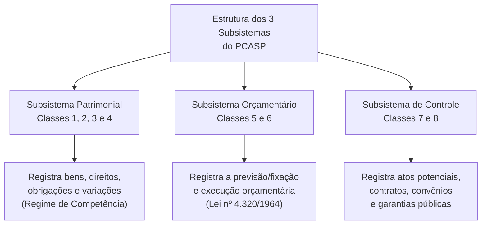
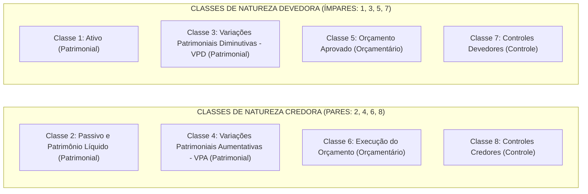
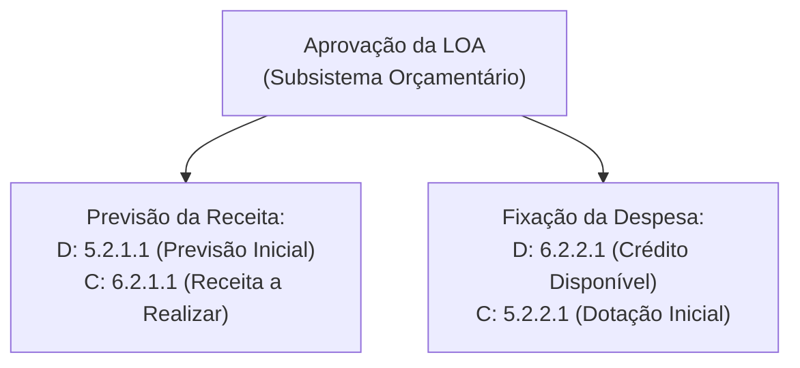
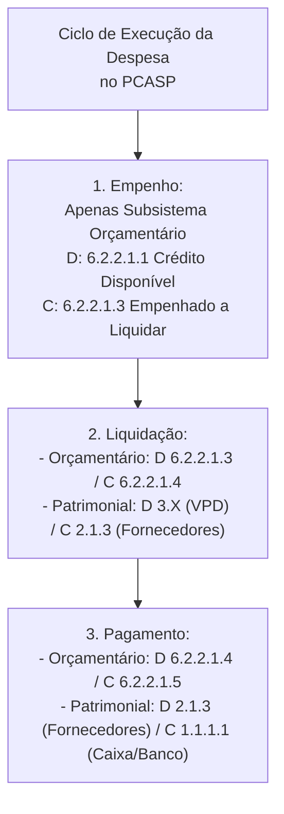

# 03 - Plano de Contas Aplicado ao Setor Público (PCASP) e Lançamentos Contábeis

> **Matéria:** Contabilidade Aplicada ao Setor Público (CASP)  
> **Cargo:** A01 – Técnico de Controle Externo – Especialidade: Técnico Administrativo  
> **Arquivo:** `03_pcasp_estrutura_e_lancamentos_contabeis.md`  

---

## 📌 Ementa / Itens do Edital
- Plano de Contas Aplicado ao Setor Público (PCASP - MCASP Parte IV):
  - Conceito, objetivos e diretrizes da padronização contábil nacional (SICONFI / Secretaria do Tesouro Nacional);
  - Estrutura codificada do plano de contas: 7 níveis de detalhamento (Classe, Grupo, Subgrupo, Título, Subtítulo, Item e Subitem);
  - Os três subsistemas contábeis integrados: Patrimonial, Orçamentário e de Controle;
  - As oito classes de contas do PCASP e sua natureza de saldo (Devedora ou Credora):
    - **Classe 1:** Ativo (Natureza Devedora);
    - **Classe 2:** Passivo e Patrimônio Líquido (Natureza Credora);
    - **Classe 3:** Variações Patrimoniais Diminutivas - VPD (Natureza Devedora);
    - **Classe 4:** Variações Patrimoniais Aumentativas - VPA (Natureza Credora);
    - **Classe 5:** Orçamento Aprovado (Natureza Devedora);
    - **Classe 6:** Execução do Orçamento (Natureza Credora);
    - **Classe 7:** Controles Devedores (Natureza Devedora);
    - **Classe 8:** Controles Credores (Natureza Credora);
- Regras de escrituração e mecânica das partidas dobradas:
  - Autonomia dos subsistemas e fechamento das partidas dobradas dentro de cada subsistema;
  - Lançamento de aprovação da Lei Orçamentária Anual (previsão da receita e fixação da despesa);
  - Lançamentos da execução da despesa orçamentária: empenho, liquidação e pagamento;
  - Lançamentos da execução da receita orçamentária: previsão, lançamento, arrecadação e recolhimento;
  - Contabilização dos atos potenciais (contratos administrativos celebrados, convênios, fianças e garantias);
  - Controle da Disponibilidade por Destinação de Recursos (DDR) e atributos das contas contábeis (P/F).

---

## 🌳 Classificação Hierárquica

```text
3. Plano de Contas Aplicado ao Setor Público (PCASP)
├── 3.1 Fundamentos, Objetivos e Padronização Nacional
│   ├── 3.1.1 Abrangência Federativa Obrigatória (União, Estados, DF e Municípios)
│   ├── 3.1.2 Harmonização Contábil e Transparência Fiscal (SICONFI/STN)
│   └── 3.1.3 Atributos Conceituais das Contas: Financeiro/Permanente (P/F)
├── 3.2 Estrutura Codificada do PCASP (7 Níveis de Detalhamento)
│   ├── Nível 1: Classe (1 dígito)
│   ├── Nível 2: Grupo (1 dígito)
│   ├── Nível 3: Subgrupo (1 dígito)
│   ├── Nível 4: Título (1 dígito)
│   ├── Nível 5: Subtítulo (1 dígito)
│   ├── Nível 6: Item (2 dígitos)
│   └── Nível 7: Subitem (2 dígitos)
├── 3.3 Os Três Subsistemas de Informação Contábil
│   ├── 3.3.1 Subsistema Patrimonial (Classes 1, 2, 3 e 4)
│   ├── 3.3.2 Subsistema Orçamentário (Classes 5 e 6)
│   └── 3.3.3 Subsistema de Controle (Classes 7 e 8)
├── 3.4 As Oito Classes e Natureza dos Saldos
│   ├── 3.4.1 Classes Ímpares (Natureza Devedora): 1, 3, 5 e 7
│   └── 3.4.2 Classes Pares (Natureza Credora): 2, 4, 6 e 8
└── 3.5 Mecânica dos Lançamentos Contábeis Típicos
    ├── 3.5.1 Aprovação da Lei Orçamentária Anual (LOA)
    ├── 3.5.2 Execução da Despesa Orçamentária (Empenho, Liquidação e Pagamento)
    ├── 3.5.3 Execução da Receita Orçamentária (Previsão, Arrecadação e Recolhimento)
    ├── 3.5.4 Atos Potenciais Ativos e Passivos (Contratos e Garantias)
    └── 3.5.5 Controle da Disponibilidade por Destinação de Recursos (DDR)
```

---

## 📖 Resumo Teórico Aprofundado & Esquematizado

### 1. Fundamentos e Padronização Federativa do PCASP

O **Plano de Contas Aplicado ao Setor Público (PCASP)** é a estrutura básica da escrituração contábil governamental no Brasil, concebida pela Secretaria do Tesouro Nacional (STN) para atender a todas as esferas de governo (União, Estados, Distrito Federal e Municípios) e a todos os poderes (Executivo, Legislativo e Judiciário, além de Ministérios Públicos e Tribunais de Contas).

#### Principais Objetivos do PCASP:
1. **Padronização Federativa:** Permitir a consolidação nacional das contas públicas no SICONFI (Sistema de Informações Contábeis e Fiscais do Setor Público Brasileiro).
2. **Separação Rigorosa dos Subsistemas:** Distinguir claramente os registros de natureza orçamentária, patrimonial e de atos potenciais/controle.
3. **Atendimento às NBC TSP:** Garantir a aplicação integral do regime de competência para fatos patrimoniais, sem prejuízo da apuração orçamentária da Lei nº 4.320/1964.
4. **Transparência e Controle Social:** Facilitar o acesso a relatórios e demonstrativos padronizados pelos órgãos de controle externo e cidadãos.

---

### 2. Estrutura dos Níveis da Conta Contábil no PCASP

A codificação contábil do PCASP é estruturada em **7 níveis de detalhamento**, representados por **9 dígitos decimais** no formato `X.X.X.X.X.XX.XX`:


| Nível | Nomenclatura | Dígitos | Exemplo Prático | Descrição do Exemplo |
| :---: | :--- | :---: | :--- | :--- |
| **1º** | **Classe** | 1 | `1` | Ativo |
| **2º** | **Grupo** | 1 | `1.1` | Ativo Circulante |
| **3º** | **Subgrupo** | 1 | `1.1.1` | Caixa e Equivalentes de Caixa |
| **4º** | **Título** | 1 | `1.1.1.1` | Caixa e Equivalentes de Caixa em Moeda Nacional |
| **5º** | **Subtítulo** | 1 | `1.1.1.1.1` | Caixa e Equivalentes de Caixa em Moeda Nacional - Consolidação |
| **6º** | **Item** | 2 | `1.1.1.1.1.01` | Caixa Geral |
| **7º** | **Subitem** | 2 | `1.1.1.1.1.01.01` | Caixa Central do TCE-GO |

> 📌 **NOTA EXPLICATIVA:**  
> A STN padroniza compulsoriamente os níveis de 1 a 5 para todos os entes da Federação (PCASP Federativo). Os níveis 6 (Item) e 7 (Subitem) podem ser detalhados por cada ente de acordo com suas necessidades específicas de gestão interna.

---

### 3. Os Três Subsistemas de Informação Contábil

No modelo conceitual da CASP, a informação contábil é organizada em três subsistemas autônomos que funcionam de maneira integrada:



1. **Subsistema Patrimonial (Classes 1, 2, 3 e 4):**
   - Registra, processa e evidencia os atos e fatos relacionados à administração patrimonial.
   - Aplica estritamente o **regime de competência patrimonial** para ativos, passivos, VPDs e VPAs.
2. **Subsistema Orçamentário (Classes 5 e 6):**
   - Registra, processa e evidencia a aprovação e a execução da receita e despesa orçamentárias.
   - Fornece as informações para o Balanço Orçamentário e Relatório Resumido da Execução Orçamentária (RREO).
3. **Subsistema de Controle (Classes 7 e 8):**
   - Registra, processa e evidencia os atos da administração pública que não afetam imediatamente o patrimônio, mas que podem vir a afetá-lo no futuro (**atos potenciais**).
   - Controla a execução de contratos administrativos, convênios, avais, garantias e a Disponibilidade por Destinação de Recursos (DDR).

---

### 4. As 8 Classes de Contas do PCASP e Natureza de Saldo

A arquitetura do PCASP organiza as contas contábeis em 8 classes fundamentais. A lógica de débito e crédito obedece a uma regra binária elementar:



#### Tabela Sintética das Classes do PCASP:

| Classe | Nome da Classe | Subsistema | Natureza Típica | Função Básica |
| :---: | :--- | :---: | :---: | :--- |
| **1** | **Ativo** | Patrimonial | **Devedora** | Bens e direitos da entidade pública. |
| **2** | **Passivo e PL** | Patrimonial | **Credora** | Obrigações exigíveis e patrimônio líquido. |
| **3** | **VPD** | Patrimonial | **Devedora** | Fatos que diminuem a situação líquida patrimonial. |
| **4** | **VPA** | Patrimonial | **Credora** | Fatos que aumentam a situação líquida patrimonial. |
| **5** | **Orçamento Aprovado** | Orçamentário | **Devedora** | Previsão da receita e fixação da despesa na LOA. |
| **6** | **Execução do Orçamento** | Orçamentário | **Credora** | Acompanhamento da receita realizada e despesa executada. |
| **7** | **Controles Devedores** | Controle | **Devedora** | Atos potenciais ativos e controles de DDR a executar. |
| **8** | **Controles Credores** | Controle | **Credora** | Atos potenciais passivos e controles de DDR executados. |

> 💡 **DICA DE ESTUDO (REGRA DE OURO):**  
> * **Classes Ímpares (1, 3, 5, 7):** Natureza **DEVEDORA** (aumentam a débito, diminuem a crédito).  
> * **Classes Pares (2, 4, 6, 8):** Natureza **CREDORA** (aumentam a crédito, diminuem a débito).  
> Essa regra simples responde a dezenas de questões da FCC sobre classificação de saldo!

---

### 5. Mecânica dos Lançamentos Contábeis Típicos

#### A) Aprovação da Lei Orçamentária Anual (LOA)
Na aprovação da LOA, são abertas as dotações da despesa e as previsões da receita exclusivamente no **Subsistema Orçamentário**:

1. **Previsão da Receita:**
   - **D - 5.2.1.1.1.xx.xx** Previsão Inicial da Receita (Classe 5 - Devedora)
   - **C - 6.2.1.1.0.xx.xx** Receita a Realizar (Classe 6 - Credora)
2. **Fixação da Despesa:**
   - **D - 6.2.2.1.1.xx.xx** Crédito Disponível (Classe 6 - Devedora transitória)
   - **C - 5.2.2.1.1.xx.xx** Dotação Inicial (Classe 5 - Credora transitória)



---

#### B) Execução da Despesa Orçamentária Passo a Passo



1. **Estágio 1 - Empenho:**
   - **Subsistema Orçamentário:**
     - `D - 6.2.2.1.1` Crédito Disponível
     - `C - 6.2.2.1.3` Crédito Empenhado a Liquidar
   - **Subsistema Patrimonial:** **NENHUM REGISTRO!** O empenho não configura fato patrimonial exigível nem incorporação de bens.
2. **Estágio 2 - Liquidação (Atesto do Serviço ou Entrega do Bem):**
   - **Subsistema Orçamentário:**
     - `D - 6.2.2.1.3` Crédito Empenhado a Liquidar
     - `C - 6.2.2.1.4` Crédito Empenhado Liquidado a Pagar
   - **Subsistema Patrimonial:**
     - `D - 3.X.X.X` VPD (Despesa de Consumo/Serviços) **OU** `1.2.3.X` Ativo Imobilizado (se for bem permanente)
     - `C - 2.1.3.X` Fornecedores a Pagar (Passivo Circulante)
3. **Estágio 3 - Pagamento (Ordem Bancária):**
   - **Subsistema Orçamentário:**
     - `D - 6.2.2.1.4` Crédito Empenhado Liquidado a Pagar
     - `C - 6.2.2.1.5` Crédito Empenhado Pago
   - **Subsistema Patrimonial:**
     - `D - 2.1.3.X` Fornecedores a Pagar (baixa do passivo)
     - `C - 1.1.1.1` Caixa e Equivalentes de Caixa (Conta Única)

---

#### C) Execução da Receita Orçamentária

1. **Lançamento do Tributo (Fato Gerador / Competência):**
   - **Subsistema Patrimonial:**
     - `D - 1.1.2.X` Créditos Tributários a Receber (Ativo Circulante)
     - `C - 4.1.1.X` VPA - Impostos (Patrimonial - VPA)
   - **Subsistema Orçamentário:** Não há lançamento no momento do lançamento tributário pelo regime da Lei 4.320/64.
2. **Arrecadação e Recolhimento:**
   - **Subsistema Orçamentário:**
     - `D - 6.2.1.1.0` Receita a Realizar
     - `C - 6.2.1.2.0` Receita Realizada
   - **Subsistema Patrimonial:**
     - `D - 1.1.1.1` Caixa e Equivalentes de Caixa
     - `C - 1.1.2.X` Créditos Tributários a Receber (baixa do direito)

---

#### D) Registro dos Atos Potenciais (Classes 7 e 8)
Os atos potenciais representam direitos e obrigações futuros decorrentes de decisões administrativas que ainda não provocaram alteração patrimonial imediata, mas demandam acompanhamento preventivo:

1. **Celebração de Contrato Administrativo de Obras/Serviços:**
   - `D - 7.9.1.1.x` Contratos de Serviços a Executar (Classe 7)
   - `C - 8.9.1.1.x` Contratos de Serviços a Executar (Classe 8)
2. **Concessão de Garantia Financeira a Município:**
   - `D - 7.1.2.x` Garantias e Contragarantias Concedidas (Classe 7)
   - `C - 8.1.2.x` Garantias e Contragarantias Concedidas (Classe 8)

---

## 🚨 Alertas de Prova & Pegadinhas da FCC

> 🚨 **ALERTA DE PROVA / PEGADINHA FCC (AUTONOMIA DOS SUBSISTEMAS):**  
> Jamais faça lançamentos cruzados entre subsistemas diferentes no PCASP! Um débito na Classe 6 **NUNCA** terá contrapartida direta num crédito na Classe 1. No modelo do MCASP, o fechamento das partidas dobradas ocorre **estritamente dentro do próprio subsistema**: contas de classe orçamentária fecham com classes orçamentárias; contas patrimoniais fecham com contas patrimoniais; e contas de controle fecham com contas de controle.

> ⭐ **IMPORTANTE (O EMPENHO NÃO ALTERA O PATRIMÔNIO):**  
> A FCC adora afirmar que o empenho da despesa gera um passivo exigível ou afeta o patrimônio líquido da entidade. Isso é **FALSO**! O empenho é um ato de reserva de dotação orçamentária registrado exclusivamente nas contas da Classe 6. A afetação patrimonial (nascimento do passivo ou da VPD/Ativo) só ocorre no estágio da **liquidação**!

> 🛑 **ATENÇÃO (NATUREZA DE SALDO DAS CLASSES ORÇAMENTÁRIAS):**  
> * A Classe 5 registra o **Orçamento Aprovado** e possui natureza **DEVEDORA**.  
> * A Classe 6 registra a **Execução do Orçamento** e possui natureza **CREDORA**.  
> A pegadinha comum da banca é inverter esses papéis ou afirmar que a execução orçamentária é registrada na Classe 5.

> 📌 **NOTA EXPLICATIVA (ATRIBUTO P / F - FINANCEIRO E PERMANENTE):**  
> No PCASP, as contas do ativo e passivo trazem o atributo indicador de superávit financeiro (`P` para Permanente e `F` para Financeiro). O atributo `F` identifica os recursos que integram o Balanço Financeiro e que servem de base para a apuração do **Superávit Financeiro** da Lei nº 4.320/1964 para abertura de créditos suplementares e especiais.

---

## 🌐 Fontes Oficiais e Referências Bibliográficas

* [Manual de Contabilidade Aplicada ao Setor Público (MCASP) - 11ª Edição](https://www.gov.br/tesouronacional/pt-br) - Parte IV: Plano de Contas Aplicado ao Setor Público (PCASP).
* [Secretaria do Tesouro Nacional (STN) - Tabela do PCASP Federativo](https://www.tesourotransparente.gov.br) - Relação codificada de contas contábeis e notas explicativas.
* [Conselho Federal de Contabilidade (CFC) - Normas Brasileiras de Contabilidade (NBC TSP)](https://cfc.org.br) - NBC TSP Estrutura Conceitual e padrões de plano de contas governamental.
* [Lei Federal nº 4.320/1964](http://www.planalto.gov.br/ccivil_03/leis/l4320.htm) - Normas Gerais de Direito Financeiro para elaboração e controle dos orçamentos e balanços.

---

## 📝 Questões de Concurso FCC Comentadas

### Questão 01
**(FCC – TCE-PI – Auditor de Controle Externo)**  
De acordo com a estrutura do Plano de Contas Aplicado ao Setor Público (PCASP) estabelecida no MCASP, as contas pertencentes às classes 3 e 4 destinam-se a registrar, respectivamente:

* **A)** O orçamento aprovado e a execução do orçamento público.
* **B)** O ativo e o passivo circulante e não circulante.
* **C)** As variações patrimoniais diminutivas (VPD) e as variações patrimoniais aumentativas (VPA).
* **D)** Os controles devedores e os controles credores dos atos potenciais.
* **E)** As despesas fixadas na LOA e as receitas arrecadadas no exercício.

> **Gabarito: C**  
> **Comentário Detalhado:**  
> - **A) Incorreta.** O orçamento aprovado e a sua execução são escriturados nas Classes 5 (Orçamento Aprovado) e 6 (Execução do Orçamento), pertencentes ao subsistema orçamentário.  
> - **B) Incorreta.** O ativo circulante/não circulante é registrado na Classe 1, enquanto o passivo e o patrimônio líquido pertencem à Classe 2.  
> - **C) CORRETA.** No PCASP, a **Classe 3** corresponde às **Variações Patrimoniais Diminutivas (VPD)**, que possuem natureza devedora e refletem decréscimos no patrimônio líquido; a **Classe 4** corresponde às **Variações Patrimoniais Aumentativas (VPA)**, de natureza credora, que refletem acréscimos na situação líquida da entidade. Ambas compõem o subsistema patrimonial de resultado.  
> - **D) Incorreta.** Os controles devedores e credores de atos potenciais são escriturados nas Classes 7 e 8 (subsistema de controle).  
> - **E) Incorreta.** A fixação da despesa orçamentária e a arrecadação da receita pertencem às contas de controle orçamentário das Classes 5 e 6.

---

### Questão 02
**(FCC – TCE-RS – Auditor de Controle Externo)**  
A formalização da celebração de um contrato administrativo de prestação de serviços continuados de vigilância armada no valor total anual de R$ 1.200.000,00, antes do início de qualquer execução física ou financeira pelo contratado, enseja no órgão público estadual o seguinte registro contábil segundo o PCASP:

* **A)** Débito em Variação Patrimonial Diminutiva (Classe 3) e Crédito em Fornecedores a Pagar (Classe 2).
* **B)** Lançamento simultâneo no Subsistema de Controle (Classes 7 e 8) para acompanhamento dos atos potenciais decorrentes do contrato celebrado.
* **C)** Débito em Crédito Disponível e Crédito em Despesa Paga no Subsistema Orçamentário (Classe 6).
* **D)** Débito no Ativo Imobilizado (Classe 1) e Crédito no Patrimônio Líquido (Classe 2).
* **E)** Nenhum registro contábil, uma vez que contratos administrativos só são escriturados após o pagamento das ordens bancárias.

> **Gabarito: B**  
> **Comentário Detalhado:**  
> - **A) Incorreta.** A assinatura do termo contratual não representa prestação de serviços nem fato gerador de despesa pública; logo, inexiste VPD ou obrigação exigível a pagar no passivo circulante.  
> - **B) CORRETA.** A formalização do contrato gera direitos e obrigações futuras que caracterizam **atos potenciais passivos e ativos**. No PCASP, esses eventos são compulsoriamente escriturados no **Subsistema de Controle**, debitando-se uma conta da **Classe 7 (Controles Devedores)** e creditando-se uma conta da **Classe 8 (Controles Credores)**.  
> - **C) Incorreta.** O pagamento orçamentário só ocorre no terceiro estágio da execução da despesa, após prévio empenho e regular liquidação.  
> - **D) Incorreta.** Serviços de vigilância armada são despesas correntes de terceiros, não constituindo ativo imobilizado nem afetação direta do patrimônio líquido.  
> - **E) Incorreta.** O setor público registra obrigatoriamente a celebração de contratos em contas de controle para fins de transparência e fiscalização pelos órgãos de controle externo.

---

### Questão 03
**(FCC – SEFAZ-PE – Auditor Fiscal do Tesouro Estadual)**  
No âmbito da execução orçamentária e financeira do setor público regida pelo PCASP, considere os seguintes fatos:
I. Aprovação do orçamento com fixação da despesa na Lei Orçamentária Anual.
II. Emissão de Nota de Empenho ordinário para aquisição de material de consumo.
III. Recebimento e atesto do material no almoxarifado acompanhado da respectiva nota fiscal (liquidação).
IV. Emissão da ordem bancária e pagamento ao fornecedor.
À luz das normas contábeis aplicadas ao setor público, haverá registro contábil no **Subsistema Patrimonial** especificamente nos estágios indicados em:

* **A)** I, II, III e IV.
* **B)** II e III, apenas.
* **C)** III e IV, apenas.
* **D)** I e II, apenas.
* **E)** II, III e IV, apenas.

> **Gabarito: C**  
> **Comentário Detalhado:**  
> - **Análise dos Fatos:**  
>   - **I. Aprovação da LOA:** Enseja registro exclusivamente no subsistema orçamentário (Classes 5 e 6). Não afeta o patrimônio.  
>   - **II. Empenho da Despesa:** Trata-se de mero ato administrativo de reserva de dotação, escriturado unicamente no subsistema orçamentário (`D - Crédito Disponível / C - Crédito Empenhado a Liquidar`, Classe 6). Não afeta o patrimônio nem gera passivo.  
>   - **III. Liquidação:** Ocorre a verificação do direito adquirido do credor e o recebimento do bem. Ocorre registro no **subsistema patrimonial**: debita-se o Ativo Circulante (Estoques - Almoxarifado) e credita-se o Passivo Circulante (Fornecedores a Pagar).  
>   - **IV. Pagamento:** Ocorre a extinção da obrigação exigível no **subsistema patrimonial**: debita-se o Passivo Circulante (Fornecedores a Pagar) e credita-se o Ativo Circulante (Caixa e Equivalentes de Caixa).  
> - **A) Incorreta.** Os itens I e II pertencem exclusivamente ao subsistema orçamentário.  
> - **B) Incorreta.** O item II não afeta o patrimônio.  
> - **C) CORRETA.** Apenas a liquidação (III) e o pagamento (IV) provocam registros no subsistema patrimonial.  
> - **D) Incorreta.** I e II são atos estritamente orçamentários.  
> - **E) Incorreta.** O item II não possui reflexo patrimonial.

---

### Questão 04
**(FCC – DPE-RS – Analista: Área Contabilidade)**  
Assinale a alternativa que apresenta a correta associação entre a classe de contas do PCASP, seu subsistema de informação e sua respectiva natureza de saldo:

* **A)** Classe 1 (Ativo) – Subsistema Patrimonial – Natureza Credora.
* **B)** Classe 4 (Variações Patrimoniais Aumentativas) – Subsistema Patrimonial – Natureza Devedora.
* **C)** Classe 5 (Orçamento Aprovado) – Subsistema Orçamentário – Natureza Credora.
* **D)** Classe 6 (Execução do Orçamento) – Subsistema Orçamentário – Natureza Credora.
* **E)** Classe 7 (Controles Devedores) – Subsistema de Controle – Natureza Credora.

> **Gabarito: D**  
> **Comentário Detalhado:**  
> - **A) Incorreta.** A Classe 1 (Ativo) pertence ao subsistema patrimonial, mas tem natureza **DEVEDORA** (classe ímpar).  
> - **B) Incorreta.** A Classe 4 (VPA) pertence ao subsistema patrimonial, mas possui natureza **CREDORA** (classe par).  
> - **C) Incorreta.** A Classe 5 (Orçamento Aprovado) pertence ao subsistema orçamentário e possui natureza **DEVEDORA** (classe ímpar).  
> - **D) CORRETA.** A **Classe 6 (Execução do Orçamento)** integra o **Subsistema Orçamentário** e possui natureza **CREDORA** (classe par), sendo utilizada para registrar a execução da receita e da despesa orçamentárias.  
> - **E) Incorreta.** A Classe 7 (Controles Devedores) pertence ao subsistema de controle e possui natureza **DEVEDORA** (classe ímpar).

---

### Questão 05
**(FCC – TRT-20ª Região – Analista Judiciário: Contabilidade)**  
Em determinado exercício financeiro, uma autarquia estadual efetuou a liquidação de uma despesa orçamentária referente à prestação de serviços de limpeza e conservação predial no valor de R$ 80.000,00. Sob a ótica do Plano de Contas Aplicado ao Setor Público (PCASP), os lançamentos contábeis simultâneos efetuados nos subsistemas Orçamentário e Patrimonial foram, respectivamente:

* **A)** Orçamentário: Débito em Crédito Disponível e Crédito em Crédito Empenhado Pago; Patrimonial: Débito em Caixa e Crédito em VPA.
* **B)** Orçamentário: Débito em Crédito Empenhado a Liquidar e Crédito em Crédito Empenhado Liquidado a Pagar; Patrimonial: Débito em Variação Patrimonial Diminutiva (VPD) e Crédito em Fornecedores a Pagar.
* **C)** Orçamentário: Débito em Dotação Inicial e Crédito em Crédito Disponível; Patrimonial: Débito em Bens Móveis e Crédito em Caixa.
* **D)** Orçamentário: Débito em Receita Realizada e Crédito em Receita a Realizar; Patrimonial: Débito em Estoques e Crédito em Caixa.
* **E)** Orçamentário: Débito em Crédito Empenhado Liquidado a Pagar e Crédito em Crédito Empenhado Pago; Patrimonial: Débito em Fornecedores a Pagar e Crédito em Caixa.

> **Gabarito: B**  
> **Comentário Detalhado:**  
> - **A) Incorreta.** Descreve lançamento inexistente no empenho/pagamento e receita patrimonial indevida.  
> - **B) CORRETA.** Na **liquidação da despesa**:  
>   1. No **Subsistema Orçamentário (Classe 6)**: transfere-se o saldo da fase a liquidar para liquidado a pagar por meio de:  
>      - `Débito em Crédito Empenhado a Liquidar` (reduzindo a obrigação potencial);  
>      - `Crédito em Crédito Empenhado Liquidado a Pagar` (reconhecendo a dívida empenhada e liquidada).  
>   2. No **Subsistema Patrimonial (Classes 3 e 2)**: reconhece-se o consumo do serviço e o passivo exigível:  
>      - `Débito em Variação Patrimonial Diminutiva - VPD` (Serviços de Terceiros - Classe 3);  
>      - `Crédito em Fornecedores a Pagar` (Passivo Circulante - Classe 2).  
> - **C) Incorreta.** Trata da fixação inicial da despesa na LOA e registro de ativo permanente que não se aplica a serviço de limpeza.  
> - **D) Incorreta.** Mistura execução da receita orçamentária com material em estoque.  
> - **E) Incorreta.** Descreve o estágio subsequente do **pagamento**, e não da liquidação.
