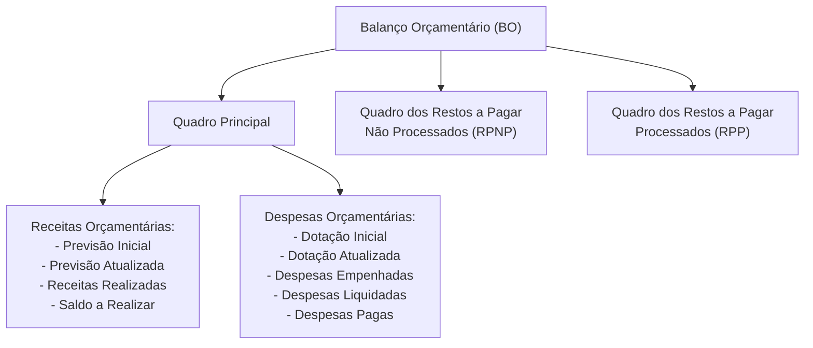
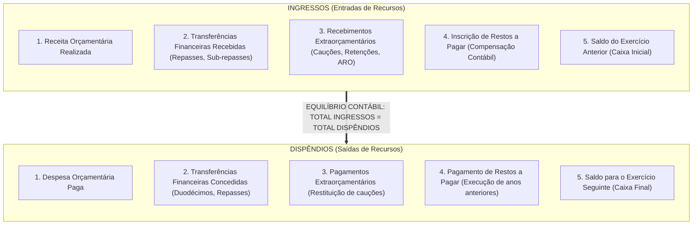
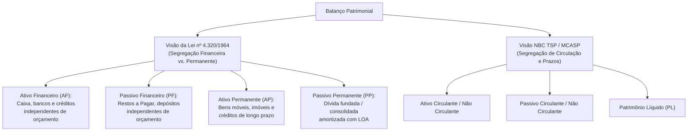
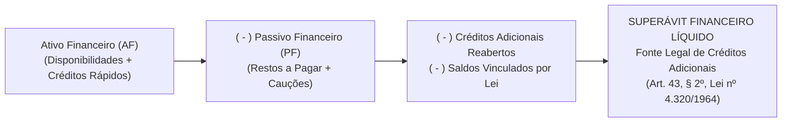
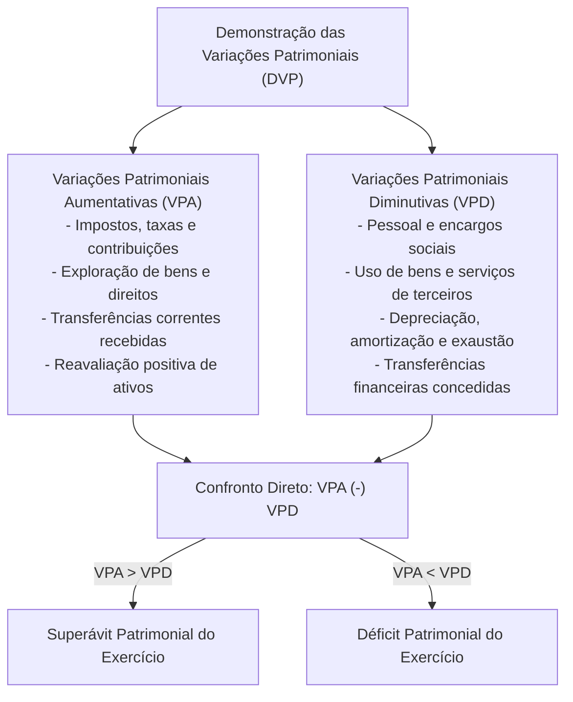
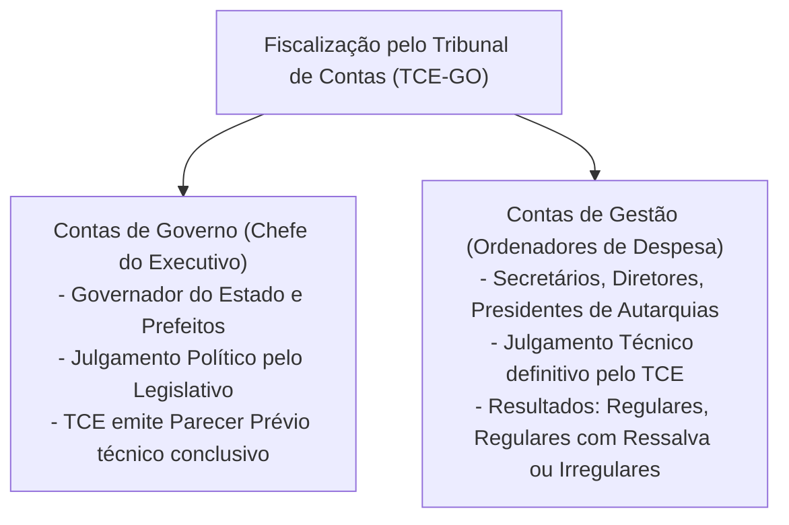

# 04 - Demonstrações Contábeis (DCASP), Lei nº 4.320/1964 e Prestação de Contas ao Tribunal de Contas

> **Matéria:** Contabilidade Aplicada ao Setor Público (CASP)  
> **Cargo:** A01 – Técnico de Controle Externo – Especialidade: Técnico Administrativo  
> **Arquivo:** `04_demonstracoes_contabeis_mcasp_e_prestacao_de_contas.md`  

---

## 📌 Ementa / Itens do Edital
- Demonstrações Contábeis Aplicadas ao Setor Público (DCASP - MCASP Parte V e NBC TSP 11):
  - **Balanço Orçamentário (BO):** estrutura conceitual, confronto entre previsão e realização de receitas, confronto entre fixação, empenho, liquidação e pagamento de despesas; apuração do Resultado Orçamentário (superávit/déficit orçamentário); quadros anexos da execução dos Restos a Pagar Processados (RPP) e Não Processados (RPNP);
  - **Balanço Financeiro (BF):** estrutura, ingressos e dispêndios orçamentários e extraorçamentários, transferências financeiras recebidas e concedidas (repasses, sub-repasses e duodécimos), saldo inicial e final de caixa e equivalentes de caixa; fechamento das contas financeiras;
  - **Balanço Patrimonial (BP):** estrutura dual sob a Lei nº 4.320/1964 (Ativo Financeiro e Permanente; Passivo Financeiro e Permanente) e sob o MCASP / NBC TSP (Ativo Circulante e Não Circulante; Passivo Circulante e Não Circulante; Patrimônio Líquido); apuração e cálculo do Superávit Financeiro para abertura de créditos adicionais (Art. 43, § 2º da Lei nº 4.320/1964);
  - **Demonstração das Variações Patrimoniais (DVP):** confronto entre Variações Patrimoniais Aumentativas (VPA) e Diminutivas (VPD); apuração do Resultado Patrimonial do exercício pelo regime de competência patrimonial pura; variações quantitativas e qualitativas;
  - **Demonstração dos Fluxos de Caixa (DFC):** método direto obrigatório no setor público; fluxos das atividades operacionais, de investimento e de financiamento;
  - **Demonstração das Mutações do Patrimônio Líquido (DMPL)** e Notas Explicativas;
- Prestação de Contas ao Tribunal de Contas:
  - Processo de contas de governo (parecer prévio sobre as contas do Chefe do Poder Executivo) versus processo de contas de gestão (julgamento de ordenadores de despesas);
  - Peças obrigatórias dos processos de contas: DCASP completas, relatórios da LRF (RREO e RGF), relatório do órgão central de controle interno;
  - Fiscalização contábil, financeira, orçamentária e patrimonial exercida pelo TCE-GO.

---

## 🌳 Classificação Hierárquica

```text
4. Demonstrações Contábeis Aplicadas ao Setor Público (DCASP) e Prestação de Contas
├── 4.1 Balanço Orçamentário (BO - Art. 102 da Lei nº 4.320/1964)
│   ├── 4.1.1 Estrutura e Quadros Demonstrativos:
│   │   ├── Quadro Principal: Receitas (Previsão vs. Realização) e Despesas (Fixação vs. Execução)
│   │   ├── Quadro dos Restos a Pagar Não Processados (RPNP)
│   │   └── Quadro dos Restos a Pagar Processados (RPP)
│   ├── 4.1.2 Apuração do Resultado Orçamentário: Receita Realizada (-) Despesa Empenhada
│   └── 4.1.3 Utilização de Saldos de Exercícios Anteriores e Reserva de Contingência
├── 4.2 Balanço Financeiro (BF - Art. 103 da Lei nº 4.320/1964)
│   ├── 4.2.1 Ingressos: Receita Orçamentária + Transferências Recebidas + Ingressos Extraorçamentários + Saldo Inicial
│   ├── 4.2.2 Dispêndios: Despesa Orçamentária Paga + Transferências Concedidas + Pagamentos Extraorçamentários + Saldo Final
│   ├── 4.2.3 Regra de Fechamento: Total dos Ingressos = Total dos Dispêndios
│   └── 4.2.4 Tratamento Especial dos Restos a Pagar (Inscrição = Ingresso Extraorçamentário)
├── 4.3 Balanço Patrimonial (BP - Art. 105 da Lei nº 4.320/1964 e NBC TSP 11)
│   ├── 4.3.1 Estrutura segundo as Normas Internacionais (NBC TSP / MCASP):
│   │   ├── Ativo Circulante e Ativo Não Circulante (Realizável a LP, Investimentos, Imobilizado, Intangível)
│   │   ├── Passivo Circulante e Passivo Não Circulante
│   │   └── Patrimônio Líquido (Patrimônio Social, Reservas e Resultados Acumulados)
│   ├── 4.3.2 Estrutura Legal da Lei nº 4.320/1964:
│   │   ├── Ativo Financeiro (AF) e Passivo Financeiro (PF)
│   │   └── Ativo Permanente (AP) e Passivo Permanente (PP)
│   └── 4.3.3 Apuração do Superávit Financeiro (Art. 43, § 2º da Lei nº 4.320/1964):
│       └── SF = Ativo Financeiro - Passivo Financeiro - Créditos Adicionais Reabertos
├── 4.4 Demonstração das Variações Patrimoniais (DVP - Art. 104 da Lei nº 4.320/1964)
│   ├── 4.4.1 Variações Patrimoniais Aumentativas (VPA - tributárias, transferências, serviços)
│   ├── 4.4.2 Variações Patrimoniais Diminutivas (VPD - pessoal, consumo, serviços, depreciação)
│   └── 4.4.3 Apuração do Resultado Patrimonial: VPA (-) VPD = Superávit ou Déficit Patrimonial
├── 4.5 Demonstração dos Fluxos de Caixa (DFC) e Outras Peças
│   ├── 4.5.1 DFC: Método Direto; Atividades Operacionais, de Investimento e de Financiamento
│   ├── 4.5.2 DMPL e Notas Explicativas (NBC TSP 11)
└── 4.6 Prestação de Contas ao Tribunal de Contas do Estado (TCE-GO)
    ├── 4.6.1 Distinção: Contas de Governo (Parecer Prévio) vs. Contas de Gestão (Julgamento)
    ├── 4.6.2 Composição Documental e Prazos Constitucionais de Envio
    └── 4.6.3 Exame Técnico da Fidedignidade das DCASP pelos Auditores do TCE
```

---

## 📖 Resumo Teórico Aprofundado & Esquematizado

### 1. Balanço Orçamentário (BO)

O **Balanço Orçamentário** evidencia os rendimentos e as despesas orçamentárias detalhadas, confrontando a previsão com a arrecadação da receita e a fixação com a execução da despesa (Art. 102 da Lei nº 4.320/1964 e MCASP Parte V):



#### Apuração do Resultado Orçamentário:
O resultado orçamentário representa o equilíbrio da execução orçamentária do exercício corrente:

$$\text{Resultado Orçamentário} = \text{Receitas Realizadas} - \text{Despesas Executadas (Empenhadas)}$$

* **Superávit Orçamentário:** Receitas Realizadas $>$ Despesas Empenhadas.
* **Déficit Orçamentário:** Receitas Realizadas $<$ Despesas Empenhadas.

> 🛑 **ATENÇÃO:**  
> O déficit ou superávit orçamentário apurado no BO **NÃO** se confunde com o Superávit Financeiro do Balanço Patrimonial! O superávit orçamentário é um fluxo de execução orçamentária do exercício, enquanto o superávit financeiro é um saldo acumulado de disponibilidades líquidas.

---

### 2. Balanço Financeiro (BF)

O **Balanço Financeiro** demonstra as receitas e despesas orçamentárias bem como os recebimentos e pagamentos extraorçamentários, conjugados com os saldos em espécie provenientes do exercício anterior e os que se transferem para o exercício seguinte (Art. 103 da Lei nº 4.320/1964):

$$\mathbf{\text{Total dos Ingressos} = \text{Total dos Dispêndios}}$$



#### Tratamento dos Restos a Pagar no Balanço Financeiro:
* **Inscrição de RP:** Registrada nos **Ingressos Extraorçamentários** no momento do encerramento do exercício.
* **Pagamento de RP:** Registrado nos **Dispêndios Extraorçamentários** no momento de seu efetivo adimplemento.

---

### 3. Balanço Patrimonial (BP) e Apuração do Superávit Financeiro

O Balanço Patrimonial evidencia a situação patrimonial da entidade pública. Ele convive com duas estruturas conceituais complementares:



#### Apuração do Superávit Financeiro (Art. 43, § 2º da Lei nº 4.320/1964):
O Superávit Financeiro é uma das fontes legais mais importantes para abertura de **créditos adicionais suplementares e especiais**:

$$\mathbf{\text{Superávit Financeiro} = \text{Ativo Financeiro} - \text{Passivo Financeiro} - \text{Créditos Especiais Reabertos} - \text{Compromissos Vinculados}}$$



---

### 4. Demonstração das Variações Patrimoniais (DVP)

A DVP evidencia as alterações quantitativas verificadas no patrimônio público resultantes ou independentes da execução orçamentária, aplicando rigorosamente o **regime de competência patrimonial**:



#### Variações Quantitativas versus Qualitativas:
* **Variações Patrimoniais Quantitativas:** Fatos que aumentam (VPA) ou diminuem (VPD) o Patrimônio Líquido (ex.: arrecadação de imposto, pagamento de folha salarial, depreciação).
* **Variações Patrimoniais Qualitativas:** Fatos permutativos que apenas alteram a composição dos elementos patrimoniais sem mudar o valor total do Patrimônio Líquido (ex.: aquisição de um veículo à vista, em que o ativo Caixa diminui e o ativo Imobilizado aumenta no mesmo valor).

---

### 5. Demonstração dos Fluxos de Caixa (DFC) e Outras Demonstrações

1. **Demonstração dos Fluxos de Caixa (DFC - NBC TSP 12):**
   - No setor público, a apresentação dos fluxos operacionais é feita compulsoriamente pelo **Método Direto**.
   - Segrega as movimentações em três fluxos fundamentais:
     - **Fluxo Operacional:** Arrecadação de tributos, pagamento de salários a servidores, compra de material de consumo;
     - **Fluxo de Investimento:** Aquisição e alienação de bens do ativo imobilizado e intangível;
     - **Fluxo de Financiamento:** Captação de empréstimos, emissão de títulos da dívida e amortização do principal da dívida pública fundada.
2. **Demonstração das Mutações do Patrimônio Líquido (DMPL):**
   - Evidencia a movimentação de todas as contas que compõem o PL (Patrimônio Social, Reservas de Capital, Ajustes de Avaliação Patrimonial e Resultados Acumulados).
3. **Notas Explicativas:**
   - Informações suplementares essenciais que acompanham todas as demonstrações contábeis para detalhar premissas, métodos de mensuração, passivos contingentes e critérios adotados.

---

### 6. Prestação de Contas ao Tribunal de Contas (TCE-GO)

No regime republicano brasileiro, todo aquele que utilize, arrecade, guarde, gerencie ou administre dinheiros, bens e valores públicos tem o dever constitucional de prestar contas:



#### Composição Obrigatória do Processo de Prestação de Contas Anual:
* Todas as Demonstrações Contábeis Aplicadas ao Setor Público (DCASP) consolidadas acompanhadas de Notas Explicativas;
* Relatório Resumido da Execução Orçamentária (RREO) e Relatório de Gestão Fiscal (RGF);
* Demonstrativo do cumprimento dos limites constitucionais de Saúde (12% para Estados) e Educação (25%);
* Relatório e Certificado de Auditoria emitidos pelo Sistema de Controle Interno estadual com parecer conclusivo;
* Demonstrativo do inventário analítico dos bens móveis, imóveis e almoxarifados.

---

## 🚨 Alertas de Prova & Pegadinhas da FCC

> 🚨 **ALERTA DE PROVA / PEGADINHA FCC (ONDE ESTÁ A FONTE DE CRÉDITOS ADICIONAIS?):**  
> A FCC adora tentar confundir os candidatos afirmando que o resultado do **Balanço Orçamentário** serve para abrir créditos suplementares. Isso é **completamente FALSO**!  
> - A fonte legal autorizada pelo Art. 43 da Lei nº 4.320/1964 é o **Superávit Financeiro apurado no BALANÇO PATRIMONIAL** ($AF - PF$).  
> - O Balanço Orçamentário apura o resultado orçamentário do ano, que **não** autoriza abertura de novos créditos!

> ⭐ **IMPORTANTE (O BALANÇO FINANCEIRO SEMPRE FECHA):**  
> O Balanço Financeiro **NÃO possui resultado de superávit ou déficit** em sua última linha! Ele sempre fecha em perfeita igualdade: $\text{Total dos Ingressos} = \text{Total dos Dispêndios}$. A diferença entre entradas e saídas de recursos é equilibrada exatamente pela inclusão do saldo em caixa transferido para o exercício seguinte.

> 🛑 **ATENÇÃO (DEPRECIAÇÃO NAS DEMONSTRAÇÕES CONTÁBEIS):**  
> A cota periódica de depreciação de bens públicos é reconhecida:  
> 1. Na **DVP** como uma **Variação Patrimonial Diminutiva (VPD)**;  
> 2. No **Balanço Patrimonial** como conta retificadora do Ativo Não Circulante (Imobilizado).  
> A depreciação **NÃO APARECE no Balanço Orçamentário nem no Balanço Financeiro**, porque não envolve fluxo financeiro (não é desembolso de caixa nem despesa orçamentária fixada).

> 📌 **NOTA EXPLICATIVA (MÉTODO DA DFC NO SETOR PÚBLICO):**  
> Pelo MCASP e pela NBC TSP 12, a elaboração da Demonstração dos Fluxos de Caixa (DFC) no setor público deve adotar obrigatoriamente o **Método Direto** para os fluxos das atividades operacionais. O método indireto é facultativo apenas como conciliação em nota explicativa.

---

## 🌐 Fontes Oficiais e Referências Bibliográficas

* [Lei Federal nº 4.320/1964](https://www.planalto.gov.br/ccivil_03/leis/l4320.htm) - Arts. 43 e 101 a 106 (Das Demonstrações Contábeis e Créditos Adicionais).
* [Manual de Contabilidade Aplicada ao Setor Público (MCASP) - 11ª Edição](https://www.gov.br/tesouronacional/pt-br) - Parte V: Demonstrações Contábeis Aplicadas ao Setor Público (DCASP).
* [Conselho Federal de Contabilidade - NBC TSP 11](https://cfc.org.br) - Apresentação das Demonstrações Contábeis.
* [Conselho Federal de Contabilidade - NBC TSP 12](https://cfc.org.br) - Demonstração dos Fluxos de Caixa.
* [Lei Complementar Estadual nº 161/2020](https://portal.tce.go.gov.br) - Lei Orgânica do Tribunal de Contas do Estado de Goiás (TCE-GO).
* [Instrução Normativa TCE-GO nº 004/2017](https://portal.tce.go.gov.br) - Regulamenta a remessa e composição das prestações de contas de governo e de gestão no Estado de Goiás.

---

## 📝 Questões de Concurso FCC Comentadas

### Questão 01
**(FCC – TCE-PI – Auditor de Controle Externo)**  
Ao final do exercício financeiro de 2023, determinado órgão público estadual apurou as seguintes informações em seus registros contábeis para fechamento do Balanço Patrimonial:
- Ativo Financeiro: R$ 12.000.000,00
- Ativo Permanente: R$ 45.000.000,00
- Passivo Financeiro: R$ 7.000.000,00
- Passivo Permanente: R$ 30.000.000,00
- Saldos de créditos adicionais especiais reabertos para o exercício seguinte: R$ 1.500.000,00

Com base estritamente nas regras da Lei Federal nº 4.320/1964 (Art. 43, § 2º), o montante do Superávit Financeiro disponível para abertura de créditos adicionais no exercício de 2024 é de:

* **A)** R$ 5.000.000,00.
* **B)** R$ 3.500.000,00.
* **C)** R$ 20.000.000,00.
* **D)** R$ 18.500.000,00.
* **E)** R$ 2.000.000,00.

> **Gabarito: B**  
> **Comentário Detalhado:**  
> - Nos termos do Art. 43, § 2º, da Lei Federal nº 4.320/1964, o superávit financeiro é calculado pela diferença entre o Ativo Financeiro e o Passivo Financeiro, deduzidos os saldos de créditos adicionais transferidos/reabertos que ainda oneram a disponibilidade:  
>   - $\text{SF} = \text{Ativo Financeiro} - \text{Passivo Financeiro} - \text{Créditos Especiais Reabertos}$  
>   - $\text{SF} = 12.000.000,00 - 7.000.000,00 - 1.500.000,00 =$ **R$ 3.500.000,00**  
> - **A) Incorreta.** Trata da diferença bruta ($AF - PF =$ R$ 5.000.000,00), esquecendo-se de deduzir os créditos reabertos.  
> - **B) CORRETA.** R$ 3.500.000,00 é o valor exato disponível para suportar a abertura de créditos suplementares ou especiais.  
> - **C) Incorreta.** Considerou a diferença do patrimônio permanente ($45.000.000,00 - 30.000.000,00 + 5.000.000,00$), misturando ativos fixos não financeiros.  
> - **D) Incorreta.** Considerou valores do ativo permanente, que não têm liquidez financeira para lastrear despesas orçamentárias.  
> - **E) Incorreta.** Realizou subtrações aleatórias sem base nas regras legais.

---

### Questão 02
**(FCC – TCE-RS – Auditor de Controle Externo)**  
No âmbito da Contabilidade Aplicada ao Setor Público, a demonstração contábil que evidencia as receitas previstas em confronto com as realizadas e as despesas fixadas em confronto com as executadas (empenhadas, liquidadas e pagas), apurando o resultado orçamentário do exercício, é o:

* **A)** Balanço Financeiro.
* **B)** Balanço Patrimonial.
* **C)** Balanço Orçamentário.
* **D)** Demonstrativo de Fluxo de Caixa.
* **E)** Demonstrativo das Variações Patrimoniais.

> **Gabarito: C**  
> **Comentário Detalhado:**  
> - **A) Incorreta.** O Balanço Financeiro (Art. 103 da Lei nº 4.320/1964) evidencia os ingressos e dispêndios de recursos orçamentários e extraorçamentários e a movimentação das disponibilidades de caixa.  
> - **B) Incorreta.** O Balanço Patrimonial (Art. 105 da Lei nº 4.320/1964) evidencia o patrimônio público estático (bens, direitos, obrigações e situação líquida).  
> - **C) CORRETA.** O **Balanço Orçamentário** (Art. 102 da Lei nº 4.320/1964 e MCASP Parte V) confronta a previsão e realização das receitas públicas com a fixação e execução das despesas orçamentárias (empenho, liquidação e pagamento), demonstrando o superávit ou déficit orçamentário.  
> - **D) Incorreta.** A DFC evidencia as entradas e saídas financeiras agrupadas por atividades operacionais, de investimento e de financiamento pelo método direto.  
> - **E) Incorreta.** A DVP (Art. 104 da Lei nº 4.320/1964) confronta as variações aumentativas (VPA) e diminutivas (VPD) para apurar o resultado patrimonial por competência.

---

### Questão 03
**(FCC – DPE-RS – Analista: Ciências Contábeis)**  
Em relação ao Balanço Financeiro disciplinado pela Lei nº 4.320/1964 e pelo Manual de Contabilidade Aplicada ao Setor Público (MCASP), é correto afirmar que:

* **A)** Apura em sua última linha o montante do superávit financeiro que servirá de fonte para abertura de créditos suplementares.
* **B)** A inscrição de despesas em Restos a Pagar no encerramento do exercício é registrada na coluna dos ingressos extraorçamentários para compensar a despesa empenhada.
* **C)** As transferências financeiras recebidas de outros órgãos do mesmo ente da Federação (repasses e sub-repasses) devem ser classificadas como receitas orçamentárias de capital.
* **D)** O pagamento de restos a pagar processados efetuado no exercício é escriturado no quadro das receitas orçamentárias correntes.
* **E)** A cota de depreciação acumulada dos edifícios públicos é registrada como um dispêndio extraorçamentário.

> **Gabarito: B**  
> **Comentário Detalhado:**  
> - **A) Incorreta.** O Balanço Financeiro não apresenta superávit ou déficit financeiro ao final, pois o total dos ingressos sempre se iguala ao total dos dispêndios mediante o transporte do saldo para o exercício seguinte. O superávit financeiro é calculado no Balanço Patrimonial.  
> - **B) CORRETA.** Como a despesa orçamentária é computada pelo valor empenhado nos sistemas legais e nos dispêndios, a parcela empenhada e não paga no ano (inscrita em Restos a Pagar) deve figurar nos **ingressos extraorçamentários** como contrapartida contábil de ajuste para manter a equação financeira fechada.  
> - **C) Incorreta.** Repasses e sub-repasses são transferências puramente financeiras entre órgãos públicos, não constituindo receita orçamentária nem fato gerador de receita própria.  
> - **D) Incorreta.** O pagamento de restos a pagar é uma despesa ou dispêndio **extraorçamentário**, pois pertence a orçamento de exercício pretérito.  
> - **E) Incorreta.** A depreciação não transita pelo Balanço Financeiro, visto que não envolve movimentação física ou bancária de dinheiro.

---

### Questão 04
**(FCC – SEFAZ-SC – Auditor Fiscal da Receita Estadual)**  
No encerramento do exercício financeiro, uma entidade governamental constatou que o reconhecimento da quota anual de depreciação de seus veículos operacionais no montante de R$ 500.000,00 produziu impactos nas Demonstrações Contábeis Aplicadas ao Setor Público. O reflexo desse fato contábil ocorreu:

* **A)** Exclusivamente no Balanço Orçamentário, reduzindo o superávit orçamentário do exercício.
* **B)** No Balanço Financeiro como dispêndio operacional e na Demonstração dos Fluxos de Caixa.
* **C)** Na Demonstração das Variações Patrimoniais (DVP) como Variação Patrimonial Diminutiva (VPD) e no Balanço Patrimonial como conta redutora do Ativo Não Circulante.
* **D)** No Balanço Orçamentário e no Balanço Financeiro simultaneamente, sem afetar o Balanço Patrimonial.
* **E)** Exclusivamente na Demonstração dos Fluxos de Caixa, classificado como fluxo de investimentos.

> **Gabarito: C**  
> **Comentário Detalhado:**  
> - **A) Incorreta.** A depreciação não depende de dotação nem envolve execução de despesa orçamentária, não figurando no Balanço Orçamentário.  
> - **B) Incorreta.** A depreciação não envolve desembolso de moeda e não afeta o Balanço Financeiro nem a DFC.  
> - **C) CORRETA.** A depreciação é um fato contábil estritamente patrimonial decorrente do regime de competência. Seu lançamento é: `D - Variação Patrimonial Diminutiva (Classe 3)` e `C - Depreciação Acumulada (Classe 1 - Retificadora do Imobilizado)`. Logo, impacta a **DVP** (como VPD) e o **Balanço Patrimonial** (reduzindo o valor contábil líquido do Ativo Não Circulante).  
> - **D) Incorreta.** Não afeta os balanços orçamentário e financeiro.  
> - **E) Incorreta.** A DFC só registra fatos que movimentam contas de caixa e equivalentes de caixa; a depreciação é um custo não financeiro.

---

### Questão 05
**(FCC – TCE-GO – Analista de Controle Externo)**  
A respeito da prestação de contas dos administradores públicos perante o Tribunal de Contas do Estado de Goiás (TCE-GO), assinale a afirmativa correta:

* **A)** As contas prestadas pelo Chefe do Poder Executivo são submetidas a julgamento técnico irrecorrível pelo próprio Tribunal de Contas, cabendo à Assembleia Legislativa apenas tomar conhecimento.
* **B)** A prestação de contas dos dirigentes de autarquias e secretários de Estado (contas de gestão) é apreciada mediante parecer prévio opinativo encaminhado ao Governador do Estado.
* **C)** O parecer prévio emitido pelo TCE sobre as contas de governo do Chefe do Poder Executivo só deixará de prevalecer por decisão de dois terços dos membros da Assembleia Legislativa.
* **D)** O Tribunal de Contas dispensa a apresentação do relatório do órgão central do sistema de controle interno nos processos de tomada de contas especial.
* **E)** As demonstrações contábeis exigidas na prestação de contas anual dispensam notas explicativas caso o Balanço Patrimonial não registre dívida fundada consolidada.

> **Gabarito: C**  
> **Comentário Detalhado:**  
> - **A) Incorreta.** As contas do Chefe do Executivo estadual (Governador) são **julgadas politicamente pela Assembleia Legislativa**, cabendo ao Tribunal de Contas emitir **parecer prévio** de caráter eminentemente técnico (Art. 71, I c/c Art. 75 da CF/88 e Constituição Estadual de Goiás).  
> - **B) Incorreta.** Os ordenadores de despesas e dirigentes de órgãos/autarquias prestam **contas de gestão**, as quais são **julgadas diretamente pelo Tribunal de Contas**, com caráter terminativo e eficácia de título executivo em caso de condenação em débito ou multa.  
> - **C) CORRETA.** Nos termos do modelo constitucional de controle externo (Art. 31, § 2º aplicado por simetria e normas constitucionais correlatas), o parecer prévio técnico emitido pelo Tribunal de Contas sobre as contas anuais de governo do Chefe do Executivo somente deixará de prevalecer por decisão qualificada de **dois terços dos membros do Poder Legislativo**.  
> - **D) Incorreta.** O relatório e o certificado de auditoria do órgão central do sistema de controle interno são peças obrigatórias e indeclináveis em qualquer processo de contas ou tomada de contas especial.  
> - **E) Incorreta.** As notas explicativas são parte integrante e obrigatória das Demonstrações Contábeis Aplicadas ao Setor Público (NBC TSP 11 e MCASP), independentemente da existência ou não de dívida fundada.
