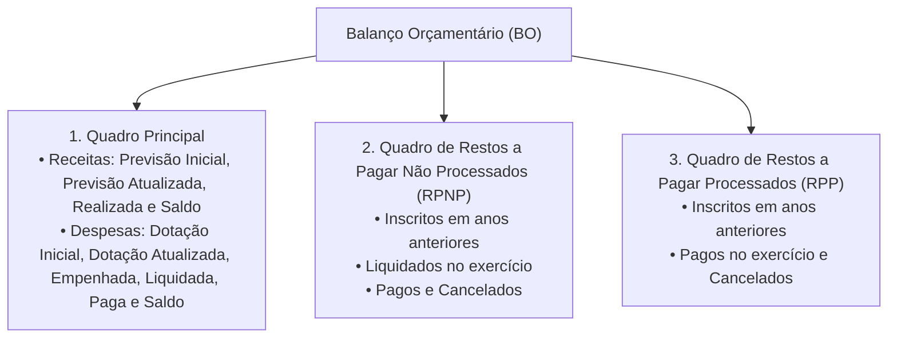
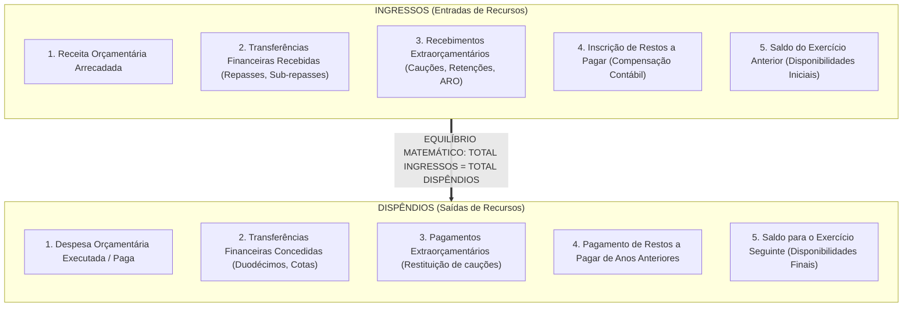
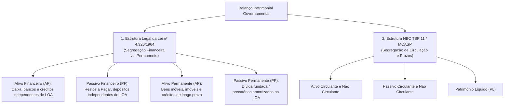
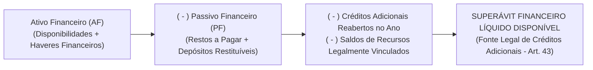
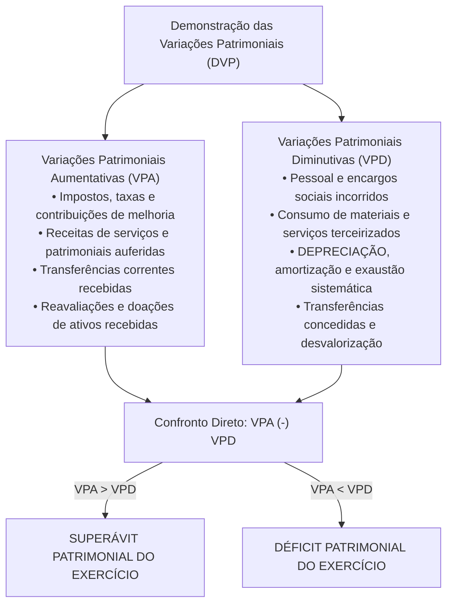
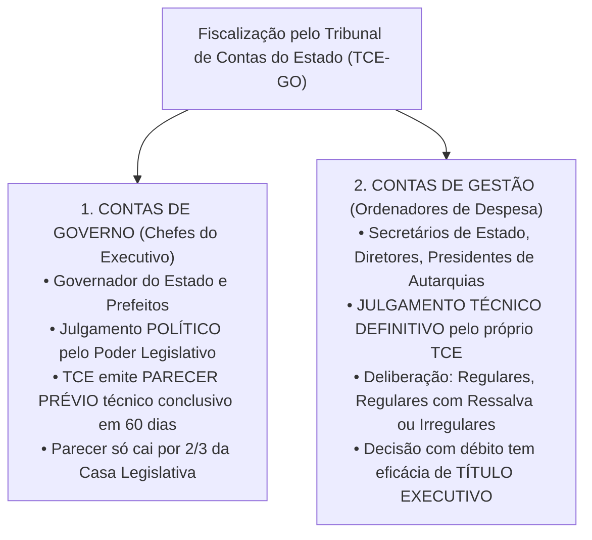

# 04 - Demonstrações Contábeis (DCASP), Lei nº 4.320/1964 e Prestação de Contas ao Tribunal de Contas

> **Matéria:** Contabilidade Aplicada ao Setor Público (CASP)  
> **Cargo:** A01 – Técnico de Controle Externo – Especialidade: Técnico Administrativo  
> **Arquivo:** `04_demonstracoes_contabeis_mcasp_e_prestacao_de_contas.md`  

---

## 📌 Ementa / Itens do Edital

- Demonstrações Contábeis Aplicadas ao Setor Público (DCASP - MCASP Parte V e NBC TSP 11):
    - **Balanço Orçamentário (BO):** estrutura conceitual, confronto entre previsão e realização de receitas, confronto entre fixação, empenho, liquidação e pagamento de despesas; apuração do Resultado Orçamentário (superávit/déficit orçamentário); quadros anexos da execução dos Restos a Pagar Processados (RPP) e Não Processados (RPNP);
    - **Balanço Financeiro (BF):** estrutura, ingressos e dispêndios orçamentários e extraorçamentários, transferências financeiras recebidas e concedidas (repasses, sub-repasses e duodécimos), saldo inicial e final de caixa e equivalentes de caixa; fechamento das contas financeiras;
    - **Balanço Patrimonial (BP):** estrutura dual sob a Lei nº 4.320/1964 (Ativo Financeiro e Permanente; Passivo Financeiro e Permanente) e sob o MCASP / NBC TSP (Ativo Circulante e Não Circulante; Passivo Circulante e Não Circulante; Patrimônio Líquido); apuração e cálculo do Superávit Financeiro para abertura de créditos adicionais (Art. 43, § 2º da Lei nº 4.320/1964);
    - **Demonstração das Variações Patrimoniais (DVP):** confronto entre Variações Patrimoniais Aumentativas (VPA) e Diminutivas (VPD); apuração do Resultado Patrimonial do exercício pelo regime de competência patrimonial pura; variações quantitativas e qualitativas;
    - **Demonstração dos Fluxos de Caixa (DFC):** método direto obrigatório no setor público; fluxos das atividades operacionais, de investimento e de financiamento;
    - **Demonstração das Mutações do Patrimônio Líquido (DMPL)** e Notas Explicativas;
- Prestação de Contas ao Tribunal de Contas:
    - Processo de contas de governo (parecer prévio sobre as contas do Chefe do Poder Executivo) versus processo de contas de gestão (julgamento de ordenadores de despesas);
    - Peças obrigatórias dos processos de contas: DCASP completas, relatórios da LRF (RREO e RGF), relatório do órgão central de controle interno;
    - Fiscalização contábil, financeira, orçamentária e patrimonial exercida pelo TCE-GO.

---

## 🧭 Sumário Interativo
- [1. Balanço Orçamentário (BO - Art. 102 da Lei nº 4.320/1964)](#1-balanco-orcamentario-bo-art-102-da-lei-no-43201964)
    - [1.1 Estrutura e Quadros Demonstrativos](#11-estrutura-e-quadros-demonstrativos)
    - [1.2 Apuração do Resultado Orçamentário (Superávit vs. Déficit)](#12-apuracao-do-resultado-orcamentario-superavit-vs-deficit)
- [2. Balanço Financeiro (BF - Art. 103 da Lei nº 4.320/1964)](#2-balanco-financeiro-bf-art-103-da-lei-no-43201964)
    - [2.1 Estrutura de Ingressos e Dispêndios](#21-estrutura-de-ingressos-e-dispendios)
    - [2.2 O Fechamento Contábil Obrigatório e a Inscrição de Restos a Pagar](#22-o-fechamento-contabil-obrigatorio-e-a-inscricao-de-restos-a-pagar)
- [3. Balanço Patrimonial (BP - Art. 105 da Lei nº 4.320/1964 e NBC TSP 11)](#3-balanco-patrimonial-bp-art-105-da-lei-no-43201964-e-nbc-tsp-11)
    - [3.1 Estrutura Dual: Lei nº 4.320/1964 vs. Normas Internacionais (NBC TSP)](#31-estrutura-dual-lei-no-43201964-vs-normas-internacionais-nbc-tsp)
    - [3.2 Apuração e Cálculo do Superávit Financeiro (Art. 43, § 2º)](#32-apuracao-e-calculo-do-superavit-financeiro-art-43-2o)
- [4. Demonstração das Variações Patrimoniais (DVP) e Outras Demonstrações](#4-demonstracao-das-variacoes-patrimoniais-dvp-e-outras-demonstracoes)
    - [4.1 Estrutura da DVP e Resultado Patrimonial por Competência](#41-estrutura-da-dvp-e-resultado-patrimonial-por-competencia)
    - [4.2 Demonstração dos Fluxos de Caixa (DFC) pelo Método Direto](#42-demonstracao-dos-fluxos-de-caixa-dfc-pelo-metodo-direto)
    - [4.3 Demonstração das Mutações do Patrimônio Líquido (DMPL) e Notas Explicativas](#43-demonstracao-das-mutacoes-do-patrimonio-liquido-dmpl-e-notas-explicativas)
- [5. Prestação de Contas ao Tribunal de Contas (TCE-GO)](#5-prestacao-de-contas-ao-tribunal-de-contas-tce-go)
    - [5.1 Contas de Governo (Parecer Prévio) vs. Contas de Gestão (Julgamento Técnico)](#51-contas-de-governo-parecer-previo-vs-contas-de-gestao-julgamento-tecnico)
    - [5.2 Composição Documental Obrigatória e Papel do Controle Interno](#52-composicao-documental-obrigatoria-e-papel-do-controle-interno)
- [6. Fontes Oficiais & Manuais Técnicos Recomendados](#fontes-oficiais-manuais-tecnicos-recomendados)
- [7. Questões Comentadas no Padrão FCC](#questoes-comentadas-no-padrao-fcc)

---

## 📖 Conteúdo Teórico Aprofundado

### 1. Balanço Orçamentário (BO - Art. 102 da Lei nº 4.320/1964)

#### 1.1 Estrutura e Quadros Demonstrativos
O **Balanço Orçamentário (BO)** demonstra as receitas e despesas previstas em confronto com as realizadas, consoante determina o art. 102 da Lei Federal nº 4.320/1964 e a Parte V do Manual de Contabilidade Aplicada ao Setor Público (MCASP). É composto por três quadros integrados:

- **Quadro Principal:** Desagrega receitas e despesas por categorias econômicas (Correntes e de Capital), origens e grupos de natureza da despesa (GND);
- **Quadros de Restos a Pagar:** Evidenciam a execução dos passivos orçamentários transferidos de exercícios anteriores, separando os processados dos não processados.

#### 1.2 Apuração do Resultado Orçamentário (Superávit vs. Déficit)
O Resultado Orçamentário do exercício financeiro expressa o equilíbrio entre a arrecadação das receitas e a execução das despesas:

$$\text{Resultado Orçamentário} = \text{Receitas Realizadas} - \text{Despesas Executadas (Empenhadas)}$$

- **Superávit Orçamentário:** Quando o total das receitas realizadas for superior ao total das despesas empenhadas ($\text{Receitas Realizadas} > \text{Despesas Empenhadas}$);
- **Déficit Orçamentário:** Quando o total das despesas empenhadas for superior ao total das receitas arrecadadas ($\text{Despesas Empenhadas} > \text{Receitas Realizadas}$).

> 🚨 **ALERTA DE PROVA / PEGADINHA FCC:**  
> A banca frequentemente afirma que o Resultado Orçamentário apurado no BO serve de fonte para a abertura de créditos suplementares. **FALSO!** O superávit orçamentário é um fluxo anual de execução. A fonte legal autorizada pelo art. 43, § 1º, I da Lei nº 4.320/1964 é o **Superávit Financeiro apurado no Balanço Patrimonial**!

---

### 2. Balanço Financeiro (BF - Art. 103 da Lei nº 4.320/1964)

#### 2.1 Estrutura de Ingressos e Dispêndios
O **Balanço Financeiro (BF)** demonstra as receitas e despesas orçamentárias bem como os recebimentos e os pagamentos de natureza extraorçamentária, conjugados com os saldos em espécie provenientes do exercício anterior e os que se transferem para o exercício seguinte (art. 103 da Lei nº 4.320/1964):

#### 2.2 O Fechamento Contábil Obrigatório e a Inscrição de Restos a Pagar
- **Igualdade Matemática Rigorosa:** No Balanço Financeiro, **não existe resultado de superávit ou déficit** na última linha! Ele sempre fecha em perfeita igualdade:

$$\mathbf{\text{Total dos Ingressos} = \text{Total dos Dispêndios}}$$

A diferença entre o somatório das entradas e das saídas é exatamente equilibrada pelo saldo de disponibilidades financeiras transportado para o exercício seguinte;

- **A Inscrição de Restos a Pagar como Ingresso Extraorçamentário:**  
  Como a despesa orçamentária é registrada na coluna de dispêndios pelo valor empenhado total, a parcela que não foi paga até 31 de dezembro (inscrita em Restos a Pagar) deve figurar nos **ingressos extraorçamentários** como artifício contábil compensatório para fechar o balanço financeiro do ano.

---

### 3. Balanço Patrimonial (BP - Art. 105 da Lei nº 4.320/1964 e NBC TSP 11)

#### 3.1 Estrutura Dual: Lei nº 4.320/1964 vs. Normas Internacionais (NBC TSP)
O Balanço Patrimonial convive com duas estruturas conceituais distintas e complementares:

#### 3.2 Apuração e Cálculo do Superávit Financeiro (Art. 43, § 2º)
O **Superávit Financeiro** é a principal fonte legal para abertura de créditos suplementares e especiais autorizada pelo art. 43 da Lei Federal nº 4.320/1964. Ele é apurado exclusivamente no **Balanço Patrimonial** do exercício anterior:

$$\mathbf{\text{Superávit Financeiro}} = AF - PF - \text{Créditos Adicionais Reabertos} - \text{Disponibilidades Vinculadas}$$

---

### 4. Demonstração das Variações Patrimoniais (DVP) e Outras Demonstrações

#### 4.1 Estrutura da DVP e Resultado Patrimonial por Competência
A **Demonstração das Variações Patrimoniais (DVP)** evidencia as alterações verificadas no patrimônio público resultantes ou independentes da execução orçamentária, aplicando rigorosamente o **regime de competência pura**:

#### 4.2 Demonstração dos Fluxos de Caixa (DFC) pelo Método Direto
- Normatizada pela **NBC TSP 12** e pelo MCASP, a DFC no setor público deve ser elaborada compulsoriamente pelo **Método Direto** para os fluxos das atividades operacionais;
- Desagrega os fluxos financeiros de caixa em três categorias operacionais fundamentais:
    1. **Fluxos das Atividades Operacionais:** Arrecadação tributária, receitas de serviços, pagamento de vencimentos a servidores públicos, compras de material de consumo e transferências intergovernamentais;
    2. **Fluxos das Atividades de Investimento:** Desembolsos para aquisição de bens do ativo imobilizado (obras, prédios, viaturas) e entradas decorrentes da alienação de ativos públicos;
    3. **Fluxos das Atividades de Financiamento:** Captação de recursos via emissão de títulos da dívida mobiliária e contratos de empréstimos, bem como pagamentos para amortização do principal da dívida fundada.

#### 4.3 Demonstração das Mutações do Patrimônio Líquido (DMPL) e Notas Explicativas
- **DMPL (NBC TSP 11):** Evidencia a movimentação de todas as contas integrantes do Patrimônio Líquido durante o exercício (Patrimônio Social, Reservas de Capital, Ajustes de Avaliação Patrimonial e Resultados Acumulados de exercícios anteriores);
- **Notas Explicativas:** Peça textual analítica obrigatória e indissociável de todas as DCASP, fornecendo detalhes sobre as premissas e políticas contábeis adotadas, contingências judiciais e critérios de mensuração e depreciação.

---

### 5. Prestação de Contas ao Tribunal de Contas (TCE-GO)

No Estado de Goiás e nos termos dos arts. 70 e 71 da CF/88 c/c a Lei Orgânica do TCE-GO (Lei Complementar Estadual nº 161/2020), o controle externo exercido pelo Tribunal de Contas opera sob dois ritos processuais com naturezas jurídicas inteiramente distintas:

#### 5.1 Contas de Governo (Parecer Prévio) vs. Contas de Gestão (Julgamento Técnico)
1. **Contas de Governo (Governador do Estado):**
    - Consubstanciam o balanço geral anual do Estado e a prestação macroeconômica da execução orçamentária e financeira;
    - O Tribunal de Contas **não julga as contas de governo**; emite **Parecer Prévio** de caráter técnico conclusivo no prazo de sessenta (60) dias;
    - O julgamento final é político-institucional e compete privativamente à Assembleia Legislativa do Estado de Goiás (ALEGO). O parecer técnico do TCE só deixará de prevalecer por decisão de **dois terços (2/3)** dos membros do parlamento estadual.

2. **Contas de Gestão (Ordenadores de Despesas):**
    - Referem-se aos atos de gestão patrimonial, orçamentária e financeira praticados individualmente pelos secretários de Estado, dirigentes de autarquias, fundações e fundos especiais;
    - O Tribunal de Contas **julga diretamente e em definitivo** a regularidade dessas contas, proferindo acórdão que pode imputar débito ou aplicar multas com **eficácia de título executivo extrajudicial** (art. 71, § 3º da CF/88).

#### 5.2 Composição Documental Obrigatória e Papel do Controle Interno
Os processos de prestação de contas enviados anualmente ao TCE-GO devem conter obrigatoriamente:

- O conjunto completo das Demonstrações Contábeis Aplicadas ao Setor Público (DCASP) acompanhadas das respectivas Notas Explicativas;
- Os relatórios fiscais previstos na LRF: Relatório Resumido da Execução Orçamentária (RREO) e Relatório de Gestão Fiscal (RGF);
- Demonstrativo do cumprimento dos limites constitucionais mínimos de aplicação em **Saúde (12% para os Estados)** e em **Educação (25%)**;
- **Relatório e Certificado de Auditoria emitidos pelo Órgão Central do Sistema de Controle Interno estadual**, com parecer conclusivo sobre a regularidade da gestão examinada.

---

## 🌐 Fontes Oficiais & Manuais Técnicos Recomendados

- [Lei Federal nº 4.320/1964](https://www.planalto.gov.br/ccivil_03/leis/l4320.htm)
    - Arts. 43 (Superávit Financeiro) e Arts. 101 a 106 (Das Demonstrações Contábeis).
- [Manual de Contabilidade Aplicada ao Setor Público (MCASP) - 11ª Edição (STN)](https://www.gov.br/tesouronacional/pt-br)
    - Parte V: Demonstrações Contábeis Aplicadas ao Setor Público (DCASP).
- [Conselho Federal de Contabilidade - NBC TSP 11 e 12](https://cfc.org.br/)
    - NBC TSP 11 (Apresentação das Demonstrações Contábeis) e NBC TSP 12 (Demonstração dos Fluxos de Caixa).
- [Lei Complementar Estadual de Goiás nº 161/2020 (Lei Orgânica do TCE-GO)](https://portal.tce.go.gov.br)
    - Normas sobre processos de contas de governo e de gestão no Estado de Goiás.

---

## 📝 Questões Comentadas no Padrão FCC

### Questão 1 (FCC - Adaptada / TCE-PI - Auditor de Controle Externo)
Ao final do exercício financeiro de 2023, determinado órgão público estadual apurou as seguintes informações em seus registros contábeis para fechamento do Balanço Patrimonial:

- Ativo Financeiro: R$ 12.000.000,00
- Ativo Permanente: R$ 45.000.000,00
- Passivo Financeiro: R$ 7.000.000,00
- Passivo Permanente: R$ 30.000.000,00
- Saldos de créditos adicionais especiais reabertos para o exercício seguinte: R$ 1.500.000,00

Com base estritamente nas regras da Lei Federal nº 4.320/1964 (Art. 43, § 2º), o montante do Superávit Financeiro disponível para abertura de créditos adicionais no exercício de 2024 é de:

* **A)** R$ 5.000.000,00.
* **B)** R$ 3.500.000,00.
* **C)** R$ 20.000.000,00.
* **D)** R$ 18.500.000,00.
* **E)** R$ 2.000.000,00.

> **Comentário Detalhado:**
>
> - **A)** Incorreta. Refere-se à diferença bruta entre Ativo Financeiro e Passivo Financeiro ($12.000.000 - 7.000.000 = 5.000.000$), esquecendo-se da dedução obrigatória dos créditos especiais reabertos.
> - **B)** Correta. De acordo com o art. 43, § 2º da Lei Federal nº 4.320/1964, o superávit financeiro é calculado subtraindo-se o Passivo Financeiro do Ativo Financeiro e deduzindo-se os saldos de créditos adicionais reabertos que ainda oneram a disponibilidade:  
>   $$\text{SF} = \text{Ativo Financeiro} - \text{Passivo Financeiro} - \text{Créditos Reabertos}$$  
>   $$\text{SF} = 12.000.000,00 - 7.000.000,00 - 1.500.000,00 = \text{R\$ 3.500.000,00}$$
> - **C)** Incorreta. Misturou valores do patrimônio permanente ($45.000.000 - 30.000.000 + 5.000.000$), que não possuem liquidez financeira para lastrear gastos orçamentários.
> - **D)** Incorreta. Computou indevidamente o Ativo Permanente, que reúne bens imóveis e infraestrutura.
> - **E)** Incorreta. Subtrações aleatórias sem base nas diretrizes legais de finanças públicas.
> 
> **Gabarito: B**

---

### Questão 2 (FCC - Adaptada / TCE-RS - Auditor de Controle Externo)
No âmbito da Contabilidade Aplicada ao Setor Público, a demonstração contábil que evidencia as receitas previstas em confronto com as realizadas e as despesas fixadas em confronto com as executadas (empenhadas, liquidadas e pagas), apurando o resultado orçamentário do exercício, é o:

* **A)** Balanço Financeiro.
* **B)** Balanço Patrimonial.
* **C)** Balanço Orçamentário.
* **D)** Demonstrativo de Fluxo de Caixa.
* **E)** Demonstrativo das Variações Patrimoniais.

> **Comentário Detalhado:**
>
> - **A)** Incorreta. O Balanço Financeiro (art. 103 da Lei nº 4.320/1964) evidencia os ingressos e dispêndios de recursos orçamentários e extraorçamentários e a movimentação das disponibilidades de caixa.
> - **B)** Incorreta. O Balanço Patrimonial (art. 105 da Lei nº 4.320/1964) evidencia a situação estática de bens, direitos, obrigações e patrimônio líquido.
> - **C)** Correta. O Balanço Orçamentário (art. 102 da Lei nº 4.320/1964 e MCASP Parte V) é o demonstrativo que confronta a previsão e arrecadação das receitas públicas com a fixação e execução das despesas orçamentárias (empenho, liquidação e pagamento), demonstrando formalmente o superávit ou déficit orçamentário do exercício.
> - **D)** Incorreta. A DFC evidencia as movimentações financeiras segregadas por atividades operacionais, de investimento e de financiamento pelo método direto.
> - **E)** Incorreta. A DVP (art. 104 da Lei nº 4.320/1964) confronta as variações aumentativas (VPA) e diminutivas (VPD) para apuração do resultado patrimonial por competência.
> 
> **Gabarito: C**

---

### Questão 3 (FCC - Adaptada / DPE-RS - Analista: Ciências Contábeis)
Em relação ao Balanço Financeiro disciplinado pela Lei nº 4.320/1964 e pelo Manual de Contabilidade Aplicada ao Setor Público (MCASP), é correto afirmar que:

* **A)** Apura em sua última linha o montante do superávit financeiro que servirá de fonte para abertura de créditos suplementares.
* **B)** A inscrição de despesas em Restos a Pagar no encerramento do exercício é registrada na coluna dos ingressos extraorçamentários para compensar a despesa empenhada.
* **C)** As transferências financeiras recebidas de outros órgãos do mesmo ente da Federação (repasses e sub-repasses) devem ser classificadas como receitas orçamentárias de capital.
* **D)** O pagamento de restos a pagar processados efetuado no exercício é escriturado no quadro das receitas orçamentárias correntes.
* **E)** A cota de depreciação acumulada dos edifícios públicos é registrada como um dispêndio extraorçamentário.

> **Comentário Detalhado:**
>
> - **A)** Incorreta. O Balanço Financeiro não apresenta saldo de superávit ou déficit financeiro ao final, pois o total dos ingressos sempre se iguala ao total dos dispêndios mediante o transporte do saldo para o exercício seguinte. O superávit financeiro é calculado no Balanço Patrimonial.
> - **B)** Correta. Como a despesa orçamentária é computada nos dispêndios pelo valor empenhado total, a parcela que não foi paga até 31 de dezembro (inscrita em Restos a Pagar) deve figurar nos ingressos extraorçamentários como contrapartida contábil de ajuste para manter a equação financeira em equilíbrio.
> - **C)** Incorreta. Repasses e sub-repasses são transferências puramente financeiras entre órgãos públicos, não constituindo receita orçamentária.
> - **D)** Incorreta. O pagamento de restos a pagar é uma despesa extraorçamentária, pois refere-se a orçamento de exercício pretérito.
> - **E)** Incorreta. A depreciação não transita pelo Balanço Financeiro, visto que não envolve movimentação física ou bancária de dinheiro.
> 
> **Gabarito: B**

---

### Questão 4 (FCC - Adaptada / SEFAZ-SC - Auditor Fiscal da Receita Estadual)
No encerramento do exercício financeiro, uma entidade governamental constatou que o reconhecimento da quota anual de depreciação de seus veículos operacionais no montante de R$ 500.000,00 produziu impactos nas Demonstrações Contábeis Aplicadas ao Setor Público. O reflexo desse fato contábil ocorreu:

* **A)** Exclusivamente no Balanço Orçamentário, reduzindo o superávit orçamentário do exercício.
* **B)** No Balanço Financeiro como dispêndio operacional e na Demonstração dos Fluxos de Caixa.
* **C)** Na Demonstração das Variações Patrimoniais (DVP) como Variação Patrimonial Diminutiva (VPD) e no Balanço Patrimonial como conta redutora do Ativo Não Circulante.
* **D)** No Balanço Orçamentário e no Balanço Financeiro simultaneamente, sem afetar o Balanço Patrimonial.
* **E)** Exclusivamente na Demonstração dos Fluxos de Caixa, classificado como fluxo de investimentos.

> **Comentário Detalhado:**
>
> - **A)** Incorreta. A depreciação independe de dotação e não envolve execução de despesa orçamentária, não figurando no Balanço Orçamentário.
> - **B)** Incorreta. A depreciação não envolve desembolso financeiro de moeda, não afetando o Balanço Financeiro nem a DFC.
> - **C)** Correta. A depreciação periódica é um fato contábil estritamente patrimonial decorrente do regime de competência. Seu lançamento é: débito em Variação Patrimonial Diminutiva (VPD - Classe 3) e crédito em Depreciação Acumulada (Conta retificadora do Ativo Imobilizado - Classe 1). Logo, impacta a DVP (como VPD) e o Balanço Patrimonial (reduzindo o valor contábil líquido do Ativo Não Circulante).
> - **D)** Incorreta. Não afeta os balanços orçamentário e financeiro.
> - **E)** Incorreta. A DFC registra exclusivamente eventos que movimentam contas de disponibilidades de caixa; a depreciação é um custo puramente econômico.
> 
> **Gabarito: C**

---

### Questão 5 (FCC - Adaptada / TCE-GO - Analista de Controle Externo)
A respeito da prestação de contas dos administradores públicos perante o Tribunal de Contas do Estado de Goiás (TCE-GO), assinale a afirmativa correta:

* **A)** As contas prestadas pelo Chefe do Poder Executivo são submetidas a julgamento técnico irrecorrível pelo próprio Tribunal de Contas, cabendo à Assembleia Legislativa apenas tomar conhecimento.
* **B)** A prestação de contas dos dirigentes de autarquias e secretários de Estado (contas de gestão) é apreciada mediante parecer prévio opinativo encaminhado ao Governador do Estado.
* **C)** O parecer prévio emitido pelo TCE sobre as contas de governo do Chefe do Poder Executivo só deixará de prevalecer por decisão de dois terços dos membros da Assembleia Legislativa.
* **D)** O Tribunal de Contas dispensa a apresentação do relatório do órgão central do sistema de controle interno nos processos de tomada de contas especial.
* **E)** As demonstrações contábeis exigidas na prestação de contas anual dispensam notas explicativas caso o Balanço Patrimonial não registre dívida fundada consolidada.

> **Comentário Detalhado:**
>
> - **A)** Incorreta. As contas de governo do Chefe do Executivo estadual (Governador) são julgadas politicamente pela Assembleia Legislativa, cabendo ao Tribunal de Contas emitir parecer prévio técnico conclusivo (art. 71, I c/c art. 75 da CF/88).
> - **B)** Incorreta. Os ordenadores de despesas e dirigentes de órgãos e autarquias prestam contas de gestão, as quais são julgadas diretamente pelo Tribunal de Contas com caráter terminativo.
> - **C)** Correta. Conforme o modelo constitucional de controle externo (art. 31, § 2º aplicado por simetria federativa e normas correlatas da Constituição de Goiás), o parecer prévio técnico emitido pelo Tribunal de Contas sobre as contas anuais de governo do Chefe do Executivo somente deixará de prevalecer por decisão qualificada de dois terços (2/3) dos membros do Poder Legislativo.
> - **D)** Incorreta. O relatório e o certificado de auditoria emitidos pelo órgão central do sistema de controle interno são peças obrigatórias e indeclináveis na prestação e tomada de contas especial.
> - **E)** Incorreta. As notas explicativas são parte integrante e obrigatória das Demonstrações Contábeis Aplicadas ao Setor Público (NBC TSP 11 e MCASP), independentemente de existir dívida fundada.
> 
> **Gabarito: C**
