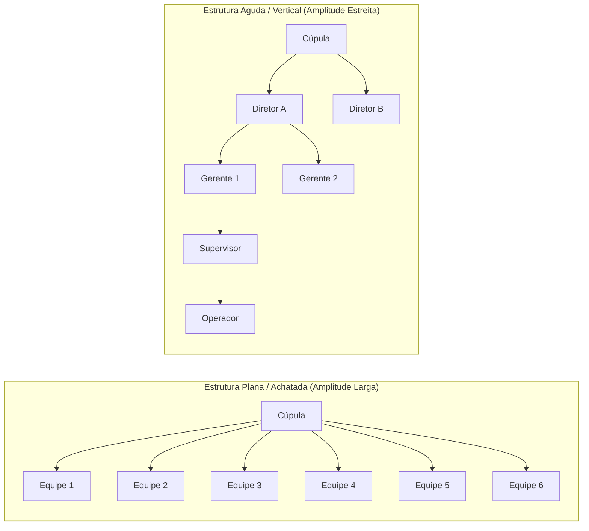
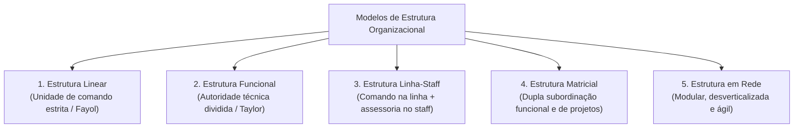
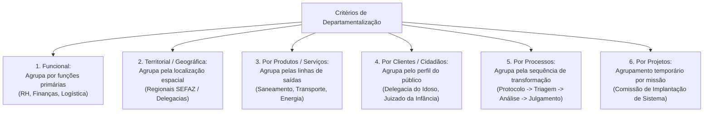
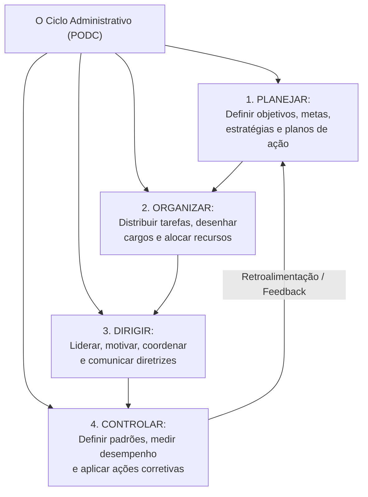
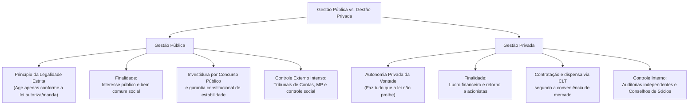

# 01 - Organizações Formais, Estruturas, Departamentalização e Processo Organizacional

> **Matéria:** Noções de Administração Pública  
> **Cargo:** A01 – Técnico de Controle Externo – Especialidade: Técnico Administrativo  
> **Arquivo:** `01_organizacoes_formais_estruturas_e_processo_organizacional.md`  

---

## 📌 Ementa / Itens do Edital

- Características básicas das organizações formais modernas: estrutura organizacional, sistemas de autoridade, hierarquia, amplitude administrativa e especialização do trabalho;
- Desenho de estruturas organizacionais:
    - Relação entre amplitude de controle e formato organizacional (estruturas agudas/altas versus estruturas achatadas/planas);
    - Centralização e descentralização da tomada de decisão;
- Tipos de estrutura organizacional: linear (militar), funcional, linha-staff, matricial e estruturas em rede (redes organizacionais flexíveis);
- Critérios de departamentalização: por funções (funcional), por produtos ou serviços, territorial (geográfica), por clientes, por processos e por projetos;
- Processo organizacional: as funções fundamentais da administração (PODC):
    - Planejamento (níveis estratégico, tático e operacional; objetivos e planos de ação);
    - Organização (alocação de recursos, divisão do trabalho e atribuição de responsabilidades);
    - Direção e Coordenação (liderança, motivação, delegação de autoridade e harmonização de esforços);
    - Comunicação organizacional (fluxos verticais ascendente e descendente, horizontais e diagonais; barreiras e ruídos na comunicação);
    - Controle e Avaliação (estabelecimento de padrões, medição do desempenho real, comparação e ações corretivas; controles prévio, concomitante e posterior);
- Convergências e diferenças essenciais entre a gestão pública e a gestão privada (princípio da legalidade estrita versus autonomia da vontade, finalidade pública versus lucro, regime de pessoal e sujeição aos órgãos de controle externo).

---

## 🧭 Sumário Interativo

- [1. Elementos da Organização Formal e Desenho Estrutural](#1-elementos-da-organização-formal-e-desenho-estrutural)
    - [1.1 Os Pilares da Organização Formal Moderna](#11-os-pilares-da-organização-formal-moderna)
    - [1.2 Amplitude Administrativa e Formato Organizacional (Agudo vs. Plano)](#12-amplitude-administrativa-e-formato-organizacional-agudo-vs-plano)
    - [1.3 Centralização vs. Descentralização Decisória](#13-centralização-vs-descentralização-decisória)
- [2. Modelos de Estrutura Organizacional](#2-modelos-de-estrutura-organizacional)
    - [2.1 Estrutura Linear (Militar/Clássica)](#21-estrutura-linear-militarclássica)
    - [2.2 Estrutura Funcional (Tayloriana)](#22-estrutura-funcional-tayloriana)
    - [2.3 Estrutura Linha-Staff (Comando e Assessoria)](#23-estrutura-linha-staff-comando-e-assessoria)
    - [2.4 Estrutura Matricial (Dupla Subordinação)](#24-estrutura-matricial-dupla-subordinação)
    - [2.5 Estrutura em Rede (Modular e Desverticalizada)](#25-estrutura-em-rede-modular-e-desverticalizada)
- [3. Critérios de Departamentalização](#3-critérios-de-departamentalização)
    - [3.1 Departamentalização Funcional, Territorial e por Produtos](#31-departamentalização-funcional-territorial-e-por-produtos)
    - [3.2 Departamentalização por Clientes, Processos e Projetos](#32-departamentalização-por-clientes-processos-e-projetos)
- [4. O Processo Organizacional e as Funções Administrativas (PODC)](#4-o-processo-organizacional-e-as-funções-administrativas-podc)
    - [4.1 Planejamento: Estratégico, Tático e Operacional](#41-planejamento-estratégico-tático-e-operacional)
    - [4.2 Organização: Distribuição de Tarefas, Autoridade e Recursos](#42-organização-distribuição-de-tarefas-autoridade-e-recursos)
    - [4.3 Direção, Liderança e Comunicação Organizacional](#43-direção-liderança-e-comunicação-organizacional)
    - [4.4 Controle: Padrões, Medição e Momentos de Atuação (Prévio, Concomitante e Posterior)](#44-controle-padrões-medição-e-momentos-de-atuação-prévio-concomitante-e-posterior)
- [5. Gestão Pública vs. Gestão Privada: Convergências e Diferenças](#5-gestão-pública-vs-gestão-privada-convergências-e-diferenças)
- [6. Fontes Oficiais & Referências Bibliográficas](#6-fontes-oficiais--referências-bibliográficas)
- [7. Questões Comentadas no Padrão FCC](#7-questões-comentadas-no-padrão-fcc)

---

## 📖 Conteúdo Teórico Aprofundado

### 1. Elementos da Organização Formal e Desenho Estrutural

#### 1.1 Os Pilares da Organização Formal Moderna
A **organização formal** é a estrutura deliberadamente planejada, racionalmente desenhada e oficialmente sancionada por normas e regulamentos para integrar recursos humanos, materiais, financeiros e tecnológicos em direção a objetivos comuns. Seus pilares teóricos centrais compreendem:

1. **Divisão do Trabalho:** Decomposição das atividades complexas em tarefas menores, homogêneas e sequenciais, potencializando a eficiência global;
2. **Especialização:** Concentração individual em funções específicas do processo de trabalho, permitindo aprimoramento da perícia técnica;
3. **Cadeia Escalar e Hierarquia:** Linha ininterrupta de autoridade formal e responsabilidade que conecta a cúpula diretiva à base operacional (*princípio escalar de Fayol*);
4. **Amplitude Administrativa (ou Amplitude de Controle):** Número exato de subordinados que reportam diretamente a um único gestor ou supervisor;
5. **Formalização:** Nível de padronização escrita das rotinas de trabalho, manuais, procedimentos operacionais padrão (POP) e organogramas.

#### 1.2 Amplitude Administrativa e Formato Organizacional (Agudo vs. Plano)
Há uma correlação matemática inversa entre a amplitude administrativa e o número de níveis hierárquicos da organização:

| Critério de Comparação | Amplitude Estreita (Estrutura Aguda/Vertical) | Amplitude Ampla (Estrutura Plana/Achatada) |
| :--- | :--- | :--- |
| **Níveis Hierárquicos** | Muitos níveis intermediários (organização alta). | Poucos níveis intermediários (organização horizontal). |
| **Estilo de Supervisão** | Cerrada, rigorosa, minuciosa e controladora. | Frouxa, com foco na autonomia, confiança e resultados. |
| **Fluxo de Comunicação** | Lento, burocrático e sujeito a distorções ("telefone sem fio"). | Direto, rápido, transparente e horizontal. |
| **Custo de Administração**| Elevado (grande número de cargos comissionados de chefia). | Baixo (estrutura enxuta com menos gerentes intermediários). |
| **Delegação e Decisão** | Centralizada na cúpula; baixa delegação. | Descentralizada; forte empoderamento (*empowerment*) da base. |

> 🚨 **ALERTA DE PROVA / PEGADINHA FCC:**  
> A banca frequentemente explora o impacto da "desospitalização" ou redução de níveis hierárquicos: quando uma organização extingue cargos intermediários mantendo o mesmo número de servidores operacionais, ocorre **o alargamento da amplitude de controle** e o **achatamento da estrutura** (horizontalização), exigindo maior autonomia e descentralização!

#### 1.3 Centralização vs. Descentralização Decisória
- **Centralização:** Ocorre quando o poder decisório e a autoridade para emitir deliberações estão concentrados no ápice da pirâmide hierárquica. Proporciona visão global e uniformidade de políticas, mas gera morosidade, sobrecarga na cúpula e desmotivação dos escalões inferiores.
- **Descentralização:** Ocorre quando a autoridade para tomar decisões é formalmente transferida e delegada aos níveis mais baixos da organização, próximos de onde a ação se desenvolve. Promove agilidade, adaptação às peculiaridades operacionais e valorização dos servidores, mas pode gerar inconsistência e perda de visão sistêmica se não houver mecanismos eficazes de governança e alinhamento.

---

### 2. Modelos de Estrutura Organizacional

As organizações estruturam-se segundo diferentes desenhos formais de autoridade e divisão do trabalho:

#### 2.1 Estrutura Linear (Militar/Clássica)
- **Princípio Central:** **Unidade de comando absoluta** formulada por Henri Fayol: cada subordinado reporta-se única e exclusivamente a um único superior hierárquico direto;
- **Características:** Linhas formais, retas e descendentes de autoridade; centralização radical no topo; formato piramidal rígido;
- **Vantagens:** Clareza de responsabilidades, facilidade de controle e disciplina impecável;
- **Desvantagens:** Rigidez burocrática, morosidade decisória, isolamento departamental e sobrecarga de trabalho do gestor supremo.

#### 2.2 Estrutura Funcional (Tayloriana)
- **Princípio Central:** **Especialização funcional** proposta por Frederick Taylor: a autoridade não decorre do posto na linha hierárquica, mas do domínio técnico especializado;
- **Características:** Cada trabalhador reporta-se simultaneamente a vários supervisores especializados (ex.: chefe de qualidade, chefe de manutenção, chefe de prazos);
- **Vantagens:** Máximo aproveitamento do conhecimento técnico especializado e comunicação direta sem intermediários;
- **Desvantagens:** **Quebra categórica da unidade de comando**, gerando conflitos de prioridades, concorrência entre chefes e confusão de ordens.

#### 2.3 Estrutura Linha-Staff (Comando e Assessoria)
- **Princípio Central:** Combinação harmônica dos modelos linear e funcional. Os órgãos de **linha** detêm a autoridade de comando e decisão sobre as atividades-fim da organização; os órgãos de **staff (assessoria)** prestam serviços especializados, pareceres técnicos, estudos e consultoria às chefias de linha;
- **Vantagens:** Assegura suporte técnico de alto padrão sem quebrar a unidade de comando de chefia direta;
- **Desvantagens:** Risco constante de atrito e conflito entre os assessores teóricos do *staff* e os gerentes práticos da *linha*.

> 🚨 **ALERTA DE PROVA / PEGADINHA FCC:**  
> Os órgãos de *staff* **NÃO possuem autoridade de comando** sobre o pessoal da linha! Eles prestam consultoria, aconselham e sugerem, mas não têm competência para emitir ordens diretas de execução aos operadores de linha.

#### 2.4 Estrutura Matricial (Dupla Subordinação)
- **Princípio Central:** Sobreposição deliberada de uma estrutura temporária de **projetos/produtos** sobre a estrutura permanente **funcional**. O servidor possui **dupla subordinação**: responde perante o seu chefe de departamento funcional (ex.: Diretor de TI) e perante o líder do projeto interdisciplinar (ex.: Coordenador do Projeto Nova Sede);
- **Vantagens:** Altíssima flexibilidade, orientação estratégica para resultados e objetivos de longo prazo, cooperação interdisciplinar e resposta ágil a demandas complexas;
- **Desvantagens:** **Violação deliberada da unidade de comando**: gera insegurança emocional, ansiedade em relação a prazos, disputa de poder entre gestores e excesso de reuniões de alinhamento.

#### 2.5 Estrutura em Rede (Modular e Desverticalizada)
- **Princípio Central:** Desverticalização organizacional. A entidade mantém um núcleo estratégico enxuto central que coordena uma rede de prestadores de serviços, parceiros, órgãos conveniados e fornecedores externos conectados por tecnologia da informação e contratos;
- **Vantagens:** Custos fixos estruturais mínimos, extrema adaptabilidade a oscilações do ambiente e foco exclusivo nas competências essenciais (*core business*);
- **Desvantagens:** Perda de controle direto sobre a operação, fragilidade na cadeia de suprimentos e dependência excessiva de parceiros externos.

---

### 3. Critérios de Departamentalização

A departamentalização consiste no agrupamento de atividades, recursos e servidores em unidades organizacionais homogêneas para viabilizar a divisão equilibrada do trabalho:

#### 3.1 Departamentalização Funcional, Territorial e por Produtos
- **Funcional:** Agrupa servidores que desempenham funções correlatas ou utilizam competências e equipamentos semelhantes (ex.: Secretaria de Estado da Fazenda, Gerência de Recursos Humanos). Propicia economia de escala, mas cria isolamento setorial ("feudos").
- **Territorial ou Geográfica:** Baseia-se na dispersão espacial dos usuários e das atividades (ex.: Delegacias Regionais do Trabalho, Superintendências Regionais do Dnit). Permite adaptação precisa ao contexto local, mas duplica custos de infraestrutura física.
- **Por Produtos ou Serviços:** Agrupa atividades em torno das saídas ou linhas de bens produzidos (ex.: numa agência reguladora, diretoria de energia elétrica, diretoria de petróleo e diretoria de biocombustíveis). Fomenta inovação e foco nos resultados do produto, mas encarece a gestão com duplicação de funções de apoio.

#### 3.2 Departamentalização por Clientes, Processos e Projetos
- **Por Clientes / Cidadãos:** Organiza os setores com foco nas características peculiares de segmentos de usuários do serviço público (ex.: Delegacia de Atendimento à Mulher, Promotoria do Idoso). Assegura tratamento prioritário e personalizado ao público-alvo, mas dificulta a coordenação central.
- **Por Processos:** Estrutura as unidades segundo a sequência lógica e temporal das etapas de trabalho produtivo (ex.: Protocolo Geral $\rightarrow$ Triagem Documental $\rightarrow$ Instrução Processual $\rightarrow$ Julgamento pelo Tribunal Pleno). Otimiza o fluxo de valor contínuo e a tecnologia de produção, mas é vulnerável a gargalos operacionais em qualquer etapa.
- **Por Projetos:** Agrupamento temporário de recursos e profissionais de diversas especialidades dedicados exclusivamente a entregar um empreendimento único com data de encerramento prefixada (ex.: Comitê de Construção do Novo Prédio do TCE-GO). Ao término do projeto, a equipe é desmobilizada e os membros retornam aos seus órgãos funcionais.

---

### 4. O Processo Organizacional e as Funções Administrativas (PODC)

A administração moderna concebe o processo organizacional como um fluxo dinâmico, interdependente e contínuo composto por quatro funções clássicas:

#### 4.1 Planejamento: Estratégico, Tático e Operacional
O planejamento é a função que precede e fundamenta todas as demais, determinando onde a instituição pretende chegar e quais caminhos trilhar:

| Nível de Planejamento | Nível Hierárquico Responsável | Horizonte Temporal | Amplitude e Abrangência | Conteúdo Típico |
| :--- | :--- | :--- | :--- | :--- |
| **Estratégico** | Alta Administração (Cúpula / Presidência). | **Longo Prazo** (4 a 8 anos). | Abrange a **instituição como um todo** em sua relação com o ambiente externo. | Missão, Visão de Futuro, Valores, Objetivos Estratégicos e Plano de Metas Global. |
| **Tático** | Gerências Intermediárias (Diretorias). | **Médio Prazo** (1 a 3 anos). | Abrange cada **unidade ou departamento funcional** isoladamente. | Planos setoriais (RH, TI, Logística), alocação departamental de recursos e metas intermediárias. |
| **Operacional** | Supervisores e Equipes Operacionais. | **Curto Prazo** (dias, semanas, meses). | Focado em **tarefas, procedimentos e rotinas específicas**. | Procedimentos Operacionais Padrão (POP), rotinas de atendimento, escalas diárias e cronogramas. |

#### 4.2 Organização: Distribuição de Tarefas, Autoridade e Recursos
Função responsável pela modelagem dos órgãos, desenho de cargos, atribuição de responsabilidades, alocação de recursos financeiros e materiais e estabelecimento de relações formais de cooperação e subordinação para que os planos possam ser implementados com eficácia.

#### 4.3 Direção, Liderança e Comunicação Organizacional
A função de **Direção** dinamiza a organização, orientando e influenciando as pessoas para que desempenhem com zelo suas atribuições:

- **Liderança e Motivação:** Condução de equipes através de estilos de liderança (autocrático, democrático e liberal/laissez-faire) e compreensão dos fatores motivacionais de servidores públicos (Teoria dos Dois Fatores de Herzberg, Teoria das Necessidades de Maslow);
- **Comunicação Organizacional e seus Fluxos:**
    - **Fluxo Descendente (Top-Down):** Da chefia superior para a base operacional (ordens de serviço, diretrizes institucionais, metas e instruções normativas);
    - **Fluxo Ascendente (Bottom-Up):** Da base operacional para a cúpula (relatórios de progresso, sugestões de melhoria, dúvidas e recursos administrativos);
    - **Fluxo Horizontal (Lateral):** Entre servidores ou unidades situados no mesmo nível hierárquico (coordenação interdisciplinar e cooperação técnica);
    - **Fluxo Diagonal:** Atravessa diferentes setores e diferentes níveis hierárquicos simultaneamente (agiliza soluções de problemas complexos);
- **Barreiras Comunicacionais:** Ruídos que prejudicam a decodificação da mensagem:
    - *Físicas:* Barulho ambiente, interferência técnica em equipamentos e falhas de rede;
    - *Semânticas:* Diferenças de vocabulário, termos técnicos ou jurídicos herméticos inacessíveis ao receptor;
    - *Psicológicas:* Preconceitos, desconfiança, filtros seletivos e viés perceptivo do interlocutor.

#### 4.4 Controle: Padrões, Medição e Momentos de Atuação (Prévio, Concomitante e Posterior)
O controle assegura que o desempenho real esteja em consonância com o que foi previamente planejado:

1. **Estabelecimento de Padrões de Desempenho:** Fixação prévia de metas, indicadores e prazos;
2. **Medição do Desempenho Real:** Obtenção de dados tempestivos sobre o andamento dos processos;
3. **Comparação entre Desempenho Real e Padrão:** Identificação de variações, desvios e erros;
4. **Ação Corretiva:** Intervenção tempestiva para reorientar a execução ou reajustar o planejamento original.

##### Momentos Temporais do Controle Público:
- **Controle Prévio (Preventivo / Ex Ante):** Antecipa-se aos fatos para impedir irregularidades ou desvios (ex.: exigência de certidões de regularidade fiscal e habilitação técnica antes de assinar contrato, estimativa orçamentária prévia);
- **Controle Concomitante (Diretivo / Em Tempo Real):** Acompanha a execução física e financeira no momento em que ela está ocorrendo (ex.: fiscalização presencial de obra pública, medições parciais de cronograma);
- **Controle Posterior (Corretivo / Ex Post):** Incide após a conclusão da ação ou do ciclo de gestão para auditar a conformidade e os resultados alcançados (ex.: prestação anual de contas julgada pelo Tribunal de Contas, processo disciplinar por desvio de conduta).

---

### 5. Gestão Pública vs. Gestão Privada: Convergências e Diferenças

| Dimensão de Análise | Gestão Pública | Gestão Privada |
| :--- | :--- | :--- |
| **Princípio da Legalidade** | **Legalidade Estrita (Art. 37 da CF):** O gestor só pode fazer o que a lei expressamente autoriza ou determina. | **Autonomia da Vontade (Art. 5º, II da CF):** A empresa pode fazer tudo o que a lei não proíbe. |
| **Objetivo Primordial** | Promoção do **bem comum**, satisfação de necessidades coletivas e justiça social. | Maximização do **lucro financeiro**, participação de mercado e retorno aos investidores. |
| **Recursos Financeiros** | Receitas públicas derivadas (tributos arrecadados coercitivamente da sociedade). | Preços de venda de produtos e serviços cobrados em regime de concorrência de mercado. |
| **Regime de Pessoal** | Regime jurídico estatutário (ou celetista público), com **investidura obrigatória por concurso público** e estabilidade. | Regime celetista comum (CLT), com contratações e demissões discricionárias segundo a demanda. |
| **Sistema de Controle** | Submissão a rígido **controle externo** (Poder Legislativo auxiliado pelo Tribunal de Contas, Ministério Público e cidadãos). | Submissão a controles societários internos (Conselho de Administração, acionistas e auditorias privadas). |
| **Convergências Modernas** | Adoção de técnicas de gestão por processos, governança, foco no usuário-cidadão e busca contínua por eficiência e qualidade. | Responsabilidade socioambiental (ESG), governança corporativa e conformidade com normas regulatórias (*compliance*). |

---

## 🌐 Fontes Oficiais & Referências Bibliográficas

- [CHIAVENATO, Idalberto. Introdução à Teoria Geral da Administração: Uma visão abrangente da moderna administração das organizações. 10ª Edição.](https://www.grupogen.com.br)
    - Estrutura organizacional, amplitude administrativa e funções administrativas (PODC).
- [MAXIMIANO, Antonio Cesar Amaru. Teoria Geral da Administração: da revolução urbana à revolução digital. Editora Atlas.](https://www.grupogen.com.br)
    - Modelagem estrutural, centralização, departamentalização e fluxos comunicacionais.
- [Constituição da República Federativa do Brasil de 1988](https://www.planalto.gov.br/ccivil_03/constituicao/constituicao.htm)
    - Art. 37 (Princípios da Administração Pública e Concurso Público).
- [Cadernos ENAP (Escola Nacional de Administração Pública)](https://repositorio.enap.gov.br)
    - Textos de referência sobre Organização do Estado e Gestão Pública Contemporânea.

---

## 📝 Questões Comentadas no Padrão FCC

### Questão 1 (FCC – TCE-PI – Auditor de Controle Externo)
Determinada autarquia estadual de regulação de transportes estruturou suas equipes de fiscalização agrupando os servidores em torno de projetos especiais com prazos pré-fixados, mantendo concomitantemente as diretorias técnicas fixas de engenharia, finanças e tecnologia. Nesse modelo, os auditores reportam-se tanto ao coordenador do projeto específico quanto ao diretor da sua respectiva área técnica de origem. Trata-se de típica estrutura organizacional:

* **A)** Linear.
* **B)** Funcional pura.
* **C)** Matricial.
* **D)** Linha-staff.
* **E)** Colegiada.

> **Comentário Detalhado:**
> - **A)** Incorreta. A estrutura linear fundamenta-se na unidade de comando irrestrita, com linhas únicas, diretas e verticais de chefia.
> - **B)** Incorreta. A estrutura funcional fraciona a autoridade de acordo com a especialidade funcional, mas não sobrepõe gerências temporárias de projetos a departamentos fixos.
> - **C)** Correta. A estrutura matricial caracteriza-se essencialmente pela combinação bidimensional de uma estrutura funcional permanente com gerências de projetos temporárias, resultando na **dupla subordinação** dos colaboradores (ao líder do projeto e ao chefe funcional da sua área técnica).
> - **D)** Incorreta. Na estrutura linha-staff, os órgãos de staff prestam consultoria técnica aos órgãos de linha, sem haver comando duplo de projetos sobre colaboradores operacionais.
> - **E)** Incorreta. Estrutura colegiada refere-se à tomada de decisão por órgão consultivo ou deliberativo coletivo (ex.: Tribunal Pleno, Conselhos de Administração).
> 
> **Gabarito: C**

---

### Questão 2 (FCC – TCE-RS – Auditor de Controle Externo)
A respeito das funções do processo administrativo (planejamento, organização, direção e controle) e das diferenças entre a gestão pública e a gestão privada, assinale a opção correta:

* **A)** A função administrativa de planejamento restringe-se ao nível operacional da instituição, cabendo à função de organização a definição das metas estratégicas de longo prazo.
* **B)** A gestão pública e a gestão privada diferenciam-se essencialmente pelo regime de legalidade, na medida em que, na administração pública, o administrador só pode fazer o que a lei expressamente autoriza ou determina.
* **C)** O controle é a primeira função administrativa a ser desempenhada no processo de trabalho, dispensando a existência de padrões prévios fixados no planejamento.
* **D)** A amplitude de controle administrativa define a quantidade total de departamentos existentes na organização, independentemente do número de subordinados por chefia.
* **E)** As organizações privadas submetem-se ao mesmo regime de recrutamento universal mediante concurso público imposto pela Constituição aos órgãos estatais.

> **Comentário Detalhado:**
> - **A)** Incorreta. O planejamento abrange três horizontes: estratégico (longo prazo), tático (médio prazo) e operacional (curto prazo). A fixação de metas institucionais pertence ao planejamento estratégico, e não à organização.
> - **B)** Correta. Essa é a distinção jurídica clássica: na gestão privada vigora a autonomia da vontade (fazer tudo que a lei não proíbe - Art. 5º, II da CF), enquanto na administração pública incide o princípio da legalidade estrita (o agente só pode agir de acordo com o que a lei expressamente autoriza ou determina - Art. 37, caput da CF).
> - **C)** Incorreta. O planejamento é a primeira função administrativa. O controle depende da existência prévia de metas e padrões para aferir desvios e corrigi-los.
> - **D)** Incorreta. Amplitude de controle administrativo mede o número de subordinados atribuídos diretamente a cada supervisor ou gestor.
> - **E)** Incorreta. O dever de concurso público é imposto pela CF/88 (art. 37, II) exclusivamente para a investidura em cargos e empregos públicos da Administração Direta e Indireta.
> 
> **Gabarito: B**

---

### Questão 3 (FCC – TRT-2ª Região – Analista Judiciário: Área Administrativa)
Considere uma organização pública estadual que decida reduzir o número de seus escalões hierárquicos intermediários de sete para apenas três níveis, mantendo o mesmo quantitativo total de servidores em seus quadros operacionais. Sob a ótica da teoria da organização formal, essa reforma provocará:

* **A)** O estreitamento da amplitude de controle e a verticalização da estrutura organizacional.
* **B)** A eliminação da divisão do trabalho e a conversão automática para a estrutura linear pura.
* **C)** O alargamento da amplitude de controle dos gestores e o achatamento (horizontalização) da estrutura organizacional.
* **D)** A centralização absoluta de todas as decisões na cúpula diretiva em razão do aumento do número de chefes.
* **E)** A transformação imediata do modelo organizacional em departamentalização estritamente geográfica.

> **Comentário Detalhado:**
> - **A)** Incorreta. Reduzir escalões faz o oposto: alarga a amplitude de controle e horizontaliza a estrutura.
> - **B)** Incorreta. A divisão do trabalho permanece; ela não depende da quantidade de níveis hierárquicos.
> - **C)** Correta. Ao reduzir os níveis intermediários sem diminuir o total de subordinados, cada gestor remanescente passará a chefiar um contingente maior de pessoas (**alargamento da amplitude administrativa**). Como consequência direta, a organização torna-se **achatada (plana/horizontalizada)**, reduzindo a distância entre a base e a cúpula.
> - **D)** Incorreta. Estruturas achatadas com grande amplitude tendem a exigir maior delegação e descentralização, pois um chefe com muitos subordinados não consegue centralizar todas as rotinas.
> - **E)** Incorreta. A forma da pirâmide hierárquica não define o critério de departamentalização (que pode continuar sendo funcional, por processos etc.).
> 
> **Gabarito: C**

---

### Questão 4 (FCC – AL-AP – Analista Legislativo: Administração)
Uma das etapas cruciais da função administrativa de Direção é a comunicação organizacional. A respeito dos fluxos comunicacionais e de suas barreiras nas organizações públicas, assinale a alternativa correta:

* **A)** O fluxo de comunicação descendente transporta prioritariamente relatórios de desempenho, pedidos de esclarecimento e sugestões de melhoria vindos da base operacional.
* **B)** O fluxo horizontal ou lateral refere-se à troca de informações entre servidores situados no mesmo nível hierárquico, sendo indispensável para a coordenação interdepartamental.
* **C)** Barreiras semânticas decorrem exclusivamente de falhas mecânicas nos equipamentos de transmissão e instabilidade nas redes de computadores.
* **D)** A comunicação diagonal ocorre exclusivamente entre a chefia superior de um setor e os estagiários daquele mesmo departamento.
* **E)** A ampliação de níveis hierárquicos em estruturas verticais favorece a fidelidade da mensagem e elimina qualquer possibilidade de ruído comunicacional.

> **Comentário Detalhado:**
> - **A)** Incorreta. Relatórios, dúvidas e sugestões vindos da base para a chefia constituem o fluxo **ascendente**. O fluxo descendente transmite diretrizes, metas e normas do topo para a base.
> - **B)** Correta. A comunicação horizontal (ou lateral) ocorre entre membros de departamentos distintos ou colegas que ocupam o mesmo patamar hierárquico, facilitando a cooperação mútua, integração de processos e resolução ágil de problemas cotidianos.
> - **C)** Incorreta. Falhas mecânicas e instabilidade de sinal são barreiras **físicas**. Barreiras **semânticas** dizem respeito ao significado das palavras, jargões técnicos incompreendidos ou diferenças de vocabulário.
> - **D)** Incorreta. A comunicação **diagonal** atravessa diferentes funções e diferentes níveis hierárquicos simultaneamente (ex.: um analista de compras que se comunica diretamente com o Diretor de Tecnologia de outro órgão).
> - **E)** Incorreta. Quanto maior o número de níveis hierárquicos, maior o risco de distorção ("efeito telefone sem fio") e ruídos na comunicação.
> 
> **Gabarito: B**

---

### Questão 5 (FCC – DPE-RS – Analista: Área Administrativa)
No âmbito da administração contemporânea, o processo administrativo de controle desdobra-se em três momentos temporais fundamentais: prévio, concomitante e posterior. Constitui exemplo típico de controle prévio (preventivo) no setor público:

* **A)** A análise da prestação de contas do ordenador de despesa efetuada pelo Tribunal de Contas após o encerramento do exercício financeiro.
* **B)** A aplicação de penalidade contratual de multa a uma empresa fornecedora que entregou bens com defeito de fabricação.
* **C)** A medição semanal em tempo real do avanço físico de uma rodovia estadual pelo fiscal da administração durante a execução da obra.
* **D)** A exigência de apresentação prévia de certidões de regularidade fiscal e habilitação jurídica no edital antes da contratação da empresa licitante.
* **E)** A realização de auditoria de conformidade ex post destinada a quantificar o dano ao erário decorrente de sobrepreço em contrato encerrado.

> **Comentário Detalhado:**
> - **A)** Incorreta. A análise de contas após o encerramento do exercício financeiro é um controle **posterior (ex post)**.
> - **B)** Incorreta. A aplicação de sanção por entrega defeituosa é uma medida **corretiva/posterior** à constatação da infração contratual.
> - **C)** Incorreta. A fiscalização presencial durante a realização dos serviços é um controle **concomitante (em tempo real)**.
> - **D)** Correta. O controle prévio (preventivo ou ex ante) atua antes que a ação administrativa se materialize, estabelecendo barreiras e condições de aptidão com o objetivo de evitar prejuízos futuros. A exigência editalícia de regularidade fiscal e jurídica antes da celebração do vínculo é um exemplo límpido de controle preventivo.
> - **E)** Incorreta. Auditoria após a conclusão contratual para apuração de dano é controle **posterior**.
> 
> **Gabarito: D**
