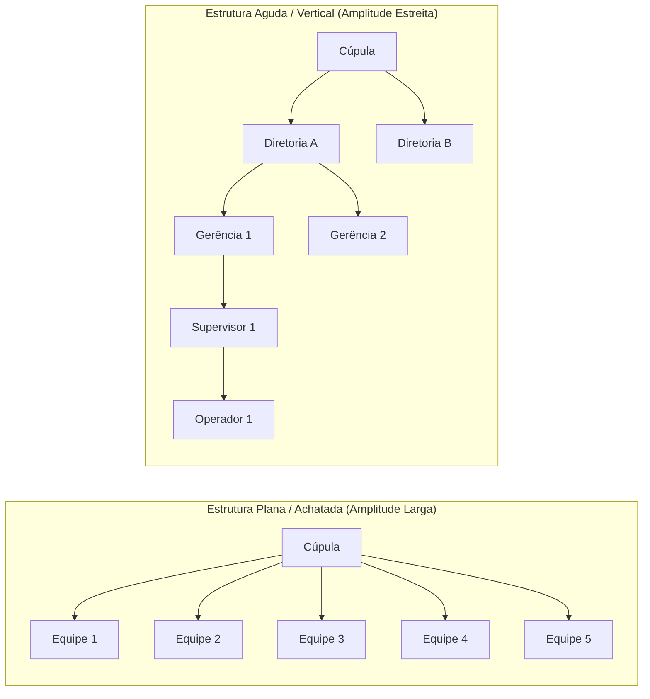
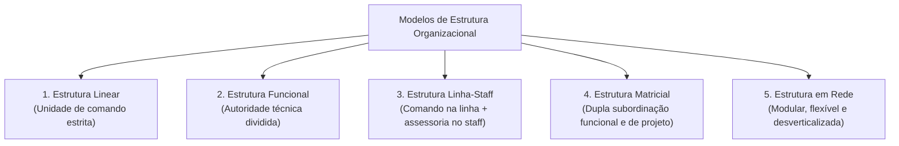
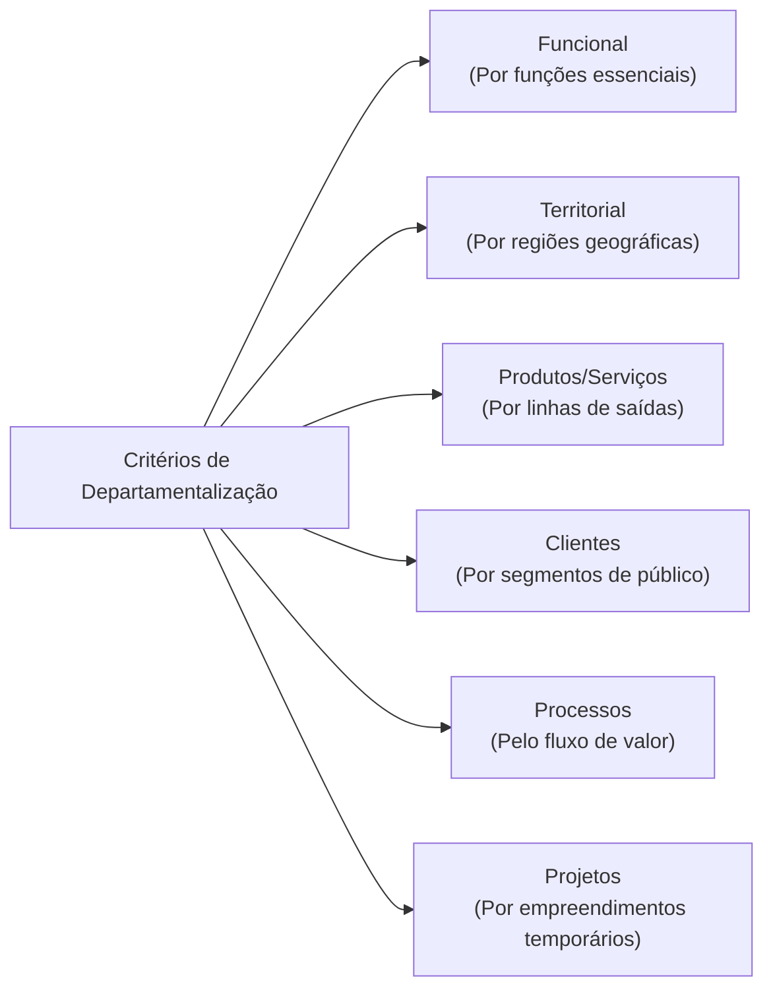
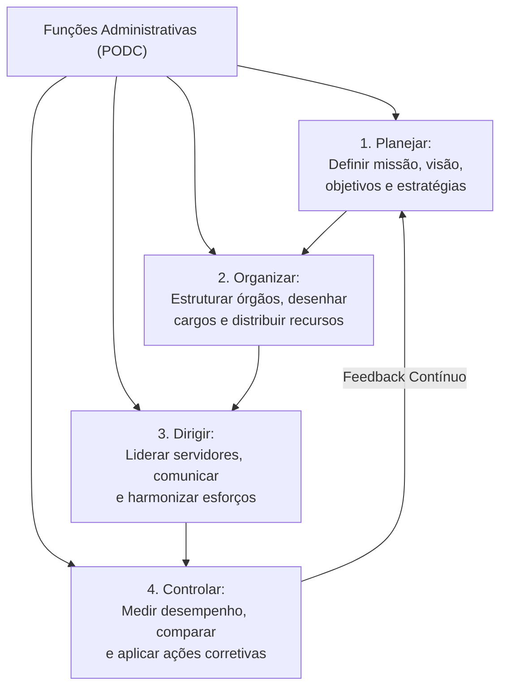
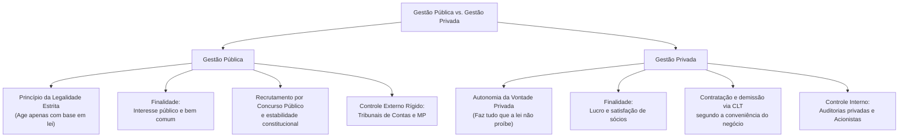

# 01 - Organizações Formais, Estruturas, Departamentalização e Processo Organizacional

> **Matéria:** Noções de Administração Pública  
> **Cargo:** A01 – Técnico de Controle Externo – Especialidade: Técnico Administrativo  
> **Arquivo:** `01_organizacoes_formais_estruturas_e_processo_organizacional.md`  

---

## 📌 Ementa / Itens do Edital
- Características básicas das organizações formais modernas: estrutura organizacional, sistemas de autoridade, hierarquia, amplitude administrativa e especialização do trabalho;
- Desenho de estruturas organizacionais:
  - Relação entre amplitude de controle e formato organizacional (estruturas agudas/altas versus estruturas achatadas/planas);
  - Centralização e descentralização da tomada de decisão;
- Tipos de estrutura organizacional: linear (militar), funcional, linha-staff, matricial e estruturas em rede (redes organizacionais flexíveis);
- Critérios de departamentalização: por funções (funcional), por produtos ou serviços, territorial (geográfica), por clientes, por processos e por projetos;
- Processo organizacional: as funções fundamentais da administração (PODC):
  - Planejamento (níveis estratégico, tático e operacional; objetivos e planos de ação);
  - Organização (alocação de recursos, divisão do trabalho e atribuição de responsabilidades);
  - Direção e Coordenação (liderança, motivação, delegação de autoridade e harmonização de esforços);
  - Comunicação organizacional (fluxos verticais ascendente e descendente, horizontais e diagonais; barreiras e ruídos na comunicação);
  - Controle e Avaliação (estabelecimento de padrões, medição do desempenho real, comparação e ações corretivas; controles prévio, concomitante e posterior);
- Convergências e diferenças essenciais entre a gestão pública e a gestão privada (princípio da legalidade estrita versus autonomia da vontade, finalidade pública versus lucro, regime de pessoal e sujeição aos órgãos de controle externo).

---

## 🌳 Classificação Hierárquica

```text
1. Organizações Formais, Estruturas e Funções Administrativas
├── 1.1 Elementos Fundamentais da Organização Formal
│   ├── 1.1.1 Divisão do Trabalho e Especialização: Maximização da produtividade
│   ├── 1.1.2 Cadeia Escalar e Hierarquia: Linha de autoridade formal e subordinação
│   ├── 1.1.3 Amplitude de Controle (Amplitude Administrativa):
│   │   ├── Amplitude Estreita: Estrutura verticalizada (aguda), supervisão cerrada, alto custo
│   │   └── Amplitude Ampla: Estrutura achatada (plana), autonomia, comunicação direta
│   └── 1.1.4 Centralização vs. Descentralização: Ponto focal de tomada de decisões
├── 1.2 Modelos de Estrutura Organizacional
│   ├── 1.2.1 Estrutura Linear: Unidade de comando estrita (Fayol), linhas únicas de chefia
│   ├── 1.2.2 Estrutura Funcional: Autoridade funcional por especialidade (Taylor), sem unidade de comando
│   ├── 1.2.3 Estrutura Linha-Staff: Autoridade de comando na linha + assessoria técnica no staff
│   ├── 1.2.4 Estrutura Matricial: Dupla subordinação (gerente funcional + gerente de projeto)
│   └── 1.2.5 Estrutura em Rede (Modular): Núcleo central enxuto conectado por contratos e TI
├── 1.3 Critérios de Departamentalização
│   ├── 1.3.1 Departamentalização Funcional: Agrupamento por funções essenciais (RH, Finanças, Logística)
│   ├── 1.3.2 Departamentalização Territorial (Geográfica): Foco na dispersão espacial ou regional
│   ├── 1.3.3 Departamentalização por Produtos / Serviços: Foco nas linhas de saídas e serviços
│   ├── 1.3.4 Departamentalização por Clientes / Cidadãos: Foco no perfil e necessidades do público-alvo
│   ├── 1.3.5 Departamentalização por Processos: Foco na sequência do fluxo de valor produtivo
│   └── 1.3.6 Departamentalização por Projetos: Estruturas multidisciplinares temporárias
├── 1.4 O Processo Organizacional (Funções Administrativas - PODC)
│   ├── 1.4.1 Planejamento: Estratégico (longo prazo), Tático (médio prazo) e Operacional (curto prazo)
│   ├── 1.4.2 Organização: Distribuição de tarefas, autoridade, recursos e arranjo físico
│   ├── 1.4.3 Direção: Liderança, motivação humana, dinamização de equipes e canais de comunicação
│   └── 1.4.4 Controle: Padrões, monitoramento, comparação e ação corretiva (prévio, concomitante, posterior)
└── 1.5 Convergências e Divergências: Gestão Pública vs. Gestão Privada
    ├── 1.5.1 Divergências: Princípio da Legalidade, busca do bem público vs. lucro, concurso e controle externo
    └── 1.5.2 Convergências: Foco no usuário-cidadão, governança, gestão por processos e busca de eficiência
```

---

## 📖 Resumo Teórico Aprofundado & Esquematizado

### 1. Elementos da Organização Formal e Desenho Estrutural

A **organização formal** é a estrutura deliberadamente planejada e oficialmente instituída para coordenar os esforços humanos e materiais rumo a objetivos definidos. Ela se apoia em cinco pilares clássicos:

1. **Divisão do Trabalho:** Fragmentação das atividades complexas em tarefas menores e especializadas.
2. **Especialização:** Concentração de um indivíduo ou unidade na execução de tarefas específicas, elevando a perícia técnica.
3. **Hierarquia e Cadeia de Comando:** Linha ininterrupta de autoridade formal que liga o topo da instituição à base operacional (*princípio escalar*).
4. **Amplitude Administrativa (ou Amplitude de Controle):** Número de subordinados que reportam diretamente a um único gestor/supervisor.
5. **Grau de Formalização:** Nível de padronização escrita das tarefas, regras, instruções normativas e regulamentos internos.



#### Comparativo: Amplitude Estreita vs. Amplitude Ampla

| Dimensão | Amplitude Estreita (Estrutura Aguda/Vertical) | Amplitude Ampla (Estrutura Plana/Achatada) |
| :--- | :--- | :--- |
| **Níveis Hierárquicos** | Muitos níveis intermediários (organização alta). | Poucos níveis intermediários (organização horizontal). |
| **Supervisão e Controle** | Estrita, próxima e minuciosa. | Mais frouxa, orientada a autonomia e resultados. |
| **Comunicação** | Lenta, burocrática e sujeita a ruídos e distorções. | Rápida, direta e transparente. |
| **Custo de Gestão** | Elevado (muitos cargos em comissão e chefias). | Reduzido (menor número de gestores intermediários). |
| **Delegação de Autoridade**| Baixa (decisões sobem pela cadeia escalar). | Alta (decisões delegadas à base operacional). |

---

### 2. Tipos de Estruturas Organizacionais Clássicas e Contemporâneas



#### Análise Comparativa Detalhada dos Modelos Estruturais:

| Modelo | Princípio Central | Vantagens Principais | Desvantagens / Riscos para Concurso |
| :--- | :--- | :--- | :--- |
| **Linear (Militar)** | **Unidade de Comando:** Cada subordinado tem um único chefe superior. Linhas formais e retas de autoridade. | Clareza absoluta de competências, facilidade de controle e disciplina incontestável. | Extrema rigidez, lentidão decisória, isolamento dos setores e sobrecarga do topo. |
| **Funcional** | **Especialização:** A autoridade decorre do conhecimento técnico. Subordinado recebe ordens de múltiplos chefes funcionais. | Máximo aproveitamento do conhecimento especializado e cooperação técnica. | **Quebra da unidade de comando**, concorrência entre chefes e confusão de ordens. |
| **Linha-Staff** | Combinação harmônica: os órgãos de **linha** detêm poder decisório e comando; os órgãos de **staff** prestam consultoria e suporte técnico. | Suporte técnico especializado de alto nível sem romper a unidade de comando de chefia. | Risco de atrito entre assessores teóricos do *staff* e chefes práticos da *linha*. |
| **Matricial** | Estrutura mista que sobrepõe uma autoridade de **projeto/produto** sobre a autoridade **funcional**. | Flexibilidade excepcional, orientação para metas e integração interdisciplinar. | **Dupla subordinação:** gera insegurança, ansiedade, disputas de poder e reuniões em excesso. |
| **Em Rede (Modular)** | Desverticalização: núcleo central enxuto coordena parceiros externos independentes mediante alianças contratuais e TI. | Custos fixos mínimos, adaptabilidade imediata ao mercado e velocidade de resposta. | Perda de controle direto, alta vulnerabilidade à ruptura de parceiros terceirizados. |

---

### 3. Critérios de Departamentalização

Departamentalização é o processo de agrupar atividades e recursos em unidades orgânicas especializadas:



1. **Departamentalização Funcional:** Agrupa atividades pelas funções primárias (ex.: Secretaria de Administração, Diretoria de Finanças, Gerência de Recursos Humanos).  
   * *Vantagem:* Economia de escala e concentração de especialistas.  
   * *Desvantagem:* Visão departamental limitada ("efeito feudo"), pouca colaboração intersetorial.
2. **Departamentalização Territorial (Geográfica):** Agrupa órgãos segundo a localização geográfica atendida (ex.: Delegacias Regionais Fazendárias da SEFAZ-GO em Anápolis, Rio Verde e Luziânia).  
   * *Vantagem:* Adaptação precisa às realidades locais.  
   * *Desvantagem:* Duplicação de custos estruturais em várias regiões.
3. **Departamentalização por Clientes:** Estruturada para atender perfis de usuários com características peculiares (ex.: Delegacia do Idoso, Juizado da Infância e Juventude).
4. **Departamentalização por Processos:** Organizada de acordo com o fluxo ordenado das etapas de transformação operacional (ex.: Seção de Protocolo $\rightarrow$ Triagem $\rightarrow$ Autuação $\rightarrow$ Julgamento).
5. **Departamentalização por Projetos:** Agrupamento temporário multidisciplinar destinado a realizar uma missão específica com prazo de início e fim determinados (ex.: Comissão de Implantação do SEI no TCE-GO).

---

### 4. O Processo Organizacional: As Funções Administrativas (PODC)

O processo administrativo é contínuo, cíclico e interativo, integrando quatro funções capitais:



#### Aprofundamento das Quatro Funções:

* **1. Planejamento:** É a função que antecede todas as demais, definindo aonde se quer chegar e os caminhos necessários:
  * **Nível Estratégico:** Horizonte de longo prazo; abrange a organização como um todo; formulado pela alta administração (ex.: Plano Estratégico do TCE-GO 2024-2030).
  * **Nível Tático:** Horizonte de médio prazo; focado nas unidades e departamentos funcionais; desdobra as diretrizes estratégicas em planos setoriais.
  * **Nível Operacional:** Horizonte de curto prazo; focado nas tarefas rotineiras, procedimentos operacionais padrão (POP) e cronogramas diários/semanais.
* **2. Organização:** Função de estruturar os recursos organizacionais (humanos, materiais, financeiros e tecnológicos), definir atribuições de cargos e estabelecer linhas formais de autoridade.
* **3. Direção e Coordenação:** Função de guiar, orientar, liderar e influenciar o comportamento das pessoas no trabalho:
  * *Comunicação Organizacional:* Envolve fluxos verticais (**descendentes**: ordens e instruções da chefia para a base; **ascendentes**: relatórios e sugestões da base para o topo), fluxos **horizontais** (entre colegas do mesmo nível hierárquico) e fluxos **diagonais** (entre diferentes níveis e setores).
  * *Barreiras de Comunicação:* Ruídos físicos, barreiras psicológicas (preconceitos, filtros mentais), barreiras semânticas (linguagem hermética) e sobrecarga informacional.
* **4. Controle:** Função de mensurar o desempenho real frente aos parâmetros planejados:
  * *Controle Prévio (Preventivo/Ex Ante):* Antecipa-se aos fatos para evitar desvios (ex.: exigência de Certidão Negativa de Débitos antes da assinatura do contrato).
  * *Controle Concomitante (Diretivo/Em Tempo Real):* Ocorre durante a realização da atividade (ex.: fiscalização presencial de uma obra pública).
  * *Controle Posterior (Corretivo/Feedback/Ex Post):* Ocorre após a conclusão do ciclo para apurar resultados e sanar falhas (ex.: prestação de contas anual analisada pelo Tribunal de Contas).

---

### 5. Gestão Pública vs. Gestão Privada: Quadro Sintético para Prova



---

## 🚨 Alertas de Prova & Pegadinhas da FCC

> 🚨 **ALERTA DE PROVA / PEGADINHA FCC (ESTRUTURA MATRICIAL E UNIDADE DE COMANDO):**  
> Questão garantida de prova: a FCC frequentemente tenta induzir o candidato a erro afirmando que "a estrutura matricial respeita e reforça o princípio da unidade de comando preconizado pela teoria clássica". Isso é **FALSO**! O aspecto definidor da estrutura matricial é justamente a **dupla subordinação** (o funcionário responde simultaneamente ao gerente de departamento técnico e ao gestor de projeto), o que viola deliberadamente a unidade de comando para obter maior flexibilidade!

> ⭐ **IMPORTANTE (AMPLITUDE E ESTRUTURA ORGANIZACIONAL):**  
> Grave a correlação inversa:  
> - **Amplitude Administrativa Estreita** $\rightarrow$ Poucos subordinados por chefe $\rightarrow$ **Estrutura Aguda / Vertical** (muitos níveis hierárquicos, maior custo de pessoal administrativo, decisão lenta).  
> - **Amplitude Administrativa Larga/Ampla** $\rightarrow$ Muitos subordinados por chefe $\rightarrow$ **Estrutura Achatada / Plana** (poucos níveis hierárquicos, organização descentralizada e ágil).

> 🛑 **ATENÇÃO (DIFERENÇA ENTRE LINHA E STAFF):**  
> Na estrutura linha-staff:  
> - Os órgãos de **LINHA** têm autoridade de comando executivo, tomam decisões e dão ordens diretas sobre a atividade-fim.  
> - Os órgãos de **STAFF (Assessoria)** têm autoridade puramente funcional de aconselhamento, parecer técnico e consultoria; eles **NÃO mandam** nos funcionários da linha.

> 📌 **NOTA EXPLICATIVA (LEGALIDADE NA GESTÃO PÚBLICA VS. PRIVADA):**  
> Para o cidadão comum e para a empresa privada, aplica-se o art. 5º, II da CF: "ninguém será obrigado a fazer ou deixar de fazer alguma coisa senão em virtude de lei" (pode fazer tudo o que a lei não proíbe).  
> Já para o gestor público, aplica-se o art. 37, caput da CF: a Administração Pública **só pode fazer aquilo que a lei expressamente autoriza ou determina**. A falta de previsão legal impede a atuação administrativa.

---

## 🌐 Fontes Oficiais e Referências Bibliográficas

* [CHIAVENATO, Idalberto. Introdução à Teoria Geral da Administração: Uma visão abrangente da moderna administração das organizações. 10ª Edição.](https://www.grupogen.com.br) - Estrutura organizacional e funções administrativas.
* [MAXIMIANO, Antonio Cesar Amaru. Teoria Geral da Administração: da revolução urbana à revolução digital. Editora Atlas.](https://www.grupogen.com.br).
* [Constituição da República Federativa do Brasil de 1988](https://www.planalto.gov.br/ccivil_03/constituicao/constituicao.htm) - Art. 37 (Princípios da Administração Pública).
* [Cadernos ENAP (Escola Nacional de Administração Pública)](https://repositorio.enap.gov.br) - Textos fundamentais sobre Organização do Estado e Gestão Pública.

---

## 📝 Questões de Concurso FCC Comentadas

### Questão 01
**(FCC – TCE-PI – Auditor de Controle Externo)**  
Determinada autarquia estadual de regulação de transportes estruturou suas equipes de fiscalização agrupando os servidores em torno de projetos especiais com prazos pré-fixados, mantendo concomitantemente as diretorias técnicas fixas de engenharia, finanças e tecnologia. Nesse modelo, os auditores reportam-se tanto ao coordenador do projeto específico quanto ao diretor da sua respectiva área técnica de origem. Trata-se de típica estrutura organizacional:

* **A)** Linear.
* **B)** Funcional pura.
* **C)** Matricial.
* **D)** Linha-staff.
* **E)** Colegiada.

> **Gabarito: C**  
> **Comentário Detalhado:**  
> - **A) Incorreta.** A estrutura linear baseia-se na unidade de comando irrestrita, com linhas únicas e verticais de chefia.  
> - **B) Incorreta.** A estrutura funcional fraciona a autoridade de acordo com a especialidade funcional, mas não sobrepõe gerências temporárias de projetos a departamentos fixos.  
> - **C) CORRETA.** A **estrutura matricial** caracteriza-se precisamente pela combinação bidimensional de uma estrutura funcional permanente com gerências de projetos temporárias, resultando na **dupla subordinação** dos colaboradores (ao líder do projeto e ao chefe funcional da sua área).  
> - **D) Incorreta.** Na estrutura linha-staff, os órgãos de staff prestam consultoria técnica aos órgãos de linha, sem haver comando duplo de projetos sobre colaboradores operacionais.  
> - **E) Incorreta.** Estrutura colegiada refere-se à tomada de decisão por órgão consultivo ou deliberativo coletivo (ex.: Tribunal Pleno, Conselho Administrativo).

---

### Questão 02
**(FCC – TCE-RS – Auditor de Controle Externo)**  
A respeito das funções do processo administrativo (planejamento, organização, direção e controle) e das diferenças entre a gestão pública e a gestão privada, assinale a opção correta:

* **A)** A função administrativa de planejamento restringe-se ao nível operacional da instituição, cabendo à função de organização a definição das metas estratégicas de longo prazo.
* **B)** A gestão pública e a gestão privada diferenciam-se essencialmente pelo regime de legalidade, na medida em que, na administração pública, o administrador só pode fazer o que a lei expressamente autoriza ou determina.
* **C)** O controle é a primeira função administrativa a ser desempenhada no processo de trabalho, dispensando a existência de padrões prévios fixados no planejamento.
* **D)** A amplitude de controle administrativa define a quantidade total de departamentos existentes na organização, independentemente do número de subordinados por chefia.
* **E)** As organizações privadas submetem-se ao mesmo regime de recrutamento universal mediante concurso público imposto pela Constituição aos órgãos estatais.

> **Gabarito: B**  
> **Comentário Detalhado:**  
> - **A) Incorreta.** O planejamento abrange três horizontes: estratégico (longo prazo), tático (médio prazo) e operacional (curto prazo). A fixação de metas institucionais pertence ao planejamento estratégico, e não à organização.  
> - **B) CORRETA.** Essa é a diferença jurídica clássica: na gestão privada vigora a autonomia da vontade (fazer tudo que a lei não proíbe - Art. 5º, II da CF), enquanto na administração pública incide o **princípio da legalidade estrita** (o agente só pode agir de acordo com o que a lei expressamente autoriza ou determina - Art. 37, caput da CF).  
> - **C) Incorreta.** O planejamento é a primeira função administrativa. O controle depende logicamente da existência de metas e padrões prévios para aferir desvios e corrigi-los.  
> - **D) Incorreta.** Amplitude de controle administrativo mede o número de subordinados atribuídos diretamente a cada supervisor ou gestor.  
> - **E) Incorreta.** O dever de concurso público é imposto pela CF/88 (art. 37, II) exclusivamente para a investidura em cargos e empregos públicos da Administração Direta e Indireta.

---

### Questão 03
**(FCC – TRT-2ª Região – Analista Judiciário: Área Administrativa)**  
Considere uma organização pública estadual que decida reduzir o número de seus escalões hierárquicos intermediários de sete para apenas três níveis, mantendo o mesmo quantitativo total de servidores em seus quadros operacionais. Sob a ótica da teoria da organização formal, essa reforma provocará:

* **A)** O estreitamento da amplitude de controle e a verticalização da estrutura organizacional.
* **B)** A eliminação da divisão do trabalho e a conversão automática para a estrutura linear pura.
* **C)** O alargamento da amplitude de controle dos gestores e o achatamento (horizontalização) da estrutura organizacional.
* **D)** A centralização absoluta de todas as decisões na cúpula diretiva em razão do aumento do número de chefes.
* **E)** A transformação imediata do modelo organizacional em departamentalização estritamente geográfica.

> **Gabarito: C**  
> **Comentário Detalhado:**  
> - **A) Incorreta.** Reduzir escalões faz o oposto: alarga a amplitude de controle e horizontaliza a estrutura.  
> - **B) Incorreta.** A divisão do trabalho permanece; ela não depende da quantidade de níveis hierárquicos.  
> - **C) CORRETA.** Ao reduzir os níveis intermediários sem diminuir o total de subordinados, cada gestor remanescente passará a chefiar um contingente maior de pessoas (**alargamento da amplitude administrativa**). Como consequência direta, a organização torna-se **achatada (plana/horizontalizada)**, reduzindo a distância entre a base e a cúpula.  
> - **D) Incorreta.** Estruturas achatadas com grande amplitude tendem a exigir maior delegação e descentralização, pois um chefe com muitos subordinados não consegue centralizar todas as rotinas.  
> - **E) Incorreta.** A forma da pirâmide hierárquica não define o critério de departamentalização (que pode continuar sendo funcional, por processos etc.).

---

### Questão 04
**(FCC – AL-AP – Analista Legislativo: Administração)**  
Uma das etapas cruciais da função administrativa de Direção é a comunicação organizacional. A respeito dos fluxos comunicacionais e de suas barreiras nas organizações públicas, assinale a alternativa correta:

* **A)** O fluxo de comunicação descendente transporta prioritariamente relatórios de desempenho, pedidos de esclarecimento e sugestões de melhoria vindos da base operacional.
* **B)** O fluxo horizontal ou lateral refere-se à troca de informações entre servidores situados no mesmo nível hierárquico, sendo indispensável para a coordenação interdepartamental.
* **C)** Barreiras semânticas decorrem exclusivamente de falhas mecânicas nos equipamentos de transmissão e instabilidade nas redes de computadores.
* **D)** A comunicação diagonal ocorre exclusivamente entre a chefia superior de um setor e os estagiários daquele mesmo departamento.
* **E)** A ampliação de níveis hierárquicos em estruturas verticais favorece a fidelidade da mensagem e elimina qualquer possibilidade de ruído comunicacional.

> **Gabarito: B**  
> **Comentário Detalhado:**  
> - **A) Incorreta.** Relatórios, dúvidas e sugestões vindos da base para a chefia constituem o fluxo **ascendente**. O fluxo descendente transmite diretrizes, metas e normas do topo para a base.  
> - **B) CORRETA.** A **comunicação horizontal (ou lateral)** ocorre entre membros de departamentos distintos ou colegas que ocupam o mesmo patamar hierárquico, facilitando a cooperação mútua, integração de processos e resolução ágil de problemas cotidianos.  
> - **C) Incorreta.** Falhas mecânicas e instabilidade de sinal são barreiras **físicas**. Barreiras **semânticas** dizem respeito ao significado das palavras, jargões técnicos incompreendidos ou diferenças de vocabulário.  
> - **D) Incorreta.** A comunicação **diagonal** atravessa diferentes funções e diferentes níveis hierárquicos simultaneamente (ex.: um analista de compras que se comunica diretamente com o Diretor de Tecnologia de outro órgão).  
> - **E) Incorreta.** Quanto maior o número de níveis hierárquicos, maior o risco de distorção ("efeito telefone sem fio") e ruídos na comunicação.

---

### Questão 05
**(FCC – DPE-RS – Analista: Área Administrativa)**  
No âmbito da administração contemporânea, o processo administrativo de controle desdobra-se em três momentos temporais fundamentais: prévio, concomitante e posterior. Constitui exemplo típico de controle prévio (preventivo) no setor público:

* **A)** A análise da prestação de contas do ordenador de despesa efetuada pelo Tribunal de Contas após o encerramento do exercício financeiro.
* **B)** A aplicação de penalidade contratual de multa a uma empresa fornecedora que entregou bens com defeito de fabricação.
* **C)** A medição semanal em tempo real do avanço físico de uma rodovia estadual pelo fiscal da administração durante a execução da obra.
* **D)** A exigência de apresentação prévia de certidões de regularidade fiscal e habilitação jurídica no edital antes da contratação da empresa licitante.
* **E)** A realização de auditoria de conformidade ex post destinada a quantificar o dano ao erário decorrente de sobrepreço em contrato encerrado.

> **Gabarito: D**  
> **Comentário Detalhado:**  
> - **A) Incorreta.** A análise de contas após o encerramento do exercício é um controle **posterior (ex post)**.  
> - **B) Incorreta.** A aplicação de sanção por entrega defeituosa é uma medida **corretiva/posterior** à constatação da infração.  
> - **C) Incorreta.** A fiscalização presencial durante a realização dos serviços é um controle **concomitante (em tempo real)**.  
> - **D) CORRETA.** O **controle prévio (preventivo ou ex ante)** atua antes que a ação administrativa se materialize, estabelecendo barreiras e condições de aptidão com o objetivo de evitar prejuízos futuros. A exigência editalícia de regularidade fiscal e jurídica antes da celebração do vínculo é um exemplo límpido de controle preventivo.  
> - **E) Incorreta.** Auditoria após a conclusão contratual para apuração de dano é controle **posterior**.
