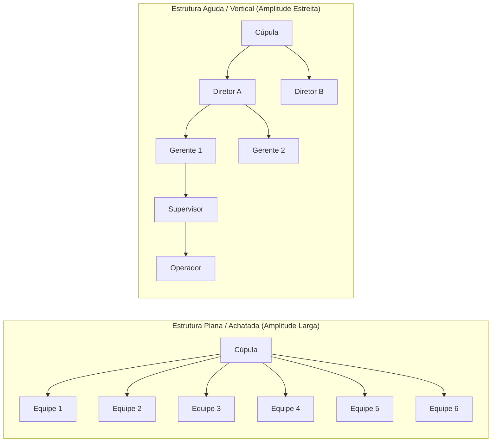
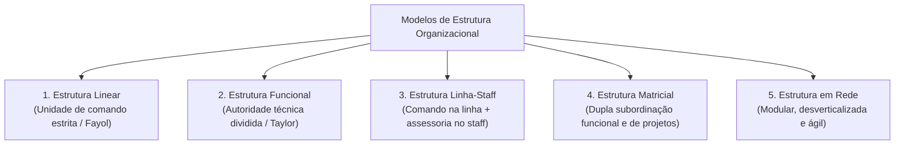
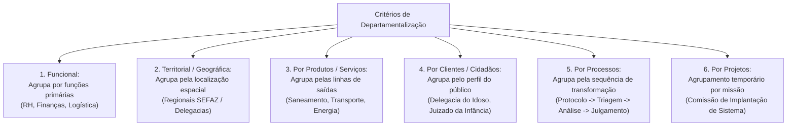
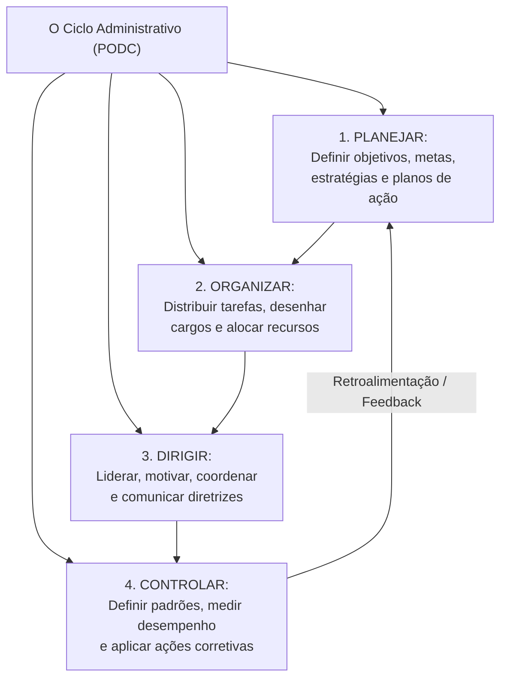
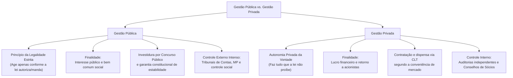

# 01 - Organizações Formais, Estruturas, Departamentalização e Processo Organizacional

> **Matéria:** Noções de Administração Pública  
> **Cargo:** A01 – Técnico de Controle Externo – Especialidade: Técnico Administrativo  
> **Arquivo:** `01_organizacoes_formais_estruturas_e_processo_organizacional.md`  

---

## 📌 Ementa / Itens do Edital

- Características básicas das organizações formais modernas: estrutura organizacional, sistemas de autoridade, hierarquia, amplitude administrativa e especialização do trabalho;
- Desenho de estruturas organizacionais:
    - Relação entre amplitude de controle e formato organizacional (estruturas agudas/altas versus estruturas achatadas/planas);
    - Centralização e descentralização da tomada de decisão;
- Tipos de estrutura organizacional: linear (militar), funcional, linha-staff, matricial e estruturas em rede (redes organizacionais flexíveis);
- Critérios de departamentalização: por funções (funcional), por produtos ou serviços, territorial (geográfica), por clientes, por processos e por projetos;
- Processo organizacional: as funções fundamentais da administração (PODC):
    - Planejamento (níveis estratégico, tático e operacional; objetivos e planos de ação);
    - Organização (alocação de recursos, divisão do trabalho e atribuição de responsabilidades);
    - Direção e Coordenação (liderança, motivação, delegação de autoridade e harmonização de esforços);
    - Comunicação organizacional (fluxos verticais ascendente e descendente, horizontais e diagonais; barreiras e ruídos na comunicação);
    - Controle e Avaliação (estabelecimento de padrões, medição do desempenho real, comparação e ações corretivas; controles prévio, concomitante e posterior);
- Convergências e diferenças essenciais entre a gestão pública e a gestão privada (princípio da legalidade estrita versus autonomia da vontade, finalidade pública versus lucro, regime de pessoal e sujeição aos órgãos de controle externo).

---

## 🧭 Sumário

1. [Elementos da Organização Formal e Desenho Estrutural](#1-elementos-da-organizacao-formal-e-desenho-estrutural)
    1. [Os Pilares da Organização Formal Moderna](#11-os-pilares-da-organizacao-formal-moderna)
    2. [Amplitude Administrativa e Formato Organizacional (Agudo vs. Plano)](#12-amplitude-administrativa-e-formato-organizacional-agudo-vs-plano)
    3. [Centralização vs. Descentralização Decisória](#13-centralizacao-vs-descentralizacao-decisoria)
    4. [Teste 300](#Teste-300)
    5. [Teste 301](#Teste-301)
2. [Modelos de Estrutura Organizacional](#2-modelos-de-estrutura-organizacional)
    1. [Estrutura Linear (Militar/Clássica)](#21-estrutura-linear-militarclassica)
    2. [Estrutura Funcional (Tayloriana)](#22-estrutura-funcional-tayloriana)
    3. [Estrutura Linha-Staff (Comando e Assessoria)](#23-estrutura-linha-staff-comando-e-assessoria)
    4. [Estrutura Matricial (Dupla Subordinação)](#24-estrutura-matricial-dupla-subordinacao)
    5. [Estrutura em Rede (Modular e Desverticalizada)](#25-estrutura-em-rede-modular-e-desverticalizada)
    6. [Teste 302](#Teste-302)
    7. [Teste 303](#Teste-303)
3. [Critérios de Departamentalização](#3-criterios-de-departamentalizacao)
    1. [Departamentalização Funcional, Territorial e por Produtos](#31-departamentalizacao-funcional-territorial-e-por-produtos)
    2. [Departamentalização por Clientes, Processos e Projetos](#32-departamentalizacao-por-clientes-processos-e-projetos)
    3. [Teste 304](#Teste-304)
4. [O Processo Organizacional e as Funções Administrativas (PODC)](#4-o-processo-organizacional-e-as-funcoes-administrativas-podc)
    1. [Planejamento: Estratégico, Tático e Operacional](#41-planejamento-estrategico-tatico-e-operacional)
    2. [Organização: Distribuição de Tarefas, Autoridade e Recursos](#42-organizacao-distribuicao-de-tarefas-autoridade-e-recursos)
    3. [Direção, Liderança e Comunicação Organizacional](#43-direcao-lideranca-e-comunicacao-organizacional)
    4. [Controle: Padrões, Medição e Momentos de Atuação (Prévio, Concomitante e Posterior)](#44-controle-padroes-medicao-e-momentos-de-atuacao-previo-concomitante-e-posterior)
    5. [Teste 305](#Teste-305)
    6. [Teste 306](#Teste-306)
5. [Gestão Pública vs. Gestão Privada: Convergências e Diferenças](#5-gestao-publica-vs-gestao-privada-convergencias-e-diferencas)
    1. [Teste 307](#Teste-307)
    2. [Teste 308](#Teste-308)
    3. [Teste 309](#Teste-309)
6. [🌐 Fontes Oficiais & Referências Bibliográficas](#fontes-oficiais-referencias-bibliograficas)

---

## 1. Elementos da Organização Formal e Desenho Estrutural

### 1.1 Os Pilares da Organização Formal Moderna
A **organização formal** é a estrutura deliberadamente planejada, racionalmente desenhada e oficialmente sancionada por normas e regulamentos para integrar recursos humanos, materiais, financeiros e tecnológicos em direção a objetivos comuns. Seus pilares teóricos centrais compreendem:

1. **Divisão do Trabalho:** Decomposição das atividades complexas em tarefas menores, homogêneas e sequenciais, potencializando a eficiência global;
2. **Especialização:** Concentração individual em funções específicas do processo de trabalho, permitindo aprimoramento da perícia técnica;
3. **Cadeia Escalar e Hierarquia:** Linha ininterrupta de autoridade formal e responsabilidade que conecta a cúpula diretiva à base operacional (*princípio escalar de Fayol*);
4. **Amplitude Administrativa (ou Amplitude de Controle):** Número exato de subordinados que reportam diretamente a um único gestor ou supervisor;
5. **Formalização:** Nível de padronização escrita das rotinas de trabalho, manuais, procedimentos operacionais padrão (POP) e organogramas.

### 1.2 Amplitude Administrativa e Formato Organizacional (Agudo vs. Plano)
Há uma correlação matemática inversa entre a amplitude administrativa e o número de níveis hierárquicos da organização:

| Critério de Comparação | Amplitude Estreita (Estrutura Aguda/Vertical) | Amplitude Ampla (Estrutura Plana/Achatada) |
| :--- | :--- | :--- |
| **Níveis Hierárquicos** | Muitos níveis intermediários (organização alta). | Poucos níveis intermediários (organização horizontal). |
| **Estilo de Supervisão** | Cerrada, rigorosa, minuciosa e controladora. | Frouxa, com foco na autonomia, confiança e resultados. |
| **Fluxo de Comunicação** | Lento, burocrático e sujeito a distorções ("telefone sem fio"). | Direto, rápido, transparente e horizontal. |
| **Custo de Administração**| Elevado (grande número de cargos comissionados de chefia). | Baixo (estrutura enxuta com menos gerentes intermediários). |
| **Delegação e Decisão** | Centralizada na cúpula; baixa delegação. | Descentralizada; forte empoderamento (*empowerment*) da base. |

> 🚨 **ALERTA DE PROVA / PEGADINHA FCC:**  
> A banca frequentemente explora o impacto da "desverticalização" (ou *downsizing*) e redução de níveis hierárquicos: quando uma organização extingue cargos intermediários mantendo o mesmo número de servidores operacionais, ocorre **o alargamento da amplitude de controle** e o **achatamento da estrutura** (horizontalização), exigindo maior autonomia e descentralização!

### 1.3 Centralização vs. Descentralização Decisória
- **Centralização:** Ocorre quando o poder decisório e a autoridade para emitir deliberações estão concentrados no ápice da pirâmide hierárquica. Proporciona visão global e uniformidade de políticas, mas gera morosidade, sobrecarga na cúpula e desmotivação dos escalões inferiores.
- **Descentralização:** Ocorre quando a autoridade para tomar decisões é formalmente transferida e delegada aos níveis mais baixos da organização, próximos de onde a ação se desenvolve. Promove agilidade, adaptação às peculiaridades operacionais e valorização dos servidores, mas pode gerar inconsistência e perda de visão sistêmica se não houver mecanismos eficazes de governança e alinhamento.

---

### Teste 300
**(FGV – TRT-DA 24-REGIÃO – Analista Judiciário - Tecnologia da Informação – 2025)**
Os critérios de departamentalização na Administração Pública 
devem alinhar-se aos princípios da legalidade, impessoalidade, 
moralidade, publicidade e eficiência. 
Assinale a opção que apresenta, corretamente, a 
departamentalização que procura agrupar órgãos e cargos por 
função para aproveitar a integração de conhecimentos, 
habilidades, competências e processos de trabalho em uma só 
unidade.

* **A)** Geográfica.
* **B)** Funcional.
* **C)** Por clientela.
* **D)** Por processos.
* **E)** Por projetos. 
Tribunal Regional do Trabalho da 24ª Região (TRT-24)  FGV CONHECIMENTO

---

> **Comentário Detalhado:**
>
> - **A)** Incorreta. Discrepa das diretrizes normativas e jurisprudenciais aplicáveis ao tema objeto do item.
> - **B)** Incorreta. Discrepa das diretrizes normativas e jurisprudenciais aplicáveis ao tema objeto do item.
> - **C)** Correta. Representa com precisão a disciplina do tema e o entendimento pacificado adotado pela banca (FGV).
> - **D)** Incorreta. Discrepa das diretrizes normativas e jurisprudenciais aplicáveis ao tema objeto do item.
> - **E)** Incorreta. Discrepa das diretrizes normativas e jurisprudenciais aplicáveis ao tema objeto do item.
>
> **Gabarito: C**

---
### Teste 301
**(FGV – TRT – Analista Judiciário - Tecnologia da Informação – 2024)**
O processo de diferenciação é a segmentação das operações de 
uma organização em áreas especializadas, como resposta ao 
crescimento e à complexidade. Inclui a divisão do trabalho, a 
criação de estruturas funcionais e departamentalização, e a 
diversificação de produtos e serviços.  
Assinale a opção que apresenta a vantagem de agrupar todas as 
funções em torno de determinada tecnologia, conjunto de 
produtos ou grupo de clientes.

* **A)** Diferenciação ocupacional.
* **B)** Descentralização geográfica.
* **C)** Diferenciação por tecnologia.
* **D)** Departamentalização.
* **E)** Diferenciação por nível hierárquico.

---

> **Comentário Detalhado:**
>
> - **A)** Incorreta. Discrepa das diretrizes normativas e jurisprudenciais aplicáveis ao tema objeto do item.
> - **B)** Incorreta. Discrepa das diretrizes normativas e jurisprudenciais aplicáveis ao tema objeto do item.
> - **C)** Correta. Representa com precisão a disciplina do tema e o entendimento pacificado adotado pela banca (FGV).
> - **D)** Incorreta. Discrepa das diretrizes normativas e jurisprudenciais aplicáveis ao tema objeto do item.
> - **E)** Incorreta. Discrepa das diretrizes normativas e jurisprudenciais aplicáveis ao tema objeto do item.
>
> **Gabarito: C**

---
## 2. Modelos de Estrutura Organizacional

As organizações estruturam-se segundo diferentes desenhos formais de autoridade e divisão do trabalho:

### 2.1 Estrutura Linear (Militar/Clássica)
- **Princípio Central:** **Unidade de comando absoluta** formulada por Henri Fayol: cada subordinado reporta-se única e exclusivamente a um único superior hierárquico direto;
- **Características:** Linhas formais, retas e descendentes de autoridade; centralização radical no topo; formato piramidal rígido;
- **Vantagens:** Clareza de responsabilidades, facilidade de controle e disciplina impecável;
- **Desvantagens:** Rigidez burocrática, morosidade decisória, isolamento departamental e sobrecarga de trabalho do gestor supremo.

### 2.2 Estrutura Funcional (Tayloriana)
- **Princípio Central:** **Especialização funcional** proposta por Frederick Taylor: a autoridade não decorre do posto na linha hierárquica, mas do domínio técnico especializado;
- **Características:** Cada trabalhador reporta-se simultaneamente a vários supervisores especializados (ex.: chefe de qualidade, chefe de manutenção, chefe de prazos);
- **Vantagens:** Máximo aproveitamento do conhecimento técnico especializado e comunicação direta sem intermediários;
- **Desvantagens:** **Quebra categórica da unidade de comando**, gerando conflitos de prioridades, concorrência entre chefes e confusão de ordens.

### 2.3 Estrutura Linha-Staff (Comando e Assessoria)
- **Princípio Central:** Combinação harmônica dos modelos linear e funcional. Os órgãos de **linha** detêm a autoridade de comando e decisão sobre as atividades-fim da organização; os órgãos de **staff (assessoria)** prestam serviços especializados, pareceres técnicos, estudos e consultoria às chefias de linha;
- **Vantagens:** Assegura suporte técnico de alto padrão sem quebrar a unidade de comando de chefia direta;
- **Desvantagens:** Risco constante de atrito e conflito entre os assessores teóricos do *staff* e os gerentes práticos da *linha*.

> 🚨 **ALERTA DE PROVA / PEGADINHA FCC:**  
> Os órgãos de *staff* **NÃO possuem autoridade de comando** sobre o pessoal da linha! Eles prestam consultoria, aconselham e sugerem, mas não têm competência para emitir ordens diretas de execução aos operadores de linha.

### 2.4 Estrutura Matricial (Dupla Subordinação)
- **Princípio Central:** Sobreposição deliberada de uma estrutura temporária de **projetos/produtos** sobre a estrutura permanente **funcional**. O servidor possui **dupla subordinação**: responde perante o seu chefe de departamento funcional (ex.: Diretor de TI) e perante o líder do projeto interdisciplinar (ex.: Coordenador do Projeto Nova Sede);
- **Vantagens:** Altíssima flexibilidade, orientação estratégica para resultados e objetivos de longo prazo, cooperação interdisciplinar e resposta ágil a demandas complexas;
- **Desvantagens:** **Violação deliberada da unidade de comando**: gera insegurança emocional, ansiedade em relação a prazos, disputa de poder entre gestores e excesso de reuniões de alinhamento.

### 2.5 Estrutura em Rede (Modular e Desverticalizada)
- **Princípio Central:** Desverticalização organizacional. A entidade mantém um núcleo estratégico enxuto central que coordena uma rede de prestadores de serviços, parceiros, órgãos conveniados e fornecedores externos conectados por tecnologia da informação e contratos;
- **Vantagens:** Custos fixos estruturais mínimos, extrema adaptabilidade a oscilações do ambiente e foco exclusivo nas competências essenciais (*core business*);
- **Desvantagens:** Perda de controle direto sobre a operação, fragilidade na cadeia de suprimentos e dependência excessiva de parceiros externos.

---

### Teste 302
**(FGV – TRT – Analista Judiciário - Tecnologia da Informação – 2024)**
O processo administrativo é o conjunto de funções 
desempenhadas por administradores em diversos níveis e áreas 
da organização, visando alcançar metas previamente definidas. 
Assinale a opção que está associada à função adminis trativa da 
direção.

* **A)** Ação corretiva.
* **B)** Divisão do trabalho.
* **C)** Produção de planos.
* **D)** Monitoramento das atividades.
* **E)** Motivação das pessoas.

---

> **Comentário Detalhado:**
>
> - **A)** Incorreta. Discrepa das diretrizes normativas e jurisprudenciais aplicáveis ao tema objeto do item.
> - **B)** Correta. Representa com precisão a disciplina do tema e o entendimento pacificado adotado pela banca (FGV).
> - **C)** Incorreta. Discrepa das diretrizes normativas e jurisprudenciais aplicáveis ao tema objeto do item.
> - **D)** Incorreta. Discrepa das diretrizes normativas e jurisprudenciais aplicáveis ao tema objeto do item.
> - **E)** Incorreta. Discrepa das diretrizes normativas e jurisprudenciais aplicáveis ao tema objeto do item.
>
> **Gabarito: B**

---
### Teste 303
**(FGV – TRT – Analista Judiciário - Tecnologia da Informação – 2024)**
O processo administrativo abrange planejamento, organização, 
direção e controle. O planejamento define objetivos e 
estratégias; a organização estrutura recursos e atividades; a 
direção lider a e motiva as equipes; e o controle monitora o 
desempenho, ajustando conforme necessário para garantir o 
sucesso organizacional. 
Assinale a base de atuação da função de ideias.

* **A)** Organização.
* **B)** Controle.
* **C)** Planejamento.
* **D)** Direção.
* **E)** Retroação.

---

> **Comentário Detalhado:**
>
> - **A)** Incorreta. Discrepa das diretrizes normativas e jurisprudenciais aplicáveis ao tema objeto do item.
> - **B)** Incorreta. Discrepa das diretrizes normativas e jurisprudenciais aplicáveis ao tema objeto do item.
> - **C)** Incorreta. Discrepa das diretrizes normativas e jurisprudenciais aplicáveis ao tema objeto do item.
> - **D)** Incorreta. Discrepa das diretrizes normativas e jurisprudenciais aplicáveis ao tema objeto do item.
> - **E)** Correta. Representa com precisão a disciplina do tema e o entendimento pacificado adotado pela banca (FGV).
>
> **Gabarito: E**

---
## 3. Critérios de Departamentalização

A departamentalização consiste no agrupamento de atividades, recursos e servidores em unidades organizacionais homogêneas para viabilizar a divisão equilibrada do trabalho:

### 3.1 Departamentalização Funcional, Territorial e por Produtos
- **Funcional:** Agrupa servidores que desempenham funções correlatas ou utilizam competências e equipamentos semelhantes (ex.: Secretaria de Estado da Fazenda, Gerência de Recursos Humanos). Propicia economia de escala, mas cria isolamento setorial ("feudos").
- **Territorial ou Geográfica:** Baseia-se na dispersão espacial dos usuários e das atividades (ex.: Delegacias Regionais do Trabalho, Superintendências Regionais do Dnit). Permite adaptação precisa ao contexto local, mas duplica custos de infraestrutura física.
- **Por Produtos ou Serviços:** Agrupa atividades em torno das saídas ou linhas de bens produzidos (ex.: numa agência reguladora, diretoria de energia elétrica, diretoria de petróleo e diretoria de biocombustíveis). Fomenta inovação e foco nos resultados do produto, mas encarece a gestão com duplicação de funções de apoio.

### 3.2 Departamentalização por Clientes, Processos e Projetos
- **Por Clientes / Cidadãos:** Organiza os setores com foco nas características peculiares de segmentos de usuários do serviço público (ex.: Delegacia de Atendimento à Mulher, Promotoria do Idoso). Assegura tratamento prioritário e personalizado ao público-alvo, mas dificulta a coordenação central.
- **Por Processos:** Estrutura as unidades segundo a sequência lógica e temporal das etapas de trabalho produtivo (ex.: Protocolo Geral $\rightarrow$ Triagem Documental $\rightarrow$ Instrução Processual $\rightarrow$ Julgamento pelo Tribunal Pleno). Otimiza o fluxo de valor contínuo e a tecnologia de produção, mas é vulnerável a gargalos operacionais em qualquer etapa.
- **Por Projetos:** Agrupamento temporário de recursos e profissionais de diversas especialidades dedicados exclusivamente a entregar um empreendimento único com data de encerramento prefixada (ex.: Comitê de Construção do Novo Prédio do TCE-GO). Ao término do projeto, a equipe é desmobilizada e os membros retornam aos seus órgãos funcionais.

---

### Teste 304
**(FGV – TRT – Analista Judiciário - Tecnologia da Informação – 2024)**
Os níveis hierárquicos em uma organização distribuem 
responsabilidades e poder, facilitando a gestão e a comunicação 
interna. Cada nível tem um papel e specífico, desde a alta 
administração, que define a visão estratégica, até os níveis 
operacionais, que executam tarefas diárias. A estrutura 
organizacional dirige atividades para alcançar objetivos e pode 
variar conforme tamanho, setor e estratégia. Atualm ente, há 
uma tendência à descentralização, embora algumas grandes 
organizações busquem centralizar funções anteriormente 
descentralizadas. 
Assinale a opção que apresenta uma vantagem da 
descentralização.

* **A)** Agilidade.
* **B)** Controle.
* **C)** Comunicação clara.
* **D)** Interdependência.
* **E)** Economia de escala.

---

> **Comentário Detalhado:**
>
> - **A)** Incorreta. Discrepa das diretrizes normativas e jurisprudenciais aplicáveis ao tema objeto do item.
> - **B)** Incorreta. Discrepa das diretrizes normativas e jurisprudenciais aplicáveis ao tema objeto do item.
> - **C)** Incorreta. Discrepa das diretrizes normativas e jurisprudenciais aplicáveis ao tema objeto do item.
> - **D)** Incorreta. Discrepa das diretrizes normativas e jurisprudenciais aplicáveis ao tema objeto do item.
> - **E)** Correta. Representa com precisão a disciplina do tema e o entendimento pacificado adotado pela banca (FGV).
>
> **Gabarito: E**

---
## 4. O Processo Organizacional e as Funções Administrativas (PODC)

A administração moderna concebe o processo organizacional como um fluxo dinâmico, interdependente e contínuo composto por quatro funções clássicas:

### 4.1 Planejamento: Estratégico, Tático e Operacional
O planejamento é a função que precede e fundamenta todas as demais, determinando onde a instituição pretende chegar e quais caminhos trilhar:

| Nível de Planejamento | Nível Hierárquico Responsável | Horizonte Temporal | Amplitude e Abrangência | Conteúdo Típico |
| :--- | :--- | :--- | :--- | :--- |
| **Estratégico** | Alta Administração (Cúpula / Presidência). | **Longo Prazo** (4 a 8 anos). | Abrange a **instituição como um todo** em sua relação com o ambiente externo. | Missão, Visão de Futuro, Valores, Objetivos Estratégicos e Plano de Metas Global. |
| **Tático** | Gerências Intermediárias (Diretorias). | **Médio Prazo** (1 a 3 anos). | Abrange cada **unidade ou departamento funcional** isoladamente. | Planos setoriais (RH, TI, Logística), alocação departamental de recursos e metas intermediárias. |
| **Operacional** | Supervisores e Equipes Operacionais. | **Curto Prazo** (dias, semanas, meses). | Focado em **tarefas, procedimentos e rotinas específicas**. | Procedimentos Operacionais Padrão (POP), rotinas de atendimento, escalas diárias e cronogramas. |

### 4.2 Organização: Distribuição de Tarefas, Autoridade e Recursos
Função responsável pela modelagem dos órgãos, desenho de cargos, atribuição de responsabilidades, alocação de recursos financeiros e materiais e estabelecimento de relações formais de cooperação e subordinação para que os planos possam ser implementados com eficácia.

### 4.3 Direção, Liderança e Comunicação Organizacional
A função de **Direção** dinamiza a organização, orientando e influenciando as pessoas para que desempenhem com zelo suas atribuições:

- **Liderança e Motivação:** Condução de equipes através de estilos de liderança (autocrático, democrático e liberal/laissez-faire) e compreensão dos fatores motivacionais de servidores públicos (Teoria dos Dois Fatores de Herzberg, Teoria das Necessidades de Maslow);
- **Comunicação Organizacional e seus Fluxos:**
    - **Fluxo Descendente (Top-Down):** Da chefia superior para a base operacional (ordens de serviço, diretrizes institucionais, metas e instruções normativas);
    - **Fluxo Ascendente (Bottom-Up):** Da base operacional para a cúpula (relatórios de progresso, sugestões de melhoria, dúvidas e recursos administrativos);
    - **Fluxo Horizontal (Lateral):** Entre servidores ou unidades situados no mesmo nível hierárquico (coordenação interdisciplinar e cooperação técnica);
    - **Fluxo Diagonal:** Atravessa diferentes setores e diferentes níveis hierárquicos simultaneamente (agiliza soluções de problemas complexos);
- **Barreiras Comunicacionais:** Ruídos que prejudicam a decodificação da mensagem:
    - *Físicas:* Barulho ambiente, interferência técnica em equipamentos e falhas de rede;
    - *Semânticas:* Diferenças de vocabulário, termos técnicos ou jurídicos herméticos inacessíveis ao receptor;
    - *Psicológicas:* Preconceitos, desconfiança, filtros seletivos e viés perceptivo do interlocutor.

### 4.4 Controle: Padrões, Medição e Momentos de Atuação (Prévio, Concomitante e Posterior)
O controle assegura que o desempenho real esteja em consonância com o que foi previamente planejado:

1. **Estabelecimento de Padrões de Desempenho:** Fixação prévia de metas, indicadores e prazos;
2. **Medição do Desempenho Real:** Obtenção de dados tempestivos sobre o andamento dos processos;
3. **Comparação entre Desempenho Real e Padrão:** Identificação de variações, desvios e erros;
4. **Ação Corretiva:** Intervenção tempestiva para reorientar a execução ou reajustar o planejamento original.

##### Momentos Temporais do Controle Público:
- **Controle Prévio (Preventivo / Ex Ante):** Antecipa-se aos fatos para impedir irregularidades ou desvios (ex.: exigência de certidões de regularidade fiscal e habilitação técnica antes de assinar contrato, estimativa orçamentária prévia);
- **Controle Concomitante (Diretivo / Em Tempo Real):** Acompanha a execução física e financeira no momento em que ela está ocorrendo (ex.: fiscalização presencial de obra pública, medições parciais de cronograma);
- **Controle Posterior (Corretivo / Ex Post):** Incide após a conclusão da ação ou do ciclo de gestão para auditar a conformidade e os resultados alcançados (ex.: prestação anual de contas julgada pelo Tribunal de Contas, processo disciplinar por desvio de conduta).

---

### Teste 305
**(FCC – TRT-15 – Analista Judiciário - Tecnologia da Informação – 2015)**
Sobre as estruturas organizacionais, considere: 

 I. O grupamento das atividades de uma entidade em órgãos é efetuado de acordo com critérios de departamentalização 
que, entre outros, podem ser: por produtos, por clientes ou por área geográfica.  
 II. Dentre as relações formais verificadas na estrutura organizacional de uma instituição, pode-se citar a autoridade de linha, ou 
seja, aquela exercida pelo chefe de um órgão diretamente sobre seus subordinados.  
 III. A denominada estrutura matricial, descrita por Fayol, pressupõe,  no primeiro nível de departamentalização, as funções de 
produção, comercialização, finanças e administração. 

 Está correto o que consta APENAS em

* **A)** II e III.
* **B)** I e III.
* **C)** I e II.
* **D)** III.
* **E)** I. 
Caderno de Prova ’B02’, Tipo 001

6 TRT15-Conhecimentos Gerais2 

Regimento Interno do TRT da 15a Região

---

> **Comentário Detalhado:**
>
> - **A)** Incorreta. Discrepa das diretrizes normativas e jurisprudenciais aplicáveis ao tema objeto do item.
> - **B)** Incorreta. Discrepa das diretrizes normativas e jurisprudenciais aplicáveis ao tema objeto do item.
> - **C)** Incorreta. Discrepa das diretrizes normativas e jurisprudenciais aplicáveis ao tema objeto do item.
> - **D)** Incorreta. Discrepa das diretrizes normativas e jurisprudenciais aplicáveis ao tema objeto do item.
> - **E)** Correta. Representa com precisão a disciplina do tema e o entendimento pacificado adotado pela banca (FCC).
>
> **Gabarito: E**

---
### Teste 306
**(FGV – TRT-1 – Analista Judiciário - Tecnologia da Informação – 2024)**
Marcelo é gerente de uma equipe de seis pessoas. 
Recentemente, ele recebeu os resultados de um a pesquisa sobre 
percepções e expectativas no trabalho realizada junto a sua 
equipe. A pesquisa foi realizada pela área de recursos humanos, 
devido aos sinais de forte desmotivação e falta de empenho da 
equipe na realização do trabalho. Os resultados da pe squisa 
indicaram que os membros da equipe consideram que: seu 
trabalho é repetitivo, exigindo que apliquem sempre as mesmas 
capacidades; e eles não recebem feedback claro e adequado 
sobre seu trabalho. Marcelo gostaria de realizar mudanças no 
trabalho da e quipe que permitissem estimular a motivação dos 
membros. 
Na situação descrita, com base no modelo das características do 
trabalho (MCT) de Hackman e Oldham, é adequado adotar, 
respectivamente, as seguintes iniciativas:

* **A)** expansão vertical dos cargos; rotação de cargos;
* **B)** formação de unidades naturais de trabalho; estabelecimento 
de relação com os clientes;
* **C)** combinação de tarefas; formação de unidades naturais de 
trabalho;
* **D)** expansão vertical dos cargos; expansão vertical dos cargos;
* **E)** estabelecimento de relação com os clientes; estabelecimento 
de relação com os clientes.

---

> **Comentário Detalhado:**
>
> - **A)** Incorreta. Discrepa das diretrizes normativas e jurisprudenciais aplicáveis ao tema objeto do item.
> - **B)** Correta. Representa com precisão a disciplina do tema e o entendimento pacificado adotado pela banca (FGV).
> - **C)** Incorreta. Discrepa das diretrizes normativas e jurisprudenciais aplicáveis ao tema objeto do item.
> - **D)** Incorreta. Discrepa das diretrizes normativas e jurisprudenciais aplicáveis ao tema objeto do item.
> - **E)** Incorreta. Discrepa das diretrizes normativas e jurisprudenciais aplicáveis ao tema objeto do item.
>
> **Gabarito: B**

---
## 5. Gestão Pública vs. Gestão Privada: Convergências e Diferenças

| Dimensão de Análise | Gestão Pública | Gestão Privada |
| :--- | :--- | :--- |
| **Princípio da Legalidade** | **Legalidade Estrita (Art. 37 da CF):** O gestor só pode fazer o que a lei expressamente autoriza ou determina. | **Autonomia da Vontade (Art. 5º, II da CF):** A empresa pode fazer tudo o que a lei não proíbe. |
| **Objetivo Primordial** | Promoção do **bem comum**, satisfação de necessidades coletivas e justiça social. | Maximização do **lucro financeiro**, participação de mercado e retorno aos investidores. |
| **Recursos Financeiros** | Receitas públicas derivadas (tributos arrecadados coercitivamente da sociedade). | Preços de venda de produtos e serviços cobrados em regime de concorrência de mercado. |
| **Regime de Pessoal** | Regime jurídico estatutário (ou celetista público), com **investidura obrigatória por concurso público** e estabilidade. | Regime celetista comum (CLT), com contratações e demissões discricionárias segundo a demanda. |
| **Sistema de Controle** | Submissão a rígido **controle externo** (Poder Legislativo auxiliado pelo Tribunal de Contas, Ministério Público e cidadãos). | Submissão a controles societários internos (Conselho de Administração, acionistas e auditorias privadas). |
| **Convergências Modernas** | Adoção de técnicas de gestão por processos, governança, foco no usuário-cidadão e busca contínua por eficiência e qualidade. | Responsabilidade socioambiental (ESG), governança corporativa e conformidade com normas regulatórias (*compliance*). |

---

### Teste 307
**(FGV – TRT-1 – Analista Judiciário - Tecnologia da Informação – 2024)**
A empresa fictícia XPTO é uma fabricante de móveis de médio 
porte que adota a seguinte departamentalização: setor de corte; 
setor de montagem; setor de acabamento e pintura. A direção da 
XPTO reconhece que uma das vantagens desse tipo de 
departamentalização é a eficiência gerada pela racionalização das 
diferentes etapas do processo produtivo. 
No entanto, a departamentalização adotada também apresenta 
potenciais desvantagens, tais como:

* **A)** dificultar a coordenação intradepartamental;
* **B)** gerar conflitos decorrentes da duplicidade de supervisão;
* **C)** oferecer pouca flexibilidade e capacidade de adaptação a 
mudanças tecnológicas;
* **D)** aumentar os custos operacionais devido à redundância de 
funções;
* **E)** induzir à burocratização e aumento do número de níveis 
hierárquicos.

---

> **Comentário Detalhado:**
>
> - **A)** Incorreta. Discrepa das diretrizes normativas e jurisprudenciais aplicáveis ao tema objeto do item.
> - **B)** Correta. Representa com precisão a disciplina do tema e o entendimento pacificado adotado pela banca (FGV).
> - **C)** Incorreta. Discrepa das diretrizes normativas e jurisprudenciais aplicáveis ao tema objeto do item.
> - **D)** Incorreta. Discrepa das diretrizes normativas e jurisprudenciais aplicáveis ao tema objeto do item.
> - **E)** Incorreta. Discrepa das diretrizes normativas e jurisprudenciais aplicáveis ao tema objeto do item.
>
> **Gabarito: B**

---
### Teste 308
**(FGV – TRT – Analista Judiciário - Tecnologia da Informação – 2024)**
Assinale a opção que, em uma organização, descreve o objetivo 
principal dos controles de segregação das funções nos processos 
de definição, implantação e gestão de políticas de TI.

* **A)** Maximizar a eficiência operacional através da centralização 
das decisões.
* **B)** Minimizar conflitos de interesse e prevenir fraudes.
* **C)** Simplificar os processos administrativos reduzindo o número 
de funcionários envolvidos.
* **D)** Aumentar a velocidade de execução de tarefas repetitivas.
* **E)** Reduzir custos operacionais ao diminuir a supervisão 
necessária.

---

> **Comentário Detalhado:**
>
> - **A)** Incorreta. Discrepa das diretrizes normativas e jurisprudenciais aplicáveis ao tema objeto do item.
> - **B)** Correta. Representa com precisão a disciplina do tema e o entendimento pacificado adotado pela banca (FGV).
> - **C)** Incorreta. Discrepa das diretrizes normativas e jurisprudenciais aplicáveis ao tema objeto do item.
> - **D)** Incorreta. Discrepa das diretrizes normativas e jurisprudenciais aplicáveis ao tema objeto do item.
> - **E)** Incorreta. Discrepa das diretrizes normativas e jurisprudenciais aplicáveis ao tema objeto do item.
>
> **Gabarito: B**

---
### Teste 309
**(FCC – TRT – Analista Judiciário - Tecnologia da Informação – 2009)**
As bibliotecas podem implementar o Customer Relationship 
Management (CRM) como uma nova forma de gestão 
centrada no cliente, capaz de colaborar na definição de 
serviços e produtos mais adequados. Os quatro passos 
básicos para implementação do CRM são identificar, 
diferenciar, interagir e

* **A)** generalizar, voltado para a implementação de 
serviços que atendam a todos os clientes, 
indistintamente.
* **B)** segmentar, que busca estabelecer diferentes níveis 
de valor dos serviços para os clientes.
* **C)** personalizar, que visa a adaptação das atividades, 
para um melhor atendimento aos clientes.
* **D)** priorizar, que define serviços e produtos que devem 
ser objeto de atenção dos clientes.
* **E)** intermediar, que equaciona as necessidades dos 
clientes e as possibilidades da biblioteca.  
_________________________________________________________

---

> **Comentário Detalhado:**
>
> - **A)** Incorreta. Discrepa das diretrizes normativas e jurisprudenciais aplicáveis ao tema objeto do item.
> - **B)** Correta. Representa com precisão a disciplina do tema e o entendimento pacificado adotado pela banca (FCC).
> - **C)** Incorreta. Discrepa das diretrizes normativas e jurisprudenciais aplicáveis ao tema objeto do item.
> - **D)** Incorreta. Discrepa das diretrizes normativas e jurisprudenciais aplicáveis ao tema objeto do item.
> - **E)** Incorreta. Discrepa das diretrizes normativas e jurisprudenciais aplicáveis ao tema objeto do item.
>
> **Gabarito: B**

---
## 🌐 Fontes Oficiais & Referências Bibliográficas

* [Decreto-Lei nº 200/1967 (Organização da Administração Federal)](https://www.planalto.gov.br/ccivil_03/decreto-lei/del0200.htm) - Princípios fundamentais de planejamento, coordenação, descentralização, delegação de competência e controle.
* [Constituição Federal de 1988 - Arts. 37 a 41 (Da Administração Pública)](https://www.planalto.gov.br/ccivil_03/constituicao/constituicao.htm#art37) - Normas constitucionais estruturantes da administração direta, autárquica, fundacional e estatal.
* [TCU - Governança Pública e Organizacional](https://portal.tcu.gov.br/governanca/governanca-no-tcu/) - Referencial institucional do TCU para avaliação de estruturas organizacionais e processos de tomada de decisão.
* [TCE-GO - Competências Institucionais e Estrutura](https://portal.tce.go.gov.br/competencias) - Portal institucional detalhando a organização estrutural e o funcionamento do Tribunal de Contas de Goiás.
* [Lei Estadual nº 13.800/2001 (Processo Administrativo de Goiás)](https://legisla.casacivil.go.gov.br/pesquisa_legislacao/81441/lei-13800) - Regula os atos, processos e competências decisórias no âmbito da administração estadual goiana.
* CHIAVENATO, Idalberto. **Introdução à Teoria Geral da Administração**. 10. ed. São Paulo: Atlas, 2020. (Cap. 7 - Tipos de Organização; Cap. 8 - Departamentalização).
* DI PIETRO, Maria Sylvia Zanella. **Direito Administrativo**. 37. ed. Rio de Janeiro: Forense, 2024. (Cap. 4 - Órgãos e Entidades da Administração Pública).
* MEIRELLES, Hely Lopes. **Direito Administrativo Brasileiro**. 44. ed. São Paulo: Malheiros, 2020. (Cap. 2 - A Estrutura Administrativa).
