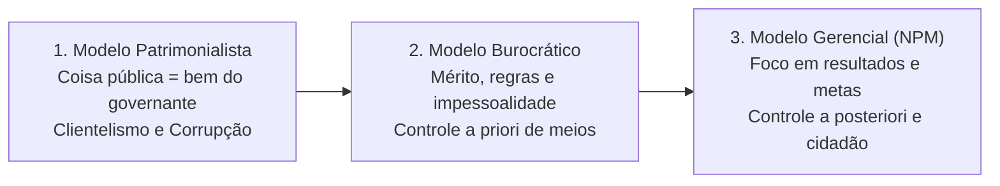
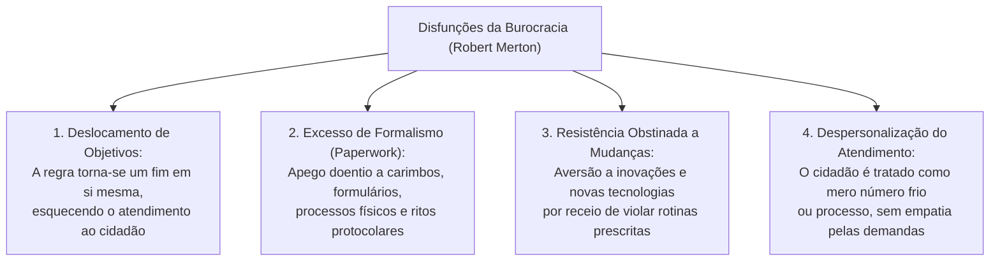
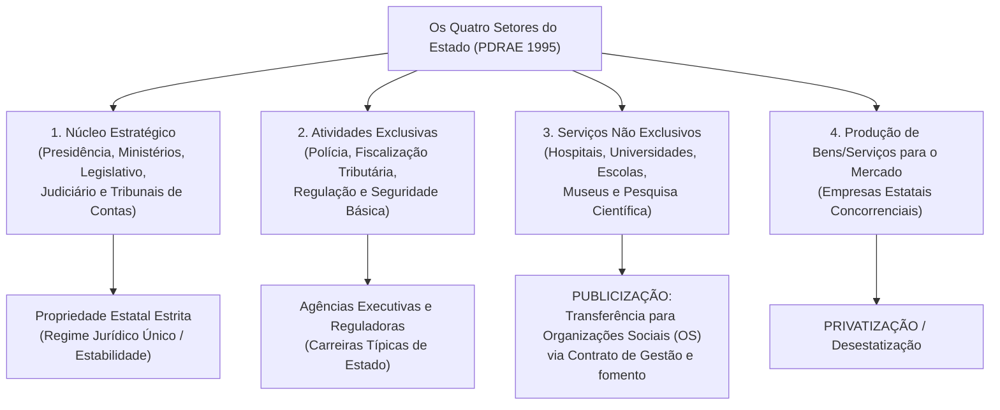
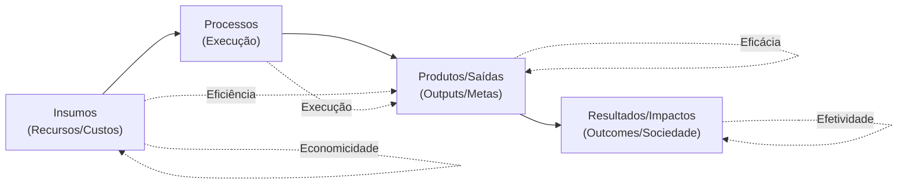
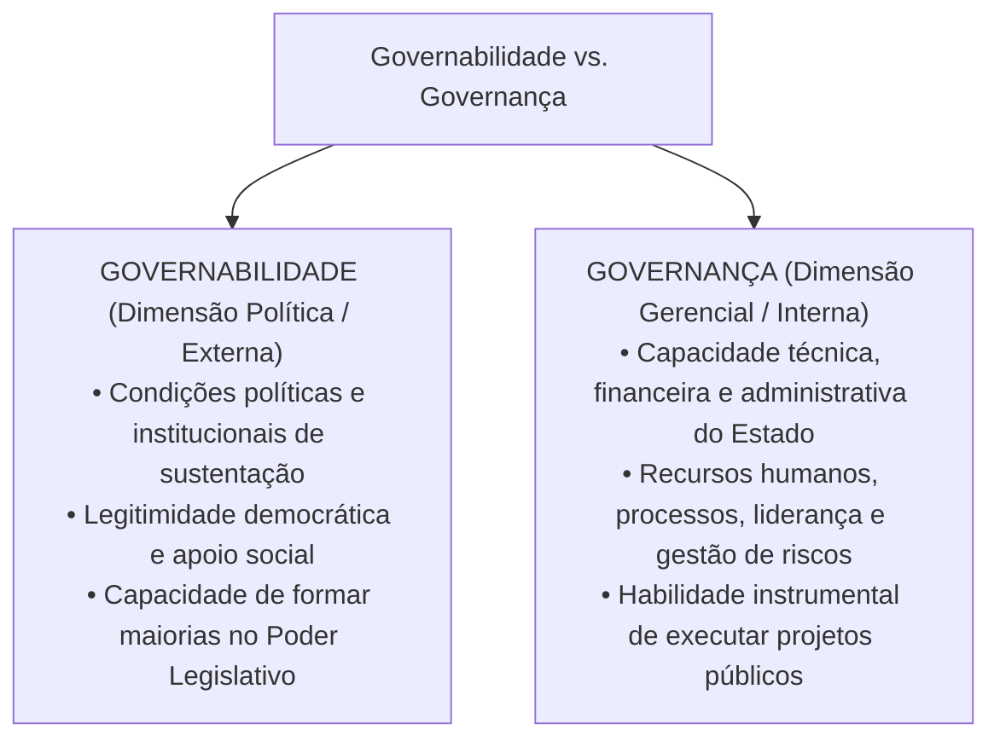
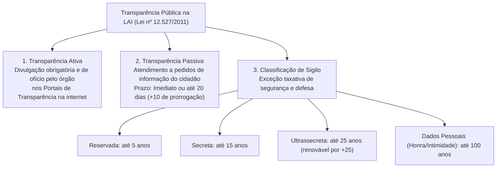

# 02 - Modelos de Administração Pública, Governança, Governabilidade e Transparência

> **Matéria:** Noções de Administração Pública  
> **Cargo:** A01 – Técnico de Controle Externo – Especialidade: Técnico Administrativo  
> **Arquivo:** `02_modelos_de_administracao_publica_e_governanca.md`  

---

## 📌 Ementa / Itens do Edital

- Evolução dos paradigmas da gestão pública:
    - **Administração Pública Patrimonialista:** características, confusão entre patrimônio público e privado, prebendas, sinécures, clientelismo e nepotismo;
    - **Administração Pública Burocrática (Max Weber):** racionalidade, formalismo, impessoalidade, meritocracia, hierarquia funcional, controle prévio (*a priori*) de processos e as disfunções da burocracia (Robert Merton);
    - **Administração Pública Gerencial (*New Public Management* - NPM):** orientação para resultados, foco no cidadão-usuário/cliente, descentralização, controle a posteriori e contratualização de resultados;
    - As três fases do gerencialismo: Gerencialismo Puro (*Managerialism*), *Consumerism* e *Public Service Orientation* (PSO);
- A Reforma Gerencial de 1995 no Brasil (Plano Diretor da Reforma do Aparelho do Estado - PDRAE):
    - Os quatro setores do Estado: Núcleo Estratégico, Atividades Exclusivas, Serviços Não Exclusivos e Produção de Bens e Serviços para o Mercado;
    - Formas de atuação e publicização: Agências Reguladoras, Agências Executivas, Organizações Sociais (OS) e Organizações da Sociedade Civil de Interesse Público (OSCIP);
- Eficiência, Eficácia e Efetividade no setor público (a tríade dos resultados públicos e economicidade);
- Governança e Governabilidade: conceitos, distinções e mecanismos (liderança, estratégia e controle - Referencial TCU);
- O conceito e dimensões de *Accountability*: vertical, horizontal e social (societal);
- Transparência pública e controle social: a Lei de Acesso à Informação (Lei Federal nº 12.527/2011 - LAI) e Lei Estadual de Goiás nº 18.025/2013:
    - Transparência ativa versus transparência passiva;
    - Prazos de resposta e instâncias de recurso administrativo (regra 20 + 10 dias);
    - Graus de sigilo documental: reservada (5 anos), secreta (15 anos) e ultrassecreta (25 anos); proteção de dados pessoais (100 anos).

---

## 🧭 Sumário Interativo
- [1. Evolução Histórica dos Modelos de Gestão Pública](#1-evolucao-historica-dos-modelos-de-gestao-publica)
    - [1.1 Modelo Patrimonialista](#11-modelo-patrimonialista)
    - [1.2 Modelo Burocrático Weberiano](#12-modelo-burocratico-weberiano)
    - [1.3 Modelo Gerencial (*New Public Management* - NPM)](#13-modelo-gerencial-new-public-management-npm)
    - [1.4 Quadro Analítico Comparativo dos Três Modelos](#14-quadro-analitico-comparativo-dos-tres-modelos)
- [2. As Disfunções da Burocracia (Robert Merton)](#2-as-disfuncoes-da-burocracia-robert-merton)
- [3. A Reforma Gerencial Brasileira de 1995 (PDRAE)](#3-a-reforma-gerencial-brasileira-de-1995-pdrae)
    - [3.1 Os Quatro Setores do Estado](#31-os-quatro-setores-do-estado)
    - [3.2 O Mecanismo da Publicização e as Organizações Sociais (OS)](#32-o-mecanismo-da-publicizacao-e-as-organizacoes-sociais-os)
- [4. As Dimensões do Desempenho Público (Os 6Es da Gestão)](#4-as-dimensoes-do-desempenho-publico-os-6es-da-gestao)
    - [4.1 Economicidade, Eficiência, Eficácia e Efetividade](#41-economicidade-eficiencia-eficacia-e-efetividade)
- [5. Governança, Governabilidade e Accountability](#5-governanca-governabilidade-e-accountability)
    - [5.1 Governabilidade vs. Governança (Distinção Crítica FCC)](#51-governabilidade-vs-governanca-distincao-critica-fcc)
    - [5.2 Dimensões da Accountability (Vertical, Horizontal e Social)](#52-dimensoes-da-accountability-vertical-horizontal-e-social)
- [6. Transparência Pública e a Lei de Acesso à Informação (Lei nº 12.527/2011)](#6-transparencia-publica-e-a-lei-de-acesso-a-informacao-lei-no-125272011)
    - [6.1 Transparência Ativa vs. Transparência Passiva](#61-transparencia-ativa-vs-transparencia-passiva)
    - [6.2 Prazos de Atendimento e Desnecessidade de Motivação](#62-prazos-de-atendimento-e-desnecessidade-de-motivacao)
    - [6.3 Graus e Prazos Máximos de Sigilo Documental](#63-graus-e-prazos-maximos-de-sigilo-documental)
- [7. Fontes Oficiais & Referências Bibliográficas](#fontes-oficiais-referencias-bibliograficas)
- [8. Questões Comentadas no Padrão FCC](#questoes-comentadas-no-padrao-fcc)

---

## 📖 Conteúdo Teórico Aprofundado

### 1. Evolução Histórica dos Modelos de Gestão Pública

A trajetória da administração pública no mundo ocidental e no Brasil desdobra-se na sucessão e convivência dialética de três modelos paradigmáticos:

#### 1.1 Modelo Patrimonialista
- Vigente no Estado Absolutista e no Brasil Colonial/Imperial até a década de 1930;
- **Característica Central:** Ausência de separação entre o patrimônio do soberano e a *res publica* (o Estado é tratado como extensão da casa do príncipe);
- **Práticas Correlatas:** Concessão de cargos públicos como **prebendas** (rendas vitalícias) e **sinecuras** (cargos sem trabalho correspondente), nepotismo, favorecimento pessoal e coronelismo/clientelismo eleitoral.

#### 1.2 Modelo Burocrático Weberiano
- Estruturado conceitualmente por Max Weber no início do século XX e introduzido no Brasil pela reforma do DASP (1936-1938);
- **Objetivo Histórico Primário:** Combater frontalmente a corrupção e o nepotismo patrimonialistas mediante regras rígidas;
- **Princípios Racionais-Legais:**
    - *Formalismo Estrito:* A autoridade emana da lei e as rotinas devem ser reduzidas a documentos escritos e processos formais;
    - *Impessoalidade:* As decisões administrativas aplicam-se a categorias abstratas, sem discriminações ou privilégios subjetivos;
    - *Meritocracia e Profissionalização:* Ingresso na carreira por concurso público e promoções baseadas no mérito funcional;
    - *Hierarquia Funcional:* Cadeia de comando clara, com linhas bem delimitadas de subordinação;
    - *Controle a Priori (Prévio):* Controle minucioso e exaustivo sobre a conformidade dos meios, formulários e ritos processuais antes de qualquer decisão.

#### 1.3 Modelo Gerencial (*New Public Management* - NPM)
- Emergente nas décadas de 1970/1980 (Reino Unido, Nova Zelândia e EUA) e adotado no Brasil pela Reforma de 1995 (PDRAE);
- **Objetivo Central:** Superar a rigidez, a lentidão e a ineficiência do modelo burocrático diante da crise fiscal do Estado social;
- **Princípios Estruturantes:** Descentralização da gestão, autonomia dos gestores, flexibilização das contratações, incentivo à inovação, contratualização de resultados e foco absoluto nas necessidades do **cidadão-usuário/cliente**;
- **Fases do Gerencialismo:**
    1. *Gerencialismo Puro (Managerialism):* Foco inicial obsessivo no corte de gastos públicos, equilíbrio fiscal e redução do tamanho da máquina governamental;
    2. *Consumerism:* Introdução do conceito de qualidade total, desregulamentação, competição entre prestadores e tratamento do cidadão como "cliente";
    3. *Public Service Orientation (PSO):* Síntese democrática contemporânea que resgata a cidadania plena, direitos republicanos, equidade, transparência e governança participativa.

#### 1.4 Quadro Analítico Comparativo dos Três Modelos

| Critério de Comparação | Administração Patrimonialista | Administração Burocrática (Weber) | Administração Gerencial (NPM) |
| :--- | :--- | :--- | :--- |
| **Relação Estado vs. Sociedade** | Confusão total entre patrimônio público e bens particulares do governante. | Separação estrita entre a esfera pública e a privada. Protege o erário da apropriação indevida. | O Estado serve à sociedade. Foco no cidadão como titular de direitos e usuário de serviços públicos. |
| **Princípio Básico de Atuação** | Arbitrariedade, laços de sangue, prebendas, sinécures e apadrinhamento político. | Formalismo legal estrito, impessoalidade, hierarquia rígida e meritocracia (concurso público). | Flexibilidade, descentralização de autoridade, competitividade, inovação e avaliação por metas. |
| **Mecanismo de Controle** | Inexistente (vontade pessoal e absoluta do soberano). | **Controle a priori (prévio):** Focado obsessivamente nos processos, ritos e obediência às normas. | **Controle a posteriori (de resultados):** Focado no cumprimento das metas pactuadas em contratos de gestão. |
| **Papel do Servidor Público** | Titular de sinecuras e favores concedidos pela coroa. | Especialista profissional, com carreira técnica estruturada e estabilidade funcional. | Gestor de programas orientado a metas, com autonomia operacional e incentivo ao mérito. |
| **Disfunções Centrais** | Corrupção sistêmica, nepotismo e ineficiência predatória. | Rigidez burocrática, lentidão, excesso de burocracia documental e desapego às demandas sociais. | Risco de mercantilização de serviços sociais e redução da impessoalidade. |

---

### 2. As Disfunções da Burocracia (Robert Merton)

Embora concebida por Max Weber como o tipo ideal de organização racional e previsível, a aplicação concreta da burocracia gera anomalias conhecidas como **disfunções da burocracia**:

- **Deslocamento de Objetivos:** O cumprimento cego do regulamento transforma-se na missão primordial do servidor, em detrimento da entrega final do serviço público;
- **Superconformidade:** O funcionário limita-se estritamente ao que está escrito e recusa-se a agir perante situações imprevistas, gerando paralisia decisória;
- **Exibição de Sinais de Autoridade:** Uso excessivo de títulos formais, carimbos e hierarquia para distanciar o funcionário do cidadão comum.

---

### 3. A Reforma Gerencial Brasileira de 1995 (PDRAE)

Coordenado pelo Ministro Luiz Carlos Bresser-Pereira durante a presidência de Fernando Henrique Cardoso, o **Plano Diretor da Reforma do Aparelho do Estado (PDRAE)** estabeleceu as bases do gerencialismo no Brasil:

#### 3.1 Os Quatro Setores do Estado
1. **Núcleo Estratégico:** Define as leis, as políticas públicas fundamentais e as diretrizes estratégicas da nação. Propriedade estatal integral, composta pelas carreiras de Estado;
2. **Atividades Exclusivas de Estado:** Serviços que envolvem o exercício do poder de império e coerção (polícia, diplomacia, fiscalização tributária, regulação e controle externo);
3. **Serviços Não Exclusivos do Estado:** Serviços sociais de relevância coletiva que o Estado presta, mas nos quais o setor privado também atua livremente (saúde, ensino, cultura e pesquisa científica);
4. **Produção de Bens e Serviços para o Mercado:** Atividades econômicas industriais e comerciais que devem ser operadas pelo mercado concorrencial (objeto de privatização).

#### 3.2 O Mecanismo da Publicização e as Organizações Sociais (OS)
- **Publicização:** É a descentralização de atividades e serviços não exclusivos do Estado para entidades do setor público não estatal (terceiro setor), constituídas como pessoas jurídicas de direito privado sem fins lucrativos qualificadas como **Organizações Sociais (OS)**;
- **Instrumento Vinculante:** A parceria celebra-se mediante **Contrato de Gestão**, estipulando metas quantitativas e qualitativas de atendimento, com repasse de recursos orçamentários, cessão de servidores públicos e de imóveis estatais, sujeitando-se ao controle externo do Tribunal de Contas.

---

### 4. As Dimensões do Desempenho Público (Os 6Es da Gestão)

A mensuração de resultados governamentais apoia-se em dimensões analíticas fundamentais:

#### 4.1 Economicidade, Eficiência, Eficácia e Efetividade
- **Economicidade:** Minimização dos custos na aquisição de insumos, sem comprometer os padrões adequados de qualidade (comprar os melhores insumos pelo menor custo financeiro possível);
- **Eficiência:** Relação otimizada entre os insumos empregados e as saídas produzidas ($\text{Produtos} / \text{Insumos}$). É a competência para fazer certo as coisas, reduzindo perdas e desperdícios operacionais;
- **Eficácia:** Grau de cumprimento das metas e objetivos formalmente planejados ($\text{Metas Realizadas} / \text{Metas Previstas}$). É a capacidade de fazer a coisa certa e entregar as saídas combinadas;
- **Efetividade:** Impacto social duradouro e positivo gerado na realidade concreta da sociedade pela política pública. É a transformação concreta da vida do cidadão.

> 💡 **Exemplo Clássico em Provas:**  
> Numa campanha de vacinação infantil:
>
> - Comprar as vacinas e seringas pelo menor preço do mercado = **Economicidade**;
> - Aplicar 80 doses por hora por enfermeiro sem desperdício de ampolas = **Eficiência**;
> - Atingir a meta de imunizar 95% das crianças do público-alvo = **Eficácia**;
> - Erradicar a doença e reduzir a zero as internações hospitalares na população infantil = **Efetividade**!

---

### 5. Governança, Governabilidade e Accountability

#### 5.1 Governabilidade vs. Governança (Distinção Crítica FCC)
A banca FCC cobra de forma reiterada a distinção analítica entre governabilidade e governança:

- **Os Mecanismos de Governança (Referencial Básico do TCU):**
    1. **Liderança:** Papel dos dirigentes em estabelecer integridade, propósito e direção ética;
    2. **Estratégia:** Definição de planos claros, metas, diretrizes e prioridades alinhadas à missão;
    3. **Controle:** Gestão de riscos, transparência, integridade (*compliance*) e monitoramento contínuo.

#### 5.2 Dimensões da Accountability (Vertical, Horizontal e Social)
O termo *accountability* compreende o dever indeclinável de prestar contas, responder pelos atos praticados na gestão da coisa pública e submeter-se a sanções em caso de malversação:

1. **Accountability Vertical:** Opera de baixo para cima, no vínculo entre o cidadão e os governantes, materializada essencialmente pelo **voto livre e secreto nas eleições democráticas**, bem como por plebiscitos e referendos;
2. **Accountability Horizontal:** Consiste no controle mútuo e recíproco exercido entre órgãos estatais autônomos dotados de poderes constitucionais de freios e contrapesos (**Tribunais de Contas**, Ministério Público, Poder Judiciário e Controladorias);
3. **Accountability Social (ou Societal):** Exercida pela mobilização da sociedade civil organizada, sindicatos, conselhos de políticas públicas e pela imprensa investigativa independente.

---

### 6. Transparência Pública e a Lei de Acesso à Informação (Lei nº 12.527/2011)

A Lei Federal nº 12.527/2011 (LAI) e a Lei Estadual de Goiás nº 18.025/2013 consagram a publicidade como preceito geral republicano e o sigilo como exceção rigorosa.

#### 6.1 Transparência Ativa vs. Transparência Passiva
- **Transparência Ativa:** Divulgação oficial espontânea e contínua de informações públicas de interesse coletivo em sítios oficiais da internet (portais de transparência), em dados abertos e de fácil acesso, independentemente de requerimento;
- **Transparência Passiva:** Resposta formal do Poder Público aos pedidos específicos de acesso a documentos e informações formulados pelos cidadãos perante os Serviços de Informações ao Cidadão (SIC).

#### 6.2 Prazos de Atendimento e Desnecessidade de Motivação
- **Prazos:** Se a informação estiver disponível, o acesso deve ser imediato. Caso não seja possível o atendimento imediato, o órgão tem o prazo de **até 20 (vinte) dias**, prorrogável motivadamente por mais **10 (dez) dias** (regra dos 20 + 10 dias);
- **Desnecessidade de Motivação (Art. 10, § 3º da LAI):** São vedadas quaisquer exigências relativas aos motivos determinantes da solicitação de informações de interesse público! O cidadão não precisa justificar por que deseja saber os gastos públicos.

#### 6.3 Graus e Prazos Máximos de Sigilo Documental
As informações cuja divulgação possa colocar em risco a segurança da sociedade ou do Estado podem ser classificadas em três graus de sigilo:

1. **Reservada:** Prazo máximo de restrição de **até 5 (cinco) anos**;
2. **Secreta:** Prazo máximo de restrição de **até 15 (quinze) anos**;
3. **Ultrassecreta:** Prazo máximo de restrição de **até 25 (vinte e cinco) anos**, prorrogável uma única vez por igual período;
4. **Informações Pessoais (Art. 31 da LAI):** Relativas à intimidade, vida privada, honra e imagem de indivíduos têm acesso restrito por **até 100 (cem) anos**, independentemente de classificação de sigilo.

---

## 🌐 Fontes Oficiais & Referências Bibliográficas

* [Decreto Federal nº 9.203/2017 (Política de Governança da Administração Pública)](https://www.planalto.gov.br/ccivil_03/_ato2015-2018/2017/decreto/d9203.htm) - Dispõe sobre a governança pública e os mecanismos de liderança, estratégia e controle.
* [Decreto-Lei nº 200/1967 (Reforma Administrativa e Descentralização)](https://www.planalto.gov.br/ccivil_03/decreto-lei/del0200.htm) - Marco histórico de modernização e descentralização da administração pública brasileira.
* [TCU - Referencial Básico de Governança Aplicável a Órgãos e Entidades Públicas](https://portal.tcu.gov.br/governanca/governanca-no-tcu/) - Diretrizes para implantação de boas práticas de accountability e transparência.
* [Constituição Federal de 1988 - Art. 37 (Princípios da Administração Pública)](https://www.planalto.gov.br/ccivil_03/constituicao/constituicao.htm#art37) - Previsão dos princípios do LIMPE (Legalidade, Impessoalidade, Moralidade, Publicidade e Eficiência).
* [TCE-GO - Plano de Fiscalização e Governança](https://portal.tce.go.gov.br/governanca-planejamento-e-gestao/planos-institucionais/plano-de-fiscalizacao) - Planejamento institucional do TCE-GO com foco na governança e resultados operacionais.
* BRESSER-PEREIRA, Luiz Carlos. **Reforma do Estado para a Cidadania: a Reforma Gerencial Brasileira na Perspectiva Internacional**. São Paulo: Editora 34, 1998. (Cap. 1 a 3 - Modelos Patrimonialista, Burocrático e Gerencial).
* MATIAS-PEREIRA, José. **Manual de Gestão Pública Contemporânea**. 5. ed. São Paulo: Atlas, 2018. (Cap. 2 - Modelos de Administração Pública; Cap. 5 - Governança no Setor Público).
* OSBORNE, David; GAEBLER, Ted. **Reinventando o Governo: Como o Espírito Empreendedor Está Transformando o Setor Público**. 10. ed. Brasília: MH Comunicação, 1994.

## 📝 Questões Comentadas no Padrão FCC

### Questão 1 (FCC – TCE-PI – Auditor de Controle Externo)
A respeito da evolução dos modelos de administração pública e das reformas administrativas contemporâneas, considere as afirmativas a seguir:

I. O modelo burocrático weberiano introduziu a impessoalidade e o mérito no serviço público com o objetivo de combater as práticas clientelistas e patrimonialistas da administração tradicional.  

II. A governabilidade traduz a capacidade financeira, operacional e técnica do Estado de implementar políticas públicas planejadas, ao passo que a governança expressa as condições políticas de sustentação parlamentar do governo.  

III. No modelo gerencial de administração pública, o controle estatal privilegia a avaliação dos resultados e o cumprimento de metas contratuais em detrimento do controle prévio e rígido dos processos procedimentais.  

Está correto o que se afirma em:

* **A)** I, apenas.
* **B)** I e II, apenas.
* **C)** I e III, apenas.
* **D)** II e III, apenas.
* **E)** I, II e III.

> **Comentário Detalhado:**
>
> - **A)** Incorreta. O item III também está correto, tornando a opção incompleta.
> - **B)** Incorreta. O item II traz um erro conceitual grave ao inverter as definições de governança e governabilidade.
> - **C)** Correta.  
>     - O item I é verdadeiro: a burocracia weberiana surgiu historicamente para combater a apropriação privada do Estado pelo patrimonialismo, mediante mérito, concurso público e regras impessoais;  
>     - O item II é falso: governança é a capacidade técnica e gerencial de execução, enquanto governabilidade refere-se às condições políticas de sustentação no parlamento;  
>     - O item III é verdadeiro: o gerencialismo foca na avaliação a posteriori dos resultados e cumprimento de metas, flexibilizando os controles prévios processuais.  
>   Portanto, estão corretos apenas os itens I e III.
> - **D)** Incorreta. O item II é flagrantemente falso.
> - **E)** Incorreta. O item II invalida a assertiva geral.
> 
> **Gabarito: C**

---

### Questão 2 (FCC – TCE-RS – Auditor de Controle Externo)
Nos termos da Lei Federal nº 12.527/2011 (Lei de Acesso à Informação), a respeito dos prazos de resposta aos pedidos de acesso à informação formulados por cidadãos e da classificação de sigilo documental, é correto afirmar:

* **A)** O prazo para resposta ao pedido de informação não atendido de imediato é de 30 dias, vedada qualquer prorrogação.
* **B)** Informações classificadas no grau reservado permanecem sob restrição de acesso público pelo prazo máximo de 5 anos.
* **C)** O acesso à informação pública subordina-se à demonstração de legítimo interesse jurídico e comprovação dos motivos determinantes da solicitação pelo requerente.
* **D)** A classificação de informação como ultrassecreta é atribuição passível de delegação a qualquer servidor ocupante de cargo comissionado de chefia.
* **E)** A transparência ativa refere-se exclusivamente às informações fornecidas pelo poder público em resposta a pedidos protocolados via ouvidoria geral.

> **Comentário Detalhado:**
>
> - **A)** Incorreta. O prazo legal fixado pelo art. 11, §§ 1º e 2º da LAI é de até 20 dias, admitindo-se prorrogação justificada por mais 10 dias.
> - **B)** Correta. Conforme o art. 24, § 1º, III da Lei nº 12.527/2011, as informações no grau reservado ficam submetidas ao prazo de restrição máxima de até 5 (cinco) anos.
> - **C)** Incorreta. O art. 10, § 3º da LAI proíbe expressamente qualquer exigência de justificação ou demonstração de interesse jurídico para pedidos de informação pública.
> - **D)** Incorreta. A classificação no grau ultrassecreto é ato privativo de altas autoridades de cúpula (Presidente, Ministros de Estado, Comandantes Militares), não podendo ser delegada a escalões intermediários.
> - **E)** Incorreta. O atendimento a pedidos de cidadãos consubstancia transparência passiva; a transparência ativa é a publicação espontânea em portais públicos eletrônicos.
> 
> **Gabarito: B**

---

### Questão 3 (FCC – TCE-GO – Analista de Controle Externo)
A fiscalização da gestão governamental desempenhada pelo Tribunal de Contas do Estado sobre as contas dos Poderes Executivo, Legislativo e Judiciário materializa uma dimensão específica da *accountability*. Trata-se de um exemplo típico de *accountability*:

* **A)** Vertical, pois o Tribunal de Contas situa-se em escalão hierárquico superior aos órgãos do Poder Executivo estadual.
* **B)** Social, uma vez que decorre unicamente de representações apresentadas por organizações não governamentais e pela imprensa.
* **C)** Horizontal, por consistir em controle mútuo de legalidade e legitimidade exercido por um órgão estatal autônomo sobre outros órgãos estatais no mesmo nível institucional.
* **D)** Comportamental, pois visa exclusivamente à apuração disciplinar de infrações éticas cometidas por servidores subalternos.
* **E)** Primária, caracterizada pelo exercício direto do sufrágio universal e do voto popular nas urnas.

> **Comentário Detalhado:**
>
> - **A)** Incorreta. Não existe hierarquia entre o Tribunal de Contas e os Poderes; a relação é de equilíbrio e controle constitucional autônomo.
> - **B)** Incorreta. A atuação de ONGs e imprensa caracteriza accountability social (societal).
> - **C)** Correta. A accountability horizontal (formulada teoricamente por Guillermo O'Donnell) traduz o controle mútuo exercido entre órgãos públicos independentes dotados de poderes constitucionais de fiscalização e freios e contrapesos (como os Tribunais de Contas, o Ministério Público e o Poder Judiciário) sobre as contas e atos de outros órgãos de Estado.
> - **D)** Incorreta. Conceito inexistente na tipologia clássica de accountability.
> - **E)** Incorreta. O voto do cidadão nas eleições consubstancia a manifestação da accountability vertical.
> 
> **Gabarito: C**

---

### Questão 4 (FCC – ARTESP – Especialista em Regulação de Transportes)
O Plano Diretor da Reforma do Aparelho do Estado (PDRAE), editado em 1995, propôs a descentralização do Estado e a reorganização de suas atividades em quatro setores. A prestação de serviços de saúde básica em hospitais públicos e a realização de pesquisas científicas em universidades enquadram-se, segundo a tipologia do PDRAE, no setor de:

* **A)** Atividades Exclusivas de Estado, a serem desempenhadas compulsoriamente por agências reguladoras.
* **B)** Núcleo Estratégico, com manutenção de propriedade puramente estatal e cargos privativos de livre nomeação política.
* **C)** Serviços Não Exclusivos do Estado, com orientação para o modelo de publicização mediante parcerias com Organizações Sociais (OS).
* **D)** Produção de Bens e Serviços para o Mercado, orientados à privatização compulsória em bolsa de valores.
* **E)** Controle Disciplinar Corporativo, com atuação exclusiva do sistema correcional e dos Tribunais de Contas.

> **Comentário Detalhado:**
>
> - **A)** Incorreta. Atividades exclusivas abrangem polícia, arrecadação, fiscalização e regulação.
> - **B)** Incorreta. Núcleo Estratégico é composto pela cúpula dos Poderes (Presidência, Ministérios, Cúpula dos Tribunais).
> - **C)** Correta. No modelo do PDRAE (1995), a saúde, educação, cultura e pesquisa científica são classificadas como Serviços Não Exclusivos do Estado, uma vez que o setor privado também atua livremente nessas áreas. A diretriz preconizada para esse setor foi a publicização, isto é, a descentralização de sua gestão para entidades do terceiro setor qualificadas como Organizações Sociais (OS), mediante contratos de gestão.
> - **D)** Incorreta. Produção de bens para o mercado corresponde a empresas estatais industriais e financeiras voltadas ao lucro.
> - **E)** Incorreta. Categoria desconexa do texto do PDRAE.
> 
> **Gabarito: C**

---

### Questão 5 (FCC – DPE-RS – Analista: Área Administrativa)
Considere que determinado município gaúcho implementou um programa de alfabetização de adultos com orçamento de R$ 1.000.000,00. Ao final do projeto, constatou-se que:

1. O custo por aluno atendido foi o menor registrado no Estado, sem desperdício de material pedagógico.
2. A meta quantitativa de matricular e formar 2.000 estudantes foi rigorosamente alcançada.
3. Decorrido um ano da conclusão, levantamento censitário demonstrou que 95% dos formandos foram inseridos no mercado formal de trabalho e aumentaram sua renda familiar.

As constatações 1, 2 e 3 correspondem, respectivamente, aos conceitos de:

* **A)** Eficácia, Eficiência e Efetividade.
* **B)** Eficiência, Eficácia e Efetividade.
* **C)** Efetividade, Eficiência e Eficácia.
* **D)** Economicidade, Efetividade e Eficiência.
* **E)** Eficiência, Efetividade e Eficácia.

> **Comentário Detalhado:**
>
> - **A)** Incorreta. Inverte a ordem das duas primeiras dimensões.
> - **B)** Correta.  
>     - Constatação 1 (Eficiência): Atingir o menor custo por aluno sem desperdícios operacionais expressa a otimização da relação entre insumos e produtos (fazer certo as coisas), traduzindo a Eficiência;  
>     - Constatação 2 (Eficácia): Cumprir integralmente a meta planejada de matricular e formar 2.000 pessoas expressa o atingimento das saídas quantitativas (fazer a coisa certa), traduzindo a Eficácia;  
>     - Constatação 3 (Efetividade): Gerar inserção no mercado de trabalho formal e aumento real da renda familiar reflete o impacto social duradouro e a transformação da realidade coletiva, consubstanciando a Efetividade.  
>   Logo, a ordem precisa é Eficiência, Eficácia e Efetividade.
> - **C)** Incorreta. Efetividade é a terceira constatação e não a primeira.
> - **D)** Incorreta. Mistura as categorias e inverte os conceitos de impacto social.
> - **E)** Incorreta. Inverte eficácia e efetividade no final.
> 
> **Gabarito: B**
