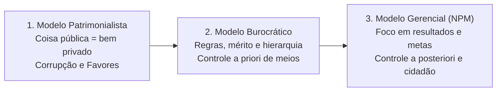
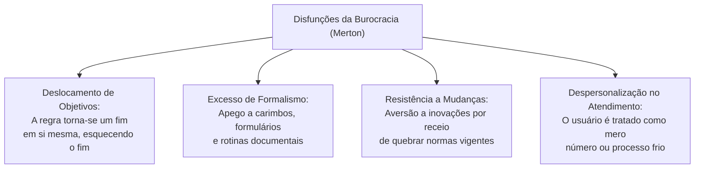
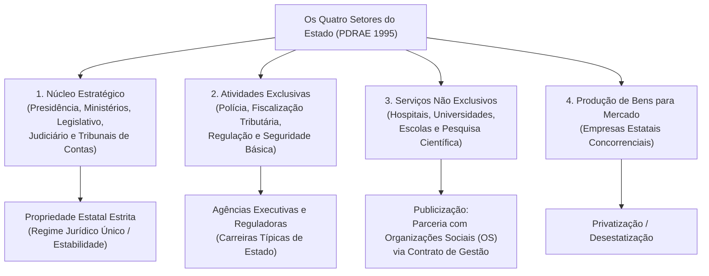
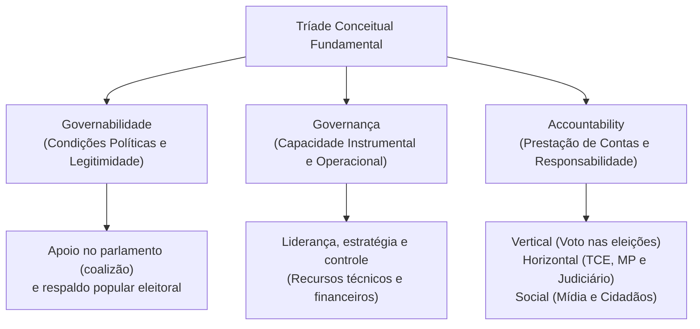
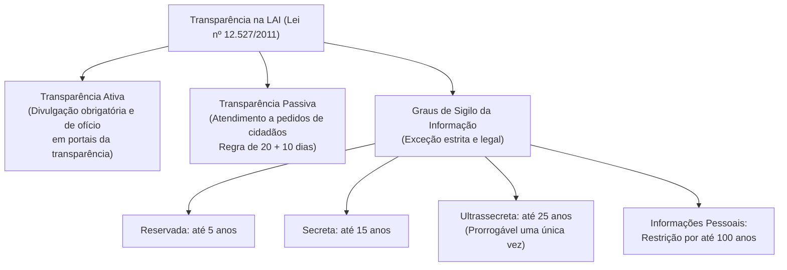

# 02 - Modelos de Administração Pública, Governança, Governabilidade e Transparência

> **Matéria:** Noções de Administração Pública  
> **Cargo:** A01 – Técnico de Controle Externo – Especialidade: Técnico Administrativo  
> **Arquivo:** `02_modelos_de_administracao_publica_e_governanca.md`  

---

## 📌 Ementa / Itens do Edital
- Evolução dos paradigmas da gestão pública:
  - **Administração Pública Patrimonialista:** características, confusão entre patrimônio público e privado, prebendas, sinécures, clientelismo e nepotismo;
  - **Administração Pública Burocrática (Max Weber):** racionalidade, formalismo, impessoalidade, meritocracia, hierarquia funcional, controle prévio (*a priori*) de processos e as disfunções da burocracia (Robert Merton);
  - **Administração Pública Gerencial (*New Public Management* - NPM):** orientação para resultados, foco no cidadão-usuário/cliente, descentralização, controle a posteriori e contratualização de resultados;
  - As três fases do gerencialismo: Gerencialismo Puro (*Managerialism*), *Consumerism* e *Public Service Orientation* (PSO);
- A Reforma Gerencial de 1995 no Brasil (Plano Diretor da Reforma do Aparelho do Estado - PDRAE):
  - Os quatro setores do Estado: Núcleo Estratégico, Atividades Exclusivas, Serviços Não Exclusivos e Produção de Bens e Serviços para o Mercado;
  - Formas de atuação e publicização: Agências Reguladoras, Agências Executivas, Organizações Sociais (OS) e Organizações da Sociedade Civil de Interesse Público (OSCIP);
- Eficiência, Eficácia e Efetividade no setor público (a tríade dos resultados públicos e economicidade);
- Governança e Governabilidade: conceitos, distinções e mecanismos (liderança, estratégia e controle - Referencial TCU);
- O conceito e dimensões de *Accountability*: vertical, horizontal e social (societal);
- Transparência pública e controle social: a Lei de Acesso à Informação (Lei Federal nº 12.527/2011 - LAI) e Lei Estadual de Goiás nº 18.025/2013:
  - Transparência ativa versus transparência passiva;
  - Prazos de resposta e instâncias de recurso administrativo (regra 20 + 10 dias);
  - Graus de sigilo documental: reservada (5 anos), secreta (15 anos) e ultrassecreta (25 anos); proteção de dados pessoais (100 anos).

---

## 🌳 Classificação Hierárquica

```text
2. Modelos de Gestão Pública, Governança e Transparência
├── 2.1 Evolução dos Modelos Teóricos de Administração Pública
│   ├── 2.1.1 Modelo Patrimonialista:
│   │   ├── Confusão entre o patrimônio do soberano e a res publica
│   │   └── Distribuição de prebendas, sinécures, clientelismo e nepotismo
│   ├── 2.1.2 Modelo Burocrático Weberiano:
│   │   ├── Princípios Racionais: Legalidade estrita, formalismo, impessoalidade e meritocracia
│   │   ├── Foco no Procedimento e Controle a Priori de Meios
│   │   └── Disfunções da Burocracia (Merton): Apego às regras, apego ao formulário, lentidão e rigidez
│   └── 2.1.3 Modelo Gerencial (New Public Management - NPM):
│       ├── Foco em Resultados (Controle a Posteriori), eficiência e qualidade do serviço
│       ├── Paradigma do Cidadão-Cliente / Cidadão-Usuário
│       └── Fases: Gerencialismo Puro (corte de custos), Consumerism (qualidade) e PSO (cidadania)
├── 2.2 O PDRAE e a Reforma Administrativa de 1995 (Bresser-Pereira)
│   ├── 2.2.1 Os Quatro Setores do Estado:
│   │   ├── 1. Núcleo Estratégico: Presidência, Ministérios, Legislativo, Judiciário e TCs (Propriedade estatal)
│   │   ├── 2. Atividades Exclusivas: Polícia, arrecadação, fiscalização e regulação (Agências)
│   │   ├── 3. Serviços Não Exclusivos: Saúde, educação, cultura e pesquisa (Publicização para OS / OSCIP)
│   │   └── 4. Produção de Bens/Serviços para o Mercado: Empresas estatais (Privatização)
│   └── 2.2.2 Mecanismos: Contratos de Gestão, Termos de Parceria e flexibilização de controles
├── 2.3 Dimensões do Desempenho Público: Eficiência, Eficácia, Efetividade e Economicidade
│   ├── 2.3.1 Economicidade: Aquisição dos melhores insumos ao menor custo possível
│   ├── 2.3.2 Eficiência: Otimização da relação insumo/produto (fazer certo as coisas com o menor custo)
│   ├── 2.3.3 Eficácia: Alcance quantitativo das metas e planos previstos (fazer as coisas certas)
│   └── 2.3.4 Efetividade: Impacto social duradouro e transformação da realidade do cidadão
├── 2.4 Governança, Governabilidade e Accountability
│   ├── 2.4.1 Governabilidade: Legitimidade e condições políticas de sustentação e apoio democrático
│   ├── 2.4.2 Governança: Capacidade instrumental, técnica, administrativa e financeira de execução
│   │   └── Mecanismos de Governança (TCU): Liderança, Estratégia e Controle
│   └── 2.4.3 Accountability:
│       ├── Vertical: Relação entre eleitores e eleitos por meio do sufrágio (voto nas eleições)
│       ├── Horizontal: Controle mútuo entre órgãos estatais (Tribunais de Contas, MP, Judiciário)
│       └── Social (Societal): Ação de ONGs, imprensa livre e conselhos de controle social
└── 2.5 Transparência Pública e Lei de Acesso à Informação (Lei Federal nº 12.527/2011)
    ├── 2.5.1 Diretrizes Básicas: Publicidade como regra e sigilo como exceção; desnecessidade de motivação
    ├── 2.5.2 Transparência Ativa: Divulgação oficial espontânea e contínua em formato aberto na internet
    ├── 2.5.3 Transparência Passiva: Resposta a pedidos de acesso (imediata ou até 20 dias prorrogáveis por +10)
    └── 2.5.4 Graus de Sigilo da Informação Pública:
        ├── Reservada: Prazo máximo de 5 anos
        ├── Secreta: Prazo máximo de 15 anos
        ├── Ultrassecreta: Prazo máximo de 25 anos (renovável por mais 25 anos)
        └── Informações Pessoais (intimidade, vida privada e honra): Restrição por até 100 anos
```

---

## 📖 Resumo Teórico Aprofundado & Esquematizado

### 1. Evolução Histórica dos Modelos de Gestão Pública

A história da administração pública moderna é marcada pela sucessão e sobreposição de três grandes modelos teóricos:



#### Quadro Analítico Comparativo dos Três Modelos:

| Critério de Comparação | Administração Patrimonialista | Administração Burocrática (Weber) | Administração Gerencial (NPM) |
| :--- | :--- | :--- | :--- |
| **Relação Estado vs. Sociedade** | Não há distinção entre patrimônio público e bens particulares do rei. | Separação estrita entre esfera pública e privada. Protege o Estado contra a corrupção. | O Estado serve à sociedade. Foco no cidadão-usuário/cliente e na entrega de valor público. |
| **Princípio Básico de Atuação** | Arbitrariedade, laços familiares, prebendas e apadrinhamento político. | Formalismo legal estrito, impessoalidade, hierarquia e meritocracia (concurso público). | Flexibilidade, descentralização, competitividade, inovação e avaliação de desempenho. |
| **Mecanismo de Controle** | Inexistente (vontade absoluta do governante). | **Controle a priori (prévio):** Focado obsessivamente nos processos, ritos e obediência às normas. | **Controle a posteriori (de resultados):** Focado no cumprimento das metas fixadas no contrato de gestão. |
| **Papel do Servidor Público** | Titular de sinecuras e favores concedidos pela coroa. | Especialista profissional, com carreira técnica estruturada e estabilidade funcional. | Gestor de programas orientado a metas, com autonomia operacional e incentivo ao mérito. |
| **Disfunções Centrais** | Corrupção sistêmica, nepotismo e ineficiência predatória. | Rigidez burocrática, lentidão, excesso de burocracia documental e desapego às demandas sociais. | Risco de mercantilização de serviços sociais e redução da impessoalidade. |

---

### 2. Disfunções da Burocracia (Robert Merton)

Embora a burocracia weberiana tenha sido desenhada como um modelo ideal de racionalidade e eficiência técnica, sociólogos como Robert Merton demonstraram que sua aplicação prática gera anomalias previsíveis:



* **Deslocamento de Objetivos (Internalização das Regras):** O servidor foca tanto em cumprir a norma que o cumprimento da regra vira o objetivo final, deixando a satisfação do interesse do cidadão em segundo plano.
* **Superconformidade:** O funcionário recusa-se a tomar qualquer atitude diante de imprevistos se não houver um formulário ou regulamento expresso que o autorize.
* **Exibição de Sinais de Autoridade:** Uso excessivo de títulos hierárquicos, mesas e carimbos para distanciar o funcionário do administrado.

---

### 3. A Reforma do Aparelho do Estado de 1995 (PDRAE - Bresser-Pereira)

O **Plano Diretor da Reforma do Aparelho do Estado (PDRAE)** instituiu a reforma gerencial brasileira na década de 1990, dividindo as atividades estatais em **quatro setores analíticos**:



---

### 4. As Dimensões do Desempenho Público (6Es da Gestão Pública)

A doutrina moderna e a jurisprudência dos Tribunais de Contas utilizam indicadores de desempenho para fiscalizar políticas públicas:


1. **Economicidade:** Minimização dos custos na aquisição de insumos, sem comprometer a qualidade necessária (comprar bem e barato).
2. **Eficiência:** Melhor relação entre os insumos empregados e os produtos gerados ($Produtos / Recursos$). É a habilidade de fazer certo as coisas, reduzindo desperdícios.
3. **Eficácia:** Grau em que as metas planejadas foram efetivamente atingidas ($Metas\ Realizadas / Metas\ Planejadas$). É fazer a coisa certa.
4. **Efetividade:** Impacto social duradouro na sociedade gerado pela política pública ($Mudança\ Real\ na\ Vida\ do\ Cidadão$).
   * *Exemplo Clássico de Prova:* Uma campanha vacinal gasta pouco por seringa (**economicidade**), aplica 100 vacinas por hora por enfermeiro (**eficiência**), atinge a meta de imunizar 95% das crianças do Estado (**eficácia**) e zera a incidência de internações e mortes por sarampo na população (**efetividade**).

---

### 5. Governança, Governabilidade e Accountability



* **Governabilidade:** É a dimensão **política**. Refere-se à legitimidade do governante, capacidade de formar maiorias legislativas e respaldo democrático conferido pela sociedade para sustentar o plano de governo.
* **Governança:** É a dimensão **técnica e gerencial**. Refere-se à capacidade prática que a administração tem de implementar as políticas públicas planejadas, gerenciar riscos e avaliar resultados.
* **Accountability:** É o dever indeclinável de prestar contas, assumir responsabilidade pelos atos e sofrer sanções quando couber:
  * *Vertical:* Ocorre do cidadão para o governante por meio do **voto democrático nas urnas**;
  * *Horizontal:* Ocorre entre órgãos do próprio Estado que se fiscalizam mutuamente por freios e contrapesos (**Tribunais de Contas**, Ministério Público, Judiciário e Controladorias);
  * *Social (Societal):* Ocorre pela atuação da sociedade civil, sindicatos, conselhos municipais e imprensa investigativa.

---

### 6. Lei de Acesso à Informação (Lei Federal nº 12.527/2011 - LAI)

A LAI materializa o princípio republicano da publicidade e da transparência democrática:



#### Regras Práticas de Prazos e Procedimentos da LAI:
1. **Prazo de Atendimento:** O órgão deve conceder acesso imediato se a informação estiver disponível; caso inviável, no prazo de até **20 (vinte) dias**, prorrogável motivadamente por mais **10 (dez) dias**.
2. **Desnecessidade de Motivação:** É terminantemente **proibido** exigir do cidadão a justificativa dos motivos de sua solicitação. O acesso à coisa pública independe de demonstrar interesse jurídico pessoal.
3. **Gratuidade:** O fornecimento de informação é gratuito, admitindo-se apenas a cobrança do custo estrito de reprodução de cópias físicas se solicitado.

---

## 🚨 Alertas de Prova & Pegadinhas da FCC

> 🚨 **ALERTA DE PROVA / PEGADINHA FCC (GOVERNANÇA VS. GOVERNABILIDADE):**  
> Essa é uma das pegadinhas campeãs da FCC: inverter as noções conceituais!  
> - **Governabilidade** = Condições políticas, legitimidade e apoio no Congresso/Assembleia (é externa e política).  
> - **Governança** = Capacidade técnico-administrativa, financeira e gerencial do Estado de tirar os projetos do papel (é interna e instrumental).

> ⭐ **IMPORTANTE (ACCOUNTABILITY HORIZONTAL VS. VERTICAL):**  
> - A fiscalização do **Tribunal de Contas sobre o Poder Executivo** é um exemplo clássico de **Accountability HORIZONTAL** (órgãos estatais autônomos fiscalizando uns aos outros no mesmo plano federativo).  
> - O **voto do eleitor na eleição** é um exemplo de **Accountability VERTICAL** (de baixo para cima).

> 🛑 **ATENÇÃO (GRAUS DE SIGILO NA LAI):**  
> Guarde os prazos exatos de restrição máxima da informação de segurança do Estado:  
> - **Reservada:** até **5 anos**;  
> - **Secreta:** até **15 anos**;  
> - **Ultrassecreta:** até **25 anos** (renovável uma única vez por mais 25 anos).  
> - Informações pessoais relativas à honra e intimidade de indivíduos: **até 100 anos**!

> 📌 **NOTA EXPLICATIVA (EFICIÊNCIA VS. EFICÁCIA VS. EFETIVIDADE):**  
> - A **eficiência** preocupa-se com os **meios e custos** (otimização de insumos).  
> - A **eficácia** preocupa-se com o cumprimento das **metas quantitativas** (produtos entregues).  
> - A **efetividade** preocupa-se com os **efeitos reais na vida da população** (solução do problema coletivo).

---

## 🌐 Fontes Oficiais e Referências Bibliográficas

* [BRESSER-PEREIRA, Luiz Carlos. Plano Diretor da Reforma do Aparelho do Estado (PDRAE)](https://www.bresserpereira.org.br) - Ministério da Administração e Reforma do Estado (MARE, 1995).
* [Lei Federal nº 12.527/2011 (Lei de Acesso à Informação - LAI)](https://www.planalto.gov.br/ccivil_03/_ato2011-2014/2011/lei/l12527.htm).
* [Lei Estadual de Goiás nº 18.025/2013](https://legisla.casacivil.go.gov.br) - Dispõe sobre o acesso à informação e a aplicação da LAI no Estado de Goiás.
* [Lei Federal nº 13.460/2017](https://www.planalto.gov.br/ccivil_03/_ato2015-2018/2017/lei/l13460.htm) - Código de Defesa dos Usuários de Serviços Públicos.
* [Tribunal de Contas da União (TCU) - Referencial Básico de Governança Aplicável a Órgãos e Entidades da Administração Pública](https://portal.tcu.gov.br).

---

## 📝 Questões de Concurso FCC Comentadas

### Questão 01
**(FCC – TCE-PI – Auditor de Controle Externo)**  
A respeito da evolução dos modelos de administração pública e das reformas administrativas contemporâneas, considere as afirmativas a seguir:

I. O modelo burocrático weberiano introduziu a impessoalidade e o mérito no serviço público com o objetivo de combater as práticas clientelistas e patrimonialistas da administração tradicional.  
II. A governabilidade traduz a capacidade financeira, operacional e técnica do Estado de implementar políticas públicas planejadas, ao passo que a governança expressa as condições políticas de sustentação parlamentar do governo.  
III. No modelo gerencial de administração pública, o controle estatal privilegia a avaliação dos resultados e o cumprimento de metas contratuais em detrimento do controle prévio e rígido dos processos procedimentais.  

Está correto o que se afirma em:
* **A)** I, apenas.
* **B)** I e II, apenas.
* **C)** I e III, apenas.
* **D)** II e III, apenas.
* **E)** I, II e III.

> **Gabarito: C**  
> **Comentário Detalhado:**  
> - **Item I: CORRETO.** O modelo burocrático concebido por Weber surgiu no século XIX exatamente para erradicar o patrimonialismo, instituindo a separação entre a coisa pública e o patrimônio privado, a meritocracia via concursos e a impessoalidade.  
> - **Item II: INCORRETO.** A questão inverteu os conceitos: a **governança** é a capacidade técnica, financeira e instrumental de formular e executar políticas públicas, enquanto a **governabilidade** representa as condições políticas de sustentação, legitimidade e apoio no parlamento.  
> - **Item III: CORRETO.** O paradigma gerencial (*New Public Management*) desloca o foco dos controles excessivos *a priori* (sobre meios) para os controles *a posteriori* (sobre metas, resultados e produtos entregues).  
> - Logo, estão corretos apenas os itens I e III.

---

### Questão 02
**(FCC – TCE-RS – Auditor de Controle Externo)**  
Nos termos da Lei Federal nº 12.527/2011 (Lei de Acesso à Informação), a respeito dos prazos de resposta aos pedidos de acesso à informação formulados por cidadãos e da classificação de sigilo documental, é correto afirmar:

* **A)** O prazo para resposta ao pedido de informação não atendido de imediato é de 30 dias, vedada qualquer prorrogação.
* **B)** Informações classificadas no grau reservado permanecem sob restrição de acesso público pelo prazo máximo de 5 anos.
* **C)** O acesso à informação pública subordina-se à demonstração de legítimo interesse jurídico e comprovação dos motivos determinantes da solicitação pelo requerente.
* **D)** A classificação de informação como ultrassecreta é atribuição passível de delegação a qualquer servidor ocupante de cargo comissionado de chefia.
* **E)** A transparência ativa refere-se exclusivamente às informações fornecidas pelo poder público em resposta a pedidos protocolados via ouvidoria geral.

> **Gabarito: B**  
> **Comentário Detalhado:**  
> - **A) Incorreta.** O prazo legal é de **20 dias**, prorrogável por mais **10 dias** mediante justificativa expressa (Art. 11, §§ 1º e 2º).  
> - **B) CORRETA.** Nos termos do art. 24, § 1º, III, da LAI, os prazos máximos de sigilo são: **reservada: até 5 anos**; secreta: até 15 anos; e ultrassecreta: até 25 anos.  
> - **C) Incorreta.** O art. 10, § 3º da LAI veda expressamente qualquer exigência de motivação determinante ou justificativa para a solicitação de informações públicas.  
> - **D) Incorreta.** A classificação de documento como ultrassecreto é privativa de autoridades de cúpula (Presidente, Vice-Presidente, Ministros de Estado, Comandantes das Forças Armadas e chefes de missões diplomáticas), vedada a subdelegação a escalões comissionados intermediários.  
> - **E) Incorreta.** O fornecimento de dados em resposta a solicitações do cidadão constitui transparência **passiva**; a transparência ativa consiste na publicação espontânea de dados de ofício em portais eletrônicos.

---

### Questão 03
**(FCC – TCE-GO – Analista de Controle Externo)**  
A fiscalização da gestão governamental desempenhada pelo Tribunal de Contas do Estado sobre as contas dos Poderes Executivo, Legislativo e Judiciário materializa uma dimensão específica da *accountability*. Trata-se de um exemplo típico de *accountability*:

* **A)** Vertical, pois o Tribunal de Contas situa-se em escalão hierárquico superior aos órgãos do Poder Executivo estadual.
* **B)** Social, uma vez que decorre unicamente de representações apresentadas por organizações não governamentais e pela imprensa.
* **C)** Horizontal, por consistir em controle mútuo de legalidade e legitimidade exercido por um órgão estatal autônomo sobre outros órgãos estatais no mesmo nível institucional.
* **D)** Comportamental, pois visa exclusivamente à apuração disciplinar de infrações éticas cometidas por servidores subalternos.
* **E)** Primária, caracterizada pelo exercício direto do sufrágio universal e do voto popular nas urnas.

> **Gabarito: C**  
> **Comentário Detalhado:**  
> - **A) Incorreta.** Não há hierarquia administrativa entre o Tribunal de Contas e os Poderes de Estado; a relação é de controle constitucional autônomo entre instituições públicas.  
> - **B) Incorreta.** A atuação de ONGs e imprensa caracteriza accountability social (societal).  
> - **C) CORRETA.** A **accountability horizontal** (conceito clássico de Guillermo O'Donnell) traduz o controle interinstitucional recíproco operado por órgãos públicos autônomos dotados de poderes constitucionais de freios e contrapesos (como Tribunais de Contas, Ministério Público e Poder Judiciário) sobre as ações e despesas de outros órgãos estatais.  
> - **D) Incorreta.** Não existe a categoria "accountability comportamental" na doutrina de controle público.  
> - **E) Incorreta.** O sufrágio universal através do voto é a principal manifestação de accountability **vertical**.

---

### Questão 04
**(FCC – ARTESP – Especialista em Regulação de Transportes)**  
O Plano Diretor da Reforma do Aparelho do Estado (PDRAE), editado em 1995, propôs a descentralização do Estado e a reorganização de suas atividades em quatro setores. A prestação de serviços de saúde básica em hospitais públicos e a realização de pesquisas científicas em universidades enquadram-se, segundo a tipologia do PDRAE, no setor de:

* **A)** Atividades Exclusivas de Estado, a serem desempenhadas compulsoriamente por agências reguladoras.
* **B)** Núcleo Estratégico, com manutenção de propriedade puramente estatal e cargos privativos de livre nomeação política.
* **C)** Serviços Não Exclusivos do Estado, com orientação para o modelo de publicização mediante parcerias com Organizações Sociais (OS).
* **D)** Produção de Bens e Serviços para o Mercado, orientados à privatização compulsória em bolsa de valores.
* **E)** Controle Disciplinar Corporativo, com atuação exclusiva do sistema correcional e dos Tribunais de Contas.

> **Gabarito: C**  
> **Comentário Detalhado:**  
> - **A) Incorreta.** Atividades exclusivas englobam polícia, arrecadação, fiscalização e regulação.  
> - **B) Incorreta.** Núcleo Estratégico é composto pela cúpula dos Poderes (Presidência, Ministérios, cúpula dos TCs etc.).  
> - **C) CORRETA.** Segundo o PDRAE (1995), serviços como saúde, educação, ensino técnico e superior, cultura e pesquisa científica são **Serviços Não Exclusivos do Estado**, pois o Estado os realiza, mas não detém o monopólio de sua prestação (o setor privado também atua). O modelo proposto para esse setor foi a **publicização**, isto é, a transferência da gestão dessas atividades para entidades do terceiro setor (Organizações Sociais - OS) mediante celebração de contratos de gestão com fomento estatal.  
> - **D) Incorreta.** Produção de bens e serviços mercantis corresponde às empresas estatais que atuam em regime concorrencial (siderurgia, energia, bancos etc.).  
> - **E) Incorreta.** Categoria inexistente no PDRAE.

---

### Questão 05
**(FCC – DPE-RS – Analista: Área Administrativa)**  
Considere que determinado município gaúcho implementou um programa de alfabetização de adultos com orçamento de R$ 1.000.000,00. Ao final do projeto, constatou-se que:
1. O custo por aluno atendido foi o menor registrado no Estado, sem desperdício de material pedagógico.
2. A meta quantitativa de matricular e formar 2.000 estudantes foi rigorosamente alcançada.
3. Decorrido um ano da conclusão, levantamento censitário demonstrou que 95% dos formandos foram inseridos no mercado formal de trabalho e aumentaram sua renda familiar.

As constatações 1, 2 e 3 correspondem, respectivamente, aos conceitos de:

* **A)** Eficácia, Eficiência e Efetividade.
* **B)** Eficiência, Eficácia e Efetividade.
* **C)** Efetividade, Eficiência e Eficácia.
* **D)** Economicidade, Efetividade e Eficiência.
* **E)** Eficiência, Efetividade e Eficácia.

> **Gabarito: B**  
> **Comentário Detalhado:**  
> - **Constatação 1 (Eficiência):** Atingir o menor custo por aluno sem desperdícios representa a otimização da relação insumo/produto (fazer mais com menos recursos), o que traduz a dimensão da **Eficiência**.  
> - **Constatação 2 (Eficácia):** Cumprir integralmente a meta estipulada no plano de ação (matricular e formar 2.000 pessoas) traduz o alcance dos objetivos quantitativos planejados, correspondendo à **Eficácia**.  
> - **Constatação 3 (Efetividade):** Gerar inclusão no mercado de trabalho formal e elevação real da renda das famílias expressa o impacto transformador e sustentável produzido na realidade social da população, conceituado como **Efetividade**.  
> - Logo, a sequência correta e unívoca é: **Eficiência, Eficácia e Efetividade** (Alternativa B).
