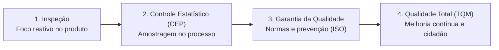
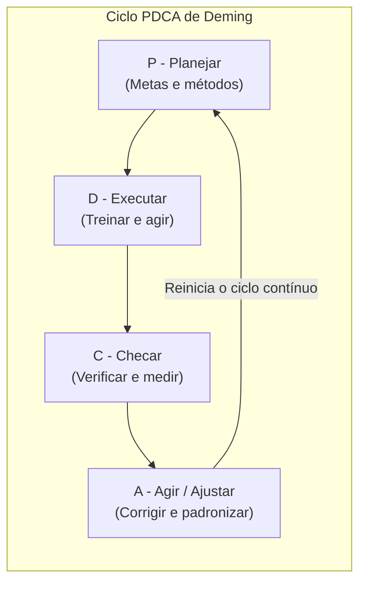
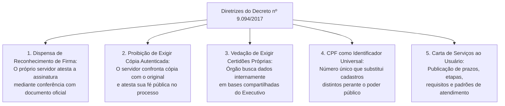
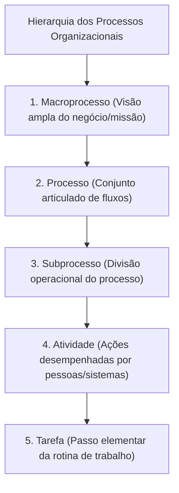
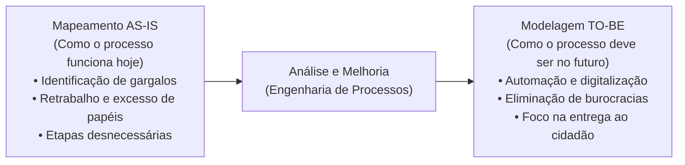
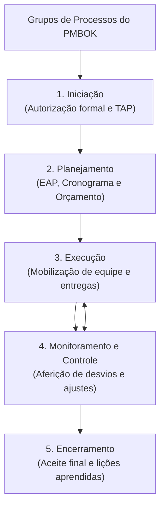

# 03 - Gestão da Qualidade, Decreto nº 9.094/2017, Gestão de Processos (BPM) e Projetos

> **Matéria:** Noções de Administração Pública  
> **Cargo:** A01 – Técnico de Controle Externo – Especialidade: Técnico Administrativo  
> **Arquivo:** `03_gestao_da_qualidade_processos_projetos_e_decreto_9094.md`  

---

## 📌 Ementa / Itens do Edital
- Gestão da Qualidade e excelência nos serviços públicos:
  - Evolução dos conceitos da qualidade: inspeção, controle estatístico de processos (CEP), garantia da qualidade e Gestão da Qualidade Total (*Total Quality Management* - TQM);
  - Mestres da qualidade e suas contribuições essenciais:
    - W. Edwards Deming: 14 princípios e o Ciclo PDCA (*Plan, Do, Check, Act*);
    - Joseph Juran: Trilogia da Qualidade (Planejamento, Controle e Aperfeiçoamento da Qualidade) e custos da qualidade;
    - Kaoru Ishikawa: Diagrama de Causa e Efeito (Espinha de Peixe / 6M), Círculos de Controle de Qualidade (CCQ) e as 7 ferramentas da qualidade;
    - Philip Crosby: Conceito de "Zero Defeito" e conformidade com requisitos;
  - Modelos de excelência em gestão pública: Modelo de Excelência em Gestão (MEG / Fundação Nacional da Qualidade - FNQ) e Programa GesPública;
- Simplificação, racionalização e avaliação dos serviços prestados aos usuários:
  - **Decreto Federal nº 9.094/2017** e alterações (Decreto nº 9.723/2019 e Lei nº 13.726/2018 - Lei de Desburocratização):
    - Dispensa de reconhecimento de firma em cartório e de autenticação de cópias de documentos;
    - Proibição de exigência de certidões ou documentos emitidos pela própria administração pública ou presentes em bancos de dados oficiais;
    - Adoção do CPF como número suficiente e universal de identificação do cidadão nos serviços públicos;
    - **Carta de Serviços ao Usuário:** conteúdo compulsório, padrões de qualidade, prazos e atualização permanente;
- Gestão de Processos de Negócio (*Business Process Management* - BPM):
  - Conceito e hierarquia dos processos: Macroprocesso, Processo, Subprocesso, Atividade e Tarefa;
  - Tipos de processos organizacionais: Processos Finalísticos (Primários / Ponta a Ponta), de Suporte (Apoio / Secundários) e de Gerenciamento (Gestão);
  - Ciclo de vida do BPM: Diagnóstico da situação atual (*AS-IS*) versus Modelagem do estado futuro otimizado (*TO-BE*);
- Noções de Gestão de Projetos:
  - Distinção conceitual entre Projeto (esforço temporário para criar um resultado exclusivo) e Processo (fluxo contínuo, padronizado e perene);
  - O guia PMBOK (*Project Management Institute* - PMI): os 5 grupos de processos (Iniciação, Planejamento, Execução, Monitoramento/Controle e Encerramento);
  - Termo de Abertura do Projeto (TAP / *Project Charter*) e Estrutura Analítica do Projeto (EAP / *WBS*).

---

## 🌳 Classificação Hierárquica

```text
3. Qualidade Pública, Desburocratização, Processos e Projetos
├── 3.1 Gestão da Qualidade e Modelos de Excelência
│   ├── 3.1.1 Evolução das Eras da Qualidade:
│   │   ├── 1. Inspeção: Foco reativo no produto final após fabricado
│   │   ├── 2. Controle Estatístico de Processo (CEP): Amostragem durante a fabricação (Shewhart)
│   │   ├── 3. Garantia da Qualidade: Prevenção de defeitos e normas de padronização (ISO 9000)
│   │   └── 4. Gestão da Qualidade Total (TQM): Foco no cliente, melhoria contínua (Kaizen) e envolvimento total
│   ├── 3.1.2 Teóricos Clássicos e Ferramentas:
│   │   ├── W. Edwards Deming: Ciclo PDCA (Plan, Do, Check, Act)
│   │   ├── Joseph Juran: Trilogia da Qualidade (Planejamento, Controle e Melhoria)
│   │   ├── Kaoru Ishikawa: Diagrama Espinha de Peixe (6M) e Círculos de Controle de Qualidade (CCQ)
│   │   └── 7 Ferramentas da Qualidade: Fluxograma, Ishikawa, Pareto (80/20), Histograma, Cartas de Controle, Dispersão, Folha de Verificação
│   └── 3.1.3 Modelo de Excelência em Gestão (MEG / FNQ) e GesPública
├── 3.2 Desburocratização e Atendimento ao Cidadão (Decreto nº 9.094/2017)
│   ├── 3.2.1 Princípios: Presunção de boa-fé, eficiência, transparência e interoperabilidade
│   ├── 3.2.2 Supressão de Custos e Ritos Notariais:
│   │   ├── Vedação de exigir reconhecimento de firma em cartório (atesto presencial pelo servidor)
│   │   └── Vedação de exigir cópia autenticada (cotejo da cópia com o original pelo próprio agente público)
│   ├── 3.2.3 Vedação de Exigência Documental Repetitiva:
│   │   └── Proibição de exigir certidões que constem de bases oficiais públicas compartilhadas
│   ├── 3.2.4 Unificação Cadastral: Cadastro de Pessoas Físicas (CPF) como chave única de identificação
│   └── 3.2.5 Carta de Serviços ao Usuário: Divulgação pública de prazos, etapas, formas de acesso e padrões de atendimento
├── 3.3 Gestão de Processos de Negócio (BPM)
│   ├── 3.3.1 Hierarquia Estrutural: Macroprocesso -> Processo -> Subprocesso -> Atividade -> Tarefa
│   ├── 3.3.2 Tipologia dos Processos:
│   │   ├── Processos Finalísticos (Primários): Entrega direta de valor público ao cidadão (saúde, segurança)
│   │   ├── Processos de Suporte (Apoio / Secundários): Sustentação das atividades operacionais (TI, RH, compras)
│   │   └── Processos de Gerenciamento: Medição estratégica, auditoria, riscos e governança
│   └── 3.3.3 Engenharia de Processos:
│       ├── Modelagem AS-IS: Retrato do processo atual ("como é") para identificação de gargalos e retrabalho
│       └── Modelagem TO-BE: Desenho do processo futuro ideal ("como deve ser"), simplificado e digitalizado
└── 3.4 Gestão de Projetos (PMBOK)
    ├── 3.4.1 Projeto versus Processo: Caráter temporário e entrega exclusiva vs. operação contínua e repetitiva
    ├── 3.4.2 Grupos de Processos: Iniciação -> Planejamento -> Execução -> Monitoramento & Controle -> Encerramento
    ├── 3.4.3 Instrumentos Primordiais:
    │   ├── Termo de Abertura do Projeto (TAP): Autorização formal e atribuição de poderes ao gerente
    │   └── Estrutura Analítica do Projeto (EAP / WBS): Decomposição hierárquica baseada em entregas (pacotes de trabalho)
    └── 3.4.4 Restrição Tripla: Escopo, Custo e Tempo balizados pelo padrão de Qualidade
```

---

## 📖 Resumo Teórico Aprofundado & Esquematizado

### 1. Gestão da Qualidade: Eras, Teóricos e Ferramentas

A qualidade no setor público evoluiu da mera rejeição mecânica de peças defeituosas para um sistema integrado focado na satisfação das necessidades do cidadão:



#### Os Mestres da Qualidade e suas Contribuições:
1. **W. Edwards Deming:**
   - Pai do gerenciamento moderno da qualidade. Criou os 14 princípios da qualidade e popularizou o **Ciclo PDCA**:
     - **P (Plan - Planejar):** Estabelecer objetivos, metas e métodos para alcançá-los.
     - **D (Do - Executar/Fazer):** Executar o plano e realizar treinamentos de capacitação.
     - **C (Check - Checar/Verificar):** Mensurar os resultados e comparar o desempenho real com as metas.
     - **A (Act - Agir/Ajustar):** Adotar ações corretivas sobre desvios e padronizar práticas bem-sucedidas.
2. **Joseph Juran:**
   - Formulou a **Trilogia da Qualidade**: Planejamento da Qualidade $\rightarrow$ Controle da Qualidade $\rightarrow$ Melhoria da Qualidade.
   - Destacou os custos da qualidade (custos de prevenção e avaliação versus custos de falhas internas e externas).
3. **Kaoru Ishikawa:**
   - Criador do **Diagrama de Ishikawa (Espinha de Peixe / Diagrama de Causa e Efeito)**, que investiga as causas raízes de um problema agrupadas tradicionalmente em **6Ms**: Método, Matéria-prima, Mão de obra, Máquina, Medição e Meio ambiente.
   - Instituiu os **Círculos de Controle de Qualidade (CCQ)** (grupos voluntários de colaboradores que se reúnem para solucionar falhas operacionais).



---

### 2. Desburocratização e Simplificação: O Decreto Federal nº 9.094/2017

O Decreto Federal nº 9.094/2017, em consonância com a Lei Federal nº 13.726/2018 (Lei de Desburocratização), estabelece regras expressas que limitam a burocracia desnecessária no relacionamento entre o Estado e a sociedade:



#### Principais Dispositivos para Prova da FCC:
* **Assinatura e Reconhecimento de Firma:** Fica **proibida** a exigência de reconhecimento de firma em cartório, exceto se houver dúvida fundada de autenticidade ou previsão expressa em lei em sentido estrito. O agente público deve confrontar a firma com o documento de identidade ou colher a assinatura na presença física do requerente.
* **Autenticação Cartorária de Cópias:** O servidor público que receber a cópia simples acompanhada do original deve compará-los e lavrar seu atesto imediato ("confere com o original"), sendo **vedada a exigência de autenticação notarial**.
* **Interoperabilidade de Bancos de Dados:** É **vedado exigir** do cidadão a apresentação de certidões, certidões negativas ou comprovantes emitidos pelo próprio órgão público ou que constem em bases de dados oficiais compartilhadas da administração.
* **Carta de Serviços ao Usuário:** Documento de publicação obrigatória nos portais institucionais que deve informar com clareza:
  - Serviços prestados pelo órgão;
  - Requisitos, documentos e informações necessários para acessar cada serviço;
  - Prazos máximos para cumprimento de cada etapa;
  - Custos e taxas aplicáveis (se houver);
  - Canais de comunicação com o cidadão e procedimentos para manifestação na ouvidoria.

---

### 3. Gestão de Processos de Negócio (BPM)

* **Processo:** Conjunto de atividades logicamente encadeadas que transformam entradas (*inputs*) em saídas (*outputs*) que agregam valor direto a um beneficiário final ou interno.



#### Os Três Tipos Fundamentais de Processos:
1. **Processos Primários (Finalísticos ou de Ponta a Ponta):**
   - Estão diretamente relacionados à missão institucional do órgão público e à entrega de serviços públicos ao cidadão-usuário.
   - *Exemplos:* Fiscalização contábil dos municípios pelo TCE-GO, policiamento ostensivo, vacinação de crianças.
2. **Processos de Suporte (Secundários ou de Apoio):**
   - Viabilizam o funcionamento dos processos finalísticos por meio do fornecimento de recursos internos, logística e infraestrutura.
   - *Exemplos:* Folha de pagamento de servidores, aquisição de computadores, manutenção predial, assessoria jurídica interna.
3. **Processos de Gerenciamento (Gestão):**
   - Asseguram a governança, a coordenação estratégica, a gestão de riscos e o monitoramento global do desempenho institucional.
   - *Exemplos:* Planejamento estratégico, auditoria interna de integridade, gestão da qualidade.

#### O Ciclo de Redesenho de Processos: AS-IS versus TO-BE



---

### 4. Gestão de Projetos segundo o Guia PMBOK (PMI)



#### Quadro Comparativo Fundamental: Projeto versus Processo

| Aspecto | Projeto | Processo |
| :--- | :--- | :--- |
| **Temporalidade** | **Temporário:** Tem início, meio e fim definidos no tempo. | **Permanente e Contínuo:** Repete-se rotineiramente sem data de término. |
| **Resultado Produzido** | Entrega um produto, serviço ou resultado **único e exclusivo**. | Gera produtos ou serviços **padronizados e repetitivos**. |
| **Objetivo Estratégico** | Promover mudanças organizacionais, inovações ou criar novas capacidades. | Manter a regularidade das operações cotidianas da instituição. |
| **Grau de Incerteza** | Elevado, devido ao ineditismo do escopo. | Reduzido, pois as atividades seguem procedimentos estáveis. |

#### Instrumentos Primordiais de Gestão de Projetos:
* **Termo de Abertura do Projeto (TAP / *Project Charter*):** Documento formal emitido pelo patrocinador (*sponsor*) que autoriza o início do projeto, define seus objetivos macros, limites orçamentários preliminares e confere autoridade oficial ao gerente do projeto para alocar recursos organizacionais.
* **Estrutura Analítica do Projeto (EAP / *WBS - Work Breakdown Structure*):** Decomposição hierárquica e visual do escopo total de trabalho a ser executado pelo projeto. A EAP divide o trabalho em partes menores e gerenciáveis chamadas de **pacotes de trabalho**.
  * *Ponto Chave de Concurso:* A EAP é orientada a **entregas (produtos)** e não a prazos ou cronogramas. O cronograma de tarefas com datas é o cronograma de atividades (como o Gráfico de Gantt).

---

## 🚨 Alertas de Prova & Pegadinhas da FCC

> 🚨 **ALERTA DE PROVA / PEGADINHA FCC (EAP NÃO É CRONOGRAMA!):**  
> Uma das armadilhas mais comuns da FCC é afirmar que "a Estrutura Analítica do Projeto (EAP) é um cronograma de atividades que estipula os prazos diários e as horas trabalhadas pela equipe". Isso é **FALSO**! A EAP organiza e decompõe o **escopo do projeto em entregas mensuráveis (pacotes de trabalho)**. Ela não contém datas, dependências temporais ou durações em dias. O instrumento que lista datas e durações é o cronograma do projeto (Diagrama de Rede / Gantt)!

> ⭐ **IMPORTANTE (PROIBIÇÃO DE EXIGÊNCIA DOCUMENTAL - DECRETO 9.094/17):**  
> O Decreto Federal nº 9.094/2017 e a Lei nº 13.726/2018 **proíbem expressamente** que órgãos públicos exijam do cidadão documentos que a própria administração já possua em suas bases ou que possam ser obtidos por consulta direta na internet. Exigir que o administrado leve cópia impressa de certidão que está disponível no sistema eletrônico do governo é conduta manifestamente ilegal.

> 🛑 **ATENÇÃO (AS-IS VS. TO-BE NO BPM):**  
> - **AS-IS:** É a situação ATUAL do processo ("como é"), retratando os fluxos reais com todos os seus gargalos, retrabalhos e ineficiências.  
> - **TO-BE:** É a situação FUTURA e DESEJADA do processo ("como deve ser"), após o redesenho, otimização e eliminação de desperdícios.

> 📌 **NOTA EXPLICATIVA (DIAGRAMA DE ISHIKAWA E OS 6Ms):**  
> O Diagrama de Ishikawa busca descobrir a causa fundamental de um efeito indesejado. Seus ramos clássicos são os 6Ms: Máquina (equipamentos), Mão de obra (habilidades/pessoas), Método (procedimentos), Matéria-prima (insumos), Medição (instrumentos de aferição) e Meio ambiente (clima/ambiente de trabalho).

---

## 🌐 Fontes Oficiais e Referências Bibliográficas

* [Decreto Federal nº 9.094/2017](https://www.planalto.gov.br/ccivil_03/_ato2015-2018/2017/decreto/d9094.htm) - Dispõe sobre a simplificação do atendimento prestado aos usuários dos serviços públicos e a Carta de Serviços.
* [Lei Federal nº 13.726/2018 (Lei da Desburocratização)](https://www.planalto.gov.br/ccivil_03/_ato2015-2018/2018/lei/l13726.htm) - Racionalização de atos e procedimentos administrativos dos Poderes da União, Estados, DF e Municípios.
* [Associação dos Profissionais de BPM (ABPMP) - Guia para o Gerenciamento de Processos de Negócio (BPM CBOK v4.0)](https://www.abpmp-br.org/).
* [Project Management Institute (PMI) - Um Guia do Conhecimento em Gerenciamento de Projetos (Guia PMBOK 7ª Edição)](https://www.pmi.org).
* [Fundação Nacional da Qualidade (FNQ) - Cadernos MEG (Modelo de Excelência da Gestão)](https://fnq.org.br).

---

## 📝 Questões de Concurso FCC Comentadas

### Questão 01
**(FCC – TCE-PI – Auditor de Controle Externo)**  
Cidadão compareceu ao setor de protocolo de uma secretaria de Estado para requerer certidão de regularidade funcional, apresentando cópia simples de sua cédula de identidade acompanhada do documento original. O atendente público recusou o recebimento da documentação, exigindo que o requerente providenciasse prévia autenticação da cópia e reconhecimento de firma em cartório de notas. Considerando o disposto no Decreto Federal nº 9.094/2017 e na legislação correlata sobre simplificação de serviços públicos:

* **A)** A conduta do atendente foi correta, pois a fé pública de documentos apresentados ao Estado depende de reconhecimento notarial.
* **B)** A conduta do atendente foi indevida, pois é vedada a exigência de reconhecimento de firma e de cópia autenticada, cabendo ao próprio servidor público atestar a autenticidade mediante cotejo da cópia com o original apresentado.
* **C)** O atendente agiu com respaldo legal, desde que o prazo de validade da cédula de identidade apresentada pelo cidadão tenha expirado há mais de cinco anos.
* **D)** O atendimento só poderia ser recusado se o cidadão não comprovasse residência fixa no Estado por meio de certidão cartorária.
* **E)** A dispensa de autenticação cartorária somente se aplica a pessoas jurídicas sem fins lucrativos qualificadas como organizações sociais.

> **Gabarito: B**  
> **Comentário Detalhado:**  
> - **A) Incorreta.** O Decreto nº 9.094/2017 e a Lei Federal nº 13.726/2018 vedam expressamente transferir ônus cartorários desnecessários ao cidadão quando o documento original é apresentado ao agente público.  
> - **B) CORRETA.** O art. 9º do Decreto Federal nº 9.094/2017 e a Lei nº 13.726/2018 estabelecem que é **dispensada a exigência de reconhecimento de firma e de cópia autenticada**, cabendo ao próprio servidor confrontar a cópia com o documento original e lavrar sua autenticidade no próprio expediente, sob sua fé pública funcional.  
> - **C) Incorreta.** A lei não cria exceção temporal para documentos de identificação oficiais que permitam a individualização inequívoca do cidadão.  
> - **D) Incorreta.** A comprovação de residência pode ser realizada mediante simples declaração escrita assinada pelo próprio interessado.  
> - **E) Incorreta.** A norma de desburocratização beneficia universalmente qualquer usuário dos serviços públicos, pessoa física ou jurídica.

---

### Questão 02
**(FCC – TCE-RS – Auditor de Controle Externo)**  
No âmbito da gestão estratégica e da teoria das organizações, a respeito das distinções essenciais entre a gestão de processos de negócio e a gestão de projetos:

* **A)** Os projetos caracterizam-se por sua natureza contínua e repetitiva, destinando-se a manter estabilizadas as operações de rotina da organização.
* **B)** A modelagem de processos denominada AS-IS refere-se ao desenho ideal do fluxo futuro após a eliminação de redundâncias e automação tecnológica.
* **C)** O projeto é um esforço temporário empreendido para criar um produto, serviço ou resultado exclusivo, enquanto os processos representam fluxos de trabalho permanentes e padronizados.
* **D)** A Estrutura Analítica do Projeto (EAP) consiste em um gráfico de barras cronológico destinado a mensurar os custos diários incorridos pela equipe.
* **E)** Os processos primários ou finalísticos de um órgão público são aqueles voltados exclusivamente para dar suporte administrativo às áreas de informática e compras.

> **Gabarito: C**  
> **Comentário Detalhado:**  
> - **A) Incorreta.** A natureza perene, contínua e repetitiva caracteriza os **processos operacionais**, e não os projetos.  
> - **B) Incorreta.** A modelagem **AS-IS** retrata o processo atual tal como ele ocorre no momento presente (com gargalos e retrabalhos). O desenho do processo futuro otimizado é o **TO-BE**.  
> - **C) CORRETA.** Essa é a definição consagrada do PMI/PMBOK: **projeto** é um esforço temporário empreendido para criar um produto, serviço ou resultado exclusivo e inovador; em contrapartida, os **processos** são fluxos de trabalho permanentes, repetitivos e contínuos de agregação de valor.  
> - **D) Incorreta.** A EAP é a decomposição hierárquica do escopo em entregas gerenciáveis (o gráfico cronológico de barras com datas é o Gráfico de Gantt).  
> - **E) Incorreta.** Informática e compras internas são processos de **suporte (meio)**; os processos finalísticos ou primários são aqueles diretamente voltados ao atendimento da missão pública e à entrega de valor ao cidadão.

---

### Questão 03
**(FCC – DPE-RS – Analista: Área Administrativa)**  
Determinada equipe de modernização administrativa do Tribunal de Contas recebeu a incumbência de identificar as causas fundamentais dos atrasos reiterados na instrução processual de tomadas de contas especiais. Para estruturar a análise, os analistas utilizaram uma ferramenta visual que categoriza as causas potenciais em fatores como procedimentos e rotinas (Método), capacitação dos auditores (Mão de obra), sistemas informatizados utilizados (Máquinas/Tecnologia) e insumos documentais recebidos dos jurisdicionados (Matéria-prima). A ferramenta descrita é o:

* **A)** Diagrama de Ishikawa (Espinha de Peixe).
* **B)** Gráfico de Pareto baseado na regra 80/20.
* **C)** Ciclo PDCA na etapa de Checagem.
* **D)** Histograma de frequências acumuladas.
* **E)** Gráfico de dispersão linear de Pearson.

> **Gabarito: A**  
> **Comentário Detalhado:**  
> - **A) CORRETA.** O **Diagrama de Causa e Efeito (Diagrama de Ishikawa ou Espinha de Peixe)** é a ferramenta da qualidade consagrada para estruturar a busca das causas primárias de um problema organizacional, dividindo as hipóteses nas categorias dos 6Ms (Método, Mão de obra, Máquina, Matéria-prima, Medição e Meio ambiente).  
> - **B) Incorreta.** O Diagrama de Pareto organiza causas por frequência de ocorrência para priorizar os problemas mais críticos ("poucos vitais vs. muitos triviais").  
> - **C) Incorreta.** O PDCA é um método gerencial de quatro etapas para melhoria contínua, e não o gráfico em espinha com ramos de categorias causais.  
> - **D) Incorreta.** O histograma é um gráfico de barras que demonstra a distribuição de frequência de dados quantitativos.  
> - **E) Incorreta.** O gráfico de dispersão analisa a correlação estatística entre duas variáveis numéricas.

---

### Questão 04
**(FCC – ARTESP – Especialista em Regulação de Transportes)**  
Em relação ao gerenciamento de projetos estruturado segundo as boas práticas do guia PMBOK (Project Management Institute), assinale a opção correta:

* **A)** O Termo de Abertura do Projeto (TAP) é emitido após o término da execução física para consolidar as lições aprendidas pela equipe.
* **B)** A Estrutura Analítica do Projeto (EAP) tem por objetivo decompor hierarquicamente o trabalho total do projeto em partes menores e gerenciáveis orientadas a entregas.
* **C)** O grupo de processos de encerramento do projeto dispensa a aceitação formal das entregas pelo cliente quando o cronograma for cumprido no prazo previsto.
* **D)** A restrição tripla do gerenciamento de projetos é composta exclusivamente por variáveis comportamentais: motivação, liderança e clima institucional.
* **E)** O gerente de projeto adquire autoridade formal para aplicar recursos da organização apenas no momento em que a equipe conclui a fase de encerramento contratual.

> **Gabarito: B**  
> **Comentário Detalhado:**  
> - **A) Incorreta.** O TAP (*Project Charter*) é emitido na fase de **iniciação**, antes do planejamento, para autorizar formalmente o início do projeto.  
> - **B) CORRETA.** A **EAP (Work Breakdown Structure - WBS)** é a decomposição hierárquica orientada a entregas do escopo total de trabalho do projeto. Ela organiza e subdivide o trabalho em pacotes de trabalho gerenciáveis, servindo de alicerce para estimativas de custos, recursos e prazos.  
> - **C) Incorreta.** O encerramento exige expressamente a formalização do aceite final das entregas pelo cliente ou patrocinador, além da documentação das lições aprendidas.  
> - **D) Incorreta.** A restrição tripla clássica do gerenciamento de projetos é formada por: **Escopo, Tempo e Custo** (tendo a Qualidade como padrão integrador).  
> - **E) Incorreta.** O gerente do projeto recebe sua autoridade formal logo na assinatura do Termo de Abertura do Projeto (Iniciação), o que lhe permite mobilizar servidores e recursos organizacionais durante todo o ciclo de vida do projeto.

---

### Questão 05
**(FCC – SEFAZ-SC – Auditor Fiscal da Receita Estadual)**  
No âmbito da modelagem e do gerenciamento de processos de negócio (BPM - Business Process Management), os processos organizacionais são classificados em finalísticos, de suporte e de gerenciamento. Assinale a alternativa que apresenta um exemplo legítimo de processo de suporte (secundário) em uma organização pública:

* **A)** Realização de fiscalização tributária e lançamento de ofício do crédito tributário estadual.
* **B)** Concessão de aposentadorias e pensões aos servidores vinculados ao regime próprio de previdência.
* **C)** Gestão de compras e contratação de serviços de vigilância e limpeza para as dependências do prédio sede.
* **D)** Julgamento de autos de infração fiscal pelo Tribunal Administrativo Tributário.
* **E)** Auditoria de regularidade das despesas públicas municipais efetuada pelo Tribunal de Contas.

> **Gabarito: C**  
> **Comentário Detalhado:**  
> - **A) Incorreta.** Fiscalização e lançamento de tributos constituem a atividade-fim primordial da SEFAZ, configurando processo **finalístico (primário)**.  
> - **B) Incorreta.** Se a entidade for o instituto de previdência, a concessão de benefícios é sua atividade-fim primordial (processo finalístico).  
> - **C) CORRETA.** Processos de **suporte (secundários ou de apoio)** são aqueles que viabilizam o funcionamento interno da instituição, não entregando valor diretamente ao cidadão externo, mas garantindo a infraestrutura e recursos necessários para que os processos finalísticos ocorram. Contratar limpeza, segurança predial, TI e almoxarifado são exemplos clássicos de processos de apoio.  
> - **D) Incorreta.** O julgamento contencioso tributário é processo finalístico essencial da administração tributária.  
> - **E) Incorreta.** A auditoria externa sobre os jurisdicionados é o processo finalístico precípuo do Tribunal de Contas.
