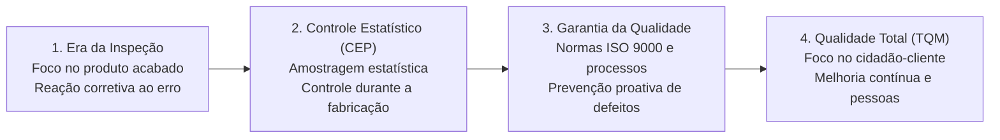
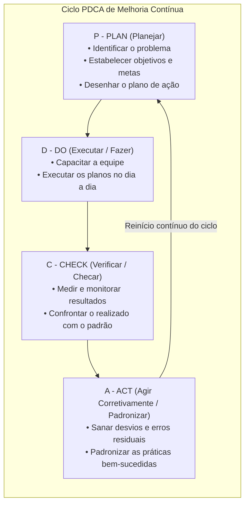
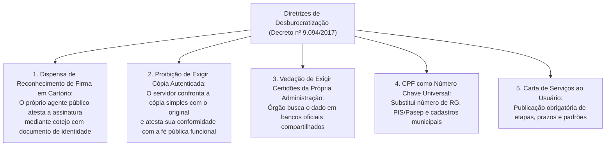
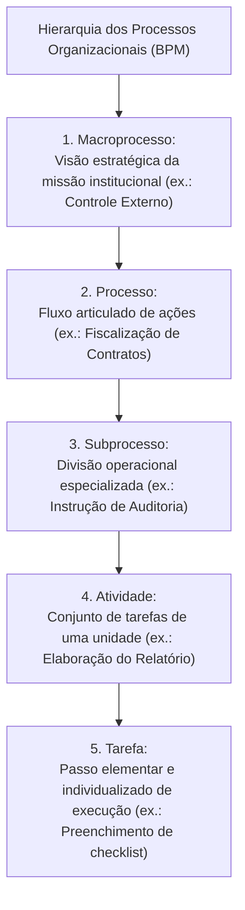
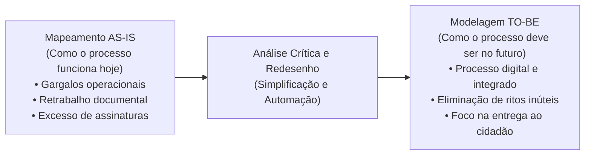
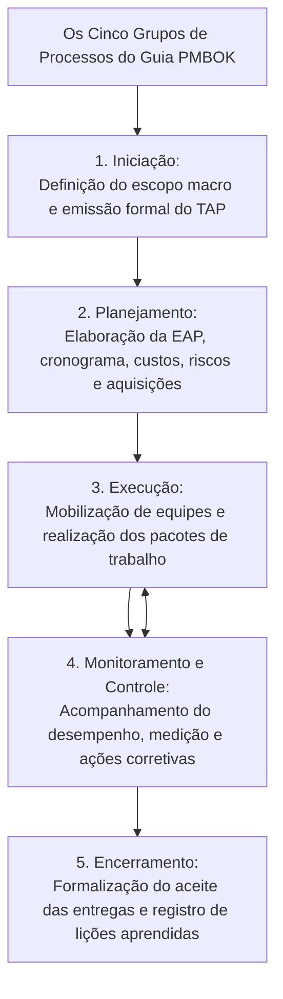

# 03 - Gestão da Qualidade, Decreto nº 9.094/2017, Gestão de Processos (BPM) e Projetos

> **Matéria:** Noções de Administração Pública  
> **Cargo:** A01 – Técnico de Controle Externo – Especialidade: Técnico Administrativo  
> **Arquivo:** `03_gestao_da_qualidade_processos_projetos_e_decreto_9094.md`  

---

## 📌 Ementa / Itens do Edital

- Gestão da Qualidade e excelência nos serviços públicos:
    - Evolução dos conceitos da qualidade: inspeção, controle estatístico de processos (CEP), garantia da qualidade e Gestão da Qualidade Total (*Total Quality Management* - TQM);
    - Mestres da qualidade e suas contribuições essenciais:
    - W. Edwards Deming: 14 princípios e o Ciclo PDCA (*Plan, Do, Check, Act*);
    - Joseph Juran: Trilogia da Qualidade (Planejamento, Controle e Aperfeiçoamento da Qualidade) e custos da qualidade;
    - Kaoru Ishikawa: Diagrama de Causa e Efeito (Espinha de Peixe / 6M), Círculos de Controle de Qualidade (CCQ) e as 7 ferramentas da qualidade;
    - Philip Crosby: Conceito de "Zero Defeito" e conformidade com requisitos;
    - Modelos de excelência em gestão pública: Modelo de Excelência em Gestão (MEG / Fundação Nacional da Qualidade - FNQ) e Programa GesPública;
- Simplificação, racionalização e avaliação dos serviços prestados aos usuários:
    - **Decreto Federal nº 9.094/2017** e alterações (Decreto nº 9.723/2019 e Lei nº 13.726/2018 - Lei de Desburocratização):
    - Dispensa de reconhecimento de firma em cartório e de autenticação de cópias de documentos;
    - Proibição de exigência de certidões ou documentos emitidos pela própria administração pública ou presentes em bancos de dados oficiais;
    - Adoção do CPF como número suficiente e universal de identificação do cidadão nos serviços públicos;
    - **Carta de Serviços ao Usuário:** conteúdo compulsório, padrões de qualidade, prazos e atualização permanente;
- Gestão de Processos de Negócio (*Business Process Management* - BPM):
    - Conceito e hierarquia dos processos: Macroprocesso, Processo, Subprocesso, Atividade e Tarefa;
    - Tipos de processos organizacionais: Processos Finalísticos (Primários / Ponta a Ponta), de Suporte (Apoio / Secundários) e de Gerenciamento (Gestão);
    - Ciclo de vida do BPM: Diagnóstico da situação atual (*AS-IS*) versus Modelagem do estado futuro otimizado (*TO-BE*);
- Noções de Gestão de Projetos:
    - Distinção conceitual entre Projeto (esforço temporário para criar um resultado exclusivo) e Processo (fluxo contínuo, padronizado e perene);
    - O guia PMBOK (*Project Management Institute* - PMI): os 5 grupos de processos (Iniciação, Planejamento, Execução, Monitoramento/Controle e Encerramento);
    - Termo de Abertura do Projeto (TAP / *Project Charter*) e Estrutura Analítica do Projeto (EAP / *WBS*).

---

## 🧭 Sumário Interativo
- [1. Gestão da Qualidade: Eras, Teóricos e Ferramentas](#1-gestao-da-qualidade-eras-teoricos-e-ferramentas)
    - [1.1 Evolução das Quatro Eras da Qualidade](#11-evolucao-das-quatro-eras-da-qualidade)
    - [1.2 Os Mestres da Qualidade e suas Contribuições (Deming, Juran, Ishikawa e Crosby)](#12-os-mestres-da-qualidade-e-suas-contribuicoes-deming-juran-ishikawa-e-crosby)
    - [1.3 O Ciclo PDCA e as Sete Ferramentas da Qualidade](#13-o-ciclo-pdca-e-as-sete-ferramentas-da-qualidade)
    - [1.4 Modelos de Excelência: MEG / FNQ e o GesPública](#14-modelos-de-excelencia-meg-fnq-e-o-gespublica)
- [2. Desburocratização e Atendimento ao Cidadão (Decreto nº 9.094/2017)](#2-desburocratizacao-e-atendimento-ao-cidadao-decreto-no-90942017)
    - [2.1 Supressão de Custos Cartorários (Reconhecimento de Firma e Autenticação)](#21-supressao-de-custos-cartorarios-reconhecimento-de-firma-e-autenticacao)
    - [2.2 Proibição de Exigência Documental Redundante e Interoperabilidade](#22-proibicao-de-exigencia-documental-redundante-e-interoperabilidade)
    - [2.3 O CPF como Chave Unificada de Identificação](#23-o-cpf-como-chave-unificada-de-identificacao)
    - [2.4 A Carta de Serviços ao Usuário](#24-a-carta-de-servicos-ao-usuario)
- [3. Gestão de Processos de Negócio (BPM)](#3-gestao-de-processos-de-negocio-bpm)
    - [3.1 Conceito e Hierarquia Estrutural dos Processos](#31-conceito-e-hierarquia-estrutural-dos-processos)
    - [3.2 Tipos de Processos: Finalísticos, de Suporte e de Gerenciamento](#32-tipos-de-processos-finalisticos-de-suporte-e-de-gerenciamento)
    - [3.3 Redesenho de Processos: Diagnóstico AS-IS vs. Modelagem TO-BE](#33-redesenho-de-processos-diagnostico-as-is-vs-modelagem-to-be)
- [4. Gestão de Projetos segundo o Guia PMBOK (PMI)](#4-gestao-de-projetos-segundo-o-guia-pmbok-pmi)
    - [4.1 Distinção Conceitual: Projeto versus Processo](#41-distincao-conceitual-projeto-versus-processo)
    - [4.2 Os Cinco Grupos de Processos do PMBOK](#42-os-cinco-grupos-de-processos-do-pmbok)
    - [4.3 Instrumentos Primordiais: TAP e EAP (WBS)](#43-instrumentos-primordiais-tap-e-eap-wbs)
    - [4.4 A Restrição Tripla Clássica (Escopo, Custo e Tempo)](#44-a-restricao-tripla-classica-escopo-custo-e-tempo)
- [5. Fontes Oficiais & Referências Bibliográficas](#fontes-oficiais-referencias-bibliograficas)
- [6. Questões Comentadas no Padrão FCC](#questoes-comentadas-no-padrao-fcc)

---

## 📖 Conteúdo Teórico Aprofundado

### 1. Gestão da Qualidade: Eras, Teóricos e Ferramentas

#### 1.1 Evolução das Quatro Eras da Qualidade
A gestão da qualidade nas organizações públicas e privadas evoluiu através de quatro grandes eras históricas:

1. **Era da Inspeção:** Foco estritamente reativo sobre o produto já fabricado. A qualidade resumia-se a separar as peças boas das peças defeituosas ao final da linha de produção;
2. **Era do Controle Estatístico de Processos (CEP):** Introduzida por Walter Shewhart na década de 1930. Utilização de técnicas estatísticas de amostragem durante o processo produtivo para identificar desvios antes da conclusão do lote;
3. **Era da Garantia da Qualidade:** Foco sistêmico na **prevenção** de defeitos. A qualidade é planejada em todas as etapas de projeto, suprimentos e fabricação, surgindo normas formais de certificação (família ISO 9000);
4. **Era da Gestão da Qualidade Total (*Total Quality Management* - TQM):** Envolvimento de todos os colaboradores e departamentos da organização, com foco prioritário na satisfação das necessidades do usuário-cidadão e na busca perene pela melhoria contínua (*Kaizen*).

#### 1.2 Os Mestres da Qualidade e suas Contribuições (Deming, Juran, Ishikawa e Crosby)
- **W. Edwards Deming:** Conhecido como o pai do gerenciamento moderno da qualidade. Defendeu que mais de 85% dos problemas de qualidade decorrem de falhas no sistema administrativo, e não dos trabalhadores. Formulou os 14 Princípios da Qualidade e disseminou globalmente o **Ciclo PDCA**;
- **Joseph Juran:** Enfatizou que a qualidade deve ser gerenciada como uma função executiva de negócios. Concebeu a **Trilogia da Qualidade**:
    1. *Planejamento da Qualidade:* Identificar quem são os clientes e desenvolver processos capazes de produzir as características exigidas;
    2. *Controle da Qualidade:* Monitorar o desempenho real e agir quando houver desvios;
    3. *Melhoria da Qualidade:* Conduzir projetos contínuos de aprimoramento estrutural de processos;

- **Kaoru Ishikawa:** Pai dos **Círculos de Controle de Qualidade (CCQ)** (grupos voluntários de funcionários que se reúnem regularmente para debater e resolver falhas de rotina). Criou o célebre **Diagrama de Causa e Efeito (Diagrama Espinha de Peixe / Diagrama de Ishikawa)**, que organiza as causas de um problema nos tradicionais **6Ms**: Método, Matéria-prima, Mão de obra, Máquinas/Tecnologia, Medição e Meio ambiente;
- **Philip Crosby:** Criador do conceito de **"Zero Defeito"** (*Zero Defects*). Defendeu que a qualidade significa estrita "conformidade com os requisitos", afirmando que "a qualidade é de graça" (*Quality is Free*), pois os custos de fazer certo da primeira vez são infinitamente menores do que os custos do retrabalho e do desperdício.

#### 1.3 O Ciclo PDCA e as Sete Ferramentas da Qualidade
O **Ciclo PDCA (Deming/Shewhart)** é um método iterativo de gestão de quatro passos utilizado para o controle e melhoria contínua de processos:

- **As Sete Ferramentas Clássicas da Qualidade:**
    1. *Fluxograma:* Representação gráfica sequencial do fluxo de etapas de um processo;
    2. *Diagrama de Ishikawa:* Identificação visual e estruturada das causas raízes de um defeito;
    3. *Folha de Verificação:* Formulário padronizado para coleta metódica de dados operacionais;
    4. *Diagrama de Pareto:* Gráfico de barras ordenado decrescente associado a uma curva cumulativa baseado no **Princípio 80/20** ("80% dos problemas decorrem de 20% das causas vitais");
    5. *Histograma:* Gráfico de barras que ilustra a distribuição de frequência de dados quantitativos;
    6. *Gráfico de Dispersão:* Avaliação gráfica da correlação estatística entre duas variáveis;
    7. *Cartas de Controle:* Gráficos temporais com limites superior e inferior de controle para verificar a estabilidade do processo.

#### 1.4 Modelos de Excelência: MEG / FNQ e o GesPública
- **Modelo de Excelência da Gestão (MEG / Fundação Nacional da Qualidade):** Baseado na visão sistêmica e em fundamentos de gestão contemporâneos (liderança transformadora, foco no cidadão, orientação para resultados, governança e responsabilidade socioambiental);
- **Programa Nacional de Gestão Pública e Desburocratização (GesPública):** Instituído pelo Decreto Federal nº 5.378/2005 para disseminar no setor público brasileiro a autoavaliação continuada e a busca por excelência nos serviços públicos prestados ao cidadão.

---

### 2. Desburocratização e Atendimento ao Cidadão (Decreto nº 9.094/2017)

O **Decreto Federal nº 9.094/2017** (regulamentado e reforçado pela Lei Federal nº 13.726/2018 - Lei de Desburocratização) estabeleceu diretrizes expressas de simplificação administrativa e presunção de boa-fé nas relações entre a administração pública e a sociedade:

#### 2.1 Supressão de Custos Cartorários (Reconhecimento de Firma e Autenticação)
- **Reconhecimento de Firma:** Fica **vedada a exigência de reconhecimento de firma em cartório** para a prática de atos perante os órgãos e entidades públicas, salvo se houver dúvida fundada de autenticidade ou previsão legal expressa em lei ordinária formal. O servidor público que receber o documento deve comparar a assinatura com a constante no documento de identidade ou colher a assinatura presencial do administrado;
- **Cópias Autenticadas:** Fica **proibida a exigência de cópia autenticada em cartório**. O servidor público confrontará a cópia simples com o documento original apresentado e atestará sua veracidade ("confere com o original"), sob sua fé pública funcional.

#### 2.2 Proibição de Exigência Documental Redundante e Interoperabilidade
- É expressamente **vedado ao órgão público exigir do requerente** a apresentação de certidões, certidões negativas de débito ou documentos comprobatórios emitidos pelo próprio órgão ou que constem em bancos de dados oficiais da administração pública;
- Os órgãos devem integrar seus sistemas e proceder à busca de informações e documentos diretamente nas bases públicas compartilhadas.

#### 2.3 O CPF como Chave Unificada de Identificação
Conforme as alterações trazidas pelo Decreto nº 9.723/2019 e Lei nº 14.534/2023, o número de inscrição no Cadastro de Pessoas Físicas (**CPF**) é o dado suficiente e universal para a identificação do cidadão nos bancos de dados de serviços públicos federais, estaduais e municipais, sendo dispensada a exigência de múltiplos números de cadastro (como PIS, Pasep, carteira de trabalho ou RG estadual).

#### 2.4 A Carta de Serviços ao Usuário
A Carta de Serviços ao Usuário é um instrumento de governança e transparência de publicação compulsória nos portais oficiais na internet e em local visível nas repartições públicas. Deve detalhar:

- Os serviços públicos oferecidos pelo órgão e as formas de acesso;
- Requisitos, documentos e informações necessários para cada serviço;
- Prazos máximos para a conclusão e entrega de cada etapa;
- Mecanismos de comunicação e procedimentos para registro de reclamações e sugestões na ouvidoria pública.

---

### 3. Gestão de Processos de Negócio (BPM)

O *Business Process Management* (BPM) é uma abordagem disciplinada para identificar, desenhar, executar, documentar, medir, monitorar e controlar processos de trabalho para alcançar resultados alinhados aos objetivos da organização.

#### 3.1 Conceito e Hierarquia Estrutural dos Processos
- **Processo:** Conjunto estruturado de atividades logicamente encadeadas que transformam entradas (*inputs*) em saídas (*outputs*) que agregam valor perceptível a um cliente ou cidadão-usuário;
- **Hierarquia Estrutural:**

$$\text{Macroprocesso} \longrightarrow \text{Processo} \longrightarrow \text{Subprocesso} \longrightarrow \text{Atividade} \longrightarrow \text{Tarefa}$$

#### 3.2 Tipos de Processos: Finalísticos, de Suporte e de Gerenciamento
1. **Processos Finalísticos (Primários ou de Ponta a Ponta):**
    - Diretamente relacionados ao cumprimento da **missão essencial** do órgão e à entrega direta de valor público ao cidadão ou usuário externo;
    - *Exemplos:* Emissão de certidões, realização de cirurgias no SUS, fiscalização de contas de prefeituras pelo TCE-GO;

2. **Processos de Suporte (Secundários ou de Apoio):**
    - Garantem a infraestrutura material, tecnológica e humana indispensável para que os processos finalísticos ocorram com sucesso, atendendo a clientes internos;
    - *Exemplos:* Gestão da folha de pagamento, contratação de serviços de vigilância e limpeza, suporte de TI e manutenção de viaturas;

3. **Processos de Gerenciamento (Gestão):**
    - Asseguram a governança corporativa, o direcionamento estratégico, a medição contínua e a gestão de riscos e integridade da instituição;
    - *Exemplos:* Formulação do plano estratégico institucional, auditoria interna de controle, comitês de governança.

#### 3.3 Redesenho de Processos: Diagnóstico AS-IS vs. Modelagem TO-BE

- **AS-IS ("Como É"):** Diagnóstico da situação atual do processo, identificando falhas, sobreposições de competências, estrangulamentos (*bottlenecks*) e burocracias inúteis;
- **TO-BE ("Como Deve Ser"):** Proposta e modelagem do fluxo futuro ideal e otimizado, incorporando ferramentas digitais, eliminando etapas que não agregam valor e encurtando o tempo de ciclo.

---

### 4. Gestão de Projetos segundo o Guia PMBOK (PMI)

#### 4.1 Distinção Conceitual: Projeto versus Processo
A doutrina da administração e a jurisprudência da FCC cobram com rigor a distinção ontológica entre projeto e processo:

| Critério de Análise | Projeto (Gestão de Projetos / PMBOK) | Processo (BPM / Rotina Organizacional) |
| :--- | :--- | :--- |
| **Temporalidade** | **Temporário:** Possui data de início e término prefixadas no tempo. | **Permanente e Contínuo:** Repete-se rotineiramente sem data de encerramento. |
| **Resultado Produzido** | Gera um produto, serviço ou resultado **único, exclusivo e inédito**. | Gera produtos ou serviços **padronizados, uniformes e repetitivos**. |
| **Finalidade Estratégica**| Conduzir mudanças, inovações ou implantar novas capacidades. | Manter a regularidade operacional e o funcionamento estável da entidade. |
| **Grau de Incerteza** | Elevado, devido ao ineditismo das entregas e variáveis externas. | Baixo, pois é regido por procedimentos estáveis e fluxos consolidados. |

#### 4.2 Os Cinco Grupos de Processos do PMBOK
O ciclo de vida do gerenciamento de projetos organiza-se em cinco grupos fundamentais de processos:

#### 4.3 Instrumentos Primordiais: TAP e EAP (WBS)
- **Termo de Abertura do Projeto (TAP / *Project Charter*):**  
  Documento formal emitido pelo patrocinador (*sponsor*) que autoriza oficialmente a existência do projeto e concede ao gerente do projeto a autoridade para aplicar recursos da instituição nas atividades do projeto;
- **Estrutura Analítica do Projeto (EAP / *WBS - Work Breakdown Structure*):**  
  Decomposição hierárquica e visual do escopo total de trabalho do projeto em partes menores e gerenciáveis chamadas de **pacotes de trabalho**.
  > 🚨 **ALERTA DE PROVA / PEGADINHA FCC:**  
  > A EAP **NÃO é um cronograma de atividades**! A EAP é orientada exclusivamente a **entregas (produtos e subprodutos)**. Ela não contém datas de início/fim nem lista de tarefas diárias. O documento que contém datas e dependências temporais é o Cronograma do Projeto (Diagrama de Rede ou Gráfico de Gantt).

#### 4.4 A Restrição Tripla Clássica (Escopo, Custo e Tempo)
O sucesso de um projeto decorre do equilíbrio dinâmico entre três variáveis interdependentes, balizadas pelo padrão de **Qualidade**:
$$\text{Escopo} \iff \text{Tempo / Cronograma} \iff \text{Custo / Orçamento}$$
A alteração em qualquer um desses vértices impacta compulsoriamente os outros dois (ex.: antecipar o prazo de conclusão exige aumento de custos com horas extras ou redução do escopo entregue).

---

## 🌐 Fontes Oficiais & Referências Bibliográficas

- [Decreto Federal nº 9.094/2017](https://www.planalto.gov.br/ccivil_03/_ato2015-2018/2017/decreto/d9094.htm)
    - Simplificação do atendimento público, dispensa de ritos notariais e Carta de Serviços ao Usuário.
- [Lei Federal nº 13.726/2018 (Lei da Desburocratização)](https://www.planalto.gov.br/ccivil_03/_ato2015-2018/2018/lei/l13726.htm)
    - Racionalização de atos administrativos e eliminação de formalidades desnecessárias.
- [Associação dos Profissionais de BPM (ABPMP) - Guia para o Gerenciamento de Processos de Negócio (BPM CBOK v4.0)](https://www.abpmp-br.org/)
    - Ciclo de vida de processos, modelagem AS-IS/TO-BE e hierarquia processual.
- [Project Management Institute (PMI) - Guia PMBOK (7ª Edição)](https://www.pmi.org)
    - Padrões globais de gerenciamento de projetos, Termo de Abertura e EAP.
- [Fundação Nacional da Qualidade (FNQ) - Cadernos MEG (Modelo de Excelência da Gestão)](https://fnq.org.br)
    - Conceitos de qualidade total, liderança transformadora e melhoria contínua.

---

## 📝 Questões Comentadas no Padrão FCC

### Questão 1 (FCC – TCE-PI – Auditor de Controle Externo)
Cidadão compareceu ao setor de protocolo de uma secretaria de Estado para requerer certidão de regularidade funcional, apresentando cópia simples de sua cédula de identidade acompanhada do documento original. O atendente público recusou o recebimento da documentação, exigindo que o requerente providenciasse prévia autenticação da cópia e reconhecimento de firma em cartório de notas. Considerando o disposto no Decreto Federal nº 9.094/2017 e na legislação correlata sobre simplificação de serviços públicos:

* **A)** A conduta do atendente foi correta, pois a fé pública de documentos apresentados ao Estado depende de reconhecimento notarial.
* **B)** A conduta do atendente foi indevida, pois é vedada a exigência de reconhecimento de firma e de cópia autenticada, cabendo ao próprio servidor público atestar a autenticidade mediante cotejo da cópia com o original apresentado.
* **C)** O atendente agiu com respaldo legal, desde que o prazo de validade da cédula de identidade apresentada pelo cidadão tenha expirado há mais de cinco anos.
* **D)** O atendimento só poderia ser recusado se o cidadão não comprovasse residência fixa no Estado por meio de certidão cartorária.
* **E)** A dispensa de autenticação cartorária somente se aplica a pessoas jurídicas sem fins lucrativos qualificadas como organizações sociais.

> **Comentário Detalhado:**
>
> - **A)** Incorreta. O Decreto nº 9.094/2017 e a Lei Federal nº 13.726/2018 proíbem a transferência de custos e formalidades cartorárias ao cidadão quando o documento original é exibido ao agente público.
> - **B)** Correta. De acordo com o art. 9º do Decreto Federal nº 9.094/2017 e a Lei nº 13.726/2018, é vedada a exigência de reconhecimento de firma e de autenticação notarial de cópias, cabendo ao próprio servidor público, sob sua fé pública funcional, confrontar a cópia simples com o documento original e atestar a sua conformidade no processo administrativo.
> - **C)** Incorreta. A lei não admite exceção temporal para documentos oficiais de identificação válidos que individualizem o cidadão.
> - **D)** Incorreta. A comprovação de endereço pode ser feita mediante simples declaração assinada pelo interessado.
> - **E)** Incorreta. A simplificação administrativa beneficia indistintamente qualquer cidadão ou pessoa jurídica no trato com o serviço público.
> 
> **Gabarito: B**

---

### Questão 2 (FCC – TCE-RS – Auditor de Controle Externo)
No âmbito da gestão estratégica e da teoria das organizações, a respeito das distinções essenciais entre a gestão de processos de negócio e a gestão de projetos:

* **A)** Os projetos caracterizam-se por sua natureza contínua e repetitiva, destinando-se a manter estabilizadas as operações de rotina da organização.
* **B)** A modelagem de processos denominada AS-IS refere-se ao desenho ideal do fluxo futuro após a eliminação de redundâncias e automação tecnológica.
* **C)** O projeto é um esforço temporário empreendido para criar um produto, serviço ou resultado exclusivo, enquanto os processos representam fluxos de trabalho permanentes e padronizados.
* **D)** A Estrutura Analítica do Projeto (EAP) consiste em um gráfico de barras cronológico destinado a mensurar os custos diários incorridos pela equipe.
* **E)** Os processos primários ou finalísticos de um órgão público são aqueles voltados exclusivamente para dar suporte administrativo às áreas de informática e compras.

> **Comentário Detalhado:**
>
> - **A)** Incorreta. A perenidade, continuidade e repetitividade são traços definidores dos processos de rotina operacional, e não dos projetos.
> - **B)** Incorreta. A modelagem AS-IS retrata o processo atual como ele funciona hoje (com suas falhas e gargalos); o desenho otimizado futuro é o TO-BE.
> - **C)** Correta. É a clássica definição do PMI/PMBOK: projeto é um esforço temporário com início e fim delimitados destinado a gerar um produto, serviço ou resultado exclusivo; ao passo que processos de negócio são contínuos, permanentes e padronizados para manter as operações regulares.
> - **D)** Incorreta. A EAP é a decomposição hierárquica do escopo em entregas gerenciáveis; o gráfico de barras temporal com cronograma é o Gráfico de Gantt.
> - **E)** Incorreta. Informática e compras internas configuram processos de suporte (secundários); processos finalísticos entregam valor público direto à sociedade e à missão essencial do órgão.
> 
> **Gabarito: C**

---

### Questão 3 (FCC – DPE-RS – Analista: Área Administrativa)
Determinada equipe de modernização administrativa do Tribunal de Contas recebeu a incumbência de identificar as causas fundamentais dos atrasos reiterados na instrução processual de tomadas de contas especiais. Para estruturar a análise, os analistas utilizaram uma ferramenta visual que categoriza as causas potenciais em fatores como procedimentos e rotinas (Método), capacitação dos auditores (Mão de obra), sistemas informatizados utilizados (Máquinas/Tecnologia) e insumos documentais recebidos dos jurisdicionados (Matéria-prima). A ferramenta descrita é o:

* **A)** Diagrama de Ishikawa (Espinha de Peixe).
* **B)** Gráfico de Pareto baseado na regra 80/20.
* **C)** Ciclo PDCA na etapa de Checagem.
* **D)** Histograma de frequências acumuladas.
* **E)** Gráfico de dispersão linear de Pearson.

> **Comentário Detalhado:**
>
> - **A)** Correta. O Diagrama de Causa e Efeito (Diagrama de Ishikawa ou Espinha de Peixe) é o instrumento clássico da qualidade estruturado para rastrear e categorizar as causas raízes de um problema operacional, dividindo-as tradicionalmente nos 6Ms (Método, Mão de obra, Máquina, Matéria-prima, Medição e Meio ambiente).
> - **B)** Incorreta. O Diagrama de Pareto organiza causas por frequência decrescente para priorizar os 20% de causas que respondem por 80% dos problemas.
> - **C)** Incorreta. O PDCA é um ciclo metodológico de gestão em quatro etapas contínuas, não o gráfico de causas em espinha.
> - **D)** Incorreta. O histograma é um gráfico de distribuição de frequência estatística.
> - **E)** Incorreta. O gráfico de dispersão avalia a relação de causa estatística entre duas variáveis contínuas.
> 
> **Gabarito: A**

---

### Questão 4 (FCC – ARTESP – Especialista em Regulação de Transportes)
Em relação ao gerenciamento de projetos estruturado segundo as boas práticas do guia PMBOK (Project Management Institute), assinale a opção correta:

* **A)** O Termo de Abertura do Projeto (TAP) é emitido após o término da execução física para consolidar as lições aprendidas pela equipe.
* **B)** A Estrutura Analítica do Projeto (EAP) tem por objetivo decompor hierarquicamente o trabalho total do projeto em partes menores e gerenciáveis orientadas a entregas.
* **C)** O grupo de processos de encerramento do projeto dispensa a aceitação formal das entregas pelo cliente quando o cronograma for cumprido no prazo previsto.
* **D)** A restrição tripla do gerenciamento de projetos é composta exclusivamente por variáveis comportamentais: motivação, liderança e clima institucional.
* **E)** O gerente de projeto adquire autoridade formal para aplicar recursos da organização apenas no momento em que a equipe conclui a fase de encerramento contratual.

> **Comentário Detalhado:**
>
> - **A)** Incorreta. O Termo de Abertura do Projeto (TAP) é emitido no grupo de Iniciação, inaugurando formalmente o projeto.
> - **B)** Correta. A EAP (Work Breakdown Structure - WBS) é a ferramenta de decomposição hierárquica e visual do escopo total de trabalho do projeto em partes menores e gerenciáveis (pacotes de trabalho) orientadas exclusivamente a entregas.
> - **C)** Incorreta. O encerramento do projeto exige impreterivelmente o aceite formal das entregas finais pelo cliente ou patrocinador, além da documentação das lições aprendidas.
> - **D)** Incorreta. A restrição tripla clássica do gerenciamento de projetos é formada por: Escopo, Tempo e Custo (integrados pelo padrão de Qualidade).
> - **E)** Incorreta. A autorização formal para mobilizar servidores e recursos organizacionais é conferida ao gerente logo no início, através da assinatura do TAP.
> 
> **Gabarito: B**

---

### Questão 5 (FCC – SEFAZ-SC – Auditor Fiscal da Receita Estadual)
No âmbito da modelagem e do gerenciamento de processos de negócio (BPM - Business Process Management), os processos organizacionais são classificados em finalísticos, de suporte e de gerenciamento. Assinale a alternativa que apresenta um exemplo legítimo de processo de suporte (secundário) em uma organização pública:

* **A)** Realização de fiscalização tributária e lançamento de ofício do crédito tributário estadual.
* **B)** Concessão de aposentadorias e pensões aos servidores vinculados ao regime próprio de previdência.
* **C)** Gestão de compras e contratação de serviços de vigilância e limpeza para as dependências do prédio sede.
* **D)** Julgamento de autos de infração fiscal pelo Tribunal Administrativo Tributário.
* **E)** Auditoria de regularidade das despesas públicas municipais efetuada pelo Tribunal de Contas.

> **Comentário Detalhado:**
>
> - **A)** Incorreta. A fiscalização e o lançamento de tributos constituem a atividade-fim essencial da Secretaria da Fazenda, qualificando-se como processo finalístico (primário).
> - **B)** Incorreta. No âmbito de um instituto de previdência pública, conceder benefícios é sua atividade-fim direta (processo primário).
> - **C)** Correta. Processos de suporte (secundários ou de apoio) são aqueles que viabilizam o funcionamento interno da instituição e dos processos finalísticos, fornecendo recursos, logística e infraestrutura para clientes internos. A contratação de vigilância, limpeza predial, almoxarifado e suporte técnico de TI são exemplos clássicos de processos de suporte.
> - **D)** Incorreta. O julgamento contencioso tributário é atividade finalística essencial de arrecadação e justiça fiscal.
> - **E)** Incorreta. A fiscalização e auditoria das contas públicas jurisdicionadas é o processo finalístico precípuo do Tribunal de Contas.
> 
> **Gabarito: C**
