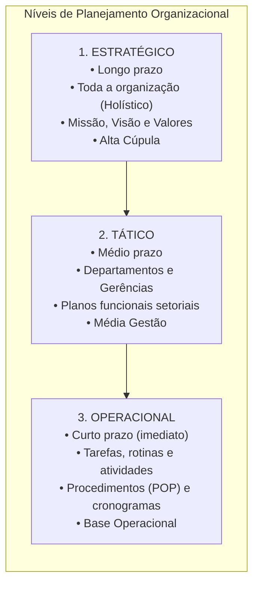
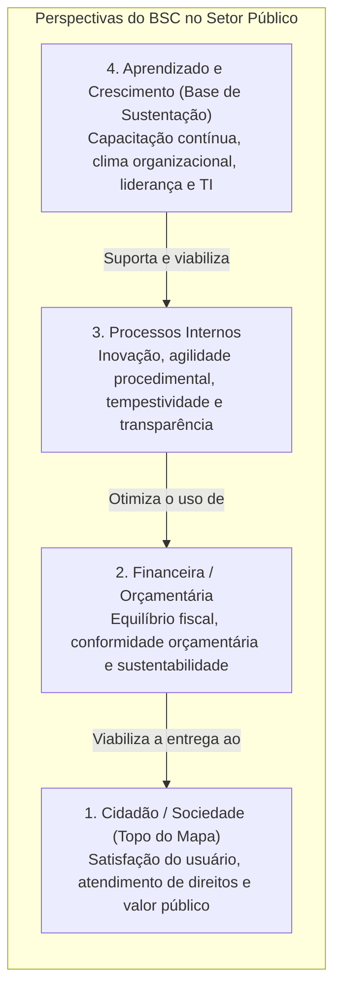
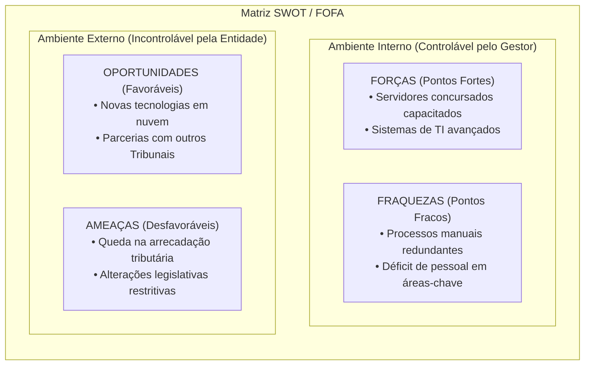
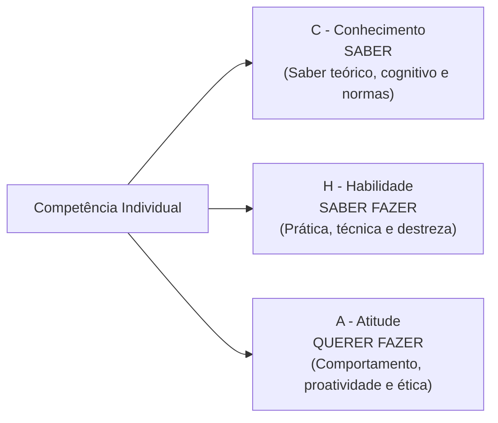
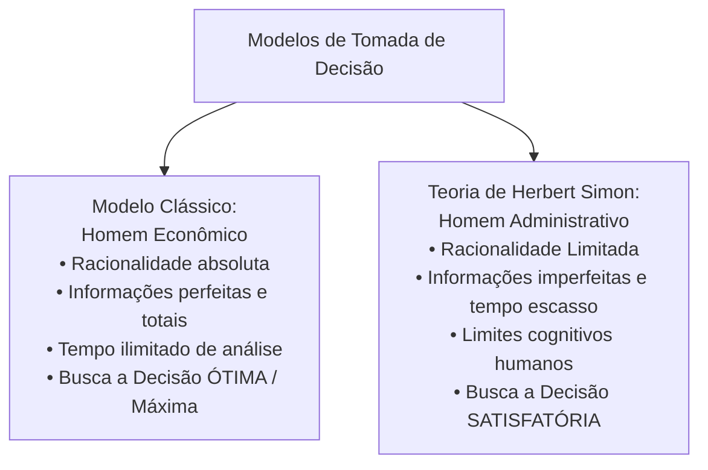

# 04 - Planejamento Estratégico, Indicadores, BSC, Gestão por Competências e Decisão

> **Matéria:** Noções de Administração Pública  
> **Cargo:** A01 – Técnico de Controle Externo – Especialidade: Técnico Administrativo  
> **Arquivo:** `04_planejamento_estrategico_indicadores_e_gestao_por_competencias.md`  

---

## 📌 Ementa / Itens do Edital
- Níveis do planejamento organizacional: Estratégico (institucional e longo prazo), Tático (departamental e médio prazo) e Operacional (tarefas, rotinas e curto prazo);
- Ferramentas de análise e diagnóstico para a gestão:
  - **Balanced Scorecard (BSC - Kaplan & Norton):** mapa estratégico, relações de causa e efeito, e as quatro perspectivas adaptadas ao setor público (Cidadão/Sociedade, Orçamentária/Financeira, Processos Internos e Aprendizado/Crescimento);
  - **Matriz SWOT (FOFA):** forças e fraquezas (ambiente interno controlável) versus oportunidades e ameaças (ambiente externo incontrolável);
  - **Matriz GUT:** priorização matemática de problemas por Gravidade, Urgência e Tendência;
  - Metodologia 5W2H de planos de ação operacional;
- Indicadores de gestão pública e desempenho organizacional:
  - Os 6 Es do desempenho público: Economicidade, Eficiência, Eficácia, Efetividade, Execução e Excelência;
  - Propriedades e requisitos dos indicadores: representatividade, simplicidade, rastreabilidade, sensibilidade e economicidade;
- Metodologias de avaliação de desempenho funcional:
  - Avaliação individual e institucional; métodos tradicionais e modernos;
  - Avaliação 360 graus (múltiplas fontes), autoavaliação e avaliação participativa por objetivos;
- Gestão por Competências na administração pública (Decreto Federal nº 9.991/2019):
  - A tríade **CHA** (Conhecimentos, Habilidades e Atitudes);
  - Mapeamento de competências, diagnóstico de lacunas (*gap analysis*) e elaboração do Plano de Desenvolvimento de Pessoas (PDP);
- Processo decisório e teoria da decisão:
  - Modelo Racional Absoluto (*Homem Econômico*) versus Teoria da Racionalidade Limitada de Herbert Simon (*Homem Administrativo* e decisões satisfatórias);
  - Decisões programadas versus decisões não programadas;
- Gestão de conflitos organizacionais: conflitos funcionais e disfuncionais; estilos de tratamento de conflitos (Kenneth Thomas e Ralph Kilmann).

---

## 🌳 Classificação Hierárquica

```text
4. Planejamento Estratégico, BSC, Indicadores, Competências e Processo Decisório
├── 4.1 Níveis de Planejamento Organizacional
│   ├── 4.1.1 Planejamento Estratégico: Longo prazo, institucional, focado na missão e visão
│   ├── 4.1.2 Planejamento Tático: Médio prazo, gerencial/departamental, desdobramento funcional
│   └── 4.1.3 Planejamento Operacional: Curto prazo, focalizado em tarefas, procedimentos (POP) e rotinas
├── 4.2 Ferramentas de Diagnóstico e Gestão Estratégica
│   ├── 4.2.1 Balanced Scorecard (BSC - Kaplan & Norton):
│   │   ├── Mapa Estratégico: Hipóteses de causa e efeito entre objetivos
│   │   ├── 1. Perspectiva do Cidadão / Sociedade (Topo no setor público: valor público)
│   │   ├── 2. Perspectiva Financeira / Orçamentária (Sustentabilidade e viabilização de recursos)
│   │   ├── 3. Perspectiva dos Processos Internos (Excelência operacional e conformidade)
│   │   └── 4. Perspectiva do Aprendizado e Crescimento (Base: pessoas, clima, liderança e TI)
│   ├── 4.2.2 Matriz SWOT (FOFA):
│   │   ├── Ambiente Interno (Controlável): Forças (Strengths) e Fraquezas (Weaknesses)
│   │   └── Ambiente Externo (Incontrolável): Oportunidades (Opportunities) e Ameaças (Threats)
│   ├── 4.2.3 Matriz GUT: Priorização matemática de problemas (Gravidade x Urgência x Tendência)
│   └── 4.2.4 Plano de Ação 5W2H: What, Why, Where, When, Who, How e How Much
├── 4.3 Indicadores de Desempenho e Avaliação Funcional
│   ├── 4.3.1 As Dimensões do Desempenho Público (Os 6 Es):
│   │   ├── Economicidade (Custo dos insumos), Eficiência (Insumo vs. Produto), Eficácia (Metas atingidas)
│   │   └── Efetividade (Impacto social), Execução (Conformidade contratual), Excelência (Qualidade)
│   ├── 4.3.2 Propriedades Técnicas: Validade, confiabilidade, simplicidade e sensibilidade
│   └── 4.3.3 Avaliação de Desempenho: 90° (chefia direta), 180° (mútua) e 360° (múltiplas fontes / circular)
├── 4.4 Gestão por Competências (Decreto nº 9.991/2019)
│   ├── 4.4.1 A Tríade CHA: Conhecimento (Saber), Habilidade (Saber Fazer) e Atitude (Querer Fazer)
│   ├── 4.4.2 Ciclo de Gestão: Mapeamento -> Diagnóstico de Lacunas (Gap) -> Capacitação (PDP) -> Avaliação
│   └── 4.4.3 GAP de Competências: Lacuna = Competência Necessária (-) Competência Existente
└── 4.5 Processo Decisório e Gestão de Conflitos
    ├── 4.5.1 Racionalidade Limitada (Herbert Simon):
    │   ├── Homem Econômico (decisão ótima / onisciente) vs. Homem Administrativo (decisão satisfatória)
    │   └── Decisões Programadas (rotineiras e padronizadas) vs. Não Programadas (inéditas e complexas)
    └── 4.5.2 Gestão de Conflitos (Kenneth Thomas e Ralph Kilmann):
        ├── Competição / Imposição (Alta assertividade e baixa cooperação: Ganha-Perde)
        ├── Colaboração (Alta assertividade e alta cooperação: Ganha-Ganha)
        ├── Acordo / Concessão Mútua (Níveis intermediários: perda e ganho mútuos)
        ├── Evitação / Fuga (Baixa assertividade e baixa cooperação: Perde-Perde)
        └── Acomodação (Baixa assertividade e alta cooperação: Perde-Ganha)
```

---

## 📖 Resumo Teórico Aprofundado & Esquematizado

### 1. Níveis do Planejamento Organizacional

O planejamento administrativo divide-se em três níveis fundamentais, interconectados pela cadeia escalar:



---

### 2. O Balanced Scorecard (BSC) no Setor Público

Concebido por Robert Kaplan e David Norton, o **BSC** é um modelo de gestão estratégica que equilibra indicadores financeiros tradicionais com medidas não financeiras críticas para o sucesso de longo prazo:



#### Adaptação Estratégica do BSC para o Setor Público:
* **Na iniciativa privada:** O topo do mapa é a **Perspectiva Financeira** (o lucro e o retorno sobre o investimento aos acionistas).
* **No setor público:** O topo do mapa é compulsoriamente a **Perspectiva do Cidadão / Sociedade**, pois o órgão estatal existe para gerar valor público e bem-estar coletivo. A perspectiva financeira atua como restritora orçamentária ou viabilizadora das políticas públicas.

---

### 3. Matriz SWOT (FOFA) e Matriz GUT

#### A) Matriz SWOT (Forças, Oportunidades, Fraquezas e Ameaças)



#### B) Matriz GUT (Gravidade, Urgência e Tendência)
Ferramenta matemática de priorização de problemas com notas de 1 a 5:

$$\mathbf{\text{Prioridade} = \text{Gravidade} \times \text{Urgência} \times \text{Tendência}}$$

* **G - Gravidade:** Intensidade do impacto ou dano se o problema não for resolvido (1 = sem gravidade; 5 = gravíssimo).
* **U - Urgência:** Tempo disponível para atuar antes que ocorram prejuízos irreversíveis (1 = pode esperar; 5 = requer ação imediata).
* **T - Tendência:** Padrão de evolução do problema com o passar do tempo (1 = vai desaparecer; 5 = vai piorar rapidamente).

---

### 4. Gestão por Competências: A Tríade CHA

A gestão por competências no setor público (disciplinada pelo Decreto Federal nº 9.991/2019) busca alinhar o potencial humano com os objetivos institucionais:



#### Diagnóstico de Gap (Lacuna de Competências):

$$\mathbf{\text{GAP} = \text{Competência Requerida pela Função} - \text{Competência Existente no Servidor}}$$

Quando a lacuna é positiva (falta de capacitação), a instituição elabora o **Plano de Desenvolvimento de Pessoas (PDP)** para oferecer treinamentos específicos e fechar o *gap*.

---

### 5. Teoria da Racionalidade Limitada (Herbert Simon)

Herbert Simon refutou o modelo decisório econômico clássico demonstrando como os administradores tomam decisões sob restrições reais:



---

### 6. Gestão de Conflitos: O Modelo de Thomas-Kilmann

Nas organizações contemporâneas, o conflito pode ser **funcional** (positivo, quando estimula o debate crítico e a inovação) ou **disfuncional** (negativo, quando gera bloqueios, desunião e queda de desempenho). Kenneth Thomas e Ralph Kilmann identificaram cinco estilos de gestão de conflitos baseados em dois eixos: **Assertividade** (foco nos próprios interesses) e **Cooperatividade** (foco nos interesses do outro):


---

## 🚨 Alertas de Prova & Pegadinhas da FCC

> 🚨 **ALERTA DE PROVA / PEGADINHA FCC (O TOPO DO BSC PÚBLICO):**  
> A FCC adora montar questões afirmando que a perspectiva financeira figura no topo do Balanced Scorecard no setor público. Isso é **FALSO**! No setor público, quem ocupa o topo do mapa estratégico é a **Perspectiva do Cidadão / Sociedade**, pois o órgão estatal não busca o lucro comercial, mas sim gerar valor social e cumprir sua missão pública!

> ⭐ **IMPORTANTE (SWOT: AMBIENTE INTERNO VS. EXTERNO):**  
> Grave os limites de controle:  
> - **Ambiente Interno (Sob controle do órgão):** Forças (*Strengths*) e Fraquezas (*Weaknesses*).  
> - **Ambiente Externo (Fora do controle do órgão):** Oportunidades (*Opportunities*) e Ameaças (*Threats*).  
> Se a questão citar uma crise econômica, uma mudança climática ou uma alteração da lei, isso é **incontrolável**, portanto pertence ao ambiente externo (Ameaça ou Oportunidade)!

> 🛑 **ATENÇÃO (HOMEM ECONÔMICO VS. HOMEM ADMINISTRATIVO):**  
> - *Homem Econômico:* Racionalidade ilimitada, escolhe a decisão **ótima/maximizadora** (modelo clássico irreal).  
> - *Homem Administrativo (Simon):* Racionalidade limitada, escolhe a decisão **satisfatória** (modelo realista adotado na administração contemporânea).

> 📌 **NOTA EXPLICATIVA (AVALIAÇÃO 360 GRAUS):**  
> A avaliação de desempenho 360 graus (circular) é aquela em que o servidor público é avaliado simultaneamente por todas as pessoas com quem se relaciona profissionalmente: sua chefia imediata, seus colegas de trabalho (pares), seus subordinados diretos, os usuários/cidadãos atendidos e por si mesmo (autoavaliação).

---

## 🌐 Fontes Oficiais e Referências Bibliográficas

* [KAPLAN, Robert S.; NORTON, David P. A Estratégia em Ação: Balanced Scorecard. Editora Campus.](https://www.grupogen.com.br) - Mapa estratégico e as quatro perspectivas.
* [SIMON, Herbert A. Comportamento Administrativo: estudo dos processos decisórios nas organizações administrativas. FGV.](https://www.fgv.br) - Teoria da Racionalidade Limitada.
* [Decreto Federal nº 9.991/2019](https://www.planalto.gov.br/ccivil_03/_ato2019-2022/2019/decreto/d9991.htm) - Política Nacional de Desenvolvimento de Pessoas e Gestão por Competências.
* [THOMAS, Kenneth W.; KILMANN, Ralph H. Conflict Mode Instrument (TKI)](https://kilmanndiagnostics.com) - Modos de tratamento de conflitos organizacionais.
* [Tribunal de Contas da União (TCU) - Referencial de Avaliação de Governança e Gestão Estratégica](https://portal.tcu.gov.br).

---

## 📝 Questões de Concurso FCC Comentadas

### Questão 01
**(FCC – TCE-PI – Auditor de Controle Externo)**  
Ao estruturar o seu Plano Estratégico Institucional, determinado Tribunal de Contas utilizou a metodologia do Balanced Scorecard (BSC). Ao elaborar o mapa estratégico, a equipe de planejamento definiu quatro perspectivas de objetivos. Considerando as peculiaridades das organizações públicas em relação às empresas privadas com fins lucrativos, no modelo adotado pelo Tribunal:

* **A)** A perspectiva financeira deve ocupar obrigatoriamente a posição superior do mapa, tendo como meta a geração de lucro operacional e dividendos públicos.
* **B)** A perspectiva dos cidadãos e da sociedade ocupa o ápice da cadeia de causalidade estratégica, enquanto os recursos orçamentários figuram como viabilizadores das entregas públicas.
* **C)** O aprendizado e o crescimento funcional são eliminados do mapa por serem exclusivos de indústrias manufatureiras.
* **D)** As relações de causa e efeito deixam de existir, passando os objetivos a ser medidos de forma isolada e autônoma.
* **E)** O mapa estratégico dispensa a identificação de indicadores e metas para os processos de fiscalização e controle.

> **Gabarito: B**  
> **Comentário Detalhado:**  
> - **A) Incorreta.** No setor público inexiste distribuição de lucros ou busca por retorno de capital a acionistas como meta finalística institucional.  
> - **B) CORRETA.** No setor público, o ápice da cadeia de valor do BSC é ocupado pela perspectiva do **Cidadão / Sociedade**, pois o órgão governamental visa entregar serviços com valor público à sociedade. A perspectiva orçamentária atua como suporte viabilizador da estratégia, e não como fim em si mesma.  
> - **C) Incorreta.** O aprendizado e crescimento (capital humano, tecnologia, liderança e cultura) é a base indispensável de sustentação de qualquer organização no BSC.  
> - **D) Incorreta.** O alicerce do BSC é precisamente a construção de hipóteses explícitas de causa e efeito entre os objetivos das quatro perspectivas.  
> - **E) Incorreta.** A metodologia do BSC exige indicadores e metas para todas as perspectivas estratégicas.

---

### Questão 02
**(FCC – TCE-RS – Auditor de Controle Externo)**  
A respeito do processo decisório nas organizações e das conclusões da Teoria da Racionalidade Limitada proposta por Herbert Simon, é correto afirmar:

* **A)** O tomador de decisão atua sempre como o "homem econômico", processando a totalidade das variáveis e alternativas possíveis para atingir a decisão ótima perfeita.
* **B)** O comportamento decisório dos gestores é orientado por informações completas, perfeita previsibilidade do futuro e tempo ilimitado para deliberação.
* **C)** Diante da escassez de tempo, limitações cognitivas e insuficiência de dados completos, o gestor atua como o "homem administrativo", selecionando uma alternativa satisfatória que atenda a padrões mínimos aceitáveis.
* **D)** A teoria da racionalidade limitada defende que o administrador público deve decidir de forma puramente arbitrária e intuitiva, dispensando critérios analíticos de avaliação.
* **E)** As decisões operacionais tomadas sob racionalidade limitada prescindem da fixação prévia de objetivos organizacionais pelo planejamento.

> **Gabarito: C**  
> **Comentário Detalhado:**  
> - **A) Incorreta.** O modelo clássico do "homem econômico" e da decisão ótima pura é uma ficção teórica refutada por Simon.  
> - **B) Incorreta.** Os gestores atuam sob ambiente de incerteza, com tempo escasso e dados parciais.  
> - **C) CORRETA.** Segundo Herbert Simon, em virtude da impossibilidade humana de capturar todas as variáveis do ambiente e analisar infinitas alternativas, o tomador de decisão opera como o **homem administrativo**, optando por soluções **satisfatórias** (que atendam a critérios suficientes de eficácia) em vez de soluções ótimas puras.  
> - **D) Incorreta.** A racionalidade limitada busca a melhor decisão possível dentro das restrições existentes, não se confundindo com irracionalidade ou arbitrariedade.  
> - **E) Incorreta.** Objetivos estratégicos prévios continuam sendo indispensáveis para orientar a busca da alternativa satisfatória.

---

### Questão 03
**(FCC – TRT-2ª Região – Analista Judiciário: Área Administrativa)**  
Durante a realização de um diagnóstico institucional, os analistas de um tribunal identificaram os seguintes fatores:
1. Elevado índice de qualificação acadêmica do quadro próprio de analistas (pós-graduados).
2. Ausência de padronização nos procedimentos operacionais dos cartórios judiciais.
3. Disponibilização de novas linhas federais de financiamento para modernização tecnológica dos tribunais.
4. Redução orçamentária imposta pela alteração da lei estadual de diretrizes orçamentárias.

Sob a ótica da Matriz SWOT (FOFA), os fatores 1, 2, 3 e 4 representam, respectivamente:

* **A)** Força, Fraqueza, Oportunidade e Ameaça.
* **B)** Oportunidade, Ameaça, Força e Fraqueza.
* **C)** Força, Ameaça, Oportunidade e Fraqueza.
* **D)** Oportunidade, Fraqueza, Força e Ameaça.
* **E)** Força, Fraqueza, Ameaça e Oportunidade.

> **Gabarito: A**  
> **Comentário Detalhado:**  
> - **Fator 1 (Força):** Qualificação dos servidores do órgão é uma característica interna positiva e controlável pela instituição (**Força / Strengths**).  
> - **Fator 2 (Fraqueza):** Despadronização interna de rotinas é uma vulnerabilidade interna e controlável pela gestão (**Fraqueza / Weaknesses**).  
> - **Fator 3 (Oportunidade):** Linhas federais de financiamento são fatores externos favoráveis que a organização não controla, mas pode aproveitar (**Oportunidade / Opportunities**).  
> - **Fator 4 (Ameaça):** Redução orçamentária decorrente de alteração legislativa é um fator externo desfavorável e incontrolável (**Ameaça / Threats**).  
> - Logo, a classificação exata é: **Força, Fraqueza, Oportunidade e Ameaça** (Alternativa A).

---

### Questão 04
**(FCC – DPE-RS – Analista: Gestão Pública)**  
Na gestão de pessoas no setor público, a metodologia de Gestão por Competências estrutura o perfil funcional a partir da tríade CHA (Conhecimentos, Habilidades e Atitudes). Quando um servidor público domina minuciosamente as regras teóricas da Nova Lei de Licitações (Lei nº 14.133/2021), mas demonstra insegurança técnica e não consegue operar o sistema eletrônico de compras públicas para cadastrar o edital, verifica-se que o servidor possui:

* **A)** Atitude e Habilidade, mas carece de Conhecimento.
* **B)** Conhecimento, mas apresenta déficit no componente de Habilidade.
* **C)** Conhecimento e Habilidade, faltando-lhe unicamente Atitude proativa.
* **D)** Habilidade plena, sem domínio de Conhecimento e Atitude.
* **E)** Ausência simultânea de Conhecimento, Habilidade e Atitude.

> **Gabarito: B**  
> **Comentário Detalhado:**  
> - **A) Incorreta.** O domínio das leis é o Conhecimento em si.  
> - **B) CORRETA.** Na tríade CHA:  
>   - **Conhecimento (Saber):** É o saber teórico, conceitual e cognitivo (domínio das regras da Lei nº 14.133/2021).  
>   - **Habilidade (Saber Fazer):** É a aplicação prática da teoria, o manejo de ferramentas e a operação de sistemas informatizados.  
>   - Como o servidor conhece a lei (tem Conhecimento), mas não consegue operar o sistema na prática, seu déficit específico reside na **Habilidade** ("saber fazer").  
> - **C) Incorreta.** Ele não possui a habilidade técnica de operar o sistema de compras.  
> - **D) Incorreta.** Ele carece exatamente de habilidade prática.  
> - **E) Incorreta.** Ele possui inequívoco conhecimento teórico demonstrado.

---

### Questão 05
**(FCC – ARTESP – Especialista em Regulação de Transportes)**  
Dois diretores de uma agência reguladora divergem categoricamente a respeito dos critérios de reajuste tarifário do transporte intermunicipal. Ambos demonstram alta preocupação em fazer valer suas teses técnicas individuais (alta assertividade), mas recusam-se terminantemente a ouvir os argumentos da outra parte ou a construir um consenso cooperativo (baixa cooperação). Segundo o modelo de estilos de administração de conflitos de Thomas-Kilmann, o comportamento adotado por esses gestores caracteriza o estilo de:

* **A)** Colaboração (Ganha-Ganha).
* **B)** Acomodação (Perde-Ganha).
* **C)** Competição ou Imposição (Ganha-Perde).
* **D)** Evitação ou Fuga (Perde-Perde).
* **E)** Acordo ou Concessão Mútua equilibrada.

> **Gabarito: C**  
> **Comentário Detalhado:**  
> - **A) Incorreta.** Colaboração combina alta assertividade com **alta cooperação**, buscando uma solução integrada "ganha-ganha".  
> - **B) Incorreta.** Acomodação apresenta **baixa assertividade** (o indivíduo abre mão do seu próprio interesse) e alta cooperação.  
> - **C) CORRETA.** O estilo de **Competição (ou Imposição / Enfrentamento)** é definido pela **alta assertividade** (busca obstinada de fazer prevalecer seus próprios interesses) combinada com **baixa cooperação** (desprezo pelos anseios e argumentos da contraparte), configurando uma dinâmica de "ganha-perde".  
> - **D) Incorreta.** Evitação apresenta baixa assertividade e baixa cooperação (ignorar o conflito e fingir que não existe).  
> - **E) Incorreta.** O acordo requer nível moderado de cooperação mútua, com ambas as partes cedendo em algum ponto.
