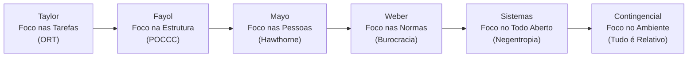
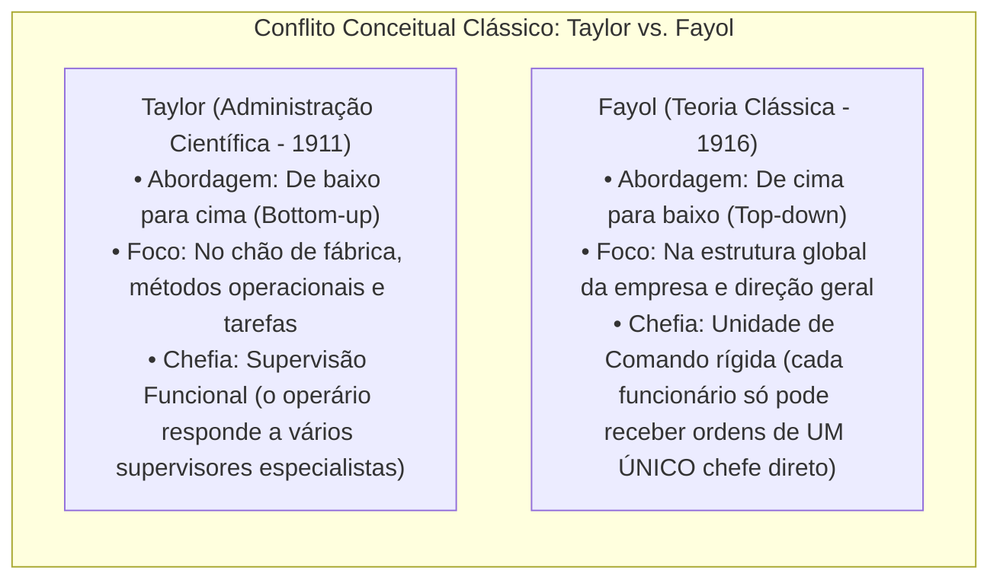
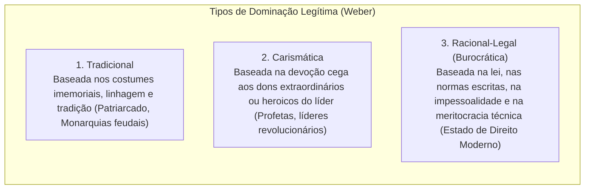
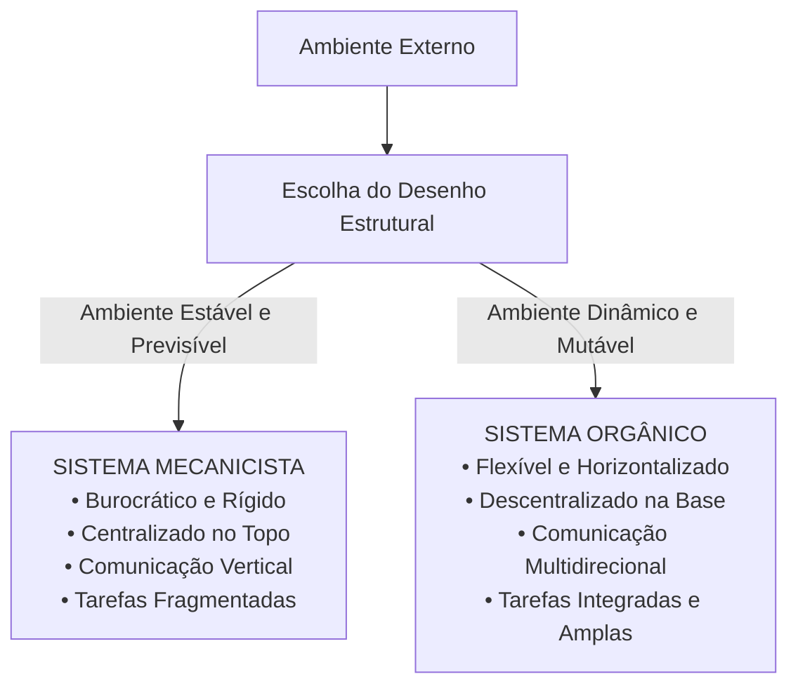
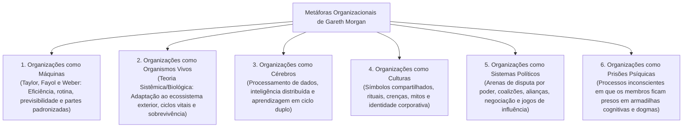

# 01 - Teorias da Administração, Escolas Administrativas e Metáforas Organizacionais

> **Matéria:** Administração Geral  
> **Cargo:** A01 – Técnico de Controle Externo – Especialidade: Técnico Administrativo  
> **Arquivo:** `01_teorias_da_administracao_e_escolas_administrativas.md`  


---


## 📌 Ementa / Itens do Edital
- Evolução histórica do pensamento administrativo e das escolas da Teoria Geral da Administração (TGA):
    - **Administração Científica (Frederick W. Taylor):** Organização Racional do Trabalho (ORT), estudo dos tempos e movimentos, fadiga, divisão do trabalho e especialização do operário, incentivos salariais por peça (*Homo Economicus*), padronização e supervisão funcional;
    - **Teoria Clássica da Administração (Henri Fayol):** visão anatômica da empresa, as seis funções básicas da empresa, funções do administrador (POCCC - Prever, Organizar, Comandar, Coordenar e Controlar) e os 14 princípios gerais da administração (ênfase na Unidade de Comando e Unidade de Direção);
    - **Teoria das Relações Humanas (Elton Mayo):** a Experiência de Hawthorne, o *Homo Socialis*, grupos informais, relevância dos fatores psicossociais e normas do grupo sobre a produtividade;
    - **Teoria da Burocracia (Max Weber):** tipos de dominação legítima (tradicional, carismática e racional-legal); características do modelo burocrático e disfunções da burocracia (Robert Merton);
    - **Teoria Neoclássica (Peter Drucker):** princípios gerais redefinidos, ecletismo, foco nos objetivos práticos e Administração por Objetivos (APO);
    - **Teoria Comportamental (Behaviorismo):** McGregor (Teoria X versus Teoria Y), Chester Barnard (organização como sistema cooperativo e aceitação da autoridade) e Herbert Simon (processo decisório e racionalidade limitada);
    - **Teoria Geral dos Sistemas (Bertalanffy, Katz & Kahn):** a organização como sistema aberto, insumos, processamento, saídas, retroalimentação (*feedback*), entropia negativa, homeostase dinâmica e equifinalidade;
    - **Teoria Contingencial:** abordagem situacional, ausência de princípios universais ("tudo é relativo"), estruturas mecanicistas versus orgânicas (Burns & Stalker) e influência da tecnologia (Woodward) e do ambiente (Lawrence & Lorsch);
- Metáforas organizacionais (Gareth Morgan): imagens da organização (máquinas, organismos, cérebros, culturas, sistemas políticos e prisões psíquicas).

---

## 🧭 Sumário

1. [Síntese Comparativa das Escolas da Teoria Geral da Administração (TGA)](#1-sintese-comparativa-das-escolas-da-teoria-geral-da-administracao-tga)
    1. [Teste 340](#Teste-340)
    2. [Teste 341](#Teste-341)
2. [A Divergência Clássica: Taylor (Científica) vs. Fayol (Clássica)](#2-a-divergencia-classica-taylor-cientifica-vs-fayol-classica)
3. [Teoria das Relações Humanas (Elton Mayo) e a Experiência de Hawthorne](#3-teoria-das-relacoes-humanas-elton-mayo-e-a-experiencia-de-hawthorne)
    1. [Teste 342](#Teste-342)
4. [Teoria da Burocracia (Max Weber) e as Disfunções Burocráticas (Robert Merton)](#4-teoria-da-burocracia-max-weber-e-as-disfuncoes-burocraticas-robert-merton)
    1. [Teste 343](#Teste-343)
5. [Abordagem Comportamental: McGregor, Barnard e Herbert Simon](#5-abordagem-comportamental-mcgregor-barnard-e-herbert-simon)
    1. [Teste 344](#Teste-344)
6. [Teoria Geral dos Sistemas (TGS): A Organização como Sistema Aberto](#6-teoria-geral-dos-sistemas-tgs-a-organizacao-como-sistema-aberto)
7. [Teoria Contingencial: Sistemas Mecanicistas vs. Orgânicos](#7-teoria-contingencial-sistemas-mecanicistas-vs-organicos)
    1. [Teste 345](#Teste-345)
    2. [Teste 346](#Teste-346)
8. [Metáforas Organizacionais de Gareth Morgan](#8-metaforas-organizacionais-de-gareth-morgan)
    1. [Teste 347](#Teste-347)
    2. [Teste 348](#Teste-348)
    3. [Teste 349](#Teste-349)
9. [Fontes Oficiais e Referências Bibliográficas](#9-fontes-oficiais-e-referencias-bibliograficas)

---

## 1. Síntese Comparativa das Escolas da Teoria Geral da Administração (TGA)

A evolução do pensamento administrativo desenvolveu-se ao longo do século XX mediante sucessivas teorias que deslocaram gradualmente o foco de análise das tarefas individuais para a estrutura global, as relações humanas, o processo decisório e a interação dinâmica com o ambiente externo:



#### Tabela de Síntese Comparativa das Escolas:

| Teoria / Escola | Autor Principal | Ênfase / Foco Primário | Concepção do Homem | Características Centrais para Prova |
| :--- | :--- | :--- | :--- | :--- |
| **Administração Científica** | Frederick W. Taylor | **Nas Tarefas** (chão de fábrica). | *Homo Economicus* (motivado exclusivamente pelo ganho financeiro). | Estudo de tempos e movimentos (ORT); fragmentação extrema; supervisão funcional; eliminação de movimentos inúteis e fadiga; busca do *the one best way*. |
| **Teoria Clássica** | Henri Fayol | **Na Estrutura** organizacional global. | *Homo Economicus*. | Visão anatômica da empresa; funções do administrador (POCCC); 14 princípios gerais; **Unidade de Comando estrita** (um só chefe). |
| **Relações Humanas** | Elton Mayo | **Nas Pessoas** e nos grupos informais. | *Homo Socialis* (motivado pelo grupo e integração). | Experiência de Hawthorne; o nível de produção é ditado pela integração social; recompensas e sanções sociais no trabalho; organização informal. |
| **Teoria da Burocracia** | Max Weber | **Nas Normas e na Estrutura**. | *Homo Burocraticus* (cumpridor de regulamentos). | Autoridade racional-legal; formalismo, impessoalidade, meritocracia técnica (concurso) e previsibilidade de conduta. |
| **Teoria Neoclássica** | Peter Drucker | **Nos Resultados** e objetivos práticos. | *Homem Organizacional*. | Ecletismo teórico; reafirmação dos princípios clássicos ajustados; foco em eficácia; Administração por Objetivos (APO). |
| **Teoria Comportamental** | McGregor / Simon / Barnard | **No Comportamento Humano e Decisão**. | *Homo Administrativus* (decisor de racionalidade limitada). | Teoria X vs. Teoria Y; liderança e motivação; Teoria da Aceitação da Autoridade (Barnard); processo decisório e satisfação (Simon). |
| **Teoria dos Sistemas** | Ludwig von Bertalanffy | **No Ambiente e no Todo Integrado**. | *Homem Sistêmico*. | Organização como sistema aberto; interdependência de subsistemas; homeostase dinâmica e entropia negativa (negentropia). |
| **Teoria Contingencial** | Woodward / Burns & Stalker | **No Ambiente e na Tecnologia**. | *Homem Complexo*. | "Nada é absoluto, tudo é relativo"; inexiste modelo único ideal; sistemas mecanicistas vs. sistemas orgânicos. |

> 🛑 **ATENÇÃO (CONCEPÇÃO DO HOMEM NAS ESCOLAS):**  
> Memorize as visões do ser humano adotadas pelas teorias:  
>
> - *Homo Economicus:* Taylor e Fayol (motivado apenas pelo salário/peça);  
> - *Homo Socialis:* Elton Mayo (motivado pela integração, afeto e aprovação grupal);  
> - *Homo Burocraticus:* Max Weber (cumpridor fiel de regulamentos formais e procedimentos);  
> - *Homo Administrativus:* Herbert Simon (tomador de decisão com racionalidade limitada);  
> - *Homem Complexo:* Teoria Contingencial (ser mutável cujo comportamento responde a contingências e contextos múltiplos).

---

### Teste 340
**(FCC – TCE-PI – Auditor de Controle Externo)**  
A respeito da evolução do pensamento administrativo e das premissas sustentadas pelas diferentes escolas da Teoria Geral da Administração, assinale a opção correta:

* **A)** A Teoria das Relações Humanas concebia o trabalhador como o *Homo Economicus*, sustentando que a produtividade fabril dependia exclusivamente dos estímulos pecuniários e incentivos salariais por peça produzida.
* **B)** A Teoria Contingencial defende a universalidade dos princípios administrativos, afirmando que existe uma única melhor maneira (*the one best way*) de gerenciar qualquer organização, independentemente do ambiente externo no âmbito da administração pública direta e indireta.
* **C)** A Teoria Geral dos Sistemas postula que as organizações operam como sistemas abertos dotados de entropia negativa, o que lhes permite importar recursos e informações do ambiente externo para conter a tendência natural de degradação e manter sua integridade interna.
* **D)** A Teoria Clássica preconizada por Henri Fayol refutou a unidade de comando, defendendo a supervisão funcional de múltiplos chefes proposta outrora pela administração científica.
* **E)** O modelo weberiano de burocracia baseia-se na autoridade carismática como esteio fundamental para a profissionalização e estabilidade do quadro funcional das organizações.


---

> **Comentário Detalhado:**  
>
> - **A) Incorreta.** O conceito de *Homo Economicus* pertence à Administração Científica (Taylor) e Teoria Clássica (Fayol). A Escola de Relações Humanas (Mayo) concebeu o trabalhador como **Homo Socialis** (motivado pelo grupo e integração social).  
> - **B) Incorreta.** A Teoria Contingencial rejeita a existência de princípios universais ou de uma "melhor maneira" única, afirmando que a estrutura adequada depende da tecnologia e do ambiente.  
> - **C) CORRETA.** Na Teoria Geral dos Sistemas, as organizações são concebidas como **sistemas abertos** que realizam trocas permanentes com o meio externo e possuem **entropia negativa (negentropia)**, ou seja, a capacidade de importar insumos e energia para deter o colapso e preservar a homeostase interna.  
> - **D) Incorreta.** Fayol era o defensor categórico da **Unidade de Comando** (um único chefe direto); a supervisão funcional pertencia a Taylor.  
> - **E) Incorreta.** A burocracia weberiana sustenta-se exclusivamente na **autoridade racional-legal** (leis, normas escritas e impessoalidade), e não na autoridade carismática.  
> 
> **Gabarito: C**

---

### Teste 341
**(FCC – TRT-20ª Região – Analista Judiciário: Área Administrativa)**  
Considere que um gestor público de departamento estadual dividiu as rotinas de trabalho em tarefas elementares repetitivas, cronometrou os tempos de digitação de cada processo e estipulou uma premiação pecuniária individual para os servidores que superassem a meta diária de processos autuados, partindo da premissa de que os indivíduos trabalham motivados exclusivamente pelo ganho monetário. Essa postura gerencial reflete diretamente os postulados da:

* **A)** Teoria das Relações Humanas e a busca pela integração grupal informal.
* **B)** Administração Científica de Taylor e a concepção do *Homo Economicus*.
* **C)** Teoria Estruturalista e a mediação de conflitos institucionais inevitáveis.
* **D)** Teoria Geral dos Sistemas e a busca pela homeostase dinâmica.
* **E)** Teoria Comportamental fundamentada na Teoria Y de Douglas McGregor.


---

> **Comentário Detalhado:**  
>
> - **A) Incorreta.** As Relações Humanas valorizam o reconhecimento social e os grupos informais, rejeitando a primazia do dinheiro como motivador único.  
> - **B) CORRETA.** A **Administração Científica de Frederick Taylor** baseava-se no estudo sistemático dos tempos e movimentos (ORT), fragmentação máxima das tarefas e estímulo pecuniário através do pagamento por produção individual, alicerçada no postulado antropológico do **Homo Economicus** (o ser humano é preguiçoso e move-se unicamente pela busca do ganho material/financeiro).  
> - **C) Incorreta.** A abordagem estruturalista foca na interação entre estruturas formais e informais e no papel dos conflitos.  
> - **D) Incorreta.** A teoria sistêmica foca no equilíbrio com o ambiente externo e fluxo de insumos/produtos.  
> - **E) Incorreta.** A Teoria Y de McGregor sustenta que as pessoas são naturalmente motivadas, criativas e buscam autorrealização no trabalho.  
> 
> **Gabarito: B**

---

## 2. A Divergência Clássica: Taylor (Científica) vs. Fayol (Clássica)

Embora ambas pertençam à abordagem clássica e compartilhem a visão mecanicista da organização (tratando-a como um sistema fechado isolado do meio externo), Taylor e Fayol partiram de pontos de vista estruturais diametralmente opostos:



#### A) A Organização Racional do Trabalho (ORT) de Taylor:
1. **Análise do Trabalho e Estudo dos Tempos e Movimentos:** Decomposição de cada tarefa em seus movimentos fundamentais (*therbligs*), eliminando movimentos inúteis para padronizar o método de execução mais rápido (*the one best way*).
2. **Estudo da Fadiga Humana:** A fadiga reduz a produtividade e gera acidentes; a administração deve calibrar períodos de repouso e posturas corporais ergonômicas.
3. **Divisão do Trabalho e Especialização do Operário:** Confinamento do operário à execução de uma única tarefa repetitiva elementar.
4. **Incentivos Salariais e Prêmios de Produção:** Pagamento por peça produzida, fundamentado na tese de que o operário é indolente por natureza e reage exclusivamente a estímulos monetários (*Homo Economicus*).
5. **Supervisão Funcional:** Existência de diversos supervisores especializados simultâneos na oficina, cada qual com autoridade funcional sobre determinado aspecto da tarefa do mesmo operário (autoridade funcional fragmentada).

#### B) A Teoria Clássica de Henri Fayol:
1. **As Seis Funções Básicas da Empresa:** Funções Técnicas (produção), Comerciais (compra/venda), Financeiras (gestão de capital), de Segurança (proteção dos bens e pessoas), Contábeis (balanços, custos) e **Administrativas** (que coordenam e presidem as outras cinco).
2. **As Funções do Administrador (POCCC):**
    - **Prever (ou Planejar):** Visualizar o futuro e traçar o programa de ação institucional.
    - **Organizar:** Construir o duplo organismo material e social da empresa.
    - **Comandar:** Dirigir, orientar e instruir o corpo de funcionários.
    - **Coordenar:** Ligar, unir, harmonizar e sincronizar todos os atos e esforços coletivos.
    - **Controlar:** Verificar se tudo corre de acordo com o programa aprovado e as ordens expedidas.

3. **Os 14 Princípios Gerais da Administração:**
    - Destaque absoluto em provas para a **Unidade de Comando** (cada agente tem apenas um chefe imediato de quem recebe ordens), a **Unidade de Direção** (um só chefe e um só programa para um conjunto de operações com o mesmo objetivo), a **Cadeia Escalar / Hierarquia** (linha de autoridade do topo à base) e a **Divisão do Trabalho**.

> 🚨 **ALERTA DE PROVA / PEGADINHA FCC (UNIDADE DE COMANDO VS. SUPERVISÃO FUNCIONAL):**  
> Questão predileta da FCC: contrapor Taylor e Fayol em matéria de chefia!  
>
> - **Supervisão Funcional:** Defendida por **Taylor** (o operário responde a vários supervisores especialistas em cada função técnica).  
> - **Unidade de Comando:** Defendida categoricamente por **Fayol** (cada funcionário só pode receber ordens de um único chefe direto, sob pena de gerar desordem, conflito de lealdades e anarquia).

---

---

## 3. Teoria das Relações Humanas (Elton Mayo) e a Experiência de Hawthorne

Desenvolvida a partir de 1932 nos Estados Unidos, a Teoria das Relações Humanas representou uma profunda reação humanística e psicológica contra o mecanicismo da abordagem clássica. Os estudos foram coordenados por Elton Mayo na fábrica da Western Electric Company em Hawthorne (Chicago):

1. **O Nível de Produção é Fruto da Integração Social:** A capacidade de produção não é determinada por limites puramente físicos ou fisiológicos (como acreditava Taylor), mas pela integração social do trabalhador e pelo padrão de normas coletivas estabelecido pelo grupo.
2. **Recompensas e Sanções Sociais:** O trabalhador não se comporta como um átomo isolado motivado apenas por salário (*Homo Economicus*). Ele é um **Homo Socialis**, impulsionado pela necessidade de afeto, aprovação, prestígio e pertencimento social junto aos colegas de bancada.
3. **Descoberta da Organização Informal:** Paralelamente à estrutura formal e hierárquica desenhada no organograma da empresa, opera uma densa e espontânea **organização informal**, composta por redes de amizade, antipatias, códigos morais próprios, lideranças naturais e expectativas de cooperação não oficiais.

---

### Teste 342
**(FCC - Adaptada / Analista de Gestão Pública)**
A Teoria das Relações Humanas, impulsionada pelos estudos de Elton Mayo na fábrica de Hawthorne (Western Electric Company, 1927-1932), revolucionou a teoria administrativa ao demonstrar que:

* **A)** O nível de produção e a produtividade no trabalho são determinados primordialmente pela integração social e pelas normas informais do grupo, e não apenas pela capacidade física ou fisiológica do trabalhador.
* **B)** O operário é motivado exclusivamente por incentivos salariais materiais e materiais financeiros (*Homo economicus*).
* **C)** A divisão extrema do trabalho em tarefas microscópicas e cronometradas elimina qualquer necessidade de supervisão humana.
* **D)** A fadiga muscular é a única causa de acidentes e quebras de produtividade no ambiente industrial.
* **E)** As organizações formais funcionam como engrenagens mecânicas imunes a sentimentos, grupos informais e estados psicológicos no âmbito da administração pública direta e indireta.


---

> **Comentário Detalhado:**
>
> - **A)** Correta. A experiência de Hawthorne revelou que o trabalhador não atua isolado, mas como membro de um grupo social (*Homo socialis*). A produtividade é influenciada por fatores psicossociais, reconhecimento, moral do grupo e liderança informal.
> - **B)** Incorreta. O conceito de *Homo economicus* pertence à Administração Científica de Taylor.
> - **C)** Incorreta. Concepção taylorista de estudos de tempos e movimentos.
> - **D)** Incorreta. Elton Mayo provou que o efeito psicológico do grupo superava a fadiga física nas variações de produção.
> - **E)** Incorreta. Visão mecanicista da Escola Clássica que foi superada pela abordagem humanística.
> 
> **Gabarito: A**

---

## 4. Teoria da Burocracia (Max Weber) e as Disfunções Burocráticas (Robert Merton)

Para Max Weber, a burocracia é a forma de organização social humana mais eficiente, técnica e racional para administrar grandes instituições e o Estado moderno.



#### A) Características do Modelo Burocrático Puro:
* **Caráter legal e formal das normas:** Comunicações, competências e rotinas são previamente fixadas em leis e regulamentos escritos.
* **Impessoalidade no tratamento:** A autoridade vincula-se ao cargo e à lei, nunca à pessoa física que o ocupa. Direitos e deveres são aplicados de maneira uniforme, sem privilégios ou simpatias pessoais.
* **Hierarquia de autoridade clara:** Cada cargo inferior está sob o controle e supervisão direta de um cargo superior (cadeia de comando nítida).
* **Profissionalização e Meritocracia:** O funcionário é um especialista remunerado com base no cargo, com carreira estruturada e admitido com base no mérito demonstrado por meio de provas e concursos públicos.
* **Completa previsibilidade do funcionamento:** Tudo é padronizado para que as decisões ocorram exatamente como previsto pelos regulamentos.

#### B) Disfunções da Burocracia (Robert Merton):
O sociólogo Robert Merton demonstrou que a tentativa de buscar o máximo de previsibilidade e conformidade gera anomalias patológicas indesejadas na prática gerencial:

* **Deslocamento de Objetivos (*Goal Displacement*):** O apego cego e intransigente aos regulamentos faz com que o cumprimento formal da norma deixe de ser um meio e se torne o objetivo supremo do servidor. O funcionário atende a todas as formalidades burocráticas, mas não resolve a demanda real do cidadão.
* **Superconformidade e Rigidez Procedimental:** Resistência categórica a qualquer inovação, flexibilização ou mudança de contexto.
* **Excesso de Formalismo e Papelório (*Red Tape*):** Proliferação desmedida de formulários, assinaturas, carimbos e etapas que retardam o trâmite processual.
* **Despersonalização do Relacionamento:** Tratamento frio, mecânico e estritamente padronizado dispensado aos cidadãos e colegas, desconsiderando particularidades humanas legítimas.

---

### Teste 343
**(FCC – SEFAZ-PE – Auditor Fiscal do Tesouro Estadual)**  
No âmbito da Teoria Burocrática desenvolvida por Max Weber, o modelo ideal de burocracia é fundamentado no tipo de dominação racional-legal. No entanto, autores pós-weberianos como Robert Merton identificaram que a aplicação prática desse modelo suscita desvios conhecidos como disfunções da burocracia. Constitui uma clássica disfunção burocrática descrita por Merton:

* **A)** A substituição da unidade de comando clássica pela supervisão funcional de múltiplos especialistas.
* **B)** A flexibilização excessiva das rotinas operacionais em resposta aos apelos emocionais dos cidadãos.
* **C)** O deslocamento de objetivos, em que a observância estrita das regras e normas procedimentais passa a ser um fim em si mesmo, prejudicando o atendimento dos objetivos reais da organização.
* **D)** A contratação indiscriminada de pessoal comissionado com base em laços de parentesco e afinidade pessoal.
* **E)** A proliferação descontrolada de grupos informais que ditam os padrões de produtividade à revelia da administração no âmbito da administração pública direta e indireta.


---

> **Comentário Detalhado:**  
>
> - **A) Incorreta.** A supervisão funcional é uma proposta da Administração Científica de Taylor, não uma disfunção da burocracia de Merton.  
> - **B) Incorreta.** A burocracia peca pelo excesso de rigidez e apego às regras, e não por flexibilização emocional.  
> - **C) CORRETA.** Robert Merton demonstrou que o apego cego e intransigente aos regulamentos provoca o **deslocamento de objetivos**: a regra, que deveria ser um mero instrumento para atingir o fim público, transforma-se no objetivo primordial do funcionário. O cumprimento formal da norma passa a valer mais do que a solução do problema do cidadão.  
> - **D) Incorreta.** Contratação por compadrio é traço típico do patrimonialismo, e não disfunção da burocracia (que preconiza o concurso público e mérito técnico).  
> - **E) Incorreta.** A ação de grupos informais foi evidenciada por Elton Mayo na Teoria das Relações Humanas.  
> 
> **Gabarito: C**

---

## 5. Abordagem Comportamental: McGregor, Barnard e Herbert Simon

A Teoria Comportamental (Behaviorista) consolidou-se na década de 1950, adotando uma perspectiva realista, empírica e democrática do homem nas organizações:

1. **Douglas McGregor (Teoria X versus Teoria Y):**
    - **Teoria X (Visão Tradicional e Pessimista):** O indivíduo é preguiçoso, avesso ao trabalho, desprovido de ambição e evita responsabilidades. Exige supervisão cerrada, coerção, controle punitivo e recompensas pecuniárias extrínsecas.
    - **Teoria Y (Visão Moderna e Otimista):** O esforço no trabalho é tão natural quanto o lazer. As pessoas são capazes de automotivação, criatividade, autodireção e buscam responsabilidades quando alinhadas aos propósitos institucionais.

2. **Chester Barnard (A Organização como Sistema Cooperativo):**
    - Formulou a **Teoria da Aceitação da Autoridade**: a autoridade não flui compulsoriamente de cima para baixo. Ela só existe efetivamente quando o subordinado decide aceitar a ordem dada pelo superior, dentro de sua "zona de indiferença" (quando entende a ordem, julga-a compatível com os objetivos da organização e com seus valores pessoais).

3. **Herbert Simon (Processo Decisório e Racionalidade Limitada):**
    - Demonstrou que o gestor atua como o **Homem Administrativo**, tomando decisões **satisfatórias** diante da escassez de tempo, imprecisão de dados e limitações de processamento cognitivo, sepultando o mito do *Homem Econômico* maximizador.

---

### Teste 344
**(FCC - Adaptada / Auditor de Controle Externo)**
Na Teoria Comportamental da Administração, Douglas McGregor concebeu duas visões antagônicas a respeito da natureza humana e da atitude dos indivíduos em relação ao trabalho: a **Teoria X** e a **Teoria Y**.

Segundo McGregor, a **Teoria Y** fundamenta-se na premissa de que:

* **A)** O dispêndio de esforço físico e mental no trabalho é tão natural quanto o lazer ou o repouso; o ser humano comum não tem aversão intrínseca ao trabalho e pode aprender não só a aceitar, mas a buscar responsabilidades sob condições favoráveis.
* **B)** O homem médio é indolente por natureza, evita o trabalho sempre que possível e precisa ser coagido, vigiado e controlado rigorosamente por meio de punições no âmbito da administração pública direta e indireta.
* **C)** As pessoas são desprovidas de ambição, preferem ser dirigidas e buscam prioritariamente a segurança acima de qualquer outro fator.
* **D)** A criatividade na solução de problemas organizacionais é privilégio raro e exclusivo dos ocupantes da alta direção.
* **E)** As recompensas financeiras estritas são a única força capaz de mobilizar a dedicação dos empregados.


---

> **Comentário Detalhado:**
>
> - **A)** Correta. A **Teoria Y** baseia-se em premissas humanistas, democráticas e participativas: o trabalho é visto como fonte de satisfação; os trabalhadores são automotivados, responsáveis e criativos quando engajados em metas organizacionais que atendem às suas necessidades de autorrealização.
> - **B)** Incorreta. Descrição clássica dos postulados autoritários da **Teoria X**.
> - **C)** Incorreta. Premissa da **Teoria X**.
> - **D)** Incorreta. Na Teoria Y, a criatividade e a engenhosidade são amplamente distribuídas na população.
> - **E)** Incorreta. Visão de incentivos materiais típica da Teoria X e da Administração Científica.
> 
> **Gabarito: A**

---

## 6. Teoria Geral dos Sistemas (TGS): A Organização como Sistema Aberto

Formulada pelo biólogo Ludwig von Bertalanffy e aplicada às organizações por Katz e Kahn, a Teoria dos Sistemas concebe a organização não como uma máquina fechada, mas como um **sistema aberto** em constante interação e intercâmbio com seu ecossistema externo:

```mermaid
flowchart LR
    AmbExt["Ambiente Externo (Ecossistema)"] --> In["1. Insumos / Entradas (Inputs)<br/>Recursos, servidores, leis, dados orçamentários"]
    In --> Proc["2. Processamento (Transformação)<br/>Instrução de processos, fiscalizações, auditorias"]
    Proc --> Out["3. Saídas / Produtos (Outputs)<br/>Acórdãos, relatórios, serviços públicos entregues"]
    Out --> AmbExt
    Out -.->|4. Feedback / Retroalimentação (Ajustes e Correções)| In
```

#### Conceitos Sistêmicos Fundamentais para Concursos:
* **Entropia:** Lei termodinâmica universal pela qual os sistemas fechados tendem progressivamente à degradação, esgotamento, perda de energia e colapso funcional.
* **Entropia Negativa (Negentropia):** Capacidade exclusiva dos **sistemas abertos** de importar do ambiente externo recursos energéticos, materiais, financeiros e informacionais para combater a degeneração e preservar sua estrutura operacional viva e organizada.
* **Homeostase Dinâmica:** Capacidade de autorregulação e manutenção do equilíbrio interno e da estabilidade organizacional frente às perturbações e flutuações do ambiente externo.
* **Equifinalidade:** Princípio segundo o qual um sistema aberto pode alcançar o mesmo estado final ou meta institucional partindo de condições iniciais distintas e percorrendo caminhos de processamento totalmente diferentes.
* **Sinergia:** O efeito multiplicador da cooperação sistêmica, no qual o resultado global do todo integrado é qualitativa e quantitativamente superior à simples soma das partes isoladas ($1 + 1 > 2$).

> ⭐ **IMPORTANTE (ENTROPIA NEGATIVA VS. HOMEOSTASE DINÂMICA):**  
>
> - **Entropia Negativa (Negentropia):** É o processo de **importar energia/recursos de fora** para não entrar em colapso (combate o desgaste natural).  
> - **Homeostase Dinâmica:** É a capacidade interna de **manter o equilíbrio e estabilidade**, ajustando o organismo às variações do ambiente.

---

---

## 7. Teoria Contingencial: Sistemas Mecanicistas vs. Orgânicos

Surgida no final dos anos 1960 a partir das pesquisas de Joan Woodward, Tom Burns, G. M. Stalker, Paul Lawrence e Jay Lorsch, a Teoria Contingencial estabelece o postulado de que **"nada é absoluto nas organizações; tudo é relativo"**. A eficácia gerencial depende (*é contingente*) da adequação entre a estrutura interna e as variáveis do ambiente externo e da tecnologia utilizada:



#### Comparação Estrutural (Burns & Stalker):

| Dimensão | Sistemas Mecanicistas (Ambiente Estável) | Sistemas Orgânicos (Ambiente Instável/Dinâmico) |
| :--- | :--- | :--- |
| **Estrutura Organizacional** | Burocrática, verticalizada, piramidal e rígida. | Flexível, horizontalizada, em rede e achatada. |
| **Divisão do Trabalho** | Tarefas altamente fragmentadas, rotineiras e especializadas. | Tarefas amplas, integradas e continuamente redefinidas. |
| **Cadeia de Comando** | Hierarquia formal rígida; respeito estrito à autoridade escalar. | Autoridade baseada no conhecimento técnico e competência. |
| **Fluxo de Comunicação** | Predominantemente vertical descendente (ordens e instruções). | Multidirecional (horizontal, diagonal, lateral e aberta). |
| **Tomada de Decisão** | Fortemente centralizada na cúpula diretiva superior. | Amplamente descentralizada próxima à base de execução. |
| **Adequação Típica** | Ambientes estáveis, mercados previsíveis e tecnologia padronizada. | Ambientes altamente turbulentos, mutáveis e inovadores. |

> 📌 **NOTA EXPLICATIVA (TEORIA CONTINGENCIAL E O "THE ONE BEST WAY"):**  
> Taylor pregava a existência da "única melhor maneira" (*the one best way*) de executar qualquer trabalho. A Teoria Contingencial **nega frontalmente** esse dogma, sustentando que **não existe um modelo organizacional ou método gerencial único e universalmente aplicável**, pois o formato ideal dependerá sempre das variáveis ambientais e tecnológicas envolvidas.

---

### Teste 345
**(FCC – DPE-RS – Analista: Área Administrativa)**  
Estudos conduzidos por Tom Burns e G. M. Stalker, no âmbito da Teoria Contingencial, demonstraram que o desenho das organizações deve ajustar-se às demandas do ambiente externo, dividindo os sistemas gerenciais em mecanicistas e orgânicos. Em relação a essas duas tipologias, é correto afirmar:

* **A)** Organizações que operam sob sistemas mecanicistas caracterizam-se por estruturas descentralizadas, canais de comunicação horizontais e adaptação veloz a ambientes altamente turbulentos.
* **B)** Os sistemas orgânicos são recomendados prioritariamente para organizações inseridas em ambientes externos estáveis e previsíveis, com tarefas rotineiras e imutáveis.
* **C)** Os sistemas mecanicistas caracterizam-se por hierarquia rígida, especialização acentuada das tarefas, centralização das decisões e adequação a ambientes externos estáveis.
* **D)** A teoria contingencial preconiza que as estruturas orgânicas devem ser adotadas universalmente por todas as entidades públicas, independentemente do contexto tecnológico ou ambiental.
* **E)** As organizações que adotam sistemas orgânicos eliminam integralmente a divisão do trabalho e suprimem as metas institucionais de longo prazo.


---

> **Comentário Detalhado:**  
>
> - **A) Incorreta.** Descentralização, comunicação horizontal e adaptabilidade rápida a ambientes dinâmicos são atributos dos sistemas **orgânicos**.  
> - **B) Incorreta.** Ambientes estáveis e previsíveis ajustam-se melhor aos sistemas **mecanicistas**.  
> - **C) CORRETA.** Segundo Burns e Stalker, os **sistemas mecanicistas** são marcados por hierarquia vertical estrita, autoridade centralizada na cúpula, tarefas fragmentadas e rotinas padronizadas, sendo ideais para ambientes externos **estáveis e previsíveis**.  
> - **D) Incorreta.** A Teoria Contingencial rechaça receitas universais; a escolha entre modelo mecanicista ou orgânico é situacional e depende das contingências externas.  
> - **E) Incorreta.** Os sistemas orgânicos mantêm a divisão de trabalho e os objetivos estratégicos, apenas operando com maior flexibilidade e integração de papéis.  
> 
> **Gabarito: C**

---

### Teste 346
**(FCC - Adaptada / Analista de Planejamento e Gestão)**
A Teoria Contingencial da Administração (desenvolvida a partir de pesquisas de Lawrence & Lorsch, Burns & Stalker e Joan Woodward) estabelece que não existe uma "única melhor maneira" (*the one best way*) de administrar e organizar, pois a estrutura e as práticas organizacionais dependem das variáveis ambientais e tecnológicas.

Segundo a tipologia de Tom Burns e G. M. Stalker, uma **estrutura orgânica** é mais adequada quando a organização opera em um ambiente:

* **A)** Dinâmico, instável e imprevisível, exigindo flexibilidade, descentralização decisória, baixa formalização e comunicações laterais/horizontais.
* **B)** Totalmente estável, estático e previsível, onde tarefas rotineiras repetitivas e centralização rígida produzem máxima eficiência no âmbito da administração pública direta e indireta.
* **C)** Fechado a qualquer influência externa e focado em controle legalista estrito de ponto eletrônico.
* **D)** Monopolista estatal sem qualquer interação com os cidadãos e a sociedade civil.
* **E)** Altamente regulado por normas que proíbam a adaptação a novas tecnologias digitais.


---

> **Comentário Detalhado:**
>
> - **A)** Correta. Burns e Stalker demonstraram que os **sistemas orgânicos** (flexíveis, descentralizados, baseados em redes e conhecimento especializado horizontal) ajustam-se a ambientes mutáveis e turbulentos; já os **sistemas mecanicistas** (burocráticos, verticais e rígidos) funcionam bem em ambientes estáveis e previsíveis.
> - **B)** Incorreta. Ambientes estáveis favorecem estruturas mecanicistas/burocráticas.
> - **C), D), E)** Incorretas. Distorções que contrariam a abertura e adaptabilidade dos modelos contingenciais.
> 
> **Gabarito: A**

---

## 8. Metáforas Organizacionais de Gareth Morgan

Em sua clássica obra *Imagens da Organização*, Gareth Morgan demonstra que as organizações podem ser concebidas e gerenciadas sob diferentes lentes metafóricas, cada qual ressaltando uma faceta da realidade institucional:



---

### Teste 347
**(FCC – TCE-RS – Auditor de Controle Externo)**  
Em sua consagrada obra sobre metáforas organizacionais, Gareth Morgan analisa as diversas imagens conceituais utilizadas para compreender o funcionamento das instituições. Ao retratar a organização sob a metáfora de uma máquina, o autor alinha-se prioritariamente às ideias sustentadas por:

* **A)** Elton Mayo e a Escola das Relações Humanas.
* **B)** Frederick Taylor e Henri Fayol nas abordagens mecanicistas clássicas.
* **C)** Ludwig von Bertalanffy e a Teoria Geral dos Sistemas.
* **D)** Peter Senge e a teoria das organizações que aprendem.
* **E)** Joan Woodward e os teóricos da abordagem situacional contemporânea no âmbito da administração pública direta e indireta.


---

> **Comentário Detalhado:**  
>
> - **A) Incorreta.** Elton Mayo inaugurou a abordagem humanística focada no comportamento grupal e nas necessidades psicossociais.  
> - **B) CORRETA.** A **metáfora da máquina** proposta por Morgan reflete a concepção mecanicista do início do século XX encabeçada por **Taylor (Administração Científica)** e **Fayol (Teoria Clássica)**, na qual a instituição é planejada como uma engrenagem mecânica precisa, projetada para funcionar com rotina, previsibilidade e máxima eficiência padronizada.  
> - **C) Incorreta.** A Teoria dos Sistemas utiliza prioritariamente a metáfora dos organismos vivos.  
> - **D) Incorreta.** As organizações que aprendem (*learning organizations*) são retratadas sob a metáfora dos cérebros.  
> - **E) Incorreta.** A abordagem situacional enfatiza a adaptabilidade contingencial ao meio ambiente.  
> 
> **Gabarito: B**

---

### Teste 348
**(FCC - Adaptada / TCE-PI - Auditor de Controle Externo)**
Na obra clássica *Imagens da Organização*, Gareth Morgan analisa as organizações por meio de diferentes metáforas para explicar como gestores percebem e projetam as instituições.

A metáfora que visualiza a organização como um sistema adaptativo que necessita processar informações constantemente, aprender com os erros e reestruturar sua própria base de conhecimento e diretrizes (conceito de circuito duplo de aprendizagem) é a:

* **A)** Organização como Cérebro.
* **B)** Organização como Máquina.
* **C)** Organização como Prisão Psíquica.
* **D)** Organização como Instrumento de Dominação.
* **E)** Organização como Sistema Político de Coalizões.


---

> **Comentário Detalhado:**
>
> - **A)** Correta. A metáfora do **Cérebro** (Gareth Morgan) retrata a organização como um sistema de processamento de informações e aprendizagem contínua (*learning organization*), inspirando-se na cibernética e no holograma, onde as partes contêm o todo e a organização aprende a aprender (aprendizagem de circuito duplo).
> - **B)** Incorreta. A metáfora da Máquina retrata a burocracia clássica e mecanicista (Taylor e Weber).
> - **C)** Incorreta. A Prisão Psíquica aborda armadilhas inconscientes e ilusões partilhadas.
> - **D)** Incorreta. Instrumento de Dominação foca na exploração de empregados e comunidades.
> - **E)** Incorreta. Sistema Político foca em disputas de poder, interesses e coalizões.
> 
> **Gabarito: A**

---

### Teste 349
**(FCC - Adaptada / TCE-GO - Analista de Controle Externo)**
Em relação aos 14 princípios gerais da administração enunciados por Henri Fayol na Teoria Clássica, assinale a opção que define o princípio da **Unidade de Comando**:

* **A)** Cada colaborador ou servidor deve receber ordens e prestar contas exclusivamente a um único superior hierárquico direto.
* **B)** Todas as unidades do órgão devem possuir o mesmo quantitativo de servidores em exercício no âmbito da administração pública direta e indireta.
* **C)** O controle orçamentário deve ser unificado na presidência do Tribunal de Justiça.
* **D)** As decisões estratégicas devem ser tomadas sempre em comissões colegiadas deliberativas.
* **E)** Os servidores comissionados possuem autoridade irrestrita sobre os servidores estáveis.


---

> **Comentário Detalhado:**
>
> - **A)** Correta. O princípio da **Unidade de Comando** de Fayol postula que um subordinado deve reportar-se e receber ordens de apenas um único chefe imediato, evitando conflitos de autoridade, ambiguidade de papéis e instruções contraditórias.
> - **B), C), D), E)** Incorretas. Não guardam nenhuma relação com o princípio clássico da unidade de comando de Fayol.
> 
> **Gabarito: A**

---

## 9. Fontes Oficiais e Referências Bibliográficas

* [Decreto-Lei nº 200/1967 (Princípios da Administração e Racionalidade)](https://www.planalto.gov.br/ccivil_03/decreto-lei/del0200.htm) - Aplicação de princípios clássicos e estruturais na organização da máquina pública.
* [Constituição Federal de 1988 - Art. 37 (Princípio da Eficiência)](https://www.planalto.gov.br/ccivil_03/constituicao/constituicao.htm#art37) - O princípio constitucional da eficiência e a evolução dos modelos administrativos.
* [Decreto nº 9.203/2017 (Governança e Estruturas Organizacionais)](https://www.planalto.gov.br/ccivil_03/_ato2015-2018/2017/decreto/d9203.htm) - Mecanismos modernos de alinhamento, prestação de contas e conformidade burocrática.
* [TCU - Governança Organizacional no Setor Público](https://portal.tcu.gov.br/governanca/governanca-no-tcu/) - Referencial conceitual que dialoga com as teorias clássicas e comportamentais de gestão.
* [TCE-GO - Competências Institucionais e Controle da Eficiência](https://portal.tce.go.gov.br/competencias) - Atuação de controle externo sobre a eficácia e economicidade dos órgãos públicos.
* CHIAVENATO, Idalberto. **Introdução à Teoria Geral da Administração**. 10. ed. São Paulo: Atlas, 2020. (Cap. 3 e 4 - Teoria Científica e Teoria Clássica; Cap. 5 e 6 - Teoria das Relações Humanas; Cap. 11 e 12 - Teoria Burocrática e Estruturalista).
* MAXIMIANO, Antonio Cesar Amaru. **Teoria Geral da Administração: Da Revolução Urbana à Revolução Digital**. 8. ed. São Paulo: Atlas, 2017. (Cap. 2 a 8 - Evolução do Pensamento Administrativo).
* MOTTA, Fernando C. Prestes; VASCONCELOS, Isabella F. Gouveia de. **Teoria Geral da Administração**. 3. ed. São Paulo: Cengage Learning, 2006. (Cap. 1 a 4).
