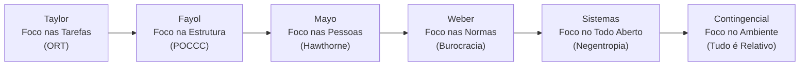
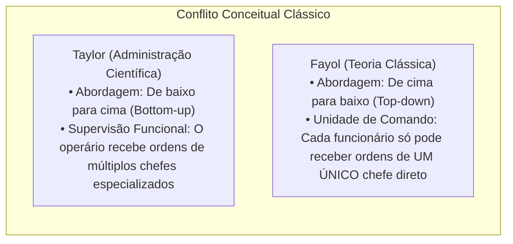
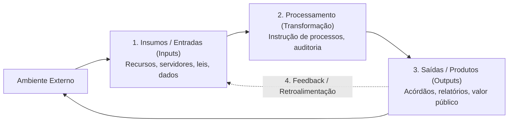
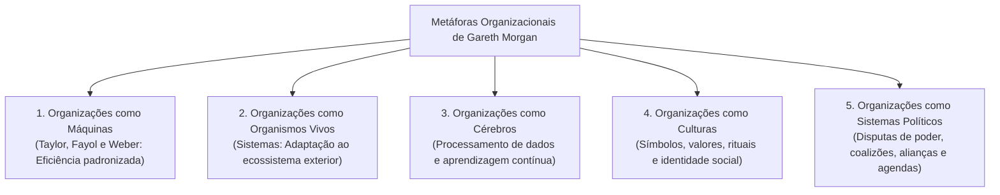

# 01 - Teorias da Administração, Escolas Administrativas e Metáforas Organizacionais

> **Matéria:** Administração Geral  
> **Cargo:** A01 – Técnico de Controle Externo – Especialidade: Técnico Administrativo  
> **Arquivo:** `01_teorias_da_administracao_e_escolas_administrativas.md`  

---

## 📌 Ementa / Itens do Edital
- Evolução histórica do pensamento administrativo e das escolas da Teoria Geral da Administração (TGA):
  - **Administração Científica (Frederick W. Taylor):** Organização Racional do Trabalho (ORT), estudo dos tempos e movimentos, fadiga, divisão do trabalho e especialização do operário, incentivos salariais por peça (*Homo Economicus*), padronização e supervisão funcional;
  - **Teoria Clássica da Administração (Henri Fayol):** visão anatômica da empresa, as seis funções básicas da empresa, funções do administrador (POCCC - Prever, Organizar, Comandar, Coordenar e Controlar) e os 14 princípios gerais da administração (ênfase na Unidade de Comando e Unidade de Direção);
  - **Teoria das Relações Humanas (Elton Mayo):** a Experiência de Hawthorne, o *Homo Socialis*, grupos informais, relevância dos fatores psicossociais e normas do grupo sobre a produtividade;
  - **Teoria da Burocracia (Max Weber):** tipos de dominação legítima (tradicional, carismática e racional-legal); características do modelo burocrático e disfunções da burocracia (Robert Merton);
  - **Teoria Neoclássica (Peter Drucker):** princípios gerais redefinidos, ecletismo, foco nos objetivos práticos e Administração por Objetivos (APO);
  - **Teoria Comportamental (Behaviorismo):** McGregor (Teoria X versus Teoria Y), Chester Barnard (organização como sistema cooperativo e aceitação da autoridade) e Herbert Simon (processo decisório e racionalidade limitada);
  - **Teoria Geral dos Sistemas (Bertalanffy, Katz & Kahn):** a organização como sistema aberto, insumos, processamento, saídas, retroalimentação (*feedback*), entropia negativa, homeostase dinâmica e equifinalidade;
  - **Teoria Contingencial:** abordagem situacional, ausência de princípios universais ("tudo é relativo"), estruturas mecanicistas versus orgânicas (Burns & Stalker) e influência da tecnologia (Woodward) e do ambiente (Lawrence & Lorsch);
- Metáforas organizacionais (Gareth Morgan): imagens da organização (máquinas, organismos, cérebros, culturas, sistemas políticos e prisões psíquicas).

---

## 🌳 Classificação Hierárquica

```text
1. Teorias da Administração e Evolução do Pensamento Administrativo
├── 1.1 As Abordagens Clássicas da Administração
│   ├── 1.1.1 Administração Científica (Frederick W. Taylor - 1911):
│   │   ├── Foco nas TAREFAS (Chão de fábrica; abordagem bottom-up)
│   │   ├── Organização Racional do Trabalho (ORT): Tempos e movimentos, fadiga e especialização
│   │   ├── Concepção do Homem: Homo Economicus (motivado unicamente pelo ganho financeiro)
│   │   └── Supervisão Funcional: Múltiplos supervisores especializados por operário
│   └── 1.1.2 Teoria Clássica (Henri Fayol - 1916):
│       ├── Foco na ESTRUTURA global da empresa (Abordagem top-down)
│       ├── As 6 Funções da Empresa: Técnicas, Comerciais, Financeiras, Segurança, Contábeis e Administrativas
│       ├── Funções do Administrador (POCCC): Prever, Organizar, Comandar, Coordenar e Controlar
│       └── Os 14 Princípios Gerais: Destaque para Unidade de Comando e Cadeia Escalar
├── 1.2 Abordagem Humanística e Comportamental
│   ├── 1.2.1 Teoria das Relações Humanas (Elton Mayo - 1932):
│   │   ├── Foco nas PESSOAS e grupos sociais; Experiência de Hawthorne
│   │   ├── O trabalhador como Homo Socialis (motivado pela integração e reconhecimento do grupo)
│   │   └── Descoberta da Organização Informal: Relações afetivas e lideranças informais
│   └── 1.2.2 Teoria Comportamental (Behaviorismo):
│       ├── Douglas McGregor: Teoria X (homem indolente e controlado) vs. Teoria Y (homem criativo e proativo)
│       ├── Chester Barnard: Organização como sistema cooperativo e Teoria da Aceitação da Autoridade
│       └── Herbert Simon: Teoria da Racionalidade Limitada e o Homem Administrativo
├── 1.3 Abordagens Estruturalista e Burocrática
│   ├── 1.3.1 Teoria da Burocracia (Max Weber):
│   │   ├── Tipos de Autoridade: Tradicional (costumes), Carismática (líder) e Racional-Legal (leis/normas)
│   │   ├── Pilares: Impessoalidade, formalismo, hierarquia rígida, mérito e completa previsibilidade
│   │   └── Disfunções da Burocracia (Merton): Apego às regras, papelório e deslocamento de objetivos
│   └── 1.3.2 Teoria Estruturalista: Visão integradora da organização formal e informal; conflito como elemento inevitável
├── 1.4 Abordagens Sistêmica e Contingencial
│   ├── 1.4.1 Teoria Geral dos Sistemas (Bertalanffy):
│   │   ├── A organização como Sistema Aberto em constante intercâmbio com o meio exterior
│   │   ├── Fluxo Sistêmico: Entradas (Inputs) -> Processamento -> Saídas (Outputs) -> Retroalimentação (Feedback)
│   │   └── Conceitos Nucleares: Entropia Negativa (Negentropia), Homeostase Dinâmica e Equifinalidade
│   └── 1.4.2 Teoria Contingencial (Abordagem Situacional):
│       ├── Inexistência de um modelo gerencial universal ótimo ("There is no one best way")
│       ├── Sistemas Mecanicistas (ambientes estáveis) vs. Sistemas Orgânicos (ambientes mutáveis)
│       └── Influência determinante do Ambiente Externo e da Tecnologia sobre a estrutura interna
└── 1.5 Metáforas Organizacionais de Gareth Morgan
    ├── 1.5.1 Organizações como Máquinas (Mecanicista - Taylor, Fayol e Weber)
    ├── 1.5.2 Organizações como Organismos Vivos (Biológica/Sistêmica - adaptação ambiental)
    ├── 1.5.3 Organizações como Cérebros (Processamento de dados e aprendizagem em ciclo duplo)
    └── 1.5.4 Organizações como Sistemas Políticos (Arenas de conflito, poder, coalizões e agendas)
```

---

## 📖 Resumo Teórico Aprofundado & Esquematizado

### 1. Quadro Comparativo das Escolas da Teoria Geral da Administração (TGA)



#### Tabela de Síntese Comparativa das Escolas:

| Teoria / Escola | Autor Principal | Ênfase / Foco Primário | Concepção do Homem | Características Centrais para Prova |
| :--- | :--- | :--- | :--- | :--- |
| **Administração Científica** | Frederick W. Taylor | **Nas Tarefas** (chão de fábrica). | *Homo Economicus* (motivado por dinheiro). | Estudo de tempos e movimentos (ORT); fragmentação do trabalho; supervisão funcional; eliminação de desperdícios. |
| **Teoria Clássica** | Henri Fayol | **Na Estrutura** organizacional global. | *Homo Economicus*. | Visão anatômica da empresa; funções do administrador (POCCC); 14 princípios gerais; **Unidade de Comando estrita**. |
| **Relações Humanas** | Elton Mayo | **Nas Pessoas** e nos grupos informais. | *Homo Socialis* (motivado pelo grupo). | Experiência de Hawthorne; integração social determina a produção; recompensas e sanções sociais no trabalho. |
| **Teoria da Burocracia** | Max Weber | **Nas Normas e na Estrutura**. | *Homo Burocraticus* (cumpridor de regras). | Autoridade racional-legal; formalismo, impessoalidade, meritocracia profissional e previsibilidade de conduta. |
| **Teoria Neoclássica** | Peter Drucker | **Nos Resultados** e objetivos práticos. | *Homem Organizacional*. | Ecletismo teórico; reafirmação dos princípios clássicos; Administração por Objetivos (APO). |
| **Teoria Comportamental** | McGregor / Herbert Simon | **No Comportamento Humano**. | *Homo Administrativus* (decisor sob limites). | Teoria X vs. Teoria Y; estudo da liderança, motivação humana e processo decisório com racionalidade limitada. |
| **Teoria dos Sistemas** | Ludwig von Bertalanffy | **No Ambiente e no Todo Integrado**. | *Homem Sistêmico*. | Organização como sistema aberto; interdependência de subsistemas; homeostase dinâmica e entropia negativa. |
| **Teoria Contingencial** | Woodward / Lawrence & Lorsch | **No Ambiente e na Tecnologia**. | *Homem Complexo*. | "Nada é absoluto, tudo é relativo"; inexiste modelo único ideal; sistemas mecanicistas vs. sistemas orgânicos. |

---

### 2. A Divergência Clássica: Taylor vs. Fayol

Apesar de contemporâneos e adeptos da visão mecanicista, Taylor e Fayol adotaram perspectivas opostas em relação à chefia e supervisão:



* **Funções do Administrador segundo Fayol (POCCC):**
  1. **Prever:** Visualizar o futuro e traçar o programa de ação.
  2. **Organizar:** Construir o duplo organismo material e social da empresa.
  3. **Comandar:** Dirigir e orientar o pessoal.
  4. **Coordenar:** Ligar, unir e harmonizar todos os atos e esforços coletivos.
  5. **Controlar:** Verificar se tudo ocorre de acordo com as regras e ordens dadas.

---

### 3. A Experiência de Hawthorne e a Teoria das Relações Humanas (Elton Mayo)

Realizada na fábrica da Western Electric Company (Chicago, 1927-1932), a pesquisa de Elton Mayo abalou os alicerces mecanicistas da Administração Científica ao demonstrar que:
1. **O nível de produção é determinado pela integração social:** Não é a capacidade física ou fisiológica do operário que define seu ritmo de trabalho, mas sim as normas sociais e a expectativa do grupo em que está inserido.
2. **Recompensas e Sanções Sociais:** O trabalhador teme a perda do afeto e a desaprovação dos colegas mais do que eventuais perdas financeiras parciais.
3. **Existência da Organização Informal:** Paralelamente à estrutura formal oficial de chefias, existe uma rede espontânea e invisível de relacionamentos, simpatias, antipatias e padrões morais informais.

---

### 4. A Teoria Geral dos Sistemas (TGS) nas Organizações



#### Conceitos Sistêmicos Fundamentais para Concursos:
* **Entropia:** Lei física natural pela qual qualquer sistema fechado caminha inevitavelmente para a desorganização, esgotamento e colapso funcional.
* **Entropia Negativa (Negentropia):** Capacidade exclusiva dos **sistemas abertos** de captar do ambiente externo energia, informações, recursos materiais e pessoas para neutralizar a deterioração e manter sua estrutura ativa e operante.
* **Homeostase Dinâmica:** Capacidade de autorregulação pela qual o sistema mantém seu equilíbrio interno e estabilidade diante de perturbações e oscilações do ambiente externo.
* **Equifinalidade:** Propriedade segundo a qual um sistema aberto pode atingir o mesmo estado final ou meta partindo de condições iniciais diferentes e seguindo caminhos completamente distintos.
* **Sinergia:** O efeito multiplicador do todo, pelo qual o resultado conjunto dos subsistemas integrados é superior à soma isolada das partes ($1 + 1 > 2$).

---

### 5. A Teoria Contingencial: Sistemas Mecanicistas vs. Orgânicos

Tom Burns e G. M. Stalker constataram que as práticas de gestão variam radicalmente de acordo com a estabilidade do ambiente externo:

| Dimensão | Sistemas Mecanicistas (Ambiente Estável) | Sistemas Orgânicos (Ambiente Instável/Dinâmico) |
| :--- | :--- | :--- |
| **Estrutura Organizacional** | Burocrática, verticalizada e rígida. | Flexível, horizontalizada e achatada. |
| **Divisão do Trabalho** | Tarefas altamente especializadas e fragmentadas. | Tarefas amplas, flexíveis e continuamente redefinidas. |
| **Cadeia de Comando** | Hierarquia de autoridade formal rígida. | Rede dinâmica de autoridade baseada no conhecimento. |
| **Fluxo de Comunicação** | Predominantemente vertical descendente (ordens). | Multidirecional (horizontal, diagonal e lateral). |
| **Tomada de Decisão** | Centralizada na alta cúpula diretiva. | Amplamente descentralizada na base operacional. |
| **Adequação Típica** | Mercados estáveis e previsíveis. | Mercados turbulentos, tecnológicos e de rápida mudança. |

---

### 6. As Metáforas Organizacionais de Gareth Morgan



---

## 🚨 Alertas de Prova & Pegadinhas da FCC

> 🚨 **ALERTA DE PROVA / PEGADINHA FCC (UNIDADE DE COMANDO VS. SUPERVISÃO FUNCIONAL):**  
> Questão favorita da FCC: misturar Taylor e Fayol!  
> - **Supervisão Funcional:** Defendida por **Taylor** (o operário responde a vários supervisores especialistas em cada função).  
> - **Unidade de Comando:** Defendida ferrenhamente por **Fayol** (cada funcionário só pode receber ordens de um único chefe direto, sob pena de gerar conflito e anarquia).

> ⭐ **IMPORTANTE (ENTROPIA NEGATIVA VS. HOMEOSTASE DINÂMICA):**  
> - **Entropia Negativa (Negentropia):** É o processo de **importar energia/recursos de fora** para não morrer (combate a deterioração natural).  
> - **Homeostase Dinâmica:** É a capacidade interna de **manter o equilíbrio estável**, adaptando-se às variações do ambiente.

> 🛑 **ATENÇÃO (CONCEPÇÃO DO HOMEM NAS ESCOLAS):**  
> Memorize as visões do ser humano adotadas pelas teorias:  
> - Administração Científica e Clássica: *Homo Economicus* (motivado apenas pelo dinheiro);  
> - Relações Humanas: *Homo Socialis* (motivado pela integração e aprovação grupal);  
> - Burocracia: *Homo Burocraticus* (cumpridor de regulamentos formais);  
> - Teoria Comportamental (Simon): *Homo Administrativus* (decisor de racionalidade limitada);  
> - Teoria Contingencial: *Homem Complexo* (comportamento moldado pelo contexto).

> 📌 **NOTA EXPLICATIVA (TEORIA CONTINGENCIAL E O "THE ONE BEST WAY"):**  
> Taylor pregava que existia a "única melhor maneira" (*the one best way*) de executar qualquer trabalho. A Teoria Contingencial **nega radicalmente** esse axioma, afirmando que **não existe um modelo gerencial único ou universalmente superior**, pois tudo depende do ambiente e da tecnologia.

---

## 🌐 Fontes Oficiais e Referências Bibliográficas

* [CHIAVENATO, Idalberto. Introdução à Teoria Geral da Administração: uma visão abrangente da moderna administração das organizações. 10ª Edição. Atlas.](https://www.grupogen.com.br).
* [FAYOL, Henri. Administração Industrial e Geral. Editora Atlas.](https://www.grupogen.com.br) - Princípios gerais e funções administrativas.
* [TAYLOR, Frederick Winslow. Princípios de Administração Científica. Editora Atlas.](https://www.grupogen.com.br).
* [MORGAN, Gareth. Imagens da Organização. Editora Atlas.](https://www.grupogen.com.br) - As metáforas organizacionais.
* [BERTALANFFY, Ludwig von. Teoria Geral dos Sistemas: Fundamentos, Desenvolvimento e Aplicações. Editora Vozes.](https://www.vozes.com.br).

---

## 📝 Questões de Concurso FCC Comentadas

### Questão 01
**(FCC – TCE-PI – Auditor de Controle Externo)**  
A respeito da evolução do pensamento administrativo e das premissas sustentadas pelas diferentes escolas da Teoria Geral da Administração, assinale a opção correta:

* **A)** A Teoria das Relações Humanas concebia o trabalhador como o *Homo Economicus*, sustentando que a produtividade fabril dependia exclusivamente dos estímulos pecuniários e incentivos salariais por peça produzida.
* **B)** A Teoria Contingencial defende a universalidade dos princípios administrativos, afirmando que existe uma única melhor maneira (*the one best way*) de gerenciar qualquer organização, independentemente do ambiente externo.
* **C)** A Teoria Geral dos Sistemas postula que as organizações operam como sistemas abertos dotados de entropia negativa, o que lhes permite importar recursos e informações do ambiente externo para conter a tendência natural de degradação e manter sua integridade interna.
* **D)** A Teoria Clássica preconizada por Henri Fayol refutou a unidade de comando, defendendo a supervisão funcional de múltiplos chefes proposta outrora pela administração científica.
* **E)** O modelo weberiano de burocracia baseia-se na autoridade carismática como esteio fundamental para a profissionalização e estabilidade do quadro funcional das organizações.

> **Gabarito: C**  
> **Comentário Detalhado:**  
> - **A) Incorreta.** O conceito de *Homo Economicus* pertence à Administração Científica (Taylor) e Teoria Clássica (Fayol). A Escola de Relações Humanas (Mayo) concebeu o trabalhador como **Homo Socialis** (motivado pelo grupo e integração social).  
> - **B) Incorreta.** A Teoria Contingencial rejeita a existência de princípios universais ou de uma "melhor maneira" única, afirmando que a estrutura adequada depende da tecnologia e do ambiente.  
> - **C) CORRETA.** Na Teoria Geral dos Sistemas, as organizações são concebidas como **sistemas abertos** que realizam trocas permanentes com o meio externo e possuem **entropia negativa (negentropia)**, ou seja, a capacidade de importar insumos e energia para deter o colapso e preservar a homeostase interna.  
> - **D) Incorreta.** Fayol era o defensor categórico da **Unidade de Comando** (um único chefe direto); a supervisão funcional pertencia a Taylor.  
> - **E) Incorreta.** A burocracia weberiana sustenta-se exclusivamente na **autoridade racional-legal** (leis, normas escritas e impessoalidade), e não na autoridade carismática.

---

### Questão 02
**(FCC – TCE-RS – Auditor de Controle Externo)**  
Em sua consagrada obra sobre metáforas organizacionais, Gareth Morgan analisa as diversas imagens conceituais utilizadas para compreender o funcionamento das instituições. Ao retratar a organização sob a metáfora de uma máquina, o autor alinha-se prioritariamente às ideias sustentadas por:

* **A)** Elton Mayo e a Escola das Relações Humanas.
* **B)** Frederick Taylor e Henri Fayol nas abordagens mecanicistas clássicas.
* **C)** Ludwig von Bertalanffy e a Teoria Geral dos Sistemas.
* **D)** Peter Senge e a teoria das organizações que aprendem.
* **E)** Joan Woodward e os teóricos da abordagem situacional contemporânea.

> **Gabarito: B**  
> **Comentário Detalhado:**  
> - **A) Incorreta.** Elton Mayo inaugurou a abordagem humanística focada no comportamento grupal e nas necessidades psicossociais.  
> - **B) CORRETA.** A **metáfora da máquina** proposta por Morgan reflete a concepção mecanicista do início do século XX encabeçada por **Taylor (Administração Científica)** e **Fayol (Teoria Clássica)**, na qual a instituição é planejada como uma engrenagem mecânica precisa, projetada para funcionar com rotina, previsibilidade e máxima eficiência padronizada.  
> - **C) Incorreta.** A Teoria dos Sistemas utiliza prioritariamente a metáfora dos organismos vivos.  
> - **D) Incorreta.** As organizações que aprendem (*learning organizations*) são retratadas sob a metáfora dos cérebros.  
> - **E) Incorreta.** A abordagem situacional enfatiza a adaptabilidade contingencial ao meio ambiente.

---

### Questão 03
**(FCC – TRT-20ª Região – Analista Judiciário: Área Administrativa)**  
Considere que um gestor público de departamento estadual dividiu as rotinas de trabalho em tarefas elementares repetitivas, cronometrou os tempos de digitação de cada processo e estipulou uma premiação pecuniária individual para os servidores que superassem a meta diária de processos autuados, partindo da premissa de que os indivíduos trabalham motivados exclusivamente pelo ganho monetário. Essa postura gerencial reflete diretamente os postulados da:

* **A)** Teoria das Relações Humanas e a busca pela integração grupal informal.
* **B)** Administração Científica de Taylor e a concepção do *Homo Economicus*.
* **C)** Teoria Estruturalista e a mediação de conflitos institucionais inevitáveis.
* **D)** Teoria Geral dos Sistemas e a busca pela homeostase dinâmica.
* **E)** Teoria Comportamental fundamentada na Teoria Y de Douglas McGregor.

> **Gabarito: B**  
> **Comentário Detalhado:**  
> - **A) Incorreta.** As Relações Humanas valorizam o reconhecimento social e os grupos informais, rejeitando a primazia do dinheiro como motivador único.  
> - **B) CORRETA.** A **Administração Científica de Frederick Taylor** baseava-se no estudo sistemático dos tempos e movimentos (ORT), fragmentação máxima das tarefas e estímulo pecuniário através do pagamento por produção individual, alicerçada no postulado antropológico do **Homo Economicus** (o ser humano é preguiçoso e move-se unicamente pela busca do ganho material/financeiro).  
> - **C) Incorreta.** A abordagem estruturalista foca na interação entre estruturas formais e informais e no papel dos conflitos.  
> - **D) Incorreta.** A teoria sistêmica foca no equilíbrio com o ambiente externo e fluxo de insumos/produtos.  
> - **E) Incorreta.** A Teoria Y de McGregor sustenta que as pessoas são naturalmente motivadas, criativas e buscam autorrealização no trabalho.

---

### Questão 04
**(FCC – SEFAZ-PE – Auditor Fiscal do Tesouro Estadual)**  
No âmbito da Teoria Burocrática desenvolvida por Max Weber, o modelo ideal de burocracia é fundamentado no tipo de dominação racional-legal. No entanto, autores pós-weberianos como Robert Merton identificaram que a aplicação prática desse modelo suscita desvios conhecidos como disfunções da burocracia. Constitui uma clássica disfunção bu описаada por Merton:

* **A)** A substituição da unidade de comando clássica pela supervisão funcional de múltiplos especialistas.
* **B)** A flexibilização excessiva das rotinas operacionais em resposta aos apelos emocionais dos cidadãos.
* **C)** O deslocamento de objetivos, em que a observância estrita das regras e normas procedimentais passa a ser um fim em si mesmo, prejudicando o atendimento dos objetivos reais da organização.
* **D)** A contratação indiscriminada de pessoal comissionado com base em laços de parentesco e afinidade pessoal.
* **E)** A proliferação descontrolada de grupos informais que ditam os padrões de produtividade à revelia da administração.

> **Gabarito: C**  
> **Comentário Detalhado:**  
> - **A) Incorreta.** A supervisão funcional é uma proposta da Administração Científica de Taylor, não uma disfunção da burocracia de Merton.  
> - **B) Incorreta.** A burocracia peca pelo excesso de rigidez e apego às regras, e não por flexibilização emocional.  
> - **C) CORRETA.** Robert Merton demonstrou que o apego cego e intransigente aos regulamentos provoca o **deslocamento de objetivos**: a regra, que deveria ser um mero instrumento para atingir o fim público, transforma-se no objetivo primordial do funcionário. O cumprimento formal da norma passa a valer mais do que a solução do problema do cidadão.  
> - **D) Incorreta.** Contratação por compadrio é traço típico do patrimonialismo, e não disfunção da burocracia (que preconiza o concurso público e mérito técnico).  
> - **E) Incorreta.** A ação de grupos informais foi evidenciada por Elton Mayo na Teoria das Relações Humanas.

---

### Questão 05
**(FCC – DPE-RS – Analista: Área Administrativa)**  
Estudos conduzidos por Tom Burns e G. M. Stalker, no âmbito da Teoria Contingencial, demonstraram que o desenho das organizações deve ajustar-se às demandas do ambiente externo, dividindo os sistemas gerenciais em mecanicistas e orgânicos. Em relação a essas duas tipologias, é correto afirmar:

* **A)** Organizações que operam sob sistemas mecanicistas caracterizam-se por estruturas descentralizadas, canais de comunicação horizontais e adaptação veloz a ambientes altamente turbulentos.
* **B)** Os sistemas orgânicos são recomendados prioritariamente para organizações inseridas em ambientes externos estáveis e previsíveis, com tarefas rotineiras e imutáveis.
* **C)** Os sistemas mecanicistas caracterizam-se por hierarquia rígida, especialização acentuada das tarefas, centralização das decisões e adequação a ambientes externos estáveis.
* **D)** A teoria contingencial preconiza que as estruturas orgânicas devem ser adotadas universalmente por todas as entidades públicas, independentemente do contexto tecnológico ou ambiental.
* **E)** As organizações que adotam sistemas orgânicos eliminam integralmente a divisão do trabalho e suprimem as metas institucionais de longo prazo.

> **Gabarito: C**  
> **Comentário Detalhado:**  
> - **A) Incorreta.** Descentralização, comunicação horizontal e adaptabilidade rápida a ambientes dinâmicos são atributos dos sistemas **orgânicos**.  
> - **B) Incorreta.** Ambientes estáveis e previsíveis ajustam-se melhor aos sistemas **mecanicistas**.  
> - **C) CORRETA.** Segundo Burns e Stalker, os **sistemas mecanicistas** são marcados por hierarquia vertical estrita, autoridade centralizada na cúpula, tarefas fragmentadas e rotinas padronizadas, sendo ideais para ambientes externos **estáveis e previsíveis**.  
> - **D) Incorreta.** A Teoria Contingencial rechaça receitas universais; a escolha entre modelo mecanicista ou orgânico é situacional e depende das contingências externas.  
> - **E) Incorreta.** Os sistemas orgânicos mantêm a divisão de trabalho e os objetivos estratégicos, apenas operando com maior flexibilidade e integração de papéis.
