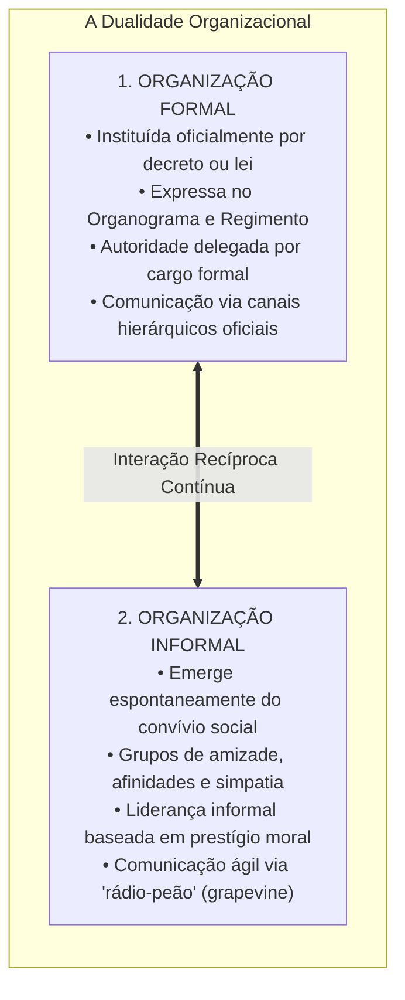
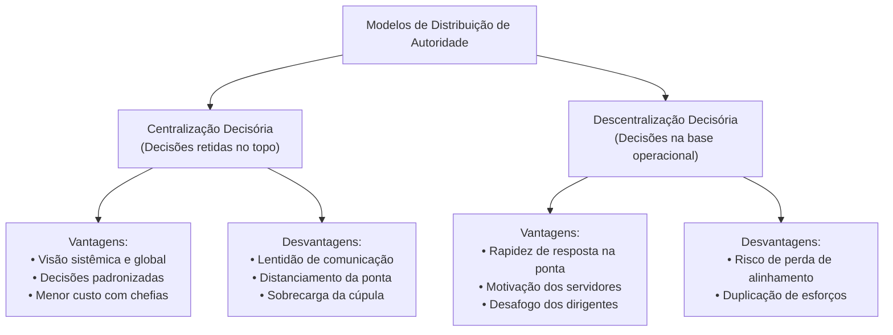
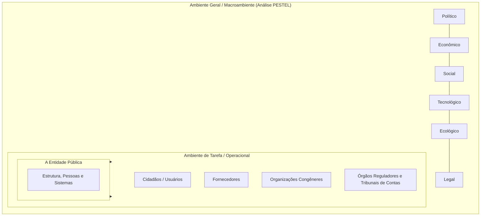

# 02 - Organização Racional do Trabalho (ORT), Eficiência, Eficácia, Estruturas e Ambientes

> **Matéria:** Administração Geral  
> **Cargo:** A01 – Técnico de Controle Externo – Especialidade: Técnico Administrativo  
> **Arquivo:** `02_organizacao_racional_do_trabalho_estruturas_e_ambientes.md`  

---

## 📌 Ementa / Itens do Edital
- Organização Racional do Trabalho (ORT): fundamentos da abordagem de Frederick Taylor:
  - Estudo dos tempos e movimentos (*Motion Study* de Frank e Lillian Gilbreth);
  - Estudo da fadiga humana e ergonomia inicial;
  - Divisão do trabalho e especialização extrema do operário;
  - Desenho de cargos e tarefas simples, fragmentadas e repetitivas;
  - Incentivos salariais e prêmios de produção por peça produzida (*Homo Economicus*);
  - Condições ambientais de trabalho (iluminação, ventilação e conforto físico);
  - Padronização de métodos, ferramentas e instrumentos;
  - Supervisão funcional especializada;
- A dicotomia clássica entre Eficiência e Eficácia (visões de Chester Barnard e Peter Drucker):
  - Eficiência: ênfase nos meios, métodos, custos, economia de insumos e processos (*doing things right*);
  - Eficácia: ênfase nos fins, resultados, objetivos e alcance de metas quantitativas (*doing the right things*);
  - A busca pela Efetividade no setor público (impacto e sustentabilidade social);
- Organizações Formais versus Organizações Informais:
  - Organização Formal: deliberadamente planejada, representada pelo organograma oficial, regimentos, hierarquia e manuais;
  - Organização Informal: emerge espontaneamente das relações sociais, interesses comuns, liderança informal e redes de comunicação lateral (*rádio-peão / grapevine*);
- Centralização versus Descentralização:
  - Centralização da autoridade: vantagens (visão holística, uniformidade de decisões e menor custo de chefias) e desvantagens (lentidão e distanciamento da realidade da ponta);
  - Descentralização da autoridade: vantagens (agilidade na ponta, motivação dos níveis inferiores e alívio da cúpula) e desvantagens (risco de desalinhamento e duplicação de estruturas);
  - Princípios da delegação: a autoridade se delega, mas a responsabilidade última permanece com o superior delegante;
- Ambientes Organizacionais:
  - Ambiente Geral (Macroambiente): forças PESTEL (Políticas, Econômicas, Sociais, Tecnológicas, Ecológicas e Legais);
  - Ambiente de Tarefa (Microambiente / Ambiente Operacional): clientes/cidadãos, fornecedores, concorrentes e órgãos reguladores e de fiscalização externa.

---

## 🌳 Classificação Hierárquica

```text
2. ORT, Eficiência vs. Eficácia, Dinâmica Organizacional e Ambientes
├── 2.1 A Organização Racional do Trabalho (ORT - Taylorismo)
│   ├── 2.1.1 Análise do Trabalho e Estudo dos Tempos e Movimentos (Therbligs)
│   ├── 2.1.2 Estudo da Fadiga Humana: Ergonomia embrionária e eliminação de movimentos inúteis
│   ├── 2.1.3 Divisão do Trabalho e Especialização do Operário: Linha seriada de produção
│   ├── 2.1.4 Desenho de Cargos e Tarefas: Tarefas elementares, repetitivas e rápida qualificação
│   ├── 2.1.5 Incentivos Salariais e Remuneração por Produção: Postulado do Homo Economicus
│   ├── 2.1.6 Padronização: A única melhor maneira (The one best way) de fazer o trabalho
│   └── 2.1.7 Supervisão Funcional: Separação de autoridade por especialidade técnica
├── 2.2 Eficiência, Eficácia e Efetividade Organizacional
│   ├── 2.2.1 Eficiência: Foco nos MEIOS, insumos e custos. Fazer certo as coisas (menor desperdício)
│   ├── 2.2.2 Eficácia: Foco nos FINS e resultados. Fazer as coisas certas (alcance das metas planejadas)
│   └── 2.2.3 Efetividade: Foco no IMPACTO social e transformação da realidade do cidadão
├── 2.3 Dinâmica das Organizações Formais e Informais
│   ├── 2.3.1 Organização Formal:
│   │   ├── Planejada pela cúpula institucional e retratada no organograma regimental
│   │   └── Cadeia formal de comando, regulamentos internos e linhas oficiais de comunicação
│   └── 2.3.2 Organização Informal:
│       ├── Rede de relacionamentos interpessoais espontâneos não previstos formalmente
│       ├── Grupos de interesse, laços de amizade e camaradagem
│       ├── Liderança Informal (baseada no carisma e na confiança, sem cargo oficial)
│       └── Canais Informais de Comunicação (Rádio-peão / Grapevine)
├── 2.4 Centralização, Descentralização e o Processo de Delegação
│   ├── 2.4.1 Centralização Decisória: Concentração do poder decisório no ápice da hierarquia
│   ├── 2.4.2 Descentralização Decisória: Dispersão do poder decisório para os níveis operacionais
│   └── 2.4.3 Regra Áurea da Delegação:
│       ├── Delega-se a AUTORIDADE e a execução da tarefa ao subordinado
│       └── A RESPONSABILIDADE pelo resultado perante a cúpula permanece INDELEGÁVEL
└── 2.5 Ambientes Organizacionais: Macroambiente vs. Microambiente
    ├── 2.5.1 Ambiente Geral / Macroambiente: Forças genéricas comuns (Análise PESTEL)
    └── 2.5.2 Ambiente de Tarefa / Operacional: O nicho de atuação direta (cidadãos, fornecedores e controle)
```

---

## 📖 Resumo Teórico Aprofundado & Esquematizado

### 1. Os Nove Pilares da Organização Racional do Trabalho (ORT)

Frederick W. Taylor desenvolveu a ORT no início do século XX com a missão de substituir o empirismo rudimentar dos operários pela sistematização científica do trabalho:


#### Detalhamento dos Componentes da ORT:
* **Estudo dos Tempos e Movimentos:** Decomposição de cada tarefa em movimentos corporais elementares (*therbligs*, conceito introduzido pelo casal Gilbreth) para eliminar movimentos inúteis e fixar o tempo-padrão de execução.
* **Homo Economicus:** Concepção antropológica de que o ser humano é indolente por natureza e busca unicamente o ganho financeiro individual, sendo estimulado a produzir mais pelo pagamento por peça produzida.
* **Supervisão Funcional:** Taylor refutou a chefia militar centralizada e propôs que cada operário tivesse múltiplos supervisores, cada qual especialista em um aspecto específico do trabalho (ex.: velocidade da máquina, manutenção, controle de qualidade, instruções de abastecimento).

---

### 2. A Dicotomia Conceitual: Eficiência vs. Eficácia vs. Efetividade

A distinção entre eficiência e eficácia, magistralmente sintetizada por Peter Drucker e Chester Barnard, é um dos temas mais recorrentes nos concursos da FCC:

$$\mathbf{\text{Eficiência} = \text{"Fazer certo as coisas"} \quad (\textit{Doing things right})}$$
$$\mathbf{\text{Eficácia} = \text{"Fazer as coisas certas"} \quad (\textit{Doing the right things})}$$

```mermaid
flowchart LR
    Recursos["Recursos / Insumos<br/>(Custos, tempo, pessoas)"] -->|EFICIÊNCIA<br/>(Foco nos Meios)| Processo["Processamento / Métodos<br/>(Fazer certo as coisas)"]
    Processo -->|EFICÁCIA<br/>(Foco nos Fins)| Metas["Resultados / Metas<br/>(Fazer as coisas certas)"]
    Metas -->|EFETIVIDADE<br/>(Foco no Impacto)| Impacto["Impacto Social<br/>(Transformação duradoura)"]
```

#### Tabela Comparativa Analítica:

| Dimensão | Eficiência | Eficácia | Efetividade |
| :--- | :--- | :--- | :--- |
| **Foco Estratégico** | **Nos Meios** (métodos, tempo, custos e recursos). | **Nos Fins** (metas atingidas, objetivos entregues). | **No Impacto** (transformação duradoura da realidade). |
| **Pergunta-Chave** | *Como* estamos fazendo? Há economia de recursos? | *O que* estamos entregando? Atingimos a meta planejada? | *Qual* benefício social real foi gerado para o cidadão? |
| **Exemplo no Setor Público** | Reduzir o custo de papel e impressoras ao digitalizar processos no TCE-GO. | Concluir 1.000 auditorias orçamentárias dentro do cronograma do exercício. | Reduzir a corrupção e recuperar recursos públicos desviados para a saúde. |

> 💡 **DICA DE ESTUDO (A EQUAÇÃO DO SUCESSO):**  
> - **Eficiente e Ineficaz:** O setor público gasta pouquíssimo dinheiro e analisa processos com extrema rapidez, mas analisa processos errados ou omite irregularidades graves.  
> - **Ineficiente e Eficaz:** O órgão atinge a meta de construir a escola, mas estoura o orçamento em 200% e desperdiça materiais.  
> - **Efetivo:** O órgão constrói a escola no prazo e custo adequados, e as crianças da região passam a ter melhor desempenho no aprendizado!

---

### 3. Dinâmica das Organizações Formais e Informais

Toda instituição humana possui uma dupla dimensão que convive em interação permanente:



* **A Origem Sociológica da Organização Informal:** Ficou demonstrada na famosa **Experiência de Hawthorne (1927-1932)** liderada por Elton Mayo. Verificou-se que a produtividade e a moral dos funcionários dependem intrinsecamente do clima afetivo do grupo informal e da aceitação mútua entre os pares.
* **A Rádio-Peão (*Grapevine*):** É a rede informal de comunicação. É extremamente veloz e atende à necessidade humana de troca de informações, embora possa disseminar boatos quando a comunicação formal oficial do órgão for precária ou omissa.

---

### 4. Centralização vs. Descentralização e a Regra da Delegação



#### A Regra Áurea da Delegação de Autoridade:
* **O que se delega:** Delega-se a **autoridade formal** e a **atribuição de executar a tarefa**.
* **O que NUNCA se delega:** A **responsabilidade final perante a organização permanece INDELEGÁVEL**! O gestor que delega continua sendo plenamente responsável pelas falhas ou sucessos cometidos pelo subordinado a quem conferiu poderes.

---

### 5. Ambientes Organizacionais: Geral (Macro) vs. Tarefa (Micro)



* **Ambiente Geral (Macroambiente):** Conjunto abrangente de condições genéricas externas que afetam indistintamente todas as organizações de uma sociedade. É mapeado pela matriz **PESTEL** (Políticas, Econômicas, Sociais, Tecnológicas, Ecológicas e Legais).
* **Ambiente de Tarefa (Ambiente Operacional):** É o nicho específico e imediato no qual o órgão público interage cotidianamente. É constituído por: cidadãos-usuários atendidos, fornecedores licitantes de bens e serviços, entidades reguladoras e órgãos de controle externo (TCE-GO, MP, etc.).

---

## 🚨 Alertas de Prova & Pegadinhas da FCC

> 🚨 **ALERTA DE PROVA / PEGADINHA FCC (DELEGAÇÃO DE RESPONSABILIDADE):**  
> Questão certíssima da FCC: afirmar que "ao delegar a execução de uma fiscalização contábil a um auditor, o chefe da diretoria exime-se integralmente de sua responsabilidade funcional". **FALSO!** A delegação transfere a **autoridade executiva**, mas a **responsabilidade pelo resultado final permanece com o delegante**.

> ⭐ **IMPORTANTE (EFICIÊNCIA VS. EFICÁCIA NAS NARRATIVAS DE PROVA):**  
> Identifique os gatilhos no enunciado:  
> - Se o texto destaca "custos reduzidos, menos horas gastas, processos sem desperdício de papel", está falando de **EFICIÊNCIA**.  
> - Se o texto destaca "meta de 100% de processos julgados alcançada, prazo final cumprido", está falando de **EFICÁCIA**.  
> - Se o texto destaca "o analfabetismo foi erradicado no município após as ações escolares", está falando de **EFETIVIDADE**.

> 🛑 **ATENÇÃO (ORT E A CONCEPÇÃO DO TRABALHADOR):**  
> Lembre-se sempre de que Taylor fundamentava toda a sua ORT no conceito do **Homo Economicus** (o homem é movido por prêmios financeiros e dinheiro). Se a questão falar que Taylor valorizou a auto-realização ou a motivação social, a alternativa está errada!

> 📌 **NOTA EXPLICATIVA (ORGANIZAÇÃO INFORMAL NÃO É CRIME):**  
> A organização informal é a expressão sociológica natural do convívio humano (redes de amizade e camaradagem no setor). Administradores inteligentes não tentam suprimi-la, mas sim integrá-la positivamente à cultura do órgão público.

---

## 🌐 Fontes Oficiais e Referências Bibliográficas

* [CHIAVENATO, Idalberto. Introdução à Teoria Geral da Administração. 10ª Edição. Editora Atlas.](https://www.grupogen.com.br) - Capítulos sobre a ORT, Estruturas e Dinâmica Organizacional.
* [DRUCKER, Peter F. Prática da Administração de Empresas. Pioneira Thomson Learning.](https://www.grupogen.com.br) - Conceituação de Eficiência e Eficácia.
* [BARNARD, Chester I. As Funções do Executivo. Editora Atlas.](https://www.grupogen.com.br) - A dinâmica da cooperação e organização informal.
* [MAXIMIANO, Antonio Cesar Amaru. Teoria Geral da Administração: da revolução urbana à revolução digital. Atlas.](https://www.grupogen.com.br).

---

## 📝 Questões de Concurso FCC Comentadas

### Questão 01
**(FCC – TCE-PI – Auditor de Controle Externo)**  
A respeito da Organização Racional do Trabalho (ORT) desenvolvida por Frederick Winslow Taylor e das características da abordagem clássica da administração, assinale a assertiva correta:

* **A)** A ORT propunha que os operários determinassem livremente seus próprios métodos operacionais de trabalho, eliminando qualquer forma de padronização industrial.
* **B)** A teoria partia da premissa do *Homo Socialis*, sustentando que os operários trabalhavam motivados preponderantemente pelo bem-estar afetivo e harmonia do grupo informal.
* **C)** O estudo dos tempos e movimentos objetivava decompor as tarefas fabris em operações elementares para eliminar movimentos desnecessários e determinar o tempo-padrão de execução.
* **D)** Taylor defendia a preservação estrita do capataz geral de fábrica com comando único, condenando a divisão da supervisão em funções especializadas.
* **E)** A fadiga humana era ignorada pela ORT por ser considerada um fenômeno psicológico irrelevante para a produtividade fabril.

> **Gabarito: C**  
> **Comentário Detalhado:**  
> - **A) Incorreta.** A ORT combatia a improvisação empírica dos operários, impondo métodos padronizados cientificamente planejados pela gerência.  
> - **B) Incorreta.** Taylor adotava a concepção do **Homo Economicus** (o ser humano é motivado pelo ganho financeiro individual por peça produzida).  
> - **C) CORRETA.** O estudo dos tempos e movimentos (sistematizado por Taylor e aprofundado pelos Gilbreth) constituía a viga-mestra da ORT: fragmentar a tarefa em micromovimentos elementares, erradicar movimentos inúteis e fixar o tempo-padrão de execução para a melhor maneira científica de trabalhar (*the one best way*).  
> - **D) Incorreta.** Taylor propunha a **supervisão funcional** (múltiplos supervisores especializados), rompendo com o princípio do chefe militar único.  
> - **E) Incorreta.** O estudo da fadiga humana era um dos pilares centrais da ORT para evitar a exaustão física do operário e garantir a cadência do trabalho.

---

### Questão 02
**(FCC – TCE-RS – Auditor de Controle Externo)**  
Determinada unidade de fiscalização governamental realizou uma auditoria utilizando técnicas modernas de amostragem eletrônica, reduzindo o custo operacional em 40% e concluindo os trabalhos na metade do tempo médio histórico previsto. Não obstante a velocidade e economia de recursos empregados, o relatório final omitiu as irregularidades materiais mais graves que assolavam o órgão auditado, inviabilizando a responsabilização dos gestores ímprobos. Sob a ótica das teorias da administração:

* **A)** O trabalho da equipe foi altamente eficiente e eficaz, visto que atendeu aos parâmetros de produtividade estipulados pela chefia.
* **B)** A unidade atuou com eficiência no uso dos recursos e métodos, contudo foi ineficaz no tocante ao alcance do objetivo finalístico primordial da fiscalização.
* **C)** A equipe demonstrou alta eficácia operacional aliada à total ineficiência metodológica.
* **D)** A omissão decorreu exclusivamente da atuação autônoma da organização informal da equipe técnica.
* **E)** O resultado comprova a inadequação da departamentalização funcional nos órgãos de controle público.

> **Gabarito: B**  
> **Comentário Detalhado:**  
> - **A) Incorreta.** A equipe não foi eficaz, uma vez que falhou em atingir o objetivo primordial da fiscalização (detectar e apontar as irregularidades materiais).  
> - **B) CORRETA.** A equipe foi **eficiente** (minimizou o uso de insumos, cortou custos em 40% e poupou tempo - foco excelente nos meios), porém foi **ineficaz** (não alcançou o objetivo finalístico proposto, falhando na entrega do resultado material substantivo - foco nos fins).  
> - **C) Incorreta.** Ocorreu exatamente o oposto: houve alta eficiência nos meios e ineficácia nos fins.  
> - **D) Incorreta.** A omissão traduz um erro técnico de execução processual, e não efeito puro da organização informal.  
> - **E) Incorreta.** O caso não aborda modelos de departamentalização, mas sim a distinção clássica entre eficiência e eficácia.

---

### Questão 03
**(FCC – TRT-2ª Região – Analista Judiciário: Área Administrativa)**  
No tocante à dinâmica da delegação de competências e à centralização versus descentralização administrativa nas organizações formais, assinale a opção correta:

* **A)** A descentralização decisória implica concentrar a tomada de decisões na diretoria executiva, garantindo que os gestores operacionais executem tarefas sem qualquer margem de arbítrio.
* **B)** Ao realizar a delegação de atribuições para um servidor subalterno, a autoridade delegante transfere simultaneamente o poder de decisão e a responsabilidade final pelo resultado, eximindo-se de qualquer prestação de contas.
* **C)** A descentralização proporciona maior rapidez na tomada de decisões no ponto de atendimento ao cidadão e eleva a motivação das equipes operacionais.
* **D)** A centralização tem como principal desvantagem a duplicação generalizada de custos operacionais e a proliferação descontrolada de órgãos descentralizados.
* **E)** A delegação de autoridade no serviço público é vedada pelo princípio da hierarquia institucional previsto na Constituição Federal.

> **Gabarito: C**  
> **Comentário Detalhado:**  
> - **A) Incorreta.** Concentrar decisões no topo da cúpula é a definição de **centralização**, e não de descentralização.  
> - **B) Incorreta.** Regra basilar de administração: **a responsabilidade final pelo resultado perante a organização é indelegável**. Delega-se a autoridade e a execução da tarefa, mas o gestor delegante responde perante a instituição pelas falhas cometidas pelo delegado.  
> - **C) CORRETA.** A **descentralização** aproxima a decisão do local onde o problema ocorre (a base operacional/ponta), conferindo agilidade de resposta às demandas dos cidadãos e motivando os servidores locais que passam a exercer autonomia funcional.  
> - **D) Incorreta.** Duplicação de esforços é desvantagem eventual da descentralização. A desvantagem da centralização é a lentidão decisória e o estrangulamento da cúpula.  
> - **E) Incorreta.** A delegação é amplamente autorizada e recomendada pelo direito administrativo e pelo princípio da eficiência (ex.: Lei Federal nº 9.784/1999 e Lei Estadual nº 13.800/2001).

---

### Questão 04
**(FCC – DPE-RS – Analista: Área Administrativa)**  
Em relação ao estudo dos ambientes organizacionais e sua influência sobre o funcionamento das instituições públicas, é correto afirmar que:

* **A)** O ambiente de tarefa é composto por forças macroscópicas universais, tais como taxas de inflação, fatores climáticos e mudanças sociodemográficas nacionais.
* **B)** O macroambiente (ambiente geral) abrange os agentes com os quais a organização interage direta e cotidianamente, tais como seus usuários, prestadores de serviços contratados e órgãos de fiscalização imediata.
* **C)** Os fornecedores de tecnologia da informação contratados pelo tribunal e os cidadãos jurisdicionados compõem o ambiente de tarefa (microambiente) do órgão público.
* **D)** A análise PESTEL destina-se a mensurar exclusivamente as variáveis psicológicas e comportamentais da organização informal no ambiente interno.
* **E)** As organizações que atuam em ambientes de tarefa dinâmicos e imprevisíveis devem adotar estruturas estritamente burocráticas e centralizadas para mitigar riscos operacionais.

> **Gabarito: C**  
> **Comentário Detalhado:**  
> - **A) Incorreta.** Inflação, clima e demografia compõem o **ambiente geral (macroambiente)**, e não o ambiente de tarefa.  
> - **B) Incorreta.** Usuários, fornecedores e órgãos fiscalizadores integram o **ambiente de tarefa (microambiente)**.  
> - **C) CORRETA.** O **ambiente de tarefa (ou microambiente operacional)** é o nicho direto com o qual a instituição pública se relaciona cotidianamente para desempenhar sua missão: nele estão inseridos os cidadãos-usuários (jurisdicionados), os fornecedores contratados e as entidades reguladoras e controladoras.  
> - **D) Incorreta.** A matriz PESTEL analisa o macroambiente externo (variáveis Políticas, Econômicas, Sociais, Tecnológicas, Ecológicas e Legais).  
> - **E) Incorreta.** Em ambientes dinâmicos e imprevisíveis, a teoria contingencial recomenda estruturas **orgânicas** (flexíveis e descentralizadas), e não burocráticas mecanicistas.

---

### Questão 05
**(FCC – ARTESP – Especialista em Regulação de Transportes)**  
A respeito da organização formal e da organização informal no cotidiano das instituições públicas, assinale a opção correta:

* **A)** A organização informal deve ser formalmente dissolvida pelos gestores por meio de sanções disciplinares, pois é incompatível com o princípio constitucional da eficiência.
* **B)** A organização formal é aquela planejada pela cúpula e oficializada em atos normativos, enquanto a organização informal decorre da rede espontânea de interações sociais e afetivas entre os colaboradores.
* **C)** A liderança informal coincide compulsoriamente com a autoridade formal atribuída aos servidores nomeados para cargos de direção e chefia.
* **D)** Os canais informais de comunicação (rádio-peão) transmitem informações de forma mais lenta e burocrática do que os canais hierárquicos regimentais.
* **E)** O organograma regimental de uma instituição representa graficamente tanto as linhas de comando formal quanto as redes de solidariedade da organização informal.

> **Gabarito: B**  
> **Comentário Detalhado:**  
> - **A) Incorreta.** A organização informal é um fenômeno social espontâneo, natural e impossível de ser extirpado pela via disciplinar; gestores eficientes aprendem a conviver com ela e a canalizar seu potencial.  
> - **B) CORRETA.** A **organização formal** é desenhada deliberadamente pela direção, oficializada em regulamentos, manuais e organogramas; em contrapartida, a **organização informal** surge espontaneamente da convivência entre as pessoas, laços de amizade, identificação mútua e costumes compartilhados.  
> - **C) Incorreta.** A liderança informal é conquistada pelo carisma, respeito e confiança dos colegas, podendo ser exercida por servidores sem qualquer cargo de chefia formal.  
> - **D) Incorreta.** A comunicação informal é notoriamente veloz, contornando a burocracia dos canais formais.  
> - **E) Incorreta.** O organograma retrata exclusivamente a estrutura **formal** (departamentos e linhas hierárquicas oficiais), sendo incapaz de mapear as redes informais.
