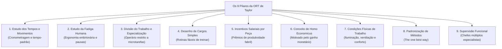
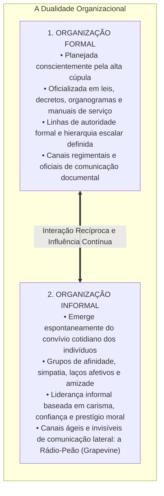
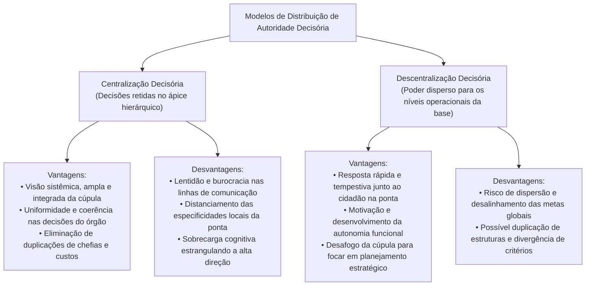
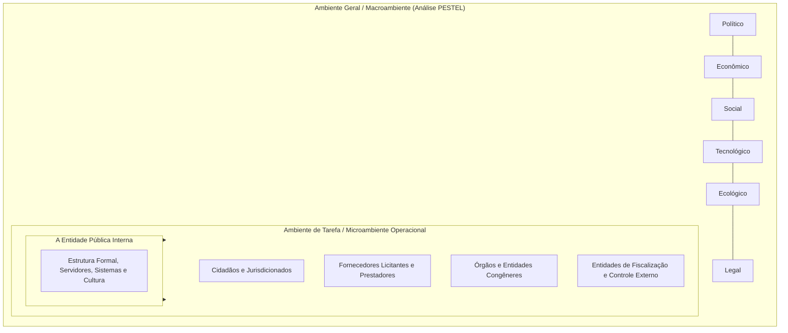

# 02 - Organização Racional do Trabalho (ORT), Eficiência, Eficácia, Estruturas e Ambientes

> **Matéria:** Administração Geral  
> **Cargo:** A01 – Técnico de Controle Externo – Especialidade: Técnico Administrativo  
> **Arquivo:** `02_organizacao_racional_do_trabalho_estruturas_e_ambientes.md`  


---


## 📌 Ementa / Itens do Edital
- Organização Racional do Trabalho (ORT): fundamentos da abordagem de Frederick Taylor:
    - Estudo dos tempos e movimentos (*Motion Study* de Frank e Lillian Gilbreth);
    - Estudo da fadiga humana e ergonomia inicial;
    - Divisão do trabalho e especialização extrema do operário;
    - Desenho de cargos e tarefas simples, fragmentadas e repetitivas;
    - Incentivos salariais e prêmios de produção por peça produzida (*Homo Economicus*);
    - Condições ambientais de trabalho (iluminação, ventilação e conforto físico);
    - Padronização de métodos, ferramentas e instrumentos;
    - Supervisão funcional especializada;
- A dicotomia clássica entre Eficiência e Eficácia (visões de Chester Barnard e Peter Drucker):
    - Eficiência: ênfase nos meios, métodos, custos, economia de insumos e processos (*doing things right*);
    - Eficácia: ênfase nos fins, resultados, objetivos e alcance de metas quantitativas (*doing the right things*);
    - A busca pela Efetividade no setor público (impacto e sustentabilidade social);
- Organizações Formais versus Organizações Informais:
    - Organização Formal: deliberadamente planejada, representada pelo organograma oficial, regimentos, hierarquia e manuais;
    - Organização Informal: emerge espontaneamente das relações sociais, interesses comuns, liderança informal e redes de comunicação lateral (*rádio-peão / grapevine*);
- Centralização versus Descentralização:
    - Centralização da autoridade: vantagens (visão holística, uniformidade de decisões e menor custo de chefias) e desvantagens (lentidão e distanciamento da realidade da ponta);
    - Descentralização da autoridade: vantagens (agilidade na ponta, motivação dos níveis inferiores e alívio da cúpula) e desvantagens (risco de desalinhamento e duplicação de estruturas);
    - Princípios da delegação: a autoridade se delega, mas a responsabilidade última permanece com o superior delegante;
- Ambientes Organizacionais:
    - Ambiente Geral (Macroambiente): forças PESTEL (Políticas, Econômicas, Sociais, Tecnológicas, Ecológicas e Legais);
    - Ambiente de Tarefa (Microambiente / Ambiente Operacional): clientes/cidadãos, fornecedores, concorrentes e órgãos reguladores e de fiscalização externa.

---

## 🧭 Sumário

1. [Os Nove Pilares da Organização Racional do Trabalho (ORT)](#1-os-nove-pilares-da-organizacao-racional-do-trabalho-ort)
    1. [Teste 350](#Teste-350)
    2. [Teste 351](#Teste-351)
2. [Dicotomia Conceitual: Eficiência vs. Eficácia vs. Efetividade](#2-dicotomia-conceitual-eficiencia-vs-eficacia-vs-efetividade)
    1. [Teste 352](#Teste-352)
3. [Dinâmica das Organizações Formais e Informais](#3-dinamica-das-organizacoes-formais-e-informais)
    1. [Teste 353](#Teste-353)
    2. [Teste 354](#Teste-354)
4. [Centralização vs. Descentralização e a Regra Áurea da Delegação](#4-centralizacao-vs-descentralizacao-e-a-regra-aurea-da-delegacao)
    1. [Teste 355](#Teste-355)
    2. [Teste 356](#Teste-356)
5. [Ambientes Organizacionais: Ambiente Geral (Macro) vs. Ambiente de Tarefa (Micro)](#5-ambientes-organizacionais-ambiente-geral-macro-vs-ambiente-de-tarefa-micro)
    1. [Teste 357](#Teste-357)
    2. [Teste 358](#Teste-358)
    3. [Teste 359](#Teste-359)
6. [Fontes Oficiais e Referências Bibliográficas](#6-fontes-oficiais-e-referencias-bibliograficas)

---

## 1. Os Nove Pilares da Organização Racional do Trabalho (ORT)

Frederick W. Taylor desenvolveu a Organização Racional do Trabalho (ORT) no início do século XX com a missão precípua de substituir o empirismo rudimentar e a improvisação dos operários por métodos científicos e matematicamente padronizados:



#### Detalhamento Teórico dos Componentes da ORT:
1. **Análise do Trabalho e Estudo dos Tempos e Movimentos:** Decomposição analítica de cada operação em micromovimentos elementares (*therbligs*, introduzidos por Frank e Lillian Gilbreth), cronometrando o tempo exato para eliminar movimentos inúteis e estabelecer o tempo-padrão de execução.
2. **Estudo da Fadiga Humana:** A fadiga reduz o rendimento muscular e eleva o índice de acidentes e doenças; a ORT propôs a calibragem de intervalos regulares de descanso, economia de esforços musculares e adequação ergonômica de instrumentos de trabalho.
3. **Divisão do Trabalho e Especialização do Operário:** Confinamento do trabalhador à repetição estrita de uma única tarefa ultraespecífica no chão de fábrica, elevando a destreza mecânica.
4. **Desenho de Cargos e Tarefas Simples:** Estruturação de posições que prescindem de qualificação prévia profunda, barateando a mão de obra e viabilizando o treinamento relâmpago de novos operadores.
5. **Incentivos Salariais e Prêmios de Produção:** Sistema remuneratório em que o trabalhador recebe um valor fixo por peça que exceder a meta padrão calculada pelo estudo de tempos.
6. **Conceito de Homo Economicus:** Axioma segundo o qual o operário é um ser naturalmente indolente e calculista, que trabalha unicamente motivado pelo estímulo financeiro e medo da fome.
7. **Condições Ambientais de Trabalho:** Reconhecimento científico pioneiro de que iluminação inadequada, ruído excessivo, má ventilação e calor degradam a eficiência física do corpo humano.
8. **Padronização de Métodos e Ferramentas:** Busca pela "única melhor maneira" (*the one best way*) de desempenhar cada rotina produtiva, padronizando uniformemente maquinários, materiais e movimentos.
9. **Supervisão Funcional:** Substituição da chefia linear tradicional por diversos supervisores simultâneos, cabendo a cada qual instruir o operário em sua respectiva área de especialidade técnica.

> 🛑 **ATENÇÃO (ORT E A CONCEPÇÃO DO TRABALHADOR):**  
> Lembre-se sempre de que Taylor fundamentava toda a sua ORT no conceito do **Homo Economicus** (o ser humano é preguiçoso e reage exclusivamente a incentivos salariais monetários). Se a questão de concurso FCC afirmar que Taylor valorizou a autorrealização, o clima afetivo grupal ou a autonomia criativa, o item está flagrantemente incorreto!

---

### Teste 350
**(Questão Inédita / Simulada Estilo FCC – Nível: Controle Externo / TI)**  
A respeito da Organização Racional do Trabalho (ORT) desenvolvida por Frederick Winslow Taylor e das características da abordagem clássica da administração, assinale a assertiva correta:

* **A)** A ORT propunha que os operários determinassem livremente seus próprios métodos operacionais de trabalho, eliminando qualquer forma de padronização industrial.
* **B)** A teoria partia da premissa do *Homo Socialis*, sustentando que os operários trabalhavam motivados preponderantemente pelo bem-estar afetivo e harmonia do grupo informal.
* **C)** O estudo dos tempos e movimentos objetivava decompor as tarefas fabris em operações elementares para eliminar movimentos desnecessários e determinar o tempo-padrão de execução.
* **D)** Taylor defendia a preservação estrita do capataz geral de fábrica com comando único, condenando a divisão da supervisão em funções especializadas.
* **E)** A fadiga humana era ignorada pela ORT por ser considerada um fenômeno psicológico irrelevante para a produtividade fabril.


---

> **Comentário Detalhado:**  
>
> - **A) Incorreta.** A ORT combatia a improvisação empírica dos operários, impondo métodos padronizados cientificamente planejados pela gerência.  
> - **B) Incorreta.** Taylor adotava a concepção do **Homo Economicus** (o ser humano é motivado pelo ganho financeiro individual por peça produzida).  
> - **C) CORRETA.** O estudo dos tempos e movimentos (sistematizado por Taylor e aprofundado pelos Gilbreth) constituía a viga-mestra da ORT: fragmentar a tarefa em micromovimentos elementares, erradicar movimentos inúteis e fixar o tempo-padrão de execução para a melhor maneira científica de trabalhar (*the one best way*).  
> - **D) Incorreta.** Taylor propunha a **supervisão funcional** (múltiplos supervisores especializados), rompendo com o princípio do chefe militar único.  
> - **E) Incorreta.** O estudo da fadiga humana era um dos pilares centrais da ORT para evitar a exaustão física do operário e garantir a cadência do trabalho.  
> 
> **Gabarito: C**

---

### Teste 351
**(Questão Inédita / Simulada Estilo FCC – Nível: Controle Externo / TI)**
A Organização Racional do Trabalho (ORT), núcleo da Administração Científica de Frederick W. Taylor, estruturou-se em fundamentos técnicos para combater a "vadiagem sistemática" dos operários e elevar a produtividade.

Dentre os pilares da ORT, o **Estudo dos Tempos e Movimentos** (*Motion and Time Study*) visava essencialmente:

* **A)** Decompor cada tarefa fabril em seus movimentos elementares para eliminar movimentos inúteis, simplificar a execução e fixar o tempo-padrão de realização.
* **B)** Fixar os prazos de tramitação de processos administrativos no âmbito dos Tribunais de Contas.
* **C)** Estabelecer o horário fixo de entrada e saída dos servidores com tolerância de dez minutos.
* **D)** Organizar os intervalos de repouso conforme a vontade individual espontânea de cada trabalhador.
* **E)** Subordinar a chefia de fábrica à avaliação semestral de clima organizacional pelos empregados.


---

> **Comentário Detalhado:**
>
> - **A)** Correta. Taylor e Gilbreth desenvolveram a análise do trabalho mediante decomposição e cronometragem minuciosa dos movimentos: eliminavam-se movimentos desnecessários e ociosos, padronizavam-se ferramentas e fixava-se o tempo médio necessário para um operário médio desempenhar a tarefa (*tempo-padrão*).
> - **B), C), D), E)** Incorretas. Distorções que não representam o pilar da ORT taylorista.
> 
> **Gabarito: A**

---

## 2. Dicotomia Conceitual: Eficiência vs. Eficácia vs. Efetividade

A distinção conceitual entre eficiência e eficácia, magistralmente consolidada por teóricos como Peter Drucker e Chester Barnard, aliada à dimensão moderna da efetividade, figura entre os temas mais cobrados pela FCC:

$$\mathbf{\text{Eficiência} = \text{"Fazer certo as coisas"} \quad (\textit{Doing things right})}$$
$$\mathbf{\text{Eficácia} = \text{"Fazer as coisas certas"} \quad (\textit{Doing the right things})}$$
$$\mathbf{\text{Efetividade} = \text{"Produzir impacto transformador real e sustentável"}}$$

```mermaid
flowchart LR
    Recursos["Recursos / Insumos<br/>(Custos, tempo, pessoas, materiais)"] -->|EFICIÊNCIA<br/>(Foco nos Meios / Relação Insumo-Produto)| Processo["Processamento e Métodos<br/>(Fazer certo as coisas)"]
    Processo -->|EFICÁCIA<br/>(Foco nos Fins / Metas)| Metas["Resultados e Metas Atingidas<br/>(Fazer as coisas certas)"]
    Metas -->|EFETIVIDADE<br/>(Foco no Impacto Social)| Impacto["Transformação Real da Sociedade<br/>(Valor público sustentável)"]
```

#### Tabela Comparativa Analítica:

| Dimensão | Eficiência | Eficácia | Efetividade |
| :--- | :--- | :--- | :--- |
| **Foco Estratégico** | **Nos Meios** (métodos, custos, tempo e otimização de insumos). | **Nos Fins** (metas concretas atingidas, objetivos entregues). | **No Impacto** (transformação duradoura na vida do cidadão). |
| **Pergunta-Chave** | *Como* estamos fazendo? Há economia de insumos e celeridade? | *O que* foi entregue? A meta quantitativa foi cumprida? | *Qual* alteração real de bem-estar social ocorreu na sociedade? |
| **Exemplo no TCE-GO** | Reduzir custos com papel e viagens ao realizar auditorias virtuais de TI. | Emitir 500 pareceres prévios sobre contas municipais no exercício. | Inibir fraudes e garantir que o dinheiro chegue aos postos de saúde de Goiás. |

> ⭐ **IMPORTANTE (EFICIÊNCIA VS. EFICÁCIA NAS NARRATIVAS DE PROVA):**  
> Identifique os gatilhos no enunciado da FCC:  
>
> - Se o texto destaca "custos reduzidos, menos horas gastas, processos sem desperdício de papel, economia de insumos", a questão trata de **EFICIÊNCIA** (foco nos meios).  
> - Se o texto destaca "meta de 100% de processos julgados alcançada, prazo final cumprido, entrega de 50 novas escolas", trata de **EFICÁCIA** (foco nos fins/metas).  
> - Se o texto destaca "a mortalidade infantil caiu 40% na região após a inauguração das unidades", trata de **EFETIVIDADE** (foco no impacto social).

---

### Teste 352
**(Questão Inédita / Simulada Estilo FCC – Nível: Controle Externo / TI)**  
Determinada unidade de fiscalização governamental realizou uma auditoria utilizando técnicas modernas de amostragem eletrônica, reduzindo o custo operacional em 40% e concluindo os trabalhos na metade do tempo médio histórico previsto. Não obstante a velocidade e economia de recursos empregados, o relatório final omitiu as irregularidades materiais mais graves que assolavam o órgão auditado, inviabilizando a responsabilização dos gestores ímprobos. Sob a ótica das teorias da administração:

* **A)** O trabalho da equipe foi altamente eficiente e eficaz, visto que atendeu aos parâmetros de produtividade estipulados pela chefia.
* **B)** A unidade atuou com eficiência no uso dos recursos e métodos, contudo foi ineficaz no tocante ao alcance do objetivo finalístico primordial da fiscalização.
* **C)** A equipe demonstrou alta eficácia operacional aliada à total ineficiência metodológica.
* **D)** A omissão decorreu exclusivamente da atuação autônoma da organização informal da equipe técnica.
* **E)** O resultado comprova a inadequação da departamentalização funcional nos órgãos de controle público.


---

> **Comentário Detalhado:**  
>
> - **A) Incorreta.** A equipe não foi eficaz, uma vez que falhou em atingir o objetivo primordial da fiscalização (detectar e apontar as irregularidades materiais).  
> - **B) CORRETA.** A equipe foi **eficiente** (minimizou o uso de insumos, cortou custos em 40% e poupou tempo - foco excelente nos meios), porém foi **ineficaz** (não alcançou o objetivo finalístico proposto, falhando na entrega do resultado material substantivo - foco nos fins).  
> - **C) Incorreta.** Ocorreu exatamente o oposto: houve alta eficiência nos meios e ineficácia nos fins.  
> - **D) Incorreta.** A omissão traduz um erro técnico de execução processual, e não efeito puro da organização informal.  
> - **E) Incorreta.** O caso não aborda modelos de departamentalização, mas sim a distinção clássica entre eficiência e eficácia.  
> 
> **Gabarito: B**

---

## 3. Dinâmica das Organizações Formais e Informais

Toda instituição humana possui uma dupla dimensão estrutural que convive em interação dialética permanente:



* **A Origem Sociológica da Organização Informal:** Ficou experimentalmente demonstrada na **Experiência de Hawthorne (1927-1932)** conduzida por Elton Mayo. Comprovou-se que a produtividade e a motivação dependem da integração no grupo informal e da aprovação social entre colegas.
* **A Rádio-Peão (*Grapevine*):** É a rede informal de comunicação. É extremamente veloz e atende à necessidade humana de troca de informações, embora possa propagar boatos quando a comunicação formal oficial do órgão público for deficiente, opaca ou autoritária.

> 📌 **NOTA EXPLICATIVA (A ORGANIZAÇÃO INFORMAL NÃO DEVE SER COMBATIDA):**  
> A organização informal é uma manifestação sociológica inevitável do comportamento coletivo humano. Administradores públicos preparados não tentam reprimi-la ou puni-la, mas sim buscar sua convergência harmônica com as metas formais da instituição pública.

---

### Teste 353
**(Questão Inédita / Simulada Estilo FCC – Nível: Controle Externo / TI)**  
A respeito da organização formal e da organização informal no cotidiano das instituições públicas, assinale a opção correta:

* **A)** A organização informal deve ser formalmente dissolvida pelos gestores por meio de sanções disciplinares, pois é incompatível com o princípio constitucional da eficiência.
* **B)** A organização formal é aquela planejada pela cúpula e oficializada em atos normativos, enquanto a organização informal decorre da rede espontânea de interações sociais e afetivas entre os colaboradores.
* **C)** A liderança informal coincide compulsoriamente com a autoridade formal atribuída aos servidores nomeados para cargos de direção e chefia.
* **D)** Os canais informais de comunicação (rádio-peão) transmitem informações de forma mais lenta e burocrática do que os canais hierárquicos regimentais.
* **E)** O organograma regimental de uma instituição representa graficamente tanto as linhas de comando formal quanto as redes de solidariedade da organização informal.


---

> **Comentário Detalhado:**  
>
> - **A) Incorreta.** A organização informal é um fenômeno social espontâneo, natural e impossível de ser extirpado pela via disciplinar; gestores eficientes aprendem a conviver com ela e a canalizar seu potencial.  
> - **B) CORRETA.** A **organização formal** é desenhada deliberadamente pela direção, oficializada em regulamentos, manuais e organogramas; em contrapartida, a **organização informal** surge espontaneamente da convivência entre as pessoas, laços de amizade, identificação mútua e costumes compartilhados.  
> - **C) Incorreta.** A liderança informal é conquistada pelo carisma, respeito e confiança dos colegas, podendo ser exercida por servidores sem qualquer cargo de chefia formal.  
> - **D) Incorreta.** A comunicação informal é notoriamente veloz, contornando a burocracia dos canais formais.  
> - **E) Incorreta.** O organograma retrata exclusivamente a estrutura **formal** (departamentos e linhas hierárquicas oficiais), sendo incapaz de mapear as redes informais.  
> 
> **Gabarito: B**

---

### Teste 354
**(Questão Inédita / Simulada Estilo FCC – Nível: Controle Externo / TI)**
No estudo da dinâmica organizacional, a **Organização Informal** coexiste paralelamente com a **Organização Formal** em toda repartição pública.

Constitui característica exclusiva da **Organização Informal**:

* **A)** O surgimento espontâneo a partir das interações sociais, simpatias, antipatias e afinidades interpessoais entre os servidores, não figurando nos organogramas e manuais oficiais.
* **B)** A formalização expressa em decretos de criação e estatutos jurídicos aprovados pelo Poder Legislativo.
* **C)** A definição prévia de níveis hierárquicos e competências funcionais taxativamente atribuídas por portaria.
* **D)** A obrigatoriedade de registro dos fluxos de comunicação em livros de ata públicos.
* **E)** A estabilidade jurídica vitalícia conferida por concurso público formal.


---

> **Comentário Detalhado:**
>
> - **A)** Correta. A **organização informal** emerge espontaneamente nas relações humanas diárias entre as pessoas: manifesta-se em padrões de liderança informal, canais de comunicação paralelos (a "rádio corredor"), grupos de amizade e normas de conduta tácitas que não constam de nenhum organograma formal.
> - **B), C), D), E)** Incorretas. Características exclusivas da organização **formal**.
> 
> **Gabarito: A**

---

## 4. Centralização vs. Descentralização e a Regra Áurea da Delegação

A distribuição formal do poder de decisão dentro da hierarquia é classificada em dois modelos estruturais:



#### A Regra Áurea da Delegação de Autoridade:
A delegação é o ato administrativo mediante o qual uma autoridade transfere atribuições decisórias e operacionais a um subordinado:

* **O que se delega:** Delega-se a **autoridade formal** e a **atribuição executiva de desempenhar a tarefa**.
* **O que NUNCA se delega:** A **responsabilidade final perante a organização permanece INDELEGÁVEL**! O superior que delega continua sendo plenamente responsável pelas falhas, irregularidades ou sucessos cometidos pelo subordinado delegado.

> 🚨 **ALERTA DE PROVA / PEGADINHA FCC (DELEGAÇÃO DE RESPONSABILIDADE):**  
> Questão certeira da FCC: afirmar que "ao delegar a emissão de relatórios de auditoria a um subordinado, o diretor da unidade exime-se integralmente de sua responsabilidade funcional". **FALSO!** A delegação transfere unicamente a **autoridade executiva**, mas a **responsabilidade final pelos resultados permanece retida com o superior delegante**.

---

### Teste 355
**(Questão Inédita / Simulada Estilo FCC – Nível: Controle Externo / TI)**  
No tocante à dinâmica da delegação de competências e à centralização versus descentralização administrativa nas organizações formais, assinale a opção correta:

* **A)** A descentralização decisória implica concentrar a tomada de decisões na diretoria executiva, garantindo que os gestores operacionais executem tarefas sem qualquer margem de arbítrio.
* **B)** Ao realizar a delegação de atribuições para um servidor subalterno, a autoridade delegante transfere simultaneamente o poder de decisão e a responsabilidade final pelo resultado, eximindo-se de qualquer prestação de contas.
* **C)** A descentralização proporciona maior rapidez na tomada de decisões no ponto de atendimento ao cidadão e eleva a motivação das equipes operacionais.
* **D)** A centralização tem como principal desvantagem a duplicação generalizada de custos operacionais e a proliferação descontrolada de órgãos descentralizados.
* **E)** A delegação de autoridade no serviço público é vedada pelo princípio da hierarquia institucional previsto na Constituição Federal.


---

> **Comentário Detalhado:**  
>
> - **A) Incorreta.** Concentrar decisões no topo da cúpula é a definição de **centralização**, e não de descentralização.  
> - **B) Incorreta.** Regra basilar de administração: **a responsabilidade final pelo resultado perante a organização é indelegável**. Delega-se a autoridade e a execução da tarefa, mas o gestor delegante responde perante a instituição pelas falhas cometidas pelo delegado.  
> - **C) CORRETA.** A **descentralização** aproxima a decisão do local onde o problema ocorre (a base operacional/ponta), conferindo agilidade de resposta às demandas dos cidadãos e motivando os servidores locais que passam a exercer autonomia funcional.  
> - **D) Incorreta.** Duplicação de esforços é desvantagem eventual da descentralização. A desvantagem da centralização é a lentidão decisória e o estrangulamento da cúpula.  
> - **E) Incorreta.** A delegação é amplamente autorizada e recomendada pelo direito administrativo e pelo princípio da eficiência (ex.: Lei Federal nº 9.784/1999 e Lei Estadual nº 13.800/2001).  
> 
> **Gabarito: C**

---

### Teste 356
**(Questão Inédita / Simulada Estilo FCC – Nível: Controle Externo / TI)**
Na teoria da administração, a delegação de autoridade é instrumento indispensável para a descentralização gerencial e agilização dos processos decisórios.

A respeito da delegação de autoridade, é uma regra fundamental da ciência da administração que:

* **A)** A autoridade pode ser delegada, mas a responsabilidade final pelo resultado alcançado permanece indelegável perante a autoridade superior que realizou a delegação.
* **B)** Tanto a autoridade quanto a responsabilidade integral são transferidas definitivamente ao subordinado, eximindo o superior de qualquer dever de supervisão.
* **C)** É obrigatória a delegação de atos normativos de caráter geral e a decisão de recursos administrativos ordinários.
* **D)** A delegação só é lícita quando envolver poderes irrevogáveis com prazo mínimo de dez anos.
* **E)** O subordinado que recebe autoridade delegada passa a responder diretamente ao Chefe do Poder Executivo.


---

> **Comentário Detalhado:**
>
> - **A)** Correta. Postulado clássico da teoria da delegação (também presente no Direito Administrativo - Lei nº 9.784/1999): a autoridade (o poder de agir e decidir) transfere-se ao subordinado delegado, mas a **responsabilidade final perante a alta administração permanece com o delegante** (*culpa in eligendo* e *culpa in vigilando*). O superior não se exime da responsabilidade final de controle.
> - **B)** Incorreta. A responsabilidade não se extingue com a delegação.
> - **C)** Incorreta. Atos normativos e recursos são legalmente indelegáveis (art. 13 da Lei nº 9.784/1999).
> - **D)** Incorreta. A delegação é ato discricionário e essencialmente revogável a qualquer tempo.
> - **E)** Incorreta. O delegado responde perante a autoridade que lhe conferiu a delegação.
> 
> **Gabarito: A**

---

## 5. Ambientes Organizacionais: Ambiente Geral (Macro) vs. Ambiente de Tarefa (Micro)

Nenhuma organização pública funciona no vácuo; ela opera inserida em camadas ambientais com diferentes graus de proximidade e influência:



1. **Ambiente Geral (Macroambiente):** Conjunto amplo de condições genéricas e cenários que afetam todas as organizações de uma determinada sociedade. Analisado pelas variáveis **PESTEL**:
    - **P**olíticas: estabilidade governamental, diretrizes do Executivo;
    - **E**conômicas: taxa de juros, inflação, arrecadação tributária estadual;
    - **S**ociais: pirâmide demográfica, nível educacional, demandas populares;
    - **T**ecnológicas: inteligência artificial, computação em nuvem, digitalização de serviços;
    - **E**cológicas: sustentabilidade ambiental, mudanças climáticas;
    - **L**egais: reformas constitucionais, marcos regulatórios e leis orçamentárias.

2. **Ambiente de Tarefa (Microambiente / Ambiente Operacional):** Nicho específico no qual o órgão público atua de maneira imediata e diária para desempenhar suas competências regimentais. É composto por:
    - **Cidadãos-usuários (jurisdicionados):** Destinatários finais dos serviços públicos e do controle da gestão;
    - **Fornecedores:** Empresas concorrentes em licitações e contratos para fornecimento de bens e serviços;
    - **Entidades de Controle e Regulação:** Tribunais de Contas, Ministério Público e agências fiscalizadoras.

---

### Teste 357
**(Questão Inédita / Simulada Estilo FCC – Nível: Controle Externo / TI)**  
Em relação ao estudo dos ambientes organizacionais e sua influência sobre o funcionamento das instituições públicas, é correto afirmar que:

* **A)** O ambiente de tarefa é composto por forças macroscópicas universais, tais como taxas de inflação, fatores climáticos e mudanças sociodemográficas nacionais.
* **B)** O macroambiente (ambiente geral) abrange os agentes com os quais a organização interage direta e cotidianamente, tais como seus usuários, prestadores de serviços contratados e órgãos de fiscalização imediata.
* **C)** Os fornecedores de tecnologia da informação contratados pelo tribunal e os cidadãos jurisdicionados compõem o ambiente de tarefa (microambiente) do órgão público.
* **D)** A análise PESTEL destina-se a mensurar exclusivamente as variáveis psicológicas e comportamentais da organização informal no ambiente interno.
* **E)** As organizações que atuam em ambientes de tarefa dinâmicos e imprevisíveis devem adotar estruturas estritamente burocráticas e centralizadas para mitigar riscos operacionais.


---

> **Comentário Detalhado:**  
>
> - **A) Incorreta.** Inflação, clima e demografia compõem o **ambiente geral (macroambiente)**, e não o ambiente de tarefa.  
> - **B) Incorreta.** Usuários, fornecedores e órgãos fiscalizadores integram o **ambiente de tarefa (microambiente)**.  
> - **C) CORRETA.** O **ambiente de tarefa (ou microambiente operacional)** é o nicho direto com o qual a instituição pública se relaciona cotidianamente para desempenhar sua missão: nele estão inseridos os cidadãos-usuários (jurisdicionados), os fornecedores contratados e as entidades reguladoras e controladoras.  
> - **D) Incorreta.** A matriz PESTEL analisa o macroambiente externo (variáveis Políticas, Econômicas, Sociais, Tecnológicas, Ecológicas e Legais).  
> - **E) Incorreta.** Em ambientes dinâmicos e imprevisíveis, a teoria contingencial recomenda estruturas **orgânicas** (flexíveis e descentralizadas), e não burocráticas mecanicistas.  
> 
> **Gabarito: C**

---

### Teste 358
**(Questão Inédita / Simulada Estilo FCC – Nível: Controle Externo / TI)**
Na análise do ambiente organizacional, os teóricos contemporâneos distinguem o **Macroambiente (Ambiente Geral)** do **Microambiente (Ambiente de Tarefa ou Operacional)**.

Constitui elemento integrante do **Ambiente de Tarefa (Microambiente)** de uma organização pública:

* **A)** Os fornecedores de bens e serviços licitados, os cidadãos-usuários diretos dos serviços e os órgãos de controle externo fiscalizadores.
* **B)** As variáveis demográficas de longo prazo da população nacional.
* **C)** A conjuntura macroeconômica global e a taxa de câmbio internacional.
* **D)** O sistema jurídico-constitucional abstrato do país e as tendências climáticas planetárias.
* **E)** O conjunto de inovações científicas mundiais em física quântica.


---

> **Comentário Detalhado:**
>
> - **A)** Correta. O **Ambiente de Tarefa (Microambiente)** compreende o segmento do ambiente mais próximo e imediato com o qual a organização interage diretamente para atingir seus fins: clientes/usuários, fornecedores, concorrentes/parceiros e agências reguladoras/órgãos de controle. Já variáveis demográficas, econômicas, culturais e tecnológicas globais compõem o **Ambiente Geral (Macroambiente)**.
> - **B), C), D), E)** Incorretas. Elementos clássicos do Macroambiente geral.
> 
> **Gabarito: A**

---

### Teste 359
**(Questão Inédita / Simulada Estilo FCC – Nível: Controle Externo / TI)**
Em uma organização pública que busca aprimorar sua gestão, o diretor de departamento determinou que suas equipes eliminassem desperdícios de materiais e reduzissem os custos operacionais com papel e suprimentos de impressão em 30%, sem alterar a qualidade do serviço.

A ênfase conferida pelo diretor concentrou-se primordialmente na dimensão da:

* **A)** Eficiência (otimização do uso de insumos e recursos em relação aos produtos entregues / relação insumo-produto).
* **B)** Efetividade (grau de transformação e impacto social na comunidade de longo prazo).
* **C)** Eficácia pura (medida estrita do atingimento da meta final de atendimento).
* **D)** Descentralização operacional desverticalizada.
* **E)** Resiliência cibernética sistêmica.


---

> **Comentário Detalhado:**
>
> - **A)** Correta. A **Eficiência** diz respeito a "fazer certo as coisas" (ênfase nos meios, métodos, custos e economia de recursos): busca a melhor relação entre insumos (*inputs*) e resultados (*outputs*), reduzindo desperdícios e custos.
> - **B)** Incorreta. Efetividade mede impactos externos duradouros na sociedade.
> - **C)** Incorreta. Eficácia mede alcance do objetivo final independentemente dos custos.
> - **D), E)** Incorretas. Conceitos estranhos à questão de uso de recursos.
> 
> **Gabarito: A**

---

## 6. Fontes Oficiais e Referências Bibliográficas

* [Decreto-Lei nº 200/1967 (Coordenação, Descentralização e Delegação de Competência)](https://www.planalto.gov.br/ccivil_03/decreto-lei/del0200.htm) - Normas para evitar duplicidade de órgãos e assegurar a racionalização do trabalho.
* [Decreto nº 9.094/2017 (Racionalização e Simplificação de Procedimentos)](https://www.planalto.gov.br/ccivil_03/_ato2015-2018/2017/decreto/d9094.htm) - Regras para simplificação e eliminação de exigências burocráticas redundantes.
* [Lei nº 14.129/2021 (Governo Digital e Gestão Eficiente de Processos)](https://www.planalto.gov.br/ccivil_03/_ato2019-2022/2021/lei/l14129.htm) - Digitalização e reorganização racional dos fluxos de trabalho nos órgãos federados.
* [TCU - Governança e Desenho Estrutural Organizacional](https://portal.tcu.gov.br/governanca/governanca-no-tcu/) - Boas práticas para dimensionamento e delegação em estruturas organizacionais.
* [TCE-GO - Resolução nº 22/2008 (Regimento Interno e Estruturas no GNOI)](https://gnoi.tce.go.gov.br/atoNormativo/Publicado?id=9544) - Definição dos níveis de hierarquia, unidades de linha e de assessoria no TCE-GO.
* CHIAVENATO, Idalberto. **Introdução à Teoria Geral da Administração**. 10. ed. São Paulo: Atlas, 2020. (Cap. 7 - Desenho Organizacional; Cap. 8 - Departamentalização e Tipos de Estruturas).
* MINTZBERG, Henry. **Criando Organizações Eficazes: Estruturas em Cinco Configurações**. 2. ed. São Paulo: Atlas, 2003. (Cap. 1 - O Mecanismo de Coordenação; Cap. 2 - As Cinco Partes da Organização).
* HALL, Richard H. **Organizações: Estruturas, Processos e Resultados**. 8. ed. São Paulo: Pearson Prentice Hall, 2004. (Cap. 3 e 4 - Estrutura Organizacional e Ambiente Externo).
