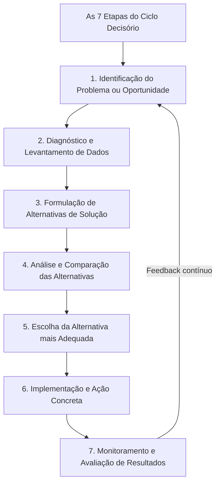
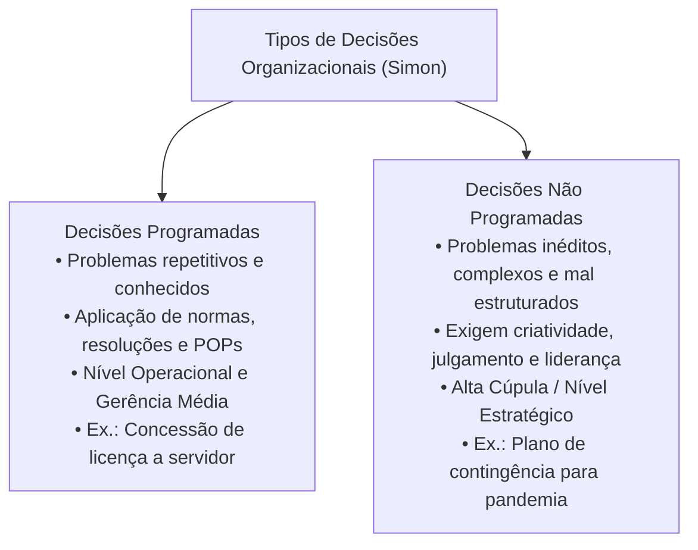
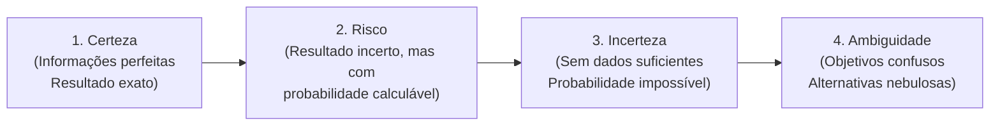
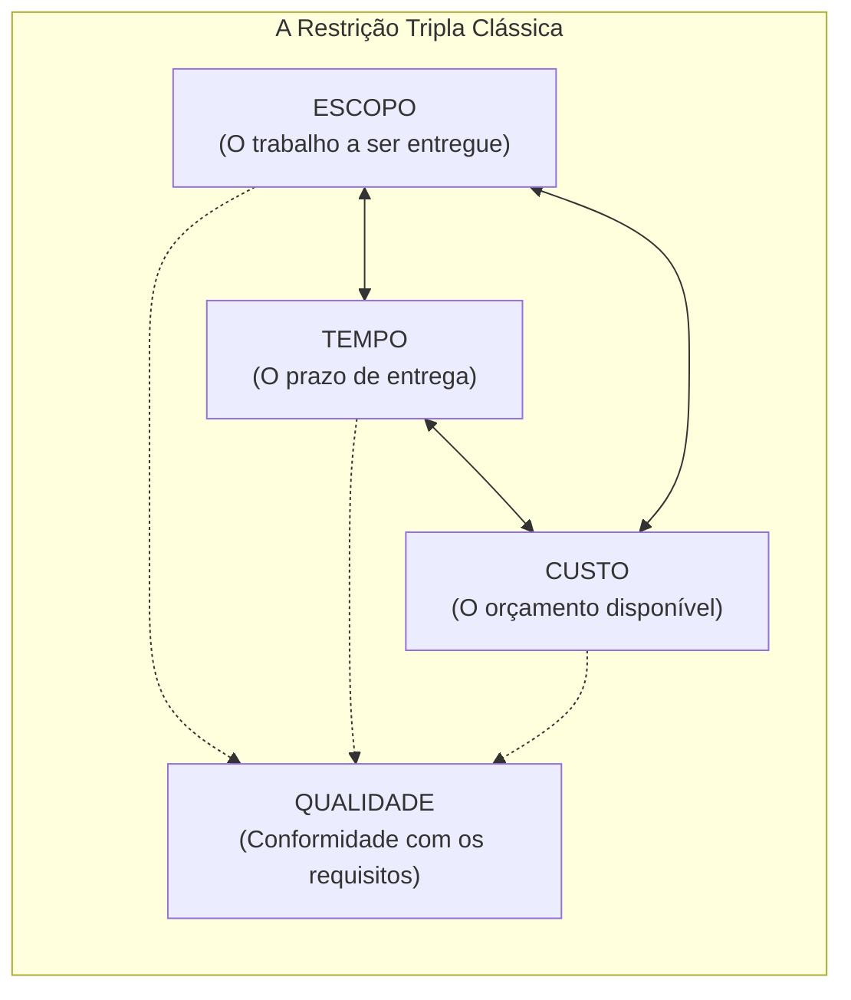

# 03 - Processo Decisório, Tipos de Decisão, Visão Sistêmica e Gerenciamento de Projetos

> **Matéria:** Administração Geral  
> **Cargo:** A01 – Técnico de Controle Externo – Especialidade: Técnico Administrativo  
> **Arquivo:** `03_processo_decisorio_visao_sistemica_e_gerenciamento_de_projetos.md`  

---

## 📌 Ementa / Itens do Edital
- O processo decisório na administração: etapas lógicas do ciclo decisório (identificação do problema, diagnóstico, formulação de alternativas, avaliação comparativa, escolha, implementação e avaliação dos resultados);
- Tipos de decisões organizacionais segundo Herbert Simon:
  - Decisões Programadas (estruturadas, rotineiras, repetitivas, amparadas por regras, resoluções e POPs);
  - Decisões Não Programadas (não estruturadas, inéditas, complexas, estratégicas e tomadas sob turbulência);
- Condições ambientais da tomada de decisão: condições de certeza, risco, incerteza e ambiguidade;
- Visão sistêmica nas organizações:
  - O pensamento holístico e a superação da visão fragmentada departamental (fim dos "silos organizacionais" ou feudos administrativos);
  - Sinergia organizacional ($1 + 1 > 2$) e interdependência dos subsistemas (técnico, estrutural, psicossocial e gerencial de Kast e Rosenzweig);
  - Equifinalidade e homeostase dinâmica na preservação da missão institucional perante o ambiente externo;
- Noções fundamentais de Gerenciamento de Projetos:
  - Conceito de projeto segundo as boas práticas do PMI/PMBOK;
  - A restrição tripla do gerenciamento de projetos: Escopo, Tempo e Custo (balizados pelo padrão de Qualidade);
  - Ferramentas clássicas de acompanhamento e controle de projetos: Gráfico de Gantt, Método do Caminho Crítico (CPM - *Critical Path Method*) e técnica PERT (*Program Evaluation and Review Technique* com três estimativas de tempo).

---

## 🌳 Classificação Hierárquica

```text
3. Processo Decisório, Visão Sistêmica e Gerenciamento de Projetos
├── 3.1 O Processo Decisório Organizacional
│   ├── 3.1.1 Fases do Ciclo de Decisão:
│   │   ├── 1. Identificação do problema ou oportunidade
│   │   ├── 2. Diagnóstico da situação e coleta de evidências
│   │   ├── 3. Desenvolvimento e formulação de alternativas
│   │   ├── 4. Análise comparativa das alternativas (risco vs. benefício)
│   │   ├── 5. Seleção e escolha da melhor alternativa (a decisão)
│   │   ├── 6. Implementação e execução do plano de ação
│   │   └── 7. Monitoramento, controle e retroalimentação (feedback)
│   ├── 3.1.2 Tipos de Decisão (Herbert Simon):
│   │   ├── Decisões Programadas: Estruturadas, dados claros, regras preexistentes (baixo risco)
│   │   └── Decisões Não Programadas: Inéditas, mal estruturadas, imprevisíveis (alta cúpula)
│   └── 3.1.3 Condições Ambientais da Tomada de Decisão:
│       ├── Certeza: Resultados determinísticos e conhecidos com exatidão
│       ├── Risco: Desfechos incertos, porém com probabilidades estatísticas calculáveis
│       ├── Incerteza: Ausência de dados suficientes para calcular probabilidades matemáticas
│       └── Ambiguidade: Problema obscuro, metas indefinidas e alternativas imprecisas
├── 3.2 Visão Sistêmica e Pensamento Holístico
│   ├── 3.2.1 Conceito: Organização vista como totalidade aberta em interação contínua
│   ├── 3.2.2 Superação dos Silos Organizacionais: Eliminação de barreiras e cooperação intersetorial
│   ├── 3.2.3 Sinergia Organizacional: O resultado integrado do todo supera a soma isolada das partes
│   └── 3.2.4 Subsistemas Organizacionais (Kast e Rosenzweig):
│       ├── Subsistema de Objetivos e Valores (Missão e cultura)
│       ├── Subsistema Técnico (Conhecimento, equipamentos e processos)
│       ├── Subsistema Psicossocial (Relações humanas, motivação e clima)
│       ├── Subsistema Estrutural (Organograma, autoridade e fluxo formal)
│       └── Subsistema Gerencial (Coordenação, liderança, estratégia e controle)
└── 3.3 Noções de Gerenciamento de Projetos
    ├── 3.3.1 Conceito: Empreendimento temporário voltado à criação de um produto ou serviço exclusivo
    ├── 3.3.2 Restrição Tripla: Equilíbrio dinâmico entre Escopo, Tempo e Custo (Qualidade no centro)
    └── 3.3.3 Ferramentas de Cronograma e Controle:
        ├── Gráfico de Gantt: Cronograma de barras horizontais que relaciona tarefas e datas
        ├── Método do Caminho Crítico (CPM): Sequência mais longa de atividades interdependentes (Folga Zero)
        └── Técnica PERT: Estimativa probabilística por média ponderada: TE = (O + 4M + P) / 6
```

---

## 📖 Resumo Teórico Aprofundado & Esquematizado

### 1. O Processo Decisório e a Tipologia das Decisões

O processo decisório é a sequência lógica pela qual um administrador seleciona uma linha de ação entre duas ou mais alternativas concorrentes:



#### Decisões Programadas versus Não Programadas (Herbert Simon):



| Critério de Comparação | Decisões Programadas | Decisões Não Programadas |
| :--- | :--- | :--- |
| **Natureza do Problema** | Estruturado, rotineiro, repetitivo e frequente. | Inédito, mal estruturado, singular e imprevisto. |
| **Grau de Incerteza** | Mínimo; desfechos amplamente previsíveis. | Elevado; variáveis desconhecidas e mutáveis. |
| **Fundamento da Escolha** | Procedimentos operacionais padrão (POP), leis e manuais. | Julgamento crítico, intuição embasada e visão estratégica. |
| **Nível Organizacional Típico** | Nível Operacional e Tático intermediário. | Alta Cúpula Institucional (Nível Estratégico). |

---

### 2. Condições Ambientais da Tomada de Decisão



1. **Condição de Certeza:** O tomador de decisão conhece previamente com exatidão todas as alternativas e as consequências determinísticas de cada uma delas.
2. **Condição de Risco:** O decisor não tem certeza absoluta do resultado, mas dispõe de séries históricas e dados suficientes para estimar **probabilidades matemáticas confiáveis** de sucesso ou fracasso (ex.: 80% de chance de vitória jurídica).
3. **Condição de Incerteza:** O decisor possui informações incompletas e o ambiente externo é tão dinâmico que é impossível calcular probabilidades matemáticas fidedignas.
4. **Condição de Ambiguidade:** A situação mais complexa e caótica; os próprios objetivos são vagos ou contraditórios, o problema é mal compreendido e as alternativas são obscuras.

---

### 3. Visão Sistêmica e Pensamento Holístico

* **Superação dos "Silos Organizacionais":** Na visão mecanicista tradicional, cada setor atuava como um "feudo isolado", preocupando-se apenas com suas tarefas departamentais sem se importar com o impacto no restante da instituição. A visão sistêmica quebra essa fragmentação e enxerga a organização como um **organismo vivo e interconectado**.
* **Sinergia Organizacional:** Conceito sistêmico segundo o qual o todo integrado operando cooperativamente produz um resultado qualitativa e quantitativamente superior à soma das partes isoladas ($1 + 1 > 2$).
* **Os 5 Subsistemas de Kast e Rosenzweig:**
  1. *Subsistema de Objetivos e Valores:* Missão, visão e cultura institucional;
  2. *Subsistema Técnico:* Equipamentos, tecnologias, métodos de auditoria e fluxos operacionais;
  3. *Subsistema Estrutural:* Organograma, divisão do trabalho e linhas formais de autoridade;
  4. *Subsistema Psicossocial:* Clima de trabalho, motivação dos servidores e liderança;
  5. *Subsistema Gerencial:* Coordenação de todos os demais subsistemas, planejamento e controle global.

---

### 4. Gerenciamento de Projetos: Restrição Tripla, CPM e PERT



#### Instrumentos Primordiais de Gestão de Cronograma e Redes:
1. **Gráfico de Gantt:** Gráfico bidimensional de barras horizontais que relaciona visualmente as atividades no eixo vertical e o calendário de tempo no eixo horizontal. É excelente para comunicação visual rápida do status do projeto.
2. **Método do Caminho Crítico (CPM - *Critical Path Method*):**
   - Mapeia o diagrama de rede de precedências lógicas entre tarefas.
   - O Caminho Crítico é a **sequência mais longa de atividades interdependentes** do início ao encerramento do projeto.
   - **Regra Fundamental de Concurso:** Todas as atividades situadas no caminho crítico possuem **FOLGA TEMPORAL NULA (FOLGA ZERO)**. Qualquer atraso em uma atividade crítica acarreta automaticamente o **atraso de todo o projeto**!
3. **Técnica PERT (*Program Evaluation and Review Technique*):**
   - Desenvolvida para projetos pioneiros com incerteza na duração das atividades.
   - Utiliza a distribuição beta baseada em três estimativas de duração:
     - **O:** Estimativa Otimista;
     - **M:** Estimativa Mais Provável (*Most Likely*);
     - **P:** Estimativa Pessimista.
   - Fórmula da Média Ponderada PERT:
     $$\mathbf{\text{Tempo Esperado (TE)} = \frac{O + 4M + P}{6}}$$

---

## 🚨 Alertas de Prova & Pegadinhas da FCC

> 🚨 **ALERTA DE PROVA / PEGADINHA FCC (FOLGA DO CAMINHO CRÍTICO):**  
> Questão clássica da FCC: perguntar qual é o valor da folga de tempo das atividades que integram o caminho crítico (CPM) de um projeto. A resposta é taxativa: **FOLGA ZERO (FOLGA NULA)**! As tarefas críticas não admitem nenhum dia de atraso sem comprometer a data de entrega final de todo o empreendimento!

> ⭐ **IMPORTANTE (RISCO VS. INCERTEZA NA DECISÃO):**  
> Grave a diferença estatística:  
> - Em ambiente de **RISCO**, você **consegue calcular probabilidades matemáticas** associadas aos eventos futuros porque dispõe de séries históricas e dados estatísticos.  
> - Em ambiente de **INCERTEZA**, os dados são precários ou inexistentes, sendo **impossível estimar probabilidades matemáticas confiáveis**.

> 🛑 **ATENÇÃO (DECISÕES PROGRAMADAS VS. NÃO PROGRAMADAS):**  
> - Decisões **Programadas** baseiam-se em normas, rotinas, formulários e leis vigentes (nível operacional).  
> - Decisões **Não Programadas** tratam de imprevistos inéditos e desestruturados, exigindo julgamento e visão estratégica da alta cúpula.

> 📌 **NOTA EXPLICATIVA (O CONCEITO DE SINERGIA):**  
> Na abordagem sistêmica, sinergia significa que as unidades interdependentes cooperando de forma harmônica geram um valor total que excede a simples soma de seus desempenhos isolados ($1 + 1 > 2$).

---

## 🌐 Fontes Oficiais e Referências Bibliográficas

* [MAXIMIANO, Antonio Cesar Amaru. Administração para Projetos: como transformar ideias em resultados. Editora Atlas.](https://www.grupogen.com.br).
* [SIMON, Herbert A. Comportamento Administrativo: estudo dos processos decisórios nas organizações. FGV.](https://www.fgv.br).
* [Project Management Institute (PMI) - Um Guia do Conhecimento em Gerenciamento de Projetos (Guia PMBOK 7ª Edição)](https://www.pmi.org).
* [KAST, Fremont E.; ROSENZWEIG, James E. Organização e Administração: um enfoque sistêmico e contingencial. Pioneira.](https://www.grupogen.com.br).
* [CHIAVENATO, Idalberto. Teoria Geral da Administração: abordagens contemporâneas. Atlas.](https://www.grupogen.com.br).

---

## 📝 Questões de Concurso FCC Comentadas

### Questão 01
**(FCC – TCE-PI – Auditor de Controle Externo)**  
A respeito das técnicas de planejamento e cronograma utilizadas no gerenciamento de projetos, o Método do Caminho Crítico (CPM) caracteriza-se fundamentalmente por:

* **A)** Indicar a sequência de atividades com maior número de folgas temporais disponíveis para remanejamento de equipe.
* **B)** Identificar a sequência de atividades dependentes de maior duração total do projeto, cujas tarefas possuem folga temporal nula.
* **C)** Consistir em um método exclusivo para orçamentação financeira que desconsidera os prazos de entrega das tarefas.
* **D)** Representar uma estrutura analítica de decomposição hierárquica do escopo sem vinculação temporal.
* **E)** Substituir o uso de diagramas de rede pela elaboração isolada de matrizes SWOT de contingência.

> **Gabarito: B**  
> **Comentário Detalhado:**  
> - **A) Incorreta.** As tarefas do caminho crítico não admitem folga de tempo; quem tem folga são as atividades fora do caminho crítico.  
> - **B) CORRETA.** O **Caminho Crítico (CPM)** é precisamente a sequência de atividades dependentes de maior duração total contínua no diagrama de rede que define o tempo mínimo para a conclusão do projeto; todas as atividades que o compõem possuem **folga temporal zero (nula)**, de maneira que qualquer atraso nelas acarreta automaticamente o atraso de todo o projeto.  
> - **C) Incorreta.** O CPM é uma ferramenta de gestão temporal de prazos e dependências em rede.  
> - **D) Incorreta.** A decomposição do escopo em entregas é a EAP (WBS), que não se confunde com o CPM.  
> - **E) Incorreta.** O CPM decorre compulsoriamente da montagem do diagrama de rede de precedências lógicas.

---

### Questão 02
**(FCC – TCE-RS – Auditor de Controle Externo)**  
Determinado setor administrativo de um Tribunal de Contas analisa diariamente dezenas de pedidos de prorrogação de prazo protocolados por jurisdicionados. O procedimento para deferimento ou indeferimento do pedido segue critérios estritos, pré-fixados de forma taxativa em resolução normativa do Tribunal, avaliando-se apenas a tempestividade do protocolo e o anexo do atestado médico. Nos termos da tipologia do processo decisório formulada por Herbert Simon, a deliberação do chefe do setor constitui típica:

* **A)** Decisão não programada.
* **B)** Decisão intuitiva em condição de ambiguidade.
* **C)** Decisão programada.
* **D)** Decisão holística sob incerteza extrema.
* **E)** Decisão estratégica de ruptura.

> **Gabarito: C**  
> **Comentário Detalhado:**  
> - **A) Incorreta.** Decisões não programadas são tomadas perante fatos inéditos, complexos e que demandam soluções inovadoras.  
> - **B) Incorreta.** Ambiguidade é a ausência de metas ou clareza sobre o problema; na hipótese narrada, as regras e dados são claros.  
> - **C) CORRETA.** As **decisões programadas** são aquelas que tratam de problemas rotineiros, estruturados e repetitivos, cuja resposta é automática e amparada em normas regimentais, resoluções, regras fixas ou procedimentos operacionais padrão (POPs) preestabelecidos pela organização.  
> - **D) Incorreta.** Os parâmetros são plenamente conhecidos, inexistindo incerteza extrema.  
> - **E) Incorreta.** A análise de pedidos de prazo de rotina é tarefa operacional, e não decisão estratégica de ruptura.

---

### Questão 03
**(FCC – TRT-2ª Região – Analista Judiciário: Área Administrativa)**  
No âmbito da gestão estratégica de projetos governamentais, uma equipe necessita estimar a duração provável de uma atividade inédita de digitalização de acervo histórico. Os especialistas estimaram que, no melhor cenário possível (otimista), a tarefa demandará 10 dias; no cenário mais provável, exigirá 16 dias; e, no pior cenário concebível (pessimista), demandará 28 dias. Utilizando a consagrada técnica probabilística PERT (*Program Evaluation and Review Technique*), a estimativa de tempo esperado (TE) para essa atividade é de:

* **A)** 18 dias.
* **B)** 16 dias.
* **C)** 17 dias.
* **D)** 20 dias.
* **E)** 15 dias.

> **Gabarito: C**  
> **Comentário Detalhado:**  
> - A técnica PERT adota a média ponderada com peso 4 para a estimativa mais provável:  
>   - $\text{TE} = \frac{O + 4M + P}{6}$  
>   - Substituindo os valores do enunciado: $\text{TE} = \frac{10 + (4 \times 16) + 28}{6} = \frac{10 + 64 + 28}{6} = \frac{102}{6} = 17\text{ dias}$.  
> - Logo, a resposta exata é **17 dias** (Alternativa C).

---

### Questão 04
**(FCC – DPE-RS – Analista: Área Administrativa)**  
A respeito da tomada de decisão em ambientes organizacionais e das condições de certeza, risco, incerteza e ambiguidade, assinale a opção correta:

* **A)** Na condição de risco, o tomador de decisão possui informações completas e sabe com absoluta precisão o desfecho de cada alternativa de ação.
* **B)** A condição de ambiguidade caracteriza-se pelo domínio pleno de dados históricos que permitem calcular probabilidades estatísticas exatas de insucesso.
* **C)** A condição de certeza é a situação em que o decisor atua sem informações preliminares, confiando unicamente na sorte e na intuição.
* **D)** Na condição de risco, o tomador de decisão desconhece com certeza o resultado final, contudo dispõe de dados suficientes para calcular probabilidades estatísticas associadas a cada alternativa.
* **E)** A condição de incerteza permite ao gestor modelar todas as variáveis futuras por meio de equações determinísticas de causa e efeito imediato.

> **Gabarito: D**  
> **Comentário Detalhado:**  
> - **A) Incorreta.** Informações completas e resultado exato definem a condição de **certeza**, e não de risco.  
> - **B) Incorreta.** Na ambiguidade, as metas são desconhecidas e os dados são obscuros, sendo impossível calcular probabilidades.  
> - **C) Incorreta.** Na certeza, o resultado é deterministicamente conhecido.  
> - **D) CORRETA.** Na condição de **risco**, o resultado concreto de cada escolha é incerto, mas a organização possui informações e base histórica que tornam viável atribuir **probabilidades matemáticas ou estatísticas** de ocorrência a cada alternativa.  
> - **E) Incorreta.** Na incerteza, as informações são escassas e as probabilidades matemáticas não podem ser calculadas com segurança.

---

### Questão 05
**(FCC – ARTESP – Especialista em Regulação de Transportes)**  
O modelo de administração contemporâneo valoriza o pensamento holístico e a visão sistêmica em oposição aos tradicionais modelos mecanicistas burocráticos. A respeito da visão sistêmica aplicada às organizações públicas, assinale a afirmativa correta:

* **A)** Sustenta que cada setor deve priorizar exclusivamente suas metas individuais de departamento, competindo com as demais unidades pelo orçamento público.
* **B)** Concebe a instituição como uma rede interdependente de subsistemas integrados, na qual as decisões adotadas em uma unidade provocam impactos diretos sobre todo o organismo institucional.
* **C)** Elimina a necessidade de controle e avaliação de desempenho, pois presume que os servidores agem de forma espontânea em perfeita sincronia com o ambiente.
* **D)** Restringe a atuação do órgão público à preservação de fronteiras rígidas e impenetráveis, impedindo qualquer intercâmbio de dados com a sociedade externa.
* **E)** Rejeita o conceito de sinergia por considerá-lo incompatível com a estrita divisão formal de trabalho prescrita em leis administrativas.

> **Gabarito: B**  
> **Comentário Detalhado:**  
> - **A) Incorreta.** Priorizar o próprio setor em detrimento do todo caracteriza a visão míope dos "silos organizacionais", combatida pela abordagem sistêmica.  
> - **B) CORRETA.** A **visão sistêmica (ou holística)** enxerga a organização como um sistema aberto composto por subsistemas reciprocamente dependentes e interconectados; assim, qualquer alteração em um subsistema repercute em todos os demais e no resultado final entregue à sociedade.  
> - **C) Incorreta.** O controle (retroalimentação/feedback) é elemento vital da teoria sistêmica para manter a homeostase dinâmica.  
> - **D) Incorreta.** As organizações são sistemas **abertos**, com fronteiras permeáveis que realizam intercâmbio contínuo de recursos e dados com o meio externo.  
> - **E) Incorreta.** A sinergia ($1 + 1 > 2$) é um dos pilares centrais da teoria de sistemas.
