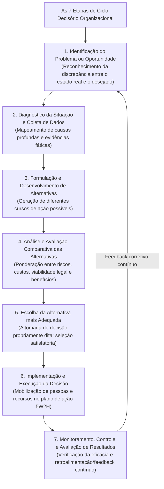
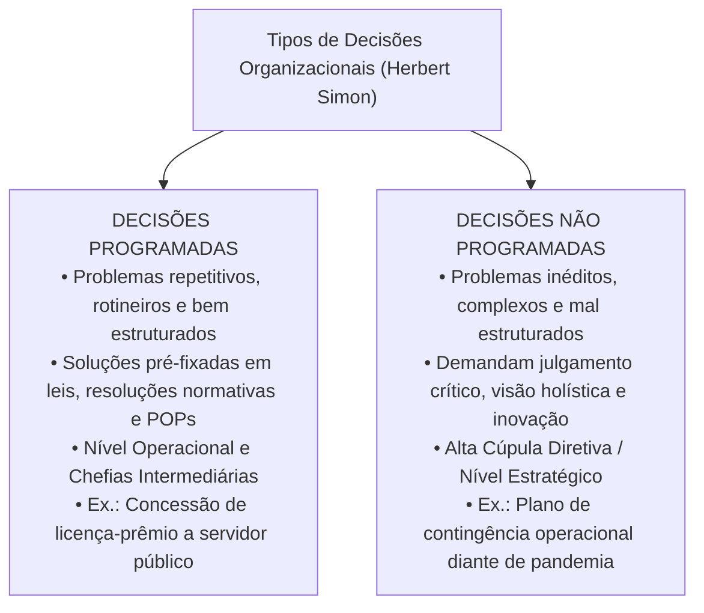
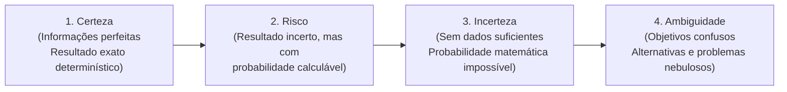
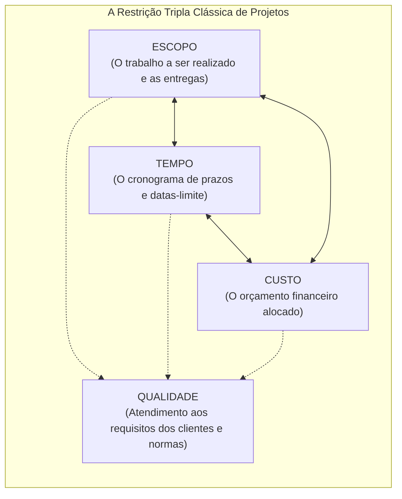

# 03 - Processo Decisório, Tipos de Decisão, Visão Sistêmica e Gerenciamento de Projetos

> **Matéria:** Administração Geral  
> **Cargo:** A01 – Técnico de Controle Externo – Especialidade: Técnico Administrativo  
> **Arquivo:** `03_processo_decisorio_visao_sistemica_e_gerenciamento_de_projetos.md`  

---

## 📌 Ementa / Itens do Edital
- O processo decisório na administração: etapas lógicas do ciclo decisório (identificação do problema, diagnóstico, formulação de alternativas, avaliação comparativa, escolha, implementação e avaliação dos resultados);
- Tipos de decisões organizacionais segundo Herbert Simon:
    - Decisões Programadas (estruturadas, rotineiras, repetitivas, amparadas por regras, resoluções e POPs);
    - Decisões Não Programadas (não estruturadas, inéditas, complexas, estratégicas e tomadas sob turbulência);
- Condições ambientais da tomada de decisão: condições de certeza, risco, incerteza e ambiguidade;
- Visão sistêmica nas organizações:
    - O pensamento holístico e a superação da visão fragmentada departamental (fim dos "silos organizacionais" ou feudos administrativos);
    - Sinergia organizacional ($1 + 1 > 2$) e interdependência dos subsistemas (técnico, estrutural, psicossocial e gerencial de Kast e Rosenzweig);
    - Equifinalidade e homeostase dinâmica na preservação da missão institucional perante o ambiente externo;
- Noções fundamentais de Gerenciamento de Projetos:
    - Conceito de projeto segundo as boas práticas do PMI/PMBOK;
    - A restrição tripla do gerenciamento de projetos: Escopo, Tempo e Custo (balizados pelo padrão de Qualidade);
    - Ferramentas clássicas de acompanhamento e controle de projetos: Gráfico de Gantt, Método do Caminho Crítico (CPM - *Critical Path Method*) e técnica PERT (*Program Evaluation and Review Technique* com três estimativas de tempo).

---

## 🧭 Sumário Interativo
- [1. O Ciclo do Processo Decisório e a Tipologia de Decisões (Herbert Simon)](#1-o-ciclo-do-processo-decisorio-e-a-tipologia-de-decisoes-herbert-simon)
- [2. Condições Ambientais da Tomada de Decisão](#2-condicoes-ambientais-da-tomada-de-decisao)
- [3. Visão Sistêmica, Pensamento Holístico e Silos Organizacionais](#3-visao-sistemica-pensamento-holistico-e-silos-organizacionais)
- [4. Gerenciamento de Projetos: Restrição Tripla, Gantt, CPM e PERT](#4-gerenciamento-de-projetos-restricao-tripla-gantt-cpm-e-pert)
- [5. Fontes Oficiais e Referências Bibliográficas](#5-fontes-oficiais-e-referencias-bibliograficas)
- [6. Questões de Concurso FCC Comentadas](#6-questoes-de-concurso-fcc-comentadas)

---

## 📖 Resumo Teórico Aprofundado & Esquematizado

### 1. O Ciclo do Processo Decisório e a Tipologia de Decisões (Herbert Simon)

O processo decisório é a sequência lógica e deliberada de passos cognitivos por meio da qual um administrador ou colegiado identifica uma demanda e elege uma linha de ação específica dentre alternativas concorrentes:

#### Decisões Programadas versus Não Programadas (Herbert Simon):

Herbert Simon dividiu as decisões administrativas em duas categorias essenciais:

| Critério de Comparação | Decisões Programadas | Decisões Não Programadas |
| :--- | :--- | :--- |
| **Natureza do Problema** | Estruturado, rotineiro, repetitivo e frequente. | Inédito, mal estruturado, singular e imprevisível. |
| **Grau de Incerteza** | Mínimo; desfechos amplamente previsíveis e seguros. | Elevado; variáveis desconhecidas, mutáveis e turbulentas. |
| **Fundamento da Escolha** | Procedimentos operacionais padrão (POP), leis e manuais. | Julgamento crítico, intuição embasada e visão estratégica. |
| **Nível Organizacional Típico** | Nível Operacional e Gerência Média/Tática. | Alta Cúpula Institucional (Nível Estratégico). |

> 🛑 **ATENÇÃO (DECISÕES PROGRAMADAS VS. NÃO PROGRAMADAS):**  
>
> - Decisões **Programadas** baseiam-se em normas, rotinas, formulários padronizados e leis vigentes (nível operacional).  
> - Decisões **Não Programadas** tratam de imprevistos inéditos e desestruturados, exigindo julgamento e visão estratégica da alta cúpula.

---

### 2. Condições Ambientais da Tomada de Decisão

O contexto em que a decisão é tomada varia segundo a qualidade e a completude das informações disponíveis:

1. **Condição de Certeza:** O decisor dispõe de informações completas, exatas e confiáveis. Os resultados de cada linha de ação são previsíveis com precisão matemática (resultado determinístico).
2. **Condição de Risco:** O decisor desconhece com certeza o desfecho final, mas possui dados históricos, séries temporais e estatísticas suficientes para **atribuir probabilidades matemáticas confiáveis** a cada alternativa (ex.: probabilidade de 70% de êxito em uma fiscalização externa).
3. **Condição de Incerteza:** O ambiente é tão dinâmico ou a situação é tão inovadora que faltam dados históricos básicos. O gestor **não tem condições de calcular probabilidades estatísticas** confiáveis, dependendo de intuição embasada e cenários prospectivos.
4. **Condição de Ambiguidade:** A situação mais crítica de gestão; as próprias metas organizacionais são nebulosas ou contraditórias, o problema é mal compreendido e inexistem alternativas claras de ação delineadas.

> ⭐ **IMPORTANTE (RISCO VS. INCERTEZA NA DECISÃO):**  
> Grave a diferença estatística crucial nas provas da FCC:  
>
> - Em ambiente de **RISCO**, você **consegue calcular probabilidades matemáticas** associadas aos eventos futuros porque dispõe de séries históricas e dados estatísticos.  
> - Em ambiente de **INCERTEZA**, os dados são precários ou inexistentes, sendo **impossível estimar probabilidades matemáticas confiáveis**.

---

### 3. Visão Sistêmica, Pensamento Holístico e Silos Organizacionais

A abordagem sistêmica concebe a instituição pública como um **sistema aberto** composto por partes dinamicamente interconectadas e em constante intercâmbio com a sociedade:

1. **Superação dos Silos Organizacionais (Feudos Administrativos):** Na abordagem burocrática mecanicista tradicional, cada diretoria ou setor funcionava como um "feudo isolado" (*silo organizacional*), preocupado exclusivamente com suas próprias metas setoriais e cego aos impactos no restante do órgão. O **pensamento holístico** supera essa fragmentação, integrando as unidades em torno do propósito público comum.
2. **Sinergia Organizacional:** Fenômeno pelo qual a ação cooperativa e coordenada dos subsistemas integrados produz um resultado global significativamente superior à mera soma dos resultados obtidos por cada unidade isoladamente ($1 + 1 > 2$).
3. **Os Cinco Subsistemas Organizacionais de Kast e Rosenzweig:**
    - **Subsistema de Objetivos e Valores:** Missão institucional, visão de futuro e cultura ética do órgão.
    - **Subsistema Técnico:** Instalações físicas, softwares, métodos de fiscalização, equipamentos e conhecimentos aplicados.
    - **Subsistema Estrutural:** Desenho do organograma, divisão do trabalho, regimentos internos e linhas de subordinação hierárquica.
    - **Subsistema Psicossocial:** Relações humanas interpessoais, clima de trabalho, dinâmica de grupos, motivação e liderança.
    - **Subsistema Gerencial:** Função integradora superior que conecta e direciona todos os outros subsistemas através do planejamento, organização, comando, coordenação e controle.

> 📌 **NOTA EXPLICATIVA (O CONCEITO DE SINERGIA):**  
> Na abordagem sistêmica, sinergia significa que as unidades interdependentes cooperando de forma harmônica geram um valor total que excede a simples soma de seus desempenhos isolados ($1 + 1 > 2$).

---

### 4. Gerenciamento de Projetos: Restrição Tripla, Gantt, CPM e PERT

Segundo o Project Management Institute (PMI/PMBOK), um **projeto** é um empreendimento temporário (possui início e fim previamente definidos) desenvolvido para criar um produto, serviço ou resultado único e exclusivo. Diferencia-se dos **processos**, que são operações contínuas, rotineiras e padronizadas.

#### As Ferramentas de Planejamento e Controle de Cronograma:

1. **Gráfico de Gantt:**
    - Representação visual bidimensional de barras horizontais em que o eixo vertical elenca as tarefas e o eixo horizontal projeta a linha do tempo (dias, semanas ou meses).
    - Proporciona acompanhamento visual imediato do avanço das tarefas e de suas datas de início e término.

2. **Método do Caminho Crítico (CPM - *Critical Path Method*):**
    - Mapeia o diagrama de rede de dependências e precedências lógicas entre todas as atividades do projeto.
    - O Caminho Crítico é a **sequência mais longa de atividades interdependentes** do início ao final do projeto, determinando a sua duração total mínima.
    - **Regra Mandatória de Prova:** Todas as atividades situadas no caminho crítico possuem **FOLGA TEMPORAL NULA (FOLGA ZERO)**. Qualquer atraso em uma tarefa do caminho crítico acarreta automaticamente o atraso na entrega final de todo o projeto!

3. **Técnica PERT (*Program Evaluation and Review Technique*):**
    - Ferramenta probabilística empregada em projetos complexos ou inovadores com alto grau de incerteza quanto à duração das atividades.
    - Utiliza a distribuição beta baseada em três estimativas temporais fornecidas pelos especialistas:
    - **O (Otimista):** Tempo mínimo em que a atividade pode ser concluída em condições ideais.
    - **M (Mais Provável / *Most Likely*):** Tempo esperado em circunstâncias normais de trabalho.
    - **P (Pessimista):** Tempo máximo exigido na pior hipótese concebível (quando tudo dá errado).
    - **Fórmula da Média Ponderada PERT (Tempo Esperado):**
     $$\mathbf{\text{Tempo Esperado (TE)} = \frac{O + 4M + P}{6}}$$

> 🚨 **ALERTA DE PROVA / PEGADINHA FCC (FOLGA DO CAMINHO CRÍTICO):**  
> Questão clássica da FCC: perguntar qual é o valor da folga de tempo das atividades que integram o caminho crítico (CPM) de um projeto. A resposta é taxativa: **FOLGA ZERO (FOLGA NULA)**! As tarefas críticas não admitem nenhum dia de atraso sem comprometer a data de entrega final de todo o empreendimento!

---

### 5. Fontes Oficiais e Referências Bibliográficas

* [Scrum Guide 2020 Oficial (Português-BR)](https://scrumguides.org/docs/scrumguide/v2020/2020-Scrum-Guide-PortugueseBR-3.0.pdf) - Guia definitivo sobre tomada de decisão ágil, sprints e retrospectivas.
* [Kanban Guide Oficial (English)](https://kanbanguides.org/english/) - Princípios de fluxo contínuo, limitação de trabalho em progresso (WIP) e feedback sistêmico.
* [Decreto nº 9.203/2017 (Governança, Tomada de Decisão e Gestão de Riscos)](https://www.planalto.gov.br/ccivil_03/_ato2015-2018/2017/decreto/d9203.htm) - Processo decisório baseado em evidências, gestão de riscos e controle interno.
* [TCU - Governança e Tomada de Decisão Pública](https://portal.tcu.gov.br/governanca/governanca-no-tcu/) - Referencial para embasamento técnico de decisões administrativas complexas.
* [TCE-GO - Plano de Fiscalização e Gestão de Projetos](https://portal.tce.go.gov.br/governanca-planejamento-e-gestao/planos-institucionais/plano-de-fiscalizacao) - Alinhamento e monitoramento de projetos estratégicos de fiscalização.
* SIMON, Herbert A. **Comportamento Administrativo: Estudo dos Processos Decisórios nas Organizações Administrativas**. 3. ed. Rio de Janeiro: FGV, 1979. (Cap. 4 e 5 - Racionalidade Limitada e Processo Decisório).
* KERZNER, Harold. **Gestão de Projetos: As Melhores Práticas**. 3. ed. Porto Alegre: Bookman, 2011. (Cap. 1 - Princípios de Gerenciamento de Projetos; Cap. 11 - Controle e Monitoramento).
* BERTALANFFY, Ludwig von. **Teoria Geral dos Sistemas: Fundamentos, Desenvolvimento e Aplicações**. 8. ed. Petrópolis: Vozes, 2015. (Cap. 2 - O Significado da Teoria Geral dos Sistemas).

### 6. Questões de Concurso FCC Comentadas

### Questão 01
**(FCC – TCE-PI – Auditor de Controle Externo)**  
A respeito das técnicas de planejamento e cronograma utilizadas no gerenciamento de projetos, o Método do Caminho Crítico (CPM) caracteriza-se fundamentalmente por:

* **A)** Indicar a sequência de atividades com maior número de folgas temporais disponíveis para remanejamento de equipe.
* **B)** Identificar a sequência de atividades dependentes de maior duração total do projeto, cujas tarefas possuem folga temporal nula.
* **C)** Consistir em um método exclusivo para orçamentação financeira que desconsidera os prazos de entrega das tarefas.
* **D)** Representar uma estrutura analítica de decomposição hierárquica do escopo sem vinculação temporal.
* **E)** Substituir o uso de diagramas de rede pela elaboração isolada de matrizes SWOT de contingência.

> **Comentário Detalhado:**  
>
> - **A) Incorreta.** As tarefas do caminho crítico não admitem folga de tempo; quem tem folga são as atividades fora do caminho crítico.  
> - **B) CORRETA.** O **Caminho Crítico (CPM)** é precisamente a sequência de atividades dependentes de maior duração total contínua no diagrama de rede que define o tempo mínimo para a conclusão do projeto; todas as atividades que o compõem possuem **folga temporal zero (nula)**, de maneira que qualquer atraso nelas acarreta automaticamente o atraso de todo o projeto.  
> - **C) Incorreta.** O CPM é uma ferramenta de gestão temporal de prazos e dependências em rede.  
> - **D) Incorreta.** A decomposição do escopo em entregas é a EAP (WBS), que não se confunde com o CPM.  
> - **E) Incorreta.** O CPM decorre compulsoriamente da montagem do diagrama de rede de precedências lógicas.  
> 
> **Gabarito: B**

---

### Questão 02
**(FCC – TCE-RS – Auditor de Controle Externo)**  
Determinado setor administrativo de um Tribunal de Contas analisa diariamente dezenas de pedidos de prorrogação de prazo protocolados por jurisdicionados. O procedimento para deferimento ou indeferimento do pedido segue critérios estritos, pré-fixados de forma taxativa em resolução normativa do Tribunal, avaliando-se apenas a tempestividade do protocolo e o anexo do atestado médico. Nos termos da tipologia do processo decisório formulada por Herbert Simon, a deliberação do chefe do setor constitui típica:

* **A)** Decisão não programada.
* **B)** Decisão intuitiva em condição de ambiguidade.
* **C)** Decisão programada.
* **D)** Decisão holística sob incerteza extrema.
* **E)** Decisão estratégica de ruptura.

> **Comentário Detalhado:**  
>
> - **A) Incorreta.** Decisões não programadas são tomadas perante fatos inéditos, complexos e que demandam soluções inovadoras.  
> - **B) Incorreta.** Ambiguidade é a ausência de metas ou clareza sobre o problema; na hipótese narrada, as regras e dados são claros.  
> - **C) CORRETA.** As **decisões programadas** são aquelas que tratam de problemas rotineiros, estruturados e repetitivos, cuja resposta é automática e amparada em normas regimentais, resoluções, regras fixas ou procedimentos operacionais padrão (POPs) preestabelecidos pela organização.  
> - **D) Incorreta.** Os parâmetros são plenamente conhecidos, inexistindo incerteza extrema.  
> - **E) Incorreta.** A análise de pedidos de prazo de rotina é tarefa operacional, e não decisão estratégica de ruptura.  
> 
> **Gabarito: C**

---

### Questão 03
**(FCC – TRT-2ª Região – Analista Judiciário: Área Administrativa)**  
No âmbito da gestão estratégica de projetos governamentais, uma equipe necessita estimar a duração provável de uma atividade inédita de digitalização de acervo histórico. Os especialistas estimaram que, no melhor cenário possível (otimista), a tarefa demandará 10 dias; no cenário mais provável, exigirá 16 dias; e, no pior cenário concebível (pessimista), demandará 28 dias. Utilizando a consagrada técnica probabilística PERT (*Program Evaluation and Review Technique*), a estimativa de tempo esperado (TE) para essa atividade é de:

* **A)** 18 dias.
* **B)** 16 dias.
* **C)** 17 dias.
* **D)** 20 dias.
* **E)** 15 dias.

> **Comentário Detalhado:**  
>
> - A técnica PERT adota a média ponderada com peso 4 para a estimativa mais provável:  
>     - $\text{TE} = \frac{O + 4M + P}{6}$  
>     - Substituindo os valores do enunciado: $\text{TE} = \frac{10 + (4 \times 16) + 28}{6} = \frac{10 + 64 + 28}{6} = \frac{102}{6} = 17\text{ dias}$.  
> - Logo, a resposta exata é **17 dias** (Alternativa C).  
> 
> **Gabarito: C**

---

### Questão 04
**(FCC – DPE-RS – Analista: Área Administrativa)**  
A respeito da tomada de decisão em ambientes organizacionais e das condições de certeza, risco, incerteza e ambiguidade, assinale a opção correta:

* **A)** Na condição de risco, o tomador de decisão possui informações completas e sabe com absoluta precisão o desfecho de cada alternativa de ação.
* **B)** A condição de ambiguidade caracteriza-se pelo domínio pleno de dados históricos que permitem calcular probabilidades estatísticas exatas de insucesso.
* **C)** A condição de certeza é a situação em que o decisor atua sem informações preliminares, confiando unicamente na sorte e na intuição.
* **D)** Na condição de risco, o tomador de decisão desconhece com certeza o resultado final, contudo dispõe de dados suficientes para calcular probabilidades estatísticas associadas a cada alternativa.
* **E)** A condição de incerteza permite ao gestor modelar todas as variáveis futuras por meio de equações determinísticas de causa e efeito imediato.

> **Comentário Detalhado:**  
>
> - **A) Incorreta.** Informações completas e resultado exato definem a condição de **certeza**, e não de risco.  
> - **B) Incorreta.** Na ambiguidade, as metas são desconhecidas e os dados são obscuros, sendo impossível calcular probabilidades.  
> - **C) Incorreta.** Na certeza, o resultado é deterministicamente conhecido.  
> - **D) CORRETA.** Na condição de **risco**, o resultado concreto de cada escolha é incerto, mas a organização possui informações e base histórica que tornam viável atribuir **probabilidades matemáticas ou estatísticas** de ocorrência a cada alternativa.  
> - **E) Incorreta.** Na incerteza, as informações são escassas e as probabilidades matemáticas não podem ser calculadas com segurança.  
> 
> **Gabarito: D**

---

### Questão 05
**(FCC – ARTESP – Especialista em Regulação de Transportes)**  
O modelo de administração contemporâneo valoriza o pensamento holístico e a visão sistêmica em oposição aos tradicionais modelos mecanicistas burocráticos. A respeito da visão sistêmica aplicada às organizações públicas, assinale a afirmativa correta:

* **A)** Sustenta que cada setor deve priorizar exclusivamente suas metas individuais de departamento, competindo com as demais unidades pelo orçamento público.
* **B)** Concebe a instituição como uma rede interdependente de subsistemas integrados, na qual as decisões adotadas em uma unidade provocam impactos diretos sobre todo o organismo institucional.
* **C)** Elimina a necessidade de controle e avaliação de desempenho, pois presume que os servidores agem de forma espontânea em perfeita sincronia com o ambiente.
* **D)** Restringe a atuação do órgão público à preservação de fronteiras rígidas e impenetráveis, impedindo qualquer intercâmbio de dados com a sociedade externa.
* **E)** Rejeita o conceito de sinergia por considerá-lo incompatível com a estrita divisão formal de trabalho prescrita em leis administrativas.

> **Comentário Detalhado:**  
>
> - **A) Incorreta.** Priorizar o próprio setor em detrimento do todo caracteriza a visão míope dos "silos organizacionais", combatida pela abordagem sistêmica.  
> - **B) CORRETA.** A **visão sistêmica (ou holística)** enxerga a organização como um sistema aberto composto por subsistemas reciprocamente dependentes e interconectados; assim, qualquer alteração em um subsistema repercute em todos os demais e no resultado final entregue à sociedade.  
> - **C) Incorreta.** O controle (retroalimentação/feedback) é elemento vital da teoria sistêmica para manter a homeostase dinâmica.  
> - **D) Incorreta.** As organizações são sistemas **abertos**, com fronteiras permeáveis que realizam intercâmbio contínuo de recursos e dados com o meio externo.  
> - **E) Incorreta.** A sinergia ($1 + 1 > 2$) é um dos pilares centrais da teoria de sistemas.  
> 
> **Gabarito: B**
