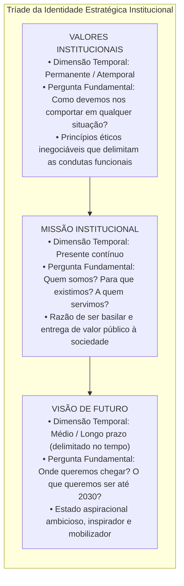
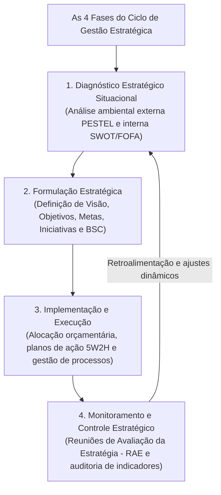
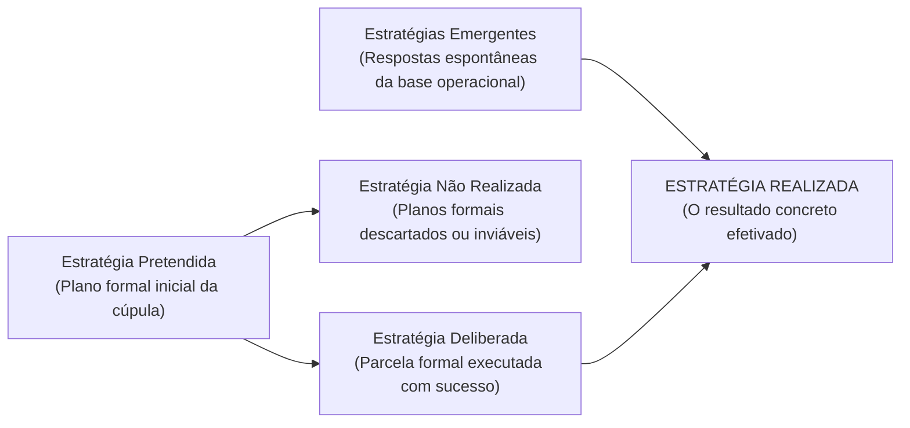
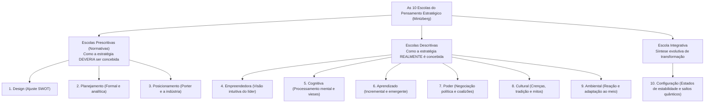

# 01 - Planejamento Estratégico: Missão, Visão, Valores e Escolas Estratégicas

> **Matéria:** Administração Estratégica  
> **Cargo:** A01 – Técnico de Controle Externo – Especialidade: Técnico Administrativo  
> **Arquivo:** `01_planejamento_estrategico_missao_visao_valores_e_escolas.md`  

---

## 📌 Ementa / Itens do Edital
- Planejamento estratégico: conceitos, características, objetivos e evolução conceitual;
- A tríade fundamental da identidade institucional:
    - **Missão:** a razão de existir da organização no presente, seu propósito essencial, competências e público atendido;
    - **Visão:** a aspiração de futuro da instituição, onde ela pretende chegar no horizonte temporal delimitado;
    - **Valores:** princípios morais, crenças fundamentais e padrões éticos inegociáveis que orientam a conduta organizacional;
- O ciclo da gestão estratégica integrada:
    - 1. Diagnóstico Estratégico (análise ambiental externa e interna);
    - 2. Formulação da Estratégia (estabelecimento de objetivos, metas e iniciativas estratégicas);
    - 3. Implementação e Execução (alocação orçamentária, planos de ação e governança);
    - 4. Controle e Avaliação da Estratégia (monitoramento por indicadores, RAE e retroalimentação);
- Tipologias de estratégias segundo Henry Mintzberg:
    - Estratégia Pretendida, Deliberada, Não Realizada, Emergente e Realizada;
- As Dez Escolas do Pensamento Estratégico (*Safári de Estratégia* - Henry Mintzberg, Bruce Ahlstrand e Joseph Lampel):
    - **Escolas Prescritivas / Normativas:** Escola do Design (ajuste interno/externo e SWOT), Escola do Planejamento (formalismo mecanicista e etapas sequenciais) e Escola do Posicionamento (análise setorial e matrizes de Porter);
    - **Escolas Descritivas:** Escola Empreendedora (visão intuitiva do líder), Escola Cognitiva (processamento mental e vieses), Escola do Aprendizado (estratégias emergentes e tentativa e erro), Escola do Poder (negociação, jogos de poder e coalizões), Escola Cultural (crenças coletivas e mitos) e Escola Ambiental (adaptação passiva às pressões externas);
    - **Escola Integrativa:** Escola da Configuração (estabilidade pontuada por transformações estruturais quânticas).

---

## 🧭 Sumário

1. [A Tríade da Identidade Estratégica: Missão, Visão e Valores](#1-a-triade-da-identidade-estrategica-missao-visao-e-valores)
    1. [Teste 370](#Teste-370)
    2. [Teste 371](#Teste-371)
    3. [Teste 372](#Teste-372)
2. [O Ciclo da Gestão Estratégica Integrada](#2-o-ciclo-da-gestao-estrategica-integrada)
    1. [Teste 373](#Teste-373)
3. [Estratégias Deliberadas vs. Estratégias Emergentes (Henry Mintzberg)](#3-estrategias-deliberadas-vs-estrategias-emergentes-henry-mintzberg)
    1. [Teste 374](#Teste-374)
    2. [Teste 375](#Teste-375)
4. [As Dez Escolas do Pensamento Estratégico (*Safári de Estratégia*)](#4-as-dez-escolas-do-pensamento-estrategico-safari-de-estrategia)
    1. [Teste 376](#Teste-376)
    2. [Teste 377](#Teste-377)
    3. [Teste 378](#Teste-378)
    4. [Teste 379](#Teste-379)
5. [Fontes Oficiais e Referências Bibliográficas](#5-fontes-oficiais-e-referencias-bibliograficas)

---

## 1. A Tríade da Identidade Estratégica: Missão, Visão e Valores

A construção da identidade organizacional representa o marco fundador do planejamento estratégico, orientando a tomada de decisão da alta cúpula até a base operacional:

#### Quadro Analítico Comparativo:

| Componente | Dimensão Temporal | Foco Central | Exemplo Prático no Setor Público (TCE-GO) |
| :--- | :--- | :--- | :--- |
| **Missão** | **Presente** (contínuo). | A razão de existir hoje; a entrega fundamental que justifica a existência do órgão perante a sociedade. | *"Exercer o controle externo com excelência, assegurando a regular aplicação dos recursos públicos em benefício da sociedade."* |
| **Visão** | **Futuro** (longo prazo delimitado). | O estado almejado; onde a instituição projeta e quer estar em um marco temporal futuro. | *"Ser reconhecido pela sociedade, até 2030, como referência nacional em inovação e eficácia no controle governamental."* |
| **Valores** | **Atemporal** (permanente). | Os mandamentos morais e éticos inegociáveis que norteiam a conduta funcional e as decisões diárias. | *Ética, Transparência, Independência Funcional, Inovação, Tempestividade e Comprometimento Social.* |

> 🚨 **ALERTA DE PROVA / PEGADINHA FCC (MISSÃO VS. VISÃO NAS QUESTÕES):**  
> Identifique imediatamente a temporalidade da assertiva no enunciado:  
>
> - Se o texto afirma o que a instituição é ou faz no **PRESENTE** ("prestar controle externo de qualidade para a sociedade"): trata-se de **MISSÃO**.  
> - Se o texto traz uma ambição de **FUTURO** com prazo determinado ("ser reconhecido até 2030 como centro de excelência"): trata-se de **VISÃO**.

> 📌 **NOTA EXPLICATIVA (VALORES INSTITUCIONAIS):**  
> Os valores institucionais atuam como balizas e limites éticos inderrogáveis. Nenhuma meta estratégica arrojada pode ser legitimamente cumprida se para tanto for violado qualquer valor ético fixado pela instituição.

---

### Teste 370
**(FCC – TCE-PI – Auditor de Controle Externo)**  
Determinado Tribunal de Contas publicou seu Plano Estratégico com os seguintes enunciados institucionais:

I. "Garantir a adequada aplicação dos recursos públicos em benefício da sociedade por meio do controle externo tempestivo e orientador."  

II. "Ser reconhecido pela sociedade, até o ano de 2030, como órgão de controle de excelência, moderno e indispensável à integridade governamental."  

Nos termos da teoria do planejamento estratégico, os enunciados I e II correspondem, respectivamente, à:

* **A)** Visão e Missão.
* **B)** Missão e Valores.
* **C)** Missão e Visão.
* **D)** Meta Operacional e Diretriz Tática.
* **E)** Valores e Visão.

---

> **Comentário Detalhado:**
>
> - **A) Incorreta.** Inverte a ordem das definições essenciais de planejamento estratégico.
> - **B) Incorreta.** Confunde a imagem de futuro projetada com valores éticos/comportamentais.
> - **C) CORRETA.** O Enunciado I reflete a razão de ser primordial e a atuação pública no presente (**Missão**), enquanto o Enunciado II projeta a imagem-alvo aspiracional com marco temporal delimitado até 2030 (**Visão**).
> - **D) Incorreta.** Declarações institucionais de cúpula não constituem metas operacionais ou diretrizes táticas.
> - **E) Incorreta.** Classifica equivocadamente o propósito do órgão como princípios ou valores.
> 
> **Gabarito: C**

---

### Teste 371
**(FCC – DPE-RS – Analista: Área Administrativa)**  
Ao formular seu planejamento plurianual, determinada defensoria pública incluiu expressamente em seu documento diretor os seguintes postulados: "Independência funcional, defesa irrestrita dos direitos humanos, transparência e urbanidade no atendimento aos cidadãos vulneráveis". Sob a perspectiva da teoria da administração estratégica, esses postulados representam:

* **A)** A Visão de futuro da defensoria para os próximos dez anos.
* **B)** As Metas táticas quantitativas dos núcleos regionais.
* **C)** Os Valores institucionais que norteiam as condutas e estabelecem balizas éticas indeclináveis.
* **D)** As Estratégias não realizadas do exercício anterior.
* **E)** As Oportunidades captadas no ambiente externo através da análise PESTEL no âmbito da administração pública direta e indireta.

---

> **Comentário Detalhado:**  
>
> - **A) Incorreta.** A Visão é uma imagem de futuro onde a instituição quer chegar, com prazo delimitado.  
> - **B) Incorreta.** Metas táticas são alvos quantitativos mensuráveis (ex.: realizar 5.000 atendimentos).  
> - **C) CORRETA.** Os princípios éticos, mandamentos morais e diretrizes de conduta que direcionam as atitudes dos membros de uma instituição e expressam o que é inegociável na cultura organizacional constituem os **Valores** da organização.  
> - **D) Incorreta.** Estratégias não realizadas são planos que foram formalmente descontinuados.  
> - **E) Incorreta.** Oportunidades são eventos externos favoráveis do mercado/ambiente político.  
> 
> **Gabarito: C**

---

### Teste 372
**(FCC - Adaptada / Analista de Planejamento e Gestão)**
Na definição da identidade corporativa e do referencial estratégico de um órgão de controle externo, a **Visão de Futuro** diferencia-se da **Missão Institucional** por:

* **A)** Descrever a imagem mental do estado futuro desejado que a instituição almeja alcançar em determinado horizonte temporal (onde queremos chegar), enquanto a Missão define a razão de existir fundamental e o propósito perene de atuação presente do órgão (quem somos e para que servimos).
* **B)** Estabelecer os princípios éticos inegociáveis que regem a conduta disciplinar dos servidores concursados.
* **C)** Consistir em documento sigiloso e restrito à apreciação do Presidente do Tribunal.
* **D)** Ter validade perpétua e imutável que não admite revisão nem mesmo em novos ciclos plurianuais de planejamento considerando os requisitos operacionais de segurança, escalabilidade, auditoria e desempenho corporativo.
* **E)** Focar exclusivamente na redução percentual dos gastos de custeio com passagens aéreas e combustíveis.

---

> **Comentário Detalhado:**
>
> - **A)** Correta. Conceituação clássica: **Missão** é a razão de ser fundamental da instituição, sua vocação e propósito permanente de existir perante a sociedade; **Visão** é o estado futuro almejado, a aspiração ambiciosa de longo prazo, aquilo que a organização pretende ser e como deseja ser reconhecida no futuro.
> - **B)** Incorreta. Refere-se aos **Valores** organizacionais.
> - **C)** Incorreta. A identidade estratégica deve ser amplamente divulgada e compartilhada.
> - **D)** Incorreta. A Visão tem horizonte temporal determinado (ex.: "ser referência nacional até 2030") e é renovada a cada ciclo.
> - **E)** Incorreta. Meta operacional pontual, não visão estratégica.
> 
> **Gabarito: A**

---

## 2. O Ciclo da Gestão Estratégica Integrada

A gestão estratégica contemporânea não é um evento isolado quadrienal, mas um ciclo administrativo contínuo, dinâmico e retroalimentado composto por quatro etapas estruturadas:

1. **Diagnóstico Estratégico:** Mapeamento sistemático do ambiente externo (oportunidades e ameaças incontroláveis) e do ambiente interno (forças e fraquezas controláveis), permitindo compreender a posição real da organização.
2. **Formulação Estratégica:** Estabelecimento dos macro-objetivos, indicadores de desempenho, metas quantificadas e programas de ação prioritários alinhados à missão e visão.
3. **Implementação da Estratégia:** Desdobramento tático-operacional, alocação de recursos financeiros pelo orçamento público (PPA, LDO e LOA), designação formal de responsáveis e governança das ações.
4. **Monitoramento e Controle:** Acompanhamento tempestivo dos indicadores de resultado, identificação precoce de desvios e realização periódica de Reuniões de Avaliação da Estratégia (RAE) para calibragem de rotas.

---

### Teste 373
**(FCC - Adaptada / Auditor de Controle Externo)**
Henry Mintzberg, ao analisar a formação das estratégias organizacionais, contrapôs o modelo puramente racional e deliberado ao surgimento de estratégias não previstas.

Segundo Mintzberg, a **Estratégia Emergente** caracteriza-se por:

* **A)** Surgir a partir de padrões consistentes de ação que emergem espontaneamente ao longo do tempo, em resposta a contingências, oportunidades e desafios imprevistos do ambiente, sem terem sido formalmente intencionadas no plano estratégico original.
* **B)** Ser minuciosamente calculada pela alta administração em planos operacionais plurianuais de dez anos.
* **C)** Exigir autorização prévia em emenda parlamentar na Lei de Diretrizes Orçamentárias.
* **D)** Representar a parte do plano estratégico formal que foi integralmente abandonada e descartada pela equipe (*estratégia não realizada*) considerando os requisitos operacionais de segurança, escalabilidade, auditoria e desempenho corporativo.
* **E)** Constituir violação do princípio da legalidade administrativa suscetível de anulação sumária.

---

> **Comentário Detalhado:**
>
> - **A)** Correta. Para Mintzberg, a estratégia realizada é uma combinação de **estratégias deliberadas** (intenções originais que foram formalmente planejadas e executadas) e **estratégias emergentes** (padrões de ação que não foram planejados de antemão, mas surgiram na prática em resposta à dinâmica ambiental e acabaram sendo adotados com sucesso pela organização).
> - **B)** Incorreta. Isso caracteriza a estratégia puramente planejada/deliberada.
> - **C)** Incorreta. Conceito de administração estratégica, não de formalismo financeiro.
> - **D)** Incorreta. O que é descartado chama-se *estratégia não realizada*.
> - **E)** Incorreta. Estratégias emergentes expressam capacidade de adaptação e resiliência.
> 
> **Gabarito: A**

---

## 3. Estratégias Deliberadas vs. Estratégias Emergentes (Henry Mintzberg)

Henry Mintzberg revolucionou os estudos de estratégia organizacional ao demonstrar que a estratégia executada na prática raramente corresponde de forma idêntica àquela planejada nos gabinetes da diretoria:

* **Estratégia Pretendida:** O plano estratégico inicial concebido formalmente pela liderança institucional.
* **Estratégia Deliberada:** A parcela das intenções estratégicas originais que foi executada exatamente como planejada.
* **Estratégia Não Realizada:** Os objetivos e projetos que, devido a contingências econômicas, cortes orçamentários, alterações legais ou inviabilidade técnica, foram formalmente abandonados.
* **Estratégia Emergente:** Padrões de conduta e soluções práticas que surgem espontaneamente no dia a dia da base operacional, em resposta a contingências imprevistas do ambiente.
* **Estratégia Realizada:** A estratégia que efetivamente ocorreu no mundo dos fatos, configurando a síntese harmonizada entre as estratégias deliberadas da cúpula e as estratégias emergentes da base.

> 🛑 **ATENÇÃO (ESTRATÉGIAS EMERGENTES NO DIA A DIA):**  
> As estratégias emergentes **não brotam nas reuniões formais da cúpula diretiva**. Elas nascem na base de execução (no chão de fábrica ou nas rotinas diárias dos analistas) como soluções práticas, criativas e espontâneas diante de contingências reais não antecipadas no planejamento original.

---

### Teste 374
**(FCC – TRT-2ª Região – Analista Judiciário: Área Administrativa)**  
De acordo com os conceitos desenvolvidos por Henry Mintzberg sobre a dinâmica da formulação e implementação estratégica, as ações e padrões de conduta que emergem espontaneamente na rotina operacional da organização, sem terem sido previamente previstos no plano formal deliberado pela cúpula, são denominadas:

* **A)** Estratégias Pretendidas.
* **B)** Estratégias Emergentes.
* **C)** Estratégias Não Realizadas.
* **D)** Estratégias Deliberadas.
* **E)** Estratégias Mecanicistas.

---

> **Comentário Detalhado:**  
>
> - **A) Incorreta.** A estratégia pretendida é o plano formal inicial traçado pela liderança.  
> - **B) CORRETA.** Para Mintzberg, as **estratégias emergentes** são aquelas que não foram concebidas no plano formal deliberado, mas surgem espontaneamente da base organizacional a partir da resposta prática dos colaboradores a desafios e oportunidades cotidianas não previstos.  
> - **C) Incorreta.** A estratégia não realizada é a parcela do plano que foi descartada ou abandonada.  
> - **D) Incorreta.** A estratégia deliberada é o plano formal que foi executado exatamente conforme o planejado.  
> - **E) Incorreta.** Categoria inexistente na taxonomia de Mintzberg.  
> 
> **Gabarito: B**

---

### Teste 375
**(FCC - Adaptada / Analista de Planejamento e Controle)**
Na clássica obra *Safári de Estratégia*, Henry Mintzberg, Bruce Ahlstrand e Joseph Lampel classificam o pensamento estratégico em dez escolas, agrupadas em **Prescritivas** e **Descritivas**.

Constitui uma escola de natureza tipicamente **Prescritiva** (normativa), voltada para prescrever *como a estratégia deve ser idealmente formulada*:

* **A)** A Escola do Planejamento (que concebe a formação estratégica como um processo formal, decomposto em etapas sequenciais analíticas e detalhadas).
* **B)** A Escola do Aprendizado (que vê a estratégia como um processo emergente e contínuo de experimentação).
* **C)** A Escola do Poder (que compreende a estratégia como um processo de negociação e disputas políticas entre grupos).
* **D)** A Escola Cultural (que enxerga a formação da estratégia como um processo coletivo enraizado em valores e crenças).
* **E)** A Escola Ambiental (que trata a estratégia como uma resposta passiva e reativa às pressões ecológicas do contexto externo) no âmbito da administração pública direta e indireta.

---

> **Comentário Detalhado:**
>
> - **A)** Correta. As três escolas **Prescritivas** (normativas - como deve ser formulada a estratégia) são: **Design** (estratégia como processo de concepção/ajuste SWOT), **Planejamento** (processo formal e sistemático de passos analíticos) e **Posicionamento** (processo analítico focado na indústria e concorrência - Porter). As demais escolas (Empreendedora, Cognitiva, Aprendizado, Poder, Cultural, Ambiental e Configuração) são **Descritivas** ou Integrativas (focam em como a estratégia realmente se desenvolve na prática).
> - **B), C), D), E)** Incorretas. São todas escolas **Descritivas**.
> 
> **Gabarito: A**

---

## 4. As Dez Escolas do Pensamento Estratégico (*Safári de Estratégia*)

Na consagrada obra *Safári de Estratégia*, Henry Mintzberg, Bruce Ahlstrand e Joseph Lampel organizaram a evolução do pensamento estratégico em dez escolas, categorizadas em prescritivas, descritivas e integrativas:

#### A) Escolas Prescritivas (Normativas - Foco em prescrever o modelo ideal):
1. **Escola do Design:** A pioneira (década de 1960). Enxerga a formulação como um processo de concepção mental deliberada cujo objetivo supremo é o **ajuste (*fit*) essencial** entre as capacidades internas da organização (Forças e Fraquezas) e as condições externas do ambiente (Oportunidades e Ameaças) – base da Matriz SWOT.
2. **Escola do Planejamento:** Liderada por H. Igor Ansoff. Concebe a formulação como um processo altamente formal, metódico e sequencial, desdobrado em manuais exaustivos, cronogramas e orçamentos operados por analistas de planejamento.
3. **Escola do Posicionamento:** Liderada por Michael Porter (anos 1980). A estratégia é vista como um processo analítico de escolha de posições competitivas genéricas (Liderança em Custo, Diferenciação ou Enfoque) dentro da estrutura da indústria concorrencial.

---

### Teste 376
**(FCC – ARTESP – Especialista em Regulação de Transportes)**  
Dentre as dez escolas do pensamento estratégico catalogadas na obra *Safári de Estratégia*, a Escola do Design destaca-se historicamente por defender que a estratégia deve ser concebida por meio de:

* **A)** Ensaios laboratoriais e simulações estocásticas operadas por inteligência artificial.
* **B)** Um processo deliberado de ajuste e adequação mútua entre as capacidades internas da organização (forças e fraquezas) e as condições do ambiente externo (oportunidades e ameaças).
* **C)** Jogos de barganha política e manobras coercitivas promovidas por sindicatos corporativos.
* **D)** Respostas puramente passivas e reativas ditadas pelas forças demográficas e climáticas do ambiente ecológico em estrita conformidade com as normas legais e regulamentares aplicáveis.
* **E)** Vieses cognitivos inconscientes e restrições biológicas da capacidade de memória dos diretores executivos.

---

> **Comentário Detalhado:**  
>
> - **A) Incorreta.** Simulações matemáticas pertencem a abordagens analíticas quantitativas ou de pesquisa operacional.  
> - **B) CORRETA.** A **Escola do Design** é a escola clássica (pioneira nos anos 1960) que propõe a estratégia como um processo deliberado de concepção mental cujo núcleo é o **ajuste (*fit*)** essencial entre a análise interna da organização (pontos fortes e fracos) e a análise externa do ambiente (oportunidades e ameaças), constituindo a base conceitual da famosa matriz SWOT.  
> - **C) Incorreta.** Jogos de barganha e política caracterizam a Escola do Poder.  
> - **D) Incorreta.** Adaptação reativa às forças externas caracteriza a Escola Ambiental.  
> - **E) Incorreta.** Vieses mentais e processos cerebrais caracterizam a Escola Cognitiva.  
> 
> **Gabarito: B**

---

#### B) Escolas Descritivas (Foco em descrever como a estratégia ocorre na prática real):
4. **Escola Empreendedora:** Enxerga a formulação estratégica como um processo visionário personalizado, centrado na intuição, experiência e liderança carismática do governante ou fundador.
5. **Escola Cognitiva:** Analisa a estratégia como um processo mental no cérebro do tomador de decisão, investigando como os modelos mentais e vieses cognitivos filtram ou distorcem as informações do ambiente.
6. **Escola do Aprendizado:** Sustenta que o ambiente é excessivamente dinâmico para planejamentos rígidos; a estratégia emerge de forma incremental e contínua à medida que a organização "aprende fazendo" (*learning organizations*).
7. **Escola do Poder:** Enxerga a estratégia como um processo de negociação política, jogos de influência e coalizões entre grupos rivais pelo controle do orçamento e das decisões institucionais.
8. **Escola Cultural:** Trata a estratégia como um processo social coletivo enraizado nos valores, símbolos, rituais e crenças compartilhadas pelos servidores.
9. **Escola Ambiental:** Trata a organização como um agente relativamente passivo, cuja estratégia é moldada e determinada pelas pressões impositivas do ambiente externo.

#### C) Escola Integrativa:
10. **Escola da Configuração:** Sintetiza as visões anteriores, compreendendo que a organização atravessa longos períodos de estabilidade estrutural coerente (configurações), interrompidos periodicamente por transformações revolucionárias e saltos quânticos de ruptura (*turnaround*).

> ⭐ **IMPORTANTE (ESCOLAS PRESCRITIVAS VS. DESCRITIVAS):**  
>
> - **Escolas Prescritivas (Design, Planejamento e Posicionamento):** Preocupam-se em prescrever **COMO AS ESTRATÉGIAS DEVEM SER FEITAS** (foco normativo do modelo ideal).  
> - **Escolas Descritivas (Aprendizado, Poder, Cultural, etc.):** Preocupam-se em descrever **COMO AS ESTRATÉGIAS EFETIVAMENTE ACONTECEM NA PRÁTICA** (foco empírico real).

---

### Teste 377
**(FCC – TCE-RS – Auditor de Controle Externo)**  
Em sua clássica taxonomia do pensamento estratégico exposta no livro *Safári de Estratégia*, Henry Mintzberg e colaboradores classificam as escolas da estratégia em prescritivas e descritivas. Dentre as escolas prescritivas, aquela que concebe a formulação estratégica como um processo analítico formal, decomposto em etapas sequenciais rígidas e operado prioritariamente por técnicos e analistas de planejamento, é a:

* **A)** Escola do Aprendizado no âmbito da administração pública direta e indireta.
* **B)** Escola do Planejamento.
* **C)** Escola Empreendedora.
* **D)** Escola Cultural.
* **E)** Escola do Poder.

---

> **Comentário Detalhado:**  
>
> - **A) Incorreta.** A Escola do Aprendizado é descritiva e concebe a estratégia emergindo de forma incremental ao longo do tempo.  
> - **B) CORRETA.** A **Escola do Planejamento** (liderada por Igor Ansoff) é uma escola prescritiva que encara a estratégia como um processo altamente formalizado, programado e subdividido em etapas analíticas rígidas, com orçamentos detalhados preparados por planejadores profissionais da organização.  
> - **C) Incorreta.** A Escola Empreendedora é descritiva e fundamenta-se na visão e intuição individual do líder.  
> - **D) Incorreta.** A Escola Cultural é descritiva e baseia-se em crenças e valores coletivos.  
> - **E) Incorreta.** A Escola do Poder é descritiva e foca em jogos políticos e disputas de recursos.  
> 
> **Gabarito: B**

---

### Teste 378
**(FCC - Adaptada / TCE-PI - Auditor de Controle Externo)**
Na elaboração do planejamento estratégico, a formulação dos **Valores Organizacionais** representa:

* **A)** O conjunto de princípios, crenças fundamentais e padrões éticos de conduta compartilhados que orientam as decisões institucionais e definem as relações da organização com seus membros, parceiros e com a sociedade.
* **B)** A estimativa do saldo orçamentário líquido da conta de capital no final de cada quadrimestre fiscal considerando os requisitos operacionais de segurança, escalabilidade, auditoria e desempenho corporativo.
* **C)** O cálculo do retorno econômico sobre os investimentos em obras rodoviárias estaduais.
* **D)** A lista taxativa das penalidades disciplinares de demissão constantes do estatuto funcional.
* **E)** O montante financeiro total de multas imputadas aos jurisdicionados pelo Tribunal de Contas.

---

> **Comentário Detalhado:**
>
> - **A)** Correta. Os **Valores** compõem o núcleo axiológico e ético da cultura organizacional: estabelecem os limites morais, princípios de conduta, responsabilidade socioambiental, transparência e retidão que direcionam o comportamento de todos os integrantes da instituição na busca da missão e visão.
> - **B), C), D), E)** Incorretas. Distorções que confundem "valores" axiológicos/éticos com conceitos puramente financeiros ou punitivos.
> 
> **Gabarito: A**

---

### Teste 379
**(FCC - Adaptada / TCE-GO - Analista de Controle Externo)**
O ciclo integrado de gestão estratégica nas organizações públicas envolve etapas encadeadas para garantir que as decisões não se restrinjam a documentos formais engavetados.

A etapa do ciclo em que a alta direção e os comitês de governança comparam periodicamente o avanço real dos indicadores frente às metas estipuladas, promovendo os ajustes necessários no plano, denomina-se:

* **A)** Monitoramento e Avaliação Estratégica.
* **B)** Diagnóstico Ambiental Macro.
* **C)** Formulação da Missão Corporativa.
* **D)** Lançamento Tributário Vinculado.
* **E)** Homologação de Parecer Prévio Orçamentário.

---

> **Comentário Detalhado:**
>
> - **A)** Correta. O ciclo da gestão estratégica compreende: (1) Diagnóstico Estratégico; (2) Formulação da Estratégia (missão, visão, objetivos); (3) Implementação/Execução; e (4) **Monitoramento e Avaliação** (acompanhamento contínuo dos indicadores de desempenho, análise de desvios e adoção de ações corretivas tempestivas).
> - **B), C)** Incorretas. Fases preliminares de diagnóstico e concepção.
> - **D), E)** Incorretas. Atos de direito financeiro e controle externo que não se confundem com as fases do ciclo de gestão estratégica.
> 
> **Gabarito: A**

---

## 5. Fontes Oficiais e Referências Bibliográficas

* [Decreto nº 9.203/2017 (Mecanismo de Estratégia na Governança Pública)](https://www.planalto.gov.br/ccivil_03/_ato2015-2018/2017/decreto/d9203.htm) - Define estratégia como conjunto de ações voltadas ao alcance dos objetivos organizacionais e satisfação do cidadão.
* [Decreto-Lei nº 200/1967 (Princípio Fundamental do Planejamento)](https://www.planalto.gov.br/ccivil_03/decreto-lei/del0200.htm) - Exigência legal de planejamento plurianual e planos anuais de ação para as entidades públicas.
* [TCU - Referencial Básico de Governança: Práticas de Estratégia](https://portal.tcu.gov.br/governanca/governanca-no-tcu/) - Critérios para formulação de missão institucional, visão de futuro e valores organizacionais.
* [TCE-GO - Plano de Fiscalização e Diretrizes Estratégicas](https://portal.tce.go.gov.br/governanca-planejamento-e-gestao/planos-institucionais/plano-de-fiscalizacao) - Diretrizes estratégicas que orientam as ações de controle do tribunal goiano.
* [Governo Digital - Estratégia Federal de Governo Digital (EFGD)](https://www.gov.br/governodigital/pt-br/estrategias-e-governanca-digital/EFGD) - Planejamento estratégico federal para modernização da prestação de serviços públicos.
* MINTZBERG, Henry; AHLSTRAND, Bruce; LAMPEL, Joseph. **Safári de Estratégia: Um Roteiro pela Selva do Planejamento Estratégico**. 2. ed. Porto Alegre: Bookman, 2010. (Cap. 2 a 11 - As Dez Escolas do Pensamento Estratégico).
* OLIVEIRA, Djalma de Pinho Rebouças de. **Planejamento Estratégico: Conceitos, Metodologia e Práticas**. 34. ed. São Paulo: Atlas, 2018. (Cap. 1 a 3 - Missão, Visão e Valores Organizacionais).
* ANSOFF, H. Igor. **Estratégia Corporativa**. São Paulo: Atlas, 1990. (Cap. 4 - Formulação Estratégica).
