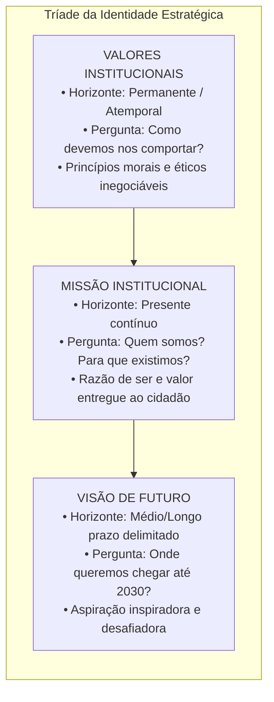
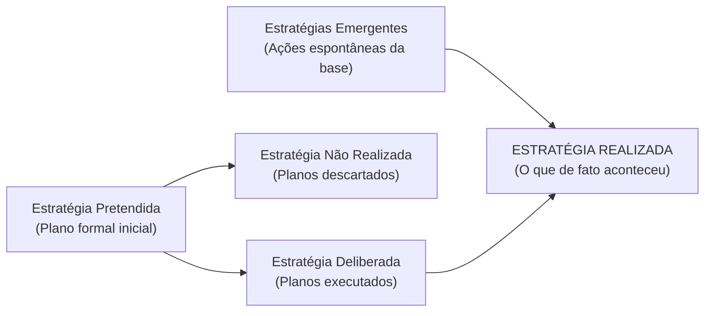
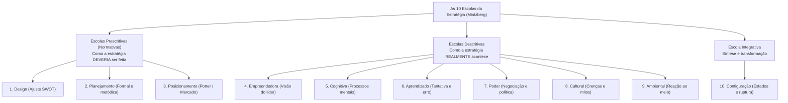

# 01 - Planejamento Estratégico: Missão, Visão, Valores e Escolas Estratégicas

> **Matéria:** Administração Estratégica  
> **Cargo:** A01 – Técnico de Controle Externo – Especialidade: Técnico Administrativo  
> **Arquivo:** `01_planejamento_estrategico_missao_visao_valores_e_escolas.md`  

---

## 📌 Ementa / Itens do Edital
- Planejamento estratégico: conceitos, características, objetivos e evolução conceitual;
- A tríade fundamental da identidade institucional:
  - **Missão:** a razão de existir da organização no presente, seu propósito essencial, competências e público atendido;
  - **Visão:** a aspiração de futuro da instituição, onde ela pretende chegar no horizonte temporal delimitado;
  - **Valores:** princípios morais, crenças fundamentais e padrões éticos inegociáveis que orientam a conduta organizacional;
- O ciclo da gestão estratégica integrada:
  - 1. Diagnóstico Estratégico (análise ambiental externa e interna);
  - 2. Formulação da Estratégia (estabelecimento de objetivos, metas e iniciativas estratégicas);
  - 3. Implementação e Execução (alocação orçamentária, planos de ação e governança);
  - 4. Controle e Avaliação da Estratégia (monitoramento por indicadores, RAE e retroalimentação);
- Tipologias de estratégias segundo Henry Mintzberg:
  - Estratégia Pretendida, Deliberada, Não Realizada, Emergente e Realizada;
- As Dez Escolas do Pensamento Estratégico (*Safári de Estratégia* - Henry Mintzberg, Bruce Ahlstrand e Joseph Lampel):
  - **Escolas Prescritivas / Normativas:** Escola do Design (ajuste interno/externo e SWOT), Escola do Planejamento (formalismo mecanicista e etapas sequenciais) e Escola do Posicionamento (análise setorial e matrizes de Porter);
  - **Escolas Descritivas:** Escola Empreendedora (visão intuitiva do líder), Escola Cognitiva (processamento mental e vieses), Escola do Aprendizado (estratégias emergentes e tentativa e erro), Escola do Poder (negociação, jogos de poder e coalizões), Escola Cultural (crenças coletivas e mitos) e Escola Ambiental (adaptação passiva às pressões externas);
  - **Escola Integrativa:** Escola da Configuração (estabilidade pontuada por transformações estruturais quânticas).

---

## 🌳 Classificação Hierárquica

```text
1. Fundamentos da Estratégia, Identidade Organizacional e Escolas Estratégicas
├── 1.1 Conceito e Evolução do Planejamento Estratégico
│   ├── 1.1.1 Definição: Processo gerencial contínuo para alinhar forças internas a oportunidades externas
│   ├── 1.1.2 Princípios do Planejamento: Participativo, coordenado, integrado e permanente
│   └── 1.1.3 Estratégias Deliberadas vs. Emergentes (Mintzberg):
│       ├── Estratégia Pretendida: Plano formal inicial traçado pela liderança
│       ├── Estratégia Deliberada: Parcela do plano intencional executada com sucesso
│       ├── Estratégia Não Realizada: Planos que se tornaram inviáveis e foram descartados
│       ├── Estratégia Emergente: Padrões de ação não planejados que brotam da base operacional
│       └── Estratégia Realizada: Síntese concreta executada (Deliberadas + Emergentes)
├── 1.2 A Identidade Estratégica Organizacional
│   ├── 1.2.1 Missão Institucional:
│   │   ├── Foco no PRESENTE: "Quem somos? Para que existimos? A quem servimos?"
│   │   └── Exemplo TCE-GO: "Garantir a regularidade e efetividade dos recursos públicos em benefício da sociedade"
│   ├── 1.2.2 Visão de Futuro:
│   │   ├── Foco no FUTURO: "O que queremos ser? Onde queremos chegar até 2030?"
│   │   └── Características: Inspiradora, desafiadora, factível e delimitada no tempo
│   └── 1.2.3 Valores Organizacionais:
│       ├── Princípios éticos inegociáveis (Ética, Transparência, Inovação, Efetividade, Tempestividade)
│       └── Balizas comportamentais que estabelecem limites para as decisões de todos os servidores
├── 1.3 As Quatro Fases do Ciclo de Gestão Estratégica
│   ├── 1.3.1 Diagnóstico Estratégico: Avaliação ambiental macro (externo) e organizacional (interno)
│   ├── 1.3.2 Formulação Estratégica: Estabelecimento de visão, objetivos, metas e projetos prioritários
│   ├── 1.3.3 Implementação Estratégica: Alocação de recursos, desdobramento tático-operacional e governança
│   └── 1.3.4 Monitoramento e Controle: Reuniões de Avaliação da Estratégia (RAE) e ajustes tempestivos
└── 1.4 As Dez Escolas do Pensamento Estratégico (Mintzberg)
    ├── 1.4.1 Escolas Prescritivas (Como a estratégia DEVE ser formulada):
    │   ├── Escola do Design: Ajuste deliberado entre forças/fraquezas e oportunidades/ameaças (SWOT)
    │   ├── Escola do Planejamento: Processo formal, decomposto em etapas sequenciais e manuais analíticos
    │   └── Escola do Posicionamento: Seleção de posições genéricas na indústria concorrencial (Porter)
    ├── 1.4.2 Escolas Descritivas (Como a estratégia REALMENTE é formulada na prática):
    │   ├── Escola Empreendedora: A estratégia como visão personalíssima intuitiva do líder central
    │   ├── Escola Cognitiva: A estratégia como processamento mental no cérebro do tomador de decisão
    │   ├── Escola do Aprendizado: A estratégia como processo emergente por tentativa, erro e experiência
    │   ├── Escola do Poder: A estratégia como negociação política, jogos de poder e coalizões de interesse
    │   ├── Escola Cultural: A estratégia como processo social coletivo enraizado nos valores e tradições
    │   └── Escola Ambiental: A estratégia como resposta passiva e reativa às pressões do meio externo
    └── 1.4.3 Escola Configurativa (Integrativa):
        └── Enxerga a organização em estados de estabilidade interrompidos por transformações quânticas
```

---

## 📖 Resumo Teórico Aprofundado & Esquematizado

### 1. A Tríade da Identidade Estratégica: Missão, Visão e Valores

A formulação da identidade organizacional é o primeiro passo de qualquer planejamento estratégico, estabelecendo a bússola institucional:



#### Quadro Analítico Comparativo:

| Componente | Dimensão Temporal | Foco Central | Exemplo Prático no Setor Público (TCE-GO) |
| :--- | :--- | :--- | :--- |
| **Missão** | **Presente** (contínuo). | A razão de existir hoje; a entrega fundamental que justifica a existência do órgão. | *"Exercer o controle externo com excelência, assegurando a regular aplicação dos recursos públicos em benefício da sociedade."* |
| **Visão** | **Futuro** (longo prazo). | O estado almejado; onde a instituição projeta estar em uma data futura determinada. | *"Ser reconhecido pela sociedade, até 2030, como referência nacional em inovação e eficácia no controle governamental."* |
| **Valores** | **Atemporal** (permanente). | Os mandamentos éticos inegociáveis que norteiam a conduta funcional e as decisões. | *Ética, Transparência, Independência Funcional, Inovação, Tempestividade e Comprometimento Social.* |

---

### 2. Estratégias Deliberadas vs. Estratégias Emergentes (Henry Mintzberg)

Henry Mintzberg revolucionou a teoria estratégica ao demonstrar que a estratégia implementada raramente coincide com os planos originais de gabinete:



* **Estratégia Pretendida:** O plano formal concebido pela alta cúpula antes do início do período.
* **Estratégia Deliberada:** A parcela do plano pretendido que foi rigorosamente executada conforme o desenho original.
* **Estratégia Não Realizada:** Os planos que se mostraram inviáveis devido a restrições orçamentárias, tecnológicas ou mudanças legislativas e acabaram sendo abandonados.
* **Estratégia Emergente:** Padrões de comportamento e iniciativas que **não constavam do plano formal**, mas que brotaram espontaneamente da ação dos servidores operacionais diante de situações imprevistas do dia a dia.
* **Estratégia Realizada:** A estratégia que efetivamente se materializou, resultante da conjunção de ações deliberadas e respostas emergentes.

---

### 3. As Dez Escolas do Pensamento Estratégico (*Safári de Estratégia*)

No clássico livro *Safári de Estratégia*, Mintzberg, Ahlstrand e Lampel dividem a história da estratégia em dez escolas fundamentais:



#### Detalhamento das Dez Escolas:
1. **Escola do Design:** A pioneira. A estratégia é desenhada como um processo deliberado de concepção mental buscando o **ajuste (*fit*) perfeito** entre a capacidade interna e as possibilidades externas (origem da matriz SWOT).
2. **Escola do Planejamento:** Liderada por Igor Ansoff. Concebe a formulação como um processo formal, decomposto em manuais, cronogramas e rotinas rígidas conduzidas por analistas de planejamento.
3. **Escola do Posicionamento:** Liderada por Michael Porter. Reduz a estratégia à escolha analítica de posições genéricas predefinidas em setores competitivos.
4. **Escola Empreendedora:** Enxerga a estratégia como uma visão personalíssima baseada no carisma, intuição e liderança do governante ou fundador.
5. **Escola Cognitiva:** Estuda a estratégia como um processo mental no cérebro do decisor, analisando como os modelos mentais e vieses cognitivos filtram a realidade.
6. **Escola do Aprendizado:** A estratégia emerge passo a passo à medida que a organização aprende com a prática, lidando com contingências e descobrindo caminhos viáveis (*learning organizations*).
7. **Escola do Poder:** Vê a estratégia como um processo de barganha, negociação política e formação de coalizões entre grupos rivais pelo controle do orçamento e das decisões.
8. **Escola Cultural:** Trata a estratégia como um processo social coletivo sustentado pelas crenças, símbolos, tradições e valores compartilhados pelos colaboradores.
9. **Escola Ambiental:** A organização é vista como um ator passivo subordinado às pressões incontroláveis do ambiente externo, que seleciona ou extingue instituições.
10. **Escola da Configuração:** Sintetiza as demais escolas; enxerga a organização vivendo períodos estáveis de configuração coerente que são periodicamente rompidos por transformações revolucionárias quânticas.

---

## 🚨 Alertas de Prova & Pegadinhas da FCC

> 🚨 **ALERTA DE PROVA / PEGADINHA FCC (MISSÃO VS. VISÃO NAS QUESTÕES):**  
> Identifique imediatamente a temporalidade da frase no enunciado:  
> - Se o texto afirma o que a instituição é ou faz no **PRESENTE** ("prestar controle externo de qualidade para a sociedade"): trata-se de **MISSÃO**.  
> - Se o texto traz uma ambição de **FUTURO** com prazo determinado ("ser reconhecido até 2030 como centro de excelência"): trata-se de **VISÃO**.

> ⭐ **IMPORTANTE (ESCOLAS PRESCRITIVAS VS. DESCRITIVAS):**  
> - **Escolas Prescritivas (Design, Planejamento e Posicionamento):** Preocupam-se em prescrever **COMO AS ESTRATÉGIAS DEVEM SER FEITAS** (foco normativo ideal).  
> - **Escolas Descritivas (Aprendizado, Poder, Cultura, etc.):** Preocupam-se em descrever **COMO AS ESTRATÉGIAS SÃO FEITAS NA REALIDADE** (foco empírico prático).

> 🛑 **ATENÇÃO (ESTRATÉGIAS EMERGENTES NO DIA A DIA):**  
> As estratégias emergentes **não nascem na sala de reunião da alta direção**. Elas brotam da base operacional como soluções criativas e espontâneas diante de contingências reais não previstas no planejamento formal.

> 📌 **NOTA EXPLICATIVA (VALORES INSTITUCIONAIS):**  
> Os valores funcionam como freios éticos e morais. Uma meta arrojada de um plano estratégico jamais pode ser perseguida às custas da violação dos valores éticos estabelecidos pela instituição.

---

## 🌐 Fontes Oficiais e Referências Bibliográficas

* [MINTZBERG, Henry; AHLSTRAND, Bruce; LAMPEL, Joseph. Safári de Estratégia: um roteiro pela selva do planejamento estratégico. Editora Bookman.](https://www.grupoa.com.br) - As dez escolas do pensamento estratégico.
* [OLIVEIRA, Djalma de Pinho Rebouças de. Planejamento Estratégico: conceitos, metodologia e práticas. Editora Atlas.](https://www.grupogen.com.br).
* [Plano Estratégico Institucional do TCE-GO 2021-2030](https://portal.tce.go.gov.br) - Declaração oficial de Missão, Visão e Valores institucionais.
* [ANSOFF, H. Igor. Estratégia Corporativa. Editora Atlas.](https://www.grupogen.com.br).
* [PORTER, Michael E. Estratégia Competitiva: técnicas para análise de indústrias e da concorrência. Campus.](https://www.grupogen.com.br).

---

## 📝 Questões de Concurso FCC Comentadas

### Questão 01
**(FCC – TCE-PI – Auditor de Controle Externo)**  
Determinado Tribunal de Contas publicou seu Plano Estratégico com os seguintes enunciados institucionais:
I. "Garantir a adequada aplicação dos recursos públicos em benefício da sociedade por meio do controle externo tempestivo e orientador."  
II. "Ser reconhecido pela sociedade, até o ano de 2030, como órgão de controle de excelência, moderno e indispensável à integridade governamental."  

Nos termos da teoria do planejamento estratégico, os enunciados I e II correspondem, respectivamente, à:

* **A)** Visão e Missão.
* **B)** Missão e Valores.
* **C)** Missão e Visão.
* **D)** Meta Operacional e Diretriz Tática.
* **E)** Valores e Visão.

> **Gabarito: C**  
> **Comentário Detalhado:**  
> - O **Enunciado I** expressa a razão de ser primordial do órgão no presente, identificando sua atividade-fim e o benefício gerado para a sociedade, configurando formalmente a **Missão** institucional.  
> - O **Enunciado II** estabelece um horizonte temporal futuro bem delimitado (até 2030) e delineia o estado aspiracional almejado pela instituição, configurando a **Visão** de futuro.  
> - Portanto, trata-se de Missão e Visão, respectivamente (Alternativa C).

---

### Questão 02
**(FCC – TCE-RS – Auditor de Controle Externo)**  
Em sua clássica taxonomia do pensamento estratégico exposta no livro *Safári de Estratégia*, Henry Mintzberg e colaboradores classificam as escolas da estratégia em prescritivas e descritivas. Dentre as escolas prescritivas, aquela que concebe a formulação estratégica como um processo analítico formal, decomposto em etapas sequenciais rígidas e operado prioritariamente por técnicos e analistas de planejamento, é a:

* **A)** Escola do Aprendizado.
* **B)** Escola do Planejamento.
* **C)** Escola Empreendedora.
* **D)** Escola Cultural.
* **E)** Escola do Poder.

> **Gabarito: B**  
> **Comentário Detalhado:**  
> - **A) Incorreta.** A Escola do Aprendizado é descritiva e concebe a estratégia emergindo de forma incremental ao longo do tempo.  
> - **B) CORRETA.** A **Escola do Planejamento** (liderada por Igor Ansoff) é uma escola prescritiva que encara a estratégia como um processo altamente formalizado, programado e subdividido em etapas analíticas rígidas, com orçamentos detalhados preparados por planejadores profissionais da organização.  
> - **C) Incorreta.** A Escola Empreendedora é descritiva e fundamenta-se na visão e intuição individual do líder.  
> - **D) Incorreta.** A Escola Cultural é descritiva e baseia-se em crenças e valores coletivos.  
> - **E) Incorreta.** A Escola do Poder é descritiva e foca em jogos políticos e disputas de recursos.

---

### Questão 03
**(FCC – TRT-2ª Região – Analista Judiciário: Área Administrativa)**  
De acordo com os conceitos desenvolvidos por Henry Mintzberg sobre a dinâmica da formulação e implementação estratégica, as ações e padrões de conduta que emergem espontaneamente na rotina operacional da organização, sem terem sido previamente previstos no plano formal deliberado pela cúpula, são denominadas:

* **A)** Estratégias Pretendidas.
* **B)** Estratégias Emergentes.
* **C)** Estratégias Não Realizadas.
* **D)** Estratégias Deliberadas.
* **E)** Estratégias Mecanicistas.

> **Gabarito: B**  
> **Comentário Detalhado:**  
> - **A) Incorreta.** A estratégia pretendida é o plano formal inicial traçado pela liderança.  
> - **B) CORRETA.** Para Mintzberg, as **estratégias emergentes** são aquelas que não foram concebidas no plano formal deliberado, mas surgem espontaneamente da base organizacional a partir da resposta prática dos colaboradores a desafios e oportunidades cotidianas não previstos.  
> - **C) Incorreta.** A estratégia não realizada é a parcela do plano que foi descartada ou abandonada.  
> - **D) Incorreta.** A estratégia deliberada é o plano formal que foi executado exatamente conforme o planejado.  
> - **E) Incorreta.** Categoria inexistente na taxonomia de Mintzberg.

---

### Questão 04
**(FCC – DPE-RS – Analista: Área Administrativa)**  
Ao formular seu planejamento plurianual, determinada defensoria pública incluiu expressamente em seu documento diretor os seguintes postulados: "Independência funcional, defesa irrestrita dos direitos humanos, transparência e urbanidade no atendimento aos cidadãos vulneráveis". Sob a perspectiva da teoria da administração estratégica, esses postulados representam:

* **A)** A Visão de futuro da defensoria para os próximos dez anos.
* **B)** As Metas táticas quantitativas dos núcleos regionais.
* **C)** Os Valores institucionais que norteiam as condutas e estabelecem balizas éticas indeclináveis.
* **D)** As Estratégias não realizadas do exercício anterior.
* **E)** As Oportunidades captadas no ambiente externo através da análise PESTEL.

> **Gabarito: C**  
> **Comentário Detalhado:**  
> - **A) Incorreta.** A Visão é uma imagem de futuro onde a instituição quer chegar, com prazo delimitado.  
> - **B) Incorreta.** Metas táticas são alvos quantitativos mensuráveis (ex.: realizar 5.000 atendimentos).  
> - **C) CORRETA.** Os princípios éticos, mandamentos morais e diretrizes de conduta que direcionam as atitudes dos membros de uma instituição e expressam o que é inegociável na cultura organizacional constituem os **Valores** da organização.  
> - **D) Incorreta.** Estratégias não realizadas são planos que foram formalmente descontinuados.  
> - **E) Incorreta.** Oportunidades são eventos externos favoráveis do mercado/ambiente político.

---

### Questão 05
**(FCC – ARTESP – Especialista em Regulação de Transportes)**  
Dentre as dez escolas do pensamento estratégico catalogadas na obra *Safári de Estratégia*, a Escola do Design destaca-se historicamente por defender que a estratégia deve ser concebida por meio de:

* **A)** Ensaios laboratoriais e simulações estocásticas operadas por inteligência artificial.
* **B)** Um processo deliberado de ajuste e adequação mútua entre as capacidades internas da organização (forças e fraquezas) e as condições do ambiente externo (oportunidades e ameaças).
* **C)** Jogos de barganha política e manobras coercitivas promovidas por sindicatos corporativos.
* **D)** Respostas puramente passivas e reativas ditadas pelas forças demográficas e climáticas do ambiente ecológico.
* **E)** Vieses cognitivos inconscientes e restrições biológicas da capacidade de memória dos diretores executivos.

> **Gabarito: B**  
> **Comentário Detalhado:**  
> - **A) Incorreta.** Simulações matemáticas pertencem a abordagens analíticas quantitativas ou de pesquisa operacional.  
> - **B) CORRETA.** A **Escola do Design** é a escola clássica (pioneira nos anos 1960) que propõe a estratégia como um processo deliberado de concepção mental cujo núcleo é o **ajuste (*fit*)** essencial entre a análise interna da organização (pontos fortes e fracos) e a análise externa do ambiente (oportunidades e ameaças), constituindo a base conceitual da famosa matriz SWOT.  
> - **C) Incorreta.** Jogos de barganha e política caracterizam a Escola do Poder.  
> - **D) Incorreta.** Adaptação reativa às forças externas caracteriza a Escola Ambiental.  
> - **E) Incorreta.** Vieses mentais e processos cerebrais caracterizam a Escola Cognitiva.
