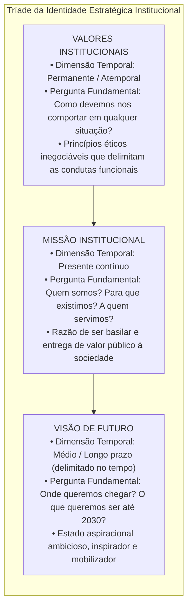
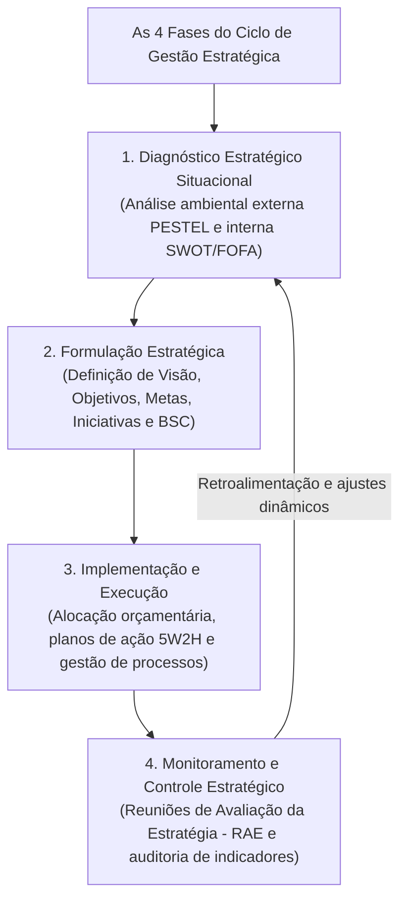
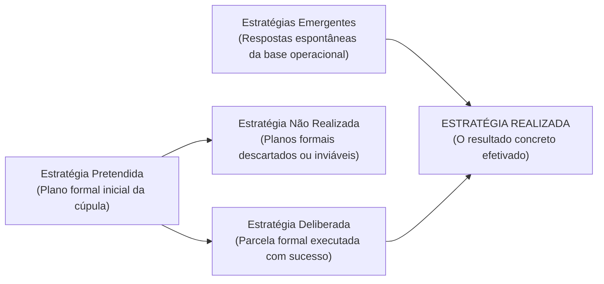
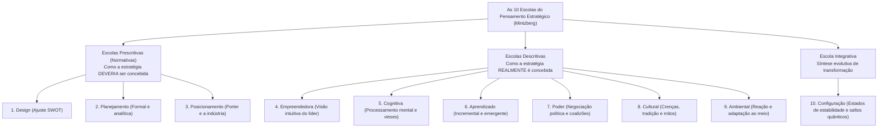

# 01 - Planejamento Estratégico: Missão, Visão, Valores e Escolas Estratégicas

> **Matéria:** Administração Estratégica  
> **Cargo:** A01 – Técnico de Controle Externo – Especialidade: Técnico Administrativo  
> **Arquivo:** `01_planejamento_estrategico_missao_visao_valores_e_escolas.md`  

---

## 📌 Ementa / Itens do Edital
- Planejamento estratégico: conceitos, características, objetivos e evolução conceitual;
- A tríade fundamental da identidade institucional:
    - **Missão:** a razão de existir da organização no presente, seu propósito essencial, competências e público atendido;
    - **Visão:** a aspiração de futuro da instituição, onde ela pretende chegar no horizonte temporal delimitado;
    - **Valores:** princípios morais, crenças fundamentais e padrões éticos inegociáveis que orientam a conduta organizacional;
- O ciclo da gestão estratégica integrada:
    - 1. Diagnóstico Estratégico (análise ambiental externa e interna);
    - 2. Formulação da Estratégia (estabelecimento de objetivos, metas e iniciativas estratégicas);
    - 3. Implementação e Execução (alocação orçamentária, planos de ação e governança);
    - 4. Controle e Avaliação da Estratégia (monitoramento por indicadores, RAE e retroalimentação);
- Tipologias de estratégias segundo Henry Mintzberg:
    - Estratégia Pretendida, Deliberada, Não Realizada, Emergente e Realizada;
- As Dez Escolas do Pensamento Estratégico (*Safári de Estratégia* - Henry Mintzberg, Bruce Ahlstrand e Joseph Lampel):
    - **Escolas Prescritivas / Normativas:** Escola do Design (ajuste interno/externo e SWOT), Escola do Planejamento (formalismo mecanicista e etapas sequenciais) e Escola do Posicionamento (análise setorial e matrizes de Porter);
    - **Escolas Descritivas:** Escola Empreendedora (visão intuitiva do líder), Escola Cognitiva (processamento mental e vieses), Escola do Aprendizado (estratégias emergentes e tentativa e erro), Escola do Poder (negociação, jogos de poder e coalizões), Escola Cultural (crenças coletivas e mitos) e Escola Ambiental (adaptação passiva às pressões externas);
    - **Escola Integrativa:** Escola da Configuração (estabilidade pontuada por transformações estruturais quânticas).

---

## 🧭 Sumário

1. [A Tríade da Identidade Estratégica: Missão, Visão e Valores](#1-a-triade-da-identidade-estrategica-missao-visao-e-valores)
    1. [Teste 370](#Teste-370)
    2. [Teste 371](#Teste-371)
    3. [Teste 372](#Teste-372)
2. [O Ciclo da Gestão Estratégica Integrada](#2-o-ciclo-da-gestao-estrategica-integrada)
    1. [Teste 373](#Teste-373)
3. [Estratégias Deliberadas vs. Estratégias Emergentes (Henry Mintzberg)](#3-estrategias-deliberadas-vs-estrategias-emergentes-henry-mintzberg)
    1. [Teste 374](#Teste-374)
    2. [Teste 375](#Teste-375)
4. [As Dez Escolas do Pensamento Estratégico (*Safári de Estratégia*)](#4-as-dez-escolas-do-pensamento-estrategico-safari-de-estrategia)
    1. [Teste 376](#Teste-376)
    2. [Teste 377](#Teste-377)
    3. [Teste 378](#Teste-378)
    4. [Teste 379](#Teste-379)
5. [Fontes Oficiais e Referências Bibliográficas](#5-fontes-oficiais-e-referencias-bibliograficas)

---

## 1. A Tríade da Identidade Estratégica: Missão, Visão e Valores

A construção da identidade organizacional representa o marco fundador do planejamento estratégico, orientando a tomada de decisão da alta cúpula até a base operacional:

#### Quadro Analítico Comparativo:

| Componente | Dimensão Temporal | Foco Central | Exemplo Prático no Setor Público (TCE-GO) |
| :--- | :--- | :--- | :--- |
| **Missão** | **Presente** (contínuo). | A razão de existir hoje; a entrega fundamental que justifica a existência do órgão perante a sociedade. | *"Exercer o controle externo com excelência, assegurando a regular aplicação dos recursos públicos em benefício da sociedade."* |
| **Visão** | **Futuro** (longo prazo delimitado). | O estado almejado; onde a instituição projeta e quer estar em um marco temporal futuro. | *"Ser reconhecido pela sociedade, até 2030, como referência nacional em inovação e eficácia no controle governamental."* |
| **Valores** | **Atemporal** (permanente). | Os mandamentos morais e éticos inegociáveis que norteiam a conduta funcional e as decisões diárias. | *Ética, Transparência, Independência Funcional, Inovação, Tempestividade e Comprometimento Social.* |

> 🚨 **ALERTA DE PROVA / PEGADINHA FCC (MISSÃO VS. VISÃO NAS QUESTÕES):**  
> Identifique imediatamente a temporalidade da assertiva no enunciado:  
>
> - Se o texto afirma o que a instituição é ou faz no **PRESENTE** ("prestar controle externo de qualidade para a sociedade"): trata-se de **MISSÃO**.  
> - Se o texto traz uma ambição de **FUTURO** com prazo determinado ("ser reconhecido até 2030 como centro de excelência"): trata-se de **VISÃO**.

> 📌 **NOTA EXPLICATIVA (VALORES INSTITUCIONAIS):**  
> Os valores institucionais atuam como balizas e limites éticos inderrogáveis. Nenhuma meta estratégica arrojada pode ser legitimamente cumprida se para tanto for violado qualquer valor ético fixado pela instituição.

---

### Teste 370
**(FGV – TJ-RR – Analista Judiciário - Suporte e Infraestrutura de TI – 2024)**
Os princípios da Gestão Estratégica de Processos não incluem

* **A)** a visão estratégica.
* **B)** a seletividade.
* **C)** o gerenciamento intensivo.
* **D)** a padronização de processos.
* **E)** o aprendizado.

---

> **Comentário Detalhado:**
>
> - **A)** Incorreta. Discrepa das diretrizes normativas e jurisprudenciais aplicáveis ao tema objeto do item.
> - **B)** Incorreta. Discrepa das diretrizes normativas e jurisprudenciais aplicáveis ao tema objeto do item.
> - **C)** Incorreta. Discrepa das diretrizes normativas e jurisprudenciais aplicáveis ao tema objeto do item.
> - **D)** Correta. Representa com precisão a disciplina do tema e o entendimento pacificado adotado pela banca (FGV).
> - **E)** Incorreta. Discrepa das diretrizes normativas e jurisprudenciais aplicáveis ao tema objeto do item.
>
> **Gabarito: D**

---
### Teste 371
**(FGV – TJ-RR – Analista Judiciário - Governança e Gestão de TI – 2024)**
Os princípios da Gestão Estratégica de Processos não incluem

* **A)** a visão estratégica.
* **B)** a seletividade.
* **C)** o gerenciamento intensivo.
* **D)** a padronização de processos.
* **E)** o aprendizado.

---

> **Comentário Detalhado:**
>
> - **A)** Incorreta. Discrepa das diretrizes normativas e jurisprudenciais aplicáveis ao tema objeto do item.
> - **B)** Incorreta. Discrepa das diretrizes normativas e jurisprudenciais aplicáveis ao tema objeto do item.
> - **C)** Incorreta. Discrepa das diretrizes normativas e jurisprudenciais aplicáveis ao tema objeto do item.
> - **D)** Correta. Representa com precisão a disciplina do tema e o entendimento pacificado adotado pela banca (FGV).
> - **E)** Incorreta. Discrepa das diretrizes normativas e jurisprudenciais aplicáveis ao tema objeto do item.
>
> **Gabarito: D**

---
### Teste 372
**(FGV – TRT-DA 24-REGIÃO – Analista Judiciário - Tecnologia da Informação – 2025)**
A gestão de desempenho compreende planejamento, 
organização, supervisão e controle para entregar excelentes 
resultados. 
Assinale a opção que apresenta, corretamente, os processos da 
gestão de desempenho e respectivas funções típicas.

* **A)** Planejamento: fixação de objetivos e definição de planos. 
Organização: implementação e infraestrutura de trabalho. 
Supervisão: comunicação e orientação para equipe. Controle: 
indicadores de desempenho e criação de valor.
* **B)** Planejamento: criação de valor. Organização: alocação de 
recursos. Supervisão: fixação de objetivos. Controle: 
implementação de sistemas de informação.
* **C)** Planejamento: definição de metas e planos de trabalho. 
Organização: execução de tarefas e controle de resultados. 
Supervisão: análise de competências. Controle: comunicação 
com a equipe.
* **D)** Planejamento: avaliação de competências. Organização: 
gestão de pessoas. Supervisão: avaliação de resultados. 
Controle: treinamento e desenvolvimento.
* **E)** Planejamento: distribuição de tarefas. Organização: análise de 
indicadores. Supervisão: criação de métricas. Controle: gestão 
de sistemas de informação.

---

> **Comentário Detalhado:**
>
> - **A)** Incorreta. Discrepa das diretrizes normativas e jurisprudenciais aplicáveis ao tema objeto do item.
> - **B)** Correta. Representa com precisão a disciplina do tema e o entendimento pacificado adotado pela banca (FGV).
> - **C)** Incorreta. Discrepa das diretrizes normativas e jurisprudenciais aplicáveis ao tema objeto do item.
> - **D)** Incorreta. Discrepa das diretrizes normativas e jurisprudenciais aplicáveis ao tema objeto do item.
> - **E)** Incorreta. Discrepa das diretrizes normativas e jurisprudenciais aplicáveis ao tema objeto do item.
>
> **Gabarito: B**

---
## 2. O Ciclo da Gestão Estratégica Integrada

A gestão estratégica contemporânea não é um evento isolado quadrienal, mas um ciclo administrativo contínuo, dinâmico e retroalimentado composto por quatro etapas estruturadas:

1. **Diagnóstico Estratégico:** Mapeamento sistemático do ambiente externo (oportunidades e ameaças incontroláveis) e do ambiente interno (forças e fraquezas controláveis), permitindo compreender a posição real da organização.
2. **Formulação Estratégica:** Estabelecimento dos macro-objetivos, indicadores de desempenho, metas quantificadas e programas de ação prioritários alinhados à missão e visão.
3. **Implementação da Estratégia:** Desdobramento tático-operacional, alocação de recursos financeiros pelo orçamento público (PPA, LDO e LOA), designação formal de responsáveis e governança das ações.
4. **Monitoramento e Controle:** Acompanhamento tempestivo dos indicadores de resultado, identificação precoce de desvios e realização periódica de Reuniões de Avaliação da Estratégia (RAE) para calibragem de rotas.

---

### Teste 373
**(FGV – TRT-DA 24-REGIÃO – Analista Judiciário - Tecnologia da Informação – 2025)**
A gestão de resultados nos serviços públicos busca eficiência, 
transparência e atendimento às demandas sociais por meio de 
monitoramento e avaliação contínuos. 
Assinale a opção que apresenta, corretamente, itens da agenda 
para a estruturação da gestão de resultados na produção de 
serviços públicos.

* **A)** Foco nos resultados e políticas públicas formuladas a partir de 
processo de organização governamental.
* **B)** Caráter centralizado da tomada de decisão e flexibilização de 
recursos com cobrança de responsabilidade de gestores.
* **C)** Utilização de planejamento estratégico nas organizações 
públicas e otimização dos processos administrativos.
* **D)** Mudanças metodológicas no processo de formulação do 
orçamento privado e sistemas de monitoramento da gestão, 
prestação de contas e avaliação.
* **E)** Desenvolvimento de indicadores que permitam medir o 
insumo da ação governamental e indicar os desvios para 
introdução de medidas preventivas. 
TRIBUNAL REGIONAL DO TRABALHO DA 24ª REGIÃO (TRT-24) – REAPLICAÇÃO FGV CONHECIMENTO

---

> **Comentário Detalhado:**
>
> - **A)** Incorreta. Discrepa das diretrizes normativas e jurisprudenciais aplicáveis ao tema objeto do item.
> - **B)** Correta. Representa com precisão a disciplina do tema e o entendimento pacificado adotado pela banca (FGV).
> - **C)** Incorreta. Discrepa das diretrizes normativas e jurisprudenciais aplicáveis ao tema objeto do item.
> - **D)** Incorreta. Discrepa das diretrizes normativas e jurisprudenciais aplicáveis ao tema objeto do item.
> - **E)** Incorreta. Discrepa das diretrizes normativas e jurisprudenciais aplicáveis ao tema objeto do item.
>
> **Gabarito: B**

---
## 3. Estratégias Deliberadas vs. Estratégias Emergentes (Henry Mintzberg)

Henry Mintzberg revolucionou os estudos de estratégia organizacional ao demonstrar que a estratégia executada na prática raramente corresponde de forma idêntica àquela planejada nos gabinetes da diretoria:

* **Estratégia Pretendida:** O plano estratégico inicial concebido formalmente pela liderança institucional.
* **Estratégia Deliberada:** A parcela das intenções estratégicas originais que foi executada exatamente como planejada.
* **Estratégia Não Realizada:** Os objetivos e projetos que, devido a contingências econômicas, cortes orçamentários, alterações legais ou inviabilidade técnica, foram formalmente abandonados.
* **Estratégia Emergente:** Padrões de conduta e soluções práticas que surgem espontaneamente no dia a dia da base operacional, em resposta a contingências imprevistas do ambiente.
* **Estratégia Realizada:** A estratégia que efetivamente ocorreu no mundo dos fatos, configurando a síntese harmonizada entre as estratégias deliberadas da cúpula e as estratégias emergentes da base.

> 🛑 **ATENÇÃO (ESTRATÉGIAS EMERGENTES NO DIA A DIA):**  
> As estratégias emergentes **não brotam nas reuniões formais da cúpula diretiva**. Elas nascem na base de execução (no chão de fábrica ou nas rotinas diárias dos analistas) como soluções práticas, criativas e espontâneas diante de contingências reais não antecipadas no planejamento original.

---

### Teste 374
**(FGV – TRT-DA 24-REGIÃO – Analista Judiciário - Tecnologia da Informação – 2025)**
A gestão de desempenho compreende planejamento, 
organização, supervisão e controle para entregar excelentes 
resultados. 
Assinale a opção que apresenta, corretamente, os processos da 
gestão de desempenho e respectivas funções típicas.

* **A)** Planejamento: fixação de objetivos e definição de planos. 
Organização: implementação e infraestrutura de trabalho. 
Supervisão: comunicação e orientação para equipe. Controle: 
indicadores de desempenho e criação de valor.
* **B)** Planejamento: criação de valor. Organização: alocação de 
recursos. Supervisão: fixação de objetivos. Controle: 
implementação de sistemas de informação.
* **C)** Planejamento: definição de metas e planos de trabalho. 
Organização: execução de tarefas e controle de resultados. 
Supervisão: análise de competências. Controle: comunicação 
com a equipe.
* **D)** Planejamento: avaliação de competências. Organização: 
gestão de pessoas. Supervisão: avaliação de resultados. 
Controle: treinamento e desenvolvimento.
* **E)** Planejamento: distribuição de tarefas. Organização: análise de 
indicadores. Supervisão: criação de métricas. Controle: gestão 
de sistemas de informação.

---

> **Comentário Detalhado:**
>
> - **A)** Incorreta. Discrepa das diretrizes normativas e jurisprudenciais aplicáveis ao tema objeto do item.
> - **B)** Correta. Representa com precisão a disciplina do tema e o entendimento pacificado adotado pela banca (FGV).
> - **C)** Incorreta. Discrepa das diretrizes normativas e jurisprudenciais aplicáveis ao tema objeto do item.
> - **D)** Incorreta. Discrepa das diretrizes normativas e jurisprudenciais aplicáveis ao tema objeto do item.
> - **E)** Incorreta. Discrepa das diretrizes normativas e jurisprudenciais aplicáveis ao tema objeto do item.
>
> **Gabarito: B**

---
### Teste 375
**(FGV – TRT-DA 24-REGIÃO – Analista Judiciário - Tecnologia da Informação – 2025)**
A gestão de resultados nos serviços públicos busca eficiência, 
transparência e atendimento às demandas sociais por meio de 
monitoramento e avaliação contínuos. 
Assinale a opção que apresenta, corretamente, itens da agenda 
para a estruturação da gestão de resultados na produção de 
serviços públicos.

* **A)** Foco nos resultados e políticas públicas formuladas a partir de 
processo de organização governamental.
* **B)** Caráter centralizado da tomada de decisão e flexibilização de 
recursos com cobrança de responsabilidade de gestores.
* **C)** Utilização de planejamento estratégico nas organizações 
públicas e otimização dos processos administrativos.
* **D)** Mudanças metodológicas no processo de formulação do 
orçamento privado e sistemas de monitoramento da gestão, 
prestação de contas e avaliação.
* **E)** Desenvolvimento de indicadores que permitam medir o 
insumo da ação governamental e indicar os desvios para 
introdução de medidas preventivas.

---

> **Comentário Detalhado:**
>
> - **A)** Incorreta. Discrepa das diretrizes normativas e jurisprudenciais aplicáveis ao tema objeto do item.
> - **B)** Correta. Representa com precisão a disciplina do tema e o entendimento pacificado adotado pela banca (FGV).
> - **C)** Incorreta. Discrepa das diretrizes normativas e jurisprudenciais aplicáveis ao tema objeto do item.
> - **D)** Incorreta. Discrepa das diretrizes normativas e jurisprudenciais aplicáveis ao tema objeto do item.
> - **E)** Incorreta. Discrepa das diretrizes normativas e jurisprudenciais aplicáveis ao tema objeto do item.
>
> **Gabarito: B**

---
## 4. As Dez Escolas do Pensamento Estratégico (*Safári de Estratégia*)

Na consagrada obra *Safári de Estratégia*, Henry Mintzberg, Bruce Ahlstrand e Joseph Lampel organizaram a evolução do pensamento estratégico em dez escolas, categorizadas em prescritivas, descritivas e integrativas:

#### A) Escolas Prescritivas (Normativas - Foco em prescrever o modelo ideal):
1. **Escola do Design:** A pioneira (década de 1960). Enxerga a formulação como um processo de concepção mental deliberada cujo objetivo supremo é o **ajuste (*fit*) essencial** entre as capacidades internas da organização (Forças e Fraquezas) e as condições externas do ambiente (Oportunidades e Ameaças) – base da Matriz SWOT.
2. **Escola do Planejamento:** Liderada por H. Igor Ansoff. Concebe a formulação como um processo altamente formal, metódico e sequencial, desdobrado em manuais exaustivos, cronogramas e orçamentos operados por analistas de planejamento.
3. **Escola do Posicionamento:** Liderada por Michael Porter (anos 1980). A estratégia é vista como um processo analítico de escolha de posições competitivas genéricas (Liderança em Custo, Diferenciação ou Enfoque) dentro da estrutura da indústria concorrencial.

---

### Teste 376
**(FGV – TRT-DA 24-REGIÃO – Analista Judiciário - Tecnologia da Informação – 2025)**
A gestão de desempenho compreende planejamento, 
organização, supervisão e controle para entregar excelentes 
resultados. 
Assinale a opção que apresenta, corretamente, os processos da 
gestão de desempenho e respectivas funções típicas.

* **A)** Planejamento: fixação de objetivos e definição de planos. 
Organização: implementação e infraestrutura de trabalho. 
Supervisão: comunicação e orientação para equipe. Controle: 
indicadores de desempenho e criação de valor.
* **B)** Planejamento: criação de valor. Organização: alocação de 
recursos. Supervisão: fixação de objetivos. Controle: 
implementação de sistemas de informação.
* **C)** Planejamento: definição de metas e planos de trabalho. 
Organização: execução de tarefas e controle de resultados. 
Supervisão: análise de competências. Controle: comunicação 
com a equipe.
* **D)** Planejamento: avaliação de competências. Organização: 
gestão de pessoas. Supervisão: avaliação de resultados. 
Controle: treinamento e desenvolvimento.
* **E)** Planejamento: distribuição de tarefas. Organização: análise de 
indicadores. Supervisão: criação de métricas. Controle: gestão 
de sistemas de informação.

---

> **Comentário Detalhado:**
>
> - **A)** Incorreta. Discrepa das diretrizes normativas e jurisprudenciais aplicáveis ao tema objeto do item.
> - **B)** Correta. Representa com precisão a disciplina do tema e o entendimento pacificado adotado pela banca (FGV).
> - **C)** Incorreta. Discrepa das diretrizes normativas e jurisprudenciais aplicáveis ao tema objeto do item.
> - **D)** Incorreta. Discrepa das diretrizes normativas e jurisprudenciais aplicáveis ao tema objeto do item.
> - **E)** Incorreta. Discrepa das diretrizes normativas e jurisprudenciais aplicáveis ao tema objeto do item.
>
> **Gabarito: B**

---
### Teste 377
**(FGV – TRT-DA 24-REGIÃO – Analista Judiciário - Tecnologia da Informação – 2025)**
A gestão de resultados nos serviços públicos busca eficiência, 
transparência e atendimento às demandas sociais por meio de 
monitoramento e avaliação contínuos. 
Assinale a opção que apresenta, corretamente, itens da agenda 
para a estruturação da gestão de resultados na produção de 
serviços públicos.

* **A)** Foco nos resultados e políticas públicas formuladas a partir de 
processo de organização governamental.
* **B)** Caráter centralizado da tomada de decisão e flexibilização de 
recursos com cobrança de responsabilidade de gestores.
* **C)** Utilização de planejamento estratégico nas organizações 
públicas e otimização dos processos administrativos.
* **D)** Mudanças metodológicas no processo de formulação do 
orçamento privado e sistemas de monitoramento da gestão, 
prestação de contas e avaliação.
* **E)** Desenvolvimento de indicadores que permitam medir o 
insumo da ação governamental e indicar os desvios para 
introdução de medidas preventivas. 
TRIBUNAL REGIONAL DO TRABALHO DA 24ª REGIÃO (TRT-24) – REAPLICAÇÃO FGV CONHECIMENTO

---

> **Comentário Detalhado:**
>
> - **A)** Incorreta. Discrepa das diretrizes normativas e jurisprudenciais aplicáveis ao tema objeto do item.
> - **B)** Correta. Representa com precisão a disciplina do tema e o entendimento pacificado adotado pela banca (FGV).
> - **C)** Incorreta. Discrepa das diretrizes normativas e jurisprudenciais aplicáveis ao tema objeto do item.
> - **D)** Incorreta. Discrepa das diretrizes normativas e jurisprudenciais aplicáveis ao tema objeto do item.
> - **E)** Incorreta. Discrepa das diretrizes normativas e jurisprudenciais aplicáveis ao tema objeto do item.
>
> **Gabarito: B**

---
### Teste 378
**(FCC – TRT-6 – Analista Judiciário - Tecnologia da Informação – 2012)**
O processo de monitoramento de programas de governo pressupõe

* **A)** o acompanhamento contábil da implantação do programa, com relatórios semanais.
* **B)** uma checagem diária das condições formais da organiza ção, em termos de qualificação dos recursos humanos.
* **C)** o acompanhamento contínuo, cotidiano, por parte de gestores e gerentes, do desenvolvimento dos programas e políticas 
em relação a seus objetivos e metas.
* **D)** avaliações executadas por instituições externas, com pesquisas que procurem responder a perguntas específicas.
* **E)** a construção de indicadores, produzidos regularmente com bas e em diferentes fontes de dados, que dão aos gestores 
informações sobre o desempenho de programas.

---

> **Comentário Detalhado:**
>
> - **A)** Incorreta. Discrepa das diretrizes normativas e jurisprudenciais aplicáveis ao tema objeto do item.
> - **B)** Incorreta. Discrepa das diretrizes normativas e jurisprudenciais aplicáveis ao tema objeto do item.
> - **C)** Incorreta. Discrepa das diretrizes normativas e jurisprudenciais aplicáveis ao tema objeto do item.
> - **D)** Incorreta. Discrepa das diretrizes normativas e jurisprudenciais aplicáveis ao tema objeto do item.
> - **E)** Correta. Representa com precisão a disciplina do tema e o entendimento pacificado adotado pela banca (FCC).
>
> **Gabarito: E**

---
### Teste 379
**(FGV – TRT – Analista Judiciário - Tecnologia da Informação – 2024)**
O Referencial Estratégico das Organizações é uma bússola que 
orienta as ações e decisões, fornecendo uma visão clara dos 
objetivos e direcioname ntos a serem seguidos para alcançar o 
sucesso. 
Sobre o Referencial Estratégico das Organizações, analise os itens 
a seguir: 
I. Objetivos e metas são os resultados desejados. 
II. Key performance indicators (KPIs) são informações para 
avaliar até que ponto o s objetivos estão sendo atingidos e se 
os cursos de ação escolhidos são apropriados. 
III. Avaliação é o processo de determinar se a realização dos 
objetivos está alcançando os efeitos pretendidos. 
Está correto o que se afirma em

* **A)** I, apenas.
* **B)** I e II, apenas.
* **C)** I e III, apenas.
* **D)** II e III, apenas.
* **E)** I, II e III.

---

> **Comentário Detalhado:**
>
> - **A)** Correta. Representa com precisão a disciplina do tema e o entendimento pacificado adotado pela banca (FGV).
> - **B)** Incorreta. Discrepa das diretrizes normativas e jurisprudenciais aplicáveis ao tema objeto do item.
> - **C)** Incorreta. Discrepa das diretrizes normativas e jurisprudenciais aplicáveis ao tema objeto do item.
> - **D)** Incorreta. Discrepa das diretrizes normativas e jurisprudenciais aplicáveis ao tema objeto do item.
> - **E)** Incorreta. Discrepa das diretrizes normativas e jurisprudenciais aplicáveis ao tema objeto do item.
>
> **Gabarito: A**

---
## 5. Fontes Oficiais e Referências Bibliográficas

* [Decreto nº 9.203/2017 (Mecanismo de Estratégia na Governança Pública)](https://www.planalto.gov.br/ccivil_03/_ato2015-2018/2017/decreto/d9203.htm) - Define estratégia como conjunto de ações voltadas ao alcance dos objetivos organizacionais e satisfação do cidadão.
* [Decreto-Lei nº 200/1967 (Princípio Fundamental do Planejamento)](https://www.planalto.gov.br/ccivil_03/decreto-lei/del0200.htm) - Exigência legal de planejamento plurianual e planos anuais de ação para as entidades públicas.
* [TCU - Referencial Básico de Governança: Práticas de Estratégia](https://portal.tcu.gov.br/governanca/governanca-no-tcu/) - Critérios para formulação de missão institucional, visão de futuro e valores organizacionais.
* [TCE-GO - Plano de Fiscalização e Diretrizes Estratégicas](https://portal.tce.go.gov.br/governanca-planejamento-e-gestao/planos-institucionais/plano-de-fiscalizacao) - Diretrizes estratégicas que orientam as ações de controle do tribunal goiano.
* [Governo Digital - Estratégia Federal de Governo Digital (EFGD)](https://www.gov.br/governodigital/pt-br/estrategias-e-governanca-digital/EFGD) - Planejamento estratégico federal para modernização da prestação de serviços públicos.
* MINTZBERG, Henry; AHLSTRAND, Bruce; LAMPEL, Joseph. **Safári de Estratégia: Um Roteiro pela Selva do Planejamento Estratégico**. 2. ed. Porto Alegre: Bookman, 2010. (Cap. 2 a 11 - As Dez Escolas do Pensamento Estratégico).
* OLIVEIRA, Djalma de Pinho Rebouças de. **Planejamento Estratégico: Conceitos, Metodologia e Práticas**. 34. ed. São Paulo: Atlas, 2018. (Cap. 1 a 3 - Missão, Visão e Valores Organizacionais).
* ANSOFF, H. Igor. **Estratégia Corporativa**. São Paulo: Atlas, 1990. (Cap. 4 - Formulação Estratégica).
