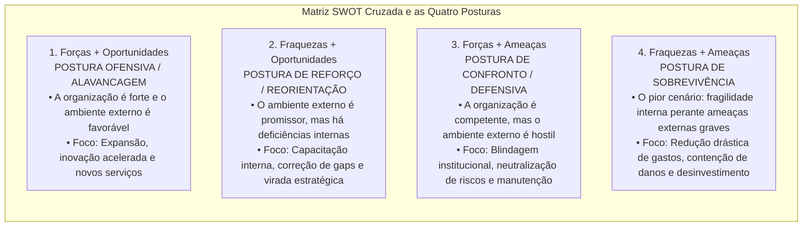
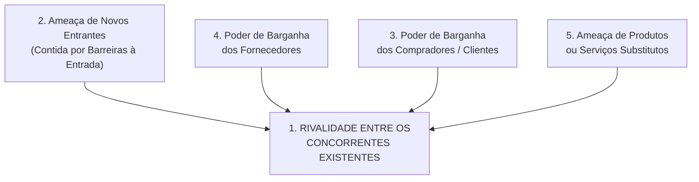
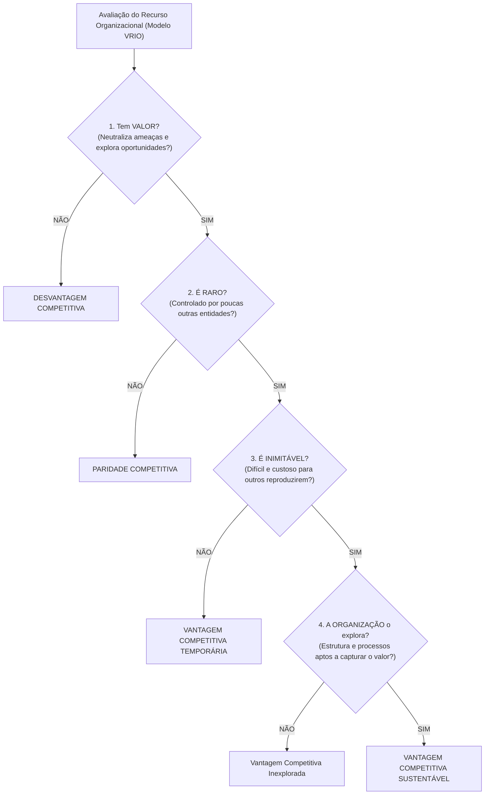
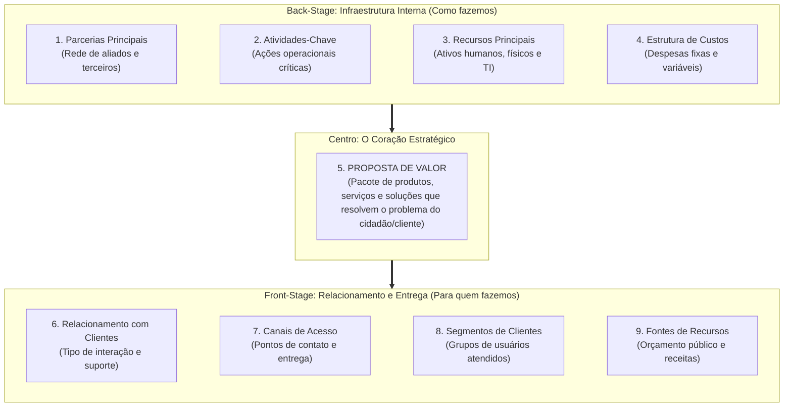

# 02 - Ferramentas de Diagnóstico Estratégico: SWOT, Cinco Forças de Porter, RBV e Canvas

> **Matéria:** Administração Estratégica  
> **Cargo:** A01 – Técnico de Controle Externo – Especialidade: Técnico Administrativo  
> **Arquivo:** `02_ferramentas_de_diagnostico_estrategico_swot_porter_rbv_canvas.md`  

---

## 📌 Ementa / Itens do Edital
- Diagnóstico do ambiente estratégico interno e externo;
- **Análise SWOT (Matriz FOFA):**
    - Mapeamento de Forças e Fraquezas (ambiente interno controlável) e Oportunidades e Ameaças (ambiente externo incontrolável);
    - Matriz de Cruzamento Estratégico e as quatro posturas organizacionais: Alavancagem/Ofensiva, Reforço/Crescimento, Confronto/Manutenção e Sobrevivência;
- **As Cinco Forças Competitivas de Michael Porter:**
    - 1. Rivalidade entre os concorrentes estabelecidos na indústria;
    - 2. Ameaça de novos entrantes e as barreiras à entrada (economias de escala, diferenciação de produto, capital inicial, custos de mudança e políticas estatais);
    - 3. Poder de barganha dos compradores / clientes;
    - 4. Poder de barganha dos fornecedores de insumos;
    - 5. Ameaça de produtos ou serviços substitutos (soluções de outros setores);
- As três Estratégias Genéricas de Michael Porter: Liderança em Custo Total, Diferenciação e Enfoque/Foco (e o risco do meio-termo / *stuck in the middle*);
- **Visão Baseada em Recursos (RBV - *Resource-Based View* - Jay Barney):**
    - Recursos tangíveis versus recursos intangíveis; premissas de heterogeneidade e imobilidade imperfeita;
    - O Framework **VRIO:** Valor, Raridade, Inimitabilidade e Organização;
    - Consequências competitivas: Desvantagem, Paridade, Vantagem Temporária e Vantagem Competitiva Sustentável;
- **Business Model Canvas (Alexander Osterwalder):**
    - Os nove blocos de geração de valor organizacional: Proposta de Valor, Segmentos de Clientes, Canais, Relacionamento com Clientes, Fontes de Receita, Recursos Principais, Atividades-Chave, Parcerias Principais e Estrutura de Custos.

---

## 🧭 Sumário

1. [Resumo Teórico Aprofundado & Esquematizado](#resumo-teorico-aprofundado-esquematizado)
    1. [Análise SWOT Cruzada (FOFA) e as Quatro Posturas Estratégicas](#1-analise-swot-cruzada-fofa-e-as-quatro-posturas-estrategicas)
    2. [Teste 380](#Teste-380)
    3. [Teste 381](#Teste-381)
    4. [O Modelo das Cinco Forças e as Estratégias Genéricas de Michael Porter](#2-o-modelo-das-cinco-forcas-e-as-estrategias-genericas-de-michael-porter)
    5. [Teste 382](#Teste-382)
    6. [Teste 383](#Teste-383)
    7. [Teste 384](#Teste-384)
    8. [A Visão Baseada em Recursos (RBV) e o Framework VRIO (Jay Barney)](#3-a-visao-baseada-em-recursos-rbv-e-o-framework-vrio-jay-barney)
    9. [Teste 385](#Teste-385)
    10. [Teste 386](#Teste-386)
    11. [O Business Model Canvas (Alexander Osterwalder)](#4-o-business-model-canvas-alexander-osterwalder)
    12. [Teste 387](#Teste-387)
    13. [Teste 388](#Teste-388)
    14. [Teste 389](#Teste-389)
    15. [Fontes Oficiais e Referências Bibliográficas](#5-fontes-oficiais-e-referencias-bibliograficas)

---

## 📖 Resumo Teórico Aprofundado & Esquematizado

### 1. Análise SWOT Cruzada (FOFA) e as Quatro Posturas Estratégicas

A análise SWOT (acrônimo para *Strengths, Weaknesses, Opportunities e Threats* / Matriz FOFA em português) combina as variáveis do ambiente interno e externo para subsidiar a escolha da postura estratégica mais adequada:

#### Tabela Analítica das Quatro Posturas Estratégicas:

| Postura Estratégica | Quadrante Cruzado | Diagnóstico Situacional | Ação Estratégica Primordial |
| :--- | :---: | :--- | :--- |
| **Alavancagem / Ofensiva** | **Forças + Oportunidades** | A organização é sólida internamente e o ambiente externo abre oportunidades vantajosas. | Expansão de atuação, modernização tecnológica e consolidação de liderança. |
| **Reorientação / Reforço** | **Fraquezas + Oportunidades** | O ambiente externo é favorável, mas a organização possui carências internas que limitam seu aproveitamento. | Capacitação de pessoal, reestruturação de processos e correção de deficiências. |
| **Manutenção / Confronto** | **Forças + Ameaças** | O órgão possui excelente capacidade interna, contudo enfrenta hostilidade ou riscos no ambiente externo. | Adoção de postura defensiva, preservação de competências essenciais e blindagem. |
| **Sobrevivência** | **Fraquezas + Ameaças** | Situação crítica: a instituição acumula vulnerabilidades internas sob severas pressões e ameaças externas. | Contenção extrema de despesas, enxugamento de rotinas e abandono de ações secundárias. |

> 🚨 **ALERTA DE PROVA / PEGADINHA FCC (FORÇAS VS. OPORTUNIDADES NA SWOT):**  
> Questão garantida de prova: a FCC coloca no enunciado que "o quadro de pessoal do tribunal possui excelente qualificação técnica e os sistemas informatizados são modernos" e pergunta se isso é uma Oportunidade. **NÃO!** Isso é uma **FORÇA (ambiente interno controlável)**! Oportunidades são eventos **estritamente externos** que o órgão não controla (ex.: aprovação de linha federal de crédito para modernização ou surgimento de novas ferramentas abertas de IA).

> 📌 **NOTA EXPLICATIVA (POSTURA DE SOBREVIVÊNCIA NA SWOT):**  
> No cruzamento SWOT, a postura de sobrevivência decorre da convergência entre **Fraquezas internas predominantes** e **Ameaças externas graves**, demandando corte imediato de gastos, redução de projetos e contenção rigorosa de danos.

---

### Teste 380
**(FCC – TRT-20ª Região – Analista Judiciário: Área Administrativa)**  
Determinada entidade governamental realizou o diagnóstico de seu ambiente por meio da matriz SWOT cruzada. A equipe constatou a existência concomitante de graves fragilidades operacionais internas (sistemas obsoletos e déficit crônico de servidores) associadas a um ambiente externo marcado por severas restrições orçamentárias impostas por lei e risco iminente de descontinuidade de convênios. Diante desse cenário de predomínio de fraquezas internas e ameaças externas, a postura estratégica recomendada pela teoria da administração é a:

* **A)** Postura de Alavancagem ou Ofensiva.
* **B)** Postura de Sobrevivência.
* **C)** Postura de Expansão Acelerada de Mercados.
* **D)** Postura de Liderança em Diferenciação de Marca.
* **E)** Postura de Reforço Baseada em Vantagem Sustentável.

---

> **Comentário Detalhado:**  
>
> - **A) Incorreta.** A postura ofensiva/alavancagem ocorre no quadrante Forças + Oportunidades.  
> - **B) CORRETA.** No cruzamento da matriz SWOT, quando uma instituição acumula **Fraquezas internas** diante de **Ameaças externas graves** (quadrante WT), a estratégia mandatória é a **Postura de Sobrevivência**, caracterizada pela contenção drástica de despesas, eliminação de desperdícios, redução de escopo e reestruturação para evitar o colapso operacional da organização.  
> - **C) Incorreta.** Expansão é postura ofensiva para momentos favoráveis.  
> - **D) Incorreta.** Diferenciação é estratégia de posicionamento mercadológico de Porter.  
> - **E) Incorreta.** O momento é de mitigação extrema de riscos, e não de sustentação de vantagem.  
> 
> **Gabarito: B**

---

### Teste 381
**(FCC - Adaptada / Analista de Planejamento e Gestão)**
Na Análise SWOT Cruzada (Matriz FOFA), o confronto entre o ambiente interno (Forças e Fraquezas) e o ambiente externo (Oportunidades e Ameaças) permite delinear posturas estratégicas fundamentais para a organização.

A postura estratégica recomendada quando a organização diagnostica um cenário caracterizado predominantemente pelo cruzamento entre **Fraquezas Internas** e **Ameaças Externas** é a postura de:

* **A)** Sobrevivência (ou Defensiva), visando reduzir danos, conter prejuízos e desinvestir em áreas críticas inviabilizadas.
* **B)** Desenvolvimento (ou Alavancagem agressiva), priorizando a expansão maciça de novos serviços e instalações.
* **C)** Domínio Monopolista irrestrito de mercado.
* **D)** Crescimento acelerado por meio de fusões estatais corporativas.
* **E)** Terceirização integral das atividades exclusivas de Estado.

---

> **Comentário Detalhado:**
>
> - **A)** Correta. As quatro posturas da matriz SWOT cruzada: (1) **Forças + Oportunidades**: Desenvolvimento / Alavancagem; (2) **Forças + Ameaças**: Manutenção / Proteção; (3) **Fraquezas + Oportunidades**: Crescimento / Mudança de Rumo; (4) **Fraquezas + Ameaças**: **Sobrevivência** (situação de vulnerabilidade extrema, exigindo contenção de despesas, enxugamento de custos, alienação de ativos e redução de danos).
> - **B), C), D), E)** Incorretas. Incompatíveis com a combinação de fraquezas e ameaças.
> 
> **Gabarito: A**

---

### 2. O Modelo das Cinco Forças e as Estratégias Genéricas de Michael Porter

Michael Porter desenvolveu um clássico referencial para explicar como as forças estruturais de uma indústria determinam sua intensidade competitiva e seu nível de atratividade:

#### As Cinco Forças Competitivas:
1. **Rivalidade entre Concorrentes Estabelecidos:** Ponto central do modelo. Intensificada por fatores como: elevado número de concorrentes com forças semelhantes, lento crescimento do mercado, custos fixos altos e elevadas barreiras de saída (custos para abandonar o negócio).
2. **Ameaça de Novos Entrantes:** Determinada pela solidez das **barreiras à entrada**, que representam dificuldades e custos impostos aos novatos, tais como:
    - Economias de escala alcançadas pelas empresas consolidadas;
    - Requisitos elevados de investimento de capital inicial;
    - Custos de mudança (*switching costs*) incorridos pelo cliente ao trocar de marca;
    - Políticas e regulamentações governamentais protetivas.

3. **Poder de Barganha dos Compradores (Clientes):** Alto quando os clientes compram em grandes volumes, os produtos oferecidos são padronizados/comoditizados e os custos de migração para outra empresa são insignificantes.
4. **Poder de Barganha dos Fornecedores:** Elevado quando os fornecedores operam em mercado concentrado, o insumo fornecido é exclusivo ou crítico e inexistem produtos substitutos no mercado.
5. **Ameaça de Produtos Substitutos:** Produtos ou serviços oriundos de **outros setores/indústrias** que desempenham a mesma função básica a um custo inferior ou com maior conveniência para o usuário.

---

### Teste 382
**(FCC – TCE-PI – Auditor de Controle Externo)**  
De acordo com o modelo de análise das Cinco Forças Competitivas desenvolvido por Michael Porter, a intensidade com que novas empresas ou organizações ameaçam ingressar em determinado setor de atividade econômica é contida fundamentalmente pela presença de:

* **A)** Barreiras à entrada, tais como economias de escala consolidadas e elevados requisitos de capital inicial.
* **B)** Alta rivalidade interna e ausência de regulamentação governamental setorial.
* **C)** Facilidade de acesso aos canais de distribuição tradicionais pelos recém-chegados.
* **D)** Baixo custo de mudança (*switching costs*) suportado pelos consumidores ao migrarem de fornecedor.
* **E)** Existência de produtos substitutos com preços significativamente menores no mercado.

---

> **Comentário Detalhado:**  
>
> - **A) CORRETA.** Segundo Michael Porter, a ameaça de novos concorrentes entrantes é diretamente atenuada pela existência de **barreiras à entrada**, que elevam os custos e riscos para quem deseja entrar no setor (ex.: economias de escala dos incumbentes, diferenciação de marcas, altos requisitos de investimento de capital, acesso restrito aos canais de distribuição e regulação pública).  
> - **B) Incorreta.** Alta rivalidade é outra força competitiva; a ausência de barreiras facilita o ingresso.  
> - **C) Incorreta.** Se os canais são de fácil acesso, a barreira é baixa, o que estimula a entrada de novos concorrentes.  
> - **D) Incorreta.** Baixo custo de mudança (*switching costs*) estimula o consumidor a trocar de empresa, fragilizando a barreira.  
> - **E) Incorreta.** A ameaça de produtos substitutos é a quinta força do modelo de Porter, não se confundindo com as barreiras à entrada de concorrentes no mesmo setor.  
> 
> **Gabarito: A**

---

#### As Três Estratégias Genéricas de Michael Porter:
* **Liderança em Custo Total:** A organização estrutura-se para produzir e operar com o menor custo unitário da indústria, valendo-se de economias de escala, rígido controle de despesas e processos padronizados.
* **Diferenciação:** A organização busca criar produtos ou serviços percebidos no mercado como singulares, únicos e de qualidade superior, conquistando fidelidade à marca e viabilizando a cobrança de um preço superior (*premium price*).
* **Enfoque / Foco:** A organização canaliza seus esforços para atender de forma estrita e especializada a um nicho de mercado específico, aplicando ou a liderança em custo ou a diferenciação restrita àquele segmento.

> ⭐ **IMPORTANTE (PRODUTOS SUBSTITUTOS DE PORTER):**  
> Cuidado: produtos substitutos na visão de Porter **NÃO SÃO produtos de concorrentes diretos da mesma indústria** (ex.: Pepsi e Coca-Cola são concorrentes diretos no setor de refrigerantes). Produtos substitutos pertencem a **outras indústrias** que atendem à mesma necessidade essencial por meio de solução alternativa (ex.: ônibus interestadual substituindo passagens aéreas em trechos regionais).

---

### Teste 383
**(FCC – SEFAZ-PE – Auditor Fiscal do Tesouro Estadual)**  
No modelo das Estratégias Genéricas formulado por Michael Porter, a organização que opta por desenvolver serviços ou produtos com atributos peculiares e exclusivos, fortemente reconhecidos pelo público-alvo pela sua excelência técnica, design inovador e credibilidade institucional, cobra preços diferenciados e busca fidelizar seus usuários, adota a estratégia genérica de:

* **A)** Liderança em Custo Total.
* **B)** Diferenciação.
* **C)** Desinvestimento Operacional.
* **D)** Conglomerado Diversificado.
* **E)** Paridade Tecnológica Compulsória.

---

> **Comentário Detalhado:**  
>
> - **A) Incorreta.** Liderança em custos busca operar com o menor custo unitário de produção da indústria com base em economias de escala.  
> - **B) CORRETA.** A estratégia genérica de **Diferenciação** baseia-se na criação de um produto ou serviço percebido pelo mercado/usuário como exclusivo e singular em suas características, gerando lealdade à marca e permitindo que a organização cobre preços superiores (*preço premium*) ou atinja alto reconhecimento público.  
> - **C) Incorreta.** Desinvestimento é manobra de redução de ativos, e não estratégia competitiva genérica.  
> - **D) Incorreta.** Conglomerado é forma societária de diversificação corporativa.  
> - **E) Incorreta.** Categoria inexistente na taxonomia de Porter.  
> 
> **Gabarito: B**

---

### Teste 384
**(FCC - Adaptada / Auditor de Controle Externo)**
Michael Porter formulou o célebre modelo das Cinco Forças Competitivas que determinam a atratividade e o nível de rentabilidade de uma indústria.

São forças competitivas integrantes do modelo original de Porter:

* **A)** Rivalidade entre os concorrentes existentes, Ameaça de novos entrantes, Poder de barganha dos compradores (clientes), Poder de barganha dos fornecedores e Ameaça de produtos ou serviços substitutos.
* **B)** Poder Judiciário, Poder Executivo, Poder Legislativo, Ministério Público e Tribunal de Contas.
* **C)** Gravidade, Urgência, Tendência, Capacidade Operacional e Risco Jurídico.
* **D)** Inflação, Taxa Selic, Produto Interno Bruto, Balança Comercial e Dívida Soberana.
* **E)** Hardware, Software, Peopleware, Sistemas de Redes e Dados na Nuvem.

---

> **Comentário Detalhado:**
>
> - **A)** Correta. As **Cinco Forças de Porter**: (1) Rivalidade entre concorrentes existentes; (2) Ameaça de novos concorrentes entrantes; (3) Poder de barganha dos clientes/compradores; (4) Poder de barganha dos fornecedores; (5) Ameaça de produtos/serviços substitutos.
> - **B)** Incorreta. Estrutura institucional dos Poderes estatais.
> - **C)** Incorreta. Elementos da Matriz GUT.
> - **D)** Incorreta. Indicadores macroeconômicos do ambiente geral.
> - **E)** Incorreta. Componentes de tecnologia da informação.
> 
> **Gabarito: A**

---

### 3. A Visão Baseada em Recursos (RBV) e o Framework VRIO (Jay Barney)

Ao contrário dos modelos que olham prioritariamente para o mercado exterior (como Porter), a **Visão Baseada em Recursos (RBV - *Resource-Based View*)** sustenta que a fonte de vantagem competitiva sustentada e de desempenho superior das organizações reside em seu **ambiente interno**: nos recursos e capacidades que a organização possui e controla.

A teoria parte de duas premissas essenciais:

* **Heterogeneidade de Recursos:** As organizações possuem feixes de recursos e competências distintos entre si.
* **Imobilidade Imperfeita de Recursos:** Os recursos essenciais não podem ser transferidos ou comprados livre e instantaneamente de uma entidade para outra.

#### Os Critérios do Framework VRIO:
1. **V - Valor:** O recurso permite à organização explorar uma oportunidade ambiental externa ou neutralizar uma ameaça?
2. **R - Raridade:** O recurso é escasso e controlado por poucas entidades concorrentes?
3. **I - Inimitabilidade:** As outras organizações enfrentam desvantagens de custo elevadas para reproduzir ou obter esse recurso? A inimitabilidade decorre de três barreiras clássicas:
    - *Condições históricas únicas:* recursos desenvolvidos ao longo de trajetórias históricas irrepetíveis;
    - *Ambiguidade causal:* os competidores não conseguem decifrar exatamente qual fator específico causa o sucesso da organização;
    - *Complexidade social:* recursos enraizados em relações humanas, reputação, confiança mútua e cultura institucional.

4. **O - Organização:** A instituição dispõe de desenho organizacional, sistemas de informação, liderança e governança estruturados para absorver e capitalizar plenamente o potencial desse recurso?

> 🛑 **ATENÇÃO (VRIO E VANTAGEM SUSTENTÁVEL):**  
> Se o recurso for Valioso e Raro, mas os competidores puderem copiá-lo rapidamente no mercado, ele gera unicamente **Vantagem Competitiva Temporária**. Para assegurar vantagem **Sustentável**, o recurso deve ser imperativamente **Inimitável** e a entidade deve dispor de **Organização** para explorá-lo!

---

### Teste 385
**(FCC – TCE-RS – Auditor de Controle Externo)**  
Segundo a Visão Baseada em Recursos (RBV) e o modelo conceitual VRIO formulado por Jay Barney, um recurso organizacional que seja considerado valioso pela organização e raro no seu mercado de atuação, porém passível de imitação a baixo custo pelos demais concorrentes, proporciona à entidade:

* **A)** Desvantagem competitiva prolongada.
* **B)** Vantagem competitiva temporária.
* **C)** Vantagem competitiva sustentável.
* **D)** Paridade competitiva definitiva.
* **E)** Ineficiência operacional estrutural.

---

> **Comentário Detalhado:**  
>
> - **A) Incorreta.** Como o recurso é valioso e raro, a empresa obtém diferencial positivo, e não desvantagem.  
> - **B) CORRETA.** No framework VRIO:  
>     - Recurso Valioso, mas não Raro $\rightarrow$ Paridade Competitiva;  
>     - Recurso Valioso e Raro, mas **Imitável (fácil de copiar)** $\rightarrow$ **Vantagem Competitiva Temporária**, visto que logo os rivais conseguirão reproduzi-lo, extinguindo o diferencial inicial.  
>     - Apenas se for Inimitável e sustentado pela Organização é que se alcança a **Vantagem Competitiva Sustentável**.  
> - **C) Incorreta.** A sustentabilidade requer obrigatoriamente que o recurso seja inimitável.  
> - **D) Incorreta.** Paridade ocorre quando o recurso não é raro.  
> - **E) Incorreta.** Não guarda pertinência com ineficiência estrutural.  
> 
> **Gabarito: B**

---

### Teste 386
**(FCC - Adaptada / Analista de Tecnologia e Controle)**
Na Visão Baseada em Recursos (RBV - *Resource-Based View*) e no framework **VRIO** desenvolvido por Jay Barney, para que um recurso interno gere uma **Vantagem Competitiva Sustentável** de longo prazo para a organização, ele deve preencher cumulativamente os quatro requisitos:

* **A)** Ser Valioso (V), Raro (R), Difícil de Imitar/Inimitável (I) e a organização estar Organizada (O) para explorá-lo plenamente.
* **B)** Ser Volátil, Razoável, Imediato e Onipresente.
* **C)** Ser Vigoroso, Regular, Inflexível e Oneroso.
* **D)** Ter Vencimento anual, Restrição orçamentária, Isenção tributária e Opção de resgate.
* **E)** Ter Valor monetário alto, Rapidez de liquidação, Inscrição em dívida ativa e Ordem bancária emitida.

---

> **Comentário Detalhado:**
>
> - **A)** Correta. O modelo **VRIO** de Jay Barney estabelece que um recurso/capacidade gera vantagem sustentável quando é: **Valioso** (permite explorar oportunidades ou neutralizar ameaças); **Raro** (poucos concorrentes o possuem); **Inimitável / Imperfeitamente Imitável** (difícil e custoso de ser copiado ou substituído por concorrentes); e a instituição está **Organizada** (possui estrutura, governança e processos capazes de capturar esse potencial).
> - **B), C), D), E)** Incorretas. Distorções arbitrárias sem qualquer respaldo na RBV.
> 
> **Gabarito: A**

---

### 4. O Business Model Canvas (Alexander Osterwalder)

Desenvolvido por Alexander Osterwalder e Yves Pigneur, o **Business Model Canvas** é uma ferramenta de gestão estratégica visual que sintetiza a arquitetura de negócios de uma instituição em um único painel composto por **nove blocos interdependentes**:

1. **Proposta de Valor:** O núcleo central do Canvas; descreve o valor que a organização entrega ao cidadão-usuário, indicando que problemas resolve e que necessidades satisfaz.
2. **Segmentos de Clientes/Usuários:** Identifica os diferentes públicos, nichos sociais ou jurisdicionados para os quais o valor é gerado.
3. **Canais:** Meios pelos quais a instituição divulga, disponibiliza e entrega sua proposta de valor (ex.: balcão presencial, portal eletrônico, aplicativo móvel).
4. **Relacionamento com Clientes:** Padrões de interação estabelecidos com os usuários (ex.: autoatendimento, atendimento personalizado, ouvidoria).
5. **Fontes de Receita / Recursos:** Como a entidade se sustenta financeiramente (no setor público: dotações orçamentárias, repasses constitucionais e taxas de fiscalização).
6. **Recursos Principais:** Ativos essenciais necessários para fazer o modelo funcionar (servidores qualificados, sistemas informatizados, imóveis e banco de dados).
7. **Atividades-Chave:** As ações e processos primordiais que a entidade precisa realizar com excelência (fiscalização contábil, julgamento de contas, auditorias de obras).
8. **Parcerias Principais:** A rede de cooperação interinstitucional (Ministério Público, Polícia Federal, universidades e outros Tribunais de Contas) que potencializa o alcance do órgão.
9. **Estrutura de Custos:** Todos os principais custos operacionais incorridos para manter o modelo em funcionamento (folha de pagamento, infraestrutura e licenças de software).

---

### Teste 387
**(FCC – DPE-RS – Analista: Área Administrativa)**  
A respeito da ferramenta Business Model Canvas desenvolvida por Alexander Osterwalder, assinale a opção correta:

* **A)** O bloco da Proposta de Valor descreve detalhadamente o organograma hierárquico e as linhas formais de subordinação funcional da empresa.
* **B)** O bloco de Segmentos de Clientes situa-se no lado de infraestrutura interna (back-stage), ao lado da estrutura de custos e fornecedores.
* **C)** O modelo Canvas é composto por nove blocos interdependentes que descrevem a lógica de como uma organização cria, entrega e captura valor perante seu público.
* **D)** A ferramenta Canvas foi desenhada com a finalidade exclusiva de substituir as Demonstrações Contábeis Aplicadas ao Setor Público (DCASP).
* **E)** O bloco das Parcerias Principais destina-se a mensurar os prazos cronológicos das tarefas críticas de projetos de curto prazo.

---

> **Comentário Detalhado:**  
>
> - **A) Incorreta.** A Proposta de Valor define o conjunto de benefícios, produtos e soluções que resolvem o problema ou atendem à necessidade do cliente, sem tratar de organogramas internos.  
> - **B) Incorreta.** Segmentos de Clientes integra o lado direito do Canvas (front-stage / mercado e clientes).  
> - **C) CORRETA.** O **Business Model Canvas** é uma metodologia visual consagrada dividida em **nove blocos essenciais** (Proposta de Valor, Segmentos de Clientes, Canais, Relacionamento com Clientes, Fontes de Receita, Recursos Principais, Atividades-Chave, Parcerias Principais e Estrutura de Custos), concebida para mapear de forma sistêmica como a entidade gera, entrega e captura valor.  
> - **D) Incorreta.** O Canvas é ferramenta de modelagem estratégica e de negócios, não tendo natureza de demonstrativo contábil.  
> - **E) Incorreta.** Parcerias Principais mapeia a rede de fornecedores, aliados e parceiros estratégicos que viabilizam o funcionamento da instituição.  
> 
> **Gabarito: C**

---

### Teste 388
**(FCC - Adaptada / TCE-PI - Auditor de Controle Externo)**
Na modelagem inovadora de serviços e projetos públicos pelo *Business Model Canvas* (Alexander Osterwalder), o bloco que define como a instituição se comunica e entrega a sua proposta de valor aos diferentes segmentos de usuários e cidadãos é denominado:

* **A)** Canais (de Comunicação, Distribuição e Acesso).
* **B)** Estrutura de Custos.
* **C)** Fluxo de Receitas.
* **D)** Recursos Principais.
* **E)** Parcerias-Chave.

---

> **Comentário Detalhado:**
>
> - **A)** Correta. No **Canvas**: os **Canais** descrevem os pontos de contato e os meios pelos quais a organização se comunica com os usuários e entrega sua proposta de valor (ex.: atendimento presencial, portal eletrônico na internet, aplicativo móvel, ouvidoria, diário oficial).
> - **B)** Incorreta. Custos reúne as principais despesas de operação.
> - **C)** Incorreta. Fontes de receita descreve a monetização ou ingressos orçamentários.
> - **D)** Incorreta. Recursos principais são os ativos humanos, físicos e tecnológicos essenciais.
> - **E)** Incorreta. Parcerias-chave são a rede de colaboradores e fornecedores externos.
> 
> **Gabarito: A**

---

### Teste 389
**(FCC - Adaptada / TCE-GO - Analista de Controle Externo)**
Segundo as Estratégias Genéricas de Michael Porter, quando uma organização busca se destacar perante os usuários e a sociedade criando produtos ou serviços amplamente percebidos como únicos, de qualidade superior e com atributos exclusivos inigualáveis no setor, ela adota a estratégia de:

* **A)** Diferenciação.
* **B)** Liderança em Custo Total.
* **C)** Foco ou Enfoque em Custos Reduzidos.
* **D)** Desinvestimento em Ativos Intangíveis.
* **E)** Equalização Regressiva de Preços.

---

> **Comentário Detalhado:**
>
> - **A)** Correta. Michael Porter descreve três estratégias genéricas: (1) **Liderança em Custo**: eficiência operacional para produzir ao menor custo da indústria; (2) **Diferenciação**: oferta de serviços/produtos percebidos como únicos e diferenciados pela inovação, marca e qualidade; (3) **Foco/Enfoque**: concentração em um nicho específico de mercado (por custo ou diferenciação).
> - **B)** Incorreta. Liderança em custo foca no menor custo operacional possível.
> - **C)** Incorreta. Foco em custos atende um nicho restrito pelo menor preço.
> - **D), E)** Incorretas. Termos sem relação com o modelo porteriano.
> 
> **Gabarito: A**

---

### 5. Fontes Oficiais e Referências Bibliográficas

* [Decreto nº 9.203/2017 (Gestão Estratégica e Avaliação de Riscos)](https://www.planalto.gov.br/ccivil_03/_ato2015-2018/2017/decreto/d9203.htm) - Diagnóstico de riscos ambientais e definição de respostas estratégicas no setor público.
* [TCU - Guia de Gestão de Riscos e Diagnóstico Organizacional](https://portal.tcu.gov.br/governanca/governanca-no-tcu/) - Metodologia do TCU para análise de ameaças, oportunidades e capacidade interna.
* [TCE-GO - Governança Institucional e Diagnóstico Estratégico](https://portal.tce.go.gov.br/governanca-planejamento-e-gestao/planos-institucionais/plano-de-fiscalizacao) - Práticas de diagnóstico institucional e priorização de áreas críticas de fiscalização.
* [Governo Digital - Modelos de Negócio e Serviços Públicos Digitais](https://www.gov.br/governodigital/pt-br/estrategias-e-governanca-digital/estrategianacional) - Uso do Business Model Canvas e ideação ágil para transformação digital.
* [Constituição Federal de 1988 - Art. 165 (Planejamento Governamental e Orçamento)](https://www.planalto.gov.br/ccivil_03/constituicao/constituicao.htm#art165) - Alinhamento do diagnóstico estratégico ao PPA e metas fiscais da LDO.
* PORTER, Michael E. **Estratégia Competitiva: Técnicas para Análise de Indústrias e da Concorrência**. 2. ed. Rio de Janeiro: Elsevier/Campus, 2004. (Cap. 1 - As Cinco Forças Competitivas).
* BARNEY, Jay B.; HESTERLY, William S. **Administração Estratégica e Vantagem Competitiva: Conceitos e Casos**. 3. ed. São Paulo: Pearson Prentice Hall, 2011. (Cap. 3 - A Visão Baseada em Recursos - RBV e Modelo VRIO).
* OSTERWALDER, Alexander; PIGNEUR, Yves. **Business Model Generation: Inovação em Modelos de Negócios**. Rio de Janeiro: Alta Books, 2011. (Cap. 1 - O Quadro do Modelo de Negócios - Canvas).
