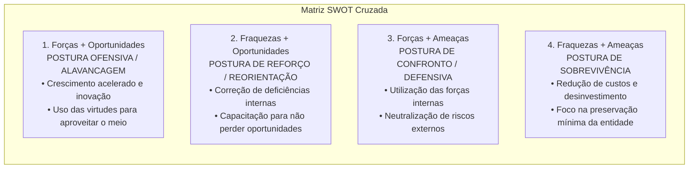
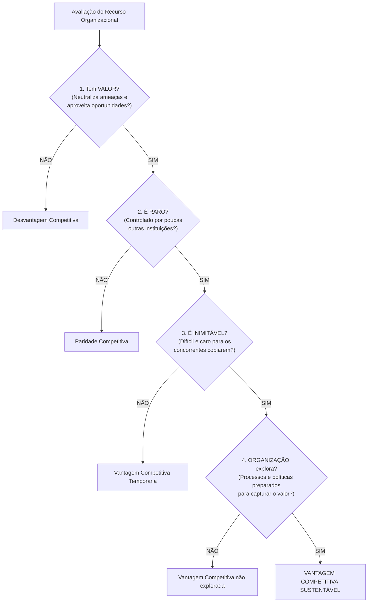
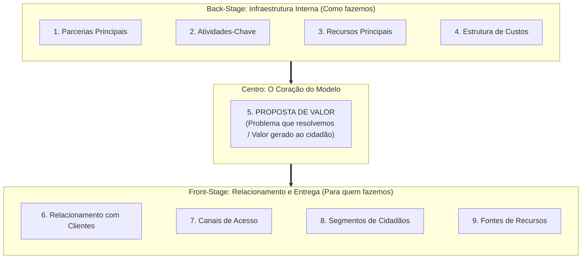

# 02 - Ferramentas de Diagnóstico Estratégico: SWOT, Cinco Forças de Porter, RBV e Canvas

> **Matéria:** Administração Estratégica  
> **Cargo:** A01 – Técnico de Controle Externo – Especialidade: Técnico Administrativo  
> **Arquivo:** `02_ferramentas_de_diagnostico_estrategico_swot_porter_rbv_canvas.md`  

---

## 📌 Ementa / Itens do Edital
- Diagnóstico do ambiente estratégico interno e externo;
- **Análise SWOT (Matriz FOFA):**
  - Mapeamento de Forças e Fraquezas (ambiente interno controlável) e Oportunidades e Ameaças (ambiente externo incontrolável);
  - Matriz de Cruzamento Estratégico e as quatro posturas organizacionais: Alavancagem/Ofensiva, Reforço/Crescimento, Confronto/Manutenção e Sobrevivência;
- **As Cinco Forças Competitivas de Michael Porter:**
  - 1. Rivalidade entre os concorrentes estabelecidos na indústria;
  - 2. Ameaça de novos entrantes e as barreiras à entrada (economias de escala, diferenciação de produto, capital inicial, custos de mudança e políticas estatais);
  - 3. Poder de barganha dos compradores / clientes;
  - 4. Poder de barganha dos fornecedores de insumos;
  - 5. Ameaça de produtos ou serviços substitutos (soluções de outros setores);
- As três Estratégias Genéricas de Michael Porter: Liderança em Custo Total, Diferenciação e Enfoque/Foco (e o risco do meio-termo / *stuck in the middle*);
- **Visão Baseada em Recursos (RBV - *Resource-Based View* - Jay Barney):**
  - Recursos tangíveis versus recursos intangíveis; premissas de heterogeneidade e imobilidade imperfeita;
  - O Framework **VRIO:** Valor, Raridade, Inimitabilidade e Organização;
  - Consequências competitivas: Desvantagem, Paridade, Vantagem Temporária e Vantagem Competitiva Sustentável;
- **Business Model Canvas (Alexander Osterwalder):**
  - Os nove blocos de geração de valor organizacional: Proposta de Valor, Segmentos de Clientes, Canais, Relacionamento com Clientes, Fontes de Receita, Recursos Principais, Atividades-Chave, Parcerias Principais e Estrutura de Custos.

---

## 🌳 Classificação Hierárquica

```text
2. Ferramentas Analíticas de Diagnóstico Estratégico
├── 2.1 Análise SWOT Cruzada (FOFA)
│   ├── 2.1.1 Diagnóstico de Variáveis Ambientais:
│   │   ├── Forças (Strengths): Vantagens internas sob controle da organização
│   │   ├── Fraquezas (Weaknesses): Vulnerabilidades internas sob controle da gestão
│   │   ├── Oportunidades (Opportunities): Fatores externos favoráveis incontroláveis
│   │   └── Ameaças (Threats): Fatores externos desfavoráveis incontroláveis
│   └── 2.1.2 As Quatro Posturas Estratégicas Cruzadas:
│       ├── Forças + Oportunidades: Postura Ofensiva / Alavancagem (Expansão)
│       ├── Fraquezas + Oportunidades: Postura de Reforço / Reorientação (Virada)
│       ├── Forças + Ameaças: Postura de Confronto / Manutenção (Defensiva)
│       └── Fraquezas + Ameaças: Postura de Sobrevivência (Desinvestimento)
├── 2.2 O Modelo das Cinco Forças e Estratégias Genéricas de Michael Porter
│   ├── 2.2.1 As Cinco Forças Competitivas:
│   │   ├── Força 1: Rivalidade entre Concorrentes Estabelecidos
│   │   ├── Força 2: Ameaça de Novos Entrantes (Barreiras de Entrada)
│   │   ├── Força 3: Poder de Negociação dos Compradores / Clientes
│   │   ├── Força 4: Poder de Negociação dos Fornecedores
│   │   └── Força 5: Ameaça de Produtos Substitutos
│   └── 2.2.2 As Três Estratégias Genéricas:
│       ├── Liderança em Custo Total: Produção padronizada de baixo custo em escala
│       ├── Diferenciação: Singularidade de produto e fidelização de marca
│       └── Enfoque / Foco: Atendimento exclusivo a um nicho estreito de mercado
├── 2.3 Visão Baseada em Recursos (RBV - Jay Barney)
│   ├── 2.3.1 Recursos Heterogêneos e de Imobilidade Imperfeita (Foco no ambiente interno)
│   └── 2.3.2 O Framework VRIO:
│       ├── V - Valor: Neutraliza ameaças e aproveita oportunidades?
│       ├── R - Raridade: Controlado por poucos ou exclusivo?
│       ├── I - Inimitabilidade: Difícil de reproduzir (condições históricas e ambiguidade causal)?
│       └── O - Organização: A instituição está estruturada para capturar esse valor?
│       └── V + R + I + O = Vantagem Competitiva Sustentável
└── 2.4 Business Model Canvas (Osterwalder)
    ├── 2.4.1 Blocos de Entrega de Valor (Lado Direito): Proposta de Valor, Segmentos, Canais, Relacionamento e Receitas
    └── 2.4.2 Blocos de Infraestrutura e Operação (Lado Esquerdo): Parcerias, Atividades, Recursos e Custos
```

---

## 📖 Resumo Teórico Aprofundado & Esquematizado

### 1. A Matriz SWOT Cruzada e as Quatro Posturas Estratégicas

A análise SWOT (sigla em inglês para *Strengths, Weaknesses, Opportunities e Threats* / FOFA em português) combina as dimensões ambientais para determinar o direcionamento estratégico da instituição:



#### Tabela Analítica das Quatro Posturas Estratégicas:

| Postura Estratégica | Quadrante Cruzado | Diagnóstico Situacional | Ação Estratégica Primordial |
| :--- | :---: | :--- | :--- |
| **Alavancagem / Ofensiva** | **Forças + Oportunidades** | A organização é forte e o ambiente externo oferece oportunidades favoráveis. | Expansão de serviços, lançamento de novos projetos e consolidação de liderança. |
| **Reorientação / Reforço** | **Fraquezas + Oportunidades** | O ambiente externo é promissor, mas a organização tem limitações internas que a impedem de aproveitá-lo. | Capacitação de servidores, aquisição de tecnologias e reestruturação interna. |
| **Manutenção / Confronto** | **Forças + Ameaças** | A instituição possui excelentes competências internas, porém enfrenta hostilidade no ambiente externo. | Adoção de postura defensiva, blindagem institucional e neutralização de perigos. |
| **Sobrevivência** | **Fraquezas + Ameaças** | O pior cenário: a organização possui graves deficiências internas e o ambiente externo apresenta fortes ameaças. | Contenção extrema de despesas, enxugamento de processos e abandono de planos secundários. |

---

### 2. O Modelo das Cinco Forças Competitivas de Michael Porter

Michael Porter demonstrou que a estrutura competitiva e a atratividade de qualquer setor são moldadas pela interação de cinco forças fundamentais:


#### Detalhamento das Cinco Forças de Porter:
1. **Rivalidade entre Concorrentes:** Determinada pelo número de competidores, taxa de crescimento da indústria, homogeneidade dos produtos e altas barreiras de saída.
2. **Ameaça de Novos Entrantes:** É amortecida pelas **barreiras à entrada**, tais como: economias de escala elevadas, requisitos maciços de capital inicial, custos de mudança de fornecedor (*switching costs*), patentes e autorizações estatais regulatórias.
3. **Poder de Barganha dos Compradores (Clientes):** Alto quando os clientes compram em grandes volumes, os produtos são padronizados e os custos de troca são insignificantes.
4. **Poder de Barganha dos Fornecedores:** Elevado quando o insumo é exclusivo, não há substitutos satisfatórios e existem poucos fornecedores no mercado.
5. **Ameaça de Produtos Substitutos:** Bens ou serviços de **outras indústrias** que desempenham a mesma função básica a um custo inferior ou melhor custo-benefício (ex.: transporte rodoviário substituindo transporte aéreo em distâncias curtas).

#### As Três Estratégias Genéricas de Porter:
* **Liderança em Custo Total:** A organização foca na eficiência máxima e escala para oferecer serviços ou produtos ao menor custo unitário do mercado.
* **Diferenciação:** A organização oferece produtos ou serviços com atributos percebidos como únicos e exclusivos (qualidade excepcional, tecnologia superior, atendimento exemplar), gerando fidelidade do usuário.
* **Enfoque / Foco:** A organização restringe sua atuação a um nicho de mercado estreito, aplicando liderança em custo ou diferenciação voltada exclusivamente àquele público específico.

---

### 3. A Visão Baseada em Recursos (RBV) e o Framework VRIO (Jay Barney)

A **RBV (*Resource-Based View*)** enfatiza que os fatores determinantes do desempenho duradouro residem no **ambiente interno** da instituição: em seus recursos tangíveis (imóveis, computadores, orçamento) e intangíveis (conhecimento técnico dos auditores, reputação, processos e cultura).



* **V - Valor:** Permite à organização explorar oportunidades ambientais ou neutralizar ameaças.
* **R - Raridade:** Recurso escasso e não dominado pela ampla maioria dos competidores.
* **I - Inimitabilidade:** Barreiras para reprodução decorrentes de condições históricas únicas, ambiguidade causal (não se sabe a receita exata do sucesso) e complexidade social (confiança e clima interpessoal).
* **O - Organização:** A organização possui desenho estrutural, rotinas e liderança aptos a absorver e potencializar esse recurso.

---

### 4. O Business Model Canvas (Alexander Osterwalder)

O Canvas mapeia o modelo de negócio visualmente em uma matriz de 9 blocos complementares:



---

## 🚨 Alertas de Prova & Pegadinhas da FCC

> 🚨 **ALERTA DE PROVA / PEGADINHA FCC (FORÇAS VS. OPORTUNIDADES NA SWOT):**  
> Questão garantida de prova: a FCC coloca no enunciado que "o corpo funcional do tribunal possui pós-graduação e domina auditoria de dados" e pergunta se isso é uma Oportunidade. **NÃO!** Isso é uma **FORÇA (ambiente interno controlável)**! Oportunidades são eventos **estritamente externos** que o órgão não controla (ex.: surgimento de novas ferramentas de inteligência artificial de código aberto no mercado).

> ⭐ **IMPORTANTE (PRODUTOS SUBSTITUTOS DE PORTER):**  
> Cuidado: produtos substitutos na visão de Porter **NÃO SÃO produtos de marcas concorrentes diretas do mesmo mercado** (ex.: Pepsi não é produto substituto da Coca-Cola; é concorrente direto da mesma indústria). Produtos substitutos vêm de **outras indústrias** e atendem à mesma necessidade básica de forma alternativa (ex.: suco natural ou chá gelado em relação ao refrigerante).

> 🛑 **ATENÇÃO (VRIO E VANTAGEM SUSTENTÁVEL):**  
> Se o recurso for Valioso e Raro, mas os concorrentes puderem copiá-lo facilmente a curto prazo, ele gera apenas **Vantagem Competitiva Temporária**. Para gerar vantagem **Sustentável**, o recurso deve ser imperativamente **Inimitável** e a instituição deve estar **Organizada** para explorá-lo!

> 📌 **NOTA EXPLICATIVA (POSTURA DE SOBREVIVÊNCIA NA SWOT):**  
> No cruzamento SWOT, a postura de sobrevivência ocorre quando a organização se depara concomitantemente com **Fraquezas internas predominantes** e **Ameaças externas graves**, demandando corte imediato de gastos, redução de projetos e contenção de danos.

---

## 🌐 Fontes Oficiais e Referências Bibliográficas

* [PORTER, Michael E. Estratégia Competitiva: técnicas para análise de indústrias e da concorrência. Campus.](https://www.grupogen.com.br).
* [BARNEY, Jay B. Gaining and Sustaining Competitive Advantage. Pearson.](https://www.pearson.com) - A teoria RBV e o modelo VRIO.
* [OSTERWALDER, Alexander; PIGNEUR, Yves. Business Model Generation: Inovação em Modelos de Negócios. Editora Alta Books.](https://altabooks.com.br).
* [SERRA, Fernando; TORRES, Maria Cândida; TORRES, Alexandre. Administração Estratégica. Editora Pearson.](https://www.pearson.com).

---

## 📝 Questões de Concurso FCC Comentadas

### Questão 01
**(FCC – TCE-PI – Auditor de Controle Externo)**  
De acordo com o modelo de análise das Cinco Forças Competitivas desenvolvido por Michael Porter, a intensidade com que novas empresas ou organizações ameaçam ingressar em determinado setor de atividade econômica é contida fundamentalmente pela presença de:

* **A)** Barreiras à entrada, tais como economias de escala consolidadas e elevados requisitos de capital inicial.
* **B)** Alta rivalidade interna e ausência de regulamentação governamental setorial.
* **C)** Facilidade de acesso aos canais de distribuição tradicionais pelos recém-chegados.
* **D)** Baixo custo de mudança (*switching costs*) suportado pelos consumidores ao migrarem de fornecedor.
* **E)** Existência de produtos substitutos com preços significativamente menores no mercado.

> **Gabarito: A**  
> **Comentário Detalhado:**  
> - **A) CORRETA.** Segundo Michael Porter, a ameaça de novos concorrentes entrantes é diretamente atenuada pela existência de **barreiras à entrada**, que elevam os custos e riscos para quem deseja entrar no setor (ex.: economias de escala dos incumbentes, diferenciação de marcas, altos requisitos de investimento de capital, acesso restrito aos canais de distribuição e regulação pública).  
> - **B) Incorreta.** Alta rivalidade é outra força competitiva; a ausência de barreiras facilita o ingresso.  
> - **C) Incorreta.** Se os canais são de fácil acesso, a barreira é baixa, o que estimula a entrada de novos concorrentes.  
> - **D) Incorreta.** Baixo custo de mudança (*switching costs*) estimula o consumidor a trocar de empresa, fragilizando a barreira.  
> - **E) Incorreta.** A ameaça de produtos substitutos é a quinta força do modelo de Porter, não se confundindo com as barreiras à entrada de concorrentes no mesmo setor.

---

### Questão 02
**(FCC – TCE-RS – Auditor de Controle Externo)**  
Segundo a Visão Baseada em Recursos (RBV) e o modelo conceitual VRIO formulado por Jay Barney, um recurso organizacional que seja considerado valioso pela organização e raro no seu mercado de atuação, porém passível de imitação a baixo custo pelos demais concorrentes, proporciona à entidade:

* **A)** Desvantagem competitiva prolongada.
* **B)** Vantagem competitiva temporária.
* **C)** Vantagem competitiva sustentável.
* **D)** Paridade competitiva definitiva.
* **E)** Ineficiência operacional estrutural.

> **Gabarito: B**  
> **Comentário Detalhado:**  
> - **A) Incorreta.** Como o recurso é valioso e raro, a empresa obtém diferencial positivo, e não desvantagem.  
> - **B) CORRETA.** No framework VRIO:  
>   - Recurso Valioso, mas não Raro $\rightarrow$ Paridade Competitiva;  
>   - Recurso Valioso e Raro, mas **Imitável (fácil de copiar)** $\rightarrow$ **Vantagem Competitiva Temporária**, visto que logo os rivais conseguirão reproduzi-lo, extinguindo o diferencial inicial.  
>   - Apenas se for Inimitável e sustentado pela Organização é que se alcança a **Vantagem Competitiva Sustentável**.  
> - **C) Incorreta.** A sustentabilidade requer obrigatoriamente que o recurso seja inimitável.  
> - **D) Incorreta.** Paridade ocorre quando o recurso não é raro.  
> - **E) Incorreta.** Não guarda pertinência com ineficiência estrutural.

---

### Questão 03
**(FCC – TRT-20ª Região – Analista Judiciário: Área Administrativa)**  
Determinada entidade governamental realizou o diagnóstico de seu ambiente por meio da matriz SWOT cruzada. A equipe constatou a existência concomitante de graves fragilidades operacionais internas (sistemas obsoletos e déficit crônico de servidores) associadas a um ambiente externo marcado por severas restrições orçamentárias impostas por lei e risco iminente de descontinuidade de convênios. Diante desse cenário de predomínio de fraquezas internas e ameaças externas, a postura estratégica recomendada pela teoria da administração é a:

* **A)** Postura de Alavancagem ou Ofensiva.
* **B)** Postura de Sobrevivência.
* **C)** Postura de Expansão Acelerada de Mercados.
* **D)** Postura de Liderança em Diferenciação de Marca.
* **E)** Postura de Reforço Baseada em Vantagem Sustentável.

> **Gabarito: B**  
> **Comentário Detalhado:**  
> - **A) Incorreta.** A postura ofensiva/alavancagem ocorre no quadrante Forças + Oportunidades.  
> - **B) CORRETA.** No cruzamento da matriz SWOT, quando uma instituição acumula **Fraquezas internas** diante de **Ameaças externas graves** (quadrante WT), a estratégia mandatória é a **Postura de Sobrevivência**, caracterizada pela contenção drástica de despesas, eliminação de desperdícios, redução de escopo e reestruturação para evitar o colapso operacional da organização.  
> - **C) Incorreta.** Expansão é postura ofensiva para momentos favoráveis.  
> - **D) Incorreta.** Diferenciação é estratégia de posicionamento mercadológico de Porter.  
> - **E) Incorreta.** O momento é de mitigação extrema de riscos, e não de sustentação de vantagem.

---

### Questão 04
**(FCC – SEFAZ-PE – Auditor Fiscal do Tesouro Estadual)**  
No modelo das Estratégias Genéricas formulado por Michael Porter, a organização que opta por desenvolver serviços ou produtos com atributos peculiares e exclusivos, fortemente reconhecidos pelo público-alvo pela sua excelência técnica, design inovador e credibilidade institucional, cobra preços diferenciados e busca fidelizar seus usuários, adota a estratégia genérica de:

* **A)** Liderança em Custo Total.
* **B)** Diferenciação.
* **C)** Desinvestimento Operacional.
* **D)** Conglomerado Diversificado.
* **E)** Paridade Tecnológica Compulsória.

> **Gabarito: B**  
> **Comentário Detalhado:**  
> - **A) Incorreta.** Liderança em custos busca operar com o menor custo unitário de produção da indústria com base em economias de escala.  
> - **B) CORRETA.** A estratégia genérica de **Diferenciação** baseia-se na criação de um produto ou serviço percebido pelo mercado/usuário como exclusivo e singular em suas características, gerando lealdade à marca e permitindo que a organização cobre preços superiores (*preço premium*) ou atinja alto reconhecimento público.  
> - **C) Incorreta.** Desinvestimento é manobra de redução de ativos, e não estratégia competitiva genérica.  
> - **D) Incorreta.** Conglomerado é forma societária de diversificação corporativa.  
> - **E) Incorreta.** Categoria inexistente na taxonomia de Porter.

---

### Questão 05
**(FCC – DPE-RS – Analista: Área Administrativa)**  
A respeito da ferramenta Business Model Canvas desenvolvida por Alexander Osterwalder, assinale a opção correta:

* **A)** O bloco da Proposta de Valor descreve detalhadamente o organograma hierárquico e as linhas formais de subordinação funcional da empresa.
* **B)** O bloco de Segmentos de Clientes situa-se no lado de infraestrutura interna (back-stage), ao lado da estrutura de custos e fornecedores.
* **C)** O modelo Canvas é composto por nove blocos interdependentes que descrevem a lógica de como uma organização cria, entrega e captura valor perante seu público.
* **D)** A ferramenta Canvas foi desenhada com a finalidade exclusiva de substituir as Demonstrações Contábeis Aplicadas ao Setor Público (DCASP).
* **E)** O bloco das Parcerias Principais destina-se a mensurar os prazos cronológicos das tarefas críticas de projetos de curto prazo.

> **Gabarito: C**  
> **Comentário Detalhado:**  
> - **A) Incorreta.** A Proposta de Valor define o conjunto de benefícios, produtos e soluções que resolvem o problema ou atendem à necessidade do cliente, sem tratar de organogramas internos.  
> - **B) Incorreta.** Segmentos de Clientes integra o lado direito do Canvas (front-stage / mercado e clientes).  
> - **C) CORRETA.** O **Business Model Canvas** é uma metodologia visual consagrada dividida em **nove blocos essenciais** (Proposta de Valor, Segmentos de Clientes, Canais, Relacionamento com Clientes, Fontes de Receita, Recursos Principais, Atividades-Chave, Parcerias Principais e Estrutura de Custos), concebida para mapear de forma sistêmica como a entidade gera, entrega e captura valor.  
> - **D) Incorreta.** O Canvas é ferramenta de modelagem estratégica e de negócios, não tendo natureza de demonstrativo contábil.  
> - **E) Incorreta.** Parcerias Principais mapeia a rede de fornecedores, aliados e parceiros estratégicos que viabilizam o funcionamento da instituição.
