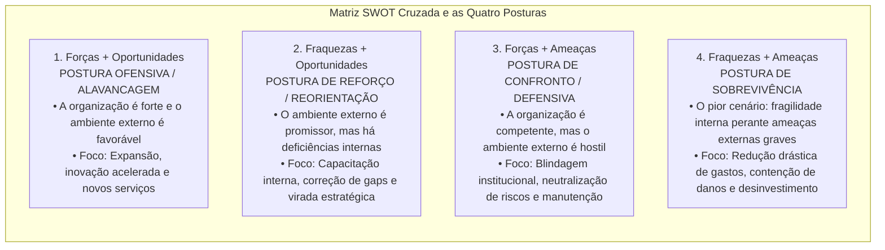
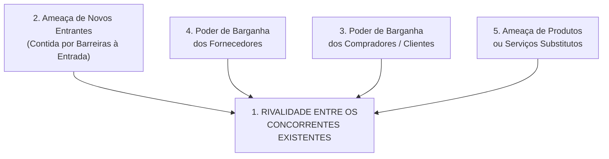
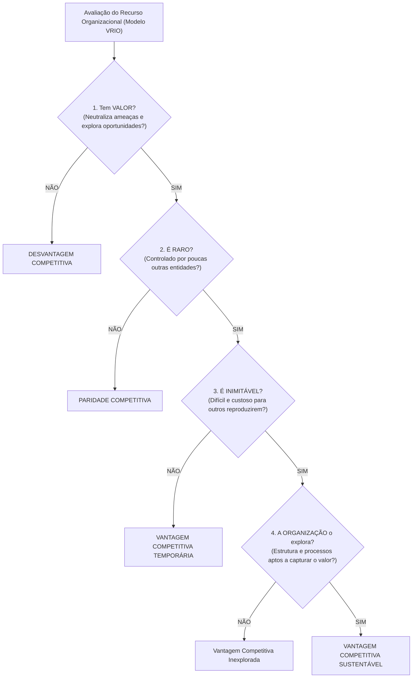
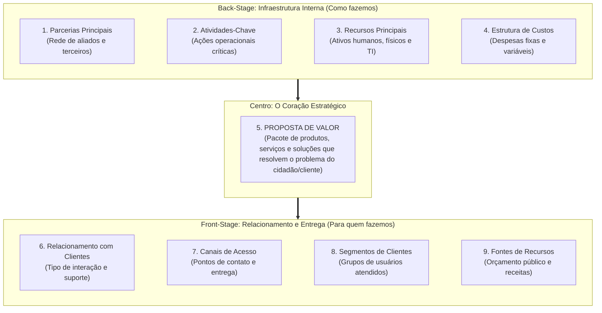

# 02 - Ferramentas de Diagnóstico Estratégico: SWOT, Cinco Forças de Porter, RBV e Canvas

> **Matéria:** Administração Estratégica  
> **Cargo:** A01 – Técnico de Controle Externo – Especialidade: Técnico Administrativo  
> **Arquivo:** `02_ferramentas_de_diagnostico_estrategico_swot_porter_rbv_canvas.md`  

---

## 📌 Ementa / Itens do Edital
- Diagnóstico do ambiente estratégico interno e externo;
- **Análise SWOT (Matriz FOFA):**
    - Mapeamento de Forças e Fraquezas (ambiente interno controlável) e Oportunidades e Ameaças (ambiente externo incontrolável);
    - Matriz de Cruzamento Estratégico e as quatro posturas organizacionais: Alavancagem/Ofensiva, Reforço/Crescimento, Confronto/Manutenção e Sobrevivência;
- **As Cinco Forças Competitivas de Michael Porter:**
    - 1. Rivalidade entre os concorrentes estabelecidos na indústria;
    - 2. Ameaça de novos entrantes e as barreiras à entrada (economias de escala, diferenciação de produto, capital inicial, custos de mudança e políticas estatais);
    - 3. Poder de barganha dos compradores / clientes;
    - 4. Poder de barganha dos fornecedores de insumos;
    - 5. Ameaça de produtos ou serviços substitutos (soluções de outros setores);
- As três Estratégias Genéricas de Michael Porter: Liderança em Custo Total, Diferenciação e Enfoque/Foco (e o risco do meio-termo / *stuck in the middle*);
- **Visão Baseada em Recursos (RBV - *Resource-Based View* - Jay Barney):**
    - Recursos tangíveis versus recursos intangíveis; premissas de heterogeneidade e imobilidade imperfeita;
    - O Framework **VRIO:** Valor, Raridade, Inimitabilidade e Organização;
    - Consequências competitivas: Desvantagem, Paridade, Vantagem Temporária e Vantagem Competitiva Sustentável;
- **Business Model Canvas (Alexander Osterwalder):**
    - Os nove blocos de geração de valor organizacional: Proposta de Valor, Segmentos de Clientes, Canais, Relacionamento com Clientes, Fontes de Receita, Recursos Principais, Atividades-Chave, Parcerias Principais e Estrutura de Custos.

---

## 🧭 Sumário

1. [Análise SWOT Cruzada (FOFA) e as Quatro Posturas Estratégicas](#1-analise-swot-cruzada-fofa-e-as-quatro-posturas-estrategicas)
    1. [Teste 380](#Teste-380)
    2. [Teste 381](#Teste-381)
2. [O Modelo das Cinco Forças e as Estratégias Genéricas de Michael Porter](#2-o-modelo-das-cinco-forcas-e-as-estrategias-genericas-de-michael-porter)
    1. [Teste 382](#Teste-382)
    2. [Teste 383](#Teste-383)
    3. [Teste 384](#Teste-384)
3. [A Visão Baseada em Recursos (RBV) e o Framework VRIO (Jay Barney)](#3-a-visao-baseada-em-recursos-rbv-e-o-framework-vrio-jay-barney)
    1. [Teste 385](#Teste-385)
    2. [Teste 386](#Teste-386)
4. [O Business Model Canvas (Alexander Osterwalder)](#4-o-business-model-canvas-alexander-osterwalder)
    1. [Teste 387](#Teste-387)
    2. [Teste 388](#Teste-388)
    3. [Teste 389](#Teste-389)
5. [Fontes Oficiais e Referências Bibliográficas](#5-fontes-oficiais-e-referencias-bibliograficas)

---

## 1. Análise SWOT Cruzada (FOFA) e as Quatro Posturas Estratégicas

A análise SWOT (acrônimo para *Strengths, Weaknesses, Opportunities e Threats* / Matriz FOFA em português) combina as variáveis do ambiente interno e externo para subsidiar a escolha da postura estratégica mais adequada:

#### Tabela Analítica das Quatro Posturas Estratégicas:

| Postura Estratégica | Quadrante Cruzado | Diagnóstico Situacional | Ação Estratégica Primordial |
| :--- | :---: | :--- | :--- |
| **Alavancagem / Ofensiva** | **Forças + Oportunidades** | A organização é sólida internamente e o ambiente externo abre oportunidades vantajosas. | Expansão de atuação, modernização tecnológica e consolidação de liderança. |
| **Reorientação / Reforço** | **Fraquezas + Oportunidades** | O ambiente externo é favorável, mas a organização possui carências internas que limitam seu aproveitamento. | Capacitação de pessoal, reestruturação de processos e correção de deficiências. |
| **Manutenção / Confronto** | **Forças + Ameaças** | O órgão possui excelente capacidade interna, contudo enfrenta hostilidade ou riscos no ambiente externo. | Adoção de postura defensiva, preservação de competências essenciais e blindagem. |
| **Sobrevivência** | **Fraquezas + Ameaças** | Situação crítica: a instituição acumula vulnerabilidades internas sob severas pressões e ameaças externas. | Contenção extrema de despesas, enxugamento de rotinas e abandono de ações secundárias. |

> 🚨 **ALERTA DE PROVA / PEGADINHA FCC (FORÇAS VS. OPORTUNIDADES NA SWOT):**  
> Questão garantida de prova: a FCC coloca no enunciado que "o quadro de pessoal do tribunal possui excelente qualificação técnica e os sistemas informatizados são modernos" e pergunta se isso é uma Oportunidade. **NÃO!** Isso é uma **FORÇA (ambiente interno controlável)**! Oportunidades são eventos **estritamente externos** que o órgão não controla (ex.: aprovação de linha federal de crédito para modernização ou surgimento de novas ferramentas abertas de IA).

> 📌 **NOTA EXPLICATIVA (POSTURA DE SOBREVIVÊNCIA NA SWOT):**  
> No cruzamento SWOT, a postura de sobrevivência decorre da convergência entre **Fraquezas internas predominantes** e **Ameaças externas graves**, demandando corte imediato de gastos, redução de projetos e contenção rigorosa de danos.

---

### Teste 380
**(FCC – TRT-16 – Analista Judiciário - Tecnologia da Informação – 2014)**
Sobre o Planejamento e Gestão Estratégica, descrito na Resolução n o 70/2009 do Conselho Nacional de Justiça, está correto 
afirmar:

* **A)** Os tribunais garantirão a participação efetiva de serventuário
s e de magistrados de primeiro e segundo graus, indicados pel
as 
respectivas entidades de classe, na elaboração e na exec
ução de suas propostas orçamentárias e planejamentos 
estratégicos.
* **B)** Os planejamentos estratégicos, alinhados ao Plano Es
tratégico Nacional, devem ter uma abrangência mínima de 
quatro anos e deverão ter, pelo menos, um indicador de resultado para cada objetivo estratégico.
* **C)** As propostas orçamentárias dos tribunais devem ser alinhadas aos respectivos planejamentos táticos para que sejam 
garantidos os recursos necessários a sua execução.
* **D)** Os Tribunais promoverão Reuniões de Análise da Estratégia (RAE) semestrais para acompanhamento dos resultados das 
metas fixadas, oportunidade em que poderão promover ajustes e outras medidas necessárias à melhoria do desempenho.
* **E)** Um dos objetivos estratégicos é facilitar o acesso à Justiça, com o objetivo de centralizar a relação da população com os 
órgãos judiciais e garantir equidade no atendimento à sociedade.

---

> **Comentário Detalhado:**
>
> - **A)** Correta. Representa com precisão a disciplina do tema e o entendimento pacificado adotado pela banca (FCC).
> - **B)** Incorreta. Discrepa das diretrizes normativas e jurisprudenciais aplicáveis ao tema objeto do item.
> - **C)** Incorreta. Discrepa das diretrizes normativas e jurisprudenciais aplicáveis ao tema objeto do item.
> - **D)** Incorreta. Discrepa das diretrizes normativas e jurisprudenciais aplicáveis ao tema objeto do item.
> - **E)** Incorreta. Discrepa das diretrizes normativas e jurisprudenciais aplicáveis ao tema objeto do item.
>
> **Gabarito: A**

---
### Teste 381
**(FCC – TRT-16 – Analista Judiciário - Tecnologia da Informação – 2014)**
Como consequência do processo de Planejamento Estratégico, as organizações produzem ou atualizam alguns componentes. 
Correlacione corretamente as colunas. 

 Componente   Conceito −  característica −  exemplo 
a Visão   I Deve ser específico(a), mensurável, atingível, relevante e 
temporal 
b Missão  II Fornece direcionamento para os próximos anos e orienta 
decisões estratégicas 
c Objetivo III Representa o produto ou serviço que a empresa faz, é a razão 
da existência. 
d Meta  IV É um exemplo: Assegurar recursos orçamentários necessários à 
execução da estratégia. 

 Está correta a correlação que consta em

* **A)** a- III - b- IV - c- II - d- I
* **B)** a- II - b- I - c- IV - d- III
* **C)** a- III - b- I - c- II - d- IV
* **D)** a- II - b- III - c- IV - d- I
* **E)** a- II - b- III - c- I - d- IV

---

> **Comentário Detalhado:**
>
> - **A)** Incorreta. Discrepa das diretrizes normativas e jurisprudenciais aplicáveis ao tema objeto do item.
> - **B)** Incorreta. Discrepa das diretrizes normativas e jurisprudenciais aplicáveis ao tema objeto do item.
> - **C)** Incorreta. Discrepa das diretrizes normativas e jurisprudenciais aplicáveis ao tema objeto do item.
> - **D)** Correta. Representa com precisão a disciplina do tema e o entendimento pacificado adotado pela banca (FCC).
> - **E)** Incorreta. Discrepa das diretrizes normativas e jurisprudenciais aplicáveis ao tema objeto do item.
>
> **Gabarito: D**

---
## 2. O Modelo das Cinco Forças e as Estratégias Genéricas de Michael Porter

Michael Porter desenvolveu um clássico referencial para explicar como as forças estruturais de uma indústria determinam sua intensidade competitiva e seu nível de atratividade:

#### As Cinco Forças Competitivas:
1. **Rivalidade entre Concorrentes Estabelecidos:** Ponto central do modelo. Intensificada por fatores como: elevado número de concorrentes com forças semelhantes, lento crescimento do mercado, custos fixos altos e elevadas barreiras de saída (custos para abandonar o negócio).
2. **Ameaça de Novos Entrantes:** Determinada pela solidez das **barreiras à entrada**, que representam dificuldades e custos impostos aos novatos, tais como:
    - Economias de escala alcançadas pelas empresas consolidadas;
    - Requisitos elevados de investimento de capital inicial;
    - Custos de mudança (*switching costs*) incorridos pelo cliente ao trocar de marca;
    - Políticas e regulamentações governamentais protetivas.

3. **Poder de Barganha dos Compradores (Clientes):** Alto quando os clientes compram em grandes volumes, os produtos oferecidos são padronizados/comoditizados e os custos de migração para outra empresa são insignificantes.
4. **Poder de Barganha dos Fornecedores:** Elevado quando os fornecedores operam em mercado concentrado, o insumo fornecido é exclusivo ou crítico e inexistem produtos substitutos no mercado.
5. **Ameaça de Produtos Substitutos:** Produtos ou serviços oriundos de **outros setores/indústrias** que desempenham a mesma função básica a um custo inferior ou com maior conveniência para o usuário.

---

### Teste 382
**(FCC – TRT-13 – Analista Judiciário - Tecnologia da Informação – 2014)**
O Balanced Scorecard  −  BSC, cujos mentores são Robert 
Kaplan e David Norton, é

* **A)** um sistema de avaliação de desempenho organiza-
cional que contempla apenas indicadores financei-
ros.
* **B)** um mecanismo para formulação da estratégia da 
instituição voltado à missão de futuro e visão de lon-
go prazo.
* **C)** um modelo de gestão estratégica que alinha missão, 
visão e estratégias a um conjunto de indicadores fi-
nanceiros e não financeiros.
* **D)** uma metodologia para avaliação e desenvolvimento 
de competências individuais orientada pelo denomi-
nado mapa estratégico.
* **E)** uma metodologia de avaliação de desempenho or-
ganizacional e não individual, baseada em guias 
operacionais.

---

> **Comentário Detalhado:**
>
> - **A)** Incorreta. Discrepa das diretrizes normativas e jurisprudenciais aplicáveis ao tema objeto do item.
> - **B)** Incorreta. Discrepa das diretrizes normativas e jurisprudenciais aplicáveis ao tema objeto do item.
> - **C)** Incorreta. Discrepa das diretrizes normativas e jurisprudenciais aplicáveis ao tema objeto do item.
> - **D)** Incorreta. Discrepa das diretrizes normativas e jurisprudenciais aplicáveis ao tema objeto do item.
> - **E)** Correta. Representa com precisão a disciplina do tema e o entendimento pacificado adotado pela banca (FCC).
>
> **Gabarito: E**

---
### Teste 383
**(FGV – TRT-DA 24-REGIÃO – Analista Judiciário - Tecnologia da Informação – 2025)**
A classificação sistemática de materiais no âmbito da Gestão de 
Materiais e Patrimônio garante a organização, otimiza o controle 
e facilita a tomada de decisões estratégicas para o uso adequado 
de recursos. 
Assinale a opção que apresenta corretamente os materiais que 
estão sendo processados ao longo das diversas seções que 
compõem o processo produtivo.

* **A)** Matérias-primas.
* **B)** Materiais em vias.
* **C)** Produtos acabados.
* **D)** Materiais componentes.
* **E)** Materiais semiacabados.

---

> **Comentário Detalhado:**
>
> - **A)** Incorreta. Discrepa das diretrizes normativas e jurisprudenciais aplicáveis ao tema objeto do item.
> - **B)** Incorreta. Discrepa das diretrizes normativas e jurisprudenciais aplicáveis ao tema objeto do item.
> - **C)** Incorreta. Discrepa das diretrizes normativas e jurisprudenciais aplicáveis ao tema objeto do item.
> - **D)** Correta. Representa com precisão a disciplina do tema e o entendimento pacificado adotado pela banca (FGV).
> - **E)** Incorreta. Discrepa das diretrizes normativas e jurisprudenciais aplicáveis ao tema objeto do item.
>
> **Gabarito: D**

---
### Teste 384
**(FCC – TRT – Analista Judiciário - Tecnologia da Informação – 2009)**
A diferença maior no desenvolvimento de acervos em 
bibliotecas especializadas, quando comparadas com 
outros tipos de bibliotecas, é a

* **A)** ênfase no desbastamento e na avaliação da cole-
ção, medida necessária para otimização do acervo.
* **B)** disponibilidade de materiais ligados ao ensino e à 
pesquisa.
* **C)** existência de uma clientela mais dinâmica e diversifi-
cada.
* **D)** necessidade de dar suporte às atividades pedagógi-
cas, integrando-se ao processo educacional formal.
* **E)** presença, com muito maior frequência, de materiais 
não-convencionais. 
_________________________________________________________

---

> **Comentário Detalhado:**
>
> - **A)** Incorreta. Discrepa das diretrizes normativas e jurisprudenciais aplicáveis ao tema objeto do item.
> - **B)** Incorreta. Discrepa das diretrizes normativas e jurisprudenciais aplicáveis ao tema objeto do item.
> - **C)** Incorreta. Discrepa das diretrizes normativas e jurisprudenciais aplicáveis ao tema objeto do item.
> - **D)** Correta. Representa com precisão a disciplina do tema e o entendimento pacificado adotado pela banca (FCC).
> - **E)** Incorreta. Discrepa das diretrizes normativas e jurisprudenciais aplicáveis ao tema objeto do item.
>
> **Gabarito: D**

---
## 3. A Visão Baseada em Recursos (RBV) e o Framework VRIO (Jay Barney)

Ao contrário dos modelos que olham prioritariamente para o mercado exterior (como Porter), a **Visão Baseada em Recursos (RBV - *Resource-Based View*)** sustenta que a fonte de vantagem competitiva sustentada e de desempenho superior das organizações reside em seu **ambiente interno**: nos recursos e capacidades que a organização possui e controla.

A teoria parte de duas premissas essenciais:

* **Heterogeneidade de Recursos:** As organizações possuem feixes de recursos e competências distintos entre si.
* **Imobilidade Imperfeita de Recursos:** Os recursos essenciais não podem ser transferidos ou comprados livre e instantaneamente de uma entidade para outra.

#### Os Critérios do Framework VRIO:
1. **V - Valor:** O recurso permite à organização explorar uma oportunidade ambiental externa ou neutralizar uma ameaça?
2. **R - Raridade:** O recurso é escasso e controlado por poucas entidades concorrentes?
3. **I - Inimitabilidade:** As outras organizações enfrentam desvantagens de custo elevadas para reproduzir ou obter esse recurso? A inimitabilidade decorre de três barreiras clássicas:
    - *Condições históricas únicas:* recursos desenvolvidos ao longo de trajetórias históricas irrepetíveis;
    - *Ambiguidade causal:* os competidores não conseguem decifrar exatamente qual fator específico causa o sucesso da organização;
    - *Complexidade social:* recursos enraizados em relações humanas, reputação, confiança mútua e cultura institucional.

4. **O - Organização:** A instituição dispõe de desenho organizacional, sistemas de informação, liderança e governança estruturados para absorver e capitalizar plenamente o potencial desse recurso?

> 🛑 **ATENÇÃO (VRIO E VANTAGEM SUSTENTÁVEL):**  
> Se o recurso for Valioso e Raro, mas os competidores puderem copiá-lo rapidamente no mercado, ele gera unicamente **Vantagem Competitiva Temporária**. Para assegurar vantagem **Sustentável**, o recurso deve ser imperativamente **Inimitável** e a entidade deve dispor de **Organização** para explorá-lo!

---

### Teste 385
**(FGV – TRT – Analista Judiciário - Tecnologia da Informação – 2024)**
Os principais fatores de atratividade organizacional são 
elementos que tornam uma organização atraente para potenciais 
colaboradores. 
Assinale a opção que apresenta um fator de atratividade 
organizacional intrínseco.

* **A)** Serviços exemplares.
* **B)** Boas práticas de gestão.
* **C)** Nível de satisfação da opinião pública.
* **D)** Marca da organização.
* **E)** Oferta de salário.

---

> **Comentário Detalhado:**
>
> - **A)** Incorreta. Discrepa das diretrizes normativas e jurisprudenciais aplicáveis ao tema objeto do item.
> - **B)** Correta. Representa com precisão a disciplina do tema e o entendimento pacificado adotado pela banca (FGV).
> - **C)** Incorreta. Discrepa das diretrizes normativas e jurisprudenciais aplicáveis ao tema objeto do item.
> - **D)** Incorreta. Discrepa das diretrizes normativas e jurisprudenciais aplicáveis ao tema objeto do item.
> - **E)** Incorreta. Discrepa das diretrizes normativas e jurisprudenciais aplicáveis ao tema objeto do item.
>
> **Gabarito: B**

---
### Teste 386
**(FGV – TCE-PA – Auditor de Controle Externo – 2024)**
Os modelos estratégicos são ferramentas que auxiliam as 
organizações na análise, planejamento e implementação de 
estratégias eficazes. Modelos como SWOT, Análise PESTEL e as 
Cinco Forças de Porter ajudam a entender o contexto 
competitivo e as oportunidades.  
Assinale a opção que avalia as oportunidades oferecidas pelo 
ambiente.

* **A)** Benchmarking.
* **B)** Brainstorming.
* **C)** PESTEL.
* **D)** SWOT.
* **E)** Matriz GUT. 

AUDITOR DE CONTROLE EXTERNO – ÁREA ADMINISTRATIVA - ADMINISTRAÇÃO – MANHÃ  TIPO  BRANCA – PÁGINA 18

---

> **Comentário Detalhado:**
>
> - **A)** Incorreta. Discrepa das diretrizes normativas e jurisprudenciais aplicáveis ao tema objeto do item.
> - **B)** Incorreta. Discrepa das diretrizes normativas e jurisprudenciais aplicáveis ao tema objeto do item.
> - **C)** Incorreta. Discrepa das diretrizes normativas e jurisprudenciais aplicáveis ao tema objeto do item.
> - **D)** Incorreta. Discrepa das diretrizes normativas e jurisprudenciais aplicáveis ao tema objeto do item.
> - **E)** Correta. Representa com precisão a disciplina do tema e o entendimento pacificado adotado pela banca (FGV).
>
> **Gabarito: E**

---
## 4. O Business Model Canvas (Alexander Osterwalder)

Desenvolvido por Alexander Osterwalder e Yves Pigneur, o **Business Model Canvas** é uma ferramenta de gestão estratégica visual que sintetiza a arquitetura de negócios de uma instituição em um único painel composto por **nove blocos interdependentes**:

1. **Proposta de Valor:** O núcleo central do Canvas; descreve o valor que a organização entrega ao cidadão-usuário, indicando que problemas resolve e que necessidades satisfaz.
2. **Segmentos de Clientes/Usuários:** Identifica os diferentes públicos, nichos sociais ou jurisdicionados para os quais o valor é gerado.
3. **Canais:** Meios pelos quais a instituição divulga, disponibiliza e entrega sua proposta de valor (ex.: balcão presencial, portal eletrônico, aplicativo móvel).
4. **Relacionamento com Clientes:** Padrões de interação estabelecidos com os usuários (ex.: autoatendimento, atendimento personalizado, ouvidoria).
5. **Fontes de Receita / Recursos:** Como a entidade se sustenta financeiramente (no setor público: dotações orçamentárias, repasses constitucionais e taxas de fiscalização).
6. **Recursos Principais:** Ativos essenciais necessários para fazer o modelo funcionar (servidores qualificados, sistemas informatizados, imóveis e banco de dados).
7. **Atividades-Chave:** As ações e processos primordiais que a entidade precisa realizar com excelência (fiscalização contábil, julgamento de contas, auditorias de obras).
8. **Parcerias Principais:** A rede de cooperação interinstitucional (Ministério Público, Polícia Federal, universidades e outros Tribunais de Contas) que potencializa o alcance do órgão.
9. **Estrutura de Custos:** Todos os principais custos operacionais incorridos para manter o modelo em funcionamento (folha de pagamento, infraestrutura e licenças de software).

---

### Teste 387
**(FCC – TRT-1 – Analista Judiciário - Tecnologia da Informação – 2014)**
Muitas empresas utilizam a análise SWOT para sua 
gestão e planejamento estratégico. O significado, em 
português, do acrônimo SWOT é, respectivamente,

* **A)** vantagens, desvantagens, riscos e segurança.
* **B)** perigos, soluções, forças e fraquezas.
* **C)** técnicas, procedimentos, metodologias e testes.
* **D)** forças, fraquezas, oportunidades e ameaças.
* **E)** riscos, segurança, perigos e soluções. 
Caderno de Prova ’A01’, Tipo 001

8 TRT1R-An.Jud.-Tec. Informação-A01

---

> **Comentário Detalhado:**
>
> - **A)** Incorreta. Discrepa das diretrizes normativas e jurisprudenciais aplicáveis ao tema objeto do item.
> - **B)** Incorreta. Discrepa das diretrizes normativas e jurisprudenciais aplicáveis ao tema objeto do item.
> - **C)** Correta. Representa com precisão a disciplina do tema e o entendimento pacificado adotado pela banca (FCC).
> - **D)** Incorreta. Discrepa das diretrizes normativas e jurisprudenciais aplicáveis ao tema objeto do item.
> - **E)** Incorreta. Discrepa das diretrizes normativas e jurisprudenciais aplicáveis ao tema objeto do item.
>
> **Gabarito: C**

---
### Teste 388
**(FGV – TJ-RR – Analista Judiciário - Governança e Gestão de TI – 2024)**
Considerando conceitos de gestão de projetos (PMBOK 7ª Edição), 
analise as afirmativas a seguir. 
I. Um risco é um evento ou condição incerta que, caso ocorra, 
causará um efeito positivo ou negativo a um ou mais objetivos 
do projeto. 
II. Cinco estratégias podem ser consideradas para lidar com 
ameaças: evitar, escalar, transferir, mitigar e aceitar. 
III. Uma análise SWOT avalia as forças, fraquezas, oportunidades e 
ameaças de uma organização, projeto ou opção.  
Está correto o que se afirma em

* **A)** I, apenas.
* **B)** II, apenas.
* **C)** III, apenas.
* **D)** I e II, apenas.
* **E)** I, II e III.

---

> **Comentário Detalhado:**
>
> - **A)** Incorreta. Discrepa das diretrizes normativas e jurisprudenciais aplicáveis ao tema objeto do item.
> - **B)** Correta. Representa com precisão a disciplina do tema e o entendimento pacificado adotado pela banca (FGV).
> - **C)** Incorreta. Discrepa das diretrizes normativas e jurisprudenciais aplicáveis ao tema objeto do item.
> - **D)** Incorreta. Discrepa das diretrizes normativas e jurisprudenciais aplicáveis ao tema objeto do item.
> - **E)** Incorreta. Discrepa das diretrizes normativas e jurisprudenciais aplicáveis ao tema objeto do item.
>
> **Gabarito: B**

---
### Teste 389
**(FGV – TRT-1 – Analista Judiciário - Tecnologia da Informação – 2024)**
Dora é gesto ra de uma empresa de produtos de beleza que 
iniciou suas atividades há três anos e encontra -se em fase de 
expansão, conquistando espaço no mercado. Ela quer adotar o 
balanced scorecard  e está especialmente atenta à perspectiva 
financeira, nos seguintes tem as estratégicos: crescimento e mix 
de receita; e redução de custos/melhoria de produtividade. 
Tendo em vista a fase em que a empresa se encontra, são 
indicadores adequados para os temas estratégicos citados, 
respectivamente:

* **A)** taxa de vendas por segmento; receita por funcionário;
* **B)** lucratividade por cliente; taxa de utilização dos ativos;
* **C)** investimentos como percentual de vendas; custo unitário de 
produção;
* **D)** percentual da receita gerado por novos produtos ; índices de 
capital de giro;
* **E)** lucratividade por linha de produto; retorno sobre o 
patrimônio líquido.

---

> **Comentário Detalhado:**
>
> - **A)** Incorreta. Discrepa das diretrizes normativas e jurisprudenciais aplicáveis ao tema objeto do item.
> - **B)** Incorreta. Discrepa das diretrizes normativas e jurisprudenciais aplicáveis ao tema objeto do item.
> - **C)** Correta. Representa com precisão a disciplina do tema e o entendimento pacificado adotado pela banca (FGV).
> - **D)** Incorreta. Discrepa das diretrizes normativas e jurisprudenciais aplicáveis ao tema objeto do item.
> - **E)** Incorreta. Discrepa das diretrizes normativas e jurisprudenciais aplicáveis ao tema objeto do item.
>
> **Gabarito: C**

---
## 5. Fontes Oficiais e Referências Bibliográficas

* [Decreto nº 9.203/2017 (Gestão Estratégica e Avaliação de Riscos)](https://www.planalto.gov.br/ccivil_03/_ato2015-2018/2017/decreto/d9203.htm) - Diagnóstico de riscos ambientais e definição de respostas estratégicas no setor público.
* [TCU - Guia de Gestão de Riscos e Diagnóstico Organizacional](https://portal.tcu.gov.br/governanca/governanca-no-tcu/) - Metodologia do TCU para análise de ameaças, oportunidades e capacidade interna.
* [TCE-GO - Governança Institucional e Diagnóstico Estratégico](https://portal.tce.go.gov.br/governanca-planejamento-e-gestao/planos-institucionais/plano-de-fiscalizacao) - Práticas de diagnóstico institucional e priorização de áreas críticas de fiscalização.
* [Governo Digital - Modelos de Negócio e Serviços Públicos Digitais](https://www.gov.br/governodigital/pt-br/estrategias-e-governanca-digital/estrategianacional) - Uso do Business Model Canvas e ideação ágil para transformação digital.
* [Constituição Federal de 1988 - Art. 165 (Planejamento Governamental e Orçamento)](https://www.planalto.gov.br/ccivil_03/constituicao/constituicao.htm#art165) - Alinhamento do diagnóstico estratégico ao PPA e metas fiscais da LDO.
* PORTER, Michael E. **Estratégia Competitiva: Técnicas para Análise de Indústrias e da Concorrência**. 2. ed. Rio de Janeiro: Elsevier/Campus, 2004. (Cap. 1 - As Cinco Forças Competitivas).
* BARNEY, Jay B.; HESTERLY, William S. **Administração Estratégica e Vantagem Competitiva: Conceitos e Casos**. 3. ed. São Paulo: Pearson Prentice Hall, 2011. (Cap. 3 - A Visão Baseada em Recursos - RBV e Modelo VRIO).
* OSTERWALDER, Alexander; PIGNEUR, Yves. **Business Model Generation: Inovação em Modelos de Negócios**. Rio de Janeiro: Alta Books, 2011. (Cap. 1 - O Quadro do Modelo de Negócios - Canvas).
