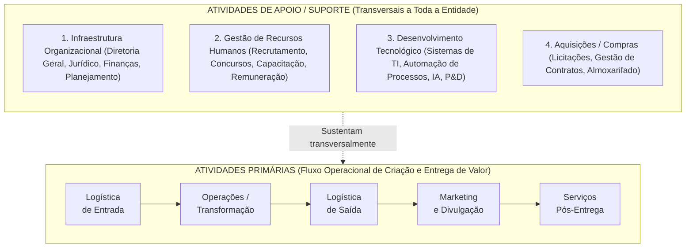
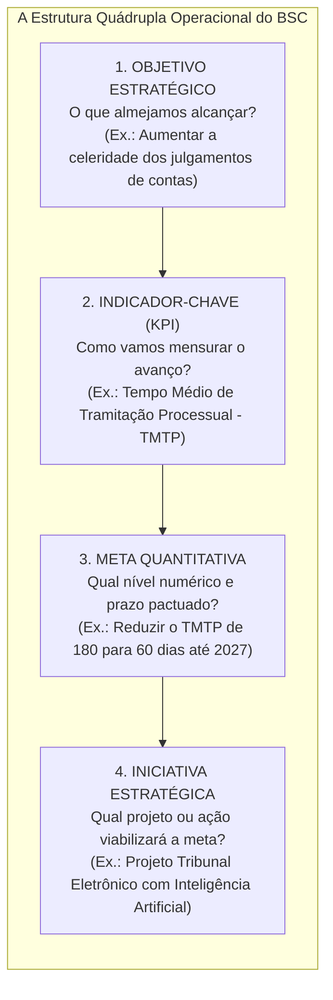
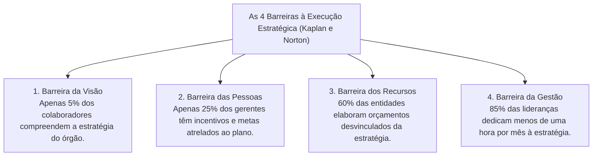

# 03 - Cadeia de Valor, Alinhamento pelo BSC e Implementação Estratégica

> **Matéria:** Administração Estratégica  
> **Cargo:** A01 – Técnico de Controle Externo – Especialidade: Técnico Administrativo  
> **Arquivo:** `03_cadeia_de_valor_bsc_e_execucao_estrategica.md`  

---

## 📌 Ementa / Itens do Edital
- A Cadeia de Valor de Michael Porter:
    - Conceito de valor e agregação de valor ao usuário/cidadão;
    - **Atividades Primárias:** Logística Interna (de entrada), Operações (transformação), Logística Externa (de saída), Marketing & Vendas e Serviços (pós-venda);
    - **Atividades de Apoio (Suporte):** Infraestrutura Organizacional, Gestão de Recursos Humanos, Desenvolvimento Tecnológico e Aquisições (compras/suprimentos);
    - A Margem da Cadeia de Valor e sua transposição para a geração de "Valor Público" nos órgãos de controle externo;
- O Balanced Scorecard (BSC) como ferramenta de alinhamento e execução estratégica:
    - Da formulação ao desdobramento da estratégia (*cascading*): alinhamento vertical e alinhamento horizontal;
    - A estrutura quádrupla operacional: Objetivos Estratégicos $\rightarrow$ Indicadores-Chave (KPIs) $\rightarrow$ Metas Quantitativas $\rightarrow$ Iniciativas Estratégicas (Planos de Ação e Projetos);
    - Indicadores de tendência (*leading indicators*) versus indicadores de resultado (*lagging indicators*);
- Implementação, Governança e Controle da Estratégia:
    - As Quatro Barreiras clássicas à execução estratégica (Robert Kaplan e David Norton): barreira da visão, das pessoas, dos recursos e da gestão;
    - O Escritório de Gestão Estratégica (EGE / PMO institucional);
    - Reuniões de Avaliação da Estratégia (RAE) e governança do Plano Estratégico do TCE-GO.

---

## 🧭 Sumário

1. [A Cadeia de Valor de Michael Porter](#1-a-cadeia-de-valor-de-michael-porter)
    1. [Teste 390](#Teste-390)
    2. [Teste 391](#Teste-391)
    3. [Teste 392](#Teste-392)
2. [O Desdobramento da Estratégia (*Cascading*) pelo BSC](#2-o-desdobramento-da-estrategia-cascading-pelo-bsc)
    1. [Teste 393](#Teste-393)
    2. [Teste 394](#Teste-394)
3. [As Quatro Barreiras à Execução da Estratégia (Kaplan e Norton)](#3-as-quatro-barreiras-a-execucao-da-estrategia-kaplan-e-norton)
    1. [Teste 395](#Teste-395)
    2. [Teste 396](#Teste-396)
4. [Escritório de Gestão Estratégica (EGE) e Reuniões de Avaliação (RAE)](#4-escritorio-de-gestao-estrategica-ege-e-reunioes-de-avaliacao-rae)
    1. [Teste 397](#Teste-397)
    2. [Teste 398](#Teste-398)
    3. [Teste 399](#Teste-399)
5. [Fontes Oficiais e Referências Bibliográficas](#5-fontes-oficiais-e-referencias-bibliograficas)

---

## 1. A Cadeia de Valor de Michael Porter

Concebida por Michael Porter em 1985, a **Cadeia de Valor** é um modelo analítico que desagrega a organização em suas atividades estrategicamente relevantes para compreender o comportamento de custos e identificar fontes de diferenciação competitiva:

#### Classificação Rigorosa das Atividades:
1. **Atividades Primárias:** Estão diretamente envolvidas na criação física do produto ou serviço, sua distribuição aos usuários e a assistência pós-entrega:
    - *Logística de Entrada (Interna):* Recebimento, conferência, armazenagem e distribuição interna dos insumos necessários.
    - *Operações (Transformação):* Processamento e transformação dos insumos no serviço ou produto final entregue.
    - *Logística de Saída (Externa):* Coleta, armazenagem e distribuição final dos relatórios, acórdãos ou produtos aos clientes/cidadãos.
    - *Marketing e Vendas:* Comunicação social, canais de transparência, publicidade e estímulo ao controle social.
    - *Serviços (Pós-Venda):* Atendimento contínuo, ouvidoria, monitoramento e suporte aos usuários.

2. **Atividades de Apoio (Suporte):** Sustentam transversalmente as atividades primárias fornecendo infraestrutura institucional, pessoal, tecnologia e materiais:
    - *Infraestrutura da Organização:* Gestão geral, assessoria jurídica, planejamento orçamentário e relações institucionais.
    - *Gestão de Recursos Humanos:* Seleção pública, planos de cargos e salários, capacitação contínua e avaliação de desempenho.
    - *Desenvolvimento Tecnológico:* Procedimentos técnicos, softwares de gestão, infraestrutura de redes e inteligência artificial.
    - *Aquisições (Compras):* A função de licitar e adquirir insumos, materiais e contratação de serviços terceirizados.

---

### Teste 390
**(FGV – TCE-PA – Auditor de Controle Externo - Tecnologia da Informação – 2024)**
Avalie se as seguintes afirmativas a seguir, contidas no 
Planejamento Estratégico do TCE -PA, correspondem a um valor 
institucional, à missão da organização ou à visão da organização. 
I. Ser instituição de referência no controle externo e contribuir 
para o aperfeiçoamento da administração pública.  
II. Primar pela divulgação clara e acessível dos seus atos e dos 
decorrentes de sua missão.  
III. Exercer o controle externo da gestão de recursos públicos 
estaduais em benefício da sociedade.  
IV. Atuar com liberdade, imparcialidade e autonomia.  
As afirmativas referem-se, respectivamente, a

* **A)** valor, visão, missão e valor.
* **B)** visão, missão, valor e valor.
* **C)** visão, visão, missão e missão.
* **D)** missão, visão, valor e visão.
* **E)** visão, valor, missão e valor.

---

> **Comentário Detalhado:**
>
> - **A)** Correta. Representa com precisão a disciplina do tema e o entendimento pacificado adotado pela banca (FGV).
> - **B)** Incorreta. Discrepa das diretrizes normativas e jurisprudenciais aplicáveis ao tema objeto do item.
> - **C)** Incorreta. Discrepa das diretrizes normativas e jurisprudenciais aplicáveis ao tema objeto do item.
> - **D)** Incorreta. Discrepa das diretrizes normativas e jurisprudenciais aplicáveis ao tema objeto do item.
> - **E)** Incorreta. Discrepa das diretrizes normativas e jurisprudenciais aplicáveis ao tema objeto do item.
>
> **Gabarito: A**

---
### Teste 391
**(FGV – TCE-PA – Auditor de Controle Externo - Tecnologia da Informação – 2024)**
Avalie se as seguintes afirmativas a seguir, contidas no 
Planejamento Estratégico do TCE -PA, correspondem a um valor 
institucional, à missão da organização ou à visão da organização. 
I. Ser instituição de referência no controle externo e contribuir 
para o aperfeiçoamento da administração pública.  
II. Primar pela divulgação clara e acessível dos seus atos e dos 
decorrentes de sua missão.  
III. Exercer o controle externo da gestão de recursos públicos 
estaduais em benefício da sociedade.  
IV. Atuar com liberdade, imparcialidade e autonomia.  
As afirmativas referem-se, respectivamente, a

* **A)** valor, visão, missão e valor.
* **B)** visão, missão, valor e valor.
* **C)** visão, visão, missão e missão.
* **D)** missão, visão, valor e visão.
* **E)** visão, valor, missão e valor.

---

> **Comentário Detalhado:**
>
> - **A)** Correta. Representa com precisão a disciplina do tema e o entendimento pacificado adotado pela banca (FGV).
> - **B)** Incorreta. Discrepa das diretrizes normativas e jurisprudenciais aplicáveis ao tema objeto do item.
> - **C)** Incorreta. Discrepa das diretrizes normativas e jurisprudenciais aplicáveis ao tema objeto do item.
> - **D)** Incorreta. Discrepa das diretrizes normativas e jurisprudenciais aplicáveis ao tema objeto do item.
> - **E)** Incorreta. Discrepa das diretrizes normativas e jurisprudenciais aplicáveis ao tema objeto do item.
>
> **Gabarito: A**

---
### Teste 392
**(FGV – TCE-PA – Auditor de Controle Externo - Tecnologia da Informação – 2024)**
Avalie se as seguintes afirmativas a seguir, contidas no 
Planejamento Estratégico do TCE -PA, correspondem a um valor 
institucional, à missão da organização ou à visão da organização. 
I. Ser instituição de referência no controle externo e c ontribuir 
para o aperfeiçoamento da administração pública.  
II. Primar pela divulgação clara e acessível dos seus atos e dos 
decorrentes de sua missão.  
III. Exercer o controle externo da gestão de recursos públicos 
estaduais em benefício da sociedade.  
IV. Atuar com liberdade, imparcialidade e autonomia.  
As afirmativas referem-se, respectivamente, a

* **A)** valor, visão, missão e valor.
* **B)** visão, missão, valor e valor.
* **C)** visão, visão, missão e missão.
* **D)** missão, visão, valor e visão.
* **E)** visão, valor, missão e valor.

---

> **Comentário Detalhado:**
>
> - **A)** Correta. Representa com precisão a disciplina do tema e o entendimento pacificado adotado pela banca (FGV).
> - **B)** Incorreta. Discrepa das diretrizes normativas e jurisprudenciais aplicáveis ao tema objeto do item.
> - **C)** Incorreta. Discrepa das diretrizes normativas e jurisprudenciais aplicáveis ao tema objeto do item.
> - **D)** Incorreta. Discrepa das diretrizes normativas e jurisprudenciais aplicáveis ao tema objeto do item.
> - **E)** Incorreta. Discrepa das diretrizes normativas e jurisprudenciais aplicáveis ao tema objeto do item.
>
> **Gabarito: A**

---
## 2. O Desdobramento da Estratégia (*Cascading*) pelo BSC

O Balanced Scorecard (BSC) só se converte em realidade operacional quando o mapa estratégico é desdobrado de forma descendente em iniciativas concretas:

* **Alinhamento em Cascata (*Cascading*):** Processo estruturado pelo qual os objetivos e indicadores do mapa estratégico corporativo do TCE-GO são sucessivamente desdobrados para secretarias, diretorias, divisões e planos de trabalho individuais dos auditores e analistas, assegurando que cada servidor visualize sua contribuição para o plano de longo prazo.
* **Indicadores de Tendência (*Leading Indicators*) vs. Resultado (*Lagging Indicators*):**
    - *Leading (Guias/Tendência):* Medem direcionadores de desempenho e ações intermediárias (ex.: horas de treinamento de servidores em auditoria de TI).
    - *Lagging (Ocorrência/Resultado):* Medem o desfecho final já consolidado no encerramento do exercício (ex.: índice global de processos julgados tempestivamente).

> ⭐ **IMPORTANTE (A DIFERENÇA ENTRE INDICADOR E META):**  
> Não confunda nas alternativas da FCC:  
>
> - O **Indicador (KPI)** é o instrumento ou fórmula matemática de mensuração (ex.: "Índice de Acórdãos Cumpridos").  
> - A **Meta** é o valor numérico quantificado e delimitado no tempo (ex.: "Alcançar 90% até dezembro de 2026").

---

### Teste 393
**(FGV – TCE-PA – Auditor de Controle Externo - Tecnologia da Informação – 2024)**
Avalie se as seguintes afirmativas a seguir, contidas no 
Planejamento Estratégico do TCE -PA, correspondem a um valor 
institucional, à missão da organização ou à visão da organização. 
I. Ser instituição de referência no controle externo e contribuir 
para o aperfeiçoamento da administração pública.  
II. Primar pela divulgação clara e acessível dos seus atos e dos 
decorrentes de sua missão.  
III. Exercer o controle externo da gestão de recursos públicos 
estaduais em benefício da sociedade.  
IV. Atuar com liberdade, imparcialidade e autonomia.  
As afirmativas referem-se, respectivamente, a

* **A)** valor, visão, missão e valor.
* **B)** visão, missão, valor e valor.
* **C)** visão, visão, missão e missão.
* **D)** missão, visão, valor e visão.
* **E)** visão, valor, missão e valor.

---

> **Comentário Detalhado:**
>
> - **A)** Correta. Representa com precisão a disciplina do tema e o entendimento pacificado adotado pela banca (FGV).
> - **B)** Incorreta. Discrepa das diretrizes normativas e jurisprudenciais aplicáveis ao tema objeto do item.
> - **C)** Incorreta. Discrepa das diretrizes normativas e jurisprudenciais aplicáveis ao tema objeto do item.
> - **D)** Incorreta. Discrepa das diretrizes normativas e jurisprudenciais aplicáveis ao tema objeto do item.
> - **E)** Incorreta. Discrepa das diretrizes normativas e jurisprudenciais aplicáveis ao tema objeto do item.
>
> **Gabarito: A**

---
### Teste 394
**(FGV – TRT – Analista Judiciário - Tecnologia da Informação – 2024)**
A formulação estratégica se concentra na definição de metas 
claras e na escolha de ações que direcionem a organização rumo 
ao sucesso. A implementação, por sua vez, exige coordenação 
eficaz, monitoramento contínuo e ajustes conforme necessário, 
garantindo que a estratégia se traduza em resultados concretos. 
Assinale a opção que apresenta um problema que exige nível de 
decisão estratégica.

* **A)** Seleção do mix produto/mercado capaz de melhorar o 
potencial de retorno do investimento da empresa.
* **B)** Estruturação dos recursos da empresa para proporcionar 
melhor desempenho.
* **C)** Melhoria da realização do potencial de retorno sobre o 
investimento por meio do desempenho das tarefas.
* **D)** Distribuição dos recursos entre as áreas funcionais.
* **E)** Programação da aplicação e conversão dos recursos.

---

> **Comentário Detalhado:**
>
> - **A)** Incorreta. Discrepa das diretrizes normativas e jurisprudenciais aplicáveis ao tema objeto do item.
> - **B)** Incorreta. Discrepa das diretrizes normativas e jurisprudenciais aplicáveis ao tema objeto do item.
> - **C)** Correta. Representa com precisão a disciplina do tema e o entendimento pacificado adotado pela banca (FGV).
> - **D)** Incorreta. Discrepa das diretrizes normativas e jurisprudenciais aplicáveis ao tema objeto do item.
> - **E)** Incorreta. Discrepa das diretrizes normativas e jurisprudenciais aplicáveis ao tema objeto do item.
>
> **Gabarito: C**

---
## 3. As Quatro Barreiras à Execução da Estratégia (Kaplan e Norton)

Estudos clássicos conduzidos por Robert Kaplan e David Norton comprovaram que a maioria dos planos estratégicos fracassa na fase de execução prática em razão de quatro barreiras clássicas:

1. **Barreira da Visão:** A estratégia fica restrita à cúpula diretiva em linguagem hermética, não sendo comunicada de forma acessível e compreensível à base operacional.
2. **Barreira das Pessoas:** Os sistemas de avaliação funcional e incentivos premiam rotinas burocráticas cotidianas em vez do alcance das metas estratégicas pactuadas.
3. **Barreira dos Recursos:** O orçamento financeiro e a programação orçamentária anual (LOA/PPA) são elaborados sem qualquer diálogo com o plano estratégico, financiando despesas rotineiras e deixando as iniciativas estratégicas sem dotação.
4. **Barreira da Gestão:** A liderança superior é tragada pelo "apagamento de incêndios" operacionais do dia a dia e raramente dedica tempo formal para monitorar os indicadores do plano estratégico.

> 🛑 **ATENÇÃO (BARREIRA DOS RECURSOS):**  
> Se a questão da FCC narrar um órgão governamental no qual a diretoria formulou um plano estratégico moderno, mas o setor de planejamento orçamentário distribuiu os créditos da LOA sem observar os projetos do plano, a barreira enfrentada é a **BARREIRA DOS RECURSOS**!

---

### Teste 395
**(FGV – TRT – Analista Judiciário - Tecnologia da Informação – 2024)**
A gestão estratégica é um processo que abrange a definição e 
implementação de estratég ias para alcançar objetivos 
organizacionais. Seus conceitos centrais incluem a análise do 
ambiente interno e externo, a formulação de planos estratégicos 
e a alocação eficaz de recursos para execução. 
Com relação à gestão estratégica, avalie as afirmativas a seguir: 
I. Na abordagem tradicional de formulação estratégica, o 
método mais utilizado é o prescritivo, originado da evolução 
das escolas de planejamento, gestão estratégica e 
posicionamento. 
II. Organizações menos focadas na sistematização das atividades 
de formulação estratégica têm adotado métodos descritivos, 
como os orientados às escolas de aprendizagem 
organizacional, à escola cognitiva e à escola empreendedora. 
III. Em condições imprevisíveis e dinâmicas, as organizações não 
precisam de métodos de  resposta rápida às instabilidades 
futuras, nem de interação constante com stakeholders ou 
adaptação frequente. 
Está correto o que se afirma em

* **A)** I, apenas.
* **B)** I e II, apenas.
* **C)** I e III, apenas.
* **D)** II e III, apenas.
* **E)** I, II e III.

---

> **Comentário Detalhado:**
>
> - **A)** Incorreta. Discrepa das diretrizes normativas e jurisprudenciais aplicáveis ao tema objeto do item.
> - **B)** Incorreta. Discrepa das diretrizes normativas e jurisprudenciais aplicáveis ao tema objeto do item.
> - **C)** Incorreta. Discrepa das diretrizes normativas e jurisprudenciais aplicáveis ao tema objeto do item.
> - **D)** Correta. Representa com precisão a disciplina do tema e o entendimento pacificado adotado pela banca (FGV).
> - **E)** Incorreta. Discrepa das diretrizes normativas e jurisprudenciais aplicáveis ao tema objeto do item.
>
> **Gabarito: D**

---
### Teste 396
**(FGV – TCE-PA – Auditor de Controle Externo - Tecnologia da Informação – 2024)**
Avalie se as seguintes afirmativas a seguir, contidas no 
Planejamento Estratégico do TCE -PA, correspondem a um valor 
institucional, à missão da organização ou à visão da organização. 
I. Ser instituição de referência no controle externo e contribuir 
para o aperfeiçoamento da administração pública.  
II. Primar pela divulgação clara e acessível dos seus atos e dos 
decorrentes de sua missão.  
III. Exercer o controle externo da gestão de recursos públicos 
estaduais em benefício da sociedade.  
IV. Atuar com liberdade, imparcialidade e autonomia.  
As afirmativas referem-se, respectivamente, a

* **A)** valor, visão, missão e valor.
* **B)** visão, missão, valor e valor.
* **C)** visão, visão, missão e missão.
* **D)** missão, visão, valor e visão.
* **E)** visão, valor, missão e valor.

---

> **Comentário Detalhado:**
>
> - **A)** Correta. Representa com precisão a disciplina do tema e o entendimento pacificado adotado pela banca (FGV).
> - **B)** Incorreta. Discrepa das diretrizes normativas e jurisprudenciais aplicáveis ao tema objeto do item.
> - **C)** Incorreta. Discrepa das diretrizes normativas e jurisprudenciais aplicáveis ao tema objeto do item.
> - **D)** Incorreta. Discrepa das diretrizes normativas e jurisprudenciais aplicáveis ao tema objeto do item.
> - **E)** Incorreta. Discrepa das diretrizes normativas e jurisprudenciais aplicáveis ao tema objeto do item.
>
> **Gabarito: A**

---
## 4. Escritório de Gestão Estratégica (EGE) e Reuniões de Avaliação (RAE)

Para romper as barreiras de execução, a governança pública moderna institui estruturas e rotinas permanentes:

* **Escritório de Gestão Estratégica (EGE / PMO Estratégico):** Unidade orgânica que atua como guardiã da metodologia do BSC e do planejamento estratégico. Coordena a coleta fidedigna de dados dos KPIs, padroniza relatórios gerenciais e fornece assessoria metodológica aos gerentes de iniciativas e projetos institucionais.
* **Reuniões de Avaliação da Estratégia (RAE):** Rito periódico formal em que a alta administração e os líderes de projetos se reúnem com foco exclusivo na análise de desempenho dos indicadores nos painéis executivos (*dashboards*). A finalidade central é identificar precocemente metas ameaçadas (semáforos amarelos e vermelhos) para deliberar e pactuar planos de ação corretivos tempestivos.

---

### Teste 397
**(FCC – TRT-16 – Analista Judiciário - Tecnologia da Informação – 2014)**
Ao elaborar seus processos de planejamento, as organizações definem objetivos e deliberam estratégias com a finalidade de 
alcançá-los. Sobre as estratégias organizacionais é correto afirmar que há

* **A)** Estratégia Defensiva
, utilizada por organizações que se encontram constantemente buscando oportunidades de mercado e 
regularmente estão experimentando responder tendências.
* **B)** Estratégia Reativa
, utilizada por organizações que operam em dois tipos de domínio de produto/mercado: um 
relacionamento estável e outro instável.
* **C)** Estratégia Analítica
, são aquelas cujos administradores percebem a ocorrência de mudanças e incertezas no ambiente, 
mas não possuem a habilidade necessária para responder eficazmente, carecendo de uma consistente relação estrutura-
estratégia.
* **D)** Estratégia Exploradora,
 utilizada por organizações que possuem um estreito domínio de produto/mercado, não se 
preocupando com a busca de oportunidades fora do seu domínio atual.
* **E)** Estratégia Defensiva
, utilizada por organizações que raramente necessitam 
fazer grandes ajustes em sua tecnologia, em sua 
estrutura ou nos seus métodos de operação. Elas dedicam a 
sua maior atenção na constante melhora da eficiência das 
operações existentes. 
Caderno de Prova ’J10’, Tipo 001

8 TRT16-An.Jud.-Tec.Informação-J10

---

> **Comentário Detalhado:**
>
> - **A)** Incorreta. Discrepa das diretrizes normativas e jurisprudenciais aplicáveis ao tema objeto do item.
> - **B)** Incorreta. Discrepa das diretrizes normativas e jurisprudenciais aplicáveis ao tema objeto do item.
> - **C)** Incorreta. Discrepa das diretrizes normativas e jurisprudenciais aplicáveis ao tema objeto do item.
> - **D)** Incorreta. Discrepa das diretrizes normativas e jurisprudenciais aplicáveis ao tema objeto do item.
> - **E)** Correta. Representa com precisão a disciplina do tema e o entendimento pacificado adotado pela banca (FCC).
>
> **Gabarito: E**

---
### Teste 398
**(FGV – TCE-PA – Auditor de Controle Externo – 2024)**
Ana, Prefeita do Município Alfa, contava com residência oficial, 
que se situava em localidade central, próxima à sede do Partido 
Político Beta, ao qual estava filiada. No ano de realização da 
eleição em que concorreria à reeleição, Ana realizou reuniões de 
campanha de modo recorrente, em caráter reservado, na 
residência oficial, o que foi objeto de críticas dos demais 
candidatos ao pleito. 
No caso em tela, é correto afirmar que a conduta de Ana é

* **A)** lícita, já que as reuniões não tiveram caráter de ato público.
* **B)** ilícita, pois é vedado o uso de bens públicos em benefício de 
candidato.
* **C)** Ilícita, salvo se Ana foi expressamente autorizada a realizar as 
reuniões pela Câmara Municipal de Alfa.
* **D)** lícita, desde que as reuniões tenham sido realizadas em 
momento anterior à convenção partidária.
* **E)** lícita, desde que as reuniões tenham sido realizadas em 
momento anterior ao registro de candidatura. 

AUDITOR DE CONTROLE EXTERNO – ÁREA ADMINISTRATIVA - DIREITO – MANHÃ  TIPO  BRANCA – PÁGINA 24

---

> **Comentário Detalhado:**
>
> - **A)** Incorreta. Discrepa das diretrizes normativas e jurisprudenciais aplicáveis ao tema objeto do item.
> - **B)** Incorreta. Discrepa das diretrizes normativas e jurisprudenciais aplicáveis ao tema objeto do item.
> - **C)** Incorreta. Discrepa das diretrizes normativas e jurisprudenciais aplicáveis ao tema objeto do item.
> - **D)** Correta. Representa com precisão a disciplina do tema e o entendimento pacificado adotado pela banca (FGV).
> - **E)** Incorreta. Discrepa das diretrizes normativas e jurisprudenciais aplicáveis ao tema objeto do item.
>
> **Gabarito: D**

---
### Teste 399
**(FGV – TCE-PA – Auditor de Controle Externo – 2024)**
Um processo é uma sequência organizada e cronológica de ações 
que transforma insumos, agregando valor por meio de recursos e 
tecnologias, com o objetivo de produzir bens ou serviços de 
qualidade para atender às demandas dos clientes. 
Assinale a opção que apresenta o conjunto de fatores que entram 
na produção de bens ou serviços.

* **A)** Atividades.
* **B)** Insumos.
* **C)** Recursos.
* **D)** Tempos.
* **E)** Movimentos. 

AUDITOR DE CONTROLE EXTERNO – ÁREA ADMINISTRATIVA - ADMINISTRAÇÃO – MANHÃ  TIPO  BRANCA – PÁGINA 19

---

> **Comentário Detalhado:**
>
> - **A)** Incorreta. Discrepa das diretrizes normativas e jurisprudenciais aplicáveis ao tema objeto do item.
> - **B)** Incorreta. Discrepa das diretrizes normativas e jurisprudenciais aplicáveis ao tema objeto do item.
> - **C)** Incorreta. Discrepa das diretrizes normativas e jurisprudenciais aplicáveis ao tema objeto do item.
> - **D)** Incorreta. Discrepa das diretrizes normativas e jurisprudenciais aplicáveis ao tema objeto do item.
> - **E)** Correta. Representa com precisão a disciplina do tema e o entendimento pacificado adotado pela banca (FGV).
>
> **Gabarito: E**

---
## 5. Fontes Oficiais e Referências Bibliográficas

* [Decreto nº 9.203/2017 (Monitoramento e Alinhamento Estratégico)](https://www.planalto.gov.br/ccivil_03/_ato2015-2018/2017/decreto/d9203.htm) - Disciplina o acompanhamento contínuo de resultados através de metas e indicadores de desempenho.
* [TCU - Referencial Básico de Governança: Liderança, Estratégia e Controle](https://portal.tcu.gov.br/governanca/governanca-no-tcu/) - Recomendações para construção de painéis de indicadores e Balanced Scorecard no setor público.
* [TCE-GO - Plano de Fiscalização e Monitoramento de Metas](https://portal.tce.go.gov.br/governanca-planejamento-e-gestao/planos-institucionais/plano-de-fiscalizacao) - Desdobramento de objetivos estratégicos e indicadores finalísticos de auditoria.
* [TCE-GO - Competências Institucionais do Tribunal de Contas](https://portal.tce.go.gov.br/competencias) - Acompanhamento das metas constitucionais de gestão pública.
* [Governo Digital - Estratégia Nacional de Governo Digital (ENGD)](https://www.gov.br/governodigital/pt-br/estrategias-e-governanca-digital/estrategianacional) - Indicadores de impacto e metas do ecossistema de serviços públicos.
* PORTER, Michael E. **Vantagem Competitiva: Criando e Sustentando um Desempenho Superior**. 34. ed. Rio de Janeiro: Elsevier/Campus, 1989. (Cap. 2 - A Cadeia de Valores e a Vantagem Competitiva).
* KAPLAN, Robert S.; NORTON, David P. **A Estratégia em Ação: Balanced Scorecard**. 22. ed. Rio de Janeiro: Elsevier/Campus, 1997. (Cap. 1 - Medindo o Desempenho na Era da Informação; Cap. 5 - Estabelecendo Metas e Alinhando Iniciativas).
* KAPLAN, Robert S.; NORTON, David P. **Mapas Estratégicos: Convertendo Ativos Intangíveis em Resultados Tangíveis**. 7. ed. Rio de Janeiro: Elsevier/Campus, 2004. (Cap. 1 a 3).
