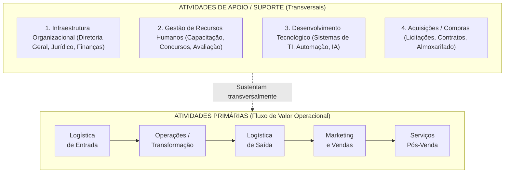
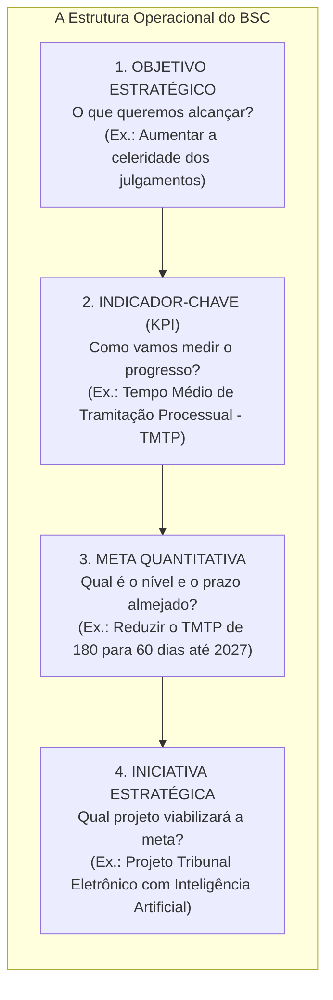
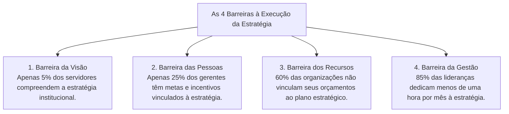

# 03 - Cadeia de Valor, Alinhamento pelo BSC e Implementação Estratégica

> **Matéria:** Administração Estratégica  
> **Cargo:** A01 – Técnico de Controle Externo – Especialidade: Técnico Administrativo  
> **Arquivo:** `03_cadeia_de_valor_bsc_e_execucao_estrategica.md`  

---

## 📌 Ementa / Itens do Edital
- A Cadeia de Valor de Michael Porter:
  - Conceito de valor e agregação de valor ao usuário/cidadão;
  - **Atividades Primárias:** Logística Interna (de entrada), Operações (transformação), Logística Externa (de saída), Marketing & Vendas e Serviços (pós-venda);
  - **Atividades de Apoio (Suporte):** Infraestrutura Organizacional, Gestão de Recursos Humanos, Desenvolvimento Tecnológico e Aquisições (compras/suprimentos);
  - A Margem da Cadeia de Valor e sua transposição para a geração de "Valor Público" nos órgãos de controle externo;
- O Balanced Scorecard (BSC) como ferramenta de alinhamento e execução estratégica:
  - Da formulação ao desdobramento da estratégia (*cascading*): alinhamento vertical e alinhamento horizontal;
  - A estrutura quádrupla operacional: Objetivos Estratégicos $\rightarrow$ Indicadores-Chave (KPIs) $\rightarrow$ Metas Quantitativas $\rightarrow$ Iniciativas Estratégicas (Planos de Ação e Projetos);
  - Indicadores de tendência (*leading indicators*) versus indicadores de resultado (*lagging indicators*);
- Implementação, Governança e Controle da Estratégia:
  - As Quatro Barreiras clássicas à execução estratégica (Robert Kaplan e David Norton): barreira da visão, das pessoas, dos recursos e da gestão;
  - O Escritório de Gestão Estratégica (EGE / PMO institucional);
  - Reuniões de Avaliação da Estratégia (RAE) e governança do Plano Estratégico do TCE-GO.

---

## 🌳 Classificação Hierárquica

```text
3. Cadeia de Valor, Desdobramento do BSC e Governança da Estratégia
├── 3.1 A Cadeia de Valor de Michael Porter
│   ├── 3.1.1 Fundamentos: Desagregação analítica das atividades organizacionais para avaliar custos e valor
│   ├── 3.1.2 Atividades Primárias (Criação física, distribuição e suporte direto):
│   │   ├── Logística de Entrada: Recebimento, controle e armazenagem de insumos
│   │   ├── Operações: Transformação e processamento final dos serviços ou produtos
│   │   ├── Logística de Saída: Distribuição, emissão e entrega dos produtos/decisões aos usuários
│   │   ├── Marketing e Vendas: Comunicação social, canais de acesso e indução do uso
│   │   └── Serviços: Suporte contínuo, atendimento de ouvidoria e monitoramento
│   ├── 3.1.3 Atividades de Apoio / Suporte (Sustentação transversal da cadeia):
│   │   ├── Infraestrutura Organizacional: Gestão geral, assessoria jurídica, planejamento e finanças
│   │   ├── Gestão de Recursos Humanos: Recrutamento, seleção, treinamento, planos de carreira e avaliação
│   │   ├── Desenvolvimento Tecnológico: P&D, sistemas de automação, softwares e inteligência artificial
│   │   └── Aquisições / Compras: Função institucional de licitar e adquirir bens e serviços
│   └── 3.1.4 Transposição para o Setor Público:
│       └── Substituição do lucro privado pela geração de Valor Público (Mark Moore)
├── 3.2 Desdobramento da Estratégia (*Cascading*) pelo BSC
│   ├── 3.2.1 Do Mapa Estratégico à Ação Cotidiana:
│   │   ├── Objetivos Estratégicos: O que deve ser alcançado em cada perspectiva
│   │   ├── Indicadores (KPIs): Métricas de aferição do avanço institucional (Leading vs. Lagging)
│   │   ├── Metas: Parâmetros numéricos com prazos de cumprimento estipulados
│   │   └── Iniciativas Estratégicas: Projetos e ações prioritárias financiados para atingir as metas
│   └── 3.2.2 Alinhamento Organizacional (*Cascading*):
│       └── Desdobramento vertical: Nível Corporativo -> Secretarias -> Diretorias -> Servidores
└── 3.3 Execução, Governança e Controle Estratégico
    ├── 3.3.1 As Quatro Barreiras à Execução da Estratégia (Kaplan e Norton):
    │   ├── Barreira da Visão: Apenas 5% dos servidores compreendem a estratégia corporativa
    │   ├── Barreira das Pessoas: Objetivos e incentivos individuais não vinculados ao plano estratégico
    │   ├── Barreira dos Recursos: Orçamento financeiro e tempo não alocados nas prioridades estratégicas
    │   └── Barreira da Gestão: A liderança gasta menos de uma hora por mês debatendo a estratégia
    ├── 3.3.2 O Escritório de Gestão Estratégica (EGE): Unidade guardiã da metodologia do BSC
    └── 3.3.3 Reuniões de Avaliação da Estratégia (RAE):
        └── Rito periódico de cúpula com painéis de bordo (Dashboards) para correção de desvios
```

---

## 📖 Resumo Teórico Aprofundado & Esquematizado

### 1. A Cadeia de Valor de Michael Porter

A **Cadeia de Valor** é uma ferramenta analítica que divide a organização em suas atividades estrategicamente relevantes para compreender o comportamento dos custos e as fontes potenciais de diferenciação:



#### Distinção Rigorosa das Atividades:
* **Atividades Primárias:** Estão diretamente envolvidas na criação física do produto ou serviço, sua distribuição aos usuários e a assistência pós-entrega:
  1. *Logística de Entrada:* Recepção, conferência, armazenagem e distribuição dos insumos necessários.
  2. *Operações:* Processamento e transformação dos insumos no serviço final entregue.
  3. *Logística de Saída:* Coleta, armazenagem e distribuição final das decisões, relatórios ou produtos aos clientes/cidadãos.
  4. *Marketing e Vendas:* Comunicação, publicidade, canais de atendimento e facilitação do acesso do cidadão.
  5. *Serviços:* Assistência técnica, treinamento de usuários, ouvidoria e suporte continuado.
* **Atividades de Apoio (Suporte):** Sustentam as atividades primárias fornecendo infraestrutura, tecnologia, pessoal e insumos adquiridos:
  1. *Infraestrutura da Organização:* Gestão geral, assessoria jurídica, contabilidade e relações institucionais.
  2. *Gestão de Recursos Humanos:* Recrutamento, seleção, capacitação e políticas remuneratórias.
  3. *Desenvolvimento Tecnológico:* Procedimentos técnicos, automação, softwares e inovação tecnológica.
  4. *Aquisições (Compras):* A função de adquirir todos os insumos, materiais e serviços terceirizados utilizados na instituição.

#### Transposição para os Órgãos Públicos de Controle (TCE-GO):
No setor público não há a "Margem de Lucro Privada". Ela é convertida no conceito de **Valor Público** (Mark Moore):
* **Atividades Primárias do TCE:** Recebimento das prestações de contas (Logística de Entrada) $\rightarrow$ Realização de auditorias e instruções processuais (Operações) $\rightarrow$ Emissão e publicação de pareceres prévios e acórdãos (Logística de Saída) $\rightarrow$ Divulgação no Portal da Transparência (Marketing/Divulgação) $\rightarrow$ Monitoramento das determinações e recomendações (Serviços de Acompanhamento).
* **Atividades de Apoio do TCE:** A gestão predial, a Escola Superior de Controle Externo, os servidores da área de TI e a comissão de contratação de compras.

---

### 2. O Desdobramento da Estratégia pelo BSC (*Cascading*)

O Balanced Scorecard só se torna efetivo quando traduz a visão de longo prazo em projetos e ações concretas, estruturadas em quatro elementos integrados:



* **Alinhamento em Cascata (*Cascading*):** Processo estruturado pelo qual o mapa estratégico corporativo é sucessivamente desdobrado para os níveis hierárquicos inferiores (secretarias, diretorias, divisões e servidores individuais), garantindo que cada colaborador saiba exatamente como seu trabalho diário contribui para a missão da organização.

---

### 3. As Quatro Barreiras à Execução da Estratégia (Kaplan e Norton)

Pesquisas clássicas revelaram que o insucesso do planejamento estratégico quase sempre reside na sua execução. Kaplan e Norton catalogaram esse fenômeno nas **Quatro Barreiras da Estratégia**:



1. **Barreira da Visão:** A estratégia fica restrita à cúpula diretiva e não é comunicada de forma acessível à base operacional.
2. **Barreira das Pessoas:** Os sistemas de avaliação e incentivo premiam rotinas burocráticas cotidianas em vez do alcance das metas estratégicas.
3. **Barreira dos Recursos:** O orçamento financeiro anual (LOA/PPA) é elaborado sem diálogo com o plano estratégico, financiando rotinas antigas e deixando as iniciativas estratégicas sem verba.
4. **Barreira da Gestão:** A liderança executiva é absorvida pelo "apagamento de incêndios" cotidianos e raramente se reúne para analisar os indicadores do plano estratégico.

---

### 4. Escritório de Gestão Estratégica (EGE) e Reuniões de Avaliação (RAE)

* **Escritório de Gestão Estratégica (EGE / PMO Estratégico):** Unidade orgânica que atua como guardiã da metodologia do BSC, responsável por coordenar a coleta de dados dos KPIs, padronizar relatórios e dar suporte metodológico aos gestores de projetos.
* **Reuniões de Avaliação da Estratégia (RAE):** Rito periódico formal em que a alta direção e os líderes de projeto se reúnem com foco exclusivo na análise do desempenho dos indicadores estratégicos (identificação de semáforos amarelos e vermelhos) para deliberação de planos de ação corretivos imediatos.

---

## 🚨 Alertas de Prova & Pegadinhas da FCC

> 🚨 **ALERTA DE PROVA / PEGADINHA FCC (COMPRAS E TI SÃO ATIVIDADES DE APOIO!):**  
> Pegadinha campeã de prova da FCC: afirmar que "a aquisição de materiais e o desenvolvimento de sistemas informatizados são atividades primárias da cadeia de valor". **FALSO!** No modelo oficial de Michael Porter, **Aquisições (Compras)** e **Desenvolvimento Tecnológico (TI)** são **Atividades de Apoio (Suporte)**, pois dão suporte transversal a todas as demais funções da entidade!

> ⭐ **IMPORTANTE (A DIFERENÇA ENTRE INDICADOR E META):**  
> Não confunda nas alternativas:  
> - O **Indicador (KPI)** é o instrumento ou fórmula de mensuração (ex.: "Índice de Acórdãos Cumpridos").  
> - A **Meta** é o valor quantitativo associado a um prazo determinado (ex.: "Alcançar 90% até dezembro de 2026").

> 🛑 **ATENÇÃO (BARREIRA DOS RECURSOS):**  
> Se a questão descrever um órgão governamental em que a alta administração traçou um plano estratégico arrojado, mas o setor de finanças e orçamento distribuiu as dotações da LOA sem qualquer vinculação aos projetos do plano, a barreira enfrentada é a **BARREIRA DOS RECURSOS**!

> 📌 **NOTA EXPLICATIVA (VALOR PÚBLICO NO CONTROLE EXTERNO):**  
> Para o Tribunal de Contas, valor público significa fiscalizar para coibir desvios, induzir a melhoria das políticas públicas de saúde e educação e assegurar que os impostos pagos pelos cidadãos retornem em serviços estatais de excelência.

---

## 🌐 Fontes Oficiais e Referências Bibliográficas

* [PORTER, Michael E. Vantagem Competitiva: criando e sustentando um desempenho superior. Editora Campus.](https://www.grupogen.com.br) - A cadeia de valor original.
* [KAPLAN, Robert S.; NORTON, David P. Organização Orientada para a Estratégia: como as empresas que adotam o BSC prosperam. Campus.](https://www.grupogen.com.br).
* [MOORE, Mark H. Criando Valor Público: gestão estratégica no governo. Harvard University Press / ENAP.](https://repositorio.enap.gov.br).
* [Tribunal de Contas da União (TCU) - Manual de Gestão Estratégica e Alinhamento Institucional](https://portal.tcu.gov.br).
* [Plano Estratégico Institucional do TCE-GO 2021-2030](https://portal.tce.go.gov.br).

---

## 📝 Questões de Concurso FCC Comentadas

### Questão 01
**(FCC – TCE-PI – Auditor de Controle Externo)**  
Segundo a teoria da Cadeia de Valor concebida por Michael Porter, as atividades organizacionais dividem-se em atividades primárias e atividades de apoio (suporte). Dentre as alternativas a seguir, assinale a que apresenta unicamente Atividades de Apoio:

* **A)** Logística de entrada, operações e logística de saída.
* **B)** Marketing e vendas, serviços pós-venda e infraestrutura da organização.
* **C)** Gestão de recursos humanos, desenvolvimento tecnológico e aquisições (compras).
* **D)** Operações fabris, compras de matéria-prima e distribuição comercial.
* **E)** Logística interna, assistência técnica a clientes e recursos humanos.

> **Gabarito: C**  
> **Comentário Detalhado:**  
> - **A) Incorreta.** Logística de entrada, operações e logística de saída são atividades primárias.  
> - **B) Incorreta.** Marketing e serviços pós-venda são atividades primárias; apenas infraestrutura é de apoio.  
> - **C) CORRETA.** No modelo de Porter, as **Atividades de Apoio (Suporte)** são compostas por quatro funções transversais que sustentam toda a organização: 1) Infraestrutura Organizacional; 2) **Gestão de Recursos Humanos**; 3) **Desenvolvimento de Tecnologia**; e 4) **Aquisições (função de compras e suprimentos)**.  
> - **D) Incorreta.** Operações fabris e distribuição (logística de saída) são atividades primárias.  
> - **E) Incorreta.** Logística interna e assistência técnica pós-venda são atividades primárias.

---

### Questão 02
**(FCC – TCE-RS – Auditor de Controle Externo)**  
No contexto do alinhamento organizacional e desdobramento da estratégia pelo Balanced Scorecard (BSC), Robert Kaplan e David Norton identificaram as principais barreiras que impedem a execução eficaz dos planos estratégicos nas instituições. A constatação empírica de que a imensa maioria dos orçamentos financeiros e dos planos anuais de compras não guarda conexão direta com as prioridades e iniciativas definidas no plano estratégico de longo prazo tipifica a:

* **A)** Barreira da visão.
* **B)** Barreira das pessoas.
* **C)** Barreira dos recursos.
* **D)** Barreira da gestão.
* **E)** Barreira cultural mecanicista.

> **Gabarito: C**  
> **Comentário Detalhado:**  
> - **A) Incorreta.** A barreira da visão traduz a incompreensão da estratégia pelos servidores da base (apenas 5% a compreendem).  
> - **B) Incorreta.** A barreira das pessoas ocorre quando os incentivos e metas individuais dos colaboradores não têm vínculo com os objetivos do plano estratégico.  
> - **C) CORRETA.** A **barreira dos recursos** decorre da desconexão entre o processo orçamentário e o plano estratégico (mais de 60% das organizações elaboram seus orçamentos sem consultar as prioridades estratégicas, inviabilizando o financiamento das novas iniciativas).  
> - **D) Incorreta.** A barreira da gestão refere-se à falta de tempo da alta liderança para avaliar periodicamente a execução da estratégia (menos de uma hora por mês em reuniões de avaliação estratégica).  
> - **E) Incorreta.** Categoria inexistente na classificação de Kaplan e Norton.

---

### Questão 03
**(FCC – TRT-2ª Região – Analista Judiciário: Área Administrativa)**  
No processo de desdobramento da estratégia corporativa pelo Balanced Scorecard (BSC), a metodologia exige a articulação harmônica de quatro componentes operacionais para garantir a efetividade da execução. A associação correta entre o componente do BSC e sua respectiva definição é:

* **A)** Objetivo Estratégico: o plano orçamentário específico que detalha a dotação de diárias dos servidores.
* **B)** Indicador-Chave (KPI): a métrica quantificável utilizada para mensurar periodicamente o nível de alcance de determinado objetivo estratégico.
* **C)** Meta: o projeto inovador financiado pela alta direção para criar novas unidades físicas.
* **D)** Iniciativa Estratégica: o valor numérico fixo que expressa o grau de incerteza do ambiente externo.
* **E)** Mapa Estratégico: o documento contábil que consolida a execução orçamentária do exercício anterior.

> **Gabarito: B**  
> **Comentário Detalhado:**  
> - **A) Incorreta.** O Objetivo Estratégico define *o que* a organização almeja alcançar em cada perspectiva do BSC, não se confundindo com plano orçamentário de diárias.  
> - **B) CORRETA.** O **Indicador-Chave de Desempenho (KPI - *Key Performance Indicator*)** é o instrumento analítico quantificável que serve de régua para monitorar continuamente o desempenho e verificar se o objetivo estratégico está sendo atingido.  
> - **C) Incorreta.** A Meta é o valor numérico temporalmente delimitado que se pretende alcançar (ex.: atingir 95% até 2026).  
> - **D) Incorreta.** A Iniciativa Estratégica é o projeto de ação concreta ou programa que viabiliza a consecução da meta.  
> - **E) Incorreta.** O Mapa Estratégico é a representação visual das relações lógicas de causa e efeito entre os objetivos das perspectivas do BSC.

---

### Questão 04
**(FCC – SEFAZ-PE – Auditor Fiscal do Tesouro Estadual)**  
No âmbito da administração pública gerencial, a aplicação da teoria da Cadeia de Valor exige a transposição dos conceitos originalmente desenhados para empresas mercantis privadas. Em um Tribunal de Contas estadual, a atividade primária correspondente ao processamento interno das fiscalizações, análise documental de contratos e elaboração de relatórios técnicos de auditoria é categorizada como:

* **A)** Infraestrutura Organizacional.
* **B)** Logística de Entrada de Insumos.
* **C)** Operações (Transformação).
* **D)** Aquisições e Suprimentos.
* **E)** Logística Externa de Distribuição.

> **Gabarito: C**  
> **Comentário Detalhado:**  
> - **A) Incorreta.** Infraestrutura organizacional é atividade de apoio transversal (administração predial, assessoria jurídica geral).  
> - **B) Incorreta.** Logística de entrada seria o recebimento e protocolo das contas dos jurisdicionados.  
> - **C) CORRETA.** As **Operações** correspondem ao processo nuclear de transformação dos insumos (dados brutos, notas fiscais e processos licitatórios) no produto técnico final do Tribunal (relatórios circunstanciados de auditoria e propostas de voto). Constitui a atividade operacional finalística precípua do órgão de controle.  
> - **D) Incorreta.** Aquisições é atividade de apoio voltada a comprar materiais para o Tribunal.  
> - **E) Incorreta.** Logística externa seria a publicação oficial dos acórdãos e notificação dos jurisdicionados.

---

### Questão 05
**(FCC – DPE-RS – Analista: Área Administrativa)**  
Com o propósito de assegurar a governança e a implementação efetiva de seu plano estratégico, determinado órgão público instituiu uma unidade permanente denominada Escritório de Gestão Estratégica (EGE) e fixou Reuniões de Avaliação da Estratégia (RAE) com periodicidade bimestral. A finalidade precípua das RAEs é:

* **A)** Realizar sindicâncias administrativas para apuração de infrações disciplinares dos analistas operacionais.
* **B)** Avaliar o desempenho dos indicadores estratégicos no painel de controle executivo e deliberar tempestivamente sobre ações corretivas para objetivos que estejam distantes das metas pactuadas.
* **C)** Redigir pareceres jurídicos conclusivos sobre recursos administrativos de servidores subalternos.
* **D)** Proceder ao inventário físico anual de bens móveis e equipamentos de informática do almoxarifado.
* **E)** Julgar as contas anuais de governo encaminhadas pelos prefeitos municipais ao parlamento.

> **Gabarito: B**  
> **Comentário Detalhado:**  
> - **A) Incorreta.** Sindicâncias disciplinares competem à Corregedoria do órgão.  
> - **B) CORRETA.** As **Reuniões de Avaliação da Estratégia (RAE)** constituem o rito máximo de governança executiva do plano estratégico: reúnem periodicamente a alta direção e os coordenadores de projetos para analisar os *dashboards* de indicadores (KPIs), identificar semáforos amarelos ou vermelhos e deliberar ajustes de rota e planos de contingência tempestivos.  
> - **C) Incorreta.** Emissão de pareceres em recursos de pessoal compete à consultoria jurídica ou área de RH.  
> - **D) Incorreta.** Inventário físico de bens é rotina da gerência de patrimônio e almoxarifado.  
> - **E) Incorreta.** O julgamento de contas municipais é competência legislativa/fiscalizatória externa do plenário.
