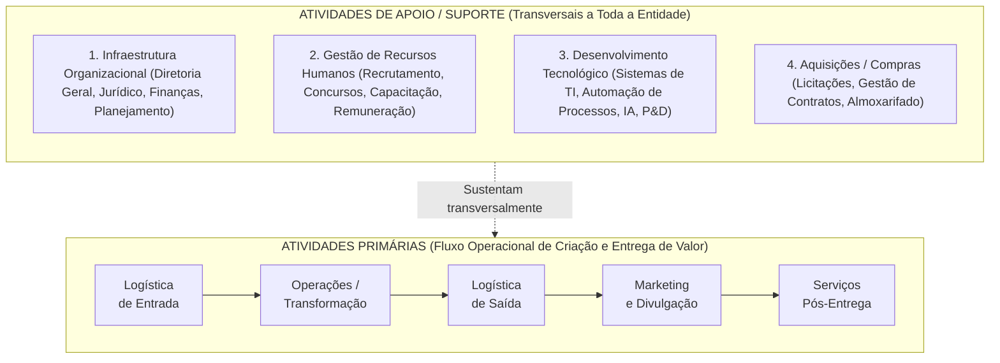
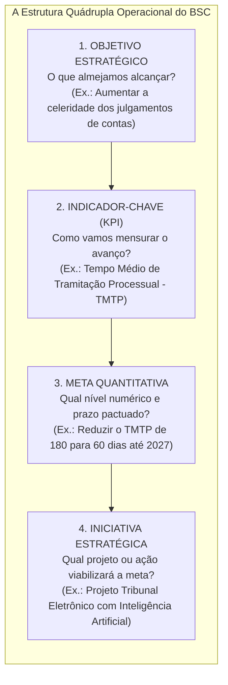
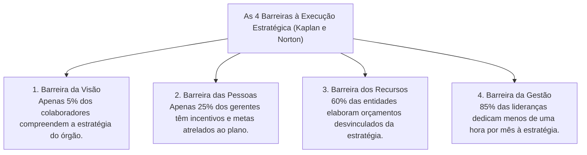

# 03 - Cadeia de Valor, Alinhamento pelo BSC e Implementação Estratégica

> **Matéria:** Administração Estratégica  
> **Cargo:** A01 – Técnico de Controle Externo – Especialidade: Técnico Administrativo  
> **Arquivo:** `03_cadeia_de_valor_bsc_e_execucao_estrategica.md`  

---

## 📌 Ementa / Itens do Edital
- A Cadeia de Valor de Michael Porter:
    - Conceito de valor e agregação de valor ao usuário/cidadão;
    - **Atividades Primárias:** Logística Interna (de entrada), Operações (transformação), Logística Externa (de saída), Marketing & Vendas e Serviços (pós-venda);
    - **Atividades de Apoio (Suporte):** Infraestrutura Organizacional, Gestão de Recursos Humanos, Desenvolvimento Tecnológico e Aquisições (compras/suprimentos);
    - A Margem da Cadeia de Valor e sua transposição para a geração de "Valor Público" nos órgãos de controle externo;
- O Balanced Scorecard (BSC) como ferramenta de alinhamento e execução estratégica:
    - Da formulação ao desdobramento da estratégia (*cascading*): alinhamento vertical e alinhamento horizontal;
    - A estrutura quádrupla operacional: Objetivos Estratégicos $\rightarrow$ Indicadores-Chave (KPIs) $\rightarrow$ Metas Quantitativas $\rightarrow$ Iniciativas Estratégicas (Planos de Ação e Projetos);
    - Indicadores de tendência (*leading indicators*) versus indicadores de resultado (*lagging indicators*);
- Implementação, Governança e Controle da Estratégia:
    - As Quatro Barreiras clássicas à execução estratégica (Robert Kaplan e David Norton): barreira da visão, das pessoas, dos recursos e da gestão;
    - O Escritório de Gestão Estratégica (EGE / PMO institucional);
    - Reuniões de Avaliação da Estratégia (RAE) e governança do Plano Estratégico do TCE-GO.

---

## 🧭 Sumário

1. [Resumo Teórico Aprofundado & Esquematizado](#resumo-teorico-aprofundado-esquematizado)
    1. [A Cadeia de Valor de Michael Porter](#1-a-cadeia-de-valor-de-michael-porter)
    2. [Teste 390](#Teste-390)
    3. [Teste 391](#Teste-391)
    4. [Teste 392](#Teste-392)
    5. [O Desdobramento da Estratégia (*Cascading*) pelo BSC](#2-o-desdobramento-da-estrategia-cascading-pelo-bsc)
    6. [Teste 393](#Teste-393)
    7. [Teste 394](#Teste-394)
    8. [As Quatro Barreiras à Execução da Estratégia (Kaplan e Norton)](#3-as-quatro-barreiras-a-execucao-da-estrategia-kaplan-e-norton)
    9. [Teste 395](#Teste-395)
    10. [Teste 396](#Teste-396)
    11. [Escritório de Gestão Estratégica (EGE) e Reuniões de Avaliação (RAE)](#4-escritorio-de-gestao-estrategica-ege-e-reunioes-de-avaliacao-rae)
    12. [Teste 397](#Teste-397)
    13. [Teste 398](#Teste-398)
    14. [Teste 399](#Teste-399)
    15. [Fontes Oficiais e Referências Bibliográficas](#5-fontes-oficiais-e-referencias-bibliograficas)

---

## 📖 Resumo Teórico Aprofundado & Esquematizado

### 1. A Cadeia de Valor de Michael Porter

Concebida por Michael Porter em 1985, a **Cadeia de Valor** é um modelo analítico que desagrega a organização em suas atividades estrategicamente relevantes para compreender o comportamento de custos e identificar fontes de diferenciação competitiva:

#### Classificação Rigorosa das Atividades:
1. **Atividades Primárias:** Estão diretamente envolvidas na criação física do produto ou serviço, sua distribuição aos usuários e a assistência pós-entrega:
    - *Logística de Entrada (Interna):* Recebimento, conferência, armazenagem e distribuição interna dos insumos necessários.
    - *Operações (Transformação):* Processamento e transformação dos insumos no serviço ou produto final entregue.
    - *Logística de Saída (Externa):* Coleta, armazenagem e distribuição final dos relatórios, acórdãos ou produtos aos clientes/cidadãos.
    - *Marketing e Vendas:* Comunicação social, canais de transparência, publicidade e estímulo ao controle social.
    - *Serviços (Pós-Venda):* Atendimento contínuo, ouvidoria, monitoramento e suporte aos usuários.

2. **Atividades de Apoio (Suporte):** Sustentam transversalmente as atividades primárias fornecendo infraestrutura institucional, pessoal, tecnologia e materiais:
    - *Infraestrutura da Organização:* Gestão geral, assessoria jurídica, planejamento orçamentário e relações institucionais.
    - *Gestão de Recursos Humanos:* Seleção pública, planos de cargos e salários, capacitação contínua e avaliação de desempenho.
    - *Desenvolvimento Tecnológico:* Procedimentos técnicos, softwares de gestão, infraestrutura de redes e inteligência artificial.
    - *Aquisições (Compras):* A função de licitar e adquirir insumos, materiais e contratação de serviços terceirizados.

---

### Teste 390
**(FCC – TCE-PI – Auditor de Controle Externo)**  
Segundo a teoria da Cadeia de Valor concebida por Michael Porter, as atividades organizacionais dividem-se em atividades primárias e atividades de apoio (suporte). Dentre as alternativas a seguir, assinale a que apresenta unicamente Atividades de Apoio:

* **A)** Logística de entrada, operações e logística de saída.
* **B)** Marketing e vendas, serviços pós-venda e infraestrutura da organização.
* **C)** Gestão de recursos humanos, desenvolvimento tecnológico e aquisições (compras).
* **D)** Operações fabris, compras de matéria-prima e distribuição comercial.
* **E)** Logística interna, assistência técnica a clientes e recursos humanos.

---

> **Comentário Detalhado:**  
>
> - **A) Incorreta.** Logística de entrada, operações e logística de saída são atividades primárias.  
> - **B) Incorreta.** Marketing e serviços pós-venda são atividades primárias; apenas infraestrutura é de apoio.  
> - **C) CORRETA.** No modelo de Porter, as **Atividades de Apoio (Suporte)** são compostas por quatro funções transversais que sustentam toda a organização: 1) Infraestrutura Organizacional; 2) **Gestão de Recursos Humanos**; 3) **Desenvolvimento de Tecnologia**; e 4) **Aquisições (função de compras e suprimentos)**.  
> - **D) Incorreta.** Operações fabris e distribuição (logística de saída) são atividades primárias.  
> - **E) Incorreta.** Logística interna e assistência técnica pós-venda são atividades primárias.  
> 
> **Gabarito: C**

---

### Teste 391
**(FCC – SEFAZ-PE – Auditor Fiscal do Tesouro Estadual)**  
No âmbito da administração pública gerencial, a aplicação da teoria da Cadeia de Valor exige a transposição dos conceitos originalmente desenhados para empresas mercantis privadas. Em um Tribunal de Contas estadual, a atividade primária correspondente ao processamento interno das fiscalizações, análise documental de contratos e elaboração de relatórios técnicos de auditoria é categorizada como:

* **A)** Infraestrutura Organizacional.
* **B)** Logística de Entrada de Insumos.
* **C)** Operações (Transformação).
* **D)** Aquisições e Suprimentos.
* **E)** Logística Externa de Distribuição.

---

> **Comentário Detalhado:**  
>
> - **A) Incorreta.** Infraestrutura organizacional é atividade de apoio transversal (administração predial, assessoria jurídica geral).  
> - **B) Incorreta.** Logística de entrada seria o recebimento e protocolo das contas dos jurisdicionados.  
> - **C) CORRETA.** As **Operações** correspondem ao processo nuclear de transformação dos insumos (dados brutos, notas fiscais e processos licitatórios) no produto técnico final do Tribunal (relatórios circunstanciados de auditoria e propostas de voto). Constitui a atividade operacional finalística precípua do órgão de controle.  
> - **D) Incorreta.** Aquisições é atividade de apoio voltada a comprar materiais para o Tribunal.  
> - **E) Incorreta.** Logística externa seria a publicação oficial dos acórdãos e notificação dos jurisdicionados.  
> 
> **Gabarito: C**

---

#### Transposição para os Órgãos Públicos de Controle (TCE-GO):
No setor público, a "Margem de Lucro Privada" é convertida no conceito fundamental de **Valor Público** (Mark Moore):

* **Atividades Primárias do TCE-GO:** Recebimento e autuação das prestações de contas municipais e estaduais (Logística de Entrada) $\rightarrow$ Análise técnica, instrução de processos e elaboração de relatórios de auditoria (Operações) $\rightarrow$ Sessões plenárias, julgamentos, publicação de acórdãos e emissão de pareceres prévios (Logística de Saída) $\rightarrow$ Divulgação ampla no Portal da Transparência e Diário Oficial (Marketing e Comunicação) $\rightarrow$ Monitoramento do cumprimento das determinações e recomendações pelos órgãos jurisdicionados (Serviços e Pós-Decisão).
* **Atividades de Apoio do TCE-GO:** A gestão predial, o departamento de TI (sistemas informatizados), o setor de compras/licitações e a Escola Superior de Controle Externo.

> 🚨 **ALERTA DE PROVA / PEGADINHA FCC (COMPRAS E TI SÃO ATIVIDADES DE APOIO!):**  
> Pegadinha campeã em concursos da FCC: afirmar que "a aquisição de materiais e o desenvolvimento de sistemas informatizados são atividades primárias da cadeia de valor". **FALSO!** No modelo oficial de Michael Porter, **Aquisições (Compras)** e **Desenvolvimento Tecnológico (TI)** são **Atividades de Apoio (Suporte)**, pois exercem papel de sustentação transversal para as atividades primárias!

> 📌 **NOTA EXPLICATIVA (VALOR PÚBLICO NO CONTROLE EXTERNO):**  
> Para o Tribunal de Contas, valor público significa fiscalizar para coibir a corrupção e os desvios, induzir a melhoria das políticas públicas de saúde e educação e assegurar que os impostos pagos pelos cidadãos retornem em serviços estatais de excelência.

---

### Teste 392
**(FCC - Adaptada / Analista de Gestão Pública)**
Na Cadeia de Valor de Michael Porter, as atividades empresariais e organizacionais são rigorosamente classificadas em Atividades Primárias e Atividades de Apoio (ou Suporte).

Constitui típica **Atividade Primária** da Cadeia de Valor:

* **A)** Logística Interna (recebimento, armazenamento e distribuição de insumos e matérias-primas).
* **B)** Gestão de Recursos Humanos (recrutamento, seleção, treinamento e remuneração).
* **C)** Desenvolvimento de Tecnologia e Pesquisa (P&D).
* **D)** Infraestrutura da Empresa (planejamento, contabilidade, finanças e assessoria jurídica).
* **E)** Aquisição / Compras de suprimentos corporativos gerais.

---

> **Comentário Detalhado:**
>
> - **A)** Correta. A Cadeia de Valor de Porter divide-se em: **Atividades Primárias** (envolvidas diretamente na criação física, venda e entrega do produto/serviço): Logística Interna, Operações, Logística Externa, Marketing/Vendas e Serviços pós-venda. As **Atividades de Apoio/Suporte** (sustentam as atividades primárias fornecendo insumos, tecnologia e infraestrutura): Infraestrutura da empresa, Gestão de RH, Desenvolvimento de Tecnologia e Aquisição/Compras.
> - **B), C), D), E)** Incorretas. São todas Atividades de Apoio / Suporte.
> 
> **Gabarito: A**

---

### 2. O Desdobramento da Estratégia (*Cascading*) pelo BSC

O Balanced Scorecard (BSC) só se converte em realidade operacional quando o mapa estratégico é desdobrado de forma descendente em iniciativas concretas:

* **Alinhamento em Cascata (*Cascading*):** Processo estruturado pelo qual os objetivos e indicadores do mapa estratégico corporativo do TCE-GO são sucessivamente desdobrados para secretarias, diretorias, divisões e planos de trabalho individuais dos auditores e analistas, assegurando que cada servidor visualize sua contribuição para o plano de longo prazo.
* **Indicadores de Tendência (*Leading Indicators*) vs. Resultado (*Lagging Indicators*):**
    - *Leading (Guias/Tendência):* Medem direcionadores de desempenho e ações intermediárias (ex.: horas de treinamento de servidores em auditoria de TI).
    - *Lagging (Ocorrência/Resultado):* Medem o desfecho final já consolidado no encerramento do exercício (ex.: índice global de processos julgados tempestivamente).

> ⭐ **IMPORTANTE (A DIFERENÇA ENTRE INDICADOR E META):**  
> Não confunda nas alternativas da FCC:  
>
> - O **Indicador (KPI)** é o instrumento ou fórmula matemática de mensuração (ex.: "Índice de Acórdãos Cumpridos").  
> - A **Meta** é o valor numérico quantificado e delimitado no tempo (ex.: "Alcançar 90% até dezembro de 2026").

---

### Teste 393
**(FCC – TRT-2ª Região – Analista Judiciário: Área Administrativa)**  
No processo de desdobramento da estratégia corporativa pelo Balanced Scorecard (BSC), a metodologia exige a articulação harmônica de quatro componentes operacionais para garantir a efetividade da execução. A associação correta entre o componente do BSC e sua respectiva definição é:

* **A)** Objetivo Estratégico: o plano orçamentário específico que detalha a dotação de diárias dos servidores.
* **B)** Indicador-Chave (KPI): a métrica quantificável utilizada para mensurar periodicamente o nível de alcance de determinado objetivo estratégico.
* **C)** Meta: o projeto inovador financiado pela alta direção para criar novas unidades físicas.
* **D)** Iniciativa Estratégica: o valor numérico fixo que expressa o grau de incerteza do ambiente externo.
* **E)** Mapa Estratégico: o documento contábil que consolida a execução orçamentária do exercício anterior.

---

> **Comentário Detalhado:**  
>
> - **A) Incorreta.** O Objetivo Estratégico define *o que* a organização almeja alcançar em cada perspectiva do BSC, não se confundindo com plano orçamentário de diárias.  
> - **B) CORRETA.** O **Indicador-Chave de Desempenho (KPI - *Key Performance Indicator*)** é o instrumento analítico quantificável que serve de régua para monitorar continuamente o desempenho e verificar se o objetivo estratégico está sendo atingido.  
> - **C) Incorreta.** A Meta é o valor numérico temporalmente delimitado que se pretende alcançar (ex.: atingir 95% até 2026).  
> - **D) Incorreta.** A Iniciativa Estratégica é o projeto de ação concreta ou programa que viabiliza a consecução da meta.  
> - **E) Incorreta.** O Mapa Estratégico é a representação visual das relações lógicas de causa e efeito entre os objetivos das perspectivas do BSC.  
> 
> **Gabarito: B**

---

### Teste 394
**(FCC - Adaptada / Auditor de Controle Externo)**
No processo de desdobramento da estratégia corporativa pelo Balanced Scorecard, a técnica denominada **Cascading** (Estratégia em Cascata) tem por objetivo central:

* **A)** Desdobrar e traduzir os objetivos, metas e indicadores corporativos do nível estratégico para os níveis tático e operacional, alinhando as diretorias setoriais, gerências e equipes individuais à estratégia mestre da organização.
* **B)** Eliminar a remuneração variável e gratificações dos servidores públicos estaduais.
* **C)** Concentrar todas as decisões de compras na presidência da comissão permanente de licitação.
* **D)** Impor a demissão periódica de 10% dos servidores com pior produtividade mecânica.
* **E)** Substituir os sistemas de gestão eletrônica de processos por formulários impressos.

---

> **Comentário Detalhado:**
>
> - **A)** Correta. O desdobramento da estratégia (*cascading*) promove o alinhamento organizacional vertical: os objetivos macro do mapa estratégico institucional são sucessivamente traduzidos em objetivos departamentais e metas operacionais para equipes e indivíduos, assegurando que o trabalho diário contribua para a estratégia corporativa.
> - **B), C), D), E)** Incorretas. Distorções que nada têm a ver com a metodologia do BSC.
> 
> **Gabarito: A**

---

### 3. As Quatro Barreiras à Execução da Estratégia (Kaplan e Norton)

Estudos clássicos conduzidos por Robert Kaplan e David Norton comprovaram que a maioria dos planos estratégicos fracassa na fase de execução prática em razão de quatro barreiras clássicas:

1. **Barreira da Visão:** A estratégia fica restrita à cúpula diretiva em linguagem hermética, não sendo comunicada de forma acessível e compreensível à base operacional.
2. **Barreira das Pessoas:** Os sistemas de avaliação funcional e incentivos premiam rotinas burocráticas cotidianas em vez do alcance das metas estratégicas pactuadas.
3. **Barreira dos Recursos:** O orçamento financeiro e a programação orçamentária anual (LOA/PPA) são elaborados sem qualquer diálogo com o plano estratégico, financiando despesas rotineiras e deixando as iniciativas estratégicas sem dotação.
4. **Barreira da Gestão:** A liderança superior é tragada pelo "apagamento de incêndios" operacionais do dia a dia e raramente dedica tempo formal para monitorar os indicadores do plano estratégico.

> 🛑 **ATENÇÃO (BARREIRA DOS RECURSOS):**  
> Se a questão da FCC narrar um órgão governamental no qual a diretoria formulou um plano estratégico moderno, mas o setor de planejamento orçamentário distribuiu os créditos da LOA sem observar os projetos do plano, a barreira enfrentada é a **BARREIRA DOS RECURSOS**!

---

### Teste 395
**(FCC – TCE-RS – Auditor de Controle Externo)**  
No contexto do alinhamento organizacional e desdobramento da estratégia pelo Balanced Scorecard (BSC), Robert Kaplan e David Norton identificaram as principais barreiras que impedem a execução eficaz dos planos estratégicos nas instituições. A constatação empírica de que a imensa maioria dos orçamentos financeiros e dos planos anuais de compras não guarda conexão direta com as prioridades e iniciativas definidas no plano estratégico de longo prazo tipifica a:

* **A)** Barreira da visão.
* **B)** Barreira das pessoas.
* **C)** Barreira dos recursos.
* **D)** Barreira da gestão.
* **E)** Barreira cultural mecanicista.

---

> **Comentário Detalhado:**  
>
> - **A) Incorreta.** A barreira da visão traduz a incompreensão da estratégia pelos servidores da base (apenas 5% a compreendem).  
> - **B) Incorreta.** A barreira das pessoas ocorre quando os incentivos e metas individuais dos colaboradores não têm vínculo com os objetivos do plano estratégico.  
> - **C) CORRETA.** A **barreira dos recursos** decorre da desconexão entre o processo orçamentário e o plano estratégico (mais de 60% das organizações elaboram seus orçamentos sem consultar as prioridades estratégicas, inviabilizando o financiamento das novas iniciativas).  
> - **D) Incorreta.** A barreira da gestão refere-se à falta de tempo da alta liderança para avaliar periodicamente a execução da estratégia (menos de uma hora por mês em reuniões de avaliação estratégica).  
> - **E) Incorreta.** Categoria inexistente na classificação de Kaplan e Norton.  
> 
> **Gabarito: C**

---

### Teste 396
**(FCC - Adaptada / Analista de Planejamento e Gestão)**
Kaplan e Norton identificaram as quatro barreiras primordiais que impedem a execução eficaz das estratégias organizacionais nas instituições.

A barreira que ocorre quando a alta direção formula a estratégia, mas não a comunica nem a torna compreensível para os servidores e colaboradores que executam os serviços cotidianos na ponta da linha é denominada:

* **A)** Barreira da Visão.
* **B)** Barreira das Pessoas.
* **C)** Barreira da Gestão.
* **D)** Barreira dos Recursos.
* **E)** Barreira Orçamentária Externa.

---

> **Comentário Detalhado:**
>
> - **A)** Correta. As **quatro barreiras de Kaplan e Norton**: (1) **Barreira da Visão**: a equipe não compreende a estratégia nem a visão (apenas uma minoria conhece o plano); (2) **Barreira das Pessoas**: metas e incentivos individuais não estão ligados à estratégia; (3) **Barreira da Gestão**: a liderança dedica tempo excessivo a problemas operacionais e pouco à estratégia; (4) **Barreira dos Recursos**: orçamentos e investimentos não são alocados aos projetos estratégicos prioritários.
> - **B), C), D), E)** Incorretas. Outras barreiras ou terminologias distintas do conceito cobrado.
> 
> **Gabarito: A**

---

### 4. Escritório de Gestão Estratégica (EGE) e Reuniões de Avaliação (RAE)

Para romper as barreiras de execução, a governança pública moderna institui estruturas e rotinas permanentes:

* **Escritório de Gestão Estratégica (EGE / PMO Estratégico):** Unidade orgânica que atua como guardiã da metodologia do BSC e do planejamento estratégico. Coordena a coleta fidedigna de dados dos KPIs, padroniza relatórios gerenciais e fornece assessoria metodológica aos gerentes de iniciativas e projetos institucionais.
* **Reuniões de Avaliação da Estratégia (RAE):** Rito periódico formal em que a alta administração e os líderes de projetos se reúnem com foco exclusivo na análise de desempenho dos indicadores nos painéis executivos (*dashboards*). A finalidade central é identificar precocemente metas ameaçadas (semáforos amarelos e vermelhos) para deliberar e pactuar planos de ação corretivos tempestivos.

---

### Teste 397
**(FCC – DPE-RS – Analista: Área Administrativa)**  
Com o propósito de assegurar a governança e a implementação efetiva de seu plano estratégico, determinado órgão público instituiu uma unidade permanente denominada Escritório de Gestão Estratégica (EGE) e fixou Reuniões de Avaliação da Estratégia (RAE) com periodicidade bimestral. A finalidade precípua das RAEs é:

* **A)** Realizar sindicâncias administrativas para apuração de infrações disciplinares dos analistas operacionais.
* **B)** Avaliar o desempenho dos indicadores estratégicos no painel de controle executivo e deliberar tempestivamente sobre ações corretivas para objetivos que estejam distantes das metas pactuadas.
* **C)** Redigir pareceres jurídicos conclusivos sobre recursos administrativos de servidores subalternos.
* **D)** Proceder ao inventário físico anual de bens móveis e equipamentos de informática do almoxarifado.
* **E)** Julgar as contas anuais de governo encaminhadas pelos prefeitos municipais ao parlamento.

---

> **Comentário Detalhado:**  
>
> - **A) Incorreta.** Sindicâncias disciplinares competem à Corregedoria do órgão.  
> - **B) CORRETA.** As **Reuniões de Avaliação da Estratégia (RAE)** constituem o rito máximo de governança executiva do plano estratégico: reúnem periodicamente a alta direção e os coordenadores de projetos para analisar os *dashboards* de indicadores (KPIs), identificar semáforos amarelos ou vermelhos e deliberar ajustes de rota e planos de contingência tempestivos.  
> - **C) Incorreta.** Emissão de pareceres em recursos de pessoal compete à consultoria jurídica ou área de RH.  
> - **D) Incorreta.** Inventário físico de bens é rotina da gerência de patrimônio e almoxarifado.  
> - **E) Incorreta.** O julgamento de contas municipais é competência legislativa/fiscalizatória externa do plenário.  
> 
> **Gabarito: B**

---

### Teste 398
**(FCC - Adaptada / TCE-PI - Auditor de Controle Externo)**
Na governança estratégica moderna dos órgãos públicos (como no TCE-GO), as **Reuniões de Avaliação da Estratégia (RAE)** desempenham papel crucial na governança executiva.

O propósito primordial das RAEs é:

* **A)** Avaliar o andamento das iniciativas e indicadores estratégicos institucionais em periodicidade definida, debatendo causas de desvios e decidindo intervenções saneadoras e alocação de recursos em alto nível.
* **B)** Realizar a apuração de faltas funcionais disciplinares individuais dos servidores para abertura de PAD.
* **C)** Fiscalizar a conformidade fiscal das declarações de imposto de renda de pessoas físicas.
* **D)** Redigir pareceres jurídicos para aprovação de editais de concurso público.
* **E)** Conceder recesso administrativo remunerado aos membros dos comitês executivos.

---

> **Comentário Detalhado:**
>
> - **A)** Correta. As **Reuniões de Avaliação da Estratégia (RAE)** reúnem periodicamente a alta administração e os líderes de projetos para revisar o mapa estratégico, analisar se os indicadores estão atingindo as metas e tomar decisões corretivas para destravar projetos estratégicos prioritários.
> - **B), C), D), E)** Incorretas. Funções corriqueiras ou disciplinares estranhas ao escopo das RAEs.
> 
> **Gabarito: A**

---

### Teste 399
**(FCC - Adaptada / TCE-GO - Analista de Controle Externo)**
No âmbito dos Tribunais de Contas, o **Escritório de Gestão Estratégica (EGE)** atua como unidade técnica de apoio à governança corporativa.

Dentre as atribuições típicas do EGE em uma corte de contas, destaca-se:

* **A)** Facilitar o processo de planejamento estratégico institucional, apoiar as áreas na definição de indicadores e metas, consolidar relatórios de desempenho e secretariar as Reuniões de Avaliação da Estratégia.
* **B)** Emitir votos de julgamento de mérito com força jurisdicional nos processos de fiscalização contábil.
* **C)** Fiscalizar in loco as obras de construção civil e realizar medições de asfalto em rodovias estaduais.
* **D)** Gerenciar a segurança armada e o policiamento ostensivo das portarias do prédio sede.
* **E)** Substituir os Conselheiros titulares do Tribunal em caso de vacância definitiva do cargo.

---

> **Comentário Detalhado:**
>
> - **A)** Correta. O **Escritório de Gestão Estratégica (EGE / PMO Estratégico)** é o guardião metodológico da estratégia do órgão: auxilia a formulação, apoia os gestores setoriais na gestão de projetos e indicadores, padroniza ferramentas (BSC, 5W2H) e alimenta a alta direção com dados consolidados para subsidiar decisões de governança.
> - **B), C), D), E)** Incorretas. Atribuições institucionais próprias dos Conselheiros, auditores fiscais ou segurança predial.
> 
> **Gabarito: A**

---

### 5. Fontes Oficiais e Referências Bibliográficas

* [Decreto nº 9.203/2017 (Monitoramento e Alinhamento Estratégico)](https://www.planalto.gov.br/ccivil_03/_ato2015-2018/2017/decreto/d9203.htm) - Disciplina o acompanhamento contínuo de resultados através de metas e indicadores de desempenho.
* [TCU - Referencial Básico de Governança: Liderança, Estratégia e Controle](https://portal.tcu.gov.br/governanca/governanca-no-tcu/) - Recomendações para construção de painéis de indicadores e Balanced Scorecard no setor público.
* [TCE-GO - Plano de Fiscalização e Monitoramento de Metas](https://portal.tce.go.gov.br/governanca-planejamento-e-gestao/planos-institucionais/plano-de-fiscalizacao) - Desdobramento de objetivos estratégicos e indicadores finalísticos de auditoria.
* [TCE-GO - Competências Institucionais do Tribunal de Contas](https://portal.tce.go.gov.br/competencias) - Acompanhamento das metas constitucionais de gestão pública.
* [Governo Digital - Estratégia Nacional de Governo Digital (ENGD)](https://www.gov.br/governodigital/pt-br/estrategias-e-governanca-digital/estrategianacional) - Indicadores de impacto e metas do ecossistema de serviços públicos.
* PORTER, Michael E. **Vantagem Competitiva: Criando e Sustentando um Desempenho Superior**. 34. ed. Rio de Janeiro: Elsevier/Campus, 1989. (Cap. 2 - A Cadeia de Valores e a Vantagem Competitiva).
* KAPLAN, Robert S.; NORTON, David P. **A Estratégia em Ação: Balanced Scorecard**. 22. ed. Rio de Janeiro: Elsevier/Campus, 1997. (Cap. 1 - Medindo o Desempenho na Era da Informação; Cap. 5 - Estabelecendo Metas e Alinhando Iniciativas).
* KAPLAN, Robert S.; NORTON, David P. **Mapas Estratégicos: Convertendo Ativos Intangíveis em Resultados Tangíveis**. 7. ed. Rio de Janeiro: Elsevier/Campus, 2004. (Cap. 1 a 3).
